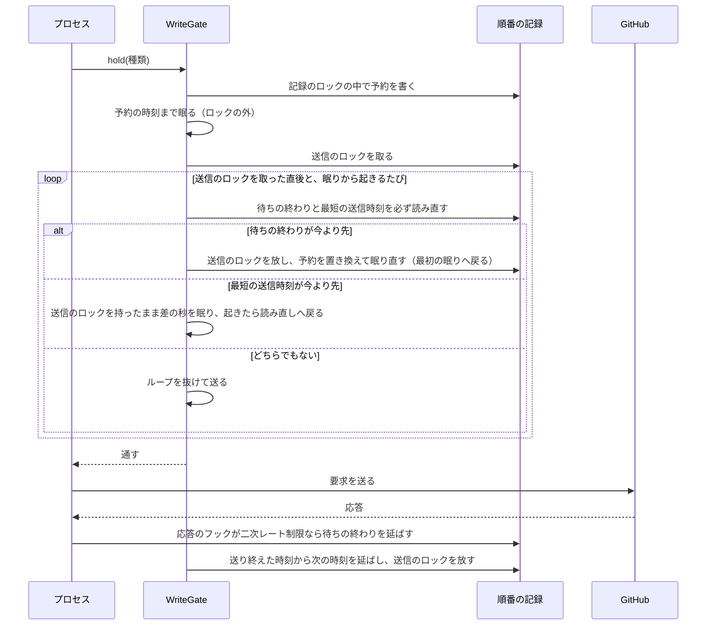

# GitHub への書き込み: 二次レート制限の内側に収まるよう、まとめて送り、マシン全体で間隔を空ける

## 概要

**NDF が GitHub へ送る書き込みは、すべて送る前にマシン全体の順番を取る。** どの書き込みも前の書き込みから 1 秒、
内容を作る書き込み（Issue・コメント・レビュー・PR の作成）は前の内容を作る書き込みから 7.2 秒（1 時間 500 件）を空ける。
二次レート制限に当たったプロセスは、待ちの終わりの時刻をマシンの 1 つの記録へ書き、ほかのプロセスの書き込みもその時刻まで待つ。

**cross-review が終わるときに PR へ書くリクエストは、付けるコミットの数まで減らす。** 行の分かる指摘は付けるコミットごとに
1 つのレビューへまとめ、この実行で直した・見送った指摘はクローズの理由を最初のコメントへ入れて返信を省く。
GitHub が待ちの秒を返さない二次レート制限の打ち直しは、60 秒・120 秒・240 秒と延ばし、4 回目の失敗で止める。

| 何を | どこを読む |
| --- | --- |
| 書き込みの順番（予約・送信のロック・待ちの終わり・待ちの予算） | [`write_gate.py`](../../plugins/ndf/src/ndf/adapters/write_gate.py) の冒頭の説明 |
| 二次レート制限の見分けと待ちの秒・応答のフック・githubkit の打ち直しの判断 | [`github_limits.py`](../../plugins/ndf/src/ndf/adapters/github_limits.py) の冒頭の説明 |
| 指摘のスレッドの書き方（レビューのまとめ・クローズの理由・PR からの復元） | [`threads.py`](../../plugins/ndf/src/ndf/domains/crossreview/threads.py) の冒頭の説明 |
| PR に残る記録の利用者向けの説明 | [`cross-review` の修正と巻き直し](../../plugins/ndf/skills/cross-review/docs/02-fix-and-rotation.md) の「終わり方」 |
| 間隔・ロック・打ち直しの値 | [上限の宣言](../../plugins/ndf/contracts/limits.json) の方針 `github.write-spacing`・`github.content-spacing`・`github.write-send-lock`・`github.pr-publish-lock`・`cross-review.secondary-rate-limit` |

コードのコメントの「決定 N」「I1〜I6」「E1〜E6」は、この文書の「決定と理由」「常に成り立つ条件」「ドメインイベント」の番号を指す。

## コンテキスト

| コンテキスト | 何の語が 1 つの意味に決まるか |
| --- | --- |
| NDF の実行の基盤 | 書き込みの順番の記録・内容を作る書き込み・待ちの終わり（GitHub への要求の数え方） |
| NDF の cross-review | 指摘のスレッド・記録のコメント（PR へ何を書くか） |

cross-review は実行の基盤の書き込みの順番を使う側で、順番の決め方を知らない（顧客と供給者の関係。供給者は実行の基盤）。

## 用語

語の定義は用語集の [NDF の実行の基盤](../glossary/ndf-durable.md) が持つ（書き込みの順番の記録・内容を作る書き込み・
二次レート制限）。この文書だけで使う語は次のとおり。

| 用語 | 意味 |
| --- | --- |
| 待ちの終わり | 二次レート制限の後、どのプロセスも書き込みを送らない時刻（記録の `blocked_until`） |
| 予約 | 書き込みを送ってよい時刻。記録のロックの中で決めて記録へ書く |
| 最短の送信時刻 | 前の書き込みを送り終えた時刻 + 間隔。予約とは別に持つ（記録の `sent_next`・`sent_next_content`） |
| 待ちの予算 | 呼び手が待ちに使える残りの秒（`client(remaining=...)`。CI の監視が渡す） |
| 指摘の発生の値 | 指摘を初めて記録したとき・再発したときに作る 12 字の値（`occurrence`）。番号は使い回されるため、スレッドは番号とこの値の両方で指摘に結び付ける |
| 記録のコメント | cross-review が PR に書く実行の記録（指摘の表・注意）。指摘のスレッドとは別の書き込み。同じ状態ファイルに投稿済みの URL（`report_decide.COMMENT_KEY`）があればそのコメントを書き換え、無ければ新しく書く（PR の既存のコメントは探さない） |

## 背景

cross-review は終わるときに、収束の妨げになる重さの指摘 1 件ごとにスレッドを作り、返信し、resolve していた（1 件あたり
3 回の書き込み）。間隔は同じプロセスの中でスレッドを作るときの 1 秒だけで、並列のレーンはすべて同じアカウントで書く。
1 分に 40 件を超える書き込みの後、同じアカウントで GitHub が `You have exceeded a secondary rate limit and have been
temporarily blocked from content creation` を返し、すべてのレーンが PR・Issue・コメントを書けなくなった。

GitHub の文書（下の「外部連携」）は、内容を作るリクエストをおおむね 1 分 80 件・1 時間 500 件とし、書き込みは並列にせず
順に送って間を 1 秒以上空け、当たったら `retry-after` → `x-ratelimit-reset` → 1 分以上の順で待ち、続けば指数的に延ばすよう
求める。ブロックが続く長さと残りの量は公開されていない。間隔の既定は、数えられる上限のうち厳しい 1 時間 500 件から決める。

## 対象範囲

含む:

- NDF が `adapters/github.py` の `client()` を通して送るすべての書き込み（cross-review・Issue の起票・PR のコメント・
  リリース・マージキュー）。`client()` は githubkit の `Client` を作る唯一のエントリポイントで、`transport` を渡さない限り
  マシンの `WriteGate` を付ける
- cross-review の終わりの指摘のスレッドの書き方と、二次レート制限の打ち直し

含まない:

- 読み取りの削減（条件付きのリクエスト）。読み取りは順番を取らず、待ちの終わりでも止めない
- エージェントが NDF を通さずに打つ `gh` のコマンド。NDF のコードを通らないので数えない
- 別のマシン・別のコンテナで同じアカウントが書く分。共有の範囲は同じ OS のユーザーで動く NDF のプロセスすべてである

## 決定と理由

| # | 決定 | 理由 |
| --- | --- | --- |
| 1 | 間隔を githubkit の throttler（`BaseThrottler` を継いだ `WriteGate`）に置き、マシンに 1 つの記録を filelock で守る。記録のパスは `pwd` で引いたホームから作り、`NDF_STATE_HOME`・`XDG_STATE_HOME`・`HOME` を読まない | すべての書き込みが 1 か所を通り、書く関数ごとに包む漏れが出ない。環境変数で保存先が変わると、同じ OS のユーザーの NDF が別々に予約する。pyrate-limiter（窓の中の回数で、間隔と待ちの終わりの共有を持たない）と Redis（サーバーが要る）は採らない |
| 2 | 予約は記録のロックの中で決めて書き、ロックを放してから眠る。時刻は壁時計で比べる | ロックを持ったまま 7.2 秒ずつ並ぶと、後ろのプロセスがロックの待ちの上限に当たる。プロセスをまたいで比べるには壁時計が要る |
| 3 | 書き込みを 2 種類に分ける。REST の POST と GraphQL の `create`・`add` で始まる mutation を内容を作る書き込みとして 7.2 秒、ほかの書き込み（PATCH・PUT・DELETE・resolve などの mutation）は 1 秒 | すべてに 7.2 秒を当てると resolve とラベルの付け替えも並び、cross-review の終わりが指摘の数 × 7.2 秒延びる。内容を作るエンドポイントの一覧は GitHub が公開しておらず古くなる |
| 4 | 行の分かる指摘を、指摘のラウンドの head のコミットごとに 1 つのレビュー（`POST /pulls/{n}/reviews`・`event: COMMENT`）で書く。ファイルに付ける指摘は 1 件ずつ書く | レビューは 1 つのコミットにしか付けられず、別のコミットに付けると行がずれる。レビューの `comments[]` は `subject_type` を持たない |
| 5 | レビューが行の位置の 422 で断られた組だけを 1 件ずつの書き込みへ落とす。スパムの判定・二次レート制限・原因の分からない 422 は展開せず、組の指摘ごとに注意へ残す | 書き込みを抑えるべき応答へ、指摘の数の倍まで要求を足さない。どの指摘が断られたかを GitHub は返さない |
| 6 | この実行でクローズした指摘は、クローズの理由を最初のコメントへ入れて返信を省く。前の実行のスレッドを持つ指摘をクローズしたときだけ返信する | 返信を残すと、指摘 1 件ごとに内容を作る書き込みが 1 回（7.2 秒）残る |
| 7 | 二次レート制限の待ちの終わりを書き込みの順番の記録で共有する | 当たったプロセスだけが待つと、ほかのレーンが打ち続けて BAN に近づく |
| 8 | 二次レート制限の見分けと待ちの秒を `github_limits.limit_of` の 1 か所で決め、GitHub が待ちの秒を示したか（`hinted`）を `GitHubError` に持たせる。示さなければ指数的に延ばす | githubkit は `retry-after` の無い待ちを 60 秒で埋めるため、そのままでは有無を見分けられない。`retry_after` を None にすると、`retry_after is not None` を上限と読む呼び手の分け方が変わる |
| 9 | resolve は 1 件ずつ送る | 別名で 1 つの要求にまとめると、一部だけ断られたときの読み分けが要る。1 件ずつでも指摘 20 件で約 20 秒に収まる |
| 10 | 待ちの予算を持つ呼び手は、順番の待ち（ロックの待ち・眠り）も予算に数え、収まらなければ送らずに `write_gate.Busy` を出す | 予算を越えて眠ると `RetryWithin` の契約を破り、順番を取らずに送るとほかのレーンの間隔と待ちの終わりを破る |

代償:

- 読み取りを除くすべての書き込みが、ほかのレーンの書き込みの分だけ待つ。6 つのレーンが同時に内容を作ると、最後は約 36 秒待つ。
  二次レート制限の後は、待ちの終わりまで（最大 600 秒）どのレーンも書かない
- 同じマシンで別のアカウントが書く分も同じ記録で数える（数え過ぎる側に倒れる）。ラベルを足す POST など、内容を作らない
  POST も 7.2 秒を待つ
- 予約の後にプロセスが落ちると、その予約の分だけほかの書き込みが待つ（最大 7.2 秒）。時刻が過ぎれば効かない

## 仕様

### 構成要素

| 要素 | 責務 |
| --- | --- |
| `write_gate.WriteGate` | githubkit の throttler。書き込みの要求を送る前にマシン全体の順番を取り、送り終えた時刻を記録する。待ちの終わりを受け取って記録する（`block`） |
| `write_gate.write_of` | `httpx.Request` を、読み取り（None）か、書き込みの種類（`WRITE`・`CONTENT`）と件数（`Writes`）に分ける |
| `write_gate.Within` | `WriteGate.within(remaining)` が返す throttler。同じ記録を使い、どの待ちも呼び手の予算に収める |
| `write_gate.pr_lock` | 同じ PR の公開のロック |
| `github_limits` | 二次レート制限の見分け（`limit_of`）・拒否の理由の全文（`reasons_of`）・応答のフック（`watcher`）・githubkit の打ち直しの判断（`RetryWithin`）・失敗の `GitHubError` への変換（`failure_of`） |
| `github.client`・`GitHub` | `Client` に `WriteGate` と応答のフックを付ける。`GitHub.gate` は省けば `Client` の throttler の `WriteGate` を使う。失敗は `GitHubError`（`secondary`・`hinted`・`reasons` を持つ）で返す |
| `threads.sync`・`GitHubPort` | 行の分かる指摘をコミットごとのレビューで書き、クローズの理由を最初のコメントへ入れる。書く前に PR からスレッドの記録を戻す |
| `threads.patient`・`throttle_decide.wait_before_retry` | 二次レート制限の打ち直し。待つ前に待ちの秒を `WriteGate.block` へ知らせる |
| `journal` | 指摘の発生の値を書く（新しい指摘・再発・前のバージョンの指摘の補完） |
| `crossreview.cli._post_report` | 同じ PR の公開のロックの中で、状態ファイルの読み取りから記録のコメントと保存までを行う |

依存の向き: `crossreview/cli.py` → `adapters/write_gate.py`・`adapters/github.py`、`adapters/github.py` →
`adapters/github_limits.py` → `adapters/write_gate.py` → `slot_pool`・`filelock`・`githubkit.throttling`。
`threads.py` と `throttle_decide.py` は adapters を import せず、待ちの終わりを知らせる関数（`block`）を引数で受ける。

### 集約

| 集約 | オーナー（書き換えてよいもの） | 根 | 値オブジェクト |
| --- | --- | --- | --- |
| 書き込みの順番の記録 | `WriteGate`（記録のロックの中でだけ書く） | 記録のファイル（OS のユーザーに 1 つ） | 次の書き込みの時刻・次の内容を作る書き込みの時刻・最短の送信時刻（2 種類）・待ちの終わり・最後に書いた壁時計の時刻 |
| 指摘のスレッドの記録 | `threads.sync`（cross-review の状態ファイルの `threads`。同じ PR の公開のロックの中でだけ書く） | 状態ファイル（PR ごと） | 指摘の番号ごとの最初のコメントの id・返信済み・resolve 済み。指摘の側の発生の値（`journal` が書く） |

### 常に成り立つ条件

| # | 集約 | 条件 | 破れたときの扱い |
| --- | --- | --- | --- |
| I1 | 書き込みの順番の記録 | 続く 2 つの書き込みの予約の差は `github.write-spacing` の秒以上 | 予約は記録のロックの中で前の予約から計算する。ロックを取れなければ I5 |
| I2 | 書き込みの順番の記録 | 続く 2 つの内容を作る書き込みの予約の差は `github.content-spacing` の秒以上 | I1 と同じ |
| I3 | 書き込みの順番の記録 | 待ちの終わりより前に、書き込みを予約しない・送らない | 予約の後に待ちの終わりが延びたら、送る直前の読み直しで予約を置き換える |
| I4 | 指摘のスレッドの記録 | 同じ指摘の発生について、スレッド・返信・resolve をそれぞれ 2 回書かない。別の発生のスレッドを結び付けない | 同じ PR の公開のロックの中で、書く前に PR のスレッドと返信を読み、自分が書いた最初のコメントの番号と発生の値が同じなら、書かずに記録を PR から戻す |
| I5 | 書き込みの順番の記録 | 記録を読めない・ロックを取れないときも、書き込みを止めない | プロセスの中の記録で間隔を空けて送り、標準エラーと実行の記録へ 1 行を出す。記録へ書けなかった変更は、書けるようになったら記録へ重ねる |
| I6 | 書き込みの順番の記録 | 2 つの書き込みを同時に送らない。前の書き込みを送り終えてから間隔より前に次を送らない | 送信のロックを応答まで持ち、送り終えた時刻から次の時刻と最短の送信時刻を延ばす |

### ドメインイベント

| # | イベント | 発生元 | 受け手 |
| --- | --- | --- | --- |
| E1 | cross-review の実行が終わった | `cli._post_report`（`finish`・`report`） | `threads.sync` |
| E2 | 指摘をコミットごとのレビューにまとめて書いた | `threads.sync` | 指摘のスレッドの記録 |
| E3 | 前の実行のスレッドへ返信した | `threads.sync` | 指摘のスレッドの記録 |
| E4 | クローズした指摘のスレッドを resolve した | `threads.sync` | 指摘のスレッドの記録 |
| E5 | 二次レート制限に当たった | 応答のフック（`watcher`）・`RetryWithin`・`GitHub` の `_translating`・`threads.patient` | 書き込みの順番の記録（待ちの終わり） |
| E6 | 書き込みの順番を取った | `WriteGate.hold` | 書き込みの順番の記録 |

### 書き込みの分け方

| 要求 | 種類 |
| --- | --- |
| `GET`・`HEAD` | 読み取り（順番を取らない） |
| `PATCH`・`PUT`・`DELETE` | `WRITE`（1 秒） |
| `/graphql` 以外への `POST` | `CONTENT`（7.2 秒） |
| `/graphql` への `POST` で、本文の `query` が `mutation` で始まらない | 読み取り |
| 同じく mutation で、最初のフィールドの名前が `create`・`add` で始まるか、最初のフィールドを読めない | `CONTENT` |
| 同じく mutation で、ほかの名前（`resolveReviewThread` など） | `WRITE` |
| `/graphql` への `POST` で、本文が JSON でない・`query` が文字列でない | `WRITE` |

`query` は文字列・ブロック文字列・`#` のコメントを読み飛ばし、別名（`a: field`）は元のフィールドの名前で読む。件数は
いつも 1 で、分けた結果は要求の `extensions` の `ndf.writes` に残し、応答のフックが同じ要求を分け直さない。

### 処理の流れ: 書き込みの順番を取る



- 最短の送信時刻まで眠った後は、送信のロックを持ったまま記録を読み直す（`WriteGate._settle` が眠りから戻るたびに `_peek`）。
  その間に別のプロセスが二次レート制限で待ちの終わりを延ばしていれば、`_sendable` が送信のロックを放して予約を取り直す。
  延びた待ちの終わりより先には送らない
- 予約の時刻は `max(今, 次の書き込みの時刻, 待ちの終わり)`、内容を作る書き込みはさらに次の内容を作る書き込みの時刻との
  大きいほう。予約を書くと、次の書き込みの時刻は予約 + 1 秒、内容を作る書き込みなら次の内容を作る書き込みの時刻も予約 + 7.2 秒になる
- 予約を置き換えるときは、同じ記録のロックの中で前の予約を戻してから決める。戻すのは記録の時刻が前の予約の書いた値のままの
  ときだけで、後ろに別の予約があれば戻さない
- 送り終えたら（応答でも失敗でも）、次の時刻と最短の送信時刻を `max(今の値, 送り終えた時刻 + 間隔)` へ延ばす
- 応答のフックは httpx が応答を返す前（送信のロックを放す前）に動くので、後に続く書き込みは延びた待ちの終わりを読む。
  本文を読むのは REST の 403・429 と、順番を取った GraphQL の mutation の HTTP 200 だけである
- 記録の時刻が今より `CLOCK_SLACK`（1 秒）を越えて先に書かれていたら、壁時計が戻ったとみなし、戻った秒だけ記録のすべての
  時刻を手前へずらす（待ちの終わりの残りの長さは保つ）。予約や待ちの終わりの長さでは記録を捨てない
- 非同期の経路（`async_acquire`）は同じ手順をイベントループの外で進め、送信のロックを持つ手順は専用のスレッドで進める

### 待ちの予算を持つ書き込み（決定 10）

`client(remaining=...)` を渡すと、throttler は `gate.within(remaining)` になる。

`remaining` を省いた（通常の）クライアントの既定:

- `RetryWithin` は残りを 0 秒（`github_limits.no_wait`）として受ける。githubkit が眠る上限の待ち（一次も二次も）は打ち直さず、
  すぐ `GitHubError` の `retry_after` で返す。githubkit の既定のように解除の時刻（一次の上限なら最大 1 時間）まで眠ると、
  `GitHub.pulls`・`GitHub.pull` のスロットの読み替えの前に止まるため
- `WriteGate` には予算を付けない（throttler は `gate` そのもの）。順番の待ち（ロックの待ちは上限まで・予約と最短の送信時刻までの
  眠り）は `Busy` を出さずに待ち切る

- どのロックの待ちも、取りに行く時点の `remaining()` と上限（記録のロックは 10 秒、送信のロックは `github.write-send-lock`）の
  小さいほうで縛る。待つ前に `remaining()` が 0 以下ならロックを待たずに `Busy(0)` を出す
- 予約までの秒・最短の送信時刻までの秒が `remaining()` 以上なら `Busy` を出す（等しいときも出す。待ち終えた時点で残りが 0 になるため）。
  送る直前にも `remaining()` を読み、0 以下なら送らない
- 予約を書いた後の `Busy` は、送信のロックを放し、`withdraw` で予約を取り消してから出す。`withdraw` は記録のロックを待たずに
  試し、取れなければ予約を残す（時刻が過ぎれば効かない）
- 予算で縛ったロックの時間切れは `Busy` にし、I5（ロックを持たずに送る）へ落とさない
- `GitHub` は `Busy` を `GitHubError`（`retry_after` に待ちの秒）へ変換する。呼び手は上限の待ちが予算を越えたときと同じ経路で扱う

### 二次レート制限の見分けと待ち（決定 7・8）

`github_limits.limit_of` が、二次レート制限なら待ちの秒と `hinted` を返す。

| 応答 | 二次レート制限とみなす条件 |
| --- | --- |
| REST の 403・429 | githubkit が `SecondaryRateLimitExceeded` にしたか、数の `retry-after` があるか、本文の `message` が `secondary rate` を含む（一次の残量が正で `retry-after` の無い通常の `RequestFailed` も） |
| GraphQL の HTTP 200 の誤り | 誤りの `message` が `secondary rate limit` か `submitted too quickly` を含む（`GraphQLFailed` と、githubkit が `RATE_LIMITED` から作る `PrimaryRateLimitExceeded` の両方） |

| ヘッダー | 待ちの秒 | `hinted` |
| --- | --- | --- |
| `retry-after` がある | その秒（0 秒なら githubkit が眠る 60 秒） | 真 |
| `retry-after` が無く、`x-ratelimit-remaining` が `0` で `x-ratelimit-reset` がある | reset までの秒 | 真 |
| どちらでもない（`x-ratelimit-reset` だけのときも） | `cross-review.secondary-rate-limit` の 1 回目の待ち（60 秒） | 偽 |

- `x-ratelimit-reset` だけでは `hinted` を真にしない。GitHub は一次の上限の情報としてほぼすべての応答に付ける
- 待ちの終わりは、応答のフック・`RetryWithin`（打ち直すかに依らず、最後の試行でも）・`_translating`・`patient` が知らせる。
  同じ応答について知らせた秒は応答の `extensions` の `ndf.blocked` に残し、それより長い待ちのときだけ知らせ直す
- `RetryWithin` は `hinted` が偽なら打ち直しの回数で延ばした秒（`routing.backoff`）を知らせる。githubkit が実際に眠る秒が
  `remaining()` を越える上限（一次も二次も）は打ち直さず、`GitHubError` の `retry_after` で返す
- `GitHub.pulls`・`GitHub.pull` は、一次の上限のときだけ別のスロット（REST と GraphQL）で読み替え、二次レート制限では読み替えない
- `threads.patient` は `secondary` が真の失敗だけを打ち直す。待ちは `hinted` なら `retry_after`、偽なら
  `interval × factor^(回数 - 1)`（`max_interval` で頭打ち）で、60・120・240 秒の後、4 回目の失敗で例外を出す

### 指摘のスレッドを書く（決定 4・5・6・9）

`cli._post_report` は `hub_of()` の後に同じ PR の公開のロックを取り、その中で状態ファイルを読み、発生の値の無い指摘
（前のバージョンの指摘）へ値を書いて保存してから、`threads.sync` を次の順で行う。

0. 扱う指摘のどれにも書くこと（スレッドが無い、または閉じたのに返信か resolve が済んでいない。`_pending`）が無ければ、
   PR を読まずに何もせず終える（指摘の無いレビュー・すべてを公開済みの打ち直しで、変更ファイルとスレッドの一覧を読まない）
1. PR の変更ファイルを 1 回読む。場所の分からない指摘・差分に無いファイルの指摘はスレッドにしない（記録のコメントの表に載る）
2. PR のスレッドを 1 回読む（最初のコメントと、最後の 20 件の返信）。記録の無い指摘は、今の認証の login が書いた最初のコメントの
   番号と発生の値の両方が同じなら、書かずに記録を PR から戻す（`restored`）。記録に最初のコメントの id がある指摘は、同じ id の
   スレッドの resolve の状態と、今の login が書いた返信で記録を更新する（`refreshed`。作成者の確かめ方は下の表）
3. 前の実行のスレッドを持ち、この実行でクローズした指摘で、返信済みでないものへ返信する
4. 記録の無い、行の分かる指摘を付けるコミットごとに組にし、組ごとに 1 つのレビューを送る。クローズした指摘の本文には
   クローズの理由を入れる。本文はすべて 1 回の `Publisher.guarded` に通す
5. 行の分からない指摘と、行の位置の 422 で断られた組の指摘を、1 件ずつ書く（行 → ファイルへの付け直しは行の位置の 422 のときだけ）
6. レビューを 1 つでも作ったら PR のスレッドを 1 回読み直し、番号と発生の値でレビューの指摘の記録を埋める
   （レビューの応答は作ったコメントの id を持たない）。この読み取りが resolve に要るスレッドの id もそろえる
7. クローズした指摘のうち、クローズの理由が PR に載ったもの（返信済み）だけを 1 件ずつ resolve する。返信に失敗したスレッドは
   開いたまま残し、次の実行の手順 3 で返信し直す

最初のコメントの形:

```text
<!-- ndf:cross-review-report -->
<!-- ndf-occurrence: <発生の値> -->
**cross-review の指摘 <番号>**（<相手役>・ラウンド <N>・<重さ>）

<指摘の本文>

**この実行で閉じた**

直した（修正のコミット <9 字>） | 見送った: <理由>
```

1 行目は記録のマーカー（`report_decide.MARKER`。`ndf` の部分はエントリポイントの名前）である。最後の 2 段落はクローズした指摘だけが持つ。返信の本文はクローズの理由と発生の値の行を持つ。レビュー本体の `body`
（`event: COMMENT` で GitHub が必須とする）は `MARKER` で始まり、行の指摘の件数だけを書く。

422 の拒否の判定は `GitHubError.reasons`（応答の本文の `message` と `errors[]` のすべて。表示用に 300 字へ切り詰める前のもの）で行う。

| 判定 | 条件 |
| --- | --- |
| 行の位置で断られた（`position_refused`） | 422 で、理由のどれかが `must be part of the diff`・`could not be resolved`・`diff_hunk`・`line must be` を含み、どれも `too quickly`・`rate limit`・`spam` を含まない |
| そのコミットでパスを解決できない（`path_unresolved`） | 422 で、理由のどれかが `could not be resolved` を含み、どれも上の拒否の語を含まない。PR の今の head のコミットで付け直す |

同じ PR の公開のロックがあるため、同じ状態ファイルから同じ PR へ `finish` と `report` が並んでも、後から取ったほうは先に保存された
スレッドの記録を読んで書かない。記録のコメントも、先に保存された投稿済みの URL があるときだけ同じコメントを書き換える。
`cli._publish` は URL が無ければ新しく投稿し、PR 上の既存の記録のコメントを探さないので、別の `--state-dir` で同じ PR を
レビューしたとき・初回の投稿の後で URL を保存する前に落ちて `report` を打ち直したときは、記録のコメントがもう 1 つ増える。

自分が書いたかは、GraphQL の `viewer` で 1 回だけ読んだ今の認証の login で決める。確かめ方は 2 つに分かれる。

| 確かめ方 | 作成者を見るか | 使う場所 |
| --- | --- | --- |
| スレッドを指摘へ結び付ける | 状態ファイルに最初のコメントの id がある指摘は見ない。`_Sync.match` が同じ id のスレッドへ結び付ける（`refreshed`）。id の無い指摘は、最初のコメントの書き手が今の login で、番号と発生の値が同じスレッドだけへ結び付ける（`restored`） | `refreshed`・`restored` |
| 保存していない返信済みの状態を PR から戻す | 見る。`GitHubPort.open_threads` は、最初のコメントの書き手が今の login のスレッドからだけ、今の login が書いた返信を集める（`Thread.replies`）。ほかの人の返信・ほかの書き手のスレッドの返信は、発生の値の行を持っていても返信済みに数えない | `refreshed`・`restored` の両方 |

- id を持つ指摘は、認証の login を替えた後も同じ状態ファイルからなら前のスレッドへ返信し resolve する。ただし前の login が
  書いた返信は返信済みに数えないので、状態ファイルに `replied` が保存されていなければ今の login でもう一度返信する
- id の無い指摘は、認証先の login が前の実行と違うと前の実行のスレッドを戻さず、新しく書く（ほかの人の同じ形のコメントを拾わない
  側に倒す）。同じ login のまま token だけを替えたときは戻す

## データ・設定

書き込みの順番の記録（`write_gate.gate_path()`）:

| 項目 | 値 |
| --- | --- |
| パス | `<OS のユーザーのホーム>/.local/state/ndf-github/write-gate.json`。ホームは `pwd.getpwuid(os.getuid())` で引く |
| passwd に無い UID | `/tmp/ndf-github-<UID>` の下（オーナーが同じ UID で 0700 のときだけ）。使えなければプロセスだけが使う一時ディレクトリ |
| 形 | `{"version": 1, "next", "next_content", "sent_next", "sent_next_content", "blocked_until", "written_at"}`（どれも UNIX 時刻の秒） |
| 記録のロック | 同じディレクトリの `write-gate.json.lock`。待つ上限は 10 秒（`LOCK_SECONDS`） |
| 送信のロック | 同じディレクトリの `write-gate.send.lock` |
| 同じ PR の公開のロック | 同じディレクトリの `pr/<所有者>__<名前>__<番号>.lock`（リポジトリ名は小文字にそろえる） |

ロックは取るたびに `slot_pool.lock` で別の `FileLock` を作る。1 つの `FileLock` をスレッドで共有すると、別のスレッドの取得が
再入として通る。カーネルのロックなので、ロックを持つプロセスが消えると解ける。

上限の宣言（`contracts/limits.json`）:

| 方針 | 値 | 意味 |
| --- | --- | --- |
| `github.write-spacing` | `interval` 1 | どの書き込みも前の書き込みから空ける秒 |
| `github.content-spacing` | `interval` 7.2 | 内容を作る書き込みを前の内容を作る書き込みから空ける秒（3,600 秒 ÷ 500 件） |
| `github.write-send-lock` | `lock` 60 | 送信のロックを待つ上限の秒。越えたらロックを持たずに送る（I5） |
| `github.pr-publish-lock` | `lock` 900 | 同じ PR の公開のロックを待つ上限の秒。指摘 100 件の公開が 7.2 秒ずつ並んでも収まる |
| `cross-review.secondary-rate-limit` | `attempts` 4・`interval` 60・`factor` 2・`max_interval` 600 | 二次レート制限の打ち直しの回数と、GitHub が待ちの秒を返さないときの待ち |

間隔の値は GitHub のアカウントの上限から決めるので、プロジェクトの設定では変えない。

cross-review の状態ファイル: 指摘（`findings[]`）は発生の値 `occurrence`（`uuid4` の 16 進の先頭 12 字）を持つ。`threads` の
形（指摘の番号 → `comment`・`replied`・`resolved`）は変わらない。前のバージョンの状態ファイルはそのまま読め、発生の値の無い指摘には
公開の前に値を書く。本文に発生の値の無い前のバージョンのスレッドからは記録を戻さず、新しく書く。

## 外部連携

| 相手 | 使う要求 |
| --- | --- |
| GitHub REST | `POST /repos/{o}/{r}/pulls/{n}/reviews`（`commit_id`・`event: COMMENT`・`body`・`comments[]` の `path`・`line`・`side: RIGHT`・`body`）、`POST .../pulls/{n}/comments`（1 件ずつ。行か `subject_type: file`）、`POST .../pulls/{n}/comments/{id}/replies`、`GET .../pulls/{n}/files`、`GET .../pulls/{n}` |
| GitHub GraphQL | `reviewThreads`（`comments(first:1)` と `replies: comments(last:20)`）、`resolveReviewThread`、`viewer{login}` |
| githubkit 0.17.1 | `BaseThrottler`（要求を送る前にだけ呼ばれ、打ち直しのたびに通る）・`auto_retry` の判断の関数・httpx の応答のフック |

GitHub の文書:

- [Best practices for using the REST API](https://docs.github.com/en/rest/using-the-rest-api/best-practices-for-using-the-rest-api) —
  書き込みを順に送り間を 1 秒以上空ける・当たったときの待ち方
- [Rate limits for the REST API](https://docs.github.com/en/rest/using-the-rest-api/rate-limits-for-the-rest-api) —
  内容を作るリクエストの上限・二次レート制限
- [Create a review for a pull request](https://docs.github.com/en/rest/pulls/reviews?apiVersion=2022-11-28#create-a-review-for-a-pull-request) —
  `comments[]` が `subject_type` を持たないこと・応答が作ったコメントの id を持たないこと

書き込みを 1 か所で順に並べ、種類で間隔を変える形は Octokit の `@octokit/plugin-throttling`（書き込みを同時 1 本・間 1,000 ms）に倣った。

## エラー処理

| 場所 | 失敗 | 扱い |
| --- | --- | --- |
| `WriteGate` | 記録のロックを 10 秒取れない・記録を読めない（`OSError`） | プロセスの中の記録で間隔を空けて送る（I5）。`書き込みの順番の記録のロックを取れない: <パス>` などの 1 行を出す |
| `WriteGate` | 記録が壊れた JSON・形が違う | 空の記録として読み、書き直す |
| `WriteGate` | 送信のロックを `github.write-send-lock` の秒まで取れない | 送信のロックを持たずに送る（I5）。`書き込みの送信のロックを取れない: <パス>` |
| `WriteGate`（予算あり） | 待ちが予算に収まらない | 送らずに `Busy`。予約を書いた後なら取り消す。`GitHubError(retry_after=待ちの秒)` へ変換される |
| `WriteGate` | 眠りの途中で中断された | 呼び出し元へ返す。予約は残り、ほかの書き込みが最大 7.2 秒待つ |
| `threads.sync` | 書く前にスレッド・変更ファイルを読めない | 何も書かずに注意へ残す（読めないまま書くと、保存の前に落ちた打ち直しで二重に作る） |
| `threads.sync` | レビューの作成が行の位置以外の理由で失敗した | 組の指摘ごとに注意へ残し、ほかの組を続ける |
| `threads.sync` | 作った後のスレッドを読めない・指摘が見つからない | 記録を埋めずに注意へ残し、resolve を打たない。打ち直しは書く前の読み取りで戻す |
| `threads.sync` | 返信・resolve の失敗 | 指摘ごとに注意へ残す。返信できなかったスレッドは resolve しない |
| `_post_report` | 同じ PR の公開のロックを `github.pr-publish-lock` の秒まで取れない | 書かずに `ReportFailed`（`PR #<番号> へ cross-review の記録を書けなかった: …`）。打ち直せる |
| `patient` | 二次レート制限が 4 回続いた | 呼び出し元へ返す。呼び出し元が注意へ残す |

注意は記録のコメントに載り、スレッドを書き切れなかった実行は公開できた状態を残さないので、`ndf cross-review report` の打ち直しで書き足せる。

## セキュリティ

- レビューの `comments[].body`・1 件ずつの本文・返信は、すべて `Publisher.guarded` を通してから送る（資格情報の形の文字列と
  非公開のリポジトリの参照を除く）
- 記録のパスは環境変数で変えない。passwd に無い UID の保存先は、シンボリックリンク・ほかのオーナー・0700 でないディレクトリを使わない
- PR から記録を戻すのは、今の認証の login が書いたスレッドだけである
- 記録・ロック・標準エラーの 1 行に、要求の本文と認証の値を出さない

## 運用

- テストは本物のホームの下へ記録を書かない。`client()` は `transport` を渡すと `WriteGate` を付けず、`write_gate` のテストは
  `gate_path` を一時ディレクトリへ向け、cross-review のテストの偽の Hub は何もしない公開のロックを返す
- 記録（`~/.local/state/ndf-github/write-gate.json`）は消してよい。次の書き込みが空の記録から作り直す

未確認・残リスク:

| 項目 | 内容 |
| --- | --- |
| 1 つのレビューに載せられるコメントの数の上限 | GitHub の文書に記載が無い。指摘の多い PR のレビューが通るかは、実際の cross-review の終わりのイベントの一覧で確かめる |
| GraphQL の HTTP 200 の二次レート制限の誤りの文 | `secondary rate limit` と `submitted too quickly` を見ている。別の文で返れば語を足す |
| GitHub がレビューの作成を内容を作るリクエストの何件と数えるか | 公開されていない |
| 1 回のリリースの書き込みの件数 | 数えていない。リリースの経路（`release/` の POST・PATCH）も 1〜7.2 秒ずつ待つ |

## テスト観点

| 観点 | テスト |
| --- | --- |
| 行の分かる指摘 N 件が 1 つのコミットにあるとき、レビューの作成が 1 回でスレッドの個別作成が 0 回。コミットが k 個なら k 回 | `tests/domains/crossreview/test_crossreview_review.py` |
| この実行でクローズした指摘に返信が無く、最初のコメントがクローズの理由を持つ。前の実行のスレッドの指摘をクローズすると返信が 1 回 | 同上・`test_crossreview_report.py` |
| 返信と resolve の要求も順番を取り、続く 2 つの間が `github.write-spacing` の秒以上 | `tests/adapters/test_write_gate.py` |
| 2 つのプロセス・8 つのスレッドが同時に順番を取っても、予約の差が間隔以上。環境変数の違う 2 つのプロセスが同じ記録を使う | 同上 |
| 待ちの終わりの後の予約がその時刻以後。眠りの間にほかのプロセスが `block` すると予約を置き換える。短い `block` が長い待ちの終わりを縮めない | 同上 |
| 先の書き込みの応答が遅くても、後の書き込みは先の送り終えた時刻 + 間隔まで送らず、送信が重ならない | 同上 |
| 記録が壊れた・ロックを取れないときも送り、1 行を出す。壁時計が戻った記録をずらす | 同上 |
| 予算に収まらない待ちは送らず `Busy`。予約を書いた後なら取り消す。予算で縛ったロックの時間切れを I5 にしない | `tests/adapters/test_write_gate_budget.py` |
| `retry-after` の無い本文 `secondary rate limit` の 403・`SecondaryRateLimitExceeded`・GraphQL の HTTP 200 の誤りのどれでも `secondary` が真で待ちの終わりが知らされる。`x-ratelimit-reset` だけでは `hinted` が偽 | `tests/adapters/test_github_limits.py` |
| `hinted` が偽の二次レート制限が続くと 60・120・240 秒を待ち、4 回目で例外を出す。`hinted` が真なら `retry_after` を待つ | `tests/domains/crossreview/test_crossreview_throttle.py` |
| 記録を保存せずに打ち直しても、指摘のスレッド・返信・resolve を二重に書かない。ほかの作成者・別の発生の値・再発した指摘のスレッドを結び付けない。記録のコメントはこの観点の外で、URL を保存する前に落ちた打ち直しでは PR の既存の記録のコメントを探さずに新しく投稿する（1 つ増えてよい） | `test_crossreview_review.py` |
| 行の位置の 422 の組だけを 1 件ずつに落とし、スパムの判定・分類できない 422 は落とさない。理由が本文の 300 字より後ろにあっても見分ける | 同上 |
| 同じ PR への 2 つの公開を同時に走らせても、どの指摘のスレッドも 1 回。ロックを取れなければ書かない | 同上 |

## 関連リンク

- Issue: #4016（GitHub の二次レート制限: 書き込みをまとめ、マシン全体で間隔を空ける）。関連: #3939（cross-review が PR に記録を残す）・#3941・#3956
- [上限の宣言と再試行の方針](ndf-limits-declaration-and-retry-policy.md)
- [cross-review の投稿の一時的な失敗](cross-review-transient-post-failure.md)
- [用語集: NDF の実行の基盤](../glossary/ndf-durable.md)
