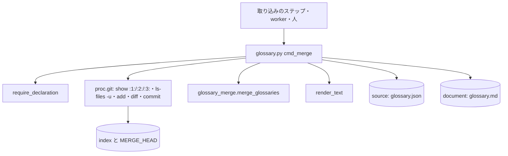

# 用語集の取り込み: 並行の Pull Request が用語集へ語を足し合った衝突を、語の単位の 3 方向の取り込みで解き、取り込みのコミットまで終える（glossary.py merge）

## 概要

**`git merge` の途中で用語集（用語集の設定の `source` の `glossary.json` と `document` の `glossary.md`）が衝突したら、
`glossary.py merge` が共通の祖先・自分の側・相手の側の 3 つの版を語の単位で突き合わせて解き、文書を作り直して index に載せ、
ほかの衝突が無ければ取り込みのコミットまで作る。** 片側だけが足した・書き換えた・消した語はその側を採り、両側が同じに
したものは 1 つにする。**同じ語を両側が違う中身にした「語の衝突」は解かずに止まり、どの語かを出す。**

この文書は、その形に**なぜしたか**（背景・決定と理由・常に成り立つ条件・取り込みの規則・既知の限界・テスト観点）を残す。
**打ち方・結果の読み方の正はスクリプトと形式の参照にある。**

| 何を | 正本 |
| --- | --- |
| `merge` の役割・終了コード・語の衝突の種類（`both_added` / `both_changed` / `deleted_and_changed` / `key_changed`） | `requirements-design` の [references/glossary-format.md](../../plugins/ndf/skills/requirements-design/references/glossary-format.md) の副命令の表 |
| 副命令の一覧と打ち方 | [`glossary.py`](../../plugins/ndf/scripts/glossary.py) の冒頭の説明と `--help` |
| 3 方向の取り込みの規則と並び | [`scripts/lib/glossary_merge.py`](../../plugins/ndf/scripts/lib/glossary_merge.py) の冒頭の説明 |
| 用語集の形・ほかの副命令の契約・用語集の決定 | [ndf-ubiquitous-language.md](ndf-ubiquitous-language.md) |

決定の番号は #1913 の設計の番号である。

## 用語

「用語集の取り込み」「語の衝突」「用語集」「用語集の設定」の定義は用語集（[docs/glossary.md](../glossary.md)）が正である。
git の段（祖先 `:1:`・自分 `:2:`・相手 `:3:`）は git の語のまま使い、用語集の語へ訳さない。

## 背景

同じスプリントで並行に出した Pull Request（主に設計 PR）が `glossary.json` の同じ位置へ語を足すと、ベースブランチの取り込みが
衝突で止まった。解く手段がスクリプトに無く、記録した 6 スプリント（m1693・m1385・m653・m1290・m1743・m1683）のすべてで、
LLM の worker か conductor が手で両方の語を残していた（#1426 の「同じ形の箇所」の表の 3 行目）。衝突は 2 つの形で起きていた。

- 設計 PR どうしが同じ位置へ語を足す（マージコミット ac09b6835）
- 確定仕様化が既存の語の `pending_source` を `source` へ書き換え、隣で設計 PR が語を足す（e7a286e33）

どちらも語の単位で見れば重ならず、判断の要らない手当てだった。

## 決定と理由

| # | 決定 | 理由 | 採らなかった案 |
| ---: | --- | --- | --- |
| 1 | 用語集を 1 語 1 ファイルへ分けず、3 方向の取り込みの副命令を足す | 1 語 1 ファイルにしても、`render` が作る `glossary.md` は 1 ファイルのまま両側で書き換わり、文書の衝突は残る。全副命令と `render` の改修と、配布先の用語集の移行も要る | 1 語 1 ファイル（衝突そのものを減らせる点で最も強いが、文書の衝突が残る） |
| 2 | git の merge driver（`.gitattributes`）に登録せず、副命令として呼ぶ | driver は `git config` の登録がクローンごとに要り、登録していないクローン（CI・他の開発者）では黙って働かない。driver はファイル 1 つずつに呼ばれるため、文書の作り直しと取り込みのコミットを中に置けない | merge driver（`git merge` の中で自動で働くが、利用者の git の設定を書き換える） |
| 3 | 名前を `merge` にする | `git merge` の途中で呼ぶ副命令で、呼ぶ場面と結びつく。既存の `diff` も git の語をそのまま使う | `resolve`・`union` |
| 4 | 並びは自分の側の順を土台にし、相手だけの鍵を、相手の並びで直前にある結果の鍵の直後へ差し込む（直前が無ければ先頭）。上位のキー（`version` など）も同じ規則にそろえる | ベースブランチを PR のブランチへ取り込むとき、自分は PR、相手はベースブランチである。相手の語を相手の位置へ差し込めば、PR をベースブランチへ戻すときに相手の語が動いた差分にならない。3 つの版だけで決まる関数なので、同じ入力から同じバイト列が出る | 相手だけの語を末尾へ足す（次の取り込みでまた衝突しやすい）。コンテキストと語で並べ替える（全行が差分になる） |
| 5 | 比べる単位は語の中身の全体にし、語の中のフィールドどうしは合わせない | フィールドの単位で合わせると「意味を変えた語の正本を、変える前の意味のまま確定した」のような食い違いを機械が作りうる。記録した 2 つの形はどちらも語の単位で解ける | フィールドの単位の取り込み（止まる回数は減るが要らない） |
| 6 | 3 方向の取り込みの純粋な処理を `lib/glossary_merge.py` に置き、`glossary.py` には `cmd_merge` と引数と説明の行だけを足す | git を使わずに単体テストで規則を縛れる。`glossary.py` の行数の例外（`scripts/script-structure-allow/`）の上限を上げない | 例外の上限を上げる（例外リストがラチェットとして持つ意図に反する） |
| 7 | 取り込んだ結果の形の検査は既存の用語チェック（CI の `glossary.py check`）に任せ、`merge` は語の衝突と同じ鍵の重複だけを止める | 両側が別の語に同じ `code` を付けた、などは取り込んだ後でしか起きず、判断の要る直しになる。`merge` に同じ検査を持たせると、形の規則の持ち主が 2 つになる | 取り込んだ後に `structure_findings` で止める（止める範囲が「語の衝突だけを止める」を越える） |
| 8 | 何もしなかった場合（取り込みの途中でない・用語集が衝突していない）も終了コード 1 で返す | 0 を「取り込みのコミットまで終えた」ことだけに使えば、呼び手は 0 で次へ進み、1 で `items` の語かパスを worker へ渡すと終了コードで分けられる | 何もしなかったときを 0 にする（呼び手が `summary` の文を読み分ける） |

## 仕様

### 構成要素と責務

| 要素 | 責務 |
| --- | --- |
| `plugins/ndf/scripts/lib/glossary_merge.py` | 3 つの版の用語集から、取り込んだ用語集・語の衝突・同じ鍵の重複・相手の側から採った件数（`added` / `changed` / `removed`）を返す（`merge_glossaries` → `Merged`）。鍵が文字列でない版の検出（`bad_keys`）、`git ls-files -u` の段の読み取り（`unmerged_stages`）、標準エラーの 1 行（`error_line`）も持つ。ファイルも git も触らず、例外を投げない |
| `plugins/ndf/scripts/glossary.py` の `cmd_merge` | 用語集の設定を読み（境界の検査は他の副命令と同じ）、取り込みの途中かと 2 ファイルの衝突を git で確かめ、3 つの版を読んで `glossary_merge` へ渡し、書き込み・`render_text` による文書の作り直し・index・残りの衝突の数え・コミットを行う |

呼び出しを取り込みのステップ・プランの雛形へ入れるのは #1912・#1917 の範囲で、`merge` は呼ばれたときだけ働く。
既存の 6 つの副命令の引数と出力、`glossary.json` の形は変えない。

### 3 方向の取り込みの規則

語は `(context, term)`、コンテキストは `id` を鍵にし、鍵ごとに祖先 `B`・自分 `O`・相手 `T` の中身（無ければ「無い」）を
辞書の等しさ（キーの順は見ない）で比べる。

| 条件 | 結果 | 件数 |
| --- | --- | --- |
| `O == T` | `O`（両側が同じに足した・書き換えた・消した） | 数えない |
| `O == B` | `T`（相手だけが変えた） | 語だけ `added` / `changed` / `removed` に数える（コンテキストは数えない） |
| `T == B` | `O`（自分だけが変えた） | 数えない |
| どれでもない | 語の衝突 | `conflicts` |

- 祖先の段が無い（両側が新しく作った）ときは、祖先を空の用語集として扱う
- 片側が `glossary.json` を消したとき（段 2 か段 3 が無い）は `file_deleted` として止まる
- 上位のキー（`contexts` と `terms` の外）も同じ 3 つの比較で値を決め、衝突は `key_changed` で止まる

### 常に成り立つ条件

| # | 条件 | 破れたときの扱い |
| --- | --- | --- |
| I1 | 取り込んだ用語集で `(context, term)` とコンテキストの `id` が一意 | 3 つの版のどれかに同じ鍵が 2 回あれば、何も書かずに 1 で止まる（`duplicate` と `side`） |
| I2 | 片側だけが変えた語とコンテキストはその側を採り、両側が同じにしたものは 1 つにする | 採れないもの（語の衝突）が 1 件でもあれば、何も書かずに 1 で止まる |
| I3 | 書き込みの前に止まったとき（語の衝突・重複・片側の消去・取り込みの途中でない・用語集が衝突していない・入力の不正）は、用語集・文書・index のどれも呼ぶ前のまま。書いた後に止まるとき（用語集の外の衝突が残る・`git commit` の失敗）は、解いた 2 ファイルを index に残す | 書き込みは全ての判定の後に行う |
| I4 | 同じ 3 つの版から同じバイト列の `glossary.json` が出る（`json.dumps(ensure_ascii=False, indent=2) + "\n"`、`init` と同じ形） | 並びが決定的な関数で決まる（決定 4） |
| I5 | 書いた `glossary.md` は、書いた `glossary.json` の `render_text` と一致する | 用語集を解いたときは、文書が衝突していなくても作り直す。文書だけが衝突していれば作業ツリーの用語集から作り直す |
| I6 | 取り込みのコミットは、衝突が 1 件も残っていないときだけ作る | 残りがあればコミットせずに 1 で止まり、最上位からのパスを出す |

### 境界の決まり

- **扱うのは `git merge` の途中だけである。** `git rebase` / `git cherry-pick` の途中の衝突は扱わない（`MERGE_HEAD` が無ければ 1）
- **段は `--root` を今のディレクトリにして `:N:./<source>` で読む。** `--root` が worktree の最上位でなくても、宣言のパスのまま読める
- **残りの衝突は、2 ファイルを index に載せた後に `git diff --name-only --diff-filter=U` で数える。** どのディレクトリから打っても最上位からのパスで全件を出す（`git ls-files -u` は今のディレクトリの下だけを出す）。載せた 2 ファイルは自然に一覧から外れる
- **コミットは `GIT_EDITOR=false` と `--no-edit` で、git が用意した取り込みの文を使う。** エディタを待って止まらない
- **用語集と文書の置き場は用語集の設定の `source` と `document` から読み、`docs/glossary` を埋め込まない。**
- 止まったときの標準エラーの 1 行は、空でない `side`・`key`・`path` も並べる（例 `ERROR: duplicate: ours: <context>: <term>`、`ERROR: file_deleted: theirs: <path>`）。重複・片側の消去・上位のキーの衝突は `context` と `term` だけでは版やキーが分からないため

## 運用

### 既知の限界

| 項目 | 内容 |
| --- | --- |
| 実際のスプリントの衝突で解けるか | #1912・#1917 のステップが `merge` を呼ぶようになってから、リリース後テストで確かめる |
| 配布先の commit hook | hook がある配布先では `git commit` が落ちうる。その場合は 1 で git の標準エラーの先頭（`detail`）を出して止まり、呼び手が直す。hook のある配布先での実測は無い |
| 同じ語の別のフィールドの書き換え | 両側が同じ語の別のフィールドを書き換えた場合も語の衝突として止まる（決定 5）。人か worker の判断に残す |
| 用語集の外の衝突 | 解かない。2 ファイルを解いて index に載せ、残りのパスを出して止まる |

## テスト観点

テストは `plugins/ndf/scripts/tests/test_glossary.py`（一時リポジトリで衝突を作る統合テストと `glossary_merge` の単体テスト）にある。

- 両側が別の語を足して `glossary.json` と `glossary.md` が衝突した取り込みの途中で 0 になり、両側の語が 1 回ずつあり、文書が `render_text` と一致し、`git diff --name-only --diff-filter=U` が空になること（I2・I5）
- 同じ語を違う中身にした衝突と、消した側と書き換えた側の衝突で 1 になり、2 ファイルの中身と `git ls-files -u` が打つ前と同じで、`items` に `context` と `term` があること（I3）
- 片側が `pending_source` → `source` へ書き換え、片側が隣へ足した衝突で 0 になり、両方の変更を持つこと
- 両側が同じ語を同じ中身で足すと 1 回だけになり、`check --rules structure` に `duplicate` が出ないこと。1 つの版に同じ鍵が 2 回あると重複が返ること（I1）
- 用語集の外のファイルも衝突していると、2 ファイルは解けて index に載り、`MERGE_HEAD` が残り、1 で `items` にそのパスがあること。衝突が 2 ファイルだけなら取り込みのコミットができ `MERGE_HEAD` が無いこと（I6）
- 取り込みの途中でないとき・用語集が衝突していないときはファイルを書かず 1 で、理由が `summary` にあること。`glossary.md` だけが衝突していれば作業ツリーの用語集から作り直して解くこと
- 用語集の設定の `source` を別の置き場へ置いたリポジトリでも解けること
- 同じ 3 つの版を 2 回取り込むと同じバイト列になり、相手だけの語が相手の並びの直前の語の後に入ること（I4）
- 境界を越えるパスを持つ用語集の設定で `merge` も 2 で止まり、ファイルが変わらないこと

## 関連リンク

- [`glossary.py`](../../plugins/ndf/scripts/glossary.py)・[`scripts/lib/glossary_merge.py`](../../plugins/ndf/scripts/lib/glossary_merge.py)
- `requirements-design` の [references/glossary-format.md](../../plugins/ndf/skills/requirements-design/references/glossary-format.md)
- [ndf-ubiquitous-language.md](ndf-ubiquitous-language.md)（用語集の形とほかの副命令）
- #1913（この形を決めた課題）、#1426（同じ形の手当ての一覧）、#1912・#1917（`merge` を呼ぶ取り込みのステップ）
