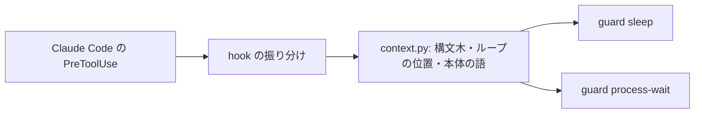

# 待ちの guard: ループの中の sleep とプロセス名の待ちを hook が止める

Claude Code の PreToolUse の hook は、`waiting.md` が禁じる 2 つの待ち方を止める。フォアグラウンドの
`while` / `until` のループの本体で `sleep` する形（guard `sleep`）と、`pgrep -f` / `pkill -f` をループの条件か
本体に置いてプロセスの終わりを待つ形（guard `process-wait`）である。どちらも `bash -c` 系・`eval` の中身と、
`timeout 590` などのラッパーのコマンドの後ろも見る。止めたときは理由の欄に代わりの待ち方（`Monitor` か Bash の
`run_in_background`、完了マーカーのファイル）が出る。

例: supervisor が `ndf ci watch` の終わりを `until ! pgrep -f "ndf ci watch --pr 1" >/dev/null; do sleep 20; done` で待とうとする。

| 順 | 起きること |
| ---: | --- |
| 1 | hook が Bash の呼び出しを受け、コマンドを構文木で読む。`pgrep -f` は `until` の条件に、`sleep 20` は本体にある |
| 2 | guard `sleep`（順 30）が、前景のループの本体の `sleep` を秒によらず止める。理由は「ループの中で sleep して待つ呼び出しを止めた。条件で待つなら Monitor を、終わりを待つなら Bash の run_in_background を使う」 |
| 3 | 同じコマンドを `run_in_background` で打ち直しても、guard `process-wait`（順 31）が止める。`pgrep -f` は待つ側のシェル（Claude Code が包んだ `/bin/bash -c … eval '…'`）のコマンド行にも一致し、ループが終わらないためである |
| 4 | エージェントは `ndf ci watch` そのものを `run_in_background` で起動し、終わりの知らせを待つ |

| 何を読むか | 正本 |
| --- | --- |
| 禁じる待ち方・代わりの待ち方・guard の一覧と外し方 | `plugins/ndf/skills/development-workflow/references/waiting.md` の「禁じる待ち方」と「hook」 |
| guard の宣言（順・対象の Tool・勧める Tool） | `plugins/ndf/contracts/hooks/guards.json` |
| ループの外の上限の秒 | `plugins/ndf/contracts/limits.json` の `hook.sleep`（既定 30 秒） |

[ndf-token-waits-and-context-cut.md](ndf-token-waits-and-context-cut.md) の環境変数の表（`NDF_SLEEP_GUARD`・
`NDF_SLEEP_MAX_SEC`）は 10 系の値である。11 系の sleep の判定はこの文書が正で、上限は `limits.json`、外し方は
`NDF_HOOK_OFF=<guard の名前>` である。

## 概要

### 構成要素と責務

| 要素 | 責務 |
| --- | --- |
| `plugins/ndf/src/ndf/domains/hooks/context.py` | シェルのコマンドを tree-sitter-bash の構文木で読み、単純コマンドごとにループの位置（本体・条件）と、ラッパーのコマンドを外した語を持たせる。`bash -c` 系・`eval` の中身を読み直して `ShellScript.waits` に入れる |
| `plugins/ndf/src/ndf/domains/hooks/guards/sleep.py` | `waits` のうちラッパーを外したコマンド名が `sleep` の単純コマンドを、前景でループの本体なら秒によらず、ループの外か `for` の中なら上限を超えるときに止める。`sleep` の後に NDF のコマンドを打つ並びも止める |
| `plugins/ndf/src/ndf/domains/hooks/guards/process_wait.py` | `waits` のうち `-f` を付けた `pgrep` / `pkill` がループの条件か本体にあれば、前景でも背景でも止める |
| `plugins/ndf/contracts/hooks/guards.json` | `sleep`（順 30）と `process-wait`（順 31）の行。どちらも PreToolUse の Bash で動く |

## 用語

用語の定義は用語集 [docs/glossary.md](../glossary.md) が正である。この文書で使う語は「プロセス名の待ち」「禁じる待ち方」「guard」。

## 背景

11.0.0 の作り直しで、`sleep` の guard は 1 回の `sleep` の秒を上限と比べるだけになり、ループ・`bash -c`・ラッパーの
コマンドを見なくなった。`sleep 20` をループで繰り返す形と `timeout 590 sleep 600` が通り、プロセス名の待ちを照らす
guard も無かった。#3812 の通し（2026-11-19）では、supervisor と worker がプロセス名の待ちを 12 回打ち、うち 1 回は
自分に一致して約 2 時間止まった。10 系の判定は、ループの本体だけを数える・`for` は数えない・`-c` の中身を引き継ぐ、
の規則で、11 系もこの規則に戻した。

`pgrep -f` を書き手が一致を避ける形（`pgrep -f '[z]z-…'`）で毎回書く前提には頼れないため、hook で止める。

## 対象範囲

- NDF を Claude Code へ導入したすべてのリポジトリで働く。Codex・Kiro・agy には hook が無く、`waiting.md` の規約だけが当たる
- モードに依らない
- 設定は `limits.json` の `hook.sleep` だけを読む。ほかの設定と引数は持たない
- `read-repeat`・`script-chain`・`full-test` の判定は変えない。`ShellScript.commands` と `loops` は外側の単純コマンドだけを持ち、これらの guard の入力は内側の単純コマンドを含まない

## 仕様

### 集約

| 集約 | オーナー（書き換えてよいもの） | 根 | 値オブジェクト |
| --- | --- | --- | --- |
| hook の 1 回の判定 | hook の振り分け（`dispatch.py`）。guard は判定を返すだけで書かない | `HookContext` | `ShellScript`・`ShellCommand`・`Verdict` |

`ShellCommand` の欄:

| 欄 | 意味 |
| --- | --- |
| `argv` | 引用を外した語（今の guard が見る語で、ラッパーを外さない） |
| `background` | `&` で背景へ回したか |
| `loop_body` / `loop_condition` | `while` / `until` の本体 / 条件の中か |
| `body_argv` | 先頭のラッパーのコマンドとその引数を外した語。読めない引数か、コマンドを起動しない形（`command -v`）なら空 |
| `body_name`（プロパティ） | `body_argv` の先頭からパスを外した名前。空なら空 |

`ShellScript` の `commands` と `loops`（ループのセクションを含むか）は外側の単純コマンドだけを見る。`waits` は外側の
単純コマンドに `bash -c` 系・`eval` の中身の単純コマンドを足した列で、待ちの guard（`sleep`・`process-wait`）だけが見る。

### 常に成り立つ条件

| # | 条件 | 破れたときの扱い |
| --- | --- | --- |
| I1 | フォアグラウンドの Bash で、`while` / `until` の本体にある `sleep`（`bash -c` 系・`eval` の中身とラッパーのコマンドの後ろを含む）は止める | 拒否して `Monitor` か背景の起動を案内する |
| I2 | 背景になる `sleep`（`run_in_background`・末尾の `&`。外側の `&` を引き継いだ内側を含む）と、`for` の中の上限以下の `sleep` は止めない | — |
| I3 | `-f` を付けた `pgrep` / `pkill` が `while` / `until` の条件か本体にあれば、前景でも背景でも止める | 拒否して完了マーカーのファイルか `Monitor` を案内する |
| I4 | 判定に失敗した（構文木を作れない・入力を読めない）ときは止めない | 通す |

### ループの位置と内側のスクリプト

- 単純コマンドの祖先をたどり、`while_statement` の `body` の欄の中なら `loop_body`、`condition` の欄の中なら `loop_condition` を立てる。tree-sitter-bash（0.25.1）は `until` も `while_statement` として読み、`until_statement` という種類は無い
- `for_statement`・`c_style_for_statement` は待ちのループに数えない（上限だけで判定する）
- `bash`・`sh`・`zsh`・`dash` の `-c` の引数と `eval` の引数を、同じ構文木の読み方で読み直す（入れ子 5 つまで。それより深い入れ子は読み直さずに外側の判定だけで返す）
- 内側の単純コマンドは、外側の `background`・`loop_body`・`loop_condition` をそれぞれ内側の値と論理和で引き継ぐ。`bash -c 'while :; do sleep 1; done' &` の内側の `sleep` は背景になり、止めない
- コメント・引用・ヒアドキュメントの本文と、`echo bash -c ...` のような引数の中の語は見ない

### ラッパーのコマンドの外し方

先頭がラッパーのコマンド（`plugins/ndf/src/ndf/testing/weight.py` の `WRAPPERS` の集合。`_WRAPPER_ARGS` のキーと同じで、
テストで縛る）なら、その語とオプションと前置きの語を外し、残りの先頭を見直す。ラッパーの引数の読み方は次の表に従う。
値はラッパーの `--help` と bash の `help exec`・`help command` から取った（uutils coreutils 0.10.0・util-linux 2.41.3・
GNU findutils 4.10.0）。

| ラッパー | 値を取らないオプション | 値を取るオプション | オプションの後の前置きの語 | 例 |
| --- | --- | --- | --- | --- |
| `timeout` | `-f` `--foreground`・`-p` `--preserve-status`・`-v` `--verbose` | `-s` `--signal`・`-k` `--kill-after` | 時間 1 語 | `timeout --signal TERM 590 sleep 600` → `sleep 600` |
| `env` | `-i` `--ignore-environment`・`-0` `--null`・`-v` `--debug`・`--list-signal-handling` | `-u` `--unset`・`-C` `--chdir`・`-f` `--file`・`-a` `--argv0`・`-S` `--split-string`。`--ignore-signal` `--default-signal` `--block-signal` は `=値` の付いた 1 語だけ | `NAME=値` の語の並び（`-` も外す） | `env -u HOME X=1 sleep 600` → `sleep 600` |
| `nice` | 数字の短い形（`-10`） | `-n` `--adjustment` | 無し | `nice -n 10 sleep 600` → `sleep 600` |
| `ionice` | `-t` `--ignore` | `-c` `--class`・`-n` `--classdata` | 無し | `ionice -c 3 sleep 600` → `sleep 600` |
| `stdbuf` | 無し | `-i` `--input`・`-o` `--output`・`-e` `--error` | 無し | `stdbuf -oL sleep 600` → `sleep 600` |
| `nohup` | 無し | 無し | 無し | `nohup sleep 600` → `sleep 600` |
| `time` | `-p`・`-a` `--append`・`-v` `--verbose`・`-q` `--quiet` | `-f` `--format`・`-o` `--output` | 無し | `time -f %e sleep 600` → `sleep 600` |
| `exec` | `-c`・`-l` | `-a` | 無し | `exec -a w sleep 600` → `sleep 600` |
| `command` | `-p` | 無し | 無し | `command -p sleep 600` → `sleep 600` |
| `xargs` | `-0` `--null`・`-o` `--open-tty`・`-p` `--interactive`・`-r` `--no-run-if-empty`・`-t` `--verbose`・`-x` `--exit`・`--show-limits`。値を付けた 1 語だけを取る `-e` `--eof`・`-i` `--replace`・`-l` | `-a` `--arg-file`・`-d` `--delimiter`・`-E`・`-I`・`-L` `--max-lines`・`-n` `--max-args`・`-P` `--max-procs`・`-s` `--max-chars`・`--process-slot-var` | 無し | `xargs -n 1 sleep` → `sleep` |

- `--` はオプションの読み取りを終える
- 値を取るオプションは、長い形なら `--name=値` の 1 語か `--name 値` の 2 語、短い形なら束の中でその文字より後ろが値で、後ろが空なら次の 1 語が値である
- 値を取らない短いオプションの束（`-pv`）は文字ごとに読む
- 表に無いオプションに当たったら、本体の語を空にして判定しない（I4 と同じく、読めない入力で止めない）
- コマンドを起動しない形（`command -v` / `-V`、`ionice -p` / `-P` / `-u`）は本体の語を空にする

`env -S <文字列>`（`--split-string`・`-S<文字列>` の束を含む）は、文字列を GNU `env` の規則（GNU Coreutils マニュアル
§23.2.3）で語に分けて残りの語の前に置き、その並びを `env` のオプションの読み取りへ戻す（`env -S '-i sleep 600'` →
`sleep 600`）。標準ライブラリの `shlex.split` は引用符の外の `\_` を区切りにしないため使わない。

| 文字 | 引用符の外 | `"` の中 | `'` の中 |
| --- | --- | --- | --- |
| 空白・タブ・改行 | 語の区切り | 語の一部 | 語の一部 |
| `\_` | 語の区切り（`env -S 'sleep\_600'` → `sleep 600`） | 空白 1 文字 | 2 文字のまま |
| `\\`・`\"`・`\'`・`\$`・`\#` | 後ろの 1 文字 | 後ろの 1 文字 | `\\` と `\'` だけ後ろの 1 文字 |
| `\t`・`\n`・`\r`・`\f`・`\v` | 制御文字 1 文字 | 制御文字 1 文字 | 2 文字のまま |
| `\c` | 文字列の残りを捨てる | 文字列の残りを捨てる | 2 文字のまま |
| 上に無い `\` の組・`${` の無い `$`・閉じない引用符 | 読めない（本体の語を空にする） | 読めない | そのまま |
| `${NAME}` | 空でない 1 つの印の文字列に置き換える（hook では値が分からない） | 同じ | そのまま |
| 語の先頭の `#` | 文字列の残りを捨てる（注釈） | 語の一部 | 語の一部 |

### guard `sleep` の判定

| 条件 | 結果 |
| --- | --- |
| 外側の単純コマンドで `sleep` の後に NDF のコマンドを打つ並び | 止める（背景でも止める。時間で待たずに条件で待つ） |
| 背景（`run_in_background`、または単純コマンドの `background`） | 上限・ループの判定をしない |
| 前景・`loop_body` | 秒によらず止める |
| 前景・ループの外か `for` の中・秒が上限以下 | 通す |
| 前景・ループの外か `for` の中・秒が上限を超える（読めない秒・変数の秒を含む） | 止める |

秒は `sleep` の引数の合計（単位 `s`・`m`・`h`・`d`）で数える。

### guard `process-wait` の判定

`body_name` が `pgrep` / `pkill` で、引数がオプションとして `-f` か `--full` を持ち、`loop_body` か `loop_condition` が
立つ単純コマンドを止める。前景でも背景でも止める。単発の `pgrep -f` は一度返るので害が無く、`-x` は名前の完全一致で
待つ側に一致しないため止めない。

引数は getopt と同じ順で読む。

| 語 | 扱い |
| --- | --- |
| `--` | 読むのを終える（後ろはすべて検索パターン。`pgrep -- -f` の `-f` はパターン） |
| `--full` | 真 |
| 値を取る長い形（`--delimiter`・`--pgroup`・`--group`・`--older`・`--parent`・`--session`・`--signal`・`--terminal`・`--euid`・`--uid`・`--pidfile`・`--runstates`・`--cgroup`・`--ns`・`--nslist`・`--queue`） | `--name=値` は 1 語、`--name` は次の 1 語も飛ばす |
| 短い形の束 | 先頭から 1 文字ずつ読み、`f` なら真。値を取る文字（`pgrep` は `dgGOPstuUFr`、`pkill` はそれに `q`）ならその後ろが値で、後ろが空なら次の 1 語を飛ばす（`pgrep -df x` の `f` は区切りの文字） |
| `pkill` の信号の指定（`-9`・`-TERM`・`-SIGHUP`） | 飛ばす |
| `-` で始まらない語 | 検索パターンとして飛ばし、読み続ける（`pgrep x -f` の `-f` もオプション） |

値を取るオプションの一覧は procps-ng 4.0.4 の `pgrep --help`・`pkill --help` から取った。

## データ・設定

| 名前 | 置き場 | 値 |
| --- | --- | --- |
| `hook.sleep` | `plugins/ndf/contracts/limits.json` | ループの外の上限の秒（既定 30） |
| `sleep` の行 | `plugins/ndf/contracts/hooks/guards.json` | 順 30・PreToolUse・Bash |
| `process-wait` の行 | `plugins/ndf/contracts/hooks/guards.json` | 順 31・PreToolUse・Bash・`deny_key` command・勧める Tool は `Monitor`（完了マーカーのファイルを待つ例） |

## エラー処理

| 場合 | 扱い |
| --- | --- |
| 構文木を作れない・入力を読めない | 止めない（I4） |
| 入れ子が 5 つを超える | それより内側を読み直さず、外側までの判定で返す |
| ラッパーの引数を読めない（表に無いオプション・`env -S` の読めない文字列） | 本体の語を空にし、その単純コマンドを判定しない |

## 運用

- 外し方は環境変数 `NDF_HOOK_OFF` に guard の名前を並べる（`NDF_HOOK_OFF=process-wait`、2 つとも外すなら `NDF_HOOK_OFF=process-wait,sleep`）
- `until ! pgrep -f x >/dev/null; do sleep 20; done` は本体に前景の `sleep` を持つため、`NDF_HOOK_OFF=process-wait` だけでは guard `sleep` が止める。2 つの guard は止める条件と案内が違い、別々に外せる

## 決定と理由

| 決定 | 理由 |
| --- | --- |
| ループの位置を構文木の欄の名前（`body`・`condition`）で決め、`for` を数えない | 判定は語の並びでなく構文木の位置で決まる。ループの有無だけで止めると、`for` の中の上限以下の `sleep` とループの条件だけを持つ文を巻き込む |
| 内側の単純コマンドを `commands` に混ぜず、`waits` を別に持つ | `commands` に足すと `script-chain` と `full-test` が見る列が変わり、`bash -c 'ndf ci watch …'` の中身を連結の判定に数え始める |
| 内側は外側の背景とループの位置の 3 つを引き継ぐ | ループの位置だけを引き継ぐと、外側の `&` を失い、背景の待ちを前景として止める |
| プロセス名の待ちを `sleep` と別の guard にする | 止める条件と案内が違い、`NDF_HOOK_OFF` で片方だけを外せる。`sleep` を含まない `until ! pgrep -f x; do :; done` を `sleep` の名前で止めずに済む |
| `pgrep -f` のうちループの中だけを止める | 単発の確かめ（受け入れ条件の確かめなど）を巻き込まない |
| ラッパーを外した語を `body_argv` として別に持つ | `argv` を書き換えると script-chain の guard の判定が変わる。表に無いオプションを値を取らないものと見なすと、値をコマンドと読み違えて無関係の語で止める |
| 上限の秒は `limits.json` の値（30 秒）のまま | 11 系は閾値を `limits.json` に置き、環境変数で受けない。直したのはループの中の止め方で、上限の値ではない |

## テスト観点

テストは `plugins/ndf/tests/domains/hooks/test_guards.py`・`test_context.py` にある。

- `while true; do sleep 1; done`・`until [ -s out ]; do sleep 5; done`・入れ子のループの本体の `sleep` を前景で渡すと拒否されること
- `sleep 5` は通り `sleep 600` は止まること。`for i in 1 2; do sleep 3; done` は通ること
- `bash -c 'while true; do sleep 1; done'`・`eval 'while :; do sleep 1; done'`・`timeout 590 sleep 600`・`timeout --signal TERM 590 sleep 600`・`nohup sleep 600` が止まること
- `run_in_background` の呼び出しと `while true; do sleep 1; done &`・`bash -c 'while :; do sleep 1; done' &` が通ること
- `bash -c 'ndf ci watch --pr 1'` などで `ShellScript.commands` と `loops` が外側の単純コマンドだけの値になり、`script-chain` と `full-test` の判定が変わらないこと
- `until ! pgrep -f "ndf ci watch --pr 1" >/dev/null; do sleep 20; done` が前景でも背景でも拒否され、`pkill --full`・`pgrep -af` も止まること
- ループの外の `pgrep -f x`・`pgrep -x dockerd >/dev/null 2>&1 || echo x`・`until ! pgrep -x dockerd; do sleep 1; done &`・ループの中の `pgrep -- -f`・`pgrep -d f x` が通ること
- `NDF_HOOK_OFF=process-wait` で `until ! pgrep -f "ndf ci watch --pr 1" >/dev/null; do :; done` が hook の判定の全体で通り、同じ設定で `sleep 20` を本体に持つ形は guard `sleep` が止め、`NDF_HOOK_OFF=process-wait,sleep` で通ること
- 構文木を作れない入力で拒否が出ないこと
- ラッパーの表の例の各行・`env -S` の分け方の表の各行（`env -S 'sleep\_600'` が 2 語になることを含む）が本体の語になり、表に無いオプション・読めない `env -S` の文字列で本体の語が空になること。`_WRAPPER_ARGS` のキーが `weight.WRAPPERS` と食い違うと落ちること

## 関連リンク

- 規約: `plugins/ndf/skills/development-workflow/references/waiting.md`
- 10 系の待ちの hook と環境変数: [ndf-token-waits-and-context-cut.md](ndf-token-waits-and-context-cut.md)
- 課題: [#3851](https://github.com/devbasex/ai-plugins/issues/3851)
