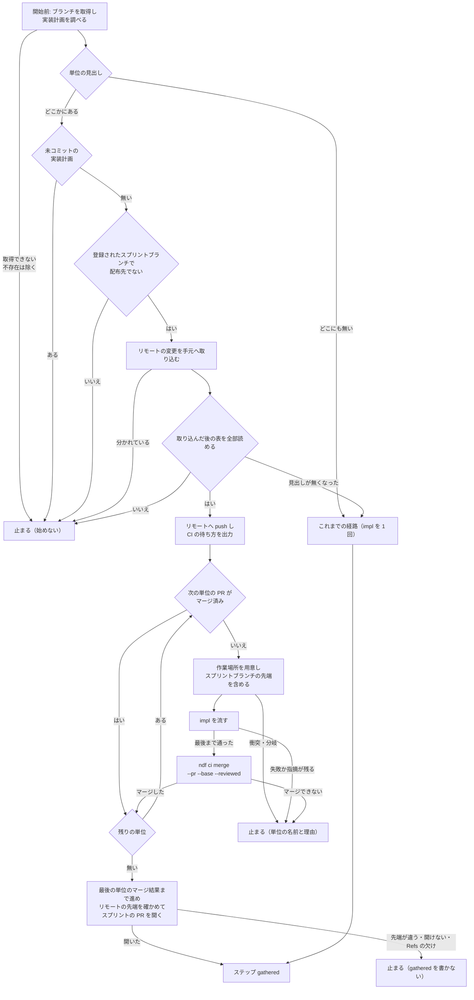

# 工程「実装」をレビューの単位ごとに流す: 自動の経路で単位の PR・レビュー・マージを経てスプリントブランチへ集める

`ndf progress next` が流す工程「実装」は、実装計画の「レビューの単位」の表を読み、単位ごとに単位のブランチ・作業場所・
スプリントブランチ宛ての PR・cross-review・マージを実行の順に流す。すべての単位をマージした後にスプリントの PR を開き、
集めた時点（`gathered`）を記録する。どの実装計画にも単位の見出しが無いスプリントは、これまでどおり実装のプラン `impl` を
1 本だけ流す。マージは supervisor の手順と同じ `ndf ci merge --reviewed` を使い、専用のマージ・単位の後片付け・指摘の
持ち越しは持たない。

決定の結論・理由・利用者が受け入れた代償・実装で見送った指摘は
[ndf-implement-stage-review-units-decisions.md](ndf-implement-stage-review-units-decisions.md) にある。本文の「決定 N」は
その文書の決定を指す。supervisor で単位を回す手順と、集めた時点の後のつなぎ目のレビューは
[ndf-review-units-and-refactoring-timing.md](ndf-review-units-and-refactoring-timing.md) が持つ。実装計画の表の書き方は
`implementation-plan` の SKILL.md が正である。

## 背景

2026-11-24、#4049 の開発で conductor が `ndf progress next` を打つと、実装計画が 7 つの単位（見込み約 3,400 行）に分けて
いた変更を、自動のプランが課題 1 つ・worker 1 本でスプリントブランチの上に直接実装し始めた。単位ごとにプランを組む約束は
supervisor の手順にしか無く、自動のプランは単位を読まなかった。止めるには worker のプロセスを落とすしかなく、気づかなければ
1,000 行を超える変更が 1 本の PR になり、1 回で読み切れる大きさ（目安は 1 単位 400 行以下）を超える。

この仕様で、自動の経路でも実装計画の分け方のとおりに PR とレビューを通す。同じ内容を扱っていた #3905 はこの課題へ統合した
（決定 3）。実装計画の単位を機械が読むファイルにする #3702 は未実装で、その実装が入ると表の読み手は単位のファイルの読み手へ
置き換わる（決定 1・2）。

## 用語

レビューの単位・単位の PR・集めた時点・レビューの保留の定義は用語集（[docs/glossary.md](../glossary.md)）にある。
この文書で使うほかの語は次のとおりである。

| 語 | 意味 |
| --- | --- |
| 単位の経路 | 工程「実装」が単位の表を読んで単位ごとに流す経路。対になるのは「これまでの経路」（`impl` を 1 本） |
| プレリファクタリングの単位 | 「タスク分解」の最初のタスクを含む単位。するかは実装計画の「リファクタリングの時機」の「実装の前」の行が決める |
| 補った単位 | 単位の見出しがある実装計画を持つスプリントで、見出しの無い課題（実装計画を省いた課題を含む）を課題 1 つで 1 単位にしたもの |
| 人の判断を待つ指摘 | 直していないレッドラインの指摘と、区分が `needs_user`・無い・知らない値の見送り。用語集の「レビューの保留」と同じ種類で、見るのはその回のレビューの結果だけである |

## 対象範囲

含むのは、自動の経路（`ndf progress next`）の工程「実装」が単位を読み、単位ごとに流し、すべてのマージの後に `gathered` を
記録することである。実装計画の書式、supervisor の手順、実行中の工程を止める操作、実行中の中断とレビュー後に外から変えられた
PR の復旧（#4218）、単位の大きさの機械の確かめ（#3702）は含まない。扱う再実行は、工程が失敗か待ちを返した後の打ち直しである。

## 構成要素

パスは `plugins/ndf/` からの相対である。依存の向きは `invoke.py` → `units_invoke.py` → `plan_runs.py`・`issue_values.py` →
`core/` → `adapters/` の一方向で、`progress/` は `domains/` を import できないため、作業場所の用意は `ndf worktree create`、
マージは `ndf ci merge` を子プロセスで打つ。

| 要素 | 責務 |
| --- | --- |
| 単位の表の読み手（`src/ndf/core/plan/review_units_decide.py`） | 実装計画の本文と課題ごとの受け入れ条件の数から、単位の並び（`Unit`）か読めない理由（`UnitsUnreadable`）を返す。ファイルも git も読まない。`has_units`・`lineup`・`acceptance_args` |
| 実装計画のパス（`src/ndf/core/issue_docs.py`） | `issue-<番号の並び>-plan.md` から番号の並びを読む（`plan_issues`） |
| 単位を流す処理（`src/ndf/progress/units_invoke.py`） | 開始前の確かめ（`prepare`）、単位ごとの作業場所・指示のファイル・`impl`・マージ、打ち直しの判定（`round_state`・`resume_of`）、スプリントの PR（`run_stage`） |
| 型と実行の記録（`src/ndf/progress/plan_runs.py`） | `StageRun`・`StageResult`・`UnitsStopped` と、プランの実行の記録の読み取り。`invoke.py` と `units_invoke.py` が共有する |
| 工程から作業を呼ぶ層（`src/ndf/progress/invoke.py`） | `per_unit` の工程を単位を流す処理へ渡し、これまでの経路なら `StageRun.plain()` で今のまま `impl` を呼ぶ。`plan_start` は `pr-number` の無い `impl` の打ち直しを `pr` から流す |
| 課題のコピー（`src/ndf/progress/issue_values.py`） | 代表の課題の題と本文を、指定した課題とリポジトリから工程の保存先へ書く。`clear_values` は単位の保存先の `values.json` も消す |
| 工程の定義（`src/ndf/progress/stages.py`・`definition.py`、`contracts/workflow/stages/implement.json`） | `StageDef.per_unit`（既定は偽）。工程「実装」は `per_unit: true` と任意の入力 `branch` を持つ |
| テンプレート（`contracts/templates/{impl,pr,params}.json`・`parts/steps.json`）と起動の組み立て（`src/ndf/core/route/__init__.py`） | PR の番号の保存と利用、フォークの除外、差し込み `unit_file`、単位の経路のテンプレート（`unit_template`）とレビューの起動（`unit_review_launch`） |
| PR の読み取り（`src/ndf/adapters/github_pulls.py`） | `Pull`・`Authored` と、head と宛先で絞ったマージ済みの PR の一括読み取り（`merged_pulls`） |
| マージ（`src/ndf/ci_cli.py`・`src/ndf/adapters/github.py`） | `ndf ci merge` の `--base` と、`--branch` と組める `--pr`（`_target`）。送る直前に読み直した PR の宛先を `MergeExpect` で照らす |
| レビュー（`src/ndf/domains/crossreview/`） | `--repo`・`--stop-on-hold`・`--reviewed-pr-out`、単位の範囲の指示（`NDF_UNIT_FILE`・`criteria_decide.unit_block`）、読んだ PR の確認（`reviewed_pr.py`） |
| worker の作業の定義（`contracts/worker/kinds.json`・`src/ndf/contracts/worker_kinds.py`） | 空でよい入力 `optional_inputs` に `unit_file` を置く（`impl`・`fix`・`ci-fix`・`fix-push`・`fix-base`） |
| 受け入れ条件の確かめ（`src/ndf/domains/loop/acceptance.py`） | 条件を持たない単位のための `--no-criteria` |
| 設定のスキーマ（`contracts/schemas/project-workflow.schema.json`） | `workflow.unit_required_checks` |

## 仕様

### 集約と常に成り立つ条件

| 集約 | オーナー | 根 | エンティティ | 値オブジェクト |
| --- | --- | --- | --- | --- |
| 単位の並び | 実装計画（工程「計画」が書き、工程「実装」は読むだけ） | 実装計画 | レビューの単位 | 単位の名前・満たす受け入れ条件・実行順 |
| 単位の実行 | 工程「実装」 | 単位の PR | — | 単位のブランチ・レビューした HEAD |

| # | 常に成り立つ条件 | 破れたときの扱い |
| --- | --- | --- |
| I1 | 単位の見出しがある実装計画は、すべての行を読めるときだけ流す。課題を 1 本にまとめて流さない | 実装を始めずに止まる |
| I2 | 工程がマージするのは、単位の `impl` が最後まで通った PR だけである。作業場所の HEAD と PR の HEAD がレビューした HEAD と同じで、PR の宛先がスプリントブランチであること | マージせずに止まる |
| I3 | 次の単位の作業場所は、前の単位をすべてマージした後のスプリントブランチから切る。既にある単位のブランチは、その先端を含んでから流す | 後の単位を始めずに止まる |
| I4 | 単位をマージする先は、スプリントに登録されたブランチで、プロジェクトの設定が配布先として宣言したブランチではない | 実装を始めずに止まる |
| I5 | `gathered` を書くのは、読んだ並びのすべての単位がマージ済みの PR を持つときだけである | 後の単位を始めず、`gathered` を書かずに止まる |

### 処理の流れ



単位の経路に入るのは、`per_unit` を持つ定義で作ったスプリントだけである。`ndf progress new` が工程の定義の写し
（スナップショット）を保存し、スプリントは終わりまでその定義で進む（決定 4）。

### 開始前の確かめ（`prepare`）

単位があるかは、コミットされた内容から判定する。作業ツリーの未コミットの内容は単位の作業場所に存在しないので、範囲や
順序の根拠にしない。リモートは `.ndf/worktree.json` の `remote`（無ければ既定）で選び、取得と push の両方に使う。

1. 作業場所が今いるブランチをリモートから取得する（決定 16）。失敗したら `git ls-remote --exit-code --heads <リモート> refs/heads/<ブランチ>` を打ち、終了コード 2（ref が無い）なら不存在として手元の HEAD で判定を続ける。それ以外は理由を示して止まる
2. 手元の HEAD と取得した先端の実装計画を `git show` で読み、単位の見出しを調べる。未コミットの実装計画があればそのファイルも調べる。どこにも無ければ、作業場所を変えずにこれまでの経路へ進む
3. 未コミットの実装計画（スプリントの課題の `issues/issue-<番号の並び>-plan.md` で、変更・削除がコミットされていないものと追跡されていないもの）があれば、パスを示して止まる。見出しがどこにも無いスプリントでは止めない
4. 作業場所が今いるブランチが、文脈の `branch`（工程「作業場所の用意」が書く）と同じで、`.ndf/project.json` の `branch_strategy` の配布先（`branches.base`・`branches.production`・`channels[].ref`・`release.deliveries[].branch`）のどれでもないことを確かめる（I4。`released_branches`）。文脈に `branch` が無ければ止まる
5. 手元が遅れていれば `git merge --ff-only` で進める。分かれていれば止まる
6. 揃えた HEAD で見出しを調べ直し、すべての単位の表を読む。見出しが無くなっていればこれまでの経路へ、読めなければ止まる
7. `git push -- <リモート> HEAD:refs/heads/<スプリントブランチ>` を打つ。リモートにブランチが無ければここで作る。upstream の設定は使わない
8. 単位の PR の宛先・待つチェックの名前・その名前を読んだ設定のキーを、標準エラーの 1 行と結果の `metrics.unit_ci`（`base`・`required`・`key`）に出す（決定 13）

並びは `<工程の保存先>/units.json`（`{"route": "units" か "plain", "units": [...]}`）に書く。打ち直しでは `units.json` が
あるので開始前の確かめを通らない。

単位の経路は、PR の作成からマージまで選んだリモートの `<所有者>/<リポジトリ>` を使う。`gh` には環境変数 `GH_REPO`、
レビュー・`ndf ci watch`・`ndf ci merge` には `--repo`、代表の課題の読み取り（`issue_values`）には関数の引数で渡す。

### 単位の表の読み方（決定 7）

| 項目 | 読み方 |
| --- | --- |
| 見出し | コードブロックの外にある、`レビューの単位` を含む `##` 以下の見出し。実装計画 1 つに 1 つだけ。そのセクションの最初の表を読み、後ろのセクションの表は読まない |
| 表の範囲 | Markdown の表の行をすべて単位の行として読む（表の範囲は markdown-it-py に任せる。打ち切った後の行を自前で調べると、インライン解析の再実装になり抜け道が増える） |
| 列 | 「単位」「含むタスク」「満たす受け入れ条件」は必須。「実行順」は任意で、あればすべての行に 1 以上の整数 |
| 含むタスクのセル | 括弧の注記を除き `・` `、` `,` で区切る。要素は `Task <番号>`・`T<番号>`・番号だけ・範囲（`Task 1〜4`・`T1〜T4`）。セルの最初の要素は接頭辞が要る。番号は「タスク分解」の `### Task <番号>` の見出しにあること |
| タスクの割り当て | 「タスク分解」のタスクは、どれも 1 つの単位にだけ割り当てる |
| 条件のセル | 括弧の注記を除き同じ区切りで分ける。要素は下の表 |

| 条件の要素 | 意味 |
| --- | --- |
| `<課題>:<番号>`・`<課題>:<始め>〜<終わり>` | その課題のその条件（始めが終わりより大きければ読めない） |
| 番号か範囲だけ（`3`・`1〜7`） | 直前の要素の課題の条件。セルの最初なら、実装計画の課題が 1 つのときだけ書ける |
| `無し` | 条件なし。ほかの要素と一緒には書けない |

条件の番号は `ndf loop acceptance check` と同じ関数で数える（課題の本文の受け入れ条件を上から 1 始まり）。開始時に一括で
読む課題の本文はこの数のためだけに使い、worker と PR へは渡さない（書き込み権限の無い人の文が指示や PR の本文に入らない
ようにするため）。

読めないのは、見出しが 2 つ以上・表か必須の列が無い・同じ名前の列が複数・行が 0・名前が空か重なる・含むタスクが空か形が
違うか見出しに無い・割り当ての漏れか重なり・条件の形が違う・条件の課題がスプリントの外・番号が課題の条件に無い・「実行順」が
1 以上の整数でない、のどれかである。読めなければ `UnitsUnreadable.reasons` を示して実装を始めない（I1）。

### 順序と補った単位

単位は、実装計画 1 つ分の単位と補った単位 1 つをそれぞれ 1 まとまりにし、まとまりを課題番号（実装計画はファイル名の番号の
最小）の小さい順に並べる。実装計画の中では、「実行順」の列があればその値の順（同じ値は表の順）で、プレリファクタリングの
単位を前へ動かさない。列が無ければ表の順で、プレリファクタリングをするならその単位を先頭にする。「リファクタリングの時機」の
表の「実装の前」で始まる行の対象が「しない」で始まれば「しない」、表か行が無ければ「しない」と読む。

例えば `issue-20-40-plan.md`（単位 A・B）と実装計画の無い課題 10・30 のスプリントは、10、A、B、30 の順になる。補った単位は
`unit_file` を空にし、課題の全体を実装して全条件を確かめる。

| 単位 | 代表の課題 | `impl` に渡す `acceptance`（`acceptance_args`） |
| --- | --- | --- |
| 条件がある | 実装計画のファイル名の番号の最小 | 条件がある課題を番号の順に `--issue` で並べ、条件を 1 件ずつ `--criteria` で渡す |
| 条件が「無し」 | 同上 | `--issue <代表の課題> --no-criteria`（決定 9） |
| 補った単位 | その課題 | `--issue <代表の課題>` |

代表の課題は `impl` の `issue`（PR の題と本文の元）と単位のブランチ名に使う。題と本文は `issue_values` が工程の保存先へ
書き、リポジトリと課題の番号の組に結び付ける（題のコピーは `{"title", "repo"}` で、`repo` が違うコピーは使わない）。読み直す
ときは題のコピーを消し、本文を書き、題を最後に書く。同じ組は 1 回の試行で 1 回だけ読み、作成者に書き込み権限が無ければ止まる。

### 単位のブランチと作業場所

- ブランチ名は `<スプリントブランチ>-u<代表の課題>-<単位の名前の sha256 の先頭 8 字>`（`unit_branch`）。別のマシンの打ち直しでも同じ名前になる
- `impl` を流すかマージだけを打ち直す前に、スプリントブランチと `refs/heads/<スプリントブランチ>-u*` を `--prune` 付きの 1 回の `git fetch` で取得し直す（一致する ref が無くても失敗しない）
- 作業場所は `.worktrees/` の下に `ndf worktree create <ブランチ> --from <スプリントブランチ>` で作り、あれば使う

| 単位のブランチがある場所 | 扱い |
| --- | --- |
| どこにも無い | 取得し直したスプリントブランチから切る |
| リモートだけ | リモートの先端から手元のブランチを作る。実行の記録が無ければ `impl` は最初から |
| 手元だけ／両方で手元が同じか進んでいる | 手元を使う |
| 両方で手元が遅れている | `git merge --ff-only` で進める |
| 両方で分かれている | `impl` を呼ばずに止まる |

- 既にある作業場所に未コミットの変更（追跡していないファイルを含む）か進行中のマージ（`MERGE_HEAD`）があれば、取り込みも `impl` もせずに止まる。利用者の編集を単位の PR に混ぜないためである
- 既にある単位のブランチがスプリントブランチの先端を含まなければ、`impl` の前に `git merge --no-edit` で取り込む（I3）。衝突すれば、この処理が始めたマージだけを取り消して `base_conflict` で止まる

| 保存先のファイル（`<工程の保存先>/units/<単位のブランチ>/<回>/`） | 書く側 |
| --- | --- |
| `unit.md`（単位の範囲の指示。流すたびに書き直す） | 単位を流す処理 |
| `pr-number`・`reviewed-head`・`reviewed-pr` | `impl` のプラン |
| `stopped-head`（`impl` が返った直後の HEAD） | 単位を流す処理 |
| `merge.json`（`ndf ci merge` の結果の種類） | 単位を流す処理 |

スプリントの PR のプランの保存先は `<工程の保存先>/sprint-pr/` である。

### 単位の範囲の指示（決定 8）

`unit.md` は、単位の名前・含むタスク・満たす条件（番号だけ。課題の本文は写さない）・実装計画のパス・単位の外の扱いと例外を
持つ。補った単位には書かない。`impl`・`fix`・`ci-fix`・`fix-push`・`fix-base` の worker には起動指示の入力 `unit_file` で、
レビューの相手役と修正担当には環境変数 `NDF_UNIT_FILE` で渡す。

- 単位の外を変えてよいのは、今の単位の変更が原因のテスト・CI の失敗かレビューの指摘を直すのに要る場合だけで、変更は最小にし、コミットメッセージに理由を書く。今の単位が原因と確かめられない失敗は直さず、後の単位のタスクは実装しない。その結果通らなければ理由を返して単位が止まる
- 例外: 今の差分に含まれる秘密・認証認可・利用者のデータ・戻せない操作の問題は、相手役が必ず指摘し、修正担当は後の単位を理由に見送らない
- 後の単位の範囲を理由に見送る指摘は、区分 `not_applicable` と担当の単位を書く

### `impl` のステップと PR の番号

ステップの並びは変えない。単位の経路では `done-check` を外す（開始時の一覧でマージ済みの単位を飛ばすため。決定 6）。

| 順 | ステップ | すること |
| --- | --- | --- |
| 1 | `done-check` | 作業場所の HEAD がマージ済みの PR の head と一致すれば終える（単位の経路では外す） |
| 2 | `work`・`acceptance`・`test` | 実装し、受け入れ条件の確認の記録を調べ、手元のテストを打つ |
| 3 | `push`・`pr`・`conflict-check`・`base-fetch` | push して PR を作り、衝突を調べ、マージ先を取得する |
| 4 | `review` | PR の変更の全体を cross-review し `reviewed-head` を書く。指摘が残れば `unresolved` を置いて進む |
| 5 | `push-reviewed`・`review-head` | 修正を push し、HEAD が `reviewed-head` と違うか `delta-recheck` があれば `review-delta` へ |
| 6 | `ci`・`head-reviewed` | CI を確かめ、HEAD が `reviewed-head` と違えば `review-delta` へ |
| — | `review-delta` | 差分だけをレビューして `reviewed-head` を書き直す。指摘が残れば `unresolved-delta` を置く |
| 7 | `resolved` | `unresolved` と `unresolved-delta` がどちらも無ければ通り、あれば `incomplete` |

`reviewed-head` は、相手役の全員が読めた最後のラウンドの HEAD である。`review-delta` は `unresolved` を消さないので、後の
差分のレビューが通っても初回の指摘が残れば `resolved` が止める。

`impl` は対象のリポジトリ・head・宛先の 3 つで PR を 1 本に決める。`pr` のステップは、作った PR の番号を `gh pr create` の
出力の URL から取り、見つけた PR の番号とともに `{state_dir}/pr-number` に書く。`probe` は head と宛先で絞り、フォーク
（`isCrossRepository`）の PR を除く。`conflict-check`・`ci`・レビューの既定の起動・マージはこの番号を使い、ブランチ名で
引き直さない。同じブランチから別の宛先へ出した PR を検査しないためである。共有のステップ `ci` は番号の取り方をキー
`pr_source`（`command` と `arg`）に持ち、テンプレートの展開の時点で `@pr_command`・`@pr_arg` へ差し込む（決定 17）。

`pr-number` の無い保存先（この変更より前に始めた `impl` を含む）で、開始点から `pr` を通らずに番号を読むステップへ進みうる
なら、`plan_start` は開始点を `pr` にする（`route.may_read_pr_number` がテンプレートの遷移を辿る）。番号を読まずに終わる
`resolved` からの打ち直しは変えない。`conflict-check` は番号を読めないか `mergeStateStatus` を取得できなければ `precondition`、
`DIRTY` なら `base_conflict` で止まり、理由を `summary` に書く。プランは停止したステップの `summary` を停止結果の説明の末尾に
足す（すべてのステップに当てる）。

### レビューした PR の照合

単位の経路の `review`・`review-delta` は、既定の起動も設定で差し替えた起動も `UNIT_REVIEW`（`sh -c`）を通す
（`unit_review_launch`）。

1. `pr-number` を読む。無いか空なら終了コード 2
2. `reviewed-pr` を消す
3. 起動に `--repo`・`--pr`・`--stop-on-hold`・`--reviewed-pr-out` を足して打つ
4. 終了コードが 0 か 6（`incomplete`）なら、`reviewed-pr` を `<所有者>/<リポジトリ>#<番号>` と照合する。違うか無ければ `--reviewed-out` のファイルを消し、`precondition` で終了コード 3
5. ほかの終了コードなら `--reviewed-out` のファイルを消し、起動の終了コードで終える

HEAD の照合だけでは、同じ HEAD を持つ別の PR（別の宛先・別のリポジトリ）を読んだレビューを見分けられないため、リポジトリと
番号の組で確かめる。単位の経路でない `impl` は、既定の起動に `--pr` だけを渡して照合せず、差し替えた起動には何も足さない。

### マージ（決定 11）

単位の作業場所で、同じ回の保存先の `pr-number` と `reviewed-head` を読んで打つ。どちらかが無ければマージせずに止まる。

```sh
ndf ci merge --repo <所有者>/<リポジトリ> --pr <番号> --branch <単位のブランチ> --base <スプリントブランチ> --reviewed <HEAD>
```

`ndf ci merge` は、番号の PR の head が `--branch`、宛先が `--base`、head のリポジトリが対象のリポジトリで、マージされずに
閉じられていないことを確かめ、違えば要求を送らずに `refused` で止まる。直接のマージもマージキューへの投入も、送る直前に読み
直した PR の宛先を照らす。レビューの後に PR が閉じられ同じブランチ・宛先・HEAD で作り直された場合は、保存した番号の PR が
閉じているので止まる（新しい PR はレビューも CI も経ていない）。マージした後はスプリントブランチを取得し、スプリントの作業場所
を `git merge --ff-only` で進め、次の単位はそこから切る。

### 単位の PR で待つチェック（決定 13）

| `workflow.unit_required_checks` | 単位の PR の CI の確認 |
| --- | --- |
| 書かない | `ci.required_checks` を待つ |
| 名前の並び | その名前を待つ |
| 空の並び | 待たない。`impl` から `ci` と、その失敗からしか到達しない `repeat-check`・`ci-fix`・`ci-local`・`push-fixed` を外す（`route.without_steps`。`ci` を指すルートは `head-reviewed` へ付け替わる） |

外した後のテンプレートが使わない差し込みと作業の入力は求めない。スプリントの PR で待つチェックはこれまでどおり
`ci.required_checks` である。起動しないチェックを待って止まった場合の理由には、読んだキーを書く。

### 人の判断を待つ指摘で止める（決定 14）

`--stop-on-hold` を渡したレビューは、人の判断を待つ指摘がその回の結果に残れば `incomplete` で終え、指摘 1 件を `gaps` の
1 要素（`kind` が `held_finding`、`name` が指摘の id、`reason` が本文）にする。`impl` は未解決の指摘が残った場合と同じく CI
まで進めてから止まり、単位はマージしない。直していない通常の指摘が残る単位も `incomplete` で止まる。単位の承認の仕組みは
持たない。利用者は指摘のとおりに直すか、指摘された変更を単位から取り除いてコミットし、`ndf progress next` を打ち直す。
cross-review は resolve されていないスレッドと、スレッドを作れずに記録の PR コメントにだけ残った指摘を次の回へ引き継ぐ。

### 打ち直し

単位ごとに次の表で扱いを決める（上の行を先に当てる。`resume_of` は純粋な関数）。

| 打ち直しの時点の単位 | 扱い |
| --- | --- |
| 対象のリポジトリの単位のブランチを head、スプリントブランチを宛先とするマージ済みの PR がある | 飛ばす。状態は `already_merged`（決定 6） |
| 回の記録（`run.json` を持つ回）が無い | 1 回目の保存先で最初から |
| 前の回の `impl` が `ok`、マージが `ci_pending` か `infra_wait`、HEAD が `reviewed-head` と同じ | `impl` を流さず `ndf ci merge` だけを打ち直す |
| 前の回の `impl` が `ok`（上に当たらずマージできなかった）か、`review`・`review-delta`・`resolved` で止まった | 次の回の保存先で、HEAD が `stopped-head` と違うか無ければ `test` から、同じなら `push` から。レビューは最初からになる |
| `work`・`acceptance`・`test`・`test-repeat`・`fix` より後のステップで止まり、HEAD が `stopped-head` と違うか無い | 次の回の保存先で `test` から |
| ほかの場合（結果の無い中断を含む） | 同じ回で、これまでのプランの打ち直しに任せる |

`test` から流すのは、手元の修正や取り込みの退行を単位の中で見つけ、取り込みを push しないまま CI を待たないためである。手元の
テストを外す設定では `test` の代わりに `push` から流す。`acceptance` は流し直さない。マージだけを打つ判定は、スプリント
ブランチを取り込む前の HEAD で行う（取り込むとレビューした HEAD と合わなくなる）。止まったステップは、結果の `items` の先頭
（`kind` が `plan`）の `step` から読む。

### スプリントの PR（決定 10）

すべての単位のマージを確かめた後に、スプリントの作業場所を最後の単位の PR のマージコミットまで進め、リモートの先端と同じかを
確かめてから、テンプレート `pr` を `push`・`fix-push` を外して流す（`GH_REPO`・選んだリモート・ブランチ戦略の宛先を渡し、
`refs` はスプリントのすべての課題）。開いた PR があれば作らず、マージはしない。

1. スプリントブランチを取得する
2. 作業場所が最後の単位のマージコミットの祖先なら、そのコミットまで `git merge --ff-only` で進める。マージコミットはマージの応答か開始時の一覧から得て、どちらにも無いときだけ GitHub へ読み直す。読み直せなければ、打ち直せば通りうる失敗（届かない・5xx・上限）は `transient` と `retry_after`、ほかは `precondition` で止まる
3. リモートの先端が作業場所の HEAD と違えば、コミットも push もせずに `stopped` を返す

停止の理由には、両方の SHA・片方にだけあるコミットの範囲・それらが単位のレビューを経ていないこと・打ち直す手順を書く。

| 履歴の関係 | 示す手順 |
| --- | --- |
| リモートだけが進んでいる | 変更を含めてよいと確かめたら `git -C <作業場所> merge --ff-only <示した SHA>` で進め、`ndf progress next` を打ち直す（引数はシェルへ貼れるように引用する） |
| 手元にだけあるコミットがある | コマンドは示さない。要る変更は別のブランチと別の PR でレビューを経て取り込み、未コミットの変更は別に保全してから、作業場所をリモートの先端に揃えて打ち直す |
| 作業場所がスプリントブランチ以外にいる | `git -C <作業場所> switch <スプリントブランチ>` だけを示す |

確認するのは利用者で、conductor はこの停止を自分の判断で打ち直さない。PR の作成の失敗と、既にある PR の本文の `Refs` の
欠けも `stopped` で `gathered` を書かない。打ち直しでは全単位がマージ済みなので、スプリントの PR の処理だけをやり直す。

## データ・設定

| 対象 | 中身 |
| --- | --- |
| 工程の定義 `implement.json` | `metadata.ndf.per_unit: true`、`optional_inputs: ["branch"]`（必須にすると見出しの無いスプリントまで止まる）。ステップは `implement`（`impl`）と `gathered` のまま |
| `ndf.schema.json`・`stage-snapshot.schema.json` | 工程の `per_unit`。保存済みのスナップショットに欄が無ければ偽 |
| `StageRun` の欄 | `per_unit`・`overrides`・`template`・`env_extra`（`GH_REPO`・`NDF_UNIT_FILE`）・`start`。`plain()` は `per_unit` を偽にし、入力から `branch` を除く |
| `.ndf/project.json` の `workflow.unit_required_checks` | 空でない文字列の配列（空の配列も可） |
| 差し込み `unit_file` | `params.json` の既定は空文字列 |
| 環境変数 `NDF_UNIT_FILE` | 単位の範囲の指示のファイル（`contracts/domains/env.json`、文書は `docs/contracts/env.md`） |

## 入出力のコントラクト

| 対象 | 振る舞い |
| --- | --- |
| `ndf ci merge --base <ブランチ>` | `--branch` を head、`<ブランチ>` を宛先とする対象のリポジトリの開いた PR（フォークを除く）を選ぶ。読み直した宛先が違えば要求を送らず `refused`。省けばこれまでと同じ |
| `ndf ci merge --pr <番号>` | 番号の PR を読み、`--branch`・`--base`・head のリポジトリ・閉じていないことを確かめる。違えば `refused`。`--branch`・`--base` を両方省くとこの確かめを省き、マージ済みなら `ok` |
| `ndf cross-review run --repo <所有者>/<リポジトリ>` | 対象のリポジトリ。保存済みの状態と作業場所のリモートより優先し、子の `gh` にも渡す |
| `ndf cross-review run --stop-on-hold` | 人の判断を待つ指摘が残れば `incomplete`、指摘ごとに `held_finding` の欠け |
| `ndf cross-review run --reviewed-pr-out <ファイル>` | 始めに消し、`--reviewed-out` を書くときに読んだ `<所有者>/<リポジトリ>#<番号>` を書く |
| `ndf loop acceptance check --no-criteria` | 確認の記録を調べず `ok`。`--criteria` とは一緒に受けない |
| 工程「実装」のステップ `implement` の結果 | 単位の経路の `ok` は、`items` に単位ごとの `{"kind": "unit", "name", "issue", "pr", "status"}`（`merged`・`already_merged`）を持つ。単位で止まった `stopped` は止まった単位の名前・課題・理由・PR の番号を持つ。スプリントの PR を開けなかった `stopped` は止まった単位を持たず、全単位の `items` と理由と `gaps` を持つ。どれも `metrics.unit_ci` を持つ |

`already_merged` は、レビューの収束と指摘の解消や承認を確かめていないことを表す（工程の外のマージと、前の試行で工程自身が
マージした単位を見分けない）。工程のステートマシンは止まったステップの `cause` だけを残すので、単位の名前と理由は
`cause.detail` の文に書く。工程の出力 `gathered` は変えない。

## エラー処理

「止まる」は `stopped` を返し、後の単位を始めず `gathered` を書かないことをいう。どれも原因を直して `ndf progress next` を
打ち直せる。終了コードは停止理由の種類で `contracts/facts/exit-codes.json` が決める。

| 場面 | 停止理由の種類 |
| --- | --- |
| 取得の失敗（不存在でない）・未コミットの実装計画・`branch` の欠けか不一致か配布先・ff できない・push の拒否 | `precondition`（開始前。作業場所は変えず、強制しない） |
| 表が読めない | `invalid`（理由の並び） |
| 単位のブランチの分岐・`ndf worktree create` の失敗・単位の作業場所の未コミットの変更か進行中のマージ・代表の課題の作成者に権限が無い・`pr-number` か `reviewed-head` の欠け | `precondition` |
| スプリントブランチの取り込みの衝突 | `base_conflict` |
| `impl` が `ok` でない | `impl` の種類のまま（`retry_after` も引き継ぐ） |
| `ndf ci merge` が `ok` でない・結果 JSON が読めない | コマンドの種類（読めなければ `bad_report`）。`merge.json` に種類を残す |
| スプリントの PR の前の先端の違い・テンプレート `pr` の失敗 | `precondition`・返った種類と `gaps` |

## 運用

- 単位の作業場所とブランチは工程が消さない（決定 15）。作業場所は人が `ndf worktree cleanup` を打てば、PR がマージ済みで変更の残らないものが外れる。git がマージ済みと認めないローカルブランチとリモートのブランチは残る
- 単位が 1 つの表でも、単位の PR とスプリントの PR の 2 本になる（決定 12）。分けない課題は実装計画に単位の見出しを置かない
- 前のスプリントと同じ名前のスプリントブランチで同じ課題・同じ単位の名前を流し直すと、前のマージ済みの PR を見て飛ばす。直した内容を流すには新しい名前の単位に分ける
- 切り戻しは単位の PR を新しい順に打ち消す。`implement.json` の `per_unit` を打ち消せば今の経路へ戻るが、`per_unit` を持つ定義を保存済みのスプリントは保存した定義のまま流れる

| 処理（単位が N 個） | 回数 |
| --- | --- |
| worker の実装・初回のレビュー・CI の確認・作業場所の用意・マージ | それぞれ N 回（1 つずつ流すので時間はほぼ足し算） |
| 開始時の GitHub への照会 | 課題の本文の一括読み取り 1 回と、マージ済みの単位の PR の一覧 1 回 |
| `per_unit` の工程の開始前の取得 | 単位の見出しの無いスプリントでも git の取得 1 回（失敗時だけ `git ls-remote` 1 回） |
| 単位のブランチとスプリントブランチの取得 | `impl` かマージの打ち直しの前に 1 回と、マージの後に 1 回 |
| 代表の課題の読み取りと権限の確認 | 試行ごとに、異なる代表の課題の数だけ |
| 受け入れ条件の確かめの本文の読み取り | 条件がある単位と補った単位ごとに 1 回。「無し」は 0 回 |

## テスト観点

テストは `plugins/ndf/tests/` の次のファイルにある。`core/plan/test_review_units.py`、`core/test_issue_docs.py`、
`progress/test_units_invoke.py`・`test_units_run.py`・`test_invoke_per_unit.py`・`test_invoke_issue_copies.py`・
`test_definition.py`、`adapters/test_github_merged_pulls.py`・`test_github_merge_commit.py`・`test_ci_cli_target.py`・
`test_ci_cli_rejudge.py`、`domains/crossreview/test_crossreview_finish.py`・`test_crossreview_criteria.py`、
`domains/loop/test_loop_acceptance.py`、`contracts/test_worker_kinds_shape.py`、`route/test_templates.py`。

- 単位が 2 つ以上の表で、単位ごとのプランが表の実行の順に呼ばれ、ブランチ・宛先・`acceptance`・`unit_file`・保存先が単位の値になること。実行順の列の有無とプレリファクタリングの有無、補った単位との混在で順が決まること（条件 1）
- どの実装計画にも見出しが無い複数課題のスプリントで `impl` が 1 回だけ呼ばれ、ブランチが作業場所の今のブランチであること。リモートへの照会は取得 1 回で、ブランチが無いときだけ `git ls-remote` が加わること（条件 2）
- 全単位のマージの後にだけ `gathered` が書かれること（条件 3・I5）
- 宛先・head・リポジトリの違い、閉じた PR、フォーク、レビューした HEAD との違い、`reviewed-head` の欠けでマージの要求を送らないこと。人の判断を待つ指摘の各分類で `incomplete` になり、`filed`・`not_applicable` の見送りだけなら `ok` であること。次の単位が前の単位のマージを含むコミットから切られること（条件 4・I2・I3）
- 単位のプランの失敗とマージの拒否で後の単位を呼ばず、結果に単位の名前と理由があること。スプリントの PR の失敗と `Refs` の欠けで `gathered` を書かないこと（条件 5）
- 打ち直しでマージ済みの単位を飛ばして `already_merged` にし、別の宛先のマージ済み PR とフォークの PR を完了と読まないこと。打ち直しの表の各行（マージだけ・`test` から・`push` から・止まったステップから）に従うこと（条件 6）
- 読めない表の各形で工程が始まらず理由が返ること。`implementation-plan` の手順書の例の行は単位の名前を埋めれば読めること（条件 7・I1）
- 作業場所が登録されたスプリントブランチでない場合と、配布先の 4 つのキーのどれかの場合に始めないこと（I4）
- 未コミットの実装計画・単位の作業場所の未コミットの変更と進行中のマージで止まり、変更が残ること
- `per_unit` の無い定義を保存したスプリントは見出しがあっても `impl` を 1 回呼ぶこと（決定 4）
- `unit_file` があるとき 5 つの作業の起動指示とレビューの指示に範囲と例外が入り、無いときは不足と扱わないこと（決定 8）
- `unit_required_checks` の 3 つの値で待つチェックが変わり、空の並びのプランがプランの形の検査を通ること（決定 13）
- リポジトリが違う題のコピーを使わず、本文を書いた直後の中断の後は読み直すこと

単位が 2 つ以上ある実際の課題を `ndf progress next` で流し、単位の PR がマージされた後に `gathered` が書かれることは、
リリース後テストで確かめる。工程 1 回の長さと、指摘で止まる頻度は、リリース後の実測で分かる。

## 関連リンク

- 課題: https://github.com/devbasex/ai-plugins/issues/4369 （統合した https://github.com/devbasex/ai-plugins/issues/3905 ）
- スプリントの PR: https://github.com/devbasex/ai-plugins/pull/4567
- 単位を機械が読むファイルにする課題: https://github.com/devbasex/ai-plugins/issues/3702
- 決定の記録: [ndf-implement-stage-review-units-decisions.md](ndf-implement-stage-review-units-decisions.md)
- supervisor の手順: `plugins/ndf/skills/development-workflow/references/agent-layers.md` の「実装のフェーズの単位」
