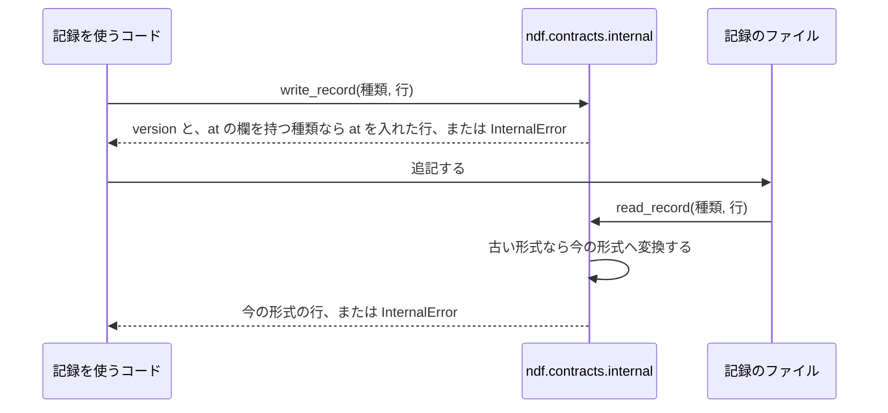

# 内部データの型とバージョン: NDF の記録を種類ごとのスキーマで確かめ、古い形式は読むときに 1 か所で変換する

NDF は、LLM の使用量、変更がプロジェクトの方針（MVV）に沿うかの判定、開発の進み具合などをファイルや DB に書き、後で自分で読む（**内部データ**と呼ぶ）。内部データは種類ごとに
JSON Schema を持ち、どのデータにも、形式を区別する整数のバージョン（キー `version`。全種類で共通の番号）を書く。`plugins/ndf/src/ndf/contracts/internal.py` が、書く前と読んだ後に
スキーマで確かめ、古い形式は今の形式へ変換して返す。同じ意味の値には同じキーを使い、別のキーを足すと `ndf check` の規則 `internal-names` が落とす。

例: 開発ループ（リリースを 1 つ終えるたびに次の課題を選んで続ける進め方）のイベントのうち、バージョンを付ける前に書かれた行を、今の NDF が読む。

| | 行 |
| --- | --- |
| ファイルにある行 | `{"at": 1795400000.0, "kind": "version-shipped", "lap": 2, "version": "11.0.23"}` |
| 読んだ結果 | `{"at": "2026-11-23T02:13:20.000000+00:00", "kind": "version-shipped", "lap": 2, "product_version": "11.0.23", "version": 1}` |

この行の `version` はリリースした製品のバージョン（文字列）なので、`product_version` へ移し、秒で書かれた時刻を文字列へ直す。ファイルは書き換えない。

## コンテキスト

この文書の用語は、用語集の区分 `ndf-code-structure`（NDF のコードの構造）のものを使う。内部データの形式は、NDF を導入したリポジトリの記録でも同じである。

## 用語

「名前の対応表」「スナップショット」の定義は [用語集](../glossary.md) にある。

| この文書だけで使う語 | 意味 |
| --- | --- |
| 内部データ | NDF が書いて、後で自分で読むデータ。種類は「種類」の表にある |
| スプリント | 1 回のリリースで出す課題と Pull Request のまとまり |
| 工程 | スプリントの中の設計・実装・リリースなどの 1 ステップ |
| プラン | 工程の中で順に打つコマンドを並べた JSON |
| 文脈 | スプリントの工程どうしで引き継ぐ値（種類 `context`）。会話の文脈とは別 |
| 形式のバージョン | 内部データの形式を区別する整数。キーは `version` |
| 製品のバージョン | リリースした製品のバージョンの文字列。キーは `product_version` |

## 構成要素と責務

| 要素 | 責務 |
| --- | --- |
| `contracts/schemas/internal/<種類>.schema.json` | 種類ごとの形式。決めた欄だけを許す（`additionalProperties: false`） |
| `contracts/schemas/internal/common.schema.json` | 共通の欄。読める形式のバージョン（`$defs/version`）と時刻の書式（`$defs/time`） |
| `ndf.contracts.internal` | 種類の一覧（`KINDS`）・スキーマの確かめ・古い形式からの変換・時刻の変換 |
| `contracts/data/internal-names.json` | 名前の対応表。意味ごとに使うキーと、使わないキーを持つ |
| `src/ndf/checks/internal_names.py` | スキーマの欄と、記録を書くコードのキーを名前の対応表と比べる（規則 `internal-names`） |
| `ndf.domains.records.jsonl` | 1 行ずつ追記する記録を、`ndf.contracts.internal` を通して読み書きする |

## 理由

| 困っていたこと | 今の形 |
| --- | --- |
| 記録に型が無く、誤った値が書かれても、読むまで分からなかった | 書く前と読んだ後の両方で、種類ごとのスキーマで確かめる |
| `version` というキーが、製品のバージョン・MVV の設定のバージョン・データの形式のバージョンの 3 つの意味で使われていた | `version` は形式のバージョンだけに使い、ほかは `product_version`・`mvv_version`・`definition_version` にした |
| 時刻のキーが `at`・`created_at`・`updated_at`・`started_at`・`ts` の 5 通りあった | `at` の 1 つにした。値は UTC の RFC 3339 の文字列である |

## 仕様

### 種類

| 種類 | 中身 | 書くコード | 読むコード | バージョンの無い古い形式から変わるところ |
| --- | --- | --- | --- | --- |
| `usage` | LLM の使用量 | `records/usage.py` | `records/usage.py`・`relay/context_report.py` | `version` を足すだけ |
| `mvv-signals` | MVV を見直す兆候（人の判断の上書きなど） | `records/mvv.py` | 同左 | `version` → `mvv_version`（無ければ `null`） |
| `mvv-validation` | MVV の判定の結果 | `records/mvv.py` | 同左 | 時刻のキーを `at` へ |
| `context-records` | 会話を切り替えるかの判定 | `relay/context_records.py` | 同左 | 時刻のキーを `at` へ。`schema`・`policy`・`margin`・`config_error` を外す。`event` が無ければ `"判定"` を入れる |
| `loop-event` | 開発ループのイベント | `loop/store.py` の `LoopStore.append` | `LoopStore.read` | 秒の `at` を文字列へ。文字列の `version` → `product_version`。期限の `until` は秒のまま |
| `context` | 工程どうしで引き継ぐ値 | `progress/command.py` の `_new_doc` | `progress/stages.py` の `compose_context` | `version` → `product_version` |
| `stage-snapshot` | スプリントを始めた時点の工程の定義 | `progress/command.py` の `_new_doc` | `progress/command.py` の `read_current` | `version` → `definition_version`。各工程の入出力の `version` → `product_version` |

スキーマは `contracts/schemas/internal/<種類>.schema.json` にある（`context` だけは `contracts/workflow/context.schema.json`）。コードのパスは、
`progress/` は `src/ndf/` の下、ほかは `src/ndf/domains/` の下である。種類を足すときは、スキーマを置き、`KINDS` に 1 行を足す。

次のデータは対象にしない。

- 途中から再開できる処理の状態。再開の仕組みを持つライブラリ DBOS が、形式とバージョンを管理する
- 複数のスプリントを並行して進める計画（`parallel-plan`）と工程の表（`progress`）。もともと `version` を持つ。計画を読む `progress/plan/__init__.py` の `read_doc` が、
  新しいバージョンの計画を受け付けない
- 工程の入出力（`stage-io`）。形式のバージョンは付けない。実行の途中で NDF が更新されると、更新前に保存した値に古いキーが残るので、
  その分だけは下の「工程どうしで引き継ぐ値」の箇所で直す

### 読み書きの関数（`ndf.contracts.internal`）

| 関数 | すること |
| --- | --- |
| `write_record(kind, row)` | `version` を入れ、`at` の欄を持つ種類で `at` が渡されなければ今の時刻を入れ、スキーマで確かめて返す。`at` の欄を持たない `context` と `stage-snapshot` には `at` を入れない。合わなければ `InternalError` を投げ、何も書かない |
| `read_record(kind, raw)`・`read_line(kind, line)` | 今の形式へ変換し、スキーマで確かめて返す |
| `migrate(kind, raw)` | 今の形式へ変換するだけで、確かめない |
| `readable_version(kind, raw)` | 形式のバージョンを返す。今より新しければ `InternalError` |
| `stage_values(raw)`・`stage_value_key(key)` | 工程どうしで渡す値の、古いキー `version` を `product_version` へ直す |
| `stamp(seconds)`・`epoch(at)` | 秒と `at` の文字列（マイクロ秒まで）を相互に変換する |

- 整数の `version` を形式のバージョンと見る。無いか整数でなければ、バージョンを付ける前の形式（0）と見る。`mvv-signals` だけは古い形式でも `version` が
  整数なので、`mvv_version` の欄が無い行を 0 と見る
- 今の形式のバージョンは全種類で共通の 1 つ（今は 1）で、共通の欄のスキーマの `$defs/version` の `enum` の最後の値から読む
- 時刻は UTC（`Z` か `+00:00`）の RFC 3339 で、実在する日時だけを受け付ける。この書式の確かめは内部データだけに効き、
  NDF のほかの JSON Schema の `format` の検証は変えない
- エラーの文には、スキーマの中の場所と規則の名前だけを入れる。記録の値やキーは、秘密の値を含むことがあるので入れない

| `InternalError` の種類 | 起きたこと | 終了コード |
| --- | --- | ---: |
| `invalid` | スキーマに合わない。JSON として読めない | 2 |
| `config_broken` | 呼び出しが渡した種類が `KINDS` に無い | 2 |
| `precondition` | 今の NDF が知らない新しい形式。プラグインを更新すると読める | 3 |

途中で処理されなかった `InternalError` は、`ndf.cli` が `stopped` の結果 JSON にして終わる。

### 1 行ずつ追記する記録（`records/jsonl.py`）

読むとき（`read_rows`）は、壊れた行とスキーマに合わない行を飛ばして続け、飛ばした行番号と理由を返す。今より新しい形式の行があるか、知らない種類を渡されたら止まる。

| 読むところ | 飛ばした行の伝え方 |
| --- | --- |
| 使用量の集計 | 結果の `broken_rows` に件数 |
| 会話を新しく始めるかの判定の、集計（`report`）と判定に使う費用の見込みの計算し直し（`calibrate`） | 結果の `metrics.skipped` に件数（報告が読む使用量の行は `usage_skipped`） |
| MVV の記録、サブエージェントの使用量の記録 | 結果の `items` に警告 `{"kind": "broken_rows", "path", "lines"}` |

- MVV の判定は、同じ入力の前回の結果を使い回す。ただし、ファイルの中で前回の結果の行より後ろに飛ばした行があり、
  それが同じ入力の判定かもしれないときは、判定し直す
- サブエージェントの使用量は、会話ログの合計から、同じサブエージェントの記録済みの分を引いて書く。引くときに読む記録は、そのサブエージェントの行だけを
  スキーマで確かめる
- 開発ループのイベントは 1 件でも欠けると状態を復元できないので、合わない行があれば読み込み全体を `StoreError` で止める
- Claude Code の会話ログは NDF の形式ではないので、確かめずに `parse_lines` で読む

### 工程どうしで引き継ぐ値

文脈は、スプリントを始めた時点の値に、工程の出力を古い順に上書きして作る。上書きするのは `compose_context` だけで、形式のバージョンは始めた時点の値のものを使う。
リリース済みかどうかは、`product_version` があるかで判断する（工程を実行する条件の 1 つ `release_record`）。

リリースした製品のバージョンは、出す側も受け取る側も `product_version` に書く（結果 JSON の `outputs`、リリースの手順 `ndf release-steps` の結果、
リリースを行う worker（NDF が 1 つの作業を任せて起動する AI のプロセス）の作業 `release` の出力、リリースの工程 `deploy` の出力、リリース後の確認の工程 `release-verification` と表示の確認の工程
`layout-review` の入力）。更新前の NDF が保存した古いキー `version` は、次の箇所が `ndf.contracts.internal` の関数を呼んで直す。

| 保存されている値 | 直すところ |
| --- | --- |
| 工程の出力のイベント | `compose_context` |
| 工程の定義のスナップショット | `read_record("stage-snapshot", …)` |
| プランの出力 `outputs.json` | `core/plan/records.py` の `_stored_outputs` |
| プランの結果のバックアップ | `core/plan/records.py` の `read_result` |
| 工程の入力 `values.json` の `inputs` | `contracts/worker_kinds.py` の `values_of` |
| プランがほかのプランの値を参照する `key: "version"` | `core/refs` が `stage_value_key` で直す |

### 結果 JSON のバージョン

サブコマンドの結果 JSON も、任意の `version`（整数。無ければ 1）を持つ。次の表の `precondition`・`invalid`・`bad_report` は、`status` が `stopped` の
結果 JSON の `cause.kind`（停止理由）の値である。`bad_report` は、呼んだ作業の結果 JSON が無いか形式が違うことを表す。

| 場面 | 今より新しい `version` のとき | スキーマに合わないとき |
| --- | --- | --- |
| 結果を出す（`result.emit`） | スキーマに合わないときと同じ | 元の結果を出さず、代わりの `stopped`（`invalid`）を 1 行で出して終了コード 2 |
| 工程の作業や Skill の結果を受け取る（`result.received`） | 代わりの `stopped`（`precondition`）にする | 受け取らない（`bad_report`） |
| プランのステップの結果を受け取る（`core/plan/steps.py` の `last_json`） | 代わりの `stopped`（`precondition`）にする | 確かめない（一部の欄だけの結果も受け取る） |
| 保存したプランの結果を読む（`stored_result`） | `InternalError`（`precondition`） | 確かめない |

代わりの結果には元の値を入れない。`tool` は固定の `ndf` にし、`detail` は誤りの件数と、標準エラーに出すものと同じエラーの文で作る
（`emit` が結果をスキーマで確かめるのは 1 回）。エラーの文には元の値とキーを入れず、スキーマの中の場所と規則の名前だけを書く
（`required` は欠けた欄の名前を添える）。スキーマでは見ない誤り（表に無い `cause.kind`・`severity`・`routes` のキー、新しい `version`、終了コードの食い違い）も、欄の名前と、コントラクトの表（停止理由・重大度など）に載っている語だけで書く。停止理由の表（`contracts/causes/`）の `invalid` が読めないときも、代わりの結果を 1 行で出す（`emit_unchecked`）。

### キーの名前（名前の対応表と規則 `internal-names`）

名前の対応表は、意味ごとに、使うキー（`key`）・使わないキー（`aliases_removed`）・そのキーを使う種類（`where`）を持つ。

| 意味 | 使うキー | 使わないキー |
| --- | --- | --- |
| 形式のバージョン（表の行の名前は「形のバージョン」） | `version` | `schema` |
| 書いた時刻 | `at` | `created_at`・`updated_at`・`started_at`・`ts` |
| 結果 | `status` | `result`・`outcome` |

全部の行は `plugins/ndf/contracts/data/internal-names.json` にある。意味の違う値に同じキーを使うときは、別の行を足す
（例: 開発ループの `outcome` は「ループの 1 回の終わり方」）。

規則 `internal-names` は、種類のスキーマの欄と、記録を書く関数（`rules.json` の `internal_names.writers`）に渡す辞書のキーを調べる。
対応表にあるキーと時刻の欄が対象で、その種類が `where` に無ければ違反にする。

## 常に成り立つ条件

| # | 条件 | 破れたときの扱い |
| --- | --- | --- |
| I1 | スキーマに合わない行はファイルに書かれない | 書く前に `InternalError` |
| I2 | 古い形式の変換の仕方は `ndf.contracts.internal`（`KINDS` と `stage_values`）だけが持つ。ほかのコードはその関数を呼ぶ | レビューで確かめる |
| I3 | 新しい形式のデータを、古い NDF が途中まで読んで判断しない | `precondition` で止まる |
| I4 | 内部データのキーは、名前の対応表でその種類に許したものである | `internal-names` が落ちる |
| I5 | エラーの文（標準エラーに出す文を含む）と代わりの結果に、元の値が出ない | `contracts/test_internal.py`・`test_result.py` が落ちる |

## 決定と理由

| 決定 | 理由 |
| --- | --- |
| 形式のバージョンを行ごとの `version` に書く | 1 つの `*.jsonl` に違うバージョンの行が混ざるので、ファイル名では区別できない。欄の有無で区別すると、その判定が読むコードごとに散らばる |
| 変換は種類ごとの関数 1 つに置き、ファイルは書き換えない | 進行中のスプリントの記録を書き換えると、動いているプロセスが読む内容とずれる |
| スキーマは決めた欄だけを許す | 綴りや型の誤りを、書く前に見つけられる |
| 追記する記録は、合わない行を飛ばして続け、飛ばした件数を結果に出す | 1 行の誤りで集計の全体が止まらない。黙って欠けることもない |
| 時刻は `at`、結果は `status` にそろえ、意味の違う `state`・`verdict`・`until` などは残す | すべてを 1 つの名前にすると、意味の違う値を取り違える |
| `rfc3339-validator` を足さず、時刻の書式の確かめを自分で書く | 依存を増やさずに、実在しない日付と UTC でない時刻を見つけられる |

## テスト観点

| 観点 | テスト（`plugins/ndf/tests/` の下） |
| --- | --- |
| 種類ごとの古い形式、新しい形式、知らない種類、時刻の書式 | `contracts/test_internal.py` |
| 飛ばす行と、止まる行 | `domains/records/test_jsonl.py` |
| 古い形式と今の形式が混ざった記録から、開発ループの状態を復元できること | `domains/loop/test_loop_store.py` |
| 更新前にリリースしたスプリントの再開、新しい形式の文脈とスナップショット | `progress/test_context_version.py` |
| 工程が受け取った結果のバージョン | `progress/test_invoke_result_version.py` |
| 代わりの結果と標準エラーの文に元の値が無いこと | `contracts/test_result.py` |
| MVV の判定を使い回すかどうかと、飛ばした行 | `domains/records/test_mvv_gate.py` |
| 名前の対応表に無いキー | `checks/test_internal_names.py` |

## 関連リンク

- [issue #2339](https://github.com/devbasex/ai-plugins/issues/2339) — 内部データの型・バージョン・キーの名前をそろえる
- [ndf-contract-fact-checks.md](ndf-contract-fact-checks.md) — コントラクトの値の検査
- [ndf-context-restart-policy.md](ndf-context-restart-policy.md) — 会話を切り替えるかの判定の記録
- [ndf-rebuild-scripted-flow.md](ndf-rebuild-scripted-flow.md) — 結果 JSON と停止理由
- [ndf-stage-plan-work-prompts.md](ndf-stage-plan-work-prompts.md) — 作業が必ず返す出力
