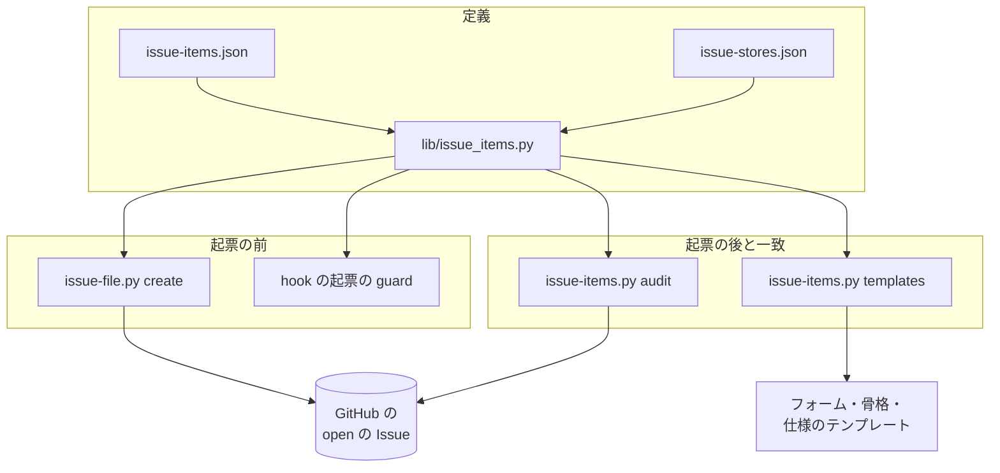

# Issue の記載項目: 種類ごとに何を書くかを 1 か所で定め、起票の前と後に確かめる（issue-items.json・issue-items.py・起票の guard）

## 概要

**Issue の本文に何を書けば足りるかを、種類（不具合・機能・調査・運用）ごとに 1 つのファイル（記載項目の定義）で定める。**
GitHub のフォーム・`out-of-scope` の本文の骨格・`requirements-design` の仕様のテンプレートはこの定義の項目名で書き、
継続的統合の一致の検査が食い違いを落とす。欠けた起票は、起票の前（AI が `issue-file.py create` か `gh issue create` で
打つとき）か起票の後（棚卸しで open の Issue を一覧にするとき）に見つかる。

例: AI が種類のラベル `bug` を付け、`## 事象` と `## 期待する結果` だけを持つ本文で `gh issue create --label bug --body-file body.md`
を打つと、Claude Code の起票の guard が「再現手順・環境・影響」の欠けを理由に拒否し、定義のファイルのパスと正しい起票の手段を示す。
Web のフォームから起票された Issue は起票の前に止められないため、棚卸しで `issue-items.py audit` が番号と欠けた項目を並べる。

この文書は、その形に**なぜしたか**（背景・決定と理由・常に成り立つ条件・入出力の契約・既知の限界・テスト観点）を残す。
**項目の中身の正はデータのファイルにある。** 項目と区分と水準は
[`plugins/ndf/scripts/data/issue-items.json`](../../plugins/ndf/scripts/data/issue-items.json)、置き場ごとの表し方と工程が足す節の
見出しの一覧は [`plugins/ndf/scripts/data/issue-stores.json`](../../plugins/ndf/scripts/data/issue-stores.json) を読む。

## 用語

「Issue の種類」「記載項目」「必須の項目」「該当時の項目」「記載の水準」「記載項目の定義」「起票の前の検査」「起票の後の検査」
「課題の置き場」「一致の検査」「工程が足す節」「置き場ごとの表し方」の定義は用語集（[docs/glossary.md](../glossary.md)）が正である。

## 背景

2026-11-07 に直近 300 件（#1997〜#2733）の本文を数えると、本文の形は 3 系統（GitHub のフォーム・`out-of-scope` の 6 節・要求の本文）に
分かれ、40% はどの形にも当たらず、フォームの利用は 0 件だった。字面の違う見出しは 395 種類あった。何を書けば足りるかの一覧が無く、
AI が手で打つ起票を確かめる仕組みも無かった。

種類で必須の欄を変える形と、種類を課題の置き場の欄に置く形は、主要な製品（GitHub のフォームの `validations.required`、Jira の
work type、Redmine のトラッカー）に共通する。不具合の必須の項目（事象・期待する結果・再現手順・環境）は Mozilla と Chromium の
バグ報告の指針から、受け入れ条件の水準（観測できる結果）は INVEST の Testable と Gherkin の Given / When / Then から採った
（出典は「関連リンク」）。

## 決定と理由

| # | 決定 | 理由 | 採らなかった案 |
| ---: | --- | --- | --- |
| 1 | 記載項目の定義を JSON の 1 ファイルに置き、置き場ごとの表し方を別のファイルに分ける | 判定・一致の検査・フォームの欄の対応を同じデータから導ける。定義の語を置き場に依らない語に保てる | Markdown の表を正本にして読む（表の書式の揺れで読み違える）。既存の Action（issue-ops/validator・need-info-action）は起票の前に動かず、骨格と仕様のテンプレートを見ない |
| 2 | プロジェクトの `.ndf/issue-items.json` があれば、既定の定義の代わりにそのまま読む。表し方のファイルは置き換えない | 項目ごとに合成すると合成の規則（消す・足す・水準だけ変える）が新しく要る。独自の項目は各置き場の「ほかの項目」の表し方で表せるため、表し方を直さずに足せる | 既定と項目ごとに合成する |
| 3 | 起票の後の検査は棚卸し（`backlog-refinement`）の手順で打つ | 継続的統合の定期実行にすると、既存の Issue を書き換え終わるまで毎回落ち続けて読まれなくなる。起票の hook では Web の起票を拾えない | 継続的統合の定期実行、起票の hook |
| 4 | `out-of-scope` の今までの 6 節の本文を、起票の前の検査で受け付けない | 古い見出しを別名として受けると、判定と一致の検査が別名の表を持ち、定義が 1 か所でなくなる。6 節の本文を書くのは骨格だけで、骨格は定義の項目名で書く | 古い見出しを別名として受ける |
| 5 | 優先・担当・時期は課題の置き場の欄（ラベル・担当者・マイルストーン）に置き、見積だけを本文の `## 見積` に置く | 欄は一覧と絞り込みで使え、棚卸しもそこを読む。本文にも書くと 2 か所が食い違う。GitHub には見積の欄が無い | 本文の節に置く |
| 6 | 「依頼（原文）」は書き手が書く節の最後に置き、その後ろには工程が足す節だけを許す | 進捗記録（`projects-sync.sh`）が本文の末尾へ `## 進行` を足すため、文字どおり本文の最後にすると記録のたびに順序の違反になる | 本文の一番最後に置く |
| 7 | Claude Code の hook に起票の guard を足し、本文を読めない形（標準入力・変数・`--web`）も止める | `gh issue create` は `issue-file.py` を通らない。読めない形を通すと、その形で書けば検査を避けられる。拒否の理由に `--body-file` で渡す手段を書くので打ち直せる | スクリプトの中の判定だけにする |
| 8 | 不具合の受け入れ条件と対象範囲は該当時にし、種類はラベル（フォームが自動で付ける・AI は `--label`）で表す | 不具合では期待する結果がそのまま直ったと言える条件になり、受け入れ条件を必須にすると同じ内容を 2 度書かせる | 不具合も受け入れ条件を必須にする。種類を本文の節に書く |

白紙の Issue を許す設定（`.github/ISSUE_TEMPLATE/config.yml` の `blank_issues_enabled`）は `true` のまま残す。白紙で起票された
Issue も起票の後の検査が拾う。

## 仕様

### 構成要素と責務

| 要素 | 責務 |
| --- | --- |
| [`data/issue-items.json`](../../plugins/ndf/scripts/data/issue-items.json) | 記載項目の定義の既定（30 項目。種類ごとの区分・水準・該当する条件、最後に置く項目 `last`） |
| [`data/issue-stores.json`](../../plugins/ndf/scripts/data/issue-stores.json) | 置き場ごとの表し方（GitHub・markdown・Redmine）と、工程が足す節の見出しの一覧（`record_headings`） |
| [`lib/issue_items.py`](../../plugins/ndf/scripts/lib/issue_items.py) | 定義と表し方を読み（`load_definition`・`definition_for`）、常に成り立つ条件 I1〜I3 を確かめる。本文とラベルと文脈から欠けを返す純粋な判定（`judge_body`） |
| [`issue-items.py`](../../plugins/ndf/scripts/issue-items.py) | `audit`（起票の後の検査）と `templates`（一致の検査） |
| [`issue-file.py`](../../plugins/ndf/scripts/issue-file.py) の `create` | 起票の前に本文を `judge_body` で判定し、欠けがあれば起票しない（詳細は [out-of-scope-issue-file.md](out-of-scope-issue-file.md)） |
| [`hook_lib/issue_guard.py`](../../plugins/ndf/scripts/hook_lib/issue_guard.py) と `hook.py` の `_issue_guard` | Claude Code の PreToolUse（Bash）で `gh issue create` を見つけ、本文とラベルを読み、欠けがあれば拒否する |
| `.github/ISSUE_TEMPLATE/*.yml`・`out-of-scope` の骨格・`requirements-design` の [仕様のテンプレート](../../plugins/ndf/skills/requirements-design/references/spec-template.md) | 定義の項目名で書き、受け持つ種類の必須の項目を含む |
| `.github/workflows/script-structure.yml` | 一致の検査（`issue-items.py templates --root .`）を継続的統合で打つ |
| `backlog-refinement` の SKILL.md | 棚卸しの手順で `issue-items.py audit` を打つ |



### 常に成り立つ条件

| # | 条件 | 破れたときの扱い |
| --- | --- | --- |
| I1 | すべての項目が 4 種類のそれぞれに「必須」「該当時」「不要」のどれか 1 つを持つ | 定義を読む時点で止まり、終了コード 2 で項目と種類を返す |
| I2 | すべての項目が水準の文を 1 つ以上持ち、該当時を 1 つでも持つ項目は該当する条件の文を持つ | I1 と同じ |
| I3 | 定義のすべての項目が、GitHub・markdown・Redmine のそれぞれで表し方を 1 つに解決できる。識別子ごとの表し方が無ければ、その置き場の既定（`default`。「ほかの項目」）を使う。定義に無い識別子の表し方は読み飛ばす | I1 と同じ |
| I4 | テンプレートは受け持つ種類の必須の項目をすべて含み（フォームでは必須欄）、項目名に当たらない節・欄を持たない | 一致の検査が終了コード 1 で、テンプレートと項目の名前を返す |
| I5 | 「依頼（原文）」の後ろには工程が足す節（`record_headings` の語の見出し）しか置かない | 本文の判定が `order` の欠けとして返す |
| I6 | 種類のラベルが 0 個か 2 個以上の本文は「種類が不明」として欠けに数える | 起票の前なら止め、起票の後なら一覧に載せる |
| I7 | 必須の項目（と、条件が機械で決まる該当時の項目）が 1 つでも欠けた本文では Issue を作らない | `issue-file.py create` は終了コード 1、hook は拒否 |
| I8 | 起票の前の検査は GitHub を呼ばず、本文とラベルと起票の引数だけで判定する | — （判定の関数が GitHub の部品を import しない） |
| I9 | 起票の後の検査は、GitHub を読めないときと open の Issue が上限（2000 件）を超えて全件を読めないときに、欠け 0 件と報告しない | 終了コード 2 |
| I10 | 起票の後の検査は open の Issue だけを読む。課題の置き場が GitHub でなければ検査しない | 置き場が GitHub 以外なら終了コード 0 で「検査しなかった」と置き場の名前を返す |

### 本文の判定（`judge_body(本文, ラベル, 文脈, 定義)`）

- 種類は、ラベルのうち種類のラベル（既定は不具合 `bug`・機能 `enhancement`・調査 `investigation`・運用 `operation`）で決める（I6）
- 見出しは H2 か H3 で、語は項目名か「項目名: 補足」「項目名（補足）」。コードブロックの中の `#` は見出しに数えない
- 節が空かは、次の同じか上の段の見出しまでで判定する。HTML のコメント・`_No response_`（フォームの空の欄）・`<!-- ndf:section-end -->` は中身に数えない
- 文脈は機械で決まる該当時の条件のキー（`ai`・`origin`）の真偽を持つ。`create` は `{"ai": true, "origin": true}`、hook は `{"ai": true}`、`audit` は空（起票した者が AI かは GitHub から決められないため、必須の項目・種類・順序だけを見る）
- 欠けは `{"heading": <項目名>, "result": "missing" / "empty" / "order" / "kind"}` で返す

## データ・設定

### 記載項目の定義（`issue-items.json`）

| キー | 型 | 意味 |
| --- | --- | --- |
| `version` | 整数 | 形の版。1 |
| `kinds` | 文字列の配列 | `["不具合", "機能", "調査", "運用"]` |
| `items[].id` | 文字列 | 項目の識別子（`symptom` など）。表し方のキーになる |
| `items[].name` | 文字列 | 項目名。GitHub と markdown では節の見出しの語になる |
| `items[].need` | 種類 → `必須` / `該当時` / `不要` | 4 種類すべてを持つ（I1） |
| `items[].level` | 文字列 | 水準（I2） |
| `items[].when` | `{"text": 文字列, "key": "ai" / "origin" / null}` | 該当する条件。`key` を持つ条件だけを起票の前の検査が機械で判定する |
| `last` | 項目の識別子 | 書き手が書く節の最後に置く項目（`request`。依頼（原文）） |
| `kind_labels`（プロジェクトの定義だけ・任意） | 種類 → ラベル名 | 種類のラベル名を置き換える。種類は `kinds` のどれかで、置き換えた後のラベル名は種類どうしで重ならない |
| `record_headings`（プロジェクトの定義だけ・任意） | 文字列の配列 | 工程が足す節の見出しの語を、表し方のファイルの一覧へ足す |

既定の定義の区分（必須の項目だけを抜き出す。該当時と不要を含む全体は定義のファイルにある）:

| 種類 | 必須の項目 |
| --- | --- |
| 不具合 | 題・種類・事象・期待する結果・再現手順・環境・影響 |
| 機能 | 題・種類・目的・対象範囲・受け入れ条件 |
| 調査 | 題・種類・目的・対象範囲・受け入れ条件 |
| 運用 | 題・種類・目的・影響・対象範囲・受け入れ条件 |

該当時の項目のうち、機械で条件を決めるのは「起票者の推定」（`ai`。AI が起票するとき）と「由来」（`origin`。作業の途中で見つけたとき）である。

### 置き場ごとの表し方（`issue-stores.json`）

| 項目 | GitHub | markdown（`issues/` の下のファイル） | Redmine |
| --- | --- | --- | --- |
| 題 | 題の欄 | H1 | 題名（Subject） |
| 種類 | ラベル | 先頭の `種類: <種類>` の行 | トラッカー |
| 優先 | ラベル（`priority: high` / `medium` / `low`） | `優先: <値>` の行 | 優先度（Priority） |
| 担当 | 担当者の欄（assignee） | `担当: <名前>` の行 | 担当者 |
| 見積 | 本文の節 `## 見積` | 節 `## 見積` | 予定工数（Estimation time） |
| 時期 | マイルストーン | `時期: <スプリント>` の行 | 対象バージョン |
| 工程が足す節 | 見出しの語の一覧 `record_headings` で見分ける節 | 同左 | 注記（journal） |
| ほかの項目（`default`） | 本文の節 | 同左 | 説明（Description）の中の見出し |

### 定義の選び方

`.ndf/issue-items.json` があればそれを、無ければ既定を読む（`items_path`）。起票先が今のリポジトリ（`git remote get-url origin`）と
別なら、プロジェクトの定義を当てず既定を読む（`definition_for`）。

### テンプレートと受け持つ種類

| テンプレート | 受け持つ種類 |
| --- | --- |
| `.github/ISSUE_TEMPLATE/bug_report.yml` | 不具合（`labels: ["bug"]`） |
| `.github/ISSUE_TEMPLATE/feature_request.yml`・`skill_proposal.yml` | 機能（`labels: ["enhancement"]`） |
| `out-of-scope` の SKILL.md の骨格・仕様のテンプレート | 4 種類（どれかの種類の必須の項目をすべて見出しに持つ。種類に当たらない節は起票者が削る） |

## 外部連携

### `issue-items.py audit [--repo <所有者>/<リポジトリ>]`（起票の後の検査）

| 項目 | 内容 |
| --- | --- |
| 入力 | `--repo`（省くと今のリポジトリ）。`.ndf/project.json` の `issues.primary`（無ければ `github`）、`.ndf/issue-items.json`（任意） |
| 出力 | 1 行の JSON（`tool` は `issue-items`）。`items` は欠けのある Issue ごとに `{"kind": "issue", "name": "#<番号>", "result": "missing", "missing": [<項目名>...]}`。`metrics` は `{"checked", "missing", "store"}` |
| 終了コード | 0: 欠け 0 件、または置き場が GitHub でない（`metrics.checked` は `null`）。1: 欠けが 1 件以上。2: GitHub を読めない・上限を超えた・定義が I1〜I3 を破る・引数の誤り |

### `issue-items.py templates [--root <リポジトリ>]`（一致の検査）

| 項目 | 内容 |
| --- | --- |
| 入力 | `<root>/.github/ISSUE_TEMPLATE/*.yml`（`config.yml` を除く）と、NDF の `out-of-scope/SKILL.md`・`requirements-design/references/spec-template.md` の ` ```markdown ` のブロックの見出し |
| 出力 | `items` は食い違いごとに `{"kind": "template", "name": <パス>, "item": <項目名>, "result": "missing" / "not-required" / "unknown" / "kind"}` |
| 終了コード | 0: 食い違い 0 件。1: 食い違いが 1 件以上。2: テンプレートか定義を読めない |

### hook の起票の guard（Claude Code の PreToolUse・Bash）

| 項目 | 内容 |
| --- | --- |
| 対象 | コマンドの位置で起動する `gh issue create`（`env`・`command`・`nohup` などの包みと変数の代入を挟んでよい）。`-R` / `--repo` が今のリポジトリと違うときは判定しない |
| 本文の読み方 | `--body` / `-b` の文字列、`--body-file` / `-F` のファイル（その `gh issue create` を打つときの現在地からの相対）、`--body "$(cat <<'EOF' … EOF)"` のヒアドキュメント。ラベルは `--label` / `-l`（繰り返しとカンマ区切り。短縮の名前は値を続けてよい） |
| 拒否 | 欠けがある。本文を上の形で読めない（標準入力・変数・`--web`）。同じ Bash の中で先に本文のファイルへ書き込む（実行前の古い本文しか読めない）。理由に欠けた項目名・定義のファイルのパス・正しい手段（範囲外の課題は `issue-file.py create`、それ以外は `--label <種類のラベル> --body-file <ファイル>`）を書く |
| 通す | 欠けが無い。構文木を読み切れない・定義を読めない・guard の中の例外（hook が落ちると Tool の呼び出しが全部止まるため） |

## 運用

- 定義を改めるときは `issue-items.json` と、受け持つテンプレートを同じ Pull Request で直す。食い違いは継続的統合のジョブ `script-structure` が落とす
- 起票先のリポジトリに種類のラベルが無いと、gh は `could not add label` で起票ごと失敗する。ラベルを作らずに止め、プロジェクトの `kind_labels` で名前を合わせる（C7）
- 起票の後の検査が見つけた欠けを、機械が自動で書き足すことはしない。open の Issue の書き換えは #2738 が扱う

### 既知の限界

| 項目 | 内容 |
| --- | --- |
| `bash -c` の中や `gh api` での起票 | guard はコマンドの位置の `gh issue create` だけを見る。ほかの形の起票は起票の後の検査で拾う |
| Codex の上の起票 | 起票の前に止める仕組みは Claude Code の hook だけにある。Codex の上の起票は起票の後の検査で拾う |
| Redmine の担当者・対象バージョンの欄の名前 | 一次情報で名前を確かめていない。表し方は Redmine の既定の欄の名前で書いた |
| 閉じた Issue | 検査しない（I10）。書き換えもしない |

## テスト観点

判定と 2 つの副命令は `plugins/ndf/scripts/tests/test_issue_items.py`、起票の guard は `plugins/ndf/scripts/tests/test_issue_guard.py` にある。

- 既定の定義の 30 項目すべてが 4 種類の区分と水準を持ち、該当時の項目は条件を持つこと。区分を空にする・水準を消すと読み込みが終了コード 2 で止まること（I1・I2）
- 表し方のファイルに識別子の無い独自の項目を足した定義が「ほかの項目」の表し方で読み込め、置き場の既定を消すと終了コード 2 で止まること（I3）
- 「依頼（原文）」の後ろに工程が足す節でない節がある本文は `order` の欠けになり、`## 進行` だけが後ろにある本文は欠けにならないこと（I5）
- `templates` が今のフォーム 3 つ・骨格・仕様のテンプレートを通し、必須欄を 1 つ消す・`required` を外す・項目に無い見出しを足すと終了コード 1 で項目とテンプレートの名前が出ること（I4）
- 必須の項目が 1 つ欠けた本文で `create` を打つと終了コード 1 で欠けた項目名が返り、課題を作る関数が呼ばれないこと。骨格どおりの本文と種類のラベル 1 つで承認資料（終了コード 10）へ進むこと（I7）
- 欠けた本文の `gh issue create` が拒否され、理由に項目名と正しい手段が入ること。標準入力の本文も拒否されること。`-R` が別のリポジトリなら通すこと
- 種類のラベルが無い本文と 2 つある本文が「種類が不明」になること（I6）
- `audit` が欠けのある open の Issue の番号と項目を並べ、0 件なら 0・1 件以上なら 1 で終わること。フォームの `### ` の見出しと `_No response_` を読むこと。GitHub を読めないと終了コード 2 になること。open の Issue だけを読むこと（I9・I10）
- `issues.primary` が `redmine` の宣言で、`audit` が終了コード 0 と「検査しなかった」と置き場の名前を返すこと（I10）
- `gh` を呼べない状態でも guard と `create` の判定が結果を返すこと（I8）
- `audit`・`templates`・`create` の出力が `lib/step_result.py` の形を満たすこと

## 関連リンク

- [out-of-scope-issue-file.md](out-of-scope-issue-file.md)（`issue-file.py create` の前提条件と結果 JSON）
- [`backlog-refinement` の SKILL.md](../../plugins/ndf/skills/backlog-refinement/SKILL.md)（起票の後の検査を打つ手順）
- [`out-of-scope` の SKILL.md](../../plugins/ndf/skills/out-of-scope/SKILL.md)（本文の骨格と種類のラベル）
- 契約: [`plugins/ndf/contracts/entrypoints/plugins__ndf__scripts__issue-items.py.json`](../../plugins/ndf/contracts/entrypoints/plugins__ndf__scripts__issue-items.py.json)・[`plugins/ndf/contracts/settings/issue-items.json.json`](../../plugins/ndf/contracts/settings/issue-items.json.json)
- 外部の一次情報: GitHub のフォームの構文（ https://docs.github.com/en/communities/using-templates-to-encourage-useful-issues-and-pull-requests/syntax-for-issue-forms ）、Jira の work type（ https://support.atlassian.com/jira-cloud-administration/docs/what-are-issue-types/ ）、Redmine の Issue（ https://www.redmine.org/projects/redmine/wiki/RedmineIssues ）、Mozilla のバグ報告（ https://bugzilla.mozilla.org/page.cgi?id=bug-writing.html ）、Chromium のバグ報告（ https://www.chromium.org/for-testers/bug-reporting-guidelines/ ）、INVEST（ https://xp123.com/articles/invest-in-good-stories-and-smart-tasks/ ）、Gherkin（ https://cucumber.io/docs/gherkin/reference/ ）
- #2737（この形を決めた課題）、#2738（open の Issue の書き換え）
