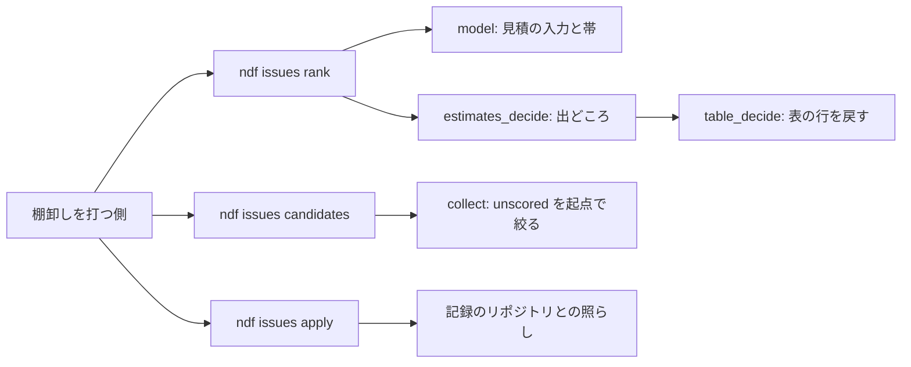
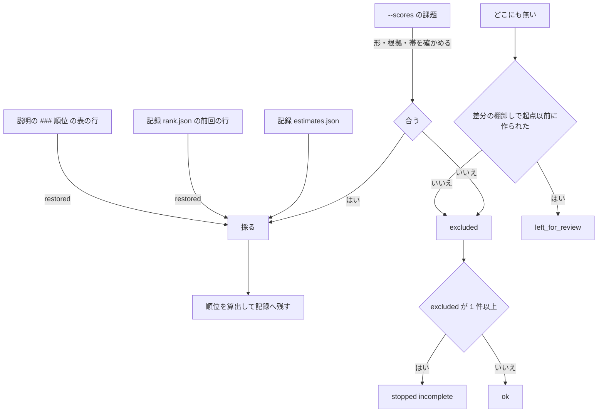

# 棚卸しの順位: 見積の入力・見積の出どころ・差分の棚卸しの起点・apply の書き込み先

`ndf issues rank` は、`backlog-refinement` の手順 2C が書く形の見積の入力（列ごとの `{"step", "why"}` と
`ubv.impact`）だけを読み、根拠の欠けと実害の目安の帯の外れを `excluded` に外す。見積は この回の入力 → 記録 →
前回の順位の記録 → マイルストーンの説明の `### 順位` の表 の順に採る。差分の棚卸しで `--since-ref` を渡すと、
起点以前に作られた見積の無い課題は `excluded` でなく `metrics.left_for_review` へ回る。`excluded` が 1 件でもあれば、
深さによらず `stopped`/`incomplete` で返す。`ndf issues apply` は、書く前に書き込み先と plan の `repo` を記録の
リポジトリと照らし、外した課題を持つ順位の plan を断る。

例: 差分の棚卸しで、課題 #3842 に段階を付けて `rank` を打つ。

```json
{"number": 3842, "digest": "<candidates の要約値>",
 "ubv": {"step": 5, "why": "棚卸しの手順 2C が通らない", "impact": "機能"},
 "tc": {"step": 3, "why": "次の棚卸しまでに要る"},
 "rr_oe": {"step": 1, "why": "ほかの課題を解かない"},
 "size": {"step": 3, "why": "5 つのモジュールに閉じる"}}
```

| 順 | 起きること |
| ---: | --- |
| 1 | `ndf issues rank --depth diff --since-ref ndf--v11.0.8 --scores <ファイル>` を打つ |
| 2 | #3842 は 4 列に根拠があり、UBV 5 が区分「機能」の帯 5〜8 に入るので採られる |
| 3 | 見積がどこにも無い古い課題（`ndf--v11.0.8` のコミットの時刻以前に作られた）は `metrics.left_for_review` に入り、順位にも `excluded` にも入らない |
| 4 | 起点より後に作られて見積の無い課題があれば `excluded` に「見積が無い（採点する）」で入り、`rank` は終了コード 6 で返る。段階を付けて打ち直す |
| 5 | `excluded` が 0 件の `rank` の `digest` を入れた plan を `apply` へ渡すと、記録のリポジトリと照らしてから書く |

| 何を読むか | 正本 |
| --- | --- |
| 棚卸しの手順（見積の付け方・入力の例・返りごとの次の手） | `plugins/ndf/skills/backlog-refinement/SKILL.md` の手順 2C・手順 3 と `references/ranking.md`・`references/depths.md` |
| 引数と結果の `metrics` の一覧 | `plugins/ndf/docs/contracts/commands.md` の `ndf issues` |
| 設定のスキーマ | `plugins/ndf/contracts/schemas/ndf-settings/backlog.schema.json` |
| 棚卸しの深さと候補の経路 | [ndf-backlog-refinement-depths.md](ndf-backlog-refinement-depths.md) |

## 概要

### 構成要素と責務

| 要素 | 責務 |
| --- | --- |
| `plugins/ndf/src/ndf/domains/backlog/model.py` | 見積の入力の形を読み（`parse_estimate`）、根拠と区分と退避策を持つ `Estimate` を作る。区分の帯を確かめる（`check_band`）。設定から `harm_guide` を読む |
| `plugins/ndf/src/ndf/domains/backlog/estimates_decide.py` | 見積の出どころを 4 つの順に採り、外した課題・見直しへ回す課題・戻した見積の課題に分ける |
| `plugins/ndf/src/ndf/domains/backlog/table_decide.py` | 書く側（`render`）と対になる `parse_rows` で、説明の `### 順位` の表の行を段階へ戻す |
| `plugins/ndf/src/ndf/domains/backlog/cli_input.py` | 課題のマイルストーンの説明から表の行を集め（`table_rows`）、起点の時刻と合わせて出どころの判定へ渡す |
| `plugins/ndf/src/ndf/domains/backlog/collect.py` | 差分の棚卸しの候補の経路 `unscored` を、起点の時刻より後に作られた課題に絞る |
| `plugins/ndf/src/ndf/domains/backlog/cli.py` | `rank --since-ref`・返りの `incomplete`、`candidates` の `metrics.since`、`apply` の書き込み先の照らしと外した課題を持つ順位の拒否 |



## 用語

用語の定義は用語集 [docs/glossary.md](../glossary.md) が正である。この文書で使う語は「見積の入力」「見積の根拠」「実害の区分」「差分の棚卸し」「見直し」「記録のリポジトリ」。
見積の 4 列は、遅延コストの 3 要素 UBV（利用者・業務の価値）・TC（時間の重要度）・RR/OE（リスクの低減・機会）と大きさ Size で、
段階（`step`）は設定の尺度（既定 1, 2, 3, 5, 8, 13, 20）の値である。

## 背景

11.0.0 の作り直しで、`rank` / `apply` は手順書の 4 つの振る舞いを失った。見積の入力は整数で読まれ、手順書の形の
入力はすべて外れた。`rank` に `--since-ref` が無く、差分の棚卸しで見積の無い課題 308 件を `excluded` にしたまま
終了コード 0 で返した。説明の `### 順位` の表を読まず、記録の無い手元で表を持つ課題が「見積が無い」で外れた。
plan の `repo` を知らないキーで断り、書き込み先の照らしも無かった。10 系はどれも手順書のとおりに持っていたため、
コードを手順書に合わせた。手順書に書かれていたが 11 系にも 10 系の意図にも当たらない記述（入力の `milestones`・
`needs_detail`、`### 並列の組（見込み）` の依存を `rank` が読むこと、前回の表からの変化の返り、返りの 20）は手順書から消した。

## 対象範囲

- NDF を入れたすべてのリポジトリで、Claude Code と Codex の両方で同じに働く
- プロジェクトごとの値は `.ndf/backlog.json` の `harm_guide` だけで、既定値を持つ
- 順位の式と尺度の既定値は変えない
- 10 系の 12 列の順位の表は読まない

## 仕様

### 集約

| 集約 | オーナー（書き換えてよいもの） | 根 | エンティティ | 値オブジェクト |
| --- | --- | --- | --- | --- |
| 棚卸しの記録 | `ndf issues`（`rank` が `estimates.json`・`rank.json` を書き、`apply` が GitHub を書く） | 記録の保存先 `.ndf/backlog/state/<repo>/` | 見積（課題ごと） | `Estimate`・順位の表の行 |

`Estimate` は 4 列の段階に加え、`why`（列 → 根拠の 1 行）・`impact`（UBV の実害の区分）・`mitigation`（退避策の
状態。`防いでいる` / `部分的` / `無い`、既定 `無い`）・`restored`（記録・前回の順位・説明の表から戻した根拠を持たない
見積の印。帯を確かめない）を持つ。

### 常に成り立つ条件

| # | 条件 | 破れたときの扱い |
| --- | --- | --- |
| I1 | `--scores` の見積は 4 列のすべてに空でない `why` を持つ | 順位に入れず、`excluded` に理由を添える |
| I2 | `ubv.impact` を持つ見積の UBV は、その区分の実害の目安の帯の中にある。`mitigation: 防いでいる` なら 1 つ下の区分の帯の値も受ける（例: `機能`（5〜8）で `防いでいる` なら 2〜3 も受ける） | `excluded` に理由を添える |
| I3 | 差分の棚卸しで、見積がどこにも無く起点以前に作られた課題は、`excluded` にも順位にも入らない | `metrics.left_for_review` へ番号を返す |
| I4 | `apply` は記録のリポジトリ以外へ 1 件も書かない | 書く前に `precondition` で止める |

### 見積の入力

| 項目 | 形 |
| --- | --- |
| `number`・`digest` | 課題の番号と、`candidates` が返した要約値 |
| `ubv`・`tc`・`rr_oe`・`size` | `{"step": <尺度の値>, "why": "<根拠>"}`。`size` の `step` は尺度の値か `"over"`（尺度を超える）。`ubv` は任意の `impact`（`harm_guide` のキー）を持つ |
| 任意の項目 | `mitigation`・`waiting_decision`・`observed_harm`・`depends_on` |

4 列の整数の形は「<列> は {"step", "why"} で書く」で外す。11.0.x が書いた整数の記録 `estimates.json` は、根拠の無い
記録の見積（`restored`）として採り、帯を確かめない。2 つの形を `--scores` で受けると、根拠の欠けが見えなくなるためである。

記録 `estimates.json` の 1 行は次の形で書く（根拠の無い列は `step` だけ）。`--sizes` で重ねた Size は記録へ写さず、毎回の入力から重ねる。

```json
{"number": 3842, "digest": "<要約値>",
 "ubv": {"step": 5, "why": "<根拠>", "impact": "機能"}, "tc": {"step": 3, "why": "<根拠>"},
 "rr_oe": {"step": 1, "why": "<根拠>"}, "size": {"step": 3, "why": "<根拠>"},
 "mitigation": "無い", "waiting_decision": false, "observed_harm": false}
```

### 見積の出どころ



| 出どころ | 扱い |
| --- | --- |
| この回の入力（`--scores`） | `digest` が無ければ外す。見直しは要約値を今の課題と照らし、違えば「見積が古い（採点し直す）」で外す。形・根拠・帯を確かめる |
| 記録 `estimates.json` | 見直しは要約値が違えば外す。区分を持つ見積は帯を確かめる |
| 前回の順位の記録 `rank.json` の行 | 深さによらず採り、`metrics.restored` に番号を載せる |
| 説明の `### 順位` の表の行 | 同上 |
| どこにも無い | 差分の棚卸しで起点があり、作成の時刻が起点以前なら `left_for_review`。それ以外は「見積が無い（採点する）」で外す |

前回の順位の行と説明の表から戻す見積では、見積でない値を尺度の最小へ戻す。ラベルの下限（設定 `label_floor`）で
押し上げた UBV（表の印 `（ラベル）`、行の `sources.ubv` がラベル）、被依存の数から決めた RR/OE（`（被依存）`）、
見積もりの記録から重ねた Size（`（見積もり）`）である。補正は再計算で付き直り、Size はその回の `--sizes` で重ね直す。
印を外した値を採ると、`--sizes` を省いた回にも `over` などが残る。戻した見積は要約値を持たず古いかを判定できないため、
外さずに `restored` で返し、見直しの手順書は `restored` の課題に段階を付け直して `--scores` で渡す。

`parse_rows` は `table_decide.render` が書く 8 列の行だけを読み、読めない行（人が書き換えた行）は捨てる。

### `rank` の返り

| 場合 | 返り |
| --- | --- |
| `excluded` が 0 件 | `ok`（0） |
| `excluded` が 1 件以上（深さによらない） | `stopped`/`incomplete`（6）。`gaps` に外した課題と理由。記録（`rank.json`・`estimates.json`）は書く |
| `--since-ref` のコミットの時刻を読めない | `stopped`/`invalid`（2） |
| 設定の `harm_guide` の誤り | `stopped`/`invalid`（2） |

`metrics` は `repo`・`depth`・`order`・`forward`・`backward`・`dropped`・`rejected_stale`・`excluded`・`sized`・`digest`
に、`left_for_review`（差分の棚卸しで `--since-ref` を渡したときだけ要素を持つ）と `restored` を足したもの。
`left_for_review` と `restored` は `excluded` に数えず、`digest` の材料にも入れない。

差分の棚卸しで `--since-ref` を省くと起点が無いため、見積の無い課題はすべて `excluded` に入り、`incomplete` が採点を促す
（`rank` を打ったことが無い初回は全件が採点の対象になる）。

### `candidates` の起点

`--depth diff --since-ref <ref>` のとき、経路 `unscored` は `<ref>` のコミットの時刻より後に作られた課題だけを拾い、
`metrics.since`（ISO 8601 の時刻）を返す。

### `apply` の照らし

| 場合 | 返り |
| --- | --- |
| 書き込み先（`--repo`、省けば origin）と plan の `repo`（無ければ照らさない）が記録のリポジトリと同じ | 書く |
| 記録 `candidates.json` が無い | 1 件も書かずに `stopped`/`precondition`（3） |
| 書き込み先か plan の `repo` が記録の `metrics.repo` と違う | 同上 |
| plan の `rank` が指す `rank.json` の `metrics.excluded` が 1 件以上 | 同上。「外した課題に段階を付けて rank を打ち直してから plan を作る」 |
| plan の `rank` が `rank.json` の `digest` と違う | `stopped`/`invalid`（2） |

外した課題を持つ順位を断るのは、`rank` が `incomplete` でも記録を書き、`digest` だけの照らしでは外した課題の無い表で
既存の行を消せるためである。

## データ・設定

`.ndf/backlog.json` の `harm_guide`: 区分の名前 → `[下限, 上限]`（どちらも尺度の値）。既定は
`{"全体": [13, 20], "機能": [5, 8], "表示": [2, 3], "なし": [1, 1]}`。

| 設定 | 帯の端がすべて尺度にある | 端のどれかが尺度に無い |
| --- | --- | --- |
| `harm_guide` を書いた | その帯で確かめる | 設定の誤り（`stopped`/`invalid`、2）。下限 > 上限も同じ |
| `harm_guide` を書いていない | 既定の帯で確かめる | 帯を確かめない。`impact` は確かめずに記録へ残し、`warnings` に「尺度が既定と違い harm_guide が無いため、実害の目安の帯を確かめていない」を載せる |

既定の帯を尺度の位置で読み替えない。区分の意味と段階の値の対応を NDF が推すことになるためで、帯を確かめたい
リポジトリは `harm_guide` を自分の尺度で書く。

`harm_guide` が空でなく、`impact` がそのキーに無い見積は「UBV の区分 <値> が実害の目安に無い」で外す。

## 外部連携

GitHub の課題とマイルストーンを読む（説明の表は 1 回の一覧で集める）。`apply` だけが GitHub へ書く。

## エラー処理

| 失敗 | 利用者に見える出力 |
| --- | --- |
| 列が整数・`step` が無い | `excluded` の理由「<列> は {"step", "why"} で書く」 |
| `step` が尺度に無い | `excluded` の理由「<列> が尺度 [...] に無い」 |
| 根拠が空 | `excluded` の理由「<列> の根拠（why）が空」 |
| 帯の外 | `excluded` の理由「UBV <値> は区分「<区分>」の帯 <下限>〜<上限> の外」 |
| `mitigation` が 3 つの値のどれでもない | `excluded` の理由 |

## 運用

`rank` は打ち直せる。`apply` の照らしは書く前に行うため、止まっても書き込みは 0 件である。同じ保存先では
`rank` と `apply` を 1 本ずつ打つ。

## 決定と理由

| 決定 | 理由 |
| --- | --- |
| コードを手順書と 10 系の振る舞いに合わせる | 落ちた振る舞いを手順書から消すと、根拠の 1 行・帯の確かめ・差分の棚卸しの絞り込み・書き込み先の守りがどこにも無くなる |
| `excluded` があれば深さによらず `incomplete` | 差分の棚卸しで外した課題を見落とさない。起点以前の課題を `left_for_review` へ分ければ、差分の棚卸しの `excluded` はこの回に採点すべき新しい課題だけになる。採点し直しは結果のコントラクトの `incomplete` に当たり、`gate`（人の承認待ち）ではない |
| 説明の表は 11 系の 8 列の形だけを読む | 10 系の表は今開いているマイルストーンに無い。読み手のいない形の解析を足さない |

## テスト観点

テストは `plugins/ndf/tests/domains/backlog/test_issues_cli.py`・`test_selection_estimates.py`・`test_apply_actions.py`・`test_routes.py` にある。

- `ranking.md` の例の形の入力で課題が順位に入ること
- `why` が空・無い列と整数の形の課題が `excluded` に理由つきで入ること
- `impact` が帯の外の UBV は外れ、`mitigation: 防いでいる` は 1 つ下の帯で通ること。`harm_guide` を書いた設定をスキーマが受け、値が帯を変えること
- `harm_guide` を持たずカスタムの `scale`（例 `[1, 2, 4, 8, 16]`）を持つ設定で、設定を変えずに `rank` が打て、帯を確かめずに `warnings` を返すこと。同じ尺度で `harm_guide` を書き、端が尺度に無ければ `invalid` になること
- `rank` の後の `estimates.json` が根拠と区分を持ち、次の回に記録から採った見積が帯で確かめられること
- `--since-ref` の時刻以前に作られた見積の無い課題が `left_for_review` に入り、時刻より後の課題は `excluded` に入ること
- 差分の棚卸しの候補の `unscored` が時刻より後の課題だけで、`metrics.since` を返すこと
- `excluded` が 1 件以上なら差分の棚卸しでも `incomplete`、0 件なら `ok` であること
- 記録の無い保存先で、説明の表に行を持つ課題の段階が `--depth diff` でも `--depth review` でも採られ、`metrics.restored` に載り、`apply` の後の表から行が消えないこと。印の付いた段階と `rank.json` の行の補正した段階・重ねた Size が尺度の最小へ戻ること
- `excluded` を持つ `rank` の `digest` を入れた plan の `apply` が書き込み 0 件で `precondition` になること
- plan の `repo` か `--repo` が記録と違う・記録が無いと、書き込みが 0 件で `precondition` になること

## 関連リンク

- 棚卸しを工程として通すこと: [ndf-backlog-refinement-stage.md](ndf-backlog-refinement-stage.md)
- 課題: [#3854](https://github.com/devbasex/ai-plugins/issues/3854)
