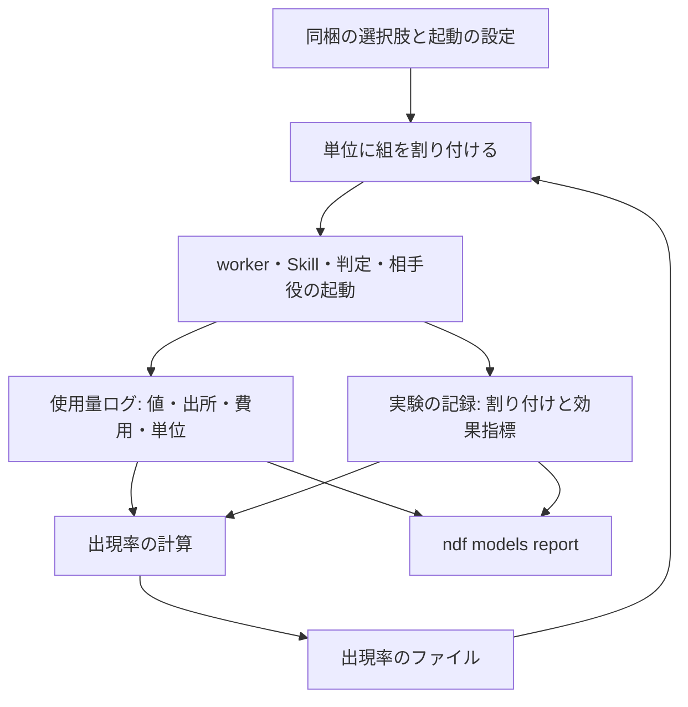
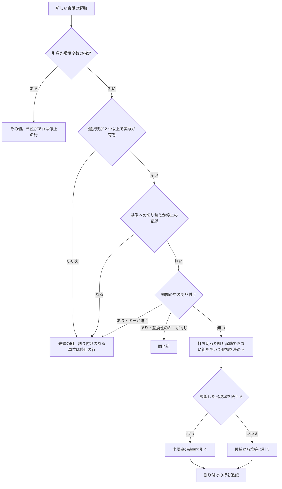

# モデルと effort の実験: 工程ごとの効果と費用から、起動の組を選ぶ

## 概要

NDF は、工程ごとのモデルと effort の組（起動の選択肢）から、作業の単位ごとに 1 つを割り付けて AI を起動する。単位の成果（効果指標）と費用を記録し、組ごとの ROI から、組が選ばれる確率（出現率）を自動で調整する。起動する場所ごとの固定の値の対応表は持たない。指定が無い作業は引数を足さず、CLI の既定で動く。

利用先の設定の書き方（`.ndf/launch.json` の `experiments`）と一時的な上書きは Skill [launch-config](../../plugins/ndf/skills/launch-config/SKILL.md)、`ndf models pick`・`report` の引数は [コマンドの規約](../../plugins/ndf/docs/contracts/commands.md)、同梱の選択肢と指標の値は [launch-experiments.json](../../plugins/ndf/contracts/domains/launch-experiments.json) が正である。この文書は、仕組みと、その形にした理由を持つ。

起動の権限と承認は [起動の許可](ndf-launch-permissions-and-approval.md) にある。モデルと effort は承認の対象ではない。

## 用語

用語の定義は用語集の [NDF の AI の CLI の起動](../glossary/ndf-agent-cli.md) にある（起動の選択肢・実験の単位・効果指標・出現率・値の出所・値の引き上げ）。この文書の「シート」は、レビューなどの 1 回で 1 人の担当（ほかの AI の CLI の起動）に割り当てるスロットで、起動の層の名前 `seat` は、レビューの担当、cross-review の修正担当、外部の AI への委譲を指す。

## コンテキスト

| コンテキスト | 何の語が 1 つの意味に決まるか |
| --- | --- |
| AI の CLI の起動（`ndf-agent-cli`） | 選択肢・単位・割り付け・出現率・値の出所 |
| 文脈と使用量（`ndf-context`） | 使用量ログの行と集計 |

## 背景

| 決定 | 理由 |
| --- | --- |
| 固定の対応表を持たず、工程ごとの選択肢と指標を 1 つの設定に置く | 値は測って選ぶ。固定の基準を残すと値が 2 か所に散る。固定したい工程は選択肢を 1 つにする |
| 選択肢は設定の無いリポジトリでも使う。費用の上限は置かない | 利用者が設定を足さずに実験の効果を受ける。止める手段は `enabled: false` |
| 割り付けは作業の単位ごと。引き上げと手戻りの費用も割り付けた組に含める | 起動ごとに引くと再開と打ち直しで組が混ざり、成果の帰属が決まらない |
| ROI は手戻りを含む費用で割り、効果の下限を持つ | 起動の費用だけで割ると、単価の安い組は効果が低くても勝つ |
| 費用つきのトンプソンサンプリングを標準ライブラリの乱数で作る | 固定の A/B テストは件数が集まるまで劣る組に同じ数を払う。MABWiser・Vowpal Wabbit・Ax は費用との比と効果の下限を持たないか依存が大きく、GrowthBook・Statsig は指標を外部へ送る |
| 平均は割り付けた確率の逆数で重み付けする | 確率が時期で変わるので、難しい作業が多かった時期の組が劣って見えないようにする |
| 同じ失敗への 2 回目以降の起動は値を 1 つ上げる。1 回目は割り付けた組のまま | 弱い組が同じ値で失敗を繰り返さないようにしつつ、1 回目の効果は測れる形にする |
| 起動の事実は使用量ログ、割り付けと指標は実験の記録に追記し、出現率は記録から作り直せるファイルにする | 指標は起動の後に決まるので、追記だけのログの行は書き換えない |
| effort は NDF が起動の前に検証し、モデル名は検証しない | Claude Code は無い effort を警告だけで無視し、組が黙って同じ値になる。無いモデル名は起動の失敗になる |

CLI の振る舞い（2026-11-26〜27、Claude Code 2.1.332・codex-cli 0.172.0）:

| 確かめたこと | 結果 |
| --- | --- |
| `claude -p --effort bogus` | 終了コード 0。警告を出して既定の effort で動く |
| `claude -p --model <無い名前>` | 終了コード 1 |
| `codex exec -c model_reasoning_effort=bogus` | 終了コード 1 |
| `codex exec --ephemeral --json` | `turn.completed` の `usage` に 5 つのトークン数。再利用と書き込みは入力の内数、推論は出力の内数。モデルと effort の名前は出ない |
| `codex exec --json` の失敗 | 理由は標準出力の `error`・`turn.failed` の行。`-o` のファイルは失敗すると前の中身が残る |
| 同じ差分（56,860 バイト）のレビュー 1 回 | `low` は 16 秒・出力 593 トークン、`high` は 69 秒・出力 3,200 トークン（入力はどちらも 37,791） |

### 会話の途中の切り替えと cache

約 1.9 万トークンの会話を `--resume` で続け、stream-json の結果の `usage` を 1 回ずつ読んだ（2026-11-27、Claude Code 2.1.332）。

| 起動 | cache の作成 | cache の読み取り |
| --- | ---: | ---: |
| 最初の起動（sonnet・low） | 6,977 | 11,837 |
| 同じ値で再開 | 31 | 18,814 |
| effort だけ替えて再開（high） | 22 | 18,845 |
| モデルを替えて再開（opus・high） | 7,316 | 11,837 |

effort だけを替えても cache はそのまま読まれ、モデルを替えると会話の部分が書き直される。大きい文脈では未測定である。値の切り替えは、新しいプロセスか新しい会話を始めるときだけ行う。

## 対象範囲

| 対象 | 扱い |
| --- | --- |
| worker（設計・実装・修正・作業場所の用意）、Skill を回す起動（設計）、判定の起動、cross-review のレビューのシート | 実験する |
| 外部の AI への委譲（codex） | 選択肢を 1 つ持つ（成果を NDF が見ないので実験しない） |
| cross-review の修正担当 | 実験の引数を足さない（引数と環境変数の指定は効く） |
| Kiro・agy | 値を渡さない |
| サブエージェント・レーン・オーガナイザー・応答の終わりの判定 | 変えない（ https://github.com/devbasex/ai-plugins/issues/4570 ） |
| cross-refactoring の相手役 | 変えない（ https://github.com/devbasex/ai-plugins/issues/4571 ） |
| 記録の複数マシンでの共有 | 記録はマシンごと（ https://github.com/devbasex/ai-plugins/issues/4572 ） |
| 作業の難しさに応じた割り付け | しない。モードは記録だけする（ https://github.com/devbasex/ai-plugins/issues/4573 ） |

## 仕様

### 構成要素と責務

パスは `plugins/ndf/src/ndf/` からの相対である。

| 要素 | 責務 |
| --- | --- |
| `adapters/model_choice.py`・`experiment_rows.py` | 同梱と設定を重ね、値と出所を返す。割り付け・引き上げ・基準への切り替え。実験の記録と出現率のファイルの読み書き |
| `adapters/claude_choice.py`・`model_chooser.py` | 値を選ぶ処理の差し込みのインターフェースと、選んだ値で起動する部品（`ChoiceRun`） |
| `core/worker.py`・`progress/skill_invoke.py`・`adapters/llm.py` | worker・Skill・判定の起動に値を足し、行を書く |
| `core/plan/runner.py`・`transition_decide.py`・`records.py` | 単位の ID と打ち直しの理由を子へ渡し、修正と作業場所の用意の効果指標を書き、実際のモデルを残す |
| `domains/crossreview/experiment.py`・`seats.py`・`fixer.py`・`journal.py` | シートの単位、レビューの効果指標、修正担当の値の持ち越し |
| `domains/records/experiments.py`・`allocation_decide.py` | 効果指標の記録、出現率の計算（`allocation_decide` はファイルも時刻も読まない） |
| `domains/records/models_cli.py` | `ndf models pick`・`report` |
| `domains/records/usage.py`・`contracts/data/codex-prices.json` | 使用量の行と、Codex の費用の換算 |
| `domains/settings/delegate_run_cli.py` | 委譲の起動にモデルと effort を足す |

adapters と core は domains を読み込めないので、値を選ぶ処理と効果指標の記録は差し込みで呼ぶ（`__main__.py` が登録する）。登録の無い呼び出し（テストなど）は値を選ばずに起動する。

### 集約

| 集約 | 書き換えてよいもの | 中身 |
| --- | --- | --- |
| 選択肢の設定 | NDF の開発者（同梱）と利用者（`experiments`） | 工程の定義、組、指標の名前、割り付けの値 |
| 実験の単位 | 割り付けと、指標を記録する処理 | 割り付け・効果指標 |
| 出現率 | 出現率の計算（と月の掃除） | リポジトリ × 工程 × ランタイム × 互換性のキーの項目 |
| 使用量ログ | 使用量ログの書き込み処理 | 起動の行 |

### 常に成り立つ条件

| # | 条件 | 破れるときの扱い |
| --- | --- | --- |
| I1 | 1 つの単位の割り付けは 1 つで、再実行と再開も同じ組を使う（引き上げ、基準への切り替え、停止・固定・手動指定・選択肢の変更の後の新しい起動、期間を過ぎた割り付け直しは除く） | — |
| I2 | 引数か環境変数の値で起動した単位は実験に数えない。割り付けた後の指定は、その単位と、費用を負う先の単位も数えない | — |
| I3 | 効果指標を取れなかった単位は、成功にも失敗にも数えない | — |
| I4 | 効果と費用は、割り付けた組に帰属する（引き上げと手戻りの費用を含む） | — |
| I5 | 調整の段階では、打ち切っても外してもいない組の確率は下限以上。確率の合計は 1 との差が `1e-6` 以下 | 満たさない項目は使わず均等に抽選する |
| I6 | 出現率のファイルは、記録と使用量ログからいつでも作り直せる | 壊れたファイルは作り直す |
| I7 | 読めない・形が違う・順位に無い effort・値の制約に合わない設定では起動しない（使わない値でも同じ） | 理由と直す場所を示して止まる |
| I8 | worker・Skill・判定・相手役が起動した `claude -p` と Codex の子 1 つにつき使用量ログ 1 行 | 書けなければ警告を出し、工程は止めない |

ドメインイベントは、値を決めた、決めた値で起動した、使用量と値の出所を記録した、値を上げて打ち直した、単位に組を割り付けた、効果指標を記録した、出現率を計算し直した、集計した、の順に起きる。

### 値の優先

モデルと effort は別々に、上から最初に値があるものを使う。

| 順 | 出所 | 実験に数えるか |
| ---: | --- | --- |
| 1 | 起動の引数 `--model`・`--effort`（`delegate-run` ではコマンドの `-m`・`-c model_reasoning_effort=`） | 数えない |
| 2 | `NDF_LAUNCH_*` | 数えない |
| 3 | `CLAUDE_CODE_EFFORT_LEVEL`（Claude の effort だけ。値は検証しない） | 数えない |
| 4 | 実験の割り付け（順 1〜3 の指定がどちらにも無い場合） | 数える |
| 5 | 指定なし（CLI の既定） | — |

片方だけ指定があれば割り付けず、無い側は基準の組（選択肢の先頭）の値を使う（出所は `base`、基準が値を持たなければ `default`）。単位が無い、実験が無効、選択肢が 1 つの場合も基準の組で、割り付けの行は書かない。`CLAUDE_CODE_EFFORT_LEVEL` は `--effort` より優先するので、NDF が effort を引数か `NDF_LAUNCH_EFFORT` で決めた起動では子の環境から外す。

### 工程・単位・効果指標

工程は起動の層と作業の名前で引く。どの工程にも無い組には引数を足さない。同梱の対応と選択肢は `launch-experiments.json` が持ち、利用先は選択肢と割り付けの値だけを置き換えられる。

| 工程 | 単位 | 効果指標（0〜1） |
| --- | --- | --- |
| `design`・`impl` | プランの実行の中の工程（`<run_id>:<工程>`） | `1 / (1 + レビューの 1 ラウンド目で挙がって採用された重大な指摘の数)` |
| `fix` | 修正のステップ 1 つ | 1 回目の修正を確かめる検査が通れば 1、通らなければ 0 |
| `mechanical`（`worktree`） | ステップ 1 つ | 完了すれば 1、止まれば 0 |
| `judge` | 質問 1 つ（`request_id`） | 1 回目の回答が形に合えば 1、形に合わないか起動後の期限切れは 0、利用上限・通信の誤り・起動できないは null |
| `review` | `<cross-review の実行の ID>:<シート>` | そのレビューで採用された重大な指摘のうち、このシートが挙げた割合 |
| `delegate` | なし | なし |

- 重大は critical か major、採用は修正担当が直した指摘である
- 設計と実装の指標は、修正の前の 1 ラウンド目の指摘だけを数え、重大かもそのラウンドの重要度で決める。未裁定があれば null。差分を読めないシートがあって止まった場合は、全シートが読んだ最初のラウンドまでを 1 ラウンド目とする
- シートの割合は、シートが 2 つ以上で採用が 1 件以上のときだけ値を持つ
- レビューの指標は、収束かラウンドの上限で終わったときに書く。上限では値の決まらない指標を書かず、再開して裁定した後の値を書けるようにする。同じ割り付け ID の指標は先に書いた行だけが有効である
- 修正の指標は、定義の `verifies` にその修正の作業を持つ検査のステップ（`test`・`ci-local`・`ci`・`push`）の最初の決まる結果で書く。停止理由が `test_failed`・`check_failed`・`push_rejected`・`base_conflict` なら 0、前提の不足や期限切れは書かない。push・待ち・承認ゲートの結果は使わない。検査に届かず実行が終われば欠測である
- レビューを通らない実行の設計と実装の単位は、指標が無いまま残り数えない

### 値の引き上げ

同じ失敗への 2 回目以降の起動は、割り付けた組から 1 つ上げる（3 回目以降も同じ値）。引数と環境変数の値は上げず、打ち直しの回数の上限は変えない。

| ランタイム | 今の値 | 引き上げた後 |
| --- | --- | --- |
| どちらも | effort が `low`・`medium` | effort を 1 つ上げる |
| Claude | `haiku`・`sonnet` で effort が `high` 以上か指定なし | モデルを 1 つ上げる |
| Claude | `opus`・順位に無い・指定なしで `high` | effort を `xhigh` |
| Codex | `high` | effort を `xhigh` |
| ほか | | 変えない |

| 起動 | 上げる起動 | 理由（`--retry`） |
| --- | --- | --- |
| 修正の作業 | 同じ実行の同じ修正ステップに、同じ理由でもう一度入る起動。プランの実行が数え、`NDF_RETRY_CAUSE` で子へ渡す | `test_failed`・`check_failed`・`push_failed`・`base_conflict` |
| 判定 | 回答が形に合わず起動し直す 2 回目 | `invalid_answer` |

テストの失敗の集計ステップ（`test-repeat`・`repeat-check`）を経由しても、元の理由を修正ステップへ引き継ぐ。

### 同じ会話を続ける起動

worker の再開と cross-review の修正担当の再開は、会話の最初の起動の `--model`・`--effort`・割り付け ID・`CLAUDE_CODE_EFFORT_LEVEL` の扱いを使う（最初に変数が無ければ再開の子から外す）。修正担当の値は 1 回の駆動の中だけで持つ。利用者の `--resume` には何も足さない。

### 割り付けの流れ

新しい会話を始める起動に当てる。

- 出現率の項目は、割り付けの値が今と同じ、添字が選択肢の範囲内、`adaptive` なら確率の形が合う、実際のモデルが最新の観測と食い違わない、のすべてを満たすときだけ使う。1 つでも欠ければ打ち切りも確率も読まない
- 調整した確率を使うのは、段階が `adaptive`、項目の候補が今の候補と同じで、期間の中の同じキーの単位に費用を計算できないモデル（`unpriced`）が無いときである。使えない場合の段階は、`unpriced` に当たれば `uniform`、ほかは `burn_in`
- 件数を集める間も、候補が変わった後も、均等に引く（確率 0 の時期を作ると、作業の難しさと組の差を分けられない）
- 記録を書けなければ指定なしで起動し、単位は実験に数えない。読めない月の記録があれば割り付けない
- 同じ単位かは、単位の ID・リポジトリのキー・工程・ランタイムの 4 つで決める

### 起動できない組

抽選した基準でない組の会話の最初の起動が、モデルを理由に拒まれたら、同じステップで基準の組の新しい会話に 1 回だけ切り替える（再開と判定の打ち直しの回数に数えない。期限は残りの時間）。基準の組の拒否は、理由と直す場所を示して止まる。

| ランタイム | 拒否と判定する条件（すべて） |
| --- | --- |
| Claude | `is_error` が真、`api_error_status` が 404、4 つのトークン数がどれも欄として在って 0、`modelUsage` が空 |
| Codex | `turn.completed` と回答の項目が無く、`turn.failed` の文が `model is not supported` か `reasoning.effort` を含む |

欄の欠け、通信の障害、利用上限、期限切れ、CLI を起動できないことは拒否と扱わない。

- 切り替える前に、残りの期限と、worker と Skill は起動の承認の対象、判定は材料の古さを確かめる。通らなければ切り替えず、拒否の行（`launch_error`）も書かない。記録の後に期限をもう一度確かめる。期限が無ければ worker と Skill は `interrupted`、判定は元の拒否を返す
- 拒否の行がある単位は、基準の組を使い、効果と費用の比較から外す
- 直近 7 日の同じリポジトリ・工程・ランタイム・キーで、同じ組の拒否が 2 件以上あれば、候補から外す（基準は外さない）

### 費用と ROI

単位の費用は、使用量ログの `assign_id` か `charge_to` がその割り付け ID の行の、起動の費用の合計である。起動 1 回の費用の求め方は [起動の許可](ndf-launch-permissions-and-approval.md) の「使用量ログの行」にある。費用が不明の起動を持つ単位と、合計が 0 の単位は、費用の平均に入れない。ROI は効果の平均 ÷ 費用の平均（USD）で、基準の組を 1 とした比も出す。

| 手戻りの起動 | 費用を負う単位（`charge_to`） |
| --- | --- |
| 実装の後のテストと CI の失敗を直す起動 | その実行の `impl` の単位（`fix` の単位にも数える） |
| レビューの指摘を直す起動 | 評価している `design` か `impl` の単位 |
| 判定の起動し直し | 割り付けた単位そのもの |

Codex の費用は、同梱の単価表（`codex-prices.json`）とトークン数で換算する。モデルを指定しない組は `default_model` の単価を使う。単価の無いモデルは不明とし、その工程は均等に抽選する。

### 出現率の計算

効果指標を書いた後に、項目が無い、候補か割り付けの値か実際のモデルが違う、前の計算から 60 分以上たった、のどれかなら計算し直す。計算はロックの外で行い、書き換えはロックの中で読み直してから変える。乱数の種は計算に使う単位から作るので、同じ単位の集まりからは同じ結果になる。

使うのは、期間（`window_days`）に割り付けて効果指標がある同じキーの単位で、割り付けた時に比べる組のすべての確率が正だったものである。重みは割り付けた確率の逆数、件数には有効な件数 `n_eff = (重みの和)² ÷ 重みの 2 乗の和` を使う。

1. 候補のどれかで効果指標のある単位が `min_units` 未満か、費用の分かる単位が 2 件未満なら `burn_in`
2. 組ごとに 2,000 回、効果は `Beta(1 + n_eff×平均, 1 + n_eff×(1−平均))`、費用は対数の平均の事後分布（正規分布）から標本を引く
3. 基準より効果が `margin` を超えて低い確率が 0.9 を超える組は「最良」を数えない
4. 標本ごとに `効果 ÷ 費用` が最大の組を数え、割合を「最良である確率」にする
5. 出現率は `floor + (1 − floor × 候補の数) × 最良である確率`

**打ち切り**は、基準でない組を、両方の確率が正だった時期の単位（どちらも 30 件以上。費用が不明でも使う）で基準と比べ、`margin` を超えて低い確率が 0.99 を超えれば出現率を 0 にする。期限は、基準とその組の新しいほうから 30 件目の割り付け日時の古いほうに `window_days` を足した日時で、過ぎれば候補へ戻る。段階が `burn_in` や `uniform` でも打ち切った組は選ばない。

| 割り付けの値 | 既定 | 制約 |
| --- | ---: | --- |
| `floor` | 0.05 | 0 より大きく、`floor × 組の数 ≤ 1` |
| `min_units` | 10 | 2 以上の整数 |
| `margin` | 0.1 | 0〜1 |
| `window_days` | 60 | 1〜365 の整数 |

**実際のモデルが変わった単位は混ぜない（Claude）。** 単位の実際のモデルは、最初の起動（引き上げと切り替えを除く）の行から取る。モデルを指定しない組は全体で 1 まとまり、指定する組は組ごとに、今のモデル（期間の中の最新の観測 `observed`、無ければ最後に評価した単位のモデル）と同じ単位だけを使う。期限切れで回答が無い単位は、モデルの変化を観測していなければすべて数え、変化があれば、最後に別のモデルを観測した単位より後で今のモデルを最初に観測した単位以降だけを数える。Codex は実際のモデルを取得しないので絞らない。

**互換性のキー**は、選択肢の並びと指標の名前・バージョンのハッシュである。変われば件数を集め直す。別のリポジトリの記録は混ぜない。

### 判断できる件数

`report` は、比べられる単位だけで次を書き分け、優劣は「判断できる」の場合にだけ出す。

| 状況 | 表示 |
| --- | --- |
| そろって候補だった単位が無い | 比較できない |
| 30 件未満の組がある | 件数が足りない |
| 各組 30 件以上で、最良である確率が 0.95 以上の組がある | 判断できる |
| 同じく 30 件以上で、その組が無い | 優劣を判定できない |

成功の割合の差を両側 5%・検出力 80% で見分けるのに要る件数（1 組あたり。正規近似）は、0.9 と 0.7 で 62、0.8 と 0.6 で 82、0.9 と 0.75 で 100、0.9 と 0.8 で 199 である。

## データ・設定

### 実験の記録

利用者の使用量ログの保存先に、月ごとの追記だけのファイル `launch-experiments-<YYYY-MM>.jsonl` を置く。行の形は [experiment.schema.json](../../plugins/ndf/contracts/schemas/internal/experiment.schema.json) が持つ。

| 行 | 中身 |
| --- | --- |
| `assign` | 割り付け ID・単位・工程・ランタイム・リポジトリのキー・モード・`window_days`・選択肢・確率・選んだ組・互換性のキー・段階（`burn_in`・`adaptive`・`uniform`） |
| `outcome` | 割り付け ID・指標の名前とバージョン・値（取れなければ null）・元の数 |
| `launch_error` | モデルを理由にした拒否と、切り替えたか |
| `halted` | 単位を対象外にした理由（`disabled`・`fixed`・`changed`・`manual`） |
| `observed` | 実際のモデル |
| `unpriced` | 費用を計算できないモデル |

行は割り付け ID で結ぶ（期間を過ぎた単位の割り付け直しで ID が 2 つになるため）。割り付けは、ロックの外で記録を読み、ロックの中では追記分だけを読んで追記する（全部を中で読むと、記録が増えるほど並列の起動が待つ）。書きかけの行は閉じてから追記し、読む側は飛ばす。

記録を残すのは `window_days` に 30 日を足した期間で、それより前に終わった月は月に 1 回の掃除が確認なしに消す。`window_days` は掃除するリポジトリの値と記録にある値の最大を使う（保存先は複数のリポジトリで共有する）。出現率のファイル `launch-weights.json` の期限を過ぎた項目も消す。

### 使用量ログの欄

| 欄 | 中身 |
| --- | --- |
| `layer`・`name`・`runtime`・`mode` | 値を選んだキー |
| `unit`・`assign_id`・`charge_to` | 単位・割り付け・費用を負う先 |
| `request_id`・`request_try` | 依頼と、その中の何番目の起動か（切り替えと打ち直しで増える） |
| `requested_model`・`effort` | 引数に渡した値（効いた値ではない） |
| `model_source`・`effort_source` | `argument`・`environment`・`experiment`・`base`・`default` |
| `raised`・`model_refused` | 引き上げたか、モデルを理由に拒まれたか |
| `outcome` | 起動の終わり方。成功は `ok`・`valid`・`done`、`gate` は成功率の分母に入れない |

Codex の行は `--ephemeral --json` の `turn.completed` から使用量を取り、回答は `-o` のファイル（標準出力のログ名に `.answer` を足したもの。起動の前に消す）から読む。手順書の委譲（`delegate-run`）は終了を NDF が見ないので行を書かない。

## 入出力のコントラクト

`ndf models report`（期間は JST。`--since` の 0 時を含み、`--until` の翌日の 0 時を含まない）は 2 種類の項目を返す。

| 項目 | 中身 |
| --- | --- |
| `launch_group` | 工程 × 指定値（リポジトリ・ランタイム・モード・モデル・effort）ごとの起動の数・秒・トークン・費用・成功率・やり直し率・指定と実際のモデルの食い違い |
| `arm` | 打ったリポジトリの組ごとの単位の数・効果と幅・費用・ROI と基準との比・最良である確率・出現率・段階・優劣の表示・外した理由と戻る日時 |

- 同じ `launch_id` の行は 1 回だけ数える。成功率は依頼ごと（最後の `request_try`）、やり直し率はステップごと（`attempt` が 2 以上の行があるか）。2 回とも形に合わない判定は人へ戻した件数に出る
- 食い違いは、指定が `-` を含まない別名（`sonnet` など）で、実際の ID を `-` で区切った部分にあれば数えない
- `repo` はパスを含まない識別子で返す
- 表示の効果と費用は期間の単位から、打ち切りと出現率は期間の終わりまでの直近 `window_days` から求める。出現率のファイルは書き換えない
- 形に合わない実験の記録の行は除き、数を返す。`--since` が残っている月より前なら、残る範囲（`kept_since`）を添える

`ndf models pick` は、値・出所・割り付け ID を返す。`--args` は引数を 1 行に 1 つ出し、失敗は標準エラーだけに出す。プランの記録の `models` に、ステップごとの指定した値と実際のモデルが残る。

## エラー処理

| 状況 | 扱い |
| --- | --- |
| 設定の誤り（順位に無い effort、空や重複の選択肢、無い工程、値の制約） | `precondition`。起動しない |
| 記録・出現率を書けない・計算できない | 警告。起動とステップの結果は変えず、単位を数えない |
| 出現率のファイルが壊れている | 項目が無いとして作り直す |
| 基準でない組の拒否 | 基準の組で続け、警告を出す |
| 基準の組の拒否 | `precondition`。`.ndf/launch.json` を示す |

## セキュリティ

使用量ログと実験の記録は作業と指摘の本文を持たない。出現率のファイルはリポジトリの絶対パスを持つので、所有者だけが読める形で置く。`report` の結果はパスを出さない。

## 運用

受け入れる限界:

- Codex の実際のモデルを取得しない。費用は書き取った日の単価（272K トークン以下の値）による換算で、長い文脈の起動は低く出る。単価表を直すまで価格の改定は反映しない
- Codex の利用上限は実際に起こして確かめていない。ほかの形で返れば失敗になる。API キーの接続の無いモデル名の拒否の文と、Claude のモデルや effort の拒否の 404 以外の形は未確認で、その場合は切り替えずに止まる
- 記録はマシンごとで、件数の少ないリポジトリは調整が始まらないことがある。件数を集める間は費用の高い組にも割り付ける
- プランの外の Skill の起動と、単位の無い起動は実験に入らない
- 期間の記録が 10 万行なら、割り付けの前の読み取りが約 0.26 秒増える（並列の値は未測定）
- 指標の限界: 指摘の数は作業の大きさにも左右される。どのシートも挙げなかった見落としと、別の文で挙げた同じ内容は数え分けない
- 実際に効いた effort は取得していない
- 拒否の行は切り替えの確認を通ってから書くので、並んで割り付ける起動が同じ組を選ぶことがある（ https://github.com/devbasex/ai-plugins/issues/4689 ）
- プランの実行の単位のある起動は、値の選択で `git rev-parse` を 1 回打つ。起動の承認の確認がある起動は別にもう 1 回打つ

未測定: 配ったバージョンで実験を 2 スプリント以上流した後の、組ごとの件数・効果・費用・ROI・出現率と、判断できる件数に達したか。この文書は組の優劣を主張しない。

## テスト観点

- 層と作業の名前から工程が引け、表に無い組は引数を足さない。同梱は工程とランタイムごとに置き換わる
- 同じ単位は再実行・再開・並列でも同じ組。片側の指定と手動指定は割り付けず、数えない
- worker・Skill・判定・シートの起動の引数に組があり、`delegate-run` は codex に組の引数と安全装置の引数を入れ、kiro と agy は安全装置の引数だけ
- 引き上げは表のとおりで、1 回目と指定した値は上げない
- 再開は最初の値のままで、後の出現率と環境変数に影響されない
- 効果指標: 取れない場合は null で数えない。1 ラウンド目の採用だけが設計と実装に付く。手戻りの費用が `charge_to` の単位に付く
- `min_units` 前は均等、後は安い組の確率が上がり下限を割らない。効果の低い安い組は上がらない。打ち切りは期限で戻る
- 基準の組への切り替えは 1 ステップで 1 回、欄の欠けでは切り替えない。7 日 2 件で外れる
- 壊れた設定で起動が 0 回になる
- 月の掃除と計算が重なっても新しい項目が残る。出現率のファイルを消しても作り直せる
- `report` は重なった `launch_id` を 1 回数え、不明の費用を 0 にしない

## 関連リンク

- [起動の許可](ndf-launch-permissions-and-approval.md)
- Claude Code のモデルの設定: https://code.claude.com/docs/en/model-config
- トンプソンサンプリングの解説: https://arxiv.org/abs/1707.02038
- 予算つきのトンプソンサンプリング: https://arxiv.org/abs/1505.00146
- 課題: https://github.com/devbasex/ai-plugins/issues/2944
