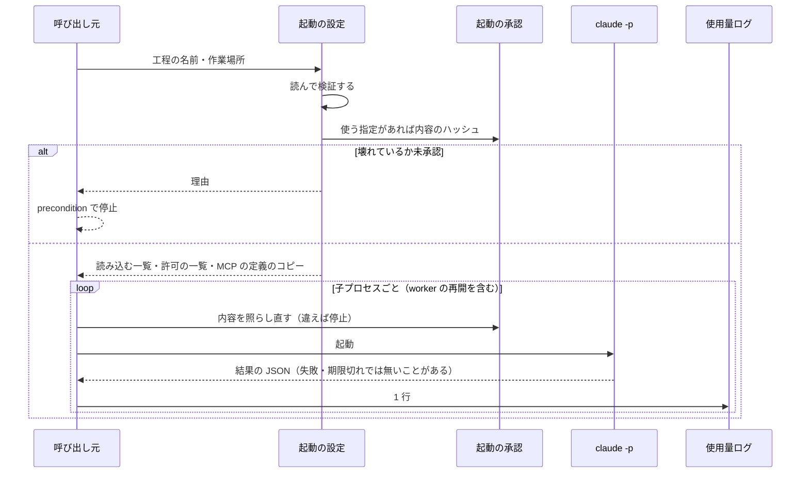

# 起動の許可: 非対話の起動が読み込む Tool と MCP、安全装置を外す指定の承認

## 概要

NDF が非対話で起動する `claude -p` のうち、利用者の設定・プラグイン・hook をそのまま読み込み、Skill とサブエージェントが使える起動（以下「full の起動」。worker と Skill を回す起動）は、読み込む組み込みの Tool を一覧に絞り、MCP を読み込まない。Tool と MCP を足す指定と、安全装置を外す指定は、利用先が起動の設定（`.ndf/launch.json`）に書き、利用者がそのマシンで承認する。承認した内容と一致する起動は、起動のたびの承認なしで動く。起動した子ごとの使用量と費用は、使用量ログに 1 行ずつ残る。

起動の設定のキーと承認の手順は Skill [launch-config](../../plugins/ndf/skills/launch-config/SKILL.md)、委譲の起動の打ち方は [external-ai](../../plugins/ndf/skills/external-ai/SKILL.md)、コマンドの引数は [コマンドの規約](../../plugins/ndf/docs/contracts/commands.md) が正である。この文書は、仕組みと、その形にした理由を持つ。

同じ起動の設定の `experiments`（モデルと effort の実験）は承認の対象ではなく、[モデルと effort の実験](ndf-launch-model-experiment.md) にある。

## 用語

用語の定義は用語集の [NDF の AI の CLI の起動](../glossary/ndf-agent-cli.md) にある（起動の設定・起動の承認）。この文書の「相手役」はレビューなどを頼むほかの AI の CLI、「工程の名前」は worker の作業の名前か Skill の名前である。

## コンテキスト

| コンテキスト | 何の語が 1 つの意味に決まるか |
| --- | --- |
| AI の CLI の起動（`ndf-agent-cli`） | 起動の引数、起動の設定、起動の承認 |
| 文脈と使用量（`ndf-context`） | 使用量ログの行 |

起動する側が使用量の行を作って渡し、使用量ログは受け取った行を追記する（起動が供給者）。

## 背景

絞らない full の起動は、環境にある全部の Tool と MCP の定義を文脈に載せる。非対話の起動は、作業ブランチの `.mcp.json` のサーバを尋ねずに起動する。安全装置を外す指定をコードと手順書が決め打ちすると、外してよい環境かを誰も確かめない。

2026-11-26 に、非対話の起動の会話の記録から工程が呼んだ MCP の Tool を数えた（このマシンの記録だけ）。

| 起動の形 | 会話数 | MCP の Tool の呼び出し |
| --- | ---: | --- |
| worker（2026-11-24〜11-26。design 39・requirements 24・worktree 21・impl 19・implementation-plan 16・design-detail 14・release 13・backlog-refinement 13・retrospective 13・quality-gates 13・release-verification 12・fix-base 9・fix-push 7・plan-to-spec 7・ci-fix 2） | 222 | どの作業も 0 件 |
| worker（2026-11-24 以後、絞り込みを入れる前の起動の数え直し） | 372 | 0 件 |
| Skill を回す起動（`ndf.skill`） | 0 | 記録が無い（「使っていない」ではない） |
| 参考: 10 系の design の Skill | 277 | 2 会話（claude.ai の Claude Docs の `guide` 2・`read` 1） |
| 参考: 10 系の requirements-design の Skill | 209 | 2 会話（同 `guide` 1・`read` 2） |
| 参考: 10 系のほかの Skill | 555 | 0 件 |
| 参考: 10 系の実装 | 235 | 77 会話（serena の 9 種類。`find_symbol` 145・`get_symbols_overview` 122・`replace_content` 91 ほか。今は入っていないプラグイン） |

このため、NDF の既定はどの工程にも MCP を指定せず、ai-plugins も `.ndf/launch.json` を置かない。

### 決定と理由

| 決定 | 理由 |
| --- | --- |
| 指定の無い工程は `--tools` と `--strict-mcp-config` の両方で絞る | `--disallowed-tools "mcp__*"` は MCP の指示文が文脈に残り、`--tools` だけでは MCP の定義が残る。最小構成（`--setting-sources ""`）は利用者の設定・プラグイン・hook を読まない |
| MCP の指定は、定義ファイルの列か `"inherit"` | claude.ai のコネクタは定義がファイルに無いので、使うには `inherit` が要る。サーバの名前で許可する形は、許可の一覧が設定の層をまたいで足し合わさり、利用者の絞り込みを広げうる |
| 読み込む指定（`load`・`mcp`）と、尋ねずに使ってよい指定（`allow`）を分ける | 読み込みを足しただけで、尋ねずに呼べる操作が増えないようにする |
| 組み込みの Tool は 16 個を読み込み、利用先が `load` で足せる | 固定すると `LSP` などを使う利用先が工程の中で使えなくなる。Tool の名前の一覧を NDF が持って突き合わせると、CLI のバージョンが上がるたびに食い違う |
| 承認は設定を変える時に取り、内容のハッシュを利用者のマシンに残す | 起動のたびには問わない。承認の記録をリポジトリに置くと、ほかの人のリポジトリを取得しただけで、その人の記録で自分のマシンのコマンドが起動する。外側で隔離されているかもマシンごとに違う |
| 承認していない内容を使う起動は止める | 指定を外して続けると、MCP や Tool が無いまま工程が進み、成果物の欠けに後で気づく |
| 安全装置を外すのは、サンドボックスが使えず、承認があるときだけ | 承認があれば常に外すと、サンドボックスで足りる環境でもレビューの相手役が書き込める |
| 承認を待つ内容は候補として状態の保存先に置き、承認の後に反映する | 先に書き換えると、承認しない場合に未承認の設定が残って工程が止まる |
| 使用量の行は、起動の呼び出し元（worker と Skill を回す起動）が書く | 起動の共通の関数で書くと、工程の名前と実行の識別子を下の層へ渡すことになる。会話の記録を後から読む方法は、記録が消えると比べられない |

承認の仕組みが防ぐのは、うっかりの書き換えと、承認していない人の変更（取得したブランチやほかの人のリポジトリ）である。AI が意図して承認者になりすます場合は扱わない。

### 実測

2026-11-26〜27 に Claude Code 2.1.332 で確かめた値である。

読み込む定義の量（同じ短い依頼。文脈のトークン数）:

| 起動の形 | 1 回目の応答の前 | MCP の接続の後 | `mcp__` の Tool |
| --- | ---: | ---: | ---: |
| 絞らない full | 29,851〜29,921 | 32,995 | 38 個 |
| `--tools` で一覧に絞る | 24,401〜24,471 | 27,533 | 38 個 |
| `--tools` と `--strict-mcp-config` | 24,401〜24,471 | 24,637 | 0 個 |

絞り込みを入れる前後の起動の引数を、同じ依頼・作業ディレクトリ・モデル（`claude-sonnet-5-5`）で 2 回ずつ起動して比べた（2 回の平均）:

| 値 | 前 | 後 | 差 |
| --- | ---: | ---: | ---: |
| 初回の文脈（トークン） | 31,304 | 26,638 | -14.9% |
| 2 回目の応答の文脈 | 49,923 | 41,710 | -16.5% |
| 1 回の費用・キャッシュをそろえた値（USD） | 0.2153 | 0.1747 | -18.8% |
| 1 回の費用・実際の `total_cost_usd`（USD） | 0.0918 | 0.1228 | +33.7% |
| Tool の数（うち `mcp__`）/ MCP のサーバ | 87（56）/ 7 | 15（0）/ 0 | |

実際の費用は、その回の文脈がキャッシュに当たったかで決まるので、費用はそろえた値で比べる（応答ごとに前の応答までを読み込み、増えた分を書き込みとして払う値）。-18.8% のうち約 0.005 USD は、前の起動が応答を 1 回多く打った違いである。

CLI の振る舞い:

- MCP は最初の応答の後に接続する。起動の最初の記録（`system/init`）に `mcp__` の Tool が無くても、読まないことの確かめにならない
- `--tools` は、知らない名前と許可の記法を黙って捨てる（終了コード 0）
- `--tools` に `Agent` と `WebFetch` を一緒に渡すと、`WebFetch` はメインの一覧から外れてサブエージェントの側に置かれる（2.1.268 も同じ）
- `--allowed-tools` は 1 件 1 引数でもカンマの連結でも、空白を含む指定が効く
- 結果の JSON の `usage` は起動 1 回分、`modelUsage` と `total_cost_usd` は会話の累計である

## 対象範囲

| 対象 | 扱い |
| --- | --- |
| full の起動（worker・Skill を回す起動） | 読み込む Tool と MCP を絞る。工程ごとの指定を当てる |
| 最小構成の起動（判定・相手役・修正担当） | 工程ごとの指定を当てない（もともと MCP を読まない） |
| 相手役の起動と、外部の AI への委譲 | 安全装置を外す指定にだけ承認を使う |
| 対話のセッション・サブエージェント | 対象外 |

## 仕様

### 構成要素と責務

パスは `plugins/ndf/src/ndf/` からの相対である。

| 要素 | 責務 |
| --- | --- |
| `adapters/launch_settings.py` | 起動の設定の読み取りと検証、起動 1 回の指定（`prepared`）、安全装置の引数（`safety_args`）、MCP の定義のコピー |
| `adapters/launch_approval.py`・`launch_records.py` | 承認の対象のハッシュ、承認の記録・依頼・回答、候補の反映と中断の後の片付け |
| `adapters/launch_candidates.py` | 候補のディレクトリの所有の確かめと、退避・削除 |
| `adapters/secret_lines.py` | 秘密の形の表（設定の解析と同じ表） |
| `adapters/claude.py`・`claude_precheck.py` | full の起動の引数、起動の直前の照らし直し、使用量の記録先（`LaunchLog`） |
| `domains/settings/launch_config_cli.py` | `ndf launch-config`（`draft`・`show`・`approve`・`revoke`） |
| `domains/settings/delegate_run_cli.py` | `ndf delegate-run`（委譲の起動） |
| `domains/hooks/guards/launch_answer.py` | 承認の質問への人の回答を記録する hook |
| `domains/records/usage.py`・`usage_decide.py` | 使用量の行の追記と、起動 1 回の費用の計算 |

層は下から contracts・adapters・core・progress・domains の順で、下の層は上の層を読み込まない。使用量ログへの書き込みは、`claude.py` が持つ差し込みのインターフェース（`set_launch_recorder`）を `__main__.py` が埋める。

### 集約

| 集約 | 書き換えてよいもの | 中身 |
| --- | --- | --- |
| 起動の設定 | 利用者（承認の後の反映か、手の編集。起動の処理は読むだけ） | 工程の指定（MCP・読み込む Tool・尋ねずに使ってよい Tool）、安全装置を外すランタイム |
| 起動の承認 | `ndf launch-config approve`・`revoke`（追記だけ） | リポジトリのキー・内容のハッシュ・操作の種類・承認を確定した人 |
| 使用量ログ | 使用量ログの書き込み処理 | 使用量・費用の行 |

### 常に成り立つ条件

| # | 条件 | 破れるときの扱い |
| --- | --- | --- |
| I1 | 指定の無い工程の full の起動は、MCP を 1 つも読まない | — |
| I2 | 読めない・形が違う指定では起動しない。指す定義ファイルが無い・リポジトリの外を指す・JSON でない・MCP サーバの定義の形でない場合も起動しない | 理由と直す場所を示して `precondition` で止まる |
| I3 | 起動の処理は、起動の設定と利用者の設定ファイルを書き換えない。NDF が起動の設定を書くのは、利用者が承認した候補を反映するときだけである | — |
| I4 | full の起動の `claude -p` の子 1 つにつき使用量ログ 1 行（再開も 1 行）。同じ起動の行が 2 つになっても `launch_id` で 1 回に数える | 書けなければ警告を出し、工程は止めない |
| I5 | 許可を広げる指定を使う起動と安全装置を外す起動は、今の内容のハッシュが承認の記録にある場合だけ動く。子を起動する直前に照らし直す | 起動せずに `precondition` で止まる |
| I6 | 承認の記録は利用者の NDF の状態の保存先にだけ置く。リポジトリのファイルは承認の根拠にしない | — |
| I7 | 承認の行は、人の確認がある場合だけ書く。承認と取り消しの行は、NDF が非対話で起動した AI の中からは書けない | コマンドが拒む |
| I8 | MCP の定義のコピーは所有者だけが読め、使った起動が終われば残らない | 次の起動が、使用中でないコピーを消す |

### full の起動の引数

`--permission-mode acceptEdits --tools <読み込む一覧> --allowed-tools <許可 1> <許可 2> … [--strict-mcp-config] [--mcp-config <定義のコピー>…]` の順で組む。

| 一覧 | 中身 |
| --- | --- |
| 読み込む一覧 | `Read`・`Edit`・`Write`・`Bash`・`Grep`・`Glob`・`Skill`・`Agent`・`Monitor`・`SendMessage`・`ToolSearch`・`WebFetch`・`WebSearch`・`TaskStop`・`NotebookEdit`・`ListAgents` の 16 個に、指定の `load` を足す |
| 許可の一覧 | 上の先頭の 13 個（`TaskStop`・`NotebookEdit`・`ListAgents` を除く）に、指定の `allow` を足す。`load` の名前は入れない |

- `mcp` が定義ファイルの列なら `--mcp-config` にコピーを渡し、`"inherit"` なら `--strict-mcp-config` を付けない
- `--allowed-tools` は複数の値を取るので、後ろには必ず別のオプション（`--append-system-prompt`）を置き、プロンプトを値として読ませない
- `--allowed-tools` は尋ねずに実行できる操作を足すだけで、利用者とリポジトリの Claude Code の `permissions` もそのまま効く

### 起動の前の確認

- 工程の指定にあるキーは `steps["*"]` の同じキーを置き換える。重ねた後の `load`・`allow` が空で `mcp` も無ければ、承認を調べず、git も起動せず、定義ファイルも読まない
- 承認の対象は全工程の定義ファイルをまとめた 1 つのハッシュなので、どれか 1 つの定義ファイルが読めないと、承認の要る起動はすべて止まる
- 照らし直しは子プロセスごとに行う。重い起動のスロットの取得、アカウントの確かめ直し、照らし直し、CLI の最低バージョンの確認の順に確かめ、バージョンの確認で `claude --version` の終了を待った起動は、もう一度照らし直す
- 起動の設定を読む位置（リポジトリの根）は、作業場所から親へたどって `.git` を持つディレクトリで決める

起動の前の検証は次のとおりである。

| いつ | 対象 | 止まる条件 |
| --- | --- | --- |
| どの工程の起動でも | `.ndf/launch.json` の全体 | JSON でない・スキーマに合わない。`load` が英字だけの名前でない。`allow` の形が違うか、指定子が秘密の形に当たる（値が環境変数の参照だけなら通す） |
| 追加の指定がある起動と `show`・`approve` | `mcp` の定義ファイル（全工程） | 絶対パス・根の外（シンボリックリンクの先を含む）・無い・形が違う |
| 同上（どれかの工程が `inherit`） | 根の `.mcp.json` | 根の外を指す・形が違う（無いのは誤りではない） |

`allow` の指定子は起動の引数になり、プロセスの一覧から見えるので、秘密を書くこと自体を拒む。

### 起動の承認

**承認の対象**は、`permissions` の全体と、指す MCP の定義ファイルの中身、どれかの工程が `inherit` ならリポジトリの `.mcp.json`（無いことも含む）である。キーの順にそろえた JSON の SHA-256 を取るので、字下げやキーの順だけの変更では外れない。定義が呼ぶスクリプトの中身は含めない。

**MCP の定義の中身は出力に出さない。** `show`・承認の質問・停止の文・ログが出すのは、サーバ名、コマンド名（`url` のサーバは「url」）、定義ファイルの場所、ハッシュだけである。

**リポジトリのキー**は git の共通管理ディレクトリの実体の絶対パスである（git の外は根のディレクトリ）。リンクされた worktree は同じキーになり、別のクローンは別のキーになる。同じキーとハッシュの最後の行が `approve` なら承認済みなので、指定の違うブランチを行き来しても承認し直さない。

**ドメインイベント「利用者が起動の設定を承認した」** は、次のどちらかの人の確認があるときだけ起きる。

| 経路 | 確認の取り方 |
| --- | --- |
| 端末 | 標準入力と出力が端末のときに、承認者の名前とハッシュの先頭 8 文字を打つ |
| Skill の質問 | `show --question approve` が作った依頼の質問を `AskUserQuestion` で出し、利用者の回答を hook が記録する |

hook は、質問の中身が依頼と一致し、会話の id が同じで、回答が示した選択肢のどちらかの場合だけ記録する。`NDF_AI_CHILD`・`NDF_FACTORY_RUN`・`NDF_RELAY_PLAN`・`NDF_ORGANIZER_DIR` のどれかがある会話では記録せず（AI が回答しうるため）、`revoke` も同じ会話では拒む。

回答は、次のどれかで使えなくなる。時間の期限は無い。

- 依頼のリポジトリ・操作・ハッシュが今と違う
- 同じ反映先に新しい依頼がある
- 反映先が、依頼の反映元のバージョンとも候補とも違う
- 依頼の後に同じ内容を取り消した

回答を使ったことは承認の行（依頼の識別子を持つ）そのもので表すので、中断しても同じ `approve` を打ち直せば続きから終わる。照合と追記は承認の記録の 1 つのロックの中で行う。

承認の対象に `unsandboxed` があれば、質問と端末の表示に次の警告を入れる。

> この承認により、サンドボックスを使えない場合は、AI が起動先の環境で実行できるコマンドを個別の確認なしで実行できます。Kiro・agy に作業を任せる場合は毎回この扱いになります。コンテナなどで別途隔離している場合も、その環境内では同じ権限で動きます。

### 候補と反映

`draft` は、今の `.ndf/launch.json` の写しを候補として状態の保存先に作り、反映先（その worktree の `.ndf/launch.json`）と反映元のバージョン（中身の SHA-256）を一緒に残す。候補は依頼ごとに別のファイルで、パスは AI が選ばない。

`approve --candidate` は、`.ndf/launch.json` の書き換えへの人の確認が無ければ、承認の対象が空か承認済みでも反映しない。反映先の今の中身で次のように分ける。

| 反映先の今の中身 | 扱い |
| --- | --- |
| 反映元のバージョンと同じ | 承認の行を書き（要る場合）、候補を置く |
| 候補と同じ | 反映は済んでいる。書き換えずに成功にする |
| どちらでもない | 承認の行を足さず `refused`。候補を作り直す |

利用者の手の保存を上書きしないために、反映は次の順で行う。

1. 反映の途中の記録を書く
2. 反映先を `launch.json.reflecting` へ退避する
3. 退避の中身が反映元のバージョンと違えば止まる
4. 候補を、反映先がまだ無い場合にだけ成功する方法（`os.link`）で置く
5. 退避をもう一度照らし、同じなら消す

中断で退避が残った場合は、次の `approve` がほかの照合より先に片付ける。利用者の保存はどの場合も残し、両方が利用者の中身なら退避を別の名前で残してパスを示す。反映先が無く退避だけがあるとき、起動は指定なしとは扱わず `precondition` で止まる。

反映の後に候補が無い `approve --candidate` は、反映の完了の記録（反映先ごとに 1 件）が一致すれば成功にし、何も書かない。

**候補の掃除**は、利用者が書いた設定案を消さないことを優先する。

- 片付けるのは、中身が比べる版（作ったときの中身・反映した中身など）と一致し、ディレクトリに NDF が作ったファイルしか無い候補だけである
- 回答がまだ使える依頼を持つ候補は片付けない
- 片付けは退避と削除の 2 回に分け、次の掃除が、開いているプロセスが無いことを `/proc` で確かめてから消す。`/proc` の無い環境では消さず、`draft` と `show` の結果の `cleanup_targets`（理由は `denied`・`worktree_gone`・`reflected`・`outdated`）に載せる

### MCP の定義のコピー

定義には資格情報が書かれうるので、承認を確かめた中身を状態の保存先の `launch-mcp/<id>/`（0700、ファイルは 0600）へ書き、そのコピーを `--mcp-config` に渡す。消し残りは、隣の管理ファイル `<id>.owner`（`flock` のロックと、NDF が作ったことを示す記録を兼ねる）で見分ける。PID は見ない（状態の保存先を共有するコンテナどうしは PID の名前空間が違う）。消すのは記録にあるファイルだけで、ディレクトリを再帰的には消さない。

### 安全装置を外す指定

相手役の起動と委譲は、同じ `safety_args` で引数を取る。用途の `review` は読むだけの起動、`delegate` は作業の委譲である。引数の値はランタイムの表（`contracts/domains/runtimes.json`）が持つ。サンドボックスが使えるかは、ユーザー名前空間を作れるかで決める。「承認あり」は `unsandboxed` にランタイムがあり、今の内容が承認済みのことである。

| ランタイム | 用途 | サンドボックスが使える | 使えず承認あり | 使えず承認なし |
| --- | --- | --- | --- | --- |
| codex | `review` | `-s read-only` | `--dangerously-bypass-approvals-and-sandbox` | 停止 |
| codex | `delegate` | `-s workspace-write` | 同上 | 停止 |
| kiro | `review` | `--trust-tools=fs_read` | 同左 | 同左 |
| kiro | `delegate` | — | `--trust-all-tools` | 停止 |
| agy | `review` | 停止（読むだけの起動が無い） | 停止 | 停止 |
| agy | `delegate` | — | `--dangerously-skip-permissions` | 停止 |
| claude | どちらも | 引数なし | 引数なし | 引数なし |

外す引数を持つ起動は、起動の直前に承認の対象を読み直し、違うか取り消されていれば起動しない。cross-review の相手役では、その担当が結果の無い担当になる。

`ndf delegate-run` は、`{args}`（ランタイムの CLI の決まった語のすぐ後に 1 つ）に安全装置と作業ディレクトリの引数を入れ、子の環境に `NDF_AI_CHILD=1` を足して、自分を CLI に置き換える。コマンドが安全装置や作業ディレクトリを自分で指定すると拒む。安全装置の引数だけを返すコマンドは作らない（受け取った後の取り消しを確かめられないため）。codex の委譲には、モデルと effort の引数も入る（[モデルと effort の実験](ndf-launch-model-experiment.md)）。

委譲 1 回で増えるのは `ndf` の起動 1 回（約 0.3〜0.7 秒）と、Linux の codex では `unshare -Ur true` 1 回（約 1 ms）、安全装置を外す承認を確かめるときの `git rev-parse` 1 回である。委譲は数分かかるので、増える時間は 1% 未満である。

## データ・設定

起動の設定のスキーマは [launch.schema.json](../../plugins/ndf/contracts/schemas/ndf-settings/launch.schema.json)、状態の保存先のファイル（承認・依頼・回答・候補・反映の記録・MCP の定義のコピー）は [ファイルの規約](../../plugins/ndf/docs/contracts/files.md)、子へ渡す環境変数は [環境変数の規約](../../plugins/ndf/docs/contracts/env.md) にある。

| 環境変数 | 意味 |
| --- | --- |
| `NDF_AI_CHILD` | NDF が非対話で起動した AI の子のマーカー。承認と取り消しはこの値があれば拒む。意図して外すことは防がない |
| `NDF_PLAN_RUN_ID`・`NDF_STEP_ID`・`NDF_STEP_ATTEMPT` | プランの実行がステップの子へ渡し、使用量ログの `run_id`・`step`・`attempt` になる。実行ログの `NDF_RUN_ID` とは別の値である |

### 使用量ログの行

行を書く単位は `claude -p` の子プロセス 1 つである。起動できなかった子（CLI が古い、スロットが取れない、照らし直しで停止）は行を書かない。欄は `launch_id`・`name`・`run_id`・`step`・`attempt`・`session_id`・`session_seq`・`usage`・`model`・`model_usage`・`session_cost_usd`・`seconds`・`launched_at`・`repo` である。

- 結果の JSON が無ければ `usage` は `unknown`
- `model` は、`modelUsage` の 4 つのトークン数の和が最も大きいモデル
- `session_seq` は会話の id ごとに 0 から数える。追記に失敗した起動も番号を使う（飛びで記録の欠けが分かる）
- `repo` はリポジトリのキーのハッシュの先頭 16 桁で、呼び出し元が解決済みのときだけ書く（このためだけに git を起動しない）

起動 1 回の費用は、書き込みの時ではなく集計の時に求める。

| 行 | 起動 1 回の費用 |
| --- | --- |
| `session_seq` が 0 | `session_cost_usd` |
| 1 つ前の番号の行にも値がある | 差 |
| ほか（値が無い・番号が飛ぶ・差が負） | 不明（0 として足さず、件数を数える） |

## エラー処理

| 状況 | 扱い |
| --- | --- |
| 起動の設定か定義が壊れている・未承認 | `precondition`。ファイルと位置、承認の対象の一覧、`/ndf:launch-config` を示す（値は載せない） |
| 起動の直前の照らし直しで違う | 子を起動せず `precondition` |
| 承認の記録の壊れた行 | 飛ばす。ファイルを読めなければ未承認 |
| `approve` で内容・反映先・候補が違う、人の確認が無い | `refused`。記録も反映もしない |
| `delegate-run` が起動できない状況 | CLI を起動せず、標準エラーに理由を出して 0 以外で終える |
| 使用量ログへ書けない | 警告 1 行。工程の結果は変えない |

## セキュリティ

受け入れる限界は次のとおりである。

| 限界 | 起きうること |
| --- | --- |
| 承認の対象は MCP の定義ファイルまで | 定義が呼ぶスクリプトの書き換えは見分けない |
| 作業ブランチの `.claude/settings.json` の hook と許可は承認の対象外 | Claude Code がそのまま読む |
| `inherit` の起動は `claude` が定義を自分で読む | 照らし直しから読み込みまでの短い間の書き換えは見分けない。利用者の設定やプラグインの MCP は照らさない |
| 秘密の検査は秘密の形の表による | 表に無い形の資格情報を指定子に書くと、引数と承認の画面に出る |
| 状態の保存先を共有する別の環境でも承認が効く | 外側で隔離されていない別のコンテナでも安全装置を外しうる |
| `ndf delegate-run` を通さない CLI の直接の起動は止めない | 手順書に従わない起動は承認を確かめない |
| MCP の定義ファイルを読まないのは Skill の手順 | Skill の外で AI が読むことは止めない |
| 反映の最後の照合と退避の削除の間の書き込み | 開いたままのエディタが退避の側へ書いた内容は残らない |
| 候補の掃除の確認の後に別名で開いた書き込み | 失われうる |
| 取り消しに人の確認が無い | 起きるのは起動の停止で、許可は広がらない |
| AI の意図的ななりすまし | 防がない |

## 運用

- 工程の中で MCP か一覧に無い組み込みの Tool を使う利用先は、`.ndf/launch.json` に指定を書いて承認する。環境の MCP をすべて読むには `{"version": 1, "permissions": {"steps": {"*": {"mcp": "inherit"}}}}`
- サンドボックスが使えない環境の cross-review と、Kiro・agy への委譲は、承認するまで起動しない
- CI やコンテナのように状態の保存先が作り直される環境では、環境を作る手順の中で人が 1 回承認するか、保存先を残す
- 利用先の MCP の使い方と、サンドボックスの引数（`-s workspace-write`）の委譲が利用者の環境で手順どおり終わるかは未確認である。承認のある環境での `ndf delegate-run` からの codex の起動も未確認である
- 一部の短い起動（応答の終わりの判定・cross-refactoring の相手役・疎通確認）は使用量の行を残さない

## テスト観点

- 指定の無い工程の引数に `--tools` と `--strict-mcp-config` があり、実際の起動で後の応答にも `mcp__` の Tool が出ない（最初の記録だけでは確かめにならない）
- 実際の起動のメインの一覧に 15 個（16 個から `WebFetch` を除く）と `load` の名前が載り、`WebFetch` はサブエージェントの側にある。CLI の最低バージョンでも同じ
- 承認した MCP の Tool が、定義ファイルの指定と `inherit` の両方で呼べる。Skill・サブエージェント・編集ができ、MCP の無い環境でも起動して終わる。起動の前後で利用者の設定ファイルが変わらない
- 壊れた指定・未承認・承認の後の書き換え（定義ファイルと `.mcp.json` を含む）で、起動を 1 度も呼ばない。字下げとキーの順の変更は通る
- `load` は `--tools` だけに、`allow` は `--allowed-tools` だけに入る。`load` の許可の記法と `mcp__` の名前は止まる
- 子プロセスの直前の照らし直し（再開と、引数を組んだ後の取り消しを含む）で止まる
- 人の確認が無い・`NDF_AI_CHILD` がある・別の会話や古い依頼の回答では、記録も反映もしない。`show` と停止の文に MCP の引数・`env`・URL が出ない
- 反映の途中の保存と中断で、利用者の中身が残る
- 安全装置の表の各行。サンドボックスが使える環境では承認があっても外さない
- 子 1 つで 1 行、再開で行が増える。費用は累計の差で、番号の飛びは不明になる
- MCP の定義のコピーは成功・失敗・例外のどれでも消える

## 関連リンク

- [モデルと effort の実験](ndf-launch-model-experiment.md)
- Claude Code の CLI の引数: https://code.claude.com/docs/en/cli-reference
- Claude Code の MCP（非対話の起動の `.mcp.json`）: https://code.claude.com/docs/en/mcp
- direnv の `allow`（許可をリポジトリの外に置く形の参考）: https://direnv.net/man/direnv.1.html
- 課題: https://github.com/devbasex/ai-plugins/issues/1959
