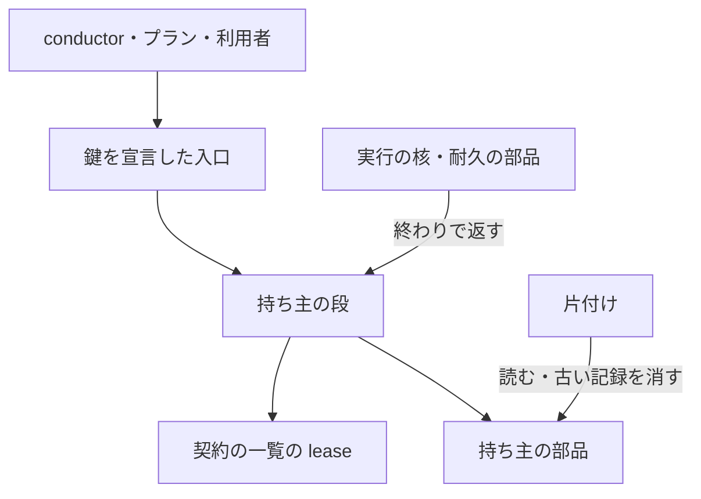
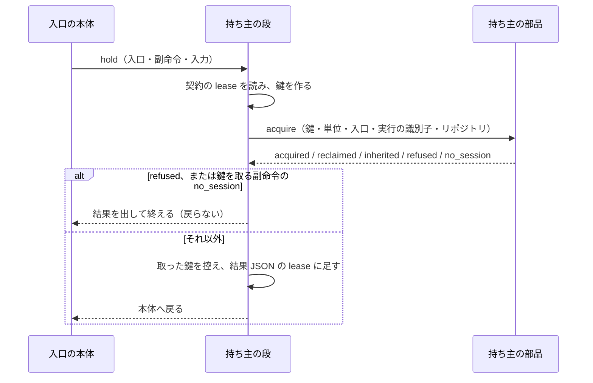

# 実行の持ち主: 持ち主の鍵を宣言した入口が鍵を取り・返し、並行する実行と打ち切りの残骸で止まらない

## 概要

持ち主の鍵を契約で宣言した入口は、入力を解いた直後に持ち主の段（[`lib/lease_stage.py`](../../plugins/ndf/scripts/lib/lease_stage.py) の `hold`）で
持ち主の記録を取り、どの終わり方（正常・例外・SIGTERM・時間切れ）でも 1 回だけ返す。生きた持ち主がいれば待たずに止まり、結果 JSON に
持ち主の実行の識別子・pid・最後に動いた時刻を出す。SIGKILL・電源断で返せなかった記録は、次の実行がプロセスの生死から判定して引き取る。

この仕組みで、次の 3 つが成り立つ。

| 起きていたこと | 今の振る舞い |
| --- | --- |
| cross-refactoring の着手前のテストを上限で打ち切ると、持ち主の記録に終わった時刻が残らず、次の起動を 24 時間断った（#2321） | 打ち切りの経路も持ち主の段の返す処理を通る。返せなかった記録も、持ち主のプロセスが居なければ次の実行が引き取る |
| 2 つの conductor が同じ開発ループと同じキューの記録（done のファイル）を互いに知らずに流した（#2316） | 開発ループはループ名ごと、キューは done ごとの鍵を取り合い、後から来た側が止まる |
| 強制終了の後の `supervise.py queue --resume <done> --from <プラン>=<ステップ>` が、前の起動の途中の位置に負けた（#2325） | `--from` があれば前の途中を子ごと止め、新しい実行の回で指定のステップから流す |

この文書は持ち主の段と、鍵を宣言する入口・断りの形・決定の理由を持つ。持ち主の記録そのもの（置き場・形・生死の判定・`lease.py` の関数・片付け）は
[ndf-run-state-owner-and-sweep.md](ndf-run-state-owner-and-sweep.md) が正である。

## 用語

定義は [用語集](../glossary.md) が正である（`.ndf/glossary.json` の `document`。文脈 `ndf-worktree` と `ndf-workflow`）。
この文書で使う語は「持ち主の記録」「持ち主の鍵」「持ち主の契約」「持ち主の単位」「寿命の窓」「実行の核」「実行の識別子」「耐久の記録」「本体」である。

## コンテキスト

| コンテキスト | この文書で受け持つ語 |
| --- | --- |
| NDF の worktree（`ndf-worktree`） | 持ち主の記録・持ち主の鍵・持ち主の契約・持ち主の単位・寿命の窓 |
| NDF の開発ワークフロー（`ndf-workflow`） | 実行の核・実行の識別子・耐久の記録 |

2 つは**共有カーネル**の関係にある。持ち主の部品（`lib/lease.py`）と持ち主の段（`lib/lease_stage.py`）を、実行の核・入口・片付けが共に使う。

## 背景

持ち主の記録を書く処理が入口ごとにあり、打ち切りの経路が漏れていた。断りの案内は `--run` を渡す・`finish` の後に開始すると示していたが、
プランから呼ぶ `drive.py` は `--run` を受けず、`refactor.py` に `finish` は無かった。開発ループとキューには、後から来た conductor を止める
仕組みが無かった。キューの再開は、前の起動が途中で残っていると、耐久の部品の `durable.resolve` が `continue` を返して前の入力で回復していた。

持ち主の扱いを入口ごとに持たず、1 か所（持ち主の部品と持ち主の段）に集めて解消した。

## 対象範囲

| 扱う | 扱わない |
| --- | --- |
| 持ち主の段（取る・動いた・返す・結果への写し・断り） | 持ち主の記録の形・置き場・生死の判定・片付け（[ndf-run-state-owner-and-sweep.md](ndf-run-state-owner-and-sweep.md)） |
| 持ち主の鍵を宣言する 6 つの入口と、その宣言 | 生きた持ち主を待つ形（どの入口も止まる） |
| キューの再開で `--from` を前の途中の位置より優先すること | 再開の入口の新設と、旧い再開の形（`run --from`・`queue --resume`・cross-review の `drive.py --reopen`）を 1 つにまとめること |
| 開発ループをランタイムのセッション単位で持つこと | backlog-refinement の見直しの持ち主（`.ndf/backlog/owner.json`。`lib/run_owner.py` のまま） |
| | 旧い版が書いた `*.owner.json` を読む互換、hook・`factory/` の並行、マシンをまたぐ排他、Issue・触るファイル・版数の単位の排他 |

**働く範囲は利用先のリポジトリを含む**（`plugins/ndf/scripts` と `plugins/ndf/skills/*/scripts`）。鍵の値は入口の入力から作り、置き場は
リポジトリの slug で分ける。寿命の窓は契約の一覧の値で、プロジェクトの `.ndf/` を読まない。

## 決定と理由

| # | 決定 | 理由 |
| ---: | --- | --- |
| 1 | 持ち主の単位を `run`（入口の 1 回の実行）と `session`（ランタイムのセッション）の 2 つにし、開発ループは `session` で持つ | 開発ループは 1 つの conductor が別々のプロセスで副命令を打って進む。`run` では `loop start` の終わりで鍵が返り、2 つ目の conductor を止められない。開発ループの記録（`loop.json`）に conductor を書き足すと、記録の書き手と生死の判定がもう 1 組できる |
| 2 | キューは done のパス、開発ループはループ名を鍵にする。`supervise.py run` には鍵を宣言しない | 衝突したのは同じ done を再開した 2 つのキューと、同じ名前の開発ループである。done ごとなら `queue ... --done X` と `queue --resume X` が同じ鍵を取り合い、別の done は並べて流せる。プランごとの鍵は、複数の鍵を一度に取る規則が別に要る。`run` を直に 2 本並べた衝突の記録は無い |
| 3 | 旧い版が状態ディレクトリの横に書いた `*.owner.json` は読まない | 読む互換を持つと、取る側と片付けの両方に寿命の窓だけで判定する旧い規則の分岐が残る。旧い記録はレビュー worktree を外すときに一緒に消える |
| 4 | 記録の持ち主のプロセスが自分か自分の祖先なら、鍵を取り直さずに使う（`inherited`）。実行の識別子の一致では判定しない | `drive.py` が子として起こす `init` も同じ鍵を宣言する（`init` は利用者が直に打つこともある）。識別子は子へ渡す経路ごとに受け渡しの漏れがあり、プランから呼ぶ `drive.py` には渡す手段が無い。プロセスの祖先は受け渡しが要らない |
| 5 | キューの再開は、プランの並びが変わったときに加えて `--from` があるときも、前の途中の耐久ワークフローを子ごと止めてから開く | 食い違いはキューの入口の 1 か所の条件にあり、既存の止め方（`durable.launch` の `keep=()`）で直せる。前の `--from` を覚えて比べる形は置き場がもう 1 つ要る。`supervise.py run --from` は開始のステップを耐久ワークフローの接頭辞に含めており、すでに `--from` が勝つ |
| 6 | 死んだ持ち主の引き取りは記録の書き直しだけにし、状態を持ち主の記録に結び付けない | レビュー worktree 1 種類に cross-review と cross-refactoring の 2 つの鍵が結び付き、複数の鍵を順に取る規則が要る。#2321 は終わった時刻が書かれれば解消する。残ったレビュー worktree は入口が今までどおり作り直すか使い直す |
| 7 | 持ち主の鍵を宣言した入口はすべて止まり、待つ形を持たない | 持ち主はどれも数分から数時間動く。待つと後から来た conductor が上限まで進まず、持ち主を知るのも上限の後になる。止まって持ち主を結果に出せば、conductor はその場で待つか別の仕事へ移るかを決められる |
| 8 | 見直しの持ち主は `run_owner.py` のまま残す | 見直しの持ち主は、同じホストでも最後に動いた時刻から `depths.owner.ttl` を過ぎた宣言を別のセッションが引き取れる。持ち主の部品へ移すと同じホストを pid と開始時刻で決める規則に入り、振る舞いが変わる。同じ役割の部品が 2 つに分かれた状態は残る |

## 仕様

### 常に成り立つ条件

| # | 条件 | 破れたときの扱い |
| --- | --- | --- |
| I1 | 1 つの持ち主の鍵を、生きた持ち主が 2 つ同時に持たない | 後から来た実行は `stopped`・終了コード 3（`summary` に持ち主の実行の識別子） |
| I2 | 記録を読んでから書くまでを、鍵ごとの排他の中で行う | 排他を取れなければ記録を書かない |
| I3 | 単位 `run` の鍵は、正常・例外・SIGTERM・時間切れのどの終わり方でも終わった時刻が書かれる | SIGKILL・電源断の後は、次の実行が生死を判定して引き取る（`reclaimed`） |
| I4 | 記録の持ち主のプロセス（pid と開始時刻）が自分の祖先である実行は、鍵を取り直さずに使い、返さない | 祖先が持っていない鍵は I1 のとおり取り合い、取った実行が自分の終わりで返す |
| I5 | 記録は版・鍵・入口・実行の識別子・3 つの時刻・pid・開始時刻・ホスト名だけを持つ | 余分な鍵があれば書かずに `stopped`・1 |
| I6 | キューの再開で `--from` があれば、前の途中の耐久ワークフローを子ごと止めてから新しい実行の回で始める | 止められなければ流さずに `stopped`・1 |

生死の判定（同じホストは pid と開始時刻、別のホストは寿命の窓）と記録の形は
[ndf-run-state-owner-and-sweep.md](ndf-run-state-owner-and-sweep.md) の「レビュー worktree の持ち主の記録」と常に成り立つ条件にある。

### 構成要素

| 要素 | 責務 |
| --- | --- |
| 持ち主の段 [`lib/lease_stage.py`](../../plugins/ndf/scripts/lib/lease_stage.py) | `hold`（契約の宣言を読み、鍵を作って取る。止まるときは戻らない）・`touch_held`（最後に動いた時刻）・`release_held`（返す。2 回目は何もしない）・`with_lease` / `lease_json`（結果 JSON の `lease`） |
| 持ち主の部品 [`lib/lease.py`](../../plugins/ndf/scripts/lib/lease.py) | 記録の取る・動いた・返す・読む・消すと生死の判定、ランタイムのセッションの解決（`runtime_session`）。呼ぶのは持ち主の段と片付けだけ |
| 実行の核 [`lib/run_core.py`](../../plugins/ndf/scripts/lib/run_core.py) | 本体の終わり（`finally`・SIGTERM・時間切れ）で、読み込まれていれば持ち主の段の `release_held` を呼ぶ |
| 耐久の部品 [`lib/durable.py`](../../plugins/ndf/scripts/lib/durable.py) | `exit_leaving_pending` が `os._exit` の前に `release_held` を呼ぶ（`os._exit` は atexit を通らないため） |
| 契約の読み手 [`scripts/contracts_lib/model.py`](../../scripts/contracts_lib/model.py) | 入口の行の任意のキー `lease` の形を確かめる（`_check_lease`） |
| キューの入口 [`supervise_lib/queue.py`](../../plugins/ndf/scripts/supervise_lib/queue.py)・[`queue_resume.py`](../../plugins/ndf/scripts/supervise_lib/queue_resume.py)・[`flow.py`](../../plugins/ndf/scripts/supervise_lib/flow.py) | done の鍵を取る。`--from` があれば `restart` を渡し、`launch_queue` が前の途中を止める |

### 持ち主の鍵を宣言する入口

宣言は [`plugins/ndf/contracts/entrypoints/`](../../plugins/ndf/contracts/entrypoints/) の各行の `lease` が正である（キーの形は
[ndf-entrypoint-contracts.md](ndf-entrypoint-contracts.md)）。寿命の窓はどれも 86400 秒（24 時間）。

| 入口 | 副命令 | 鍵の形 | 単位 |
| --- | --- | --- | --- |
| cross-refactoring の `drive.py` | — | `cross-refactoring:pr={pr}` | `run` |
| cross-refactoring の `refactor.py` | `init` | `cross-refactoring:pr={pr}` | `run` |
| cross-review の `drive.py` | — | `cross-review:pr={pr}` | `run` |
| cross-review の `state.py` | `init` | `cross-review:pr={pr}` | `run` |
| `supervise.py` | `queue`（`--resume` を含む） | `supervise.queue:done={done}` | `run` |
| `sprint-state.py` | `loop` の `start`・`select`・`exclude`・`sprint`・`gate`・`lap`・`pending`・`hold-question`・`stop`・`finish` | `supervise.loop:name={name}` | `session`（`stop`・`finish` は `release: true`） |

- `{done}` はリポジトリの根からの相対パスにする（`supervise_lib/paths.queue_done_key`。git の外は絶対パス）。worktree の違いで鍵が割れない
- `loop` の副命令のうち、利用者が答える `answer`・`approve-mvv` と、読むだけの `status`・`list`・`environment` は宣言せず、持ち主の段を通らない。
  利用者が自分の端末や別のセッションから承認を記録する手段を残すためである。記録の書き換えどうしは開発ループの記録を開く排他が守る
- `loop pending` は差し戻し・失敗の答えで周回を締め直すため、鍵を取る。呼ぶのは conductor のセッションの中のレーンなので、同じセッションとして通る
- `refactor.py init` と `state.py init` の `--run` は受けて捨て、標準エラーに「実行の識別子は実行の核が振る」と出す
- 宣言の無い入口は持ち主の段で何もしない（`hold` が `None` を返す）

### 鍵を取る（`lease_stage.hold`）

| `acquire` の結果 | 持ち主の段の扱い | 状態・終了コード |
| --- | --- | --- |
| `acquired`（無い・終わっていた） / `reclaimed`（死んだ持ち主を引き取った） | 本体へ戻る。単位 `run` なら終わりで返す | 本体の結果のまま |
| `inherited`（持ち主のプロセスが自分か祖先） | 本体へ戻る。単位 `run` なら終わりで返さない | 本体の結果のまま |
| `refused`（生きた持ち主がいる） | 止まる | `stopped`・3 |
| `no_session`（単位 `session` でランタイムのセッションが無い）、鍵を取る副命令 | 止まる。本体を走らせない | `stopped`・1 |
| `no_session`、`release: true` の副命令（`loop stop`・`loop finish`） | 記録を読み書きせずに本体へ戻る。利用者が Claude Code・Codex の外の端末からループを止められる | 本体の結果のまま |
| 鍵を作る入力が無い | 止まる | `stopped`・2 |
| 記録が壊れている・排他の時間切れ・形の違い（`LeaseError`） | 止まる | `stopped`・1 |

- 鍵のリポジトリは入口の `--root`（`repo_root`）から決め、省けば作業ディレクトリから決める
- 実行の識別子は、実行の核の上なら核が振ったもの、核の外の入口なら持ち主の段が 1 プロセスに 1 つ振ったものを使う
- ランタイムのセッションは、環境変数 `NDF_RUNTIME_SESSION`（`<pid>:<開始時刻>`）があればそれを、無ければ祖先の Claude Code・Codex のプロセスを使う

### 返す（`lease_stage.release_held`）

| 入口の動き方 | 返す時点 |
| --- | --- |
| 実行の核の上 | 核が本体の終わり（`finally`・SIGTERM の受け手・時間切れ）で呼ぶ |
| 核の外（自分がその入口のプロセスのとき） | `hold` が置いた atexit と SIGTERM の受け手。`durable.exit_leaving_pending` は `os._exit` の前に呼ぶ |
| `drive.py`（cross-review・cross-refactoring） | 本体の終わりで自分で呼ぶ。同じプロセスで続けて呼ぶ呼び出し元も次に取れる |

どの経路から呼ばれても、取った鍵ごとに 1 回だけ働く。

| 単位と結果 | 返す処理 |
| --- | --- |
| `run` で `acquired`・`reclaimed` | 終わった時刻を書く |
| `run` で `inherited` | 何もしない（祖先の持ち主が返す） |
| `session` で `release: true` の副命令 | 終わった時刻を書く |
| `session` でそれ以外の副命令 | 最後に動いた時刻だけを書く。セッションが終われば、次に取る側が死を判定する |

終わった時刻と最後に動いた時刻を書くのは、記録の pid と開始時刻が自分の持ち主のプロセスと一致するときだけである。長く動く `drive.py` は
`init` の結果を受け取るたび（起動と打ち直しのたび）に `touch_held` で最後に動いた時刻を書く。

### キューの `--from` つきの再開

`supervise.py queue --resume <done> --from <プラン>=<ステップ>` は、done の鍵を取った後、前の起動のキューの耐久ワークフローが途中で
残っていても子ごと止め、新しい実行の回で指定のステップから流す。`--from` も `--only` も無ければ前の起動を続ける。引数は変わらない。
打ち方と開始のステップの決め方は [ndf-supervise-queue-resume-and-gate-evidence.md](ndf-supervise-queue-resume-and-gate-evidence.md) にある。

## 外部連携

### 結果 JSON の `lease`

持ち主の鍵を取った入口の結果 JSON は、任意の鍵 `lease` を持つ（最後に取った鍵。足すだけで既存の鍵は変えない）。

| 鍵 | 型 | 意味 |
| --- | --- | --- |
| `key` | str | 持ち主の鍵 |
| `outcome` | str | `acquired` / `reclaimed` / `inherited` / `refused` / `no_session` |
| `holder_run` | str | 生きた持ち主・引き取った持ち主の実行の識別子。いなければ省く |
| `holder_pid` | int | 同上の pid。いなければ省く |
| `holder_seen_at` | str | 同上の最後に動いた時刻。いなければ省く |

### 断るときの案内

- `refused` の `summary` は「持ち主の鍵 <鍵> は別の実行 <実行の識別子> が持っている（pid <pid>・最後に動いた時刻 <時刻>）」で、`gaps` に `kind: lease`
- `next` は「持ち主の実行が終わってから同じコマンドを打ち直す。待てなければ、止まった理由と持ち主の pid を添えて人へ戻す」だけである。`--run`・`finish`・`kill` を書かない。
  持ち主は別の実行か利用者のランタイムのセッションで、止めるかどうかは人が決める
- 鍵を取る副命令の `no_session` の `summary` は「ランタイムのセッション（Claude Code・Codex）の外では、セッション単位の鍵を取れない」

## エラー処理

| 事象 | 扱い |
| --- | --- |
| `filelock` か `psutil` が無い | 使う入口は `deps.require("locks", "procs")` を先に呼び、記録を読む前に `stopped`・69 と足りないグループ名を返す |
| 契約の `lease` の形が違う | 契約の検査（`_check_lease`）が落とす。`key` は `{入力の名前}` を含む文字列、`unit` は `run` / `session`、`window_seconds` は正の整数、`release` は任意 |

## セキュリティ

記録が持つのは I5 の項目だけで、引数の並びと環境変数を書かない。秘密（トークン・鍵・認証情報）の値は記録に入らない。

## 運用

- 生きた持ち主で止まったら、`lease.holder_pid` の実行が終わるのを待って同じコマンドを打ち直す。conductor が待てないときは人へ戻す
- テストは `plugins/ndf/conftest.py` の自動の fixture が `NDF_LEASE_DIR` を一時ディレクトリへ、`NDF_RUNTIME_SESSION` を pytest のプロセスへ向ける。
  サブプロセスで起動した入口にも届くため、ランタイムのいない CI でも `no_session` にならず、本物の置き場へ書かない

### 未確認・残リスク

| 項目 | 内容 |
| --- | --- |
| 中継の切り替え | 中継の再起動で新しいセッションが前のセッションの終わりより先に `loop` を打つと、前のセッションが生きている間は `refused` になる。切り替えの順は実機で確かめていない |
| 旧い版との並走 | 旧い版は `leases/` を読まない。旧い版と新しい版が同じ鍵を同時に取ると互いを止めない |
| 子の課題の確定 | #2321・#2316・#2325 の再現の手順を本番へ出した版で通し、閉じるか残すかを決める作業は、リリース後テストで行う。#2316 のうち Issue・触るファイル・版数・マシンをまたぐ排他は範囲外として残る |
| 部品の重なり | 同じ役割の部品が `lease.py` と `run_owner.py`（見直しの持ち主）に分かれている |

## テスト観点

| 観点 | 確かめること |
| --- | --- |
| 終わり方（I3） | 正常・例外・SIGTERM・時間切れで終えた後に記録が `finished_at` を持ち、同じ鍵の次の実行が `acquired` で始まること |
| 強制終了と pid の再利用 | SIGKILL の後の次の実行が `reclaimed` で取ること。pid が一致し開始時刻が違う記録を死んだ持ち主と読むこと |
| 断り（I1） | 生きた持ち主がいるとき 2 つ目のプロセスが `refused`・3 で止まり、`lease` に持ち主の 3 項目が入り、`next` に `--run`・`finish`・`kill` が無いこと |
| 排他（I2） | 多数のプロセスが同時に同じ鍵を取っても生きた持ち主が常に 1 つであること |
| 祖先（I4） | 祖先が持つ鍵を子が `inherited` で使い、子の終わりで返らないこと。祖先が持たない鍵を子が取ったときは子の終わりで返ること |
| セッションの外 | `NDF_RUNTIME_SESSION` も祖先のランタイムも無いとき、`loop start` が記録を書かずに `stopped`・1 で止まり、`loop stop`・`loop finish` は本体を走らせること |
| 開発ループとキュー | 別のセッションが生きた持ち主のとき、`loop start`・`loop pending` と同じ done の `queue --resume` が `refused`・3 で止まり、`resumed` を返さないこと。`answer`・`approve-mvv`・`status`・`list` は止まらないこと |
| `--from`（I6） | 途中のまま残った後の `queue --resume <done> --from <プラン>=<ステップ>` が指定のステップから新しい実行の回で流れ、`--from` も `--only` も無ければ前の起動を続けること |
| 記録の形（I5） | 余分な鍵を持つ記録を書かないこと。`prune` が古い `.lease.json` だけを消し、`.lock` を残すこと |
| 宣言の無い入口 | 振る舞いが変わらず、全体テストが通ること |

テストは [`scripts/tests/test_lease.py`](../../plugins/ndf/scripts/tests/test_lease.py)・[`test_sprint_loop.py`](../../plugins/ndf/scripts/tests/test_sprint_loop.py)・
[`test_supervise_queue_continue.py`](../../plugins/ndf/scripts/tests/test_supervise_queue_continue.py)・[`test_run_state.py`](../../plugins/ndf/scripts/tests/test_run_state.py) にある。

## 関連リンク

- [issue #2342](https://github.com/devbasex/ai-plugins/issues/2342) — 要求（子: [#2321](https://github.com/devbasex/ai-plugins/issues/2321)・[#2316](https://github.com/devbasex/ai-plugins/issues/2316)・[#2325](https://github.com/devbasex/ai-plugins/issues/2325)）。上位の方針は [issue #2335](https://github.com/devbasex/ai-plugins/issues/2335)
- [PR #2800](https://github.com/devbasex/ai-plugins/pull/2800) — 実装
- [ndf-run-state-owner-and-sweep.md](ndf-run-state-owner-and-sweep.md) — 持ち主の記録の形・置き場・生死の判定・片付け
- [ndf-entrypoint-contracts.md](ndf-entrypoint-contracts.md) — 入口の契約の `lease` のキー
- [ndf-supervise-queue-resume-and-gate-evidence.md](ndf-supervise-queue-resume-and-gate-evidence.md) — キューの再開と `--from`
- [ndf-workflow-development-loop.md](ndf-workflow-development-loop.md) — 開発ループの副命令
