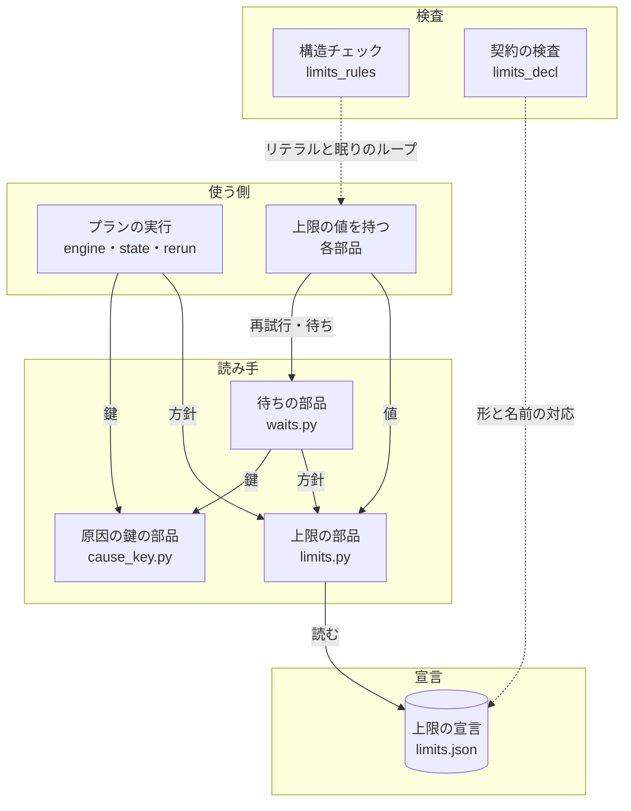
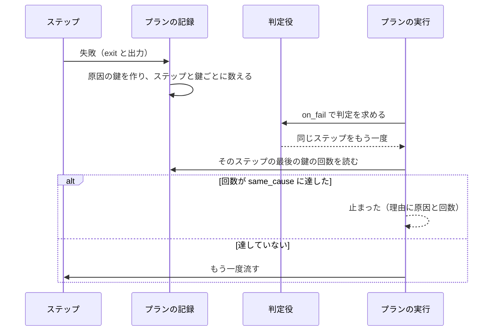
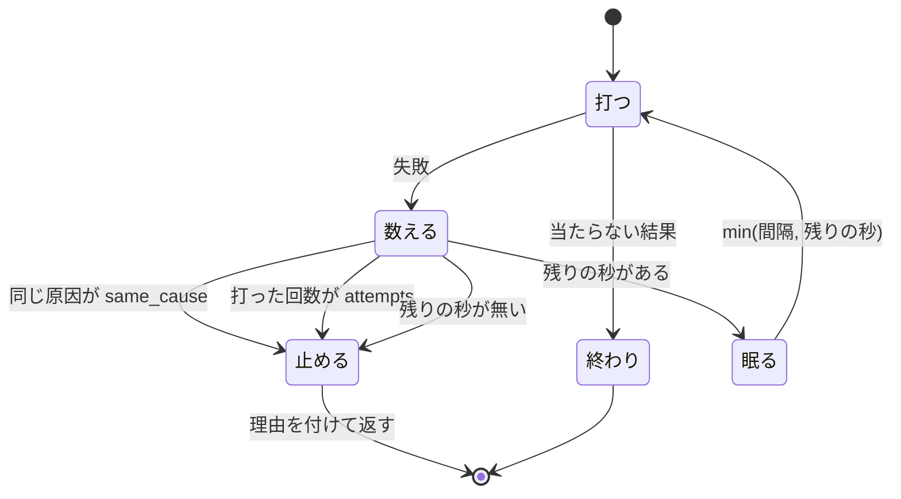

# 上限の宣言と再試行の方針: 上限を 1 つの宣言から引き、同じ原因の打ち直しを決まった回数で止める

NDF のリリース対象（`plugins/ndf/` の Python のコード。hook を含み、テストと実験版を除く）は、上限の秒・再試行の回数・待ちの間隔を
コードに数字で書かず、**上限の宣言** [`plugins/ndf/contracts/limits.json`](../../plugins/ndf/contracts/limits.json) から
**方針の名前**で引く。再試行と待ちは待ちの部品 [`lib/waits.py`](../../plugins/ndf/scripts/lib/waits.py) だけが持ち、
同じ原因の失敗を方針の回数で止め、待ちは期限の時刻に最後の照会を打ってから止まる。止まったときは、方針の名前・原因・回数・
待った秒を含む理由の文が結果に出る。

例: 本番のリリースのプランで、`release` のステップが毎回同じ CI の失敗で落ち、判定役（judge）が同じステップの打ち直しを返し続ける。

| 順 | 起きること |
| --- | --- |
| 1 | 1 回目の失敗。プランの記録が、ステップの出力の最後の結果 JSON の `summary`「PR #1976 の CI が失敗: runtime-smoke (agy)（run 38353378585）」から原因の鍵 `exit=1: PR #<数> の CI が失敗: runtime-smoke (agy)（run <数>）` を作り、回数を 1 にする |
| 2 | 判定役が同じステップを返す。回数 1 は方針 `supervise.step-rerun` の `same_cause`（2）に届かないので、ステップをもう一度流す |
| 3 | 2 回目の失敗。run の番号は違うが、数字を伏せた鍵は同じなので回数が 2 になる |
| 4 | 判定役がまた同じステップを返す。回数が 2 に達したので、ステップを流さずにプランが「止まった」になる。理由は「ステップ release が同じ原因（exit=1: PR #<数> の CI が失敗: runtime-smoke (agy)（run <数>…）で 2 回失敗した（方針 supervise.step-rerun）。打ち直さずに止める」で、進捗の記録へ `kind: same-cause` の 1 行が書かれる |

**方針と値の一覧は写さない。** 一覧の正本は宣言そのものと、契約の検査が描く逆引きの表である。

| 何を | 正本 |
| --- | --- |
| 方針の名前と値 | [`plugins/ndf/contracts/limits.json`](../../plugins/ndf/contracts/limits.json) |
| 方針ごとの値・何の上限か・引く関数の表（生成物） | [`plugins/ndf/contracts/index.md`](../../plugins/ndf/contracts/index.md) の「上限の宣言」 |
| 宣言の読み手と監視の工程 × 担当の引き方 | [`lib/limits.py`](../../plugins/ndf/scripts/lib/limits.py) の冒頭の説明 |
| 再試行と待ちの止まり方 | [`lib/waits.py`](../../plugins/ndf/scripts/lib/waits.py) の冒頭の説明 |
| 開発ループの各上限の値の意味（監視の上限・無進捗の許容・時間予算など） | [ndf-development-loop-limits.md](ndf-development-loop-limits.md) |

この文書が扱うのは、決定の理由、構成要素の責務と契約、常に成り立つ条件、検査の規則である。

## コンテキスト

| コンテキスト | 何の語が 1 つの意味に決まるか |
| --- | --- |
| NDF の開発ワークフロー（`ndf-workflow`） | 上限の宣言・方針の名前・原因の鍵・再試行・ステップの打ち直し・眠りのループ・最後の照会 |

1 つのコンテキストに収まる。上限の宣言は契約の一覧（`plugins/ndf/contracts/`）の一部で、プランの実行・収束ループ・リリースなどの
各部品は方針の名前で値を引く。

## 用語

この文書の用語（上限の宣言・方針の名前・原因の鍵・ステップの打ち直し・眠りのループ・最後の照会）の定義は
[用語集](../glossary.md) にある。

## 背景

- 上限の秒・再試行の回数・待ちの間隔は、69 ファイルの 104 か所に数字で書かれていた。値を変えるたびに置き場を探す必要があり、
  呼び出しのキーワード引数だけを見る正規表現（`timeout=[0-9]`）では、定数・関数の既定値・`.get` の既定値を見落とす
- 待ちの部品は「眠りの合計 + 次の眠り > 上限」で止まっていたため、間隔が 120 秒まで伸びた待ちは上限の最大 119 秒前に止まった。
  上限 1154 秒のうち 112 秒を残して「結論を得られない」で止まり、同じコミットのチェックはすべて成功していた（#2224）
- 判定役は「再び同じ所で落ちたら止める」と書きながら、前の打ち直しの結果を読まずに同じ答えを 7 回返し、ステップの上限で止まった（#1983）

## 対象範囲

| 含む | 含まない |
| --- | --- |
| `plugins/ndf/` の Python のコード（hook を含む）の上限の既定値 | テストと実験版（`plugins/ndf/scripts/experimental/`） |
| 呼び出しの再試行・条件が揃うまでの待ち・判定役が返すステップの打ち直し | GitHub の利用上限の回復の時刻までの待ち（`gh_quota` と `Engine.gh_limit_wait` が持つ） |
| 上限の数字のリテラル・眠りのループ・`tenacity` の import の構造チェック | シェルのスクリプトの数字（`statusline.sh` など。「決定と理由」の 8） |
| | 上限の値の上書きの経路。今ある環境変数と引数（`MONITOR_TIMEOUT` など）をそのまま受け、宣言は既定値だけを持つ |

## 決定と理由

| # | 決定 | 理由 |
| --- | --- | --- |
| 1 | 宣言は方針の名前 → 値の平らな表にする。監視の工程 × 担当の表も `monitor.phase.<工程>`・`monitor.stall.<担当>` の名前で同じ表に置き、読み手が接頭辞で数え上げる。1 つの部品が組で使う値（間隔・1 回の待ち・合計）は 1 つの方針にまとめる | 入れ子を持つのは監視の表だけで、ほかの上限に使われない形を読み手に持たせないため |
| 2 | 読み手は標準ライブラリの `json` だけで 1 プロセスに 1 回読む。置き場はプラグインからの相対に固定し、上書きの環境変数を持たない | hook は `deps.require()` を呼べず pydantic を使えない。宣言の読み込みの費用は起動の中央値で 1 ms 未満（2026-11-04 の実測） |
| 3 | 宣言が無い・壊れている・方針や値が無いときは、組み込みの値へ戻らず `LimitsError` で止める | 戻ると、宣言を直したつもりの値が使われないことが結果に出ない。宣言はリリース対象の一部で、壊れるのはリリース対象の不具合であり、CI の契約の検査が先に落とす |
| 4 | `limit-literal` は構文木で判定し、名前の規則とキーワードの表で当てる。0 は落とさない | 数字のリテラルをすべて落とすと、行数・終了コードなど上限でない数字が数百か所当たる。0 は「待たない・打ち直さない」で上限の値でない |
| 5 | 再試行と待ちを見分けず、`lib/waits.py` の外の眠りのループをすべて落とす。待ちのループは例外リストに理由つきで載せる | 構文から「打ち直し」と「問い合わせ」を見分ける規則は呼ぶ関数の意味に頼るため外れる。名前（`retry` を含む関数）でも見分けられない |
| 6 | 原因の鍵は種類と伏せた理由の文から作り、鍵ごとに数える。続いたかどうかは見ない | run の番号や時刻が違うだけの失敗を別の原因と数えないため。続けて起きた回数だけを数えると、交互に起きる 2 つの原因で上限に届かない |
| 7 | ステップの打ち直しの同じ原因の上限は 2。呼び出しの再試行の `same_cause` は、方針ごとに今の間隔と合計から届く打つ回数と同じ値にする | 新しく止める所（ステップの打ち直し）だけ振る舞いを変える。再試行は一時的な失敗（上限・lock・502）を待つためのもので、同じ原因が続くのが通常である。全方針に共通の既定を読み手に持たせると、読み手に上限の数字が残る |
| 8 | ステップの打ち直しは、判定役の入力を変えずに、判定の後にプランの実行が数えて止める | 判定は言語モデルの答えで同じ入力でも揃わず、止まるかを答えに任せるとテストで縛れない |
| 9 | 待ちと再試行は次の眠りを残りの秒に縮め、期限の時刻に最後の 1 回を打つ。同じ規則を `retry_call` と `wait_until` の両方に当てる | 宣言した上限を使い切ってから止めるため。2 つの関数で規則が分かれると、同じ方針でも打つ回数が関数で変わる |
| 10 | シェルのスクリプトの数字は検査に入れない | `statusline.sh` は表示のたびに動き、宣言を読むと Python の起動（21 ms）が毎回足される |
| 11 | 方針の名前と宣言の対応の検査と、方針ごとに引く関数の表は契約の検査に置く | 構造チェックはコードの形を見る検査で、契約の一覧の逆引きの表を描く役割を持たない |

## 仕様

### 集約

| 集約 | 持ち主（書き換えてよいもの） | 根 | エンティティ | 値オブジェクト |
| --- | --- | --- | --- | --- |
| 上限の宣言 | 宣言を変える Pull Request（実行時には誰も書かない。`lib/limits.py` は読むだけ） | `plugins/ndf/contracts/limits.json` | 方針（方針の名前で引く行） | 上限の秒・間隔・倍率・間隔の上限・1 回の呼び出しの待ち・打つ回数・同じ原因の上限 |
| 1 回の再試行 | 待ちの部品（`lib/waits.py`）。1 回の `retry_call` / `wait_until` の呼び出しの間だけ生きる | 呼び出し | — | 原因の鍵・原因ごとの回数・待った秒・止まった理由（`Waited`） |
| プランの実行 | プランの実行の部品（`supervise_lib/engine.py`）と記録（`supervise_lib/state.py`） | 状態の置き場 | ステップの結果 | 原因の鍵・ステップと原因ごとの回数 |

集約の間は名前で参照する。部品は方針を方針の名前で引き、値をコピーして持たない。

### 構成要素

| 要素 | 責務 |
| --- | --- |
| 上限の宣言（`plugins/ndf/contracts/limits.json`） | 方針の名前ごとに上限の値を持つ |
| 上限の部品（`plugins/ndf/scripts/lib/limits.py`） | 宣言を 1 プロセスに 1 回読み、形を確かめ、`policy`・`seconds`・`value` で返す。監視の工程と担当の引き方（`monitor_timeout`・`stall_timeout`・`cli_timeout`）と `check` を持つ |
| 原因の鍵の部品（`plugins/ndf/scripts/lib/cause_key.py`） | 種類と理由の文から原因の鍵と要旨を作る。外の世界を触らない |
| 待ちの部品（`plugins/ndf/scripts/lib/waits.py`） | `retry_call` / `wait_until` が方針を引数に取り、同じ原因の上限・打つ回数・最後の照会・止まった理由を受け持つ。数字の既定値を持たない。`tenacity` を import する唯一のモジュール |
| ステップの打ち直しの上限（`plugins/ndf/scripts/supervise_lib/rerun.py`） | ステップの失敗ごとに原因の鍵を数え、判定役の打ち直しを方針 `supervise.step-rerun` の回数で止める。`state.py` の `RunState.record` と `engine.py` の `Engine._next_after_judge` から呼ばれる |
| 構造チェック（`scripts/check-script-structure.py`・`scripts/structure_checks/limits_rules.py`） | 検査の種類 `limit-literal` と `sleep-loop` を持ち、`wrapped` の持ち主の表に `tenacity`（持ち主 `lib/waits.py`）を持つ |
| 契約の検査（`scripts/check-ndf-contracts.py`・`scripts/contracts_lib/limits_decl.py`） | 宣言の形と方針の名前の対応を確かめ、契約の一覧に「上限の宣言」の表を描く |
| 例外リスト（`scripts/script-structure-allow/`） | 待ちのループと、名前の規則に当たるが上限でない数字の行を理由つきで持つ |



構造チェックと契約の検査は CI で動き、実行時には働かない。

### 常に成り立つ条件

| # | 集約 | 条件 | 破れたときの扱い |
| --- | --- | --- | --- |
| I1 | 上限の宣言 | 方針の名前は一意で、各方針は `summary` と値を 1 つ以上持つ。秒・間隔は 0 以上の数、倍率は 1 以上の数、打つ回数と同じ原因の上限は 1 以上の整数で、知らないキーを持たない | 読み手が `LimitsError`（理由に宣言のパスと方針の名前）。CI では契約の検査が落とす |
| I2 | 上限の宣言 | 宣言が無い・壊れている・引いた方針の名前が無い・引いた値が方針に無いとき、部品は組み込みの値へ戻らない | `LimitsError`。エントリポイントは終了コード 1 で止まる |
| I3 | 上限の宣言 | テストと実験版を除く `plugins/ndf/` の Python のコードに、上限の数字のリテラルが無い | 構造チェックの `limit-literal` が落とす |
| I4 | 上限の宣言 | コードが引く方針の名前はすべて宣言にあり、宣言の方針はすべてどこかのコードが引く（接頭辞で数え上げる `monitor.` の方針は引かれたものとする） | 契約の検査が落とす |
| I5 | 上限の宣言 | 監視の工程と担当のすべての組で、無進捗の許容 < 監視の上限 < CLI の上限 | `limits.py check` が組を出して終了コード 1 |
| I6 | 1 回の再試行 | 眠りのループは `lib/waits.py` と、例外リストに理由つきで載った待ちのループだけにある | 構造チェックの `sleep-loop` が落とす |
| I7 | 1 回の再試行 | `tenacity` を import するのは `lib/waits.py` だけ | 構造チェックの `wrapped` が落とす |
| I8 | 1 回の再試行 | 同じ原因の鍵の失敗の回数が方針の `same_cause` に達したら、待ちの合計の上限が残っていても打ち直さない。原因の鍵が違う失敗は別に数える | 打ち直さずに `Waited`（`stop` が `same-cause`）を返す |
| I9 | 1 回の再試行 | 期限は開始の単調時計の値に方針の `seconds` を足した時刻で、どの照会の開始も期限を超えない。次の眠りが残りの秒を超えるときは残りの秒だけ眠り、期限の時刻に最後の 1 回を打ってから止まる | 打ち切った `Waited`（`stop` が `deadline`）を返す |
| I10 | 1 回の再試行 | 止まった `Waited` は理由の文を持ち、方針の名前と、上限なら待った秒・照会の回数・上限の秒が、同じ原因なら原因の要旨と回数が入る | — （理由の文を作る経路が 1 つで、空の理由を作る経路が無い） |
| I11 | プランの実行 | 判定役が失敗したステップの打ち直しを返したとき、そのステップの同じ原因の鍵の失敗が方針 `supervise.step-rerun` の `same_cause` に達していれば、ステップを流さずに止まる | 結果「止まった」、理由に原因の要旨と回数 |
| I12 | プランの実行 | ステップと原因ごとの回数は、落ちた後の続き（耐久の記録からの再開）でも数え直さずに引き継ぐ | 耐久ステップの出力のコピー（`snapshot`）が持ち、`replay` が戻す |

### ドメインイベント

| イベント | 発生元 | 受け手 |
| --- | --- | --- |
| 上限の宣言を読んだ | 上限の部品（`limits.read_table`） | 待ちの部品・各部品 |
| 呼び出しが失敗した | 待ちの部品が呼んだ関数 | 待ちの部品 |
| 失敗から原因の鍵を作った | 原因の鍵の部品 | 待ちの部品・プランの記録 |
| 同じ原因の失敗を数えた | 待ちの部品 / プランの記録（`RunState.record`） | 待ちの部品 / プランの実行 |
| 間隔を置いて打ち直した | 待ちの部品 | 呼び出し元（`on_wait` の告知） |
| 打ち直しを止めた | 待ちの部品 | 呼び出し元（`Waited.reason` を結果の `summary` へ書く） |
| 判定役がステップの打ち直しを返した | 判定役 | プランの実行（`Engine._next_after_judge`） |
| ステップの打ち直しを同じ原因の上限で止めた | プランの実行 | プランの結果・進捗の記録（`kind: same-cause` の行） |
| 待ちが期限の時刻に最後の照会を打った | 待ちの部品（`wait_until`） | 呼び出し元 |

### 入出力の契約

#### 上限の部品（`lib/limits.py`）

| 呼び出し | 入力 | 出力 | 失敗の形 |
| --- | --- | --- | --- |
| `policy(name)` | 方針の名前 | `Policy` | 宣言が無い・壊れている・名前が無い → `LimitsError`（理由に宣言のパスと方針の名前を含む 1 文） |
| `seconds(name)` / `value(name, key)` | 方針の名前（とキー） | 数 | 上に加え、方針にその値が無い → `LimitsError` |
| `phases()` / `stalls()` / `stall_default()` / `cli_margin()` | — | 工程 → 秒、担当 → 秒、秒 | 宣言の誤り → `LimitsError` |
| `monitor_timeout(phase, agent, explicit=None)`・`stall_timeout`・`cli_timeout`・`resolve_cli_timeout` | 工程・担当・明示の値 | 環境変数を解決した秒 | 表に無い工程 → `KeyError`。宣言の誤り → `LimitsError` |
| `use(path)` | 宣言のパス（`None` でプラグインの宣言へ戻す） | — | 読み込み先を差し替え、読んだ宣言を捨てる。テストが使う |
| CLI `cli-timeout` / `monitor-timeout` / `check` | 工程・担当・`--override`・`--no-floor` | 秒を 1 行 / 崩れた組 | 宣言の誤りは理由を標準エラーへ 1 行出して終了コード 1 |

`Policy` は値オブジェクト（`NamedTuple`）で、方針に無い値は `None` である。計算で上限を縮める呼び出し元（設計の結果の読み取りの
残りの予算など）は `policy._replace(seconds=<計算した値>)` で渡す。

宣言の置き場は、リリースしたプラグインでは `contracts/limits.json`、ラッパーの複製（バージョンディレクトリ）では `lib/` と並ぶ
`contracts/limits.json` で、読み手は自分の置き場からの相対で見つける。

`LimitsError` を捕まえて組み込みの値へ戻す処理は書かない。捕まえないエントリポイントは Python の既定で終了コード 1 になる。
利用者の環境変数が数字でないときに警告して既定値を使う `safe_int_env` は、利用者の入力への扱いで、宣言の誤りとは別である。

#### 待ちの部品（`lib/waits.py`）

| 呼び出し | 方針から読む値 | 止まる条件（`Waited.stop`） |
| --- | --- | --- |
| `retry_call(fn, should_retry, *, policy, retry_on=(), reason=None, sleep, clock, on_wait)` | `seconds`（必須）・`interval`（必須）・`attempts`・`same_cause` | 当たらない結果（`done`）、同じ原因の回数が `same_cause`（`same-cause`）、打った回数が `attempts`（`attempts`）、期限を過ぎた（`deadline`） |
| `wait_until(fn, done, *, policy, sleep, clock, same, on_wait)` | `seconds`（必須）・`interval`（必須）・`factor`・`max_interval` | `done(値)`（`done`）、最後の照会の後（`deadline`） |

- `clock` は単調時計の値を返す関数で、既定は `time.monotonic`。経った秒は、時計の差と眠りの合計の大きい方で数える。
  `sleep` だけを差し替えたテストでも、時計と眠りを組で差し替えたテストでも、同じ回数で止まる
- `reason(値)` は失敗の理由の文を返す関数で、省くと結果の値の `str()` を使う（種類は `result`）。例外は型の名前と `str(例外)` から鍵を作る
- `interval` が 0 の方針は打ち直さず、1 回だけ打つ
- `wait_until` は変化が無い間（前の値と `same`）は間隔を `factor` 倍に伸ばし（`max_interval` まで。無ければ期限だけが抑える）、値が変わったら最初の間隔へ戻す
- 方針に必須の値が無いときは `LimitsError`

`Waited` は `value`・`attempts`・`waited`・`done`・`error`・`stop`・`cause`・`same`・`reason` を持つ。前の 5 つの位置と意味は
待ちの部品の初めからの形のままで、後ろの 4 つ（止まり方・最後の失敗の原因の鍵・その回数・理由の文）は既定値を持つ。
理由の文の形は次の 3 つである。

```text
上限で止めた（方針 test-triage.check-wait）: 待った 1154 秒・照会 15 回・上限 1154 秒
同じ原因（exit=1: PR #<数> の CI が失敗: runtime-smoke (agy)（run <数>））で 2 回失敗した（方針 supervise.step-rerun）
打つ回数の上限 6 回に達した（方針 supervise.worktree-lock・最後の原因 <原因の鍵の要旨>）
```

#### 原因の鍵（`lib/cause_key.py`）

`make(kind, text)` は理由の文に次の置き換えをこの順で当て、空白を 1 つにまとめて先頭 200 字を残し、`"<種類>: <伏せた文>"` を返す。
伏せた文が空なら `None` を返す。呼ぶ側は鍵を持たない失敗どうしを同じ原因として数える。種類は例外の型の名前か
`exit=<終了コード>` で、同じ文でも終了コードが違えば別の原因になる。

| 順 | 伏せる部分 | 置き換え |
| --- | --- | --- |
| 1 | ISO 8601 の日時（日付と時刻、秒・小数・時差は任意） | `<時刻>` |
| 2 | URL（`http://` / `https://` から空白まで） | `<URL>` |
| 3 | パス（`/`・`./`・`../`・`~/` で始まる語と、`/` を 1 つ以上含む語） | `<パス>` |
| 4 | 英字と数字を両方含む 7〜64 字の 16 進の語（コミットの SHA など） | `<sha>` |
| 5 | 数字の並び（小数を含む） | `<数>` |

`of_exception(exc)` は例外の鍵、`brief(key)` は鍵の先頭 60 字（鍵が無ければ「原因を見分けられない」）を返す。

#### ステップの打ち直しの上限（`supervise_lib/rerun.py`）

- 原因の鍵の理由の文は、ステップの出力の最後の結果 JSON の `summary` で、無ければ出力の最後の空でない行である。種類は `exit=<終了コード>`
- 回数は `RunState.cause_counts`（`{ステップの id: {原因の鍵: 回数}}`）が持ち、`fail_counts` と同じく `snapshot` と `replay` が運ぶ。
  `state.json` には書かない（`durable-boundary` の検査が `state.json` の鍵を限るため）
- GitHub の利用上限で落ちたステップは数えず、止める判定にも使わない。回復の時刻までの待ちが受け持つ
- 判定役が失敗していないステップ・別のステップを返したときは数えない
- 止めたときは進捗の記録へ `{"kind": "same-cause", "step", "cause", "count", "policy"}` の 1 行を書く



### 処理の流れ: 呼び出しの再試行



`wait_until` も同じ形で、「失敗」を「条件が揃わない値」に、「数える」を「残りの秒を見る」に読み替える（同じ原因と打つ回数では止めない）。
残りの秒は打つたびに計算し直し、照会にかかった時間も引かれる。上限 30 秒・間隔 10 秒・照会 2 秒の待ちは 0・12・24・30 秒の時点で照会し、
最後の照会は期限の時刻に打たれる。上限がちょうど間隔の倍数の方針は、最後の照会の前の眠りが縮まないため、打つ回数が変わらない。

### 構造チェックの種類

| 種類 | 落とすもの | 落とさないもの | 例外リストの `name` |
| --- | --- | --- | --- |
| `limit-literal` | (1) 名前の規則（`TIMEOUT`・`RETRY`・`RETRIES`・`WAIT`・`INTERVAL`・`BUDGET`・`DEADLINE`・`POLL`・`STALL`・`MARGIN`・`GRACE`・`ATTEMPTS` のどれかを含む大文字の名前。`EXIT_` で始まる名前と `_CODE` で終わる名前を除く）に当たる定数への 0 でない数字の代入、(2) 呼び出しのキーワード引数 `timeout`・`max_wait`・`interval`・`max_interval`・`wait`・`deadline`・`retries`・`attempts`・`grace`・`per_call`・`poll`・`stall_timeout` への 0 でない数字、(3) 同じ名前の引数の既定値の 0 でない数字、(4) `.get("<同じキー>", <0 でない数字>)`。数字だけでできた式（`60 * 60` など）も数字として扱う | 0、`lib/limits.py` の中、テストと実験版 | 定数の名前・引数の名前 |
| `sleep-loop` | `lib/waits.py` の外で、本体（入れ子の関数・クラス・`lambda` を除く）が名前の末尾を `sleep` とする関数を呼ぶ `for` / `while` のループ | テストと実験版 | ループを持つ関数の名前（クラスの中は `<クラス>.<関数>`、最上位はモジュールの名前） |

例外リストの行は、新しい眠りのループと、名前の規則に当たるが上限でない数字（終了コード・割合・見直しの周期・回数の記録）に限る。
行を足すときは、その行を差分に載せてレビューを通す。

## データ・設定

上限の宣言は 1 つの JSON のファイルで、実行時には読むだけである。

```json
{
  "version": 1,
  "policies": {
    "monitor.cli-margin": {"summary": "CLI の上限 = 監視の上限 + この秒数。…", "seconds": 120},
    "supervise.design-stage-read": {"summary": "設計の結果の gh / git の一時的な失敗の打ち直し。…", "seconds": 120, "per_call": 30, "interval": 15, "same_cause": 3},
    "supervise.worktree-lock": {"summary": ".git/config の lock で落ちた worktree の作成の打ち直し", "seconds": 5, "attempts": 6, "interval": 1, "same_cause": 6},
    "supervise.step-rerun": {"summary": "判定役が返すステップの打ち直しの同じ原因の上限", "same_cause": 2}
  }
}
```

| キー | 型 | 空の扱い | 意味 |
| --- | --- | --- | --- |
| `version` | int | 許さない | 宣言の形の版。1 |
| `policies` | object | 許さない | 方針の名前 → 方針 |
| 方針の名前 | str | — | `<領域>.<用途>`。領域は Skill の名前、`*_lib` の名前から `_lib` を除いたもの、`lib/` の部品はその部品の名前（例 `post-queue`）、エントリポイントのスクリプトはその名前。用途は小文字のケバブケース |
| `summary` | str | 許さない | 何の上限か。理由の文と契約の一覧に出る |
| `seconds` | number | 省略可 | 上限の秒。待ちと再試行では開始から期限までの秒（眠りと照会・呼び出しの時間を含む）、呼び出しでは `timeout` |
| `interval` | number | 省略可 | 待ちの最初の間隔（秒）。再試行では毎回の間隔 |
| `factor` | number | 省略可 | 待ちの間隔の倍率（値が変わらない間に掛ける） |
| `max_interval` | number | 省略可 | 待ちの間隔の上限（秒） |
| `per_call` | number | 省略可 | 1 回の呼び出しの打ち直しの待ちの上限（秒）。1 回の実行の合計は `seconds` |
| `attempts` | int | 省略可 | 打つ回数の上限（最初の 1 回を含む） |
| `same_cause` | int | 省略可 | 同じ原因の鍵の失敗の上限の回数 |

`lib/limits.py` の外では、方針の名前を文字列のリテラル（またはモジュールの最上位で文字列を代入した定数）で書く。契約の検査が
構文木で `limits.policy(…)`・`limits.seconds(…)`・`limits.value(…)` の名前を集めて宣言と照らすためである。

## 運用

### 上限の値を変える・足すとき

1. 宣言の方針の値を変える。新しい上限は、方針の名前を決めて `summary` と値を足し、コードから `limits.policy`・`limits.seconds`・`limits.value` で引く
2. `python3 scripts/check-ndf-contracts.py` で、形と名前の対応を確かめ、契約の一覧の「上限の宣言」の表を描き直す
3. 監視の工程と担当の値を変えたときは `python3 plugins/ndf/scripts/lib/limits.py check` で順序を確かめる
4. 新しい待ちのループがどうしても要るときは、`lib/waits.py` を通せないかを先に見る。通せないときだけ例外リストに理由つきの行を足す

### 制約

| 項目 | 内容 |
| --- | --- |
| 眠りのループの検査の範囲 | `sleep-loop` はループの本体で直に `sleep` を呼ぶものだけを見る。眠りを別の関数に包んで呼ぶ打ち直し（`supervise_lib/claude.py` の利用上限の回復の時刻までの待ちを呼ぶループ）は落とさない |
| シェルのスクリプトの数字 | `statusline.sh`・`progress-record.sh`・`workflow-common.sh`・`lock-common.sh`・`worktree-registry.sh`・`pr-body-decisions.sh` の上限の数字は検査の外にある。シェルのエントリポイントが実行の核の上で動くようになれば、核が宣言から引いた値を環境変数で渡せる |
| 例外リストの行の増加 | 行の増加をベースブランチと比べて落とす検査は無く、`sleep-loop` と `limit-literal` の行を足す差分はレビューが見る |
| 実行の記録への書き込み | 止まった理由は、結果の `summary` とプランの進捗の記録に残る |

## テスト観点

| 観点 | テスト |
| --- | --- |
| 宣言を差し替えると、同じ方針を引く部品（`retry_call` の打つ回数・`monitor_timeout` の値）が変わること。負の秒・知らないキー・整数でない回数・同じ名前の重複を `LimitsError` で拒むこと | `plugins/ndf/scripts/tests/test_limits.py`・`test_limits_declaration.py` |
| 宣言が無い・壊れた JSON・名前が無い・値が無いの 4 通りで、`limits.py` の CLI が終了コード 1 と、パスと名前を含む理由を出すこと | `test_limits_declaration.py` |
| 移す前の値の表と、宣言から引いた値が一致すること | `test_limits_migration.py` |
| `timeout=600`・`FOO_TIMEOUT = 5`・`def f(timeout=5)` で `limit-literal` が落ち、`timeout=0` と `EXIT_WAIT = 75` は通ること | `scripts/tests/test_check_script_structure.py` |
| `lib/waits.py` の外の `while True: …; time.sleep(1)` で `sleep-loop` が落ち、入れ子の関数の中の `sleep` だけなら落とさないこと。`lib/waits.py` の外の `import tenacity` で `wrapped` が落ちること | `scripts/tests/test_check_script_structure.py` |
| 同じ理由の失敗が `same_cause` 回で止まり、待ちの合計まで眠らないこと。数字だけが違う理由は同じ原因、文が違えば別の原因として数えること | `test_lib_waits.py`・`test_cause_key.py` |
| 毎回同じステップを返す判定役のプランが、2 回目の失敗の後の打ち直しで「止まった」になり、理由に原因の要旨と回数が出ること。別の失敗に変わったら流し続けること。再開の後も回数を引き継ぐこと | `test_supervise_step_rerun.py` |
| 条件が揃わない値を返し続ける `wait_until` が期限の時刻に最後の照会を打つこと（上限 30 秒・間隔 10 秒・照会 2 秒で 0・12・24・30 秒）。理由に待った秒・照会の回数・上限の秒が出ること | `test_lib_waits.py` |
| コードに宣言に無い方針の名前を書く・どこからも引かれない方針を足すと、契約の検査が落ちること | `python3 scripts/check-ndf-contracts.py` |
| `limits.py check` が宣言の値で全組を判定し、無進捗の許容を監視の上限より長くした宣言で組を出して終了コード 1 になること | `test_limits.py`・`test_limits_declaration.py` |

## 関連リンク

- [ndf-development-loop-limits.md](ndf-development-loop-limits.md): 開発ループの各上限の値の意味と置き場
- [cross-refactoring-time-budget.md](cross-refactoring-time-budget.md): cross-refactoring の時間予算と手順の監視の上限
- [cross-review-transient-post-failure.md](cross-review-transient-post-failure.md): 投稿キューの一時的な失敗の流し直し（方針 `post-queue.transient-reflush`）
- サービスの確定仕様 `ndf-factory-dev-loops.md`: Factory の開発ループの利用上限の待ち（方針 `supervise.limit-retry` と揃える値）
- [ndf-run-state-owner-and-sweep.md](ndf-run-state-owner-and-sweep.md): 期限で打ち切った実行の状態の持ち主と片付け
- [用語集](../glossary.md)
