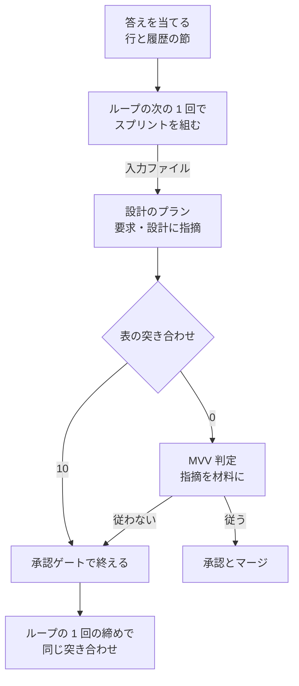
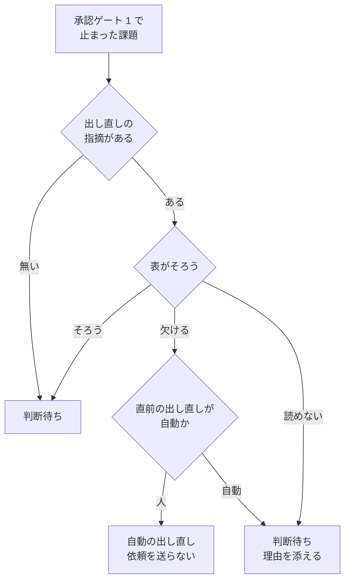
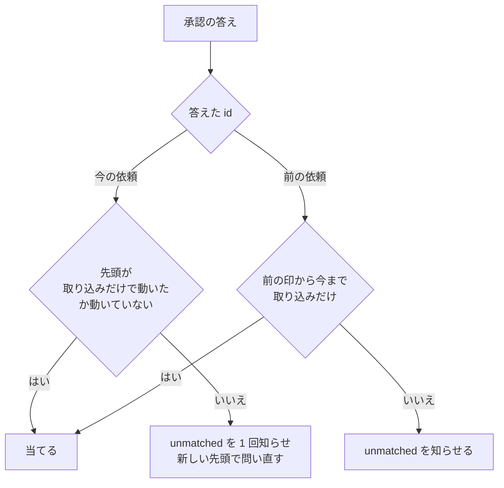
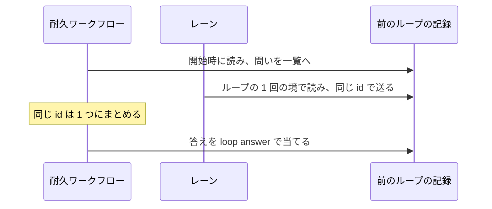

# 開発ループと並列の計画: 人の答えを、読んで動く側へ確実に届ける

承認ゲート 1 で人が返す答え（承認・直して出し直す・やらない）と、計画の外に残った承認待ちを、それを読んで動く側へ
落とさずに届ける仕組みの理由と境界、常に成り立つ条件、ファイルとコマンドの契約を残す。

**答えの種類ごとの読み手、出し直しの設計のプランの違い、取り込みのコミットだけの違いの扱いは
[`development-workflow` の references/loop.md](../../plugins/ndf/skills/development-workflow/references/loop.md) の
「答えを読んで動く手順」「出し直しの設計」「取り込みのコミットだけの違い」「並列の計画のレーン」が正である。**
オーガナイザーが問う手順と答えるコマンドは
[references/parallel.md](../../plugins/ndf/skills/development-workflow/references/parallel.md) の「問い方」が正である。
ここに書き写さない。開発ループ全体の契約は [ndf-workflow-development-loop.md](ndf-workflow-development-loop.md) が、
耐久ワークフローの依頼と答えの全体は [ndf-parallel-organizer.md](ndf-parallel-organizer.md) が持つ。

## 概要

例: 課題 #2338 の設計 PR に、人が「#2059 と #2300 に絞る」「PR は 2 本にする」の 2 項目を「直して出し直す」で返すと、次のように動く。

| 順 | 起きること |
| --- | --- |
| 1 | 答えを当てると、ループの記録の人の判断待ちの行に指摘の全文と回数が入り、課題の本文の節「出し直しの指摘の履歴」へ第 1 回が追記される |
| 2 | ループの次の 1 回のスプリントを組むとき、同じリポジトリのすべてのループの記録から #2338 の全回を集め、出し直しの指摘の入力（`revise-2338.json`）を書いて設計のプランへ渡す |
| 3 | 設計のプランは要求のコピーが一致していても要求のステップを流し、要求と設計の起動指示へ全回の指摘を入れる。設計のステップは設計文書に指摘への対応の表を書く |
| 4 | 表の突き合わせが設計文書の表を設計 PR の本文へコピーし、項目 `lroot3:1-1`・`lroot3:1-2` の行がそろうかを見る。MVV 判定は指摘を材料に含める |
| 5 | 表に欠けがあれば、人へ問わずに 1 回だけ自動の出し直しにする。2 回目も欠ければ、届いていない項目を添えて人へ問う |

並列の計画では、ほかに 3 つの答えと待ちを届ける。オーガナイザーの承認が止まったレーンへ届くこと、起点ブランチを取り込んだだけの
設計 PR を問い直さないこと、計画の外のループに残った承認待ちを問いの一覧へ出すことである。

| 構成要素 | 責務 |
| --- | --- |
| `plugins/ndf/scripts/lib/revise_note.py` | 出し直しの指摘の部品。全ループからの回の収集・項目の数え方・入力ファイルの読み書き・起動指示の文面・表の解析と欠けの判定・自動の出し直しの上限・履歴の 1 回分の文面を持つ唯一の実装 |
| `plugins/ndf/scripts/revise-note.py` | 表の突き合わせのコマンド（`check`）。設計文書の表を設計 PR の本文へコピーして項目と突き合わせる |
| `plugins/ndf/scripts/lib/gate1_requests.py` | 設計の承認の依頼の部品。設計 PR の先頭の読み取り・取り込みのコミットだけかの判定（`merge_only`）・承認の引き継ぎ（`carried_over`）・前の依頼への答えの判定（`answer_before`）・前のループの待ちの読み出しと依頼の形・前のループへの答えの当て方（`answer_prior`） |
| `plugins/ndf/scripts/lib/sprint_loop.py` | 答えを当てる（`apply_answer`・`apply_gate1_answers`）。スプリントを組むときに入力ファイルを書いて `--revise-note` で渡す |
| `plugins/ndf/scripts/lib/sprint_loop_gate.py` | 人の判断待ちへ移すときの突き合わせと自動の出し直し（`move_to_waiting`）、判断待ちの節と履歴の節の書き込み（`mark_issue`）、問い直しの判断（`regate1`） |
| `plugins/ndf/scripts/lib/sprint_loop_gate2.py` | 答えを読む依頼の一覧に、問い直す前の依頼の id を加える |
| `plugins/ndf/scripts/lib/sprint_loop_select.py`・`sprint_loop_exclusion.py` | ループの 1 回の境で送れなかった依頼と前のループの待ちを送り、前のループの待ちを持つ課題を選定から外す |
| `plugins/ndf/scripts/supervise_lib/sprint_revise.py`・`new_args.py` | `supervise.py new sprint --revise-note` を受け、設計のプランの要求のステップ・起動指示・表の突き合わせのステップ・MVV 判定の引数を変える |
| `plugins/ndf/scripts/mvv-gate.py` | `--revise-note` を受け、指摘を材料の先頭へ足し、判定の問いへ条件を足す |
| `plugins/ndf/scripts/lib/parallel_lane.py` | レーンから前のループの待ち（`send_prior`）と当たらなかった答えの知らせ（`send_unmatched`）を送る |
| `plugins/ndf/scripts/lib/parallel_reply.py`・`parallel_run.py` | 耐久ワークフローの答えの届け方。同じ行の問いの置き換え・置き換えた依頼への答え・前のループの待ち・当たらなかった答え・止まった持ち主を起こす対象 |

## 用語

この文書で使う語（出し直しの指摘・出し直しの指摘の履歴・指摘への対応の表・自動の出し直し・出し直しの指摘の入力・
設計の承認の依頼・取り込みのコミット・前のループ・当たらなかった答え）の定義は、用語集 [docs/glossary.md](../glossary.md) が正である。
「人の出し直し」は人が送った「直して出し直す」の答えを、「回」はループの名前とそのループの中の回数の組で識別する 1 回分の出し直しを指す。

## 背景

答えは記録（ループの記録と耐久ワークフローのイベント）には届いていたが、その値を読んで動く側が決まっていない値があり、
レーンが指示どおりに動いたかを確かめる手順も無かった。2026-11-04〜05 の開発ループと並列の計画で、次の形が起きた。

| 起きたこと | 落ちた場所 |
| --- | --- |
| #2344・#2338 で同じ指摘を 2 回送っても、出し直しの設計の範囲が元のままだった。課題の本文へ指摘をコピーしても、3 回目の出し直しも変わらなかった | 設計のプランの入力に指摘が無く、本文の節は次に人の判断待ちへ移すときの書き直しで消えた |
| #2494: 出し直しの設計が要求のステップを飛ばし、指摘を反映しないまま MVV 判定「従う」で承認ゲート 1 を通った | 要求のコピーの一致で要求のステップを飛ばす分岐と、MVV 判定の材料に指摘が無いこと |
| #2474 の承認がレーンのループの記録に入らず、ループは `waiting_only` で止まったままだった | 答えを当てるのは持ち主のレーンのループの 1 回の境だけで、止まったループのレーンを起こすのはオーガナイザーが `metrics.next` の 1 行を打つことだけに頼っていた |
| 起点ブランチを取り込んだ設計 PR（#2526）で、承認の依頼が送り直された | 先頭の SHA の違いを、すべて新しい設計とみなしていた |
| 計画の前のループの承認待ち 4 本が問いの一覧に一度も出ず、柱の土台 #2337 が止まった | 計画のレーンでないループの待ちを、どの経路もオーガナイザーへ送らなかった |

## 対象範囲

含む:

- 出し直しの指摘を設計のプランの要求と設計のステップの起動指示へ入れ、要求のステップを必ず流す
- 課題の本文に、回ごとに追記して上書きしない履歴の節を置く
- 指摘への対応の表を設計文書に書かせ、設計 PR の本文へコピーして突き合わせ、欠けを自動の出し直しへ戻す
- MVV 判定（`mvv-gate.py check --gate design`）の材料へ指摘を入れる
- オーガナイザーの答えを捨てず、当たらなければ区分 `unmatched` の問いで知らせる。止まったループのレーンを起こす対象に入れる
- 取り込みのコミットだけで設計 PR の先頭が動いたときに、問い直さずに承認を引き継ぐ
- 前のループの答えがまだの人の判断待ちを問いの一覧へ出し、答えをそのループの記録へ当てる

含まない:

- 承認・指摘・止める・予算を種類つきの 1 つのメッセージにまとめる作り直し
- 承認の後に設計 PR をマージする持ち主（#2507 が持つ。手順は loop.md の「承認した設計のマージ」）
- 出し直しの作業ブランチが設計 PR の最新から始まらない点（#2489 が持つ）
- 答えが届く前にレーンが同じ問いを送る行き違い
- 前のループの記録を計画のレーンへ移す・合わせること。答えを当てる以外に前のループの記録を書き換えない
- 予算と止めるの答え。既存の `loop start --budget-*`・`loop stop`・`parallel.py stop` が読み手で、新しい経路を作らない

## 決定と理由

| 決定 | 理由 |
| --- | --- |
| 設計のプランの入力の正本はループの記録とし、ループの 1 回ごとにファイルへ書き出して引数で渡す。課題の本文は入力にしない | 設計のプランを組む側は記録の形を知らずに済み、MVV 判定と表の突き合わせも同じファイルを読める。本文の節は GitHub への書き込みの失敗と人の編集で揃わなくなる |
| 起動指示へは全回の指摘の全文と項目の識別子を埋め込む。パスだけを渡さない | パスだけでは worker が読まない経路が残る。最新の 1 回だけにすると、前の回で満たした項目を次の回で崩す |
| 指摘はすべてのループの記録から集め、回をループの名前と回数の組で識別する | ループが替わると前のループの指示が届かない形を防ぐ。回数はループごとに 1 から数えるため、識別子にループの名前を入れて衝突を避ける |
| 表は設計のステップの worker が設計文書へ書き、突き合わせのコマンドが設計 PR の本文へコピーする | PR のステップは設計 PR の本文を作り直すため、本文へ直接書いた表は消える。設計文書に置けばレビューの直しと同じ差分で直る |
| 突き合わせは項目ごとの行と欄の有無だけを見る。中身が指摘を満たすかは MVV 判定に任せる | 行と欄の有無は機械で決まる。中身の充足は判断で、承認ゲート 1 の手前の MVV 判定に指摘と問いを足せば同じ問いを 2 回問わずに済む |
| 設計のプランの中で欠けを見つけたら、MVV 判定へ進まず承認ゲートで終える | MVV 判定が「従う」を返すと設計 PR はマージされ、人の判断待ちへ移す経路を通らない。自動で戻すかの判断は、記録を読めるループの 1 回の締めの 1 か所に置く |
| 自動の出し直しは人の出し直し 1 回につき 1 回まで | 利用者の決定（2026-11-05）。上限は今のループの記録の直前の出し直しの行で数える |
| 判断待ちの節は指摘の全文を持たず、履歴の節の回を指す 1 行だけを載せる | 本文の中でも全文の置き場を 1 か所にする |
| 止まったループのレーンも、耐久ワークフローが起こす対象（`revive`・`wake`）に入れる | 1 スプリントのレーンを起こす仕組み（再起動の対象と、耐久ワークフローが打つ再起動）を、ループのレーンにもそのまま使う。届け方だけを直す |
| 当てられない答えは捨てず、区分 `unmatched` の問いにする。答えのイベントは立てたまま残す | オーガナイザーが `parallel.py wait` の `questions` で知り、後から同じ id の依頼が届いても当たる |
| 取り込みのコミットだけかの判定は 1 つの関数（`merge_only`）に置き、問い直しと答えの当て方の両方が使う | 依頼を送り直すかと答えを当てるかの判断を揃える。判定は git の履歴と差分で決まり、AI の判断を要らない |
| 判定は設計 PR のブランチの上のコミット（`--first-parent`）と `issues/issue-<課題>-*.md` の差分で行い、コミットの題を見ない | 取り込んだ起点ブランチのコミットは親を辿ると範囲に入る。題は書き換えられ、中身が同じことを確かめられない |
| 前のループの待ちは、計画の開始時は耐久ワークフローが、ループの 1 回の境はレーンが、同じ関数で送る。id を行から決める | 開始時はまだどのレーンも境を通っていない。id が同じなら両方から送っても 1 つにまとまる |
| 前のループへの答えは、耐久ワークフローがそのループの `loop answer` で当てる | 前のループには境で答えを読む持ち主がいない。`loop answer` を通せば記録の書き込みはそのループの関数のままである |
| 前のループの待ちの問いは、計画を終えることを止めない | 前のループの判断は計画の仕事の外にある。終わりの要約に並べて埋もれさせない |

## 仕様

### 常に成り立つ条件

| 条件 | 破れそうなときの扱い |
| --- | --- |
| 出し直しの指摘の入力は、同じリポジトリのすべてのループの記録（`.ndf/loop/*/loop.json`）で、その課題の答えが「直して出し直す」の行をすべて持つ（人の回と自動の回）。並びは答えた時刻の順で、項目の識別子 `<ループ>:<回>-<番号>` は衝突しない | 今のループ以外の記録を読めなければ飛ばし、ループの 1 回の結果の `items` に `skipped_loop` で出す。入力を書けなければループの 1 回を `refused` で止める |
| 指摘の項目は人の回からだけ数える。箇条書き（`-`・`*`）と番号付きの行を 1 項目とし、コードブロックの中は数えず、どちらも無ければ全文を 1 項目とする。自動の回は届いていない項目の識別子だけを持つ | 数え方の関数（`split_items`）が 1 つで、ほかの経路は数えない |
| 履歴の節は追記だけで、既にある回を消さない・書き換えない。ループの名前と回数が同じ回は 2 度書かない | 本文を書けなければ理由を結果に残し、記録の書き込みは止めない |
| 出し直しの指摘を持つ課題の設計のプランは、要求のコピーのチェックを持たず、要求と設計の起動指示に全回の指摘を持つ。持たない課題のプランは変わらない | 入力の有無で分岐する（`with_revise_note`） |
| 設計 PR の本文の表は、設計文書の表をコピーしたものだけである | 食い違えば突き合わせが設計文書の側で本文を書き直す |
| 出し直しの指摘を持つ課題を答えのまだの判断待ちへ移すのは、すべての項目に表の行があり対応と箇所・理由の欄が空でないとき、自動の出し直しの上限に達したとき、表を読めなかったときだけである | 欠けがあり上限の内なら、人へ問わずオーガナイザーへ依頼も送らずに自動の出し直しの行にする |
| 承認とやらないを当てたときの承認の記録・ラベル・判断待ちの節は、出し直しの指摘の有無で変わらない | — |
| オーガナイザーの答えは捨てない。`answer-<依頼>` を 1 回だけ立て、当てられなければ区分 `unmatched` の問いにする | 一覧に無い id への答えは保留し、その依頼が届けば当てる |
| 承認の依頼の後に設計 PR の先頭が動いても、取り込みのコミットだけなら依頼を送り直さず承認を引き継ぐ | 判定できないときは新しい先頭で問い直す。答えた後の問い直しは区分 `unmatched` の知らせを 1 回だけ出す |
| 前のループの答えがまだの行 1 つにつき、問いは 1 つだけである | id を行から決め、同じ行の古い問いは新しい問いで置き換える |
| 前のループの記録へ書くのは `loop answer` だけである | 耐久ワークフローもレーンも記録を直接書かない |

### 出し直しの指摘の経路



表の突き合わせのステップ（`revise-check`）は用語の送り（`push-glossary`）の直後に入り、送りの元の行き先（Draft を外すステップ、
MVV 判定を置く形では MVV 判定）へ進む。終了コード 2 は Draft を外して設計承認ゲートへ回す。用語チェックで承認ゲートへ回った経路は
このステップを通らないが、ループの 1 回の締めの突き合わせが本文へコピーしてから判定するため、欠けとはみなされない。

### ループの 1 回の締めで人の判断待ちへ移すとき



判定は `revise-note.py check` と同じ関数で、設計 PR の先頭のコミットの設計文書（`issues/issue-<課題>-design.md`）を読む。
自動の出し直しの行は、人の答えと同じくループの次の 1 回で先頭に選ばれる。

### 承認の答えを当てる



先頭を読めないときは当てずに次の境で読み直す。取り込みのコミットだけかの判定は、並列でないループの `loop answer --approved`
（`regated_answer`）と、承認済みで未マージの設計 PR のマージし直し（`settle_approved_designs`）も同じ関数で行う。

耐久ワークフローは答えを受けると、問いの持ち主のレーンのうち止まっているものを起こす対象（`revive`）へ入れる。1 スプリントの
レーンに加えて、記録が `waiting_only` で答えのまだの行を持つループのレーン（`step_waiting_lanes`）を含める。対象のレーンは、
1 周の終わりに耐久ワークフローが起動の耐久ステップ（`parallel.launch`）で `relay.py restart <レーン>` を打って起こす。置き換えた id への答えは、
問いの `replaced` にその id を持つ今の問いを引き、その持ち主へ流す。

### 前のループの待ち



読む対象は、`.ndf/loop/*/loop.json` のうち計画のループのレーンでないものすべてで、その中の答えがまだで設計 PR を持つ行である。
動いている別の計画の依頼の id を持つ行は除く。外のオーガナイザーのレーンは前のループの待ちを送らない。レーンの選定は、前のループに
答えのまだの行がある課題を「人の判断待ち（開発ループ <名>）」で外し、棚卸しの判断待ちより先に見る。

承認を当てる前に、問いの印と今の先頭を判定の関数で比べる。取り込みのコミットだけなら `loop answer <ループ> <課題> --approved --pr <設計 PR>`
を打ち、違えば新しい先頭の問いで置き換える。`loop answer` が `status: regated` を返したら、確かめた先頭から動いていないことを
確かめ直してから 1 回だけ打ち直す。

## データ・設定

### 人の判断待ちの行に足す欄（ループの記録）

既存の欄（`note`・`revise_count`・`request`・`stamp`・`restamped` ほか）の意味は変えない。

| 欄 | 型 | 空の扱い | 意味 |
| --- | --- | --- | --- |
| `by` | 文字列 | 無ければ人の答え | `auto` のとき自動の出し直し（`answer: revise`・`note` は空）。MVV 判定の承認は `mvv` |
| `missing` | 文字列の配列 | 無ければ欠けなし | 自動の出し直しで名指しした、届いていない項目の識別子（`lroot3:1-2` など） |
| `requests_before` | `{id, stamp, settled}` の配列 | 無ければ送り直していない。`settled` が無ければ `false` | 問い直すときに置き換えた前の依頼の id と印。`settled: true` の要素は判定を終えたもので、答えを読む依頼の一覧に入れない。要素は消さない |

`revise_count` は、そのループの記録でその課題の出し直しの行（人と自動）の数である。

### 出し直しの指摘の入力（`<ループの 1 回のディレクトリ>/revise-<課題>.json`）

スプリントを組むたびに作り直す。手で直さない。

```json
{
  "issue": 2338,
  "rounds": [
    {"loop": "lroot3", "round": 1, "at": "2026-11-04T21:09:00Z", "pr": 2497, "by": "user",
     "note": "- #2059 と #2300 に絞る\n- PR は 2 本にする",
     "items": [{"id": "lroot3:1-1", "text": "#2059 と #2300 に絞る"}, {"id": "lroot3:1-2", "text": "PR は 2 本にする"}],
     "missing": []},
    {"loop": "lroot3", "round": 2, "at": "2026-11-05T10:00:00Z", "pr": 2497, "by": "auto", "note": "", "items": [],
     "missing": ["lroot3:1-2"]}
  ]
}
```

### 課題の本文の節

| 節 | 形 |
| --- | --- |
| `## 出し直しの指摘の履歴` | ループの名前を見出しに入れない 1 つの節。1 回分は `### 第 <回> 回（<日付>・設計 PR #<番号>・開発ループ <名>・人\|自動）` の見出しの下に、人の回は指摘の全文を引用（`>`）で、自動の回は届いていない項目を置く |
| `## 人の判断待ち（開発ループ <名>）` | 書き直す節。出し直しの行では「指摘: 節『出し直しの指摘の履歴』の開発ループ <名> の第 N 回」の 1 行と、自動なら届いていない項目を載せる |
| `## 出し直しの指摘への対応`（設計文書と設計 PR の本文） | 列は「項目」（識別子）・「指摘」（要約）・「対応」（`直した` か `直せない`）・「直した箇所・直せない理由」。対応か箇所の欄が空・`-`・`—` なら欠け。設計 PR の本文では手で書かない（[`/ndf:pr` の SKILL.md](../../plugins/ndf/skills/pr/SKILL.md) の「設計 Pull Request の本文」） |

### 問いの一覧に足す問い

既にある設計の承認の依頼（`kind: gate1`、`lane` を持ち、id は `<レーン>-g<設計 PR>-<先頭の SHA の 12 桁>`）の形は変えない。

| 問い | 欄 | id |
| --- | --- | --- |
| 前のループの待ち | `kind: gate1`・`loop`・`issue`・`pr`・`lap`・`stamp`（送った時点の設計 PR の先頭）・`question`。`lane` を持たない | `<ループ>-w<課題>-l<行のループの 1 回>`。別のリポジトリのループは `-r<リポジトリの識別>`（`scope`）を足し、問い直すときは末尾に `-<新しい先頭の SHA の 12 桁>` |
| 当たらなかった答え | `kind: unmatched`・`answered`・`reason`・`question`・`options: ["確かめた"]`。レーンが送ったときは `lane` | `<答えた依頼の id>-unmatched`。読めなかったループの知らせは `<計画名>-prior-<ループ>-unmatched` |

同じ行の古い問い（`lane` か `loop` と `pr` が同じで id が違う設計の承認の問い）は、新しい問いを受けたときに一覧から外し、新しい問いの
`replaced` に古い問いの `{id, stamp}` と古い問いの `replaced` を引き継ぐ。

### コマンドの契約

| コマンド | 引数 | 振る舞い |
| --- | --- | --- |
| `revise-note.py check` | `--pr <番号> --doc <設計文書> --notes <入力>` | 0 = 項目がそろった（`ok`）/ 10 = 表が無い・行の無い項目・欄が空の項目がある（`gate`。届いていない項目を `items` に `result: missing` で出す）/ 2 = 設計 PR の本文・設計文書・入力を読めないか本文へコピーできない（`stopped`） |
| `supervise.py new sprint` | `--revise-note <課題>=<パス>`（繰り返し可） | `--design` に含まれる課題の設計のプランだけを変える。形が違う・入力を読めなければ断る（終了コード 2） |
| `mvv-gate.py check --gate design` | `--revise-note <パス>` | 材料の先頭へ全回の指摘を足し、承認ゲートの問いへ「指摘の項目を満たさない設計は従うにしない」を足す。入力を読めなければ承認ゲートへ戻す |
| `parallel.py wait` | 変更なし | `questions` に前のループの待ちと区分 `unmatched` の問いが出る。終わりの出力の `metrics.prior_waits` に答えのまだの前のループの問いが並ぶ |
| `parallel.py answer` | 変更なし | 区分 `unmatched` には `--choice 確かめた`、前のループの待ちには `--approved` / `--revise --note` / `--rejected` で答える |

`loop answer` の引数は変えない。前のループの待ちへの「直して出し直す」の指摘は、計画の置き場の
`.ndf/parallel/<計画>/prior/revise-<依頼>.md` へ書いてから `--revise --note` で渡す。

### 取り込みのコミットだけかの判定（`merge_only`）

入力は設計 PR・課題・問いの時点の先頭・今の先頭で、出力は `True`（取り込みだけ）・`False`（違う）・`None`（判定できない）の 3 値である。

1. 起点ブランチを `.ndf/worktree.json` の `base_branch` から読む。読めなければ `None`
2. `git fetch -q origin <起点> refs/pull/<PR>/head`。失敗すれば `None`
3. `git rev-list --first-parent --parents <前>..<今>` の各コミットが親を 2 つ以上持ち、最初のコミットの 1 つ目の親が問いの時点の先頭で、
   2 つ目以降の親がすべて `origin/<起点>` の祖先（`git merge-base --is-ancestor`）であることを確かめる。外れれば `False`
4. `git diff --quiet <前> <今> -- 'issues/issue-<課題>-*.md'` が 0 なら `True`、1 なら `False`、ほかは `None`

## エラー処理

| 起きたこと | 扱い |
| --- | --- |
| `--note` のファイルを読めない | 答えを拒み、記録を書かない（`loop answer` の終了コード 1） |
| 課題の本文へ履歴の節を書けない | 理由を結果に残す。設計のプランは記録から読むので止めない |
| 今のループ以外の記録を読めない | 入力の組み立てでは飛ばして `skipped_loop` を出す。前のループの待ちでは、耐久ワークフローは区分 `unmatched` の知らせに、レーンはループの 1 回の結果の `items` に出す |
| 設計 PR か設計文書を読めず、表を突き合わせられない | 自動の出し直しにせず、「表を読めなかった」を理由に添えて人へ問う |
| 設計 PR の先頭を読めない | 答えを当てず、ループの次の 1 回の境で読み直す |
| 一覧にも `replaced` にも無い id への答え | 保留して run.log へ警告を残し、区分 `unmatched` の問いにする。その依頼が届くと問いを外して当てる |
| 前のループの `loop answer` が 0 以外で終わる | 理由を添えて区分 `unmatched` の問いにする |
| レーンが前のループの待ちや知らせを送れない | ループの 1 回は止めず、次の境で送り直す。答えは耐久ワークフローのイベントに残る |

## 運用

- **移行**: 既存の課題の本文の判断待ちの節に残る指摘は移さない。ループの記録の既存の `note` はそのまま入力の回として読める（`by` の無い行は
  人の回）。`requests_before` の無い行は送り直していない行として扱う。既にある前のループの答えがまだの行は、計画を始めたときか次のレーンの
  ループの 1 回の境で問いの一覧に出る
- **動いている耐久ワークフロー**: 答えの届け方は耐久ワークフローの版の分岐（`durable.patched("parallel-answers")`）の内側にある。分岐の前から
  動いている計画は、同じ行の問いの置き換え・前のループの待ち・区分 `unmatched` の問いを使わず、従来の届け方のまま続く

既知の限界と未確認:

| 項目 | 内容 |
| --- | --- |
| どのループの記録にも行を持たない棚卸しの判断待ち（`needs-decision`） | 待ちを持つ行が無いため問いの一覧に出ず、選定から外れ続ける |
| 前のループの待ちへの「直して出し直す」 | 答えはそのループの記録に当たるが、出し直しの設計はそのループを再開するまで流れない |
| worker が表の識別子を入力どおりに書くか | 書き違えは突き合わせが欠けとして拾い、自動の出し直しへ戻す。実際の出し直しで書き違えの頻度は測っていない |
| 取り込みの判定の `git fetch` の費用 | 判定は先頭が動いたときだけ呼ぶ。1 回の秒は測っていない |
| 表の中身が指摘を満たすか | 機械では見ず、MVV 判定の判断に任せる。MVV 判定が「従う」を返した設計は、指摘を満たしていなくても人へ届かない |

## テスト観点

テストは `plugins/ndf/scripts/tests/` の `test_revise_note.py`・`test_loop_revise_flow.py`・`test_gate1_requests.py`・`test_mvv_gate.py`・
`test_parallel_run.py` にある。外部の `gh`・`git` と CLI は差し替える。

- 出し直しの行を 2 回持つ課題でスプリントを組むと、要求と設計のステップの起動指示に 2 回分の全文と「この指摘を満たすように直す。満たせない項目は理由を書く」の旨が入ること。別のループの記録にある同じ課題の回も、別の識別子で入ること
- 出し直しの指摘を持つ課題のプランでは、要求のコピーのチェックが一致で 0 を返す状況でも要求のステップが流れること
- 出し直しの指摘を持たない課題のプランが変わらないこと（要求のコピーのチェックがあり、起動指示に指摘が無く、突き合わせのステップが無い）
- 直して出し直すを 2 回当て、間に判断待ちの節を書き直しても、履歴の節に第 1 回と第 2 回が残ること。同じ回を当て直しても 1 つで、別のループの第 1 回は別に足されること
- 突き合わせが設計文書の表を設計 PR の本文へコピーし、本文に別の表があれば設計文書の側で書き直すこと
- 表が無い・行の無い項目がある・欄が空のとき、突き合わせは 10 を返し、人の判断待ちへ移す処理は届いていない項目つきの自動の出し直しの行を作り、依頼を送らないこと
- 直前の出し直しが自動なら、欠けがあっても答えのまだの判断待ちの行になり、理由に届いていない項目が載ること。表を読めないときも理由を添えて人へ問うこと
- 出し直しの指摘を持つ課題の MVV 判定の材料と問いに、指摘の全文と「満たさない設計は従うにしない」が入ること
- 承認・やらないを当てたときの承認の記録・ラベル・判断待ちの節が変わらないこと
- 箇条書きと番号付きの行を 1 項目ずつ数え、どちらも無ければ全文を 1 項目にし、コードブロックの中を数えないこと
- 記録が `waiting_only` で止まったループのレーンの問いへ答えると、そのレーンが起こす対象に入り、耐久ワークフローが再起動を打つこと
- 一覧にも `replaced` にも無い id への答えでも `answer-<id>` が立ち、区分 `unmatched` の問いが出ること。置き換えた id への答えが持ち主を起こし、前の印から取り込みだけなら当たること
- 先頭が起点ブランチの取り込みのマージコミットだけで動いたとき、承認が当たり、依頼を送り直さないこと。設計文書か要求のコピーを変えるコミット・取り込みでないコミット・判定できないときは新しい先頭で送り直し、前の id を `requests_before` に残すこと
- 問い直した行と前の依頼を判定した行で、次の境から同じ答えを読み直さず、区分 `unmatched` の知らせが 1 回だけ出ること
- 計画を始めると、前のループの答えがまだの行がループの名前・課題・設計 PR つきで問いの一覧に出ること。境で同じ行を送っても問いは 1 つで、答えるとそのループの `loop answer` が打たれること。先頭が取り込み以外で動いていれば古い問いが置き換わること
- 前のループの待ちの問いだけが残る状態で全レーンが止まると、計画が終わり、要約の `prior_waits` に並ぶこと
- 前のループに答えのまだの行がある課題が、レーンの選定で「人の判断待ち（開発ループ <名>）」として外れること。自分の行で依頼の id を持たないものが境で送り直されること
- 答えの種類ごとの表が loop.md にあり parallel.md が指していることは、`.md` の文言を照合せず文書のレビューで見る

## 関連リンク

- [`development-workflow` の references/loop.md](../../plugins/ndf/skills/development-workflow/references/loop.md)（答えを読んで動く手順・出し直しの設計の正）
- [`development-workflow` の references/parallel.md](../../plugins/ndf/skills/development-workflow/references/parallel.md)（オーガナイザーの問い方の正）
- [`/ndf:pr` の SKILL.md](../../plugins/ndf/skills/pr/SKILL.md)（設計 Pull Request の本文の節）
- [ndf-workflow-development-loop.md](ndf-workflow-development-loop.md)（開発ループの副命令とループの記録の契約）
- [ndf-parallel-organizer.md](ndf-parallel-organizer.md)（耐久ワークフローの依頼と答え・メッセージとイベント）
- [ndf-development-loop-limits.md](ndf-development-loop-limits.md)（予算と止まる条件）
- [docs/glossary.md](../glossary.md)（用語の正）
