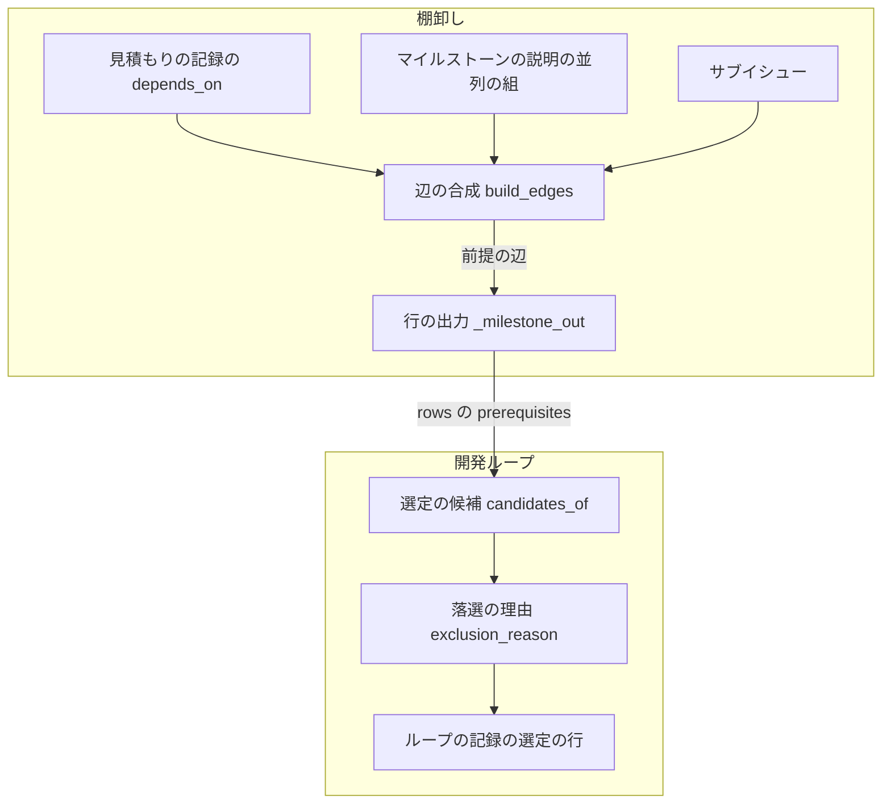
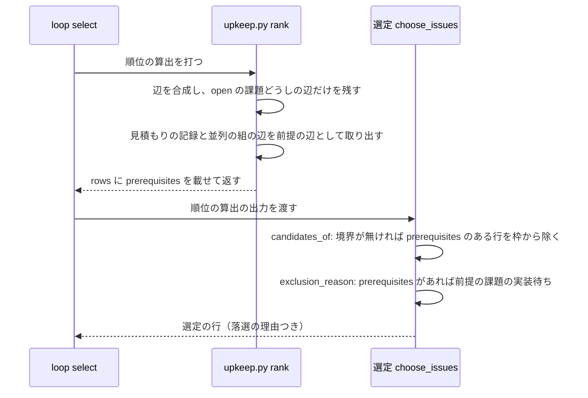

# 開発ループの選定: 閉じていない前提の課題を持つ課題を外し、理由を選定の行に残す

## 概要

**開発ループの選定（`sprint-state.py loop select` / `loop exclude`）は、閉じていない前提の課題を持つ課題を選ばない。**
落選の理由に `前提の課題の実装待ち（#番号 …）` を残し、外した課題は選定の件数の枠（`max_issues`）を使わない。
前提の関係は、棚卸しの順位の算出（`upkeep.py rank`）が行ごとの項目 `prerequisites` として選定へ渡す。

この文書は、順位の算出の出力の契約・常に成り立つ条件・決定の理由・既知の限界・テスト観点を持つ。
**選定の規則の全体（候補・外す理由の順・枠の割り当て・止まる条件）の正は
[開発ループの確定仕様の「選定」](ndf-workflow-development-loop.md#選定select--exclude) にある。** 手順は
`development-workflow` の [references/loop.md](../../plugins/ndf/skills/development-workflow/references/loop.md) が正である。

## 用語

「前提の課題」「選定」の定義は用語集（[docs/glossary.md](../glossary.md)）が正である。

## コンテキスト

| コンテキスト | 何の語が 1 つの意味に決まるか |
| --- | --- |
| 課題の棚卸し（`ndf-issue-upkeep`） | 見積もりの記録・依存の辺・順位・切り出しの境界 |
| 開発の工程（`ndf-workflow`） | 開発ループ・周回・選定・前提の課題・落選の理由 |

棚卸しが供給者、開発ループの選定が顧客の関係（顧客 / 供給者）である。選定は順位の算出の出力（JSON）だけを読み、
依存の辺を自分で合成しない。供給者の側が、選定の要る「前提の課題」を行ごとの項目として出す。

## 背景

選定が順位だけで課題を選ぶと、前提の課題の実装がまだ develop に無い課題を選び、実装のステップで失敗する。
開発ループ lroot3 の周回 13 は #2344 を選び、前提の #2337・#2339・#2341・#2342 の実装が無いため失敗した。
スプリントの側は依存を読まず、同じ周回に入った課題の実装の順序を依存で決めない。そのため、前提の判定は選定で行う。

課題管理の標準と主要な製品は、待つ関係（GitHub の課題の依存の blocked by / blocking、Jira の課題リンクの
is blocked by / blocks）を親子の関係と分けて持つ。選定もこれに合わせ、待つ関係だけを外す理由にし、
親子（サブイシュー）の関係は外す理由にしない。

## 対象範囲

含む:

- 順位の算出の出力の行に、閉じていない前提の課題の番号（`prerequisites`）を載せること
- 選定が `prerequisites` を持つ行を外し、理由を選定の行に残すこと
- 境界が無いマイルストーンで、外した行が `max_issues` の枠を使わないこと

含まない:

- 課題の本文の文章から依存の番号を拾うこと。拾って見積もりの記録へ書くのは棚卸し（`backlog-refinement`）の担当である
- 見積もりの記録・ループの記録の書き換え
- 順位の並び・切り出しの境界・品質の枠・大きい課題の枠の判定
- develop へマージ済みで、まだ閉じていない前提の課題を「満たした」と見なすこと

## 仕様

### 集約

| 集約 | 持ち主（書き換えてよいもの） | 根 | エンティティ | 値オブジェクト |
| --- | --- | --- | --- | --- |
| 順位の算出の結果 | 順位の算出（`upkeep_rank.py` / `upkeep_rank_cmd.py`） | 算出の結果 | マイルストーンの順位の行 | 前提の課題の番号の並び |
| ループの記録 | 開発ループ（`sprint_loop_*.py`） | ループの記録 | 周回 | 選定の行（番号・採否・理由） |

ループの記録は順位の算出の結果を課題の番号だけで参照する。選定は順位の算出の結果を書き換えない。

### 構成要素と責務

| 要素 | 責務 |
| --- | --- |
| 辺の合成（[`upkeep_rank_cmd.py`](../../plugins/ndf/skills/backlog-refinement/scripts/upkeep_rank_cmd.py) の `build_edges`） | サブイシュー・見積もりの記録の `depends_on`・マイルストーンの説明の `### 並列の組（見込み）` の辺を `merge_edges` で合成し、合成後に残った辺のうち見積もりの記録と並列の組が宣言した辺を前提の辺として選り分ける |
| 算出の入力（[`upkeep_rank.py`](../../plugins/ndf/skills/backlog-refinement/scripts/upkeep_rank.py) の `Board.prerequisites`） | 前提の辺の集合を持つ。依存の辺（`edges`）の部分集合である |
| 行の出力（`upkeep_rank.py` の `_milestone_out`） | 行の課題から出る前提の辺の先を昇順で `prerequisites` に載せる。空なら項目を出さない |
| 選定の候補（[`sprint_loop_select.py`](../../plugins/ndf/scripts/lib/sprint_loop_select.py) の `candidates_of`） | 境界が無いとき、`prerequisites` を持つ行を `max_issues` の枠から除く |
| 落選の理由（`sprint_loop_select.py` の `exclusion_reason` / `prerequisite_reason`） | `prerequisites` を持つ行に `前提の課題の実装待ち（#番号 …）` を返す |

### 処理の流れ

### ドメインイベント

| # | イベント | 発生元 | 受け手 |
| --- | --- | --- | --- |
| E1 | 棚卸しが課題の依存を見積もりの記録へ書いた | 棚卸しの手順 2A・2B | 順位の算出 |
| E2 | 順位の算出が依存の辺を合成し、行ごとの前提の課題を出した | `upkeep.py rank` | 開発ループの選定 |
| E3 | 選定が前提の課題の閉じていない課題を外した | `loop select` / `loop exclude` | ループの記録（選定の行） |
| E4 | 前提の課題が閉じた | スプリントの締め（`sprint-close.py`） | 次の順位の算出（閉じた課題への辺が消える） |
| E5 | 次の選定が、外していた課題を選べるようにした | 次の `loop select` | ループの記録 |

### 前提が解ける時点

前提の課題が閉じたかは、選定のたびに打つ順位の算出の時点の GitHub の状態で決める。`merge_edges` は open の課題どうしの
辺だけを残すため、前提の課題が閉じると辺が消え、次の選定で依存する課題を選べるようになる。前提の課題は別の
マイルストーンにあっても、マイルストーン未設定でも、open であれば前提に数える。

### 落選の理由を判定する順

選定は次の順に外す理由を見て、最初に当たった理由を残す。前提の課題の実装待ちは 5 番目である。

1. 人の判断待ち（棚卸し）
2. 保留の周回
3. 人の判断待ち・差し戻し・設計 PR がマージ待ち
4. この周回の手の除外（`loop exclude`）
5. **前提の課題の実装待ち（#番号 …）**
6. 周回の中で起票された
7. 容量（尺度を超える）

先頭に選ぶ課題（設計を直して出し直す課題・デプロイの直し・承認とマージが済んだ設計の課題）も、前提の課題が open なら外れる。
前提の課題が同じ周回に選ばれていても、依存する課題は外す。

### 常に成り立つ条件

| # | 対象 | 条件 | 破れたときの扱い |
| --- | --- | --- | --- |
| I1 | 順位の算出の結果 | 行の `prerequisites` は、合成後の依存の辺のうち、見積もりの記録か並列の組が宣言した辺の先にある open の課題だけである。サブイシューの辺だけの先は入れない | テストが落ちる |
| I2 | 順位の算出の結果 | 前提の課題が無い行は `prerequisites` の項目を持たない（依存の記録が無い算出の出力と `digest` に、この項目は現れない） | テストが落ちる |
| I3 | ループの記録 | `prerequisites` を持つ行は、どの選定でも採られない。落選の理由は、それより先に判定する理由が無いときに限り `前提の課題の実装待ち（#番号 …）` で、open の前提の課題の番号をすべて昇順で載せる。先に判定する理由があれば、その理由を残す | テストが落ちる |
| I4 | ループの記録 | 境界が無いマイルストーンで、`prerequisites` を持つ行は `max_issues` の枠を使わない | テストが落ちる |

## データ・設定

### 順位の算出の出力（`upkeep.py rank` の `metrics.milestones[].rows[]`）

| 項目 | 内容 |
| --- | --- |
| 入力 | 見積もりの記録・マイルストーンの説明・サブイシューの関係 |
| 前提の項目 | `prerequisites`: 整数の配列。昇順・重複なし。その行の課題が依存する open の前提の課題の番号。前提の課題が無い行は項目を持たない |
| 失敗の形 | 循環があれば `stopped` と終了コード 2 で止まる |
| 他の項目との関係 | `digest` は行の内容から計算するため、`prerequisites` を含む。表の描画（`render_rank_table`）は列を名前で読み、この項目を使わない |

### 選定の行（`loop select` / `loop exclude` の結果）

| 項目 | 内容 |
| --- | --- |
| 落選の理由 | `前提の課題の実装待ち（#B）`。複数なら `前提の課題の実装待ち（#B #C）`（番号の昇順、半角スペース区切り） |
| 行の形 | 番号・マイルストーン・順位・採否・理由 |
| 止まったときの件数 | 候補がすべて外れたときの `outside_mvv` の `values.reasons` は、理由の文字列ごとの件数として数える |

## 決定の理由

- **前提の課題を順位の算出の行ごとの項目として出す。** 選定は行を見るだけで外す理由と枠の扱いを決められ、
  辺の一覧を行へ引き直す処理を持たなくて済む。辺の合成を選定の側へ写すと、同じ役割の処理が 2 か所に分かれる。
  依存の取り元は Python 標準の `graphlib` も GitHub の課題の依存の API も使わない。要るのは「辺の先が open か」の
  1 段の判定で、並べ替えは順位の算出が既に持つ。このリポジトリの依存は GitHub の API に登録されていない
- **前提の辺は、合成後に残った辺のうち見積もりの記録と並列の組が宣言した辺に限る。** 合成はサブイシューの辺を
  最も優先し、逆向きの下位の辺を捨てる。合成の結果との共通部分を取ると、並び順と前提の判定が同じ合成の結果に揃い、
  親子の関係で親も子も選べなくなることが無い。見積もりの記録が同じ向きの辺を明示したときは、サブイシューの辺と
  重なっても前提に数える
- **前提の課題が同じ周回に選ばれていても、依存する課題を外す。** スプリントの側は依存で実装の順序を決めないため、
  同じ周回に入れると前提が develop に入る前に依存する課題の実装が始まりうる
- **前提の課題がどのループからも選ばれない場所にあっても、人へ別に知らせない。** 外す理由に前提の課題の番号が載るため、
  選定の行を読めばどこで止まっているかが分かる。候補がすべて外れれば `outside_mvv` で止まり、理由ごとの件数が出る。
  棚卸しがマイルストーンを付ければ解けるため、専用の止まる条件は足さない
- **前提の課題の実装待ちは、手の除外より後、周回の中の起票と容量より前に判定する。** 人か記録が明示した理由を
  優先して残し、周回の中の起票と容量より長く続く理由を先に置いて、理由の行が周回ごとに変わらないようにする

## 既知の限界

| 項目 | 内容 |
| --- | --- |
| 境界があるマイルストーンでの枠 | 切り出しの境界は順位の算出が決め、前提では変わらない。境界の内の課題が前提で外れても、境界の外の課題は候補に上がらない |
| 計画の `digest` の食い違い | 前提の課題を持つ行が現れると `digest` の値が変わり、それより前の `digest` を持つ計画（`plan.rank`）は古いと判定される。打ち直しで揃う見込みで、実測していない |
| 記録に無い依存 | 選定は棚卸しが見積もりの記録へ書いた依存と並列の組だけを読む。記録に依存が無い課題は前提では外れない。#2344 の見積もりの記録は 2026-11-05 時点で依存が空であり、書き足した後に外れることは未確認である |
| 依存の連なりの進み方 | 依存が連なる課題は、前提の課題が閉じる（リリースの後）まで 1 段ずつしか進まない。周回の数への影響は測っていない |

## テスト観点

| 観点 | テスト |
| --- | --- |
| 1 位の行が open の前提の課題を持つと落選し、理由が `前提の課題の実装待ち（#B）` になること。前提が 2 件なら昇順で 2 件載ること | `plugins/ndf/scripts/tests/test_sprint_loop.py` |
| 境界が無く `max_issues` が 1 のとき、1 位が前提で外れると 2 位が選ばれること | 同上 |
| 先頭に選ぶ課題（`revise`・承認とマージが済んだ設計）も前提で外れ、手の除外・差し戻しの行は先に判定する理由が残ること | 同上 |
| 候補がすべて前提で外れると `outside_mvv` で止まり、`values.reasons` に理由ごとの件数が載ること | 同上 |
| 見積もりの記録と並列の組の依存から、閉じた課題を除いた前提の課題が行に載ること。別のマイルストーン・マイルストーン未設定の課題も載ること | `plugins/ndf/skills/backlog-refinement/tests/test_upkeep_rank_cli.py` |
| サブイシューの辺だけの関係は `prerequisites` を出さないこと | 同上 |
| 依存の記録が無い算出の行は `prerequisites` を持たないこと | 同上 |

## 関連リンク

- [ndf-workflow-development-loop.md](ndf-workflow-development-loop.md) — 開発ループの選定の規則の全体
- [ndf-backlog-refinement-depths.md](ndf-backlog-refinement-depths.md) — 棚卸しの深さと順位の算出
- [GitHub: Creating issue dependencies](https://docs.github.com/en/issues/tracking-your-work-with-issues/using-issues/creating-issue-dependencies)
