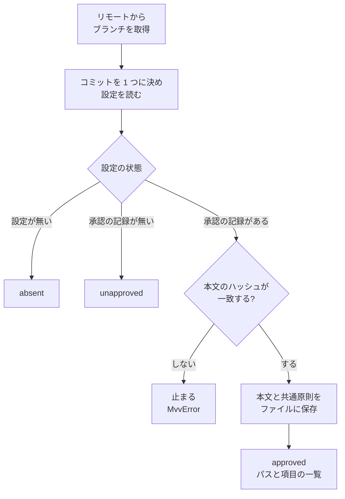

# 承認済みのプロジェクト MVV を 1 か所で読み、担当の AI に渡し、レビューの判定を記録に残す

## 概要

NDF は、プロジェクトの使命・目指す姿・判断で大切にすることを書いた文書（プロジェクト MVV）を、マージ先のブランチから読む。
承認の記録と一致した本文だけをファイルに保存し、設計・実装・リファクタリング・レビューの担当の AI に、そのファイルのパスを渡す。
レビューで「MVV に反する」とされた指摘がどう終わったかは、MVV の記録に残す。

**例: `main` でバージョン 11 の MVV が承認されているリポジトリで、設計の担当を起動する。**

| 順 | 誰が | 何をする |
| ---: | --- | --- |
| 1 | 担当を起動する AI | `ndf records mvv current --base main` を打つ |
| 2 | コマンド | リモートから `main` を取得する。`.ndf/mvv.json` の最後の承認の記録と本文のハッシュが一致することを確かめ、本文と NDF の共通原則をファイルに保存する |
| 3 | 担当を起動する AI | 結果から `MVV: バージョン 11・本文 <パス>・共通原則 <パス>（承認済み）` の 1 行を、担当への指示に書く |
| 4 | 設計の担当 | 2 つのファイルの全体を読み、反しない案を選ぶ。決定には根拠にした項目（`Value 5` など）を書く |
| 5 | `ndf cross-review run` | 自分でも同じ読み方で `main` の MVV を読み、レビュー担当の AI（codex・kiro など。コードでは reviewer）に渡す |
| 6 | 同上 | 「Value 5 に反する」という指摘を修正担当の AI が理由を添えて見送ったら、その終わり方と、MVV の改訂を考える材料を記録に 1 件ずつ足す |

作業場所の `.ndf/mvv.md` が書き換わっていても、3〜5 の担当が読むのは `main` で承認された本文である。

コマンドの打ち方と担当の手順は、手順書が正である。この文書は、入力と出力・常に成り立つ条件・決めたことと理由を書く。

| 内容 | 正とする文書 |
| --- | --- |
| 担当の手順（MVV の受け取り方・読み方・人へ戻す形・状態の表） | [project-mvv.md](../../plugins/ndf/skills/development-workflow/references/project-mvv.md) |
| 担当への指示の項目 | [agent-layers.md](../../plugins/ndf/skills/development-workflow/references/agent-layers.md) |
| リファクタリングでの使い方 | [cross-refactoring の SKILL.md](../../plugins/ndf/skills/cross-refactoring/SKILL.md) |
| 根拠にした項目の書き方 | [decisions.md](../../plugins/ndf/skills/design/references/decisions.md) |
| cross-review の中での MVV の扱い（指摘の基準・分類・根拠の記述の確認・終わり方・PR のコメント） | [cross-review-project-mvv.md](./cross-review-project-mvv.md) |

## 用語

「プロジェクト MVV」「MVV のスナップショット」「NDF の共通原則」「レッドライン」「覆し」「改訂の兆候」などは
[用語集](../glossary/ndf-loop.md) にある。この文書では、ほかに次の語を使う。

| 語 | 意味 |
| --- | --- |
| 承認の記録 | `.ndf/mvv.json` の `versions` の最後の 1 件。承認されたバージョンの番号と、承認された本文の SHA-256 を持つ |
| 識別子 | 読んだ MVV が前と同じかを比べる文字列（コードでは `identity`）。中身は「[識別子](#識別子)」にある |
| マージ先のブランチ | PR の変更が入るブランチ。PR がまだ無ければ、作業のブランチの起点にしたブランチ |

## 背景

設計や実装の担当が MVV を読むかは担当に任されており、cross-review もレビュー担当に MVV を渡していなかった。そのため、MVV に反する
設計がレビューを通り、承認の後で人が気づいた。古いバージョンの番号を引いた根拠の記述も、確かめられないまま残った
（ https://github.com/devbasex/ai-plugins/issues/4076 ）。

## 対象範囲

含むもの:

- マージ先のブランチの MVV を読むコマンド `ndf records mvv current` と、その中身の関数
- cross-review とリファクタリングが、引数 `--base` から MVV を読むブランチを決める方法
- 担当の AI へ MVV を渡す経路と、渡さない担当
- cross-review の指摘の終わり方を残す MVV の記録と、改訂の兆候の数え方

含まないもの:

- cross-review の中での MVV の扱い（[cross-review-project-mvv.md](./cross-review-project-mvv.md) ）
- 承認ゲートの直前の判定（`ndf records mvv gate`）。[ndf-design-ai-decisions-and-mvv-gate.md](./ndf-design-ai-decisions-and-mvv-gate.md) にある
- 作業を始める前の確かめ（`ndf records preflight`）の状態の表。作業場所のファイルを見るもので、project-mvv.md にある

## 仕様

### 構成要素

| 要素 | 責務 |
| --- | --- |
| `current`（[mvv.py](../../plugins/ndf/src/ndf/domains/records/mvv.py) ） | コミットから MVV を読んで承認を確かめ、スナップショットを保存し、`Snapshot` を返す |
| `of_base`（同上） | `current` の失敗を、ブランチ名を添えた `MvvError` にまとめる。cross-review とリファクタリングが使う |
| `identity_at`（同上） | `current` と同じ読み方で識別子だけを返す。ファイルを保存せず、ネットワークに出ない |
| `record_review`（同上） | cross-review の指摘の終わり方と見送りを、MVV の記録に足す |
| 判断だけの関数（[mvv_decide.py](../../plugins/ndf/src/ndf/domains/records/mvv_decide.py) ） | 状態（`status`）・本文の場所（`body_path`）・項目（`items_of`）・識別子（`identity_of`）・記録の形・兆候の数を決める。git を起動せず、MVV の本文と記録のファイルを開かない（中身は呼び出し元から受け取る） |
| コマンド（[cli.py](../../plugins/ndf/src/ndf/domains/records/cli.py) の `_mvv_current`） | リモートから取得し、`current` の結果を JSON にする |
| `fetch_base`（[worktree.py](../../plugins/ndf/src/ndf/core/converge/worktree.py) ） | 引数 `--base` から MVV を読むブランチを決めて取得する |
| リファクタリング（[drive.py](../../plugins/ndf/src/ndf/domains/crossrefactor/drive.py)・[prompt_decide.py](../../plugins/ndf/src/ndf/domains/crossrefactor/prompt_decide.py) ） | 起動の始めに MVV を読み、提案と計画の指示文に載せる |

### 処理の流れ



コマンド・cross-review・リファクタリングは、取得の方法だけが違い、その後はどれも `current` を通る。

### 常に成り立つ条件

| # | 条件 | 破れたときの扱い | 確かめているテスト |
| --- | --- | --- | --- |
| I1 | 担当へ渡す MVV は、取得したコミットの本文である。作業場所の本文は読まない | 取得できなければ止まる。手元の古い参照で続けない | `test_mvv_current.py`・`records/test_cli.py` |
| I2 | `approved` を返すのは、本文の SHA-256 が承認の記録と一致したときだけである | 一致しなければ `MvvError` で止まる（コマンドに `--allow-mismatch` を付けたときは状態 `mismatch` を返す） | `test_mvv_current.py` |
| I3 | `absent` を返すのは、コミットのツリーに設定のファイルが無いと確かめられたときだけである | 設定を読めない・通常のファイルでない・ツリーを読めないときは `MvvError` | `test_mvv_current.py` |
| I4 | 承認済みでなければ、スナップショットを保存せず、項目もパスも返さない | 空の値を返す | `test_mvv_current.py` |
| I5 | 返したパスのファイルの中身は、確かめた本文・共通原則と同じである | 同じ名前で中身か権限が違うファイルは、確かめた中身で置き換える | `test_mvv_current.py` |
| I6 | スナップショットは、ほかの利用者が差し替えられる場所に置かない。cross-review とリファクタリングでは、その作業場所の中にも置かない | `MvvError` で止まり、書かない | `test_mvv_current.py`・`test_refactor_mvv.py` |
| I7 | `--base` にコミットを渡しても、そのコミットの MVV は使わない | PR のマージ先のブランチから読む。マージ先を読めなければ止まる | `test_refactor_mvv.py`・`test_crossreview_mvv.py` |
| I8 | MVV を読めないときは、cross-review とリファクタリングは担当を起動せずに止まる | 停止理由 `precondition` | `test_refactor_mvv.py`・`test_crossreview_mvv.py` |
| I9 | MVV の記録に書くのは、今の識別子で判定した指摘だけである | 前の MVV で判定した指摘は書かない | `test_mvv_record_review.py` |
| I10 | 同じ結果を 2 回書かない。見送りの兆候は、同じ MVV・同じ指摘で 1 件だけ書く | 前の記録と比べて書かない。例外は、前の記録に読めない行があるときと、自由記述の伏せ方が変わったときで、`mvv-review` がもう 1 行増えることがある（見送りの兆候は、前の記録に読めない行があるときだけ増えうる） | `test_mvv_record_review.py` |
| I11 | 伏せていない秘密と、伏せるべき非公開リポジトリへの参照を記録に書かない。秘密は記録のキーにも入れない | 自由記述が指すリポジトリの公開範囲を確かめられなければ、自由記述を書かずに `withheld` を置く | `test_mvv_record_review.py` |

### コマンド `ndf records mvv current`

| 引数 | 意味 |
| --- | --- |
| `--base <ブランチ>` | MVV を読むブランチの名前。リモート名を付けない。コミットやタグは受けない |
| `--allow-mismatch` | 本文が承認の記録と合わなくても止まらない。状態 `mismatch` だけを、警告を付けて返す |

取得では、取得先（`refs/remotes/<リモート>/<ブランチ>`）まで指定する。別のブランチだけを取得する clone（`--single-branch`）でも、
リモートの最新の承認を読むためである。読むときも同じ参照の全体を渡すので、同じ名前の手元のブランチは読まない。

結果 JSON の `outputs.mvv` は次の形になる。`approved` でなければ `state` だけを返す。

```json
{"state": "approved", "version": 11, "sha256": "<64 桁>", "path": "<本文のスナップショット>",
 "principles_path": "<共通原則のスナップショット>", "items": ["Mission", "Vision", "Value 1", "P1", "C1"]}
```

| `state` | 条件 |
| --- | --- |
| `approved` | 本文の SHA-256 が承認の記録と一致する |
| `absent` | コミットに `.ndf/mvv.json` が無い |
| `unapproved` | `versions` が無い・空、または最後の 1 件に `sha256` が無い。本文は使わないので、本文が無くても `body` が不正でもこの状態になる |
| `mismatch` | 本文が承認の記録と合わない（`--allow-mismatch` のときだけ返る） |

### 読み方の規則

| 項目 | 規則 |
| --- | --- |
| 読むコミット | 参照を 1 回だけコミットに解決し、設定も本文もそのコミットから読む |
| 本文の場所 | 設定の最上位の `body` を `.ndf/` からの相対パスとして解く。文字列でなければ既定の `.ndf/mvv.md`。空・絶対パス・`..` を含む値は `MvvError`。`versions` の中の `body` は場所ではない |
| 改行 | LF と CRLF の違いは同じ本文とみなす。元の形・LF・CRLF のうち、承認の記録と合う形を本文とする（`approved_form`）。ほかの違いは `mismatch` |
| 共通原則 | リポジトリではなく、動いている NDF が持つ `contracts/data/ndf-common-principles.md` を読む |
| git の起動 | 設定と既定の場所の本文を 1 回の `git cat-file --batch` で読む。設定の `body` が別の場所を指すときだけ、もう 1 回読む |

項目の一覧（`items`）は、本文と共通原則に実在する項目を、重複なく出た順に並べる。コードブロックの中の例は数えない。

| 項目 | 作り方 |
| --- | --- |
| `Mission`・`Vision` | その名前の `##` の見出しがあれば 1 つ |
| `Value <番号>` | `## Value` の下で、行の先頭から始まる `<番号>.`。字下げした番号は数えない |
| `P<番号>` など | `## 必ず人の承認が要る操作` の下の表の 1 列目 |
| `C<番号>` など | 共通原則の表の 1 列目 |

### スナップショット

| 項目 | 内容 |
| --- | --- |
| 保存先 | MVV の記録の保存先の `snapshots/`。シンボリックリンクをたどった実体のパスを返す |
| 名前 | 本文は `v<バージョン>-<SHA-256 の先頭 12 文字>.md`、共通原則は `principles-<SHA-256 の先頭 12 文字>.md` |
| 権限 | 所有者だけが読み書きできる（0600） |
| 同じ名前のファイルがあるとき | 通常のファイルで、自分が所有し、ほかの利用者に権限を与えておらず、中身の SHA-256 の全体が一致すれば、そのまま使う。違えば置き換える |
| 書き方 | 同じディレクトリの一時ファイルに書いてから `os.replace` で置き換える。中身は名前と確かめたバイト列だけで決まるので、同時に書いても結果は同じになる |

### 識別子

| 状態 | 識別子 |
| --- | --- |
| `approved` | `approved:<バージョン>:<本文の SHA-256>:<共通原則の SHA-256>` |
| それ以外 | `<状態>:::` |

cross-review は、前のレビューの結果を使い回せるかと、指摘をどの MVV で判定したかを、識別子で比べる。承認済みでなければ共通原則の
SHA-256 を含めない。MVV の無いリポジトリでは、NDF を更新して共通原則が変わっても識別子は変わらない。

`identity_at` は、部分クローンで設定や本文が手元に無ければ、リモートから取り寄せずに `MvvError` にする。

### `--base` から MVV を読むブランチを決める

cross-review とリファクタリングは、同じ関数 `fetch_base` で決める。

| `--base` の値 | MVV を読むブランチ | 差分の起点 |
| --- | --- | --- |
| ブランチの名前、または `<リモート>/<ブランチ>` | そのブランチの、リモートの最新のコミット | 同じコミット |
| コミット（40 桁の SHA・短縮した SHA・タグなど） | PR のマージ先のブランチの、リモートの最新のコミット。マージ先は GitHub から読む | 渡されたコミット |

1. 40 桁の SHA なら、コミットとして扱う
2. ほかの値は、まずブランチとして取得する。取得できたら、それを MVV を読むブランチとし、その最新のコミットを差分の起点にする
3. 取得できず、手元でブランチ以外のコミットを指すときだけ、コミットとして扱う。手元だけにあるブランチは受けずに止まる

PR のブランチと MVV を読むブランチは、同じ 1 回の `git fetch` で取る（コミットを短縮した SHA やタグで渡したときは、
その前に、2 の取得を試して失敗している）。MVV と、ブランチを渡したときの差分の起点には、この取得で決まったコミットを使う（コミットを渡したときの差分の起点は、渡されたコミットである）。起動の途中で別の作業がリモート追跡参照を進めても、使うコミットは変わらない。

### 担当へ渡す経路

| 担当 | 渡し方 | 読めないとき |
| --- | --- | --- |
| 手順書に従って起動される担当（フェーズを受け持つ supervisor と、1 つの作業を行う worker） | 起動の指示の「MVV」の項目に 1 行で書く。supervisor は受け取った 1 行をそのまま worker へ渡す | コマンドが `stopped` なら指示を書かず、人へ戻す |
| `ndf refactor run` の提案と計画の担当 | バージョンと 2 つのパス、全体を読んで判断の基準にする指示を、`run` が指示文に足す | 担当を起動せずに `precondition` で止まる |
| `ndf refactor run` を使わず、担当を起動する AI がテンプレートから指示を作るリファクタリングの、提案と計画の担当 | テンプレートの `$RF_MVV` に、コマンドの結果から作った文を入れる | 指示を作らず、理由を報告する |
| cross-review のレビュー担当と修正担当 | [cross-review-project-mvv.md](./cross-review-project-mvv.md) | 同左 |

承認済みの MVV が無いとき、手順書に従う担当には `MVV: 無し（<状態>）` と書き、`ndf refactor run` は指示文に何も足さない。
本文そのものは指示に書き写さず、パスだけを渡す。

渡さない担当は次のとおりである。

| 担当 | 理由 |
| --- | --- |
| NDF が工程を自動で流すとき（`ndf plan`）の担当 | 指示のテンプレート（[prompt.md](../../plugins/ndf/contracts/worker/prompt.md) ）に MVV の項目が無い。足すことは https://github.com/devbasex/ai-plugins/issues/4423 で扱う |
| `ndf refactor run` の計画より後の担当（テストの追加・実装・修正など） | 何を直すかは提案と計画で決まる。実装の担当への指示は、決まった項目を振る舞いを変えずに直すことに限られる |

### MVV の記録（cross-review の指摘の終わり方）

記録は 2 つの JSONL ファイルで、足すだけで書き換えない。`record_review` が書く行は次のとおりである。

| ファイル | 種類（`kind`） | 書く指摘 |
| --- | --- | --- |
| `mvv-validation.jsonl` | `mvv-review` | MVV の項目に反するとされた指摘、必ず人の承認が要る操作に当たるとされた指摘、根拠の記述の誤り。今の識別子で判定したもの 1 件につき 1 行 |
| `mvv-signals.jsonl` | `review_disputed` | 上のうち、Mission・Vision・Value に反するとされ、修正担当が見送ったもの（終わり方 `deferred`）。根拠の記述の誤りは見送りにならず、`redline` は終わり方が `redline` なので、どちらも書かない |

| 項目 | 意味 |
| --- | --- |
| `repo`・`pr`・`head` | メインディレクトリのパス、PR の番号、PR に届いた最後のコミット。`head` は `mvv-review` だけ |
| `key` | 起動をまたいで同じ指摘を見分ける値。下の「指摘のキー」 |
| `id` | 指摘の番号（`r1-2` など）。起動ごとに変わるので、表示だけに使う |
| `mvv_version`・`sha256` | 指摘を判定した MVV のバージョンと本文の SHA-256 |
| `outcome` | `fixed`（直した）・`unresolved`（未解決）・`deferred`（見送った）・`redline`（必ず人の承認が要る操作に当たる）。`redline` は実際の終わり方によらない。`mvv-review` だけ |
| `item` | 反する項目。`redline` なら当たる操作の番号を `・` でつないだもの。根拠の記述の誤りなら、その記述が引いた項目 |
| `reason`・`text` | 見送りの理由（`deferred`）、指摘の本文（`redline`） |
| `withheld` | 自由記述に出てくるリポジトリの公開範囲を GitHub に問い合わせられず、伏せるべき参照を決められないので、自由記述を書かなかったことを示す `true` |

**指摘のキー。** 指摘の本文の秘密を伏せ、空白と大文字小文字の違いを除いて切り詰め、その SHA-256 を取る（`record_key`）。秘密を先に
伏せるのは、小文字にした秘密や、切り詰めで分かれた秘密が残らないようにするためである。

**二重に書かない規則。** ファイルをロックし、同じ種類・リポジトリ・PR の行だけを前の記録として読む。

| 対象 | 規則 |
| --- | --- |
| 同じ起動に同じキーの指摘が 2 件あるとき | 人の判断が要る終わり方を優先して 1 件にする（強い順に `redline`・`deferred`・`unresolved`・`fixed`） |
| `mvv-review` | 同じキーの最後の行（時刻の順。同じ時刻なら後の行）と、`head`・`outcome`・`mvv_version`・`sha256`・`item`・`reason`・`text`・`withheld` がすべて同じなら書かない |
| `withheld` の行 | 自由記述を書いた行（`withheld` の無い行）が最後にあり、`head`・`outcome`・`mvv_version`・`sha256` が同じなら書かない。逆に、`withheld` の行の後で、秘密などを伏せた自由記述を書けるようになったら、書き足す |
| `review_disputed` | 同じキー・バージョン・本文の SHA-256 の行があれば書かない |

**読めない行。** 前の記録を読むとき、形の合わない行は無いものとして飛ばし、結果にも警告を出さない。そのため、同じ記録がもう 1 行
書かれることがある。新しい形式のバージョンの行があれば、書かずに `InternalError` にする。

### 改訂の兆候の数え方

`ndf records mvv signals --base <ブランチ>` は、手元のリモート追跡参照 `<リモート>/<ブランチ>` にある設定の、現行のバージョンの行だけを数える。

| 数 | 数え方 |
| --- | --- |
| `overrides` | 承認ゲートで人が判定を覆した数。同じスプリント・承認ゲート・PR は 1 件 |
| `unknown` | 「判定できない」の数と、`review_disputed` の数の合計。`review_disputed` は、同じ PR とキーを 1 件とする |
| `unknown_pass` | 「判定できない」を人が通した数。覆しには数えない |

`overrides` か `unknown` が、設定の `settings.revise_after`（既定は `overrides` が 3。`unknown` の数の閾値のキーは `unknowns` で、既定は 5）以上なら、結果の
`metrics.revision_due` が真になる。読めない行は結果の `items` に警告として載る。

### 決定と理由

| 決定 | 理由 |
| --- | --- |
| 作業場所ではなく、マージ先のブランチの MVV を読む | PR が変えた MVV は、まだ人が承認していない。それで確かめると、変えた本文で自分を通すことになる |
| 本文を指示に埋め込まず、保存したファイルのパスを渡す | 埋め込むと、担当ごと・ラウンドごとに本文の全体を送ることになる |
| 共通原則もファイルで渡す | 利用先のリポジトリに共通原則の本文は無く、担当は `C<番号>` の操作を判断できない |
| 読み取りの失敗を「MVV が無い」にしない | MVV を持つリポジトリで、確かめないまま設計やレビューが進む |
| 本文が承認の記録と合わなければ止める | 壊れた MVV を無いものとして扱うと、同じく確かめないまま進む。直す作業のためだけに `--allow-mismatch` を置いた |
| 中身の違うスナップショットは、止めずに置き換える | 中身は名前と確かめたバイト列だけで決まり、人の判断が要らない |
| `--base` のコミットから MVV を読まない | 渡されたコミットはレビュー中のブランチの途中のことがあり、承認されていない MVV を読みうる |
| MVV の項目が無い起動を hook で止めない | 項目があっても中身の正しさは確かめられない。担当の出力が MVV に反していれば、cross-review が見つける |
| 見送りは覆しではなく「判定できない」に足す | 覆しは人が AI の判定を退けた記録である。レビュー担当と修正担当の食い違いに人は入っておらず、AI の中で決めきれなかったことに当たる |
| 根拠の記述の誤りは兆候に数えない | バージョンや番号の書き間違いは、MVV の文言の問題ではない |
| 指摘の `id` ではなく本文から作ったキーで数える | `id` は起動ごとに付け直される |
| 伏せられないときも、自由記述を除いて記録する | 書かないと、次の起動で指摘が直された場合に、見送りが一度も兆候に数えられない |

## データ・設定

| 項目 | 内容 |
| --- | --- |
| 記録とスナップショットの保存先 | 環境変数 `NDF_MVV_STATE_DIR`。無ければ状態の保存先（[ndf-state-home-by-owner.md](./ndf-state-home-by-owner.md) ） |
| 記録の形 | [mvv-validation.schema.json](../../plugins/ndf/contracts/schemas/internal/mvv-validation.schema.json)・[mvv-signals.schema.json](../../plugins/ndf/contracts/schemas/internal/mvv-signals.schema.json) 。種類ごとに必須の項目が違う |
| 記録を使い続ける規則（形式のバージョンと読めない行） | [ndf-internal-data-versions.md](./ndf-internal-data-versions.md) |
| 兆候の閾値 | `.ndf/mvv.json` の `settings.revise_after` |

## エラー処理

コマンド `ndf records mvv current` の失敗は、どれも `status: stopped`・`cause.kind: precondition`（終了コード 3）で、`outputs` は無い。
`ndf refactor run` も、MVV かブランチを読めなければ `precondition` で止まる。

| 失敗 | `summary` の内容 |
| --- | --- |
| ブランチを取得できない | 取得できなかったブランチと git の誤り |
| 参照をコミットへ解決できない | 参照と git の誤り |
| 設定を読めない・JSON でない・通常のファイルでない・廃止したキーが残る | 設定を読んだコミットか設定のファイルと、理由 |
| 承認の記録にバージョンの番号が無い | 設定のパス |
| 本文の場所が不正・本文が無い・UTF-8 でない | 本文の場所の値か、本文のパス |
| 本文が承認の記録と合わない（`--allow-mismatch` でない） | 本文のパス |
| スナップショットを保存できない・保存先が安全でない | 保存先と理由 |
| PR のマージ先を読めない（`ndf refactor run` に `--base` でコミットを渡したとき） | PR の番号と GitHub の誤り |

`--allow-mismatch` が許すのは本文の不一致だけで、ほかの失敗では同じように止まる。

`record_review` は、書けなければ `OSError`・`MvvError`・`InternalError` を呼び出し元へ返す。cross-review は、記録を書けなくても
レビューの結果を変えない（[cross-review-project-mvv.md](./cross-review-project-mvv.md) ）。

## セキュリティ

- スナップショットには非公開のリポジトリの本文が入るので、所有者だけが読める権限にする
- 担当は渡されたパスを後で開く。保存先から根までの途中のディレクトリを、ほかの利用者が差し替えられるなら保存しない
- cross-review とリファクタリングは、担当が書き換えられる作業場所の中には保存しない。保存先がリンクを通って中を指す場合も同じである
- 記録に残す自由記述（見送りの理由・`redline` の本文・根拠の記述の誤りが引いた項目）は、cross-review が PR のコメントと同じ処理で秘密と、非公開のリポジトリへの参照を伏せてから書く
- git の誤りに出る URL は、利用者の情報（`@` より前）と、`?`・`#` より後ろを伏せる。トークンを URL に埋めたリモートでも、トークンが結果に出ないようにするためである

## 運用

既知の限界:

- NDF が自動で起動する工程の担当には、MVV が渡らない（ https://github.com/devbasex/ai-plugins/issues/4423 ）
- 手順書に従う起動では、MVV の項目を書き忘れても止まらない。指示は AI が書き、機械では確かめていない
- 承認の後に本文が書き換わったブランチでは、cross-review もリファクタリングも止まる。直す PR も cross-review を通れず、人がマージする（ https://github.com/devbasex/ai-plugins/issues/4155 ）
- `ndf refactor run` は、完了した実行を同じコミット・同じ引数で打ち直すと、前の結果を返す。間に MVV が改訂されていても読み直さない。途中から続けるときも、決まった計画は作り直さない
- 承認ゲートは `mvv-review` の記録を読まない。`redline` の指摘を承認の資料に載せることと、`withheld` の記録があるときに、人の承認を省く設定でも設計の承認を省かないことは、https://github.com/devbasex/ai-plugins/issues/3959 で扱う
- `withheld` の行のある指摘は、後の起動で、秘密などを伏せた自由記述を書けるようになるまで、理由や本文が記録に無い
- 自由記述が指すリポジトリの公開範囲が変わると、伏せ方が変わり、`mvv-review` が 1 行増えることがある。キーは同じなので兆候は増えない
- 秘密の値だけが違う 2 つの指摘は、同じキーになる
- 大文字のホスト名や明示したポートを含む GitHub の URL は、非公開のリポジトリを指していても伏せられないことがある（ https://github.com/devbasex/ai-plugins/issues/4165 ）

## テスト観点

`plugins/ndf/tests/domains/` の下のテストで確かめる。

| 観点 | テスト |
| --- | --- |
| 作業場所の本文が違っても、参照の本文と共通原則が保存され、バージョン・項目・パスが返ること | `records/test_mvv_current.py`・`records/test_cli.py` |
| 既定でない場所の本文でも承認済みと読めること。設定のディレクトリの外を指す場所は断ること | `records/test_mvv_current.py` |
| 改行だけの違いでは、作業場所の確かめとコミットの確かめが同じ結果になること | `records/test_mvv_current.py` |
| 設定・本文・ツリーを読めないことが、`absent` にならないこと | `records/test_mvv_current.py` |
| 承認の後に変わった本文では止まり、`--allow-mismatch` なら警告と状態だけが返ること | `records/test_cli.py`・`records/test_mvv_current.py` |
| スナップショットの権限・置き換え・保存先の拒否が働き、失敗しても一時ファイルが残らないこと | `records/test_mvv_current.py` |
| 識別子が、保存の有無によらず同じで、共通原則の変更では承認済みのときだけ変わること | `records/test_mvv_current.py` |
| 別のブランチだけを取得する clone でも、リモートの新しい承認を読むこと。取得に失敗したら古い参照を読まないこと | `records/test_cli.py` |
| `--base` がブランチ・`<リモート>/<ブランチ>` のときに、リモートの最新を読むこと | `crossrefactor/test_refactor_mvv.py`・`crossreview/test_crossreview_mvv.py` |
| `--base` がコミット（SHA・短縮した SHA・タグ）のときに、マージ先の MVV を読み、差分の起点は渡されたコミットのままであること | `crossreview/test_crossreview_mvv.py`（SHA は `crossrefactor/test_refactor_mvv.py` でも） |
| 提案と計画の指示文にだけ MVV が載り、MVV が無ければ指示文が変わらないこと | `crossrefactor/test_refactor_mvv.py` |
| MVV を読めない・保存できないときに、担当を 1 つも起動しないこと | `crossrefactor/test_refactor_mvv.py` |
| 見送り 1 件で、理由の付いた記録と兆候が 1 件ずつ増えること。前の MVV での判定は書かないこと | `records/test_mvv_record_review.py` |
| 打ち直しや `id` の変化で、記録と兆候が増えないこと。結果が変われば記録だけが増えること | `records/test_mvv_record_review.py` |
| 秘密が記録とキーに残らないこと。伏せられない起動では自由記述を書かず、後で書き足すこと | `records/test_mvv_record_review.py` |
| 見送りの兆候が、キーごとに 1 件として「判定できない」に足されること | `records/test_mvv.py` |

## 関連リンク

- cross-review の中での MVV の扱い: [cross-review-project-mvv.md](./cross-review-project-mvv.md)
- 承認ゲートの判定と、設計の判断の記録: [ndf-design-ai-decisions-and-mvv-gate.md](./ndf-design-ai-decisions-and-mvv-gate.md)
- 内部の記録の形式のバージョン: [ndf-internal-data-versions.md](./ndf-internal-data-versions.md)
- 要求（各工程が MVV に従って動き、従ったかを確かめ、反していれば修正担当に直させる）: https://github.com/devbasex/ai-plugins/issues/4076
- 読み方と記録の直し（本文の場所・ベースの固定・スナップショットの確かめ・伏せ方）: https://github.com/devbasex/ai-plugins/issues/4090
- 承認の記録と合わない本文で止まること: https://github.com/devbasex/ai-plugins/issues/4099
