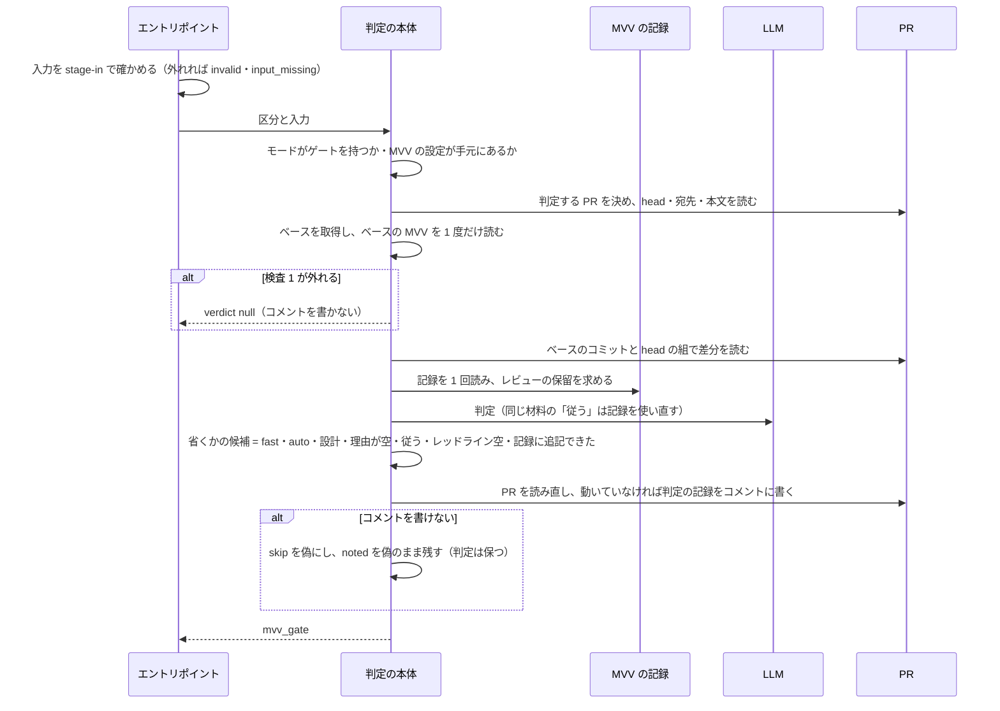

# MVV 判定: 承認ゲートの手前で進め方によらず判定し、レビューの保留と承認資料の根拠の行を確かめる

## 概要

NDF は、設計承認ゲートとリリース承認ゲートの手前で、Pull Request（PR）の本文と差分を NDF の共通原則とプロジェクト MVV に照らす
MVV 判定（`ndf records mvv gate`）を打つ。判定は進め方（`pace`）によらず打ち、進め方は判定の後に承認ゲートを省くかだけを決める
（#3959）。プランを使わずに工程を進める場面でも、ステートマシンの ID を渡せばプランと同じ入力で判定を打てる（#4055）。

**例: 進め方 `normal` のスプリントで、設計 PR の承認ゲートを迎える。**

| 順 | 誰が | 何をする |
| ---: | --- | --- |
| 1 | プランの判定のステップ（`design-mvv`） | `ndf records mvv gate --gate design` を打つ。工程の入力は環境変数 `NDF_STAGE_INPUT` で渡す |
| 2 | 判定のコマンド | PR のベースブランチを取得し、承認済みの MVV を読む。設計 PR の cross-review の記録からレビューの保留を求め、LLM に判定させる |
| 3 | 同上 | 判定・理由・レッドライン・保留・省かない理由（先頭は「進め方 normal は承認ゲートを MVV 判定で省かない」）を PR のコメントに書く |
| 4 | 承認ゲート | 出力の `skip` が偽なので人へ問う。承認資料の「MVV 判定」の欄に今回の判定の出力を載せる |
| 5 | 承認資料を組む担当（supervisor の経路） | 資料を渡す前に `ndf records mvv cite --gate design --base main <資料>` を打ち、根拠の行のバージョンと番号を確かめる |

同じ PR を `fast`・`auto` で判定し、検査がすべて通り、判定が「従う」でレッドラインもレビューの保留も無ければ、`skip` が真になり
承認ゲートを `service:mvv` の回答で通る。リリース承認ゲートは、保留を読む PR の範囲が決まるまで（#4105）、`fast`・`auto` でも省かない。

**手順は Skill の手順書が正である。** この文書は、コードの契約・データの形・常に成り立つ条件・決めたことの理由・テスト観点を残す。

| 内容 | 正とする文書 |
| --- | --- |
| 判定の順・機械の検査 1〜7・出力 `mvv_gate` のキー・supervisor の経路での打ち方（`--machine`・`--expect-pr`・結果 JSON の置き方） | [pace.md の「MVV 判定」](../../plugins/ndf/skills/development-workflow/references/pace.md#mvv-判定) |
| 承認資料の「MVV 判定」の欄の組み方・判定した PR と head の照らし方・`cite` の打ち方と誤りの直し方・「目指す姿の根拠」の欄の形 | [approval-request.md](../../plugins/ndf/skills/development-workflow/references/approval-request.md) |
| supervisor が承認ゲートを返す前に守る規則 | [agent-layers.md](../../plugins/ndf/skills/development-workflow/references/agent-layers.md) |
| 工程での MVV の読み方 | [project-mvv.md](../../plugins/ndf/skills/development-workflow/references/project-mvv.md) |
| MVV のスナップショット（`current`）・根拠の行の確かめの関数・cross-review の MVV の記録（`mvv-review` の行） | [ndf-mvv-current-and-stage-inputs.md](./ndf-mvv-current-and-stage-inputs.md)・[cross-review-project-mvv.md](./cross-review-project-mvv.md) |

## 用語

「MVV 判定」「レビューの保留」「レッドライン」「承認ゲート」などは用語集（[docs/glossary/ndf-loop.md](../glossary/ndf-loop.md) ）にある。
この文書では、ほかに次の語を使う。

| 語 | 意味 |
| --- | --- |
| `service:mvv` の回答 | MVV 判定が承認ゲートを省いてよいと決めたとき、人の代わりに NDF が承認ゲートへ書く承認の回答。回答の事象の `by` が `service:mvv` で、判定の出力のコピーを `mvv_gate` に持つ |
| 見送りの区分 | cross-review の修正担当が指摘を見送るときに選ぶ値 `defer`。`needs_user`（利用者の判断が要る）・`filed`（範囲外として起票した）・`not_applicable`（基準に当たらない・意図どおり） |
| 伏せた行 | `mvv-review` の行のうち、自由記述（見送りの理由・レッドラインの指摘本文）を保存しなかった行（`withheld: true`）。伏せる処理の公開範囲の照会に失敗したときに書く |
| プランの経路 | プランの判定のステップが `NDF_STAGE_INPUT` を渡して判定を打ち、承認資料を NDF のコード（`progress/gate/asking.py`）が組む経路 |
| supervisor の経路 | サブエージェントの supervisor が手で工程を進め、`--machine` で判定を打ち、承認資料を手順書に沿って組んで呼び出し元へ返す経路 |
| 診断の記録 | 判定の失敗の原因（例外の全文）を、判定を打った実行環境の状態の保存先にだけ残す記録 `mvv-gate-failures.jsonl` |

## 背景

承認ゲートの手前の判定は `fast`・`auto` で承認ゲートを省く材料としてだけ使われ、`normal` では打たれていなかった。2026-11-21 に
`normal` の設計承認ゲートへ届いた承認資料 3 件は、どれも「判定していない」と書き、人が見る MVV の材料は設計者が書いた根拠の行
だけだった。その根拠の行のバージョンは、承認の記録のバージョンと違っていた。あわせて次の 3 つが分かった。

- `fast`・`auto` では、cross-review がレッドラインに当たると記録した指摘が残っても、承認ゲートが `service:mvv` で省かれうる
  （判定が cross-review の記録を読まなかった）
- プランの外では、判定の入力の JSON を手で組まないと打てない（#4055）
- 工程の入力のコントラクト（`stage-in`）は `{"context": {...}}` の形を定め、プランが渡す平らな形と食い違っていた。その形の入力で
  判定のコマンドは `ok` のまま判定を打たなかった

範囲外へ分けた課題は次のとおりである。

| 課題 | 中身 |
| --- | --- |
| #4104 | 即時修正のマージの前の MVV 判定 |
| #4105 | リリース承認ゲートで保留を読む PR の範囲。それまでリリース承認ゲートは MVV 判定で省かない |
| #4106 | `service:mvv` の回答を、消費の時点で判定した PR・宛先・宛先の先端と照合すること。この仕様の照合は PR 番号と head だけ |
| #4486 | 版数を持たない `merge_base_branch` の手動のリリースで、判定に渡す承認する PR を決められないこと（今は「承認する PR を決められない」として止める） |
| #4487 | 診断の記録と `--machine` の読み取りの安全性を強めること |
| #4501 | 省いた承認ゲートの回答を使うとき、PR の宛先とベースも照らすこと |
| #4506 | cross-review の記録が見つからないとき（レビューと判定で状態の保存先 `NDF_MVV_STATE_DIR` が違うときなど）に、保留を 0 件とせず人へ問うこと。今は記録のファイルが無ければ保留 0 件として扱う |

## 対象範囲

| 含む | 含まない |
| --- | --- |
| 判定を打つ条件と承認ゲートを省く条件の分離、設計承認ゲートのレビューの保留、リリース承認ゲートを省かない止め、`ndf records mvv cite`、`--machine`、工程の入力の形の確かめ、cross-review が記録を書けないときの停止、失敗の原因の定型文と診断の記録 | 上の範囲外の課題、MVV の本文の改訂、判定の指示文 |

## 仕様

### 構成要素

| 要素 | 責務 |
| --- | --- |
| 判定のエントリポイント（`domains/records/cli.py` の `_mvv_gate`・`_mvv_inputs`・`_env_inputs`） | 工程の入力を `NDF_STAGE_INPUT` か `--machine` のどちらか 1 つから得て、工程の入力の規則で確かめる。`--expect-pr` を判定の前に比べる |
| 判定の本体（`domains/records/mvv_gate.py` の `gate`・`_judged`） | ベースの MVV とレッドラインのパスを PR のベースから読み、判定を打つ。省くかを決め、PR のコメントへ書く |
| 機械の検査（`progress/gate/checks.py`） | `judgeable`（検査 1）・`CHECKS_BY_GATE`・`refusals`・`may_skip`・`check_review_holds`・`note` |
| 判定の出力（`domains/records/mvv_material_decide.py` の `gate_outcome`・`stop_outcome`） | 出力 `mvv_gate` を組む。`stop_outcome` は判定できなかった種類を `stopped_by` に置く |
| 停止理由の定型文（`contracts/data/mvv-stop-reasons.json`） | 失敗の種類ごとの定型文。`mvv_material_decide.STOP_REASONS` が読み、`stopped_by` と `failure_text` が同じ表を使う |
| MVV の記録の読み書き（`domains/records/mvv.py`） | `validation_rows`・`review_rows`・`mvv_validate_sprint`・`record_review`（`ReviewWrite`）・`cite`（`Cited`）・`record_failure`・`compare_files` |
| 保留の規則（`domains/records/mvv_decide.py` の `review_holds`） | PR ごとのレビューの保留を決める純粋な関数 |
| 見送りの区分（`crossreview/journal.py`・`crossreview/drive.py`・`contracts/data/review-criteria.json`） | 修正担当が区分を選び、ジャーナルが持ち、`record_review` が `deferred` の行に書く |
| cross-review の終わり方（`crossreview/drive.py`・`crossreview/finish_decide.py`・`crossreview/cli.py`） | 承認ゲートの判定に要る記録を書けなければ `mvv_record_failed` で止まる |
| 工程の入力（`contracts/workflow/stage-io.schema.json`・`progress/definition.py`・`progress/invoke.py`・`progress/stage_inputs.py`） | `stage-in` を 1 つの規則にし、プランの入力と `NDF_STAGE_INPUT` の両方をそれで確かめる。ID から判定の入力を組む |
| リリース承認ゲートの止め（`progress/model.py`・`progress/run.py`・`progress/gate/records.py`） | 省いてよい区分を設計承認ゲートだけにし、数えない `service:mvv` の回答を読まない |
| プランの承認資料（`progress/gate/asking.py`・`entry.py`・`answering.py`） | 「## MVV 判定」の節を判定の出力から組み、資料を head ごとのファイルにする |
| 伏せる処理（`adapters/publish.py`・`adapters/run_log.py`） | 書き先へ出す本文と `cite` の結果から、秘密・認証情報付きの URL・非公開の参照を伏せる。値ごとに 1 回だけ照会する包み `publish.Once` |
| 保存先の閲覧範囲（`progress/store.py`） | 保存先を所有者だけが読める形にし、限れたかを `Store.private` に持つ |
| GitHub のアダプター（`adapters/github.py`） | 作業場所のブランチを head に持つ開いた PR の候補を検索する（`open_pulls_of_head`）。ruleset とブランチ保護の事実を組む処理は `adapters/github_rules.py` に分けた |

依存の向き: `records/cli.py` が `progress.stage_inputs` と `records.mvv_gate` を読む。`mvv_gate` は `progress.gate.checks`・`progress.definition`
を読む。`progress` は `records` を読まない。`mvv_decide`・`mvv_material_decide` は git もファイルも読まない純粋な関数を持つ。

### 処理の流れ

`skip` が真になるのは、上の省くかの候補が真で、PR のコメントも書けたときだけである。コメントを書けなければ、判定を保ったまま `skip` を偽にして返す。

即時修正の詳細設計（[#4104](https://github.com/devbasex/ai-plugins/issues/4104) の `issues/issue-4104-design-detail.md`）は、判定の本体 `_judged` の処理を次の手順の番号で指す。

| 手順 | 判定の本体（`_judged`）がすること |
| --- | --- |
| (1) | リモート名を 1 度だけ解き、`pr_number` で判定する PR を決めて `hub.pull` で 1 回読む（head・宛先・本文）。ここで読んだ head を、以降のすべての出力の `head` にする。ここまでの例外は `gate` が受け、`verdict: null`・`head` 無し・コメント無しで返す |
| (2) | 宛先のブランチを `fetch_branch_or_raise` で 1 回取得し、`current(..., allow_mismatch=True)` でベースの MVV を 1 度だけ読む。レッドラインのパスも同じコミットから読む。読めなければ `stopped_by.kind: base_unreadable`・`verdict: null`・`holds: null` で止まり、(1) の head を持ったまま、PR を読み直さずに判定の記録をコメントに書く（「終わり方と出力」の表の `base_unreadable` の行） |
| (3) | 検査 1（`judgeable`）が理由を返せば、判定せずに `noted: false` で返す（コメントを書かない） |
| (4) | ベースのコミットと (1) の head の組で差分を読む（`compare_files`）。差分を読んだ直後には PR を読み直さない。読めなければ `stopped_by.kind: diff_unreadable`・`verdict: null`・`holds: null` で止まり、(2) と同じく PR を読み直さずにコメントを書く（「終わり方と出力」の表の `diff_unreadable` の行） |
| (5) | 記録 `mvv-validation.jsonl` を 1 回だけ読み、レビューの保留を求める |
| (6) | 差分の全体が材料に載らなければ（`incomplete_patches`）、`verdict: null` で (9) へ進む |
| (7) | LLM で判定する（同じ材料の「従う」は記録を使い直す）。打ち直しの直前に PR を読み直し、動いていれば打ち直さずに止める。LLM が回答しない（`GateError`）ときはここで受け、`verdict: null` で (9) へ進む |
| (8) | 省くかを決める（`may_skip`・進め方・区分・記録への追記の成否） |
| (9) | PR を読み直し、head・宛先・本文のどれかが (1) と違うか読み直せなければ、結果を捨ててコメントを書かずに止める。動いていなければ判定の記録を PR のコメントに書く（`_recorded`）。書けなければ `skip` を偽にする |

### 判定を打つ条件と省く条件

- 判定を打つ前提は、モードがその承認ゲートを持つ・機械の検査 1（ベースの MVV が承認済みで本文の sha256 が承認の記録と一致する）・
  PR を読めて差分の全体が材料に載る、の 3 つだけである。進め方と検査 2〜7 は判定の後に「省くか」だけを決める
- `skip` が真になるのは、進め方が `fast`・`auto` で、区分が `MVV_SKIP_GATES`（`("design",)`）にあり、検査 2〜7 の理由が無く、
  判定が「従う」でレッドラインが空で、判定の行を記録へ追記でき、PR のコメントを書けたときだけである
- 判定の材料（MVV・レッドラインのパス `boundary_paths`・差分）は、PR のベースブランチを取得して `current(..., allow_mismatch=True)` で
  読んだ 1 つのコミット（`snap.commit`）から作る（`snapshot_facts`・`boundary_paths(root, ref)`）。作業ツリーの `.ndf/mvv.json`・`.ndf/pace.json`
  は読まない。PR が規則を緩めても、今回の変更には元の規則が効く
- 差分は `compare_files` が比較の REST（`compare/<base>...<head>?page=1&per_page=1`）を 1 回打って読む。`files` が 300 件
  （`COMPARE_FILES_CAP`）に届いたときと、権限不足の 403・404（`COMPARE_DENIED`。レート制限は除く。`compare_denied`）のときだけ、
  同じ SHA の組を手元の git（`git diff --merge-base` に出力の形を固定する引数を付ける）で読み直し、`diff_rows` で同じ行の形にする。
  `diff_rows` は git が引用したパスを `unquote_path` で元に戻す（戻さないとレッドラインのパスと一致せず検査 4 を素通りする）
- 設計承認ゲートの判定する PR は、どちらのエントリポイントでも入力の `worktree` のブランチの開いた PR である（`pr_number`）。文脈の
  `design_pr` は読まない。`worktree` が起動元と同じリポジトリの worktree でないとき、同じブランチの開いた PR が 2 件以上あるとき、
  フォークの同名ブランチだけのときは、PR を決めずに止める。リリース承認ゲートは文脈の `pr` を使う
- 手元の HEAD にも追跡ブランチにも MVV の設定が無いと確かめられたリポジトリ（`mvv_declared_locally`）では、GitHub にも `git fetch` にも
  出ずに `stopped_by.kind: mvv_unapproved` で返す。git が失敗した・ツリーが手元に無いときは「ある」として PR とベースを取得する
- LLM の打ち直しを起動する直前と、PR のコメントを書く直前に PR を読み直す（`judge_with(ask, before_retry=...)`・`_Judging.moved`）。
  head・宛先・本文のどれかが変わっていれば、判定を捨ててコメントを書かない

区分と進め方ごとの結果:

| 区分 | 進め方 | 検査 1 | 検査 2〜7 の理由 | 判定 | `skip` |
| --- | --- | --- | --- | --- | --- |
| 設計・リリース | `normal` | 通る | 問わない | 打つ | 偽 |
| 設計 | `fast`・`auto` | 通る | 無い | 打つ | 「従う」・レッドライン空で真 |
| 設計 | `fast`・`auto` | 通る | ある | 打つ | 偽 |
| リリース | `fast`・`auto` | 通る | 問わない | 打つ | 偽（#4105 まで） |
| どれも | どれも | 外れる | — | 打たない（`verdict: null`） | 偽 |

### 終わり方と出力

`verdict` が null になる終わり方と、`verdict` を持ったまま `holds` が空の配列にならない終わり方:

| 終わり方 | `stopped_by.kind` | `holds` | PR のコメント |
| --- | --- | --- | --- |
| モードがその承認ゲートを持たない | `no_gate` | `null` | 書かない |
| 開いた PR が無い・1 つに決められない・PR を読めない | `no_pr` | `null` | 書かない（`pr`・`head` も無い） |
| 検査 1 が外れる（MVV が無い・承認されていない・本文のハッシュが合わない） | `mvv_unapproved` | `null` | 書かない |
| ベースの MVV・レッドラインの設定を読めない | `base_unreadable` | `null` | 書く |
| 差分を読めない | `diff_unreadable` | `null` | 書く |
| 判定する間に head・宛先・本文が変わった | `pr_moved` | `null` | 書かない |
| 判定の間に PR を読み直せない | `pr_reread_failed` | `null` | 書かない |
| 差分の全体が材料に載らない | `incomplete_patches` | 読んだ結果 | 書く |
| LLM が回答しない | `llm_no_answer` | 読んだ結果 | 書く |
| 記録 `mvv-validation.jsonl` を読めない | — （判定のまま） | 読めない理由を含む配列 | 書く |
| リリース承認ゲート（#4105 まで） | — （判定のまま） | `null` | 書く |

- `gate_outcome(gate, verdict, skip, why, holds, *, pull)` と `stop_outcome(gate, stop, why, holds, *, pull)` が出力を組む。`pull` は
  判定した PR の（番号, head）で、キー `pr`・`head` に置く。PR を読む前に止めたら渡さない
- `holds` のキーは常に置く。保留を読んで 0 件なら `[]`（記録がまだ作られていない場合を含む）、読む前に終わったときとリリース承認ゲートでは `null`
- `noted` は既定で偽を置き、PR のコメントを書けたときだけ `_recorded` が真と `note_url`（投稿の応答の URL）に置き換える
- `gate_outcome` は、`skip` が真でも `hold_checked`（`holds` が空の配列）が偽なら `skip` を偽にし、`why` に
  「レビューの保留を確かめていないため、承認ゲートを省かない」（`HOLDS_UNCHECKED`）を足す
- 判定の行の追記に失敗したとき・PR のコメントを書けなかったとき（`note_unwritten`）は、`verdict` を保ったまま `skip` を偽にする
- `normal` で判定まで済んだときは `why` の先頭が「進め方 normal は承認ゲートを MVV 判定で省かない」、リリース承認ゲートでは
  `why` に `RELEASE_KEPT` の文が入る

### 失敗の原因の文と診断の記録

- 出力の `why`・`holds` に入れる失敗の原因は、停止理由の定型文と診断の記録の識別子だけで、例外の文を入れない
  （`failure_text(kind, exc, where)` が「<定型文>（診断の記録 <id>）」を返す）。例外の文には社内の Git ホスト名・手元のパス・秘密が入りえ、
  伏せる処理はそれらを見分けられないためである。出力は PR のコメントと承認資料へ写されるので、初めから載せない
- 例外の全文は `record_failure` が診断の記録へ書く（行の形は `contracts/schemas/internal/mvv-gate-failure.schema.json`、種類 `mvv-gate-failure`。
  `cause` は秘密の値だけを伏せた文）。書けなければ例外を出さず「<定型文>（診断の記録に書けない）」を返す
- `cite` の `precondition` の要約と、伏せる処理の照会の失敗の注意も同じ形にする（種類 `cite_precondition`・`cite_lookup_failed`）
- 定型文は `mvv-stop-reasons.json` の 1 か所に置く。PR から取った値（ファイル名・ブランチ名・PR の番号・リポジトリ名）も例外の文も含めない

### レビューの保留

`review_holds(rows, broken, repo, prs, mvv, *, hidden)` は、PR ごとに指摘のキーで行を記録の順（`at` の古い順、同じなら追記の順）に並べ、
キーごとに多くても 1 件を次の優先順で返す。head で行を選ばない。`mvv` はゲートが使う MVV の（`mvv_version`, `sha256`）の組で、
「今のバージョン」はこの組の一致で決める（番号だけが同じで `sha256` の違う行は別のバージョン）。

| 順 | 保留にする条件 | 外す条件 | 返す文の形 |
| ---: | --- | --- | --- |
| 1 | キーの最後の `redline` の行より後に同じキーの `fixed` が無い | 後の `fixed`（head・状態の保存先・バージョンを問わない） | `PR #N の <redline の行の項目の和>（redline）: <最後の redline の本文>` |
| 2 | キーの最後の行（後から書かれた行を含めて評価する）が、今のバージョンの伏せた行 | 後に書かれた行が最後の行になり、それが今のバージョンの伏せた行でない（伏せていない行・別のバージョンの伏せた行） | `PR #N の <項目>（記録の自由記述が未完了）` |
| 3 | 今のバージョンの `deferred` のうち区分が `needs_user`・無い・知らない値の行があり、後に今のバージョンの `fixed` が無い | 今のバージョンの後の `fixed` だけ（`unresolved`・別のキー・前のバージョンの `fixed` では外さない） | `PR #N の <項目>（deferred・<区分>）: <保留の元になった行の理由>` |

- 区分が `filed`・`not_applicable` の見送りと、前のバージョンの `deferred` は保留にしない
- 伏せた行から来る本文・理由の代わりに `hidden`（`publish.WITHHELD`）を載せる
- `broken`（読めなかった行の数）が 1 以上なら、その件数の 1 件を返す
- 判定の本体は記録を `validation_rows` で判定 1 回につき 1 回だけ読み、同じ行を `review_holds` と判定の再利用（`mvv_validate_sprint(rows=..., broken=...)`）の両方に渡す。
  記録のパスに何も無ければ空として通し、ファイルでない・読めない（`OSError`・`UnicodeDecodeError`・`internal.InternalError`）ときは
  読めない理由を保留の 1 件にし、再利用を省いて LLM で判定する
- 保留は `check_review_holds` が検査 7 として `refusals` に入れる。`why` には件数の固定の文「レビューの保留が N 件ある（内容は保留の欄）」
  だけを入れ、保留の文は `holds` にだけ置く
- 設計承認ゲートは設計 PR の 1 件を読み（`review_prs`）、リリース承認ゲートは #4105 まで読まない
- 人がゲートで承認しても記録は書き換えない。同じ PR を対象にする後のゲートは、保留が解けるまで同じ保留を返す

### cross-review の記録の欠落

- `record_review(repo, pr, head, snapshot, rows, clean) -> ReviewWrite(written, missing, cause)`。必須の行（`redline`・`deferred`）を先に、
  ほか（`fixed`・`unresolved`）を後に並べ、ロックの中で重ねない判定を全部終えてから追記する
- 重ねない判定は、同じ（repo・PR・キー）の最後の行と（`head`・`outcome`・`mvv_version`・`sha256`・`defer`・`item`・`reason`・`text`・`withheld`）
  がすべて同じときだけ書かない。伏せた行で伏せていない最後の行を上書きしない。伏せていない行は最後の行が伏せた行なら書く（記録の復旧）
- 保存先の決定・ロック・既存の行の読み取り・追記のどこで失敗しても例外を外へ出さず、記録に無い必須の行を `missing` に、原因を `cause` に返す
- `missing` があれば、`crossreview/drive.py` の `_summary` が `Outcome.mvv_record_failed` に入れ、`finish(review, handed, record_failed=...)` が
  ほかのどの終わり方より優先して `STOPPED`・`cause.kind: mvv_record_failed` にする。`fixed`・`unresolved` だけが書けなかったときは注意に留める
- 原因は「<操作>: <例外の型>: <伏せた文>」の形で、状態ファイルの `mvv_record_error` にだけ保存する。結果 JSON の `warnings` には
  固定の注意 `RECORDS_UNWRITTEN` だけを入れる
- 打ち直すと、書けた行を重ねずに欠けた行だけを書く

### リリース承認ゲートを省かない止めと、数えない回答

- `MVV_SKIP_GATES = ("design",)`。`mvv_counted(held, gate)` は区分が表にあり `hold_checked(held)` が真のときだけ真で、
  `mvv_skip` と `mvv_answer_void` が同じ式で決める
- リリース承認ゲートの省略を再開するのは #4105 で、表に `release` を足すだけでは再開しない。表を変える前に、今回のリリースに含まれる
  PR の保留を確かめた印（保留を読んだ PR の範囲など）を省く条件に加え、`mvv_skip` が読む判定と `mvv_answer_void` が読む既存の回答の
  両方で、印の無いものを数えないようにする。表だけを変えると、印の無い前の版の判定と未消費の回答が再び有効になる
  （[issue-4105-requirements.md](../../issues/issue-4105-requirements.md) の「#3959 から引き継ぐ条件」）
- `mvv_answer_void(payload, gate)` は、回答した者が `service:mvv` で `mvv_counted(payload.get("mvv_gate"), gate)` が偽なら真を返す。`gate` は
  呼び手がステップの区分で渡し、payload の `gate` は読まない。判定のコピー `mvv_gate` を持たない回答も数えない（`mvv_counted` が偽になる）。
  更新前の NDF が書いた回答は判定のコピーに `holds` を持たないので、ここに当たる
- 読み口の 4 か所（`run._running_move` の待ちの判定と済んだステップの判定・`run._consume`・`gate/records.approved_head`）が、この関数で
  真の回答を数えない。記録の事象は消さない
- 更新の前に数えない回答を消費して承認ゲートのステップが済み、後ろのステップがまだ済んでいない実行は、承認ゲートを開き直して人へ問う。
  後ろのステップが済んだ実行は開き直さない（マージやリリースは承認を取り直しても戻せない）
- `approved_head` は、区分の最後の回答が数えない回答なら None を返し、その前の回答へさかのぼらない

### 承認資料の根拠の行の確かめ（`ndf records mvv cite`）

- `cite(snap, files, require_basis) -> Cited(errors, checked)`。ファイルの全体からフェンスの内側を除き（`fenced_lines`）、行ごとに決定の
  根拠の行か（`decision_lines`）を添えて `citation_errors` に `{snap.version: snap.items}` を渡す。cross-review の根拠の行の確かめと
  同じ関数・同じ規則である。承認資料はゲートごとに新しく書く文書なので、差分でなく全体を確かめる
- `--gate design`（`require_basis=True`）では、設計文書ごとのまとまり（`# <設計文書の H1>（#<課題番号>）` の見出しの範囲。無ければファイルの全体）に
  「目指す姿の根拠」の節（深さ 1〜2 の見出し）が無いこと、節の中の決定の見出しの下に根拠の行が無いこと、節の中で決定の見出しの外にある
  根拠の行を、`kind: heading` の誤りにする
- ファイルはすべて先に読む。読めなければ MVV の状態によらず `precondition`。承認済みの MVV が無ければ確かめずに `ok`（件数・バージョンを置かない）
- 誤りの欄（`path`・`cited`・`unknown`）は承認資料から取った自由記述なので、`publish.Once` で包んだ `Publisher.guarded(..., assume_public=True)` に
  1 回だけ通した値だけを結果に置く。`assume_public` は書き先の公開範囲を照会せずに公開として伏せ、対象のリポジトリ自身への参照と
  単独で書かれた完全名（`_bare_repo`）も照会の対象にする。結果の受け手が対象のリポジトリを読めるとは限らないためである
- 照会に失敗したら、各欄を `WITHHELD` の文にし（`unknown` は同じ長さの配列のまま）、終わり方は誤りの件数で決める
- プランが組む承認資料には根拠の行を写さないので、プランの経路では `cite` を打たない

| 結果 | 終わり方 | `summary`・`metrics` |
| --- | --- | --- |
| 誤り無し | `ok`（終了コード 0） | 「根拠の行の誤り 0 件（MVV バージョン <バージョン>・<ファイルの数> ファイル）」。`metrics` に `mvv_version`・`commit`・`checked` |
| 承認済みの MVV が無い | `ok` | 「承認済みの MVV が無いので確かめていない」だけ |
| 誤りあり | `stopped`・`refused`（終了コード 1） | 件数と最初の誤り（伏せた後の値）。`items` に誤り |
| ベースの取得・`current` の `MvvError`（`mismatch` を含む）・ファイルを読めない | `stopped`・`precondition` | `failure_text("cite_precondition", ...)` の文 |

### プランの外のエントリポイントと工程の入力

| `NDF_STAGE_INPUT` | `--machine` | 入力 |
| --- | --- | --- |
| ある | 無い | 環境変数の JSON を `_env_inputs` で確かめた値 |
| 無い | ある | `stage_inputs_of(cwd, ID, "design-mvv" か "release-mvv")` |
| ある | ある | `invalid`（入力の出所が 2 つある） |
| 無い | 無い | `invalid` |

- `stage_inputs_of` はステートマシンの行の `repo` を起動元と比べてから定義とイベントを読み、`machine_context` に `invoke.resolve_inputs` を当てる。
  文脈のほかのキー（`design_pr` など）は足さない。無い ID・別のリポジトリの ID・判定のステップを持たないモードは `stopped`・`refused` で、
  拒否の文に相手の `repo` を載せない
- `stage-in` は文脈のスキーマ（`context.schema.json`）への参照で、プランが渡す平らな object を定める。`definition.stage_input_errors(stage, obj)` は
  誤りを `schema`（スキーマの誤りと、工程の `inputs`・`optional_inputs` に宣言されていないキー）と `missing`（工程の `inputs` のうち無いキー）に分け、
  `validate_stage_input` は 2 つを合わせて返す。`resolve_inputs` と `_env_inputs` が同じ関数で確かめる
- `_env_inputs` は区分の判定のステップを持つ工程の文書（`GATE_STAGES = {"design": "design", "release": "deploy"}`）から `definition.stage_io(name)` で
  モードを読まずに工程の定義を作る。`schema` があれば `invalid`、無くて `missing` があれば `input_missing` で、判定を打たない
- 区分 → 判定のステップの id の表は `model.MVV_GATE_STEPS` の 1 か所に置き、`mvv_gate.GATE_STEPS` はそれを読む
- `--expect-pr <番号>` は `--gate release` だけで受ける（`design` では `invalid`）。`gate` を呼ぶ前に同じ入力で `pr_number` を求め、違えば PR も LLM も
  使わずに `stopped`・`not_applicable` を返す。`summary` にどちらの PR の番号も載せない

### 常に成り立つ条件

- `normal` の `skip` は常に偽である。リリース承認ゲートの `skip` は #4105 まで常に偽である
- 判定の差分・MVV・レッドラインのパスは、同じベースのコミット（`snap.commit`）に属する
- PR を読んだ後の出力は、どの終わり方でも最初に読んだ `head` を持つ
- 記録 `mvv-validation.jsonl` は判定 1 回につき 1 回だけ読む
- 承認ゲートの省略の判定と承認資料・PR のコメントの保留は、同じ `review_holds` の結果を使う
- `service:mvv` の回答は、区分が `MVV_SKIP_GATES` にあり、判定のコピーの `holds` が空の配列のときだけ数える
- 出力・PR のコメント・承認資料・結果 JSON に、失敗の例外の文を載せない

### 決めたことと理由

| 決めたこと | 理由 |
| --- | --- |
| 判定を打つ条件と省く条件を分け、検査が外れた PR にも判定を打つ | レッドラインのパスや MVV の設定を変える PR こそ人が判定を読みたい。代償は、`fast`・`auto` で検査が外れた PR にかかる LLM の 1 回の費用 |
| 判定の記録の保存先を進め方で分けない（`normal` も PR のコメントへ書く） | 助言用の別の書き方を持つと、材料・記録・同じ材料の再利用が 2 つに分かれる |
| 保留の規則を、直っていないレッドラインと利用者の判断が要る見送りに絞る | 絞る前の規則では、cross-review がほとんどの PR で何かを見送るので、事実上どの PR も承認ゲートを省けなかった（2026-11-23 の設計承認ゲートでの利用者の判断） |
| 見送りの区分を修正担当が選ぶ値にし、理由の自由記述から決めない | 書き方で判定が揺れない。代償は、区分を誤ると保留にならないこと。区分は PR の `mvv-review` の `deferred` の行の `defer` で後から確かめる |
| 人の承認で保留を外す行を作らない | どの指摘が承認されたかを記録の行から見分けられない。人へ問う回数が増えることは許す |
| リリース承認ゲートを、判定の出力だけでなくゲートの側（`MVV_SKIP_GATES`・`mvv_answer_void`）でも省かない | 判定の手違い 1 つで省かれないようにする。更新前の NDF が書いた回答も、読み口で数えなければ移行の処理が要らない |
| 承認資料の根拠の行を、PR の差分ではなく資料を出す前のコマンドで確かめる | 差分の根拠の行は cross-review が確かめる。資料は手で組むので、資料の側にバージョンの誤りが入りうる |
| `--machine` を足し、`--pace` などの引数で入力を渡さない | 引数で渡すと文脈と引数の 2 つの出所ができ、手で書いた値がスプリントの値と食い違っても止まらない |
| コントラクトの `stage-in` をプランが渡す平らな形に合わせる | `{"context": {...}}` の形を読むコードは本番に無く、今動いている形を捨てることになる |
| 失敗の原因を定型文と診断の記録の識別子にする | 伏せる処理が見分けられない値（社内のホスト名など）を初めから写さない |

## データ・設定

| 保存先 | 形 |
| --- | --- |
| 出力 `mvv_gate`（`contracts/workflow/context.schema.json` の `$defs.mvv_gate`） | スキーマの必須キーは `gate`・`skip`・`why` の 3 つ。`gate_outcome` は `verdict`（判定か null）・`holds`（文字列の配列か null）・`noted`（真偽値）も常に置く。`pr`（整数）と `head` は PR を読めたときだけ一緒に入る。`note_url`（文字列）はコメントを書けたときだけ、`stopped_by`（`kind` は 9 種の列挙・`text`）は判定を持たずに終わったときだけ入る |
| `mvv-validation.jsonl` の `mvv-review` の行（`contracts/schemas/internal/mvv-validation.schema.json`） | 任意の欄 `defer`（`needs_user`・`filed`・`not_applicable`）。自由記述でないので伏せた行にも書く |
| 診断の記録 `mvv-gate-failures.jsonl`（`contracts/domains/ndf-files.json` の `mvv-gate-failures`。保存先 `mvv-state`・追跡しない） | 行は `id`・`at`・`repo`・`gate`・`pr`・`head`・`kind`・`cause` |
| 停止理由の定型文 `contracts/data/mvv-stop-reasons.json` | 失敗の種類 → 定型文。`stopped_by` に置くのは 9 種で、`records_unreadable`・`records_unwritable`・`note_unwritten`・`cite_precondition`・`cite_lookup_failed` は `failure_text` だけが使う |
| 停止理由 `contracts/causes/mvv_record_failed.json` | cross-review が承認ゲートの判定に要る記録を書けなかった |
| 工程の入力 `contracts/workflow/stage-io.schema.json` の `$defs.stage-in` | 文脈のスキーマへの参照（平らな object） |

新しい設定のキーは無い。MVV の本文とレッドラインのパス（`.ndf/pace.json` の `boundary_paths`）は今どおり設定から読む。

## セキュリティ

判定の理由・保留の文・例外の文には、非公開の情報が入りうる。保存先ごとに次のように扱う。

| 保存先 | 扱い |
| --- | --- |
| PR のコメント | 書き込みは `publish.Publisher.comment`（書き先の公開範囲の照会と、秘密・ホームのパス・メールアドレス・アカウント名・非公開の参照の除去）だけを通す |
| 診断の記録・判定の記録 | 親のディレクトリを無ければ 0700 で作り、ファイルを 0600 にしてから 1 つのファイル記述子で追記する（`O_NOFOLLOW`・`O_NONBLOCK`、所有者と通常のファイルを確かめる） |
| ステートマシンの保存先 | SQLite の DB を開く前に `store.restrict` が閲覧範囲を開いた OS の利用者だけに限り、限れたかを `Store.private` に持つ。状態ディレクトリは常に 0700 にする。DB のファイル（`NDF_PROGRESS_DB`）が状態ディレクトリの内側にあるときは、ファイルの権限を個別には変えない。外側にあるときだけ、DB のファイル（無ければ 0600 で作る）と既にある副ファイルを 0600 にする。権限を変えられない（`OSError`）ときは開くことを止めず、`Store.private` を偽にする。限れない（PostgreSQL・権限を変えられなかった SQLite）なら、`step_recorded`・`outputs_recorded`・`answered` の `mvv_gate` を `model.mvv_stored_view` で自由記述を伏せてから書く。`skip`・`holds` が空か・`pr`・`head` などは残すので省くかの判定は変わらない |
| プランの承認資料 | head ごとのファイル（`<質問の id>-<head の SHA>.md`）を 0600 で作り、`os.link` で置く。保存先を限れなければ、自由記述の代わりに件数と今回の判定のコメントへの案内を載せる（`mvv_lines(..., private=False)`） |
| `cite` の結果 | 公開の書き先と同じに伏せる（上の「承認資料の根拠の行の確かめ」） |

伏せる処理（`publish.scrub`）は、原文の上で秘密の範囲（`run_log.secret_spans`）と非公開の参照の範囲を求め、重なる範囲を和にしてから
1 回で置き換える。認証情報付きの URL は利用者の部分を含めて参照として拾い、URL の全体を伏せる。固定の SSH の利用者名
（`ssh://git@github.com/...` の `git@`）だけは秘密として扱わない。秘密を含む参照は公開範囲の照会へ送らない。

## 運用

- 承認ゲート 1 回につき LLM の判定（`llm.ask`）を 1 回呼ぶ。同じ材料の「従う」が記録にあれば使い直す。`normal` と、`fast`・`auto` で検査が
  外れた PR でも、判定と PR のコメント（書き先の公開範囲の照会を含む）の費用がかかる
- 判定 1 回の GitHub と git の呼び出しは、通常は PR の詳細の REST・ベースの `git fetch`・比較の REST がそれぞれ 1 回と、
  コメントの直前の PR の読み直しが 1 回である。比較の `files` が 300 件に届いたときと、比較の API が権限不足で拒否したとき（403・404）は、
  head の `git fetch` と手元の `git diff` がそれぞれ 1 回増える。LLM を打ち直すときは、打ち直しの直前の読み直しが 1 回増える。
  設計承認ゲートの PR の候補の検索は 1 ページにつき GraphQL 1 回
- LLM の 1 回目の起動の前には PR を読み直さない。読み直し 1 回（実測 約 0.6 秒）で省ける判定の割合の推定（比較の REST の経路で約 0.17%）から
  決めた暫定の判断で、1 回目の判定の所要時間を測ってから決め直す
- 更新前の NDF が `service:mvv` の回答を書いたスプリントは、再開すると人へ問い直す（移行の手順は要らない）

### 未確認のまま残ること

| 項目 | 内容 |
| --- | --- |
| `normal` で増える費用 | 判定ごとの LLM の費用は測っていない。`mvv-validation.jsonl` の `usd` で、使い始めてから分かる |
| 見送りの区分の正しさ | 修正担当が区分を正しく選ぶかは LLM の出力に依る |
| レッドラインが直ったと記録される経路 | cross-review はレッドラインの指摘を修正担当へ渡さないので、同じキーの `fixed` がどの場面で書かれるかは実測していない。書かれなければ保留に残る（省かない側） |
| `normal` の承認ゲートで判定が PR のコメントと承認資料に載ること | リリースの後の最初の `normal` のスプリントの設計承認ゲートで確かめる |

## テスト観点

テストは PR の CI で動かす（`.ndf/project.json` の `test.ci.only`）。判定の中身は LLM に依るので、CI では LLM をスタブにして振る舞いだけを確かめる。

| 観点 | 落ちるべき壊し方 |
| --- | --- |
| `normal` で判定のスタブが 1 回呼ばれ、`verdict` を持ち `skip` は偽、`why` の先頭に normal の理由、コメントが 1 件 | `normal` で判定しない・`skip` が真になる・コメントを書かない |
| `fast` で検査 3・4・5 が外れても判定は打たれ `skip` は偽。検査 1 が外れると LLM を呼ばない | 検査が外れて判定しない・承認されていない MVV で判定する |
| 判定の材料がすべてベースのコミットから来る。作業ツリーの `.ndf/pace.json` からパスを消した PR でもベースの規則で検査 4 が外れる | 作業ツリーの規則で判定する |
| 比較の `files` が 299 件なら git を打たず、300 件と権限不足なら同じ SHA の組を `--merge-base` 付きの git で読む。引用されたパス・改名・サブモジュールの差分を元の形に戻す | 宛先だけの変更が混ざる・パスの復元を落として検査 4 を素通りする |
| LLM の打ち直しの直前とコメントの直前に PR が動いたら、判定を捨ててコメントを書かない | 古い材料の判定を投稿する |
| `review_holds` の規則（直っていない `redline`・`redline` → `fixed` → `redline`・区分ごとの見送り・`sha256` だけが違う行・伏せた行・読めない行・優先順） | 保留を読まない・直った指摘や `filed`・`not_applicable` で省かない・区分の無い見送りで省く・head で行を選ぶ・読めない記録を該当なしにする |
| 不正なバイト・新しい形式の行を含む実際の記録で、例外で止まらず、再利用せず LLM を呼び、`holds` に読めない理由が載り `skip` は偽 | 読めない記録で古い「従う」を再利用する |
| `record_review` が必須の行を先に書き、追記の前の失敗では必須の行をすべて `missing` にし、`cmd_run` の結果が `STOPPED`・`mvv_record_failed` | 注意だけで収束する・`finish` の打ち直しで成功に戻る |
| リリース承認ゲートでは判定の出力が `skip: true` でも `mvv_skip` が None。更新前の NDF が書いた回答（未消費・消費済みで後ろが未了）から再開すると人へ問い、人の回答で進む | 記録に残った `service:mvv` の回答で通す・保留を確かめていない判定で設計承認ゲートを通す |
| `cite` がバージョン違い・存在しない番号・節や決定の見出しの欠落で `refused`。フェンスの中の引用は確かめない。「目指す姿の根拠」の節の外でも、`MVV` を含む根拠の行（行頭の空白と箇条書きの `- ` を除いて `根拠:` で始まる行。例: `- 根拠: Value 1（MVV バージョン 10）`）はバージョンと項目番号を確かめて誤りなら `refused` にするが、設計で必須の根拠の行には数えない。MVV が無ければ `ok`、`mismatch` なら `precondition` | 誤りを通す・節の外の誤った引用を通す・欄ごと欠けた資料を「誤り 0 件」で渡す |
| `cite` の結果と失敗の原因の文に、偽の秘密・トークン・社内のホスト名・ホームのパス・非公開のリポジトリ名が残らない。診断の記録には全文がある | 例外の文を PR や結果へコピーする |
| `--machine` で組んだ入力がプランの入力と同じで、両方のエントリポイントが同じ PR を判定する。両方ある・無い ID・別リポジトリの ID・`--expect-pr` の不一致 | `design_pr` で別の PR を判定する・他のリポジトリの文脈を読む |
| `{"context": {...}}` の入力で `invalid`、`mode` の無い入力で `input_missing`、どちらも判定を打たない。プランの入力は今どおり通る | 形の違う入力で `ok` のまま判定を打たない |
| 承認済みの MVV が無いリポジトリで、出力が `verdict: null` で PR へ書かない | 形が変わる |
| 保存先の権限（0700・0600）と、限れない保存先で `mvv_stored_view` が件数を保って自由記述を伏せる | 自由記述を伏せずに DB へ書く |

## 関連リンク

- 課題: [#3959](https://github.com/devbasex/ai-plugins/issues/3959) ・ [#4055](https://github.com/devbasex/ai-plugins/issues/4055)
- 実装の PR: [#4488](https://github.com/devbasex/ai-plugins/pull/4488)
- 設計の PR: [#4093](https://github.com/devbasex/ai-plugins/pull/4093) ・ [#4280](https://github.com/devbasex/ai-plugins/pull/4280) ・ [#4317](https://github.com/devbasex/ai-plugins/pull/4317)
- 分けた課題: [#4104](https://github.com/devbasex/ai-plugins/issues/4104) ・ [#4105](https://github.com/devbasex/ai-plugins/issues/4105) ・ [#4106](https://github.com/devbasex/ai-plugins/issues/4106)
- 関連する確定仕様: [ndf-mvv-current-and-stage-inputs.md](./ndf-mvv-current-and-stage-inputs.md) ・ [cross-review-project-mvv.md](./cross-review-project-mvv.md) ・ [ndf-design-ai-decisions-and-mvv-gate.md](./ndf-design-ai-decisions-and-mvv-gate.md)
