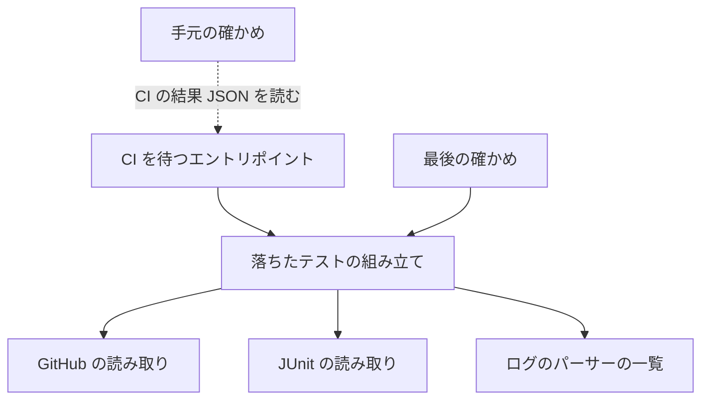
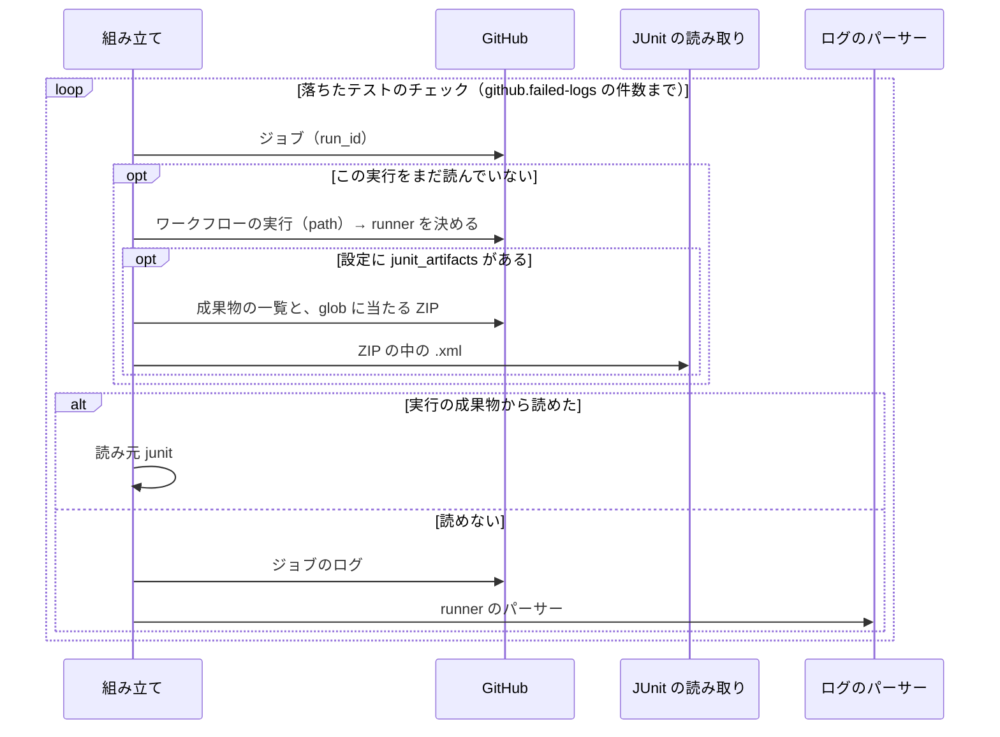
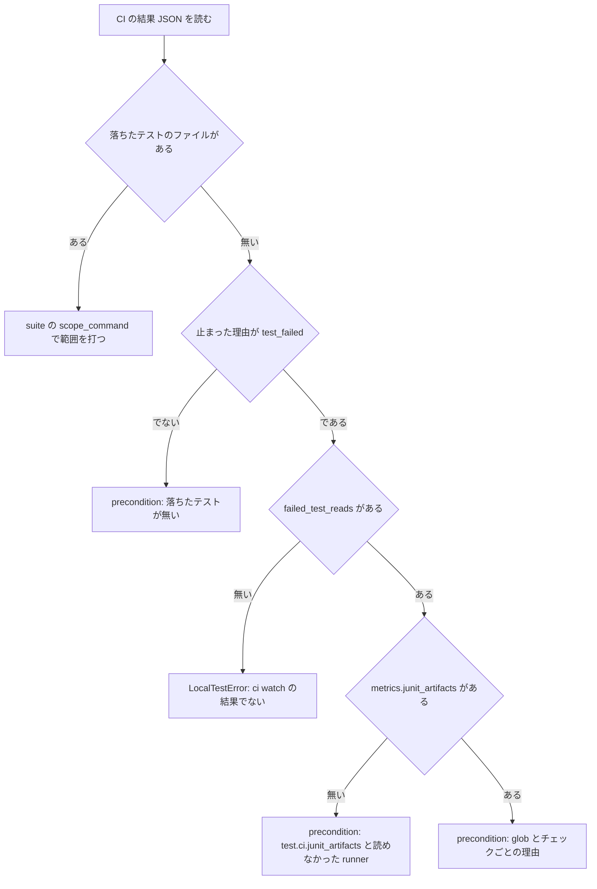

# ndf-next: どのランナーでも CI で落ちたテストを読み、収集の確かめの成功を suite ごとに宣言する

## 概要

ndf-next（`plugins/ndf-next/`）は、PR の CI で落ちたテストを **JUnit の成果物を先に、ジョブのログを後に**読む。
設定ファイル（`.ndf/project.json`）で JUnit の成果物を指せば、テストランナーを問わず落ちたテストのファイルが分かり、
CI の修正の後の手元の確かめ（`ndf route test --failed-from`）がそのファイルだけを打つ。読めないときは、足すべき
設定のキーか読めなかった理由が止まった理由に出る。cross-refactoring の収集の確かめは、suite ごとに宣言した
終了コードだけを成功と読む。

例: vitest の Web サービスで、CI が `junit-web` の成果物を上げ、設定ファイルに `test.ci.junit_artifacts: "junit-*"`
を書く。`ndf ci watch` が `test_failed` で止まると、成果物の XML から `web/src/a.test.ts::adds` のような一覧を作り、
`ndf route test --failed-from` は `web/src/a.test.ts` だけを suite の `scope_command` で打つ。glob を書かなければ、
`落ちたテストを読めない。JUnit の成果物を上げ、設定ファイルの test.ci.junit_artifacts に名前の glob を書く（ログを読めなかった suite の runner: vitest（チェック web-test））`
で `precondition` として止まる。

働く範囲は ndf-next の次の 3 つで、今の NDF（`plugins/ndf/`）は変えない。

- `ndf ci watch`
- `ndf route test --failed-from`
- cross-refactoring の収集の確かめと最後の確かめ（`final_gate`）

## 用語

「JUnit の成果物」「ログのパーサー」「収集の確かめ」の定義は [用語集](../glossary.md) にある。この文書で足す語は次の 2 つである。

| 語 | 意味 |
| --- | --- |
| 読み取りの記録 | 落ちたテストのチェック 1 件について、どこから読んだか（`junit`・`log`・`none`）・何件読めたか・読めなかった理由を持つ 1 行。CI の結果 JSON の `metrics.failed_test_reads` の 1 要素 |
| 取得の枠 | 1 回の組み立てで取得してよい成果物の ZIP の本数。`contracts/limits.json` の `github.failed-logs` の `count` で、読むチェックの数の上限と同じ値 |

## 背景

落ちたテストを pytest のログの行（`FAILED <パス>.py::<名前>`）からしか読まない作りでは、vitest・jest・PHPUnit・
playwright のリポジトリで一覧が空になり、手元の確かめが毎回止まって CI の修正のループが人へ戻る。収集の確かめも、
pytest の「収集が 0 件」を表す終了コード 5 をどのランナーでも成功と読んでいた。いずれも ai-plugins を開発する事情
（pytest）が汎用の振る舞いへ入っていたものである。

## 適用範囲

プロジェクトごとに違うものは、設定ファイルの次のキーで受ける。引数は持たない。

| キー | 何を決めるか |
| --- | --- |
| `test.ci.junit_artifacts` | JUnit の成果物の名前の glob |
| `test.suites[].ci_jobs` | チェックと suite の対応（ワークフローのファイル） |
| `test.suites[].runner` | ログのパーサーの選択 |
| `test.suites[].collect_exit_codes` | 収集の確かめで成功と読む終了コード |

代表のリポジトリでの振る舞い:

| 代表のリポジトリ | 落ちたテストの読み元 | CI の修正のループで起きること |
| --- | --- | --- |
| Web サービス（TypeScript・vitest か jest・playwright） | 成果物から読む。vitest は既定で testcase の `classname` に根からの相対パスを書く。jest（jest-junit）と playwright は `addFileAttribute` を有効にすると `file` 属性が付く | 読めればファイルだけを打つ。読めなければ `test.ci.junit_artifacts` と suite の `runner` を出して止まる。`test.ci.only` が真なら手元で打つステップは無く、一覧は同じ原因の数え上げと CI の修正担当へ渡る |
| モバイルアプリ（Flutter か Swift） | ログのパーサーは持たない。CI が JUnit の成果物を上げれば成果物から読む | Web サービスと同じ。収集の確かめは `collect_command` を持つ suite だけに働く |
| 業務文書だけのリポジトリ | テストの suite もテストのチェックも無い | `test_failed` にならず、落ちたテストを読む処理は呼ばれない |
| ai-plugins | suite `pytest`（`runner: pytest`）のログを pytest のパーサーで読む。CI の JUnit は `file` 属性を持たない形（`junit_family` の既定 `xunit2`）で、設定に glob は無い | pytest の行の形は `runner` が `pytest` の suite にだけ当てる。終了コード 5 は `src/` に持たず、`collect_command` を足すときに同じ suite の `collect_exit_codes` へ書く |

## 仕様

### 構成要素

| 要素 | 置き場（`plugins/ndf-next/` から） | 責務 |
| --- | --- | --- |
| JUnit の読み取り | `src/ndf/testing/junit.py` | XML 1 本と追跡するファイルの集合から、落ちたテストと、ファイルを決められない testcase の理由を返す。ZIP から `.xml` を取り出す。入出力を持たない |
| ログのパーサーの一覧 | `src/ndf/testing/ci_logs.py` | `runner` の名前 → パーサーの対応表 `PARSERS` を 1 か所に持つ。登録は `pytest` だけ |
| 落ちたテストの組み立て | `src/ndf/adapters/ci.py` の `failed_tests_of` | チェックごとに成果物を先に、ログを後に読み、落ちたテストと読み取りの記録を組む |
| GitHub の読み取り | `src/ndf/adapters/github.py` | `job`・`workflow_run`・`run_artifacts`・`artifact_zip` |
| CI を待つエントリポイント | `src/ndf/ci_cli.py` | 設定ファイルと追跡するファイルを読み（`FailedTestSource.from_work`）、組み立ての結果を結果 JSON の `metrics` へ載せる |
| 手元の確かめ | `src/ndf/core/route/local_tests.py` の `unread_detail` | 一覧が空のとき、読み取りの記録から止まった理由の文を組む |
| 最後の確かめ | `src/ndf/domains/crossrefactor/final_gate.py` | `ndf ci watch` と同じ入力（`FailedTestSource.from_work`）で組み立てを呼ぶ |
| 収集の確かめ | `src/ndf/domains/crossrefactor/collect.py` | suite の `collect_exit_codes` で終了コードを判定する |

`ndf.testing` の 2 本は標準ライブラリだけを読み、`ndf.adapters` も `ndf.domains` も読まない。手元の確かめは
CI の結果 JSON のファイルだけを読み、組み立てを呼ばない。

### 常に成り立つ条件

| 条件 | 破れそうなときの扱い |
| --- | --- |
| JUnit から読んだ要素のファイルは、作業ディレクトリが追跡するファイル（`git ls-files -z --full-name :/`）のどれかである | 決められない testcase は一覧へ入れず、`classname`・`name` と試した属性を理由に残す |
| ログから読んだ要素は、パーサーが返した形のまま入れ、追跡するファイルと照らさない | — |
| 落ちたテストの一覧は重ならず昇順に並ぶ | 集合にしてから並べる |
| `<skipped>` だけの testcase と通った testcase は落ちに入らない。落ちは `<failure>` か `<error>` | — |
| ログのパーサーは、チェックに当たる suite の `runner` に登録されたものだけを当てる | 当たる suite が無いか登録が無ければ読まず、理由を残す |
| 読むチェックの数と取得する ZIP の本数は、どちらも `github.failed-logs` の件数を超えない | 超えたチェックは読み元 `none`。当たる成果物が残りの枠より多い実行は ZIP を 1 本も取得せずログへ移す |
| 落ちたテストのチェックがあるのに一覧が空なら、手元の確かめはテストを 1 本も打たずに `precondition` で止まる | — |
| 収集の確かめは `collect_exit_codes`（無ければ `[0]`）に入る終了コードだけを成功と読む | ほかは `CollectError` |

### 落ちたテストの組み立て

**チェックと suite の照合。** ワークフローの実行の `path`（`.github/workflows/build.yml@main` の形）から `@` 以降を
外し、`kind` が `test` の suite の `ci_jobs` の `#` より前と比べる。当たる suite の `runner` が 1 種類ならそのパーサーを
当て、当たらないか 2 種類以上ならログを読まない。ジョブの API の応答はワークフローの YAML のジョブの識別子を持たず、
`name` は表示名であるため、`#` の後ろとチェックの名前は照合に使わない。

**成果物の読み元は実行ごとに決める。** 成果物は実行に付き、どの XML がどのジョブから上がったかは一覧から分からないため
である。ワークフローの実行・`runner` の決定・成果物の読み取りは実行（`run_id`）ごとに 1 回だけ行い、同じ実行の
チェックで使い回す。次をすべて満たす実行を「成果物から読めた」とし、その実行のチェックはすべて読み元 `junit` になる。

- glob（`fnmatch` の大文字小文字を区別する照合）に当たり、`expired` でない成果物が 1 本以上ある
- 当たる本数が残りの取得の枠以内で、どの成果物も 50 MiB（一覧の `size_in_bytes`）以下
- 全本を取得して読め、落ちた testcase が 1 件以上、ファイルを決められない testcase が 0 件

決められない testcase が 1 件でもあれば、読めた分を使わずにその実行のチェックをすべてログへ移す。一部のファイルだけを
打って、ほかの落ちを見落とさないためである。

**ファイルの決め方。** 落ちた testcase ごとに、testcase の `file` → 最も近い testsuite の `file` → testcase の
`classname` → 最も近い testsuite の `name` の順に候補を試す。候補はバックスラッシュを `/` に、先頭の `./` を外して比べる。

| 候補と追跡するファイルの関係 | 使うファイル |
| --- | --- |
| 一致する | そのファイル |
| 候補が絶対パスで `/<ファイル>` で終わる（PHPUnit の形） | 当たるうち最も長いファイル |
| `/<候補>` で終わるファイルがちょうど 1 つ | そのファイル |

末尾の照合で 2 つ以上が当たる候補は決めずに次へ進む。誤ったファイルを打つより、止まって設定を知らせる方が直しの
費用が小さい。ランナーごとに属性を決め打ちしないのは、レポーターの設定（`classnameTemplate` など）を変えた利用者で
外れるためである。一覧の要素は `<ファイル>::<testcase の name>` である。

**成果物は設定に glob を書いたときだけ読む。** 名前を推測すると、利用者の CI が上げた別の成果物を JUnit と読む
恐れがある。ログも読むのは、JUnit にファイルの属性が無い CI（ai-plugins）で pytest の読み方の一覧を退行させないため
である。ログのパーサーを pytest だけにするのは、ほかのランナーは JUnit で同じ結果が得られ、ログの形はレポーターの
設定で変わるためである。パーサーを足すときは `PARSERS` に 1 行足し、組み立ては書き換えない。

**XML の読み取り。** 標準ライブラリの `xml.etree.ElementTree` で読む。要るのは要素と属性だけで、依存を増やさない。
大きさは展開の前に `ZipInfo.file_size` で比べ、展開した `.xml`（大文字小文字を問わない）が 1 本 50 MiB・合計 100 MiB を
超えれば読まない。

### 手元の確かめが止まるときの文

| 場合 | 止まった理由の文 |
| --- | --- |
| glob が無い | `落ちたテストを読めない。JUnit の成果物を上げ、設定ファイルの test.ci.junit_artifacts に名前の glob を書く（ログを読めなかった suite の runner: <runner>（チェック <名前>）、…）`。`runner` が null なら「当たる suite が無い」 |
| glob がある | `JUnit の成果物（<glob>）とログのどちらからも落ちたテストを読めない: <チェック>: <reason>; …` |

文の書き手は CI を待つ側の 1 つで、手元の確かめは設定ファイルを読み直さない。読み直すと、CI を待ったときの設定と
食い違う経路ができるためである。

### 収集の確かめ

suite の `collect_command` の終了コードが `collect_exit_codes`（無いか並びでなければ `{0}`。真偽値の要素は数えない）に
入れば成功として出力を読み、入らなければ `CollectError`（終了コードと標準エラーの末尾 400 字）で止まる。終了コードを
コマンドと同じ suite に置くのは、成功の終了コードがそのコマンドの事実で、読み手が 1 か所で読めるためである。

## データ・設定

設定ファイル（`.ndf/project.json`。スキーマは `contracts/schemas/ndf-settings/project.schema.json`）:

| キー | 型 | 意味 |
| --- | --- | --- |
| `test.ci.junit_artifacts` | 文字列（glob）か無し | JUnit の成果物の名前の glob（例: `junit-*`）。書いたときだけ成果物を読む |
| `test.suites[].collect_command` | 文字列か `null` | 収集の確かめのコマンド。収集したテストを 1 行ずつ出す |
| `test.suites[].collect_exit_codes` | 整数の並び（1 個以上・重複なし） | 成功と読む終了コード。書かなければ `[0]`。書くには `collect_command` が要る（`dependentRequired`）。pytest の「収集が 0 件」を受けるなら `[0, 5]` |

CI の結果 JSON（`ndf ci watch` が `test_failed` で止まったとき。スキーマは `contracts/schemas/io/ci.result.schema.json`）の `metrics`:

| キー | 必須 | 意味 |
| --- | --- | --- |
| `failed_tests`・`test_files` | 必須 | 落ちたテスト（`<ファイル>::<名前>`）と、そのファイル |
| `failed_test_reads` | 必須（スキーマが `test_failed` に要求する） | チェックごとの `check`・`run_id`（読めなければ `null`）・`runner`（当たらなければ `null`）・`source`（`junit`・`log`・`none`）・`found`・`reason`。読み元 `junit` の `found` は実行の成果物から読めた件数で、同じ実行の行は同じ値を持つ |
| `junit_artifacts` | 設定にあるときだけ | 読んだ glob |
| `log_error` | ジョブかワークフローの実行を読めないチェックがあるときだけ | その理由（2 件以上は `; ` でつなぐ） |

契約のページ（`docs/contracts/commands.md`・`ndf-settings.md`）はスキーマから `ndf check` が作り直す。

## エラー処理

`failed_tests_of` は `GitHubError` を外へ投げず、止まった理由の種類（`test_failed`）を変えない。

| 失敗 | 扱い |
| --- | --- |
| ジョブかワークフローの実行を読めない | そのチェックだけ読み元 `none`・`found` 0・`reason` に理由。`log_error` に足し、ほかのチェックは読み続ける |
| 成果物の一覧・ZIP（期限切れの 410 を含む）・XML を読めない、大きすぎる、枠を超える | その実行のチェックをログへ移し、成果物の理由を `reason` に残す |
| ログを読めない・パーサーが無い・当たる suite が無い | 読み元 `none`。成果物の理由とログの側の理由の両方を `reason` に残す |
| 設定ファイルを読めない | glob も suite も無いとして続ける |
| git を読めない | 追跡するファイルを空として続ける（JUnit のファイルが決まらずログへ移る） |
| `test_failed` の結果に `failed_test_reads` が無い | `ndf route test --failed-from` が `LocalTestError`（`invalid`）で止まる |

## セキュリティ

利用者の CI が上げた成果物を読むため、取得の本数と大きさ、展開した XML の大きさ（1 本と合計）を上限で切る。ZIP は
メモリで読み、一時ファイルを作らない。結果 JSON の `reason` には、要求のメソッドとパスだけを持つ `GitHubError` の文と、
testcase の `classname`・`name` を書き、成果物の転送先の URL（署名を含む）・トークン・`<failure>` の本文・ログの本文は
写さない。

## テスト観点

テストは `plugins/ndf-next/tests/` の下にある。見本の XML と出所（実際に動かして書かせたか公式の文書の形か）は
`tests/testing/junit_samples/` にある。

- vitest（既定）・jest（`addFileAttribute`）・PHPUnit・pytest（`xunit1`）・playwright（`addFileAttribute`）の見本から、落ちたテストだけが `<ファイル>::<名前>` で返ること
- PHPUnit の絶対パスが追跡するファイルの相対パスで返り、末尾の照合で長い方を選ぶこと
- jest の既定と pytest の `xunit2` の testcase が一覧へ入らず、名前と試した属性が理由に出ること
- 分割ジョブの複数の XML で一覧が重ならず昇順になること
- glob があり当たる成果物が無い・期限切れ・410 のとき、ログのパーサーで読み、読み元が `log` になること
- pytest のログから今と同じ一覧が返ること（`ERROR <パス>` を含む）
- `runner` が `vitest` の suite に当たるチェックのログに pytest の行があっても読まないこと。試験用のパーサーを `PARSERS` へ足すと読まれること
- 同じ実行の 2 チェックで、一方の XML に決められない testcase があれば両方が `log` になり、無ければ両方が同じ `run_id`・`found` の `junit` になること
- 枠 + 1 本の成果物で ZIP を 1 本も取得しないこと。ジョブを読めないチェックだけが `none` になり、ほかの分が一覧に残ること
- 手元の確かめが、glob の有無に応じた 2 つの文で、テストを打たずに `precondition` で止まること。記録の無い `test_failed` で `LocalTestError` になること
- `collect_exit_codes: [0, 5]` で 5 が成功、宣言の無い suite で 5 が `CollectError` になること
- スキーマが `collect_exit_codes` の `["5"]`・`5`・`[1.5]`・`[true]`・`[]`・`collect_command` の無い指定を落とし、`[0, 5]` を通すこと
- 最後の確かめが組み立てへ作業場所の設定を渡すこと

## 未確認・残リスク

| 項目 | 内容 |
| --- | --- |
| PHPUnit の CI での読み取り | JUnit の成果物を上げる PHPUnit のリポジトリの実際の CI の落ちで、ファイルが決まるかは未確認 |
| 再利用ワークフローの `path` | `workflow_call` で呼ばれたジョブの実行の `path` が呼び出し元と呼ばれた側のどちらのファイルかは未確認。呼ばれた側なら `ci_jobs` にそのファイルを書く必要がある |

## 関連リンク

- [ndf-next-declarations-and-io-contracts.md](ndf-next-declarations-and-io-contracts.md) — 宣言と入出力の規約・`ndf check` の規則
- [cross-refactoring-verify-and-final-gate.md](cross-refactoring-verify-and-final-gate.md) — cross-refactoring の最後の確かめ
- [JUnit XML の共通の形（testmoapp/junitxml）](https://github.com/testmoapp/junitxml)
- [GitHub REST API: Artifacts](https://docs.github.com/en/rest/actions/artifacts)
