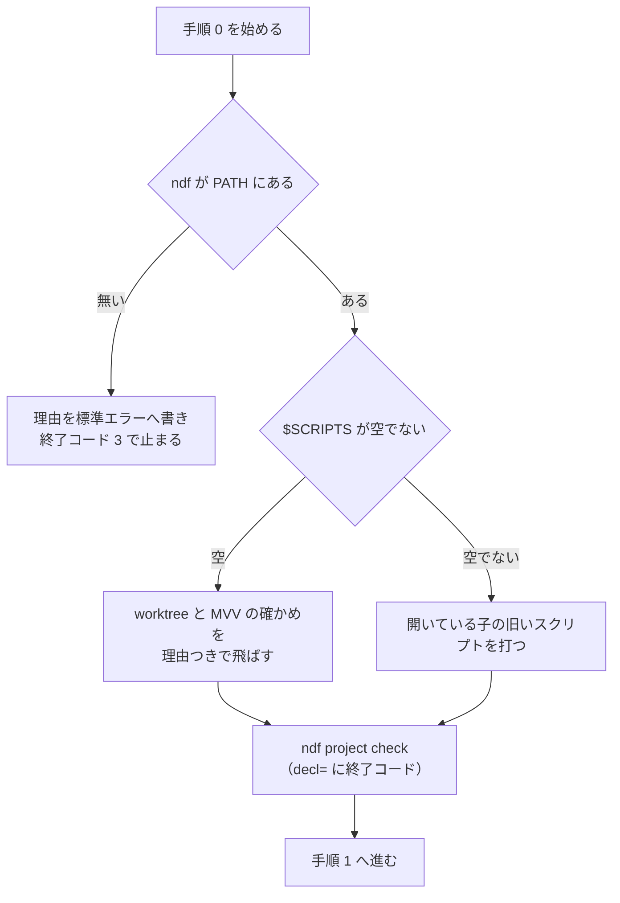

# ndf-next: 閉じた子の 10 本の機能を `ndf` の副命令で呼び、旧いプラグインへ解決しない

## 概要

ndf-next（`plugins/ndf-next/`。今の `plugins/ndf/` と入れ替わる作り直しの NDF）の Skill とエージェントの本文は、
#1142 の作り直しで行き先の子が閉じた 10 本の旧いスクリプトの機能を、エントリポイント `bin/ndf` の副命令として名前で呼ぶ。
スクリプトの置き場（`$SCRIPTS`）を探す手順は持たず、旧いプラグインのスクリプトへ解決する経路は無い。

例: 新しいプラグインだけを読む起動（`bin/ndf-claude`）で `development-workflow` の手順 0 を流すと、本文は
`command -v ndf` で `ndf` の有無だけを確かめ、`$SCRIPTS` は空のまま進む。プロジェクトの宣言の判定は
`ndf project check` が行い、`decl=` に終了コードを出す。旧い `project-decl.py`・`worktree-setup.sh`・`project-mvv.py`
は打たない。

10 本の行き先は 4 つに分かれる。

| 行き先 | 旧いスクリプト | 新しい呼び方 |
| --- | --- | --- |
| 既にある副命令へ置き換える | `supervise.py`・`test-run.py`・`stage-check.sh`・`relay.py` の大半 | `ndf plan`・`ndf route`・`ndf progress`・`ndf ci`・`ndf relay`・`ndf lanes` |
| 旧い実装を新しい副命令へ移す | `project-decl.py`・`statusline-switch.sh`（と表示の本体 `statusline.sh`）・`mode-materials.py`・`context-policy.py`・`relay.py` の足りない操作 | `ndf project`・`ndf statusline`・`ndf materials`・`ndf relay context`・`ndf relay notice`・`ndf relay stop --all`・`ndf relay account <登録の操作>` |
| 作らない | `resolve.sh`・`install-official-skills.sh`、一部の下位の命令とオプション | `command -v ndf` の確かめ、Claude Code のプラグインの導入ほか（「作らない機能」） |
| 開いている子へ回す | `supervise.py note`・`design-results` など | 本文は「<子> が `ndf` の副命令に足す。新しいプラグインだけではまだ打てない」の 1 文 |

| 何を | 正本 |
| --- | --- |
| 副命令の引数（生成物） | [`contracts/schemas/io/<副命令>.args.schema.json`](../../plugins/ndf-next/contracts/schemas/io/) と [副命令の一覧](../../plugins/ndf-next/docs/contracts/commands.md) |
| 結果の `items`・`metrics` の形（手書き） | `contracts/schemas/io/project.result.schema.json`・`statusline.result.schema.json`・`materials.result.schema.json`・`relay.result.schema.json` |
| 結果の契約と終了コードの区分 | [`contracts/schemas/result.schema.json`](../../plugins/ndf-next/contracts/schemas/result.schema.json) と [`docs/contracts/exit-codes.md`](../../plugins/ndf-next/docs/contracts/exit-codes.md) |
| `$SCRIPTS` の決め方の正本 | [ndf-next の `development-workflow/references/scripts-lookup.md`](../../plugins/ndf-next/skills/development-workflow/references/scripts-lookup.md) |
| 機能の対応表の列の意味（`to`・`not_built`・`unowned`・`now`） | [`scripts/ndf-next-parity/README.md`](../../scripts/ndf-next-parity/README.md) |
| 宣言と入出力の規約・`ndf check` の規則 | [ndf-next-declarations-and-io-contracts.md](ndf-next-declarations-and-io-contracts.md) |

パスは、ことわりが無い限り `plugins/ndf-next/` からの相対である。

## 用語

定義は [用語集](../glossary.md) が正である（`.ndf/glossary.json` の `document`）。この文書で使う語は
「旧いプラグイン」「機能の対応表」「子の表」「入れ替えの前の試走」「副命令」「閉じた子」である。

## コンテキスト

| 上流（正本） | 下流（合わせる側） | 関係 | 何を合わせるか |
| --- | --- | --- | --- |
| 呼び出しの契約（`bin/ndf` の副命令の表・規約のページ・結果のスキーマ） | 作り直しの計画（機能の対応表・子の表・試走の記録） | 公表された言語 | 判定（`parity.trial.probe`）は、本文をこの形のとおりに読み、旧い名前が残るかで対応表の行を判定する。どちらも相手の内部を読まない |
| 結果の契約（`ndf.contracts`） | 足した副命令（`project`・`statusline`・`materials`・`relay` の足した下位の命令） | 順応者 | 結果 JSON の外枠（`tool`・`status`・`summary`・`items`・`metrics`）・止まった理由の種類・終了コードの表 |
| 旧いプラグインの状態の置き場 | 足した副命令 | 順応者 | 入れ替えの前は旧い実装と同じ置き場・同じ形・同じ排他で読み書きする（「旧い実装と並ぶ間の状態」） |

## 仕様

### 集約

| 集約 | 持ち主 | 根 | 値オブジェクト |
| --- | --- | --- | --- |
| 副命令の表 | `src/ndf/cli.py` の `COMMANDS` | 副命令の表 | 副命令の名前・モジュールのパス |
| 副命令の契約 | 副命令のモジュール（argparse の定義）と結果のスキーマ | 副命令 | 引数・結果 JSON の `items` と `metrics` の形・終了コード |
| 本文の呼び出し | `skills/`・`agents/` の本文 | 呼び出しの行 | 副命令と引数の並び・`$SCRIPTS` の決め方 |
| 機能の対応表の行 | 行の `to` に書いた子。`to` を持たない `not_built` の行は起票した課題（#3569） | 対応表の行 | 行き先の子・作らない理由 |
| 機能の対応表の試走の結果 | 判定（`probe --write`）だけ | 対応表の行の `trial` | 試走の結果・理由・記録のファイル |
| 子の表の行 | オーガナイザー | 子の表（`src/ndf/checks/children.json`） | 記号・番号・パッケージ・依存・順番・レーン |
| 試走の記録 | 試走をした worker | `scripts/ndf-next-parity/parity/trial/<日付>.json` | 日付・起動の版・通した行 |

### 常に成り立つ条件

| # | 条件 | 破れたときの扱い |
| --- | --- | --- |
| I1 | 対応表の行は、副命令を持つ子の `to` と `not_built` のどちらか 1 つだけを持つ | 形の確かめ（`table.shape_errors`）が落ちる |
| I2 | `skills/`・`agents/`・`hooks/`・`manifests/` の本文に、10 本の旧いスクリプトの名前が出ない（冒頭の注記を含む） | 判定がその行と、その名前を呼ぶ Skill・エージェントの行を `failed` にする |
| I3 | 本文に書いた `ndf` の呼び出しは、副命令の表と規約の引数に当たる | `ndf check` の規則 spec-skill が落ちる |
| I4 | 副命令は結果のスキーマを持ち、結果 JSON の共通の形と終了コードの表の値で終わる | `ndf check` の規則 spec-io と、結果 JSON の契約のテストが落ちる |
| I5 | `$SCRIPTS` の決め方は、旧いプラグイン（`plugins/ndf`）の置き場を候補に持たない | 手順 0 の報告に旧い置き場が出る |
| I6 | `ndf` が `PATH` に無ければ、理由を標準エラーへ書いて終了コード 3 で止まる | `tests/skills/test_scripts_lookup.py` が落ちる |
| I7 | 足したモジュールはどれも子の表で持ち主の子を持つ | 規則 child-deps が落ちる |
| I8 | 作らない機能・ほかの子へ回した機能は、対応表の行として残る（本文から名前を消しても機能は表から消えない） | 判定で、作らない行は `passed`、回した行は行き先の子の置き場が無ければ `failed`・あれば `not_run` になる |

### `$SCRIPTS` の決め方

本文の手順の先頭は、置き場を探さずに次の 2 行を打つ。Claude Code は有効なプラグインの `bin/` を Bash の `PATH` に載せるため、
`ndf` は名前で見つかる。Codex と端末は `PATH` 上に置いた `bin/ndf` へのシンボリックリンクで呼ぶ。

```bash
command -v ndf >/dev/null 2>&1 || { echo "ndf が PATH に無い: 新しいプラグインを有効にするか、bin/ndf へのシンボリックリンクを PATH に置く" >&2; exit 3; }
SCRIPTS=
```

正本は `development-workflow/references/scripts-lookup.md` で、同じ確かめを持つほかの本文はこの節を指す。

開いている子が持つ旧いスクリプトの呼び出しは、その子が副命令へ置き換えるまで本文に残る。本文はそれを次の形で扱う。

| 形 | 使う場面 | 振る舞い |
| --- | --- | --- |
| 飛ばす（既定） | 後の手順がその出力を入力にしない | `[ -n "${SCRIPTS:-}" ]` が偽なら打たず、「<スクリプト名> は <子の記号> #<番号> が副命令に置き換えるまで新しいプラグインだけでは打てない。飛ばした」の 1 行を出す |
| 止まる | 後の手順がそのスクリプトの出力（書くファイル・終了コード）を入力にしていて、飛ばすと誤った入力で進む | 理由を標準エラーへ書いて終了コード 3 |

飛ばす形を既定にするのは、試走が手順の終わりまで進み、残りの不足を試走の全体から拾えるためである。



`development-workflow` の手順 0 で飛ばす旧いスクリプトは `worktree-setup.sh`（M8 が持つ）と `project-mvv.py`（M7 が持つ）で、
判定結果の出力の `宣言:` の行に理由を書く。新しいプラグインだけの起動では `$SCRIPTS` はいつも空である。

置き場の解決のエントリポイントを新しいプラグインに置かないのは、呼び手が置き場を知る必要が無く、置くと開いている子が
置き換えた後に消す手間が残るためである（kubectl・git も副命令を名前で見つけ、置き場の解決を呼び手に持たせない）。

### 既にある副命令への置き換え

同じ機能を 2 か所に持たないため、既にある副命令で足りる旧い下位の命令はそこへ置き換える。

| 旧い | 置き換え先 |
| --- | --- |
| `supervise.py new sprint` | `ndf progress new <スプリント名> --mode <モード> --issues <番号>...` |
| `supervise.py new <impl・fix・check・release>` | `ndf route render <目的> --out <プラン>` |
| `supervise.py queue` | `ndf plan queue <プラン>... [--then] [--from] [--resume] [--fresh] [--max <本数>] [--queue-dir]` |
| `supervise.py run`・`advance` | `ndf plan next <プラン> [--from] [--state-dir] [--answer]` |
| `supervise.py wait` | `ndf plan wait <プラン>... [--state-dir] [--timeout]`（渡すのは結果のファイルでなくプラン） |
| `test-run.py scope` | `ndf route test [<コマンド>] [--failed-from] [--result]` |
| `test-run.py whole` | `ndf ci watch`（全体テストは CI が持つ） |
| `stage-check.sh report <課題番号>` | `ndf progress show <進行表の ID>`（ID は `ndf progress new` の結果にある） |
| `relay.py run`・`spawn`・`restart`・`ls`・`status`・`install`・`stop <名前>` | `ndf relay` の同じ名前の下位の命令（`--json` は無い。どの副命令も結果 JSON を出す） |
| `relay.py account use <名前>`・`use --clear` | `ndf relay account use <名前>`・`ndf relay account clear` |
| `relay.py cap` | `ndf lanes limits <計画> [--max-lanes] [--max-plans] --reason`（計画ごとの上限） |
| `relay.py role` | `ndf relay spawn --role <役割> --plan <計画名>` |

`ndf route render` は、埋める先のリポジトリ（`repo`、無ければ打った場所）の宣言 `.ndf/project.json` がテストを CI に寄せる
（`test.ci.only` が真）なら、手元のテストのステップを外したプランを書く。工程から組むプランと同じ扱いである。

`ndf plan queue --max` は同時に流すプランの本数の上限で、1 未満は使い方の誤り（`invalid`）として止まる。省けば触るファイルの
重ならない組の本数まで流す。

### `ndf project`

宣言（メインディレクトリの `.ndf/project.json`）の判定・測定・書き出し・ずれ・スキーマを持つ。旧い `project-decl.py` の
振る舞い（判定・書くファイルの置き場と形）を変えずに、副命令の形へ移したものである。宣言のスキーマの正本は
`contracts/schemas/declarations/project.schema.json` である。

| 下位の命令 | 何をするか | 終了コード |
| --- | --- | --- |
| `check [--force] [--root]` | 宣言が新しい（`fresh`）・無い（`missing`）・古い（`stale`）・壊れている（`broken`）のどれかを判定する | 0 = 新しい / 3 = 無い・古い（`--force` なら新しくても 3）/ 2 = 壊れている / 1 = 判定できない |
| `measure --out <ファイル> [--budget <秒>] [--root]` | リポジトリ・CI・ブランチの使い方を測り、測定の結果を書く | 0 = 書けた / 1 = 書けない |
| `write --measure <ファイル> [--answers <ファイル>] [--dry-run] [--root]` | 測定の結果と答えから宣言（`.ndf/project.json`・`.ndf/worktree.json`）を書き出す | 0 = 書けた・書くものが無い / 1 = 書けない・答えがスキーマに合わない / 2 = 既存の宣言が壊れている |
| `drift --measure <ファイル> [--root]` | ブランチの運用の宣言と測った使い方のずれを出す | 0 = 比べた / 1 = 測定の結果を読めない / 2 = 宣言が壊れている |
| `schema [--out]` | 宣言の JSON Schema を出す | 0 / 1 = 書けない |

- **`check` の終了コードは新しい側の表の名前に揃える。** 3 は前提が満たされない（`precondition`）、2 は読めない（`unreadable`）
  を指す。`development-workflow` の `references/project-analysis.md` の `decl=` の読み方はこの値で書かれている
- 判定は、解析器の版（`check.ANALYZER`）と、判定の入力のファイルの中身から作る指紋が宣言の記録と一致するかで決まる
- 項目の測定の結果は `measured`（値）・`question`（候補と根拠。根拠は 20 件まで）・`unknown`（理由）のどれかである。
  測定の締め切りは上限の表の `project.measure`（120 秒）で、`--budget` が先に効く。締め切りを過ぎた項目と、`git`・GitHub に
  届かない項目は `unknown` にして続ける
- `write` は、人が書いた値を書き換えない（同じなら保ち、違えば食い違いとして書かない）。答えは測った値より先に効く
- 秘密は 2 段の表（`domains/project/secret.py`）で扱う。名前の表に当たるファイル（`.env*`・`*.pem`・`*.key` など）は開かず、
  値の形の表に当たる値は宣言へ書かず、結果では伏せる

### `ndf statusline`

Claude Code の statusline に NDF の表示を設定する。`settings.json` は `CLAUDE_CONFIG_DIR`（無ければ `~/.claude`）の下を読み書きし、
symlink なら参照先へ書く。表示の本体（`domains/statusline/statusline.sh`）は `~/.claude/ndf-statusline.sh` へ置き、
`statusLine.command` は `bash ~/.claude/ndf-statusline.sh` にする。

| 下位の命令 | 何をするか | 終了コード |
| --- | --- | --- |
| `ensure` | `statusLine` が無ければ NDF の表示を設定し（`set`）、NDF の表示なら本体だけを今の版に置き直す（`updated`・`kept`）。他の設定なら何もしない（`kept`） | 0（排他を取れない・`settings.json` を読めないときも `skipped` で 0。SessionStart を止めない） |
| `status` | 今の `statusLine` と控えの有無を出す | 0 / 2 = 読めない |
| `set` | 今の値を控えて NDF の表示へ切り替える | 0 / 1 = 書けない / 2 = 読めない |
| `restore` | 控えから元の値へ戻す。控えが無ければ `statusLine` を消す | 0 / 1 = 書けない / 2 = 読めない |

控えと排他のファイル（`.ndf-statusline-backup.json`・`.ndf-statusline.lock`）は `settings.json` の実体の隣に置き、名前は旧い
実装と同じである。旧い版で控えた利用者が新しい版で `restore` できる。JSON は Python で読み書きし、`jq` は使わない。

### `ndf materials`

`ndf materials --issue <番号>... [--root <リポジトリ>] [--out <判定の根拠のファイル>]` は、課題の本文（`ndf.adapters.github`）・
追跡されたファイルの一覧・設計文書から、モードの判定の材料を課題ごとに 1 件組む（種類・公開インタフェースの変更の有無・
触るファイルの候補・候補ごとのテストのファイル）。

- 本文を読めない課題は `gaps` に理由つきで並べ、終了コード 1 で終わる。git の外なら `precondition`（3）で止まる
- `--out` の下書きは `row`・`mode`・`condition` を空にした判定の根拠のファイルで、conductor が埋めて `ndf loop sprint` に渡す

### `ndf relay` の足した下位の命令

再起動の方針と中継の操作を `ndf relay` に置くのは、中継の置き場（`signals.relay_dir`）と設定を読む部品を共有するためである。

| 下位の命令 | 何をするか |
| --- | --- |
| `notice` | 呼び手の claude がラッパーの直接の子かを判定し（`metrics.inside`）、カットポイントのアナウンスの 1 文を返す。位置は `relay`・`not-running`・`not-child`・`no-dir` のどれかで、親のたどりは 64 世代までである。秒数は上限の表の `relay.quiet` から作る |
| `stop --all` | 動いているすべてのラッパーの置き場へ停止シグナルファイルを置き、tmux のセッションで動くものには名前つきの停止も依頼する。名前と同時には渡さない |
| `account add`・`add-bedrock`・`add-api-key`・`api-key-monthly`・`api-key-use`・`list`・`capacity`・`remove`・`check` | アカウントの登録・従量の接続（Bedrock・API キー）・枠の宣言を、旧い実装と同じ置き場と形で扱う |
| `context resolve`・`record`・`calibrate`・`report` | 再起動の方針の適用値の解決・判定の記録の追記・費用の見込みの較正・作業ごとの量の集計 |

**停止シグナルファイルを置いた後のラッパーの振る舞い。** 端末から直接起動したラッパー（tmux のセッションを持たない）は
シグナルファイルだけで止まる。ラッパーは区間を替える・アカウントを替える・起こし直す・引継ぎを頼む手を打たず、今の
セッションが続いていれば「`ndf-relay: 次の区間を起動しない（停止シグナルファイルがある）。このまま続けるか、/exit する`」を
端末へ 1 度だけ出して利用者が終えるのを待ち、終わったらシグナルファイルを消して終わる。始めたばかりの実行は、前の実行が
残したシグナルファイルを消してから動く。シグナルファイルを置けない・止められないラッパーがあれば `refused` で止まる。

**アカウントの登録の扱い。**

- キーの値・認可コード・アクセストークンを、結果 JSON・標準エラー・記録へ書かない。メールアドレスは伏せた形で出す
- `add` はブラウザの無い端末では認可の URL を出して `precondition`（3）で止まり、登録の途中の状態（`.pending-<名前>/`）を残す。
  `--code` を付けて打ち直すと続きから登録する
- 置き場は `NDF_ACCOUNTS_DIR`、無ければ `<NDF_SHARED_CONFIG_DIR か CLAUDE_CONFIG_DIR か ~/.claude>/ndf/accounts` である。
  `account.json` は権限 0600 で書く

**再起動の方針の扱い。**

- `context resolve` は設定 `.ndf/context.json` を読むだけで書かない。設定が壊れていれば現行の方式の値を返し、`config_error` を持つ
- `context record` の理由（7 つ）と印（`引継ぎ開始`・`復元完了`）以外の値は、argparse の `choices` で使い方の誤りとして拒む
- 記録と見込みの置き場は `NDF_CONTEXT_DIR`、無ければ旧い状態の根（`NDF_STATE_HOME` → `XDG_STATE_HOME/ndf` →
  `~/.local/state/ndf`）の `context` である。旧い状態の根は `registry.legacy_state_root` の 1 か所だけが求め、`legacy_root` は
  これに `relay` を足した値を返す
- `context report` は表の形（旧い `--format table`）を持たない。結果 JSON の `items` を表として読むのは呼び手である

### 旧い実装と並ぶ間の状態

入れ替えの前は、旧いプラグインで動くセッションと新しいプラグインだけの起動が同じ手元で並ぶ。**新しい副命令は旧い実装と
同じ排他の取り方と書き方を使い、状態の形（キー・値の型）を足さない・変えない。** 形を足すと、旧い実装がその値を読めずに
捨てる・壊れたものとして扱うためである。

| 状態 | 同時に書いたときの扱い |
| --- | --- |
| アカウントの登録（`<置き場>/<名前>/account.json` など） | アカウントごとの排他（`<置き場>/.locks/<名前>.lock`。filelock）を取ってから一時ファイルからの置き換えで書く。旧いと同じパスのため互いに待つ。待ちきれなければ書かずに `store_in_use`（3）で止まり、打ち直さずに人へ戻す |
| 再起動の方針の判定の記録（`decisions/<リポジトリ>.decisions.jsonl`） | 排他を取らず、1 回の書き込みで 1 行を追記する。読み手は読めない行を飛ばし（`metrics.skipped`）、`at` で並べ直す |
| 再起動の見込み（`estimates/<リポジトリ>.cost-estimates.json`） | 一時ファイルからの置き換えで書く。後に書いた方が残る。同じ判定の記録から作るため値は食い違わない |
| statusline の控えと `settings.json` の `statusLine`・表示の本体 | `.ndf-statusline.lock` に `fcntl.flock` の排他を取ってから書く。旧い `flock` コマンドと同じ種類の錠のため互いに待つ。待つ上限は上限の表の `statusline.lock`（10 秒）で、待ちきれなければ `set`・`restore` は `store_in_use` で止まり、`ensure` は `skipped` で続ける |
| プロジェクトの宣言（`.ndf/project.json`） | 一時ファイルからの置き換えで書く。後に書いた方が残る |

### 作らない機能

作らない機能は、旧いスクリプトの行とは別の `not_built` の行として機能の対応表に載る。1 行に `to` と `not_built` を両方持たせない（I1）。

| 対応表の行 | 作らない理由 |
| --- | --- |
| `entrypoint:scripts/resolve.sh` | `ndf` は名前で見つかる（X0 の `bin/ndf`）。本文は置き場を決めない |
| `entrypoint:scripts/install-official-skills.sh` | 公式 Skill は Claude Code のプラグインのマーケットプレイス（`anthropics/skills`）で配られ、導入はプラグインの導入が持つ。`official-skills-autoloader` は取得元を示して同意を得た後に `claude plugin marketplace add anthropics/skills` と `claude plugin install document-skills@anthropic-agent-skills` を打つ |
| `from-issue:3569-supervise-options` | 旧い `supervise.py` の `queue --done`・`--poll` と `run --slow` は同じ働きを 2 つの名前で持たないため持ち込まない |
| `from-issue:3569-test-run-whole` | 手元の全体テストと落ちの 3 分類は作らない。全体テストは CI（`ndf ci watch`）が持ち、落ちたテストの打ち直しは `ndf route test --failed-from` |
| `from-issue:3569-relay-attach` | 結果 JSON を返す副命令の形に合わない。`tmux -L ndf-lanes attach -t <名前>` で足りる |
| `from-issue:3569-relay-hook-bodies` | 旧い `mark`・`startup`・`is-child` の役目は、Stop の hook の guard（`src/ndf/domains/hooks/guards/relay_mark.py`）・`ndf relay install`・`ndf relay notice` の `metrics.inside` が持つ |
| `from-issue:3569-context-report-table` | 結果 JSON の `items` を表として読むのは呼び手である |
| `from-issue:3569-relay-cap` | マシン全体の本数の上限は環境変数 `NDF_RELAY_MAX_NAMED` と上限の宣言 `relay.max-named` が持つ（`ndf.progress.lane.machine.cap`）。値を書き込む副命令は持たない |

`NDF_RELAY_MAX_NAMED` は、リレーハブとマシン全体の本数の判定が同じ規則（`limits.from_env`）で読む。数でない・0 以下の値は
誤りとして扱う。`ndf lanes start` を打つ環境で渡すと、切り離した `ndf lanes run` が引き継ぐ。

### 開いている子へ回した機能

開いている子の領分の機能は、その子を行き先にした行（`unowned: true`・`now: "—"`・`source: "#3569"`）として対応表に載る。
この課題の後は行の持ち主はその子で、オーガナイザーが行き先の子の Issue の本文へ足す（`parity/README.md` の `unowned`）。

| 対応表の行 | 機能（旧い） | 行き先 |
| --- | --- | --- |
| `from-issue:3569-handoff-note` | 報告から引継ぎ文書の表へ 1 行足す（`supervise.py note`） | M7 |
| `from-issue:3569-design-results` | マージした設計 PR の設計の結果から実装のプランを書き換える（`supervise.py design-results`） | P1b |
| `from-issue:3569-sprint-close-plan` | スプリントの終わりのまとめのプランを組む（`supervise.py new close`） | P1b |
| `from-issue:3569-pace-conditions` | `fast`・`auto` の使ってよい条件を確かめ、欠ければ断る（`supervise.py new sprint --pace`） | P2 |
| `from-issue:3569-queue-answer-hold` | 答え待ちの停止の範囲に入ったレーンで、新しい承認を生むプランを流さずに止める（`supervise.py queue` の答え待ち） | P3 |
| `from-issue:3569-test-container` | 宣言の container を読んでテスト環境を起こしてから走らせる（`test-run.py scope` の経路） | M8 |

`now` を `—` にするのは、判定が `now` を鍵に旧いスクリプトの行を引くためである。旧いスクリプトの名前を `now` に書くと、
同じ `now` の行が鍵を上書きし、行き先の子の取り違えと、理由に旧い名前が出る `failed` が起きる。

## データ・設定

| 置き場 | 内容 |
| --- | --- |
| `src/ndf/cli.py` の `COMMANDS` | `"project": "ndf.domains.project.cli"`・`"statusline": "ndf.domains.statusline.cli"`・`"materials": "ndf.domains.materials.cli"` |
| `scripts/ndf-next-parity/parity/features.json` | 行 `entrypoint:scripts/project-decl.py`・`statusline-switch.sh`・`statusline.sh`・`mode-materials.py` の `to` は S1e。`places` の `S1e` は `src/ndf/domains/project/`・`statusline/`・`materials/`。`supervise.py`・`test-run.py`・`context-policy.py`・`relay.py`・`stage-check.sh` の行は副命令を持つ子（C2・M3b・P1a）のまま |
| `src/ndf/checks/children.json` | 子 S1e（#3569）: パッケージ `ndf.domains.project`・`ndf.domains.statusline`・`ndf.domains.materials` と `ndf.domains.relay` の足したモジュール（`account_*`・`cli`・`cli_account`・`cli_context`・`context_*`）、順番 8、レーン lr-t2。T2 の `needs` に S1e が入る |
| `contracts/limits.json` | `project.measure`（120 秒）・`project.git`（60 秒）・`statusline.lock`（10 秒）。アカウントの排他と認証は既存の `claude-accounts.lock`・`relay.claude-auth`・`relay.login-url` を使う |
| `contracts/domains/env.json` | 読む環境変数 `NDF_ACCOUNTS_DIR`・`NDF_SHARED_CONFIG_DIR`・`NDF_CONTEXT_DIR` の行 |
| `scripts/ndf-next-parity/parity/trial/2026-11-16.json` | T2 #3411 の 2 回目の試走の記録。手順 0 の `$SCRIPTS` は空のままで、宣言の判定・測定・書き出しは `ndf project` で通った |

## セキュリティ

- アカウントの登録は API キーを標準入力かファイルから受けて保存し、アカウントごとの OAuth のログインを扱う。キーの値・
  認可コード・トークンはどの出力にも出さない
- `ndf project write` は人が書いた宣言の値を書き換えず、秘密の形の値を書かない
- `ndf statusline` が書く先は Claude Code の設定の置き場の中だけで、他の値の `statusLine` は `ensure` で書き換えない

## テスト観点

- `python -m parity.trial.probe` の判定で、10 本の行と、それを呼ぶ `skill:install-wrapper`・`skill:statusline`・
  `agent:supervisor`・`agent:supervisor-waits` が `failed` でなく、`failed` の行の理由に 10 本の名前が出ないこと
- 10 本の行のそれぞれが `to` か `not_built` の一方だけを持ち、足した副命令の `ndf <副命令> --help` が終了コード 0 で終わること
- `ndf check` の規則 spec-io・spec-skill・spec-docs・child-deps が通ること
- `ndf project`・`ndf statusline`・`ndf materials`・`ndf relay` の足した下位の命令が、旧い実装と同じ入力で同じ判定と同じ
  ファイルを書き、結果 JSON の共通の形で終わること（`tests/domains/project/`・`statusline/`・`materials/`・`relay/`）
- statusline の排他で、子プロセスの `flock` が持つ間に新しい書き手が待つこと
- 停止シグナルファイルがある間、ラッパーが区間を替えず、今のセッションの終わりで止まること（`tests/domains/relay/test_relay_wrapper.py`）
- `scripts-lookup.md` の `command -v ndf` を含む 1 行を取り出し、偽の `ndf` を置いた `PATH` で終了コード 0、`ndf` を含まない
  `PATH` で終了コード 3 と `ndf が PATH に無い` の標準エラーになること（`tests/skills/test_scripts_lookup.py`）
- 旧いプラグイン（`plugins/ndf/`）に差分が無いこと

## 関連リンク

- [ndf-next-declarations-and-io-contracts.md](ndf-next-declarations-and-io-contracts.md)
- [ndf-next-gws-subcommands.md](ndf-next-gws-subcommands.md)
- [ndf-relay-segment-restart.md](ndf-relay-segment-restart.md)
- 課題 #3569、試走 #3411、作り直しの親 #1142
