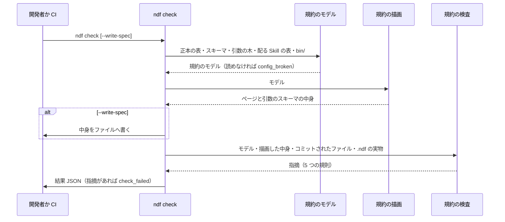

# ndf-next の宣言と入出力の規約: JSON Schema と生成した契約のページを 1 か所に置き、コードとずれたら `ndf check` が落とす

## 概要

ndf-next（11.0.0 で `plugins/ndf/` と入れ替わる作り直しの NDF）は、次の 2 つを機械が読む JSON Schema と、
そこから生成する人が読む契約のページで出す。連携システム（NDF を外から呼び、`.ndf/` の設定ページを作るシステム）と、
Skill の本文から `ndf` を打つ AI が読み手である。

1. リポジトリの `.ndf/` に置く宣言（人が決める設定のファイル）の、ファイルごとのキー・型・既定値・取りうる値・必須か・
   置き場・範囲・読む工程・例
2. NDF を呼ぶ面（副命令・環境変数・受け渡しのファイル・hook・Skill・起動スクリプト）の入出力と、終了コード・止まった理由

各項目は「公開（外の呼び手に名前と意味を版で約束する）」か「内部（予告なく変えてよい）」かを持つ。

例: 副命令に引数を 1 つ足して契約のページを生成し直さずにコミットすると、`plugins/ndf-next/bin/ndf check` が
規則 `spec-docs` の指摘（生成し直した中身と違うページと、最初に違う行）を出し、止まった理由 `check_failed`・
終了コード 1 で落ちる。`bin/ndf check --write-spec` を打ってから同じ検査を打つと通る。

**中身の正本は表とスキーマが持つ。** この文書は書き写さない。

| 何を | 正本 |
| --- | --- |
| 宣言・副命令・環境変数・受け渡しのファイル・hook・Skill・起動スクリプトの規約（読む形） | [`plugins/ndf-next/docs/contracts/`](../../plugins/ndf/docs/contracts/index.md)（生成物） |
| 宣言のキーの型・説明・既定値・取りうる値・例 | [`plugins/ndf-next/contracts/schemas/ndf-settings/`](../../plugins/ndf/contracts/schemas/ndf-settings/) |
| 副命令の引数（生成物）と結果の `metrics`・`items`（手書き） | [`plugins/ndf-next/contracts/schemas/io/`](../../plugins/ndf/contracts/schemas/io/) |
| 規則と不変条件の対応 | [`plugins/ndf-next/src/ndf/checks/spec_docs.py`](../../plugins/ndf/src/ndf/checks/spec_docs.py) の docstring |
| 読む正本の一覧 | [`plugins/ndf-next/src/ndf/checks/spec_model.py`](../../plugins/ndf/src/ndf/checks/spec_model.py) の docstring |

この文書が扱うのは、構成・常に成り立つ条件・決定の理由・テスト観点である。

## 用語

用語の定義は用語集（[docs/glossary.md](../glossary.md) ）が正本である。この仕様で使う主な語は次のとおり。

| 用語 | 指すもの |
| --- | --- |
| 宣言 | `.ndf/` に置く、人が決める設定のファイル。置き場の表で種類が `ndf_settings`、置き場が `ndf` の行 |
| 契約のページ | 宣言と入出力の規約を面ごとに表した生成物（`docs/contracts/` の 8 ページ）。手で書かない |
| 公開する面の表 | エントリポイントの表（`contracts/domains/entrypoints.json`）と、置き場の表の列 `reader` を持つ行 |
| Skill の入出力の表 | `contracts/domains/skill-io.json`。Skill ごとの `/goal` の終わりの条件・読む宣言・結果の形と、公開しない Skill の引数と環境変数 |
| 起動スクリプトの表 | `contracts/domains/launchers.json`。`bin/` のファイルごとに起動スクリプト（`launcher`）か内部の部品（`part`）か |
| 手書きの引数の表 | `contracts/domains/manual-args.json`。argparse を使わない副命令の下位の命令と引数 |

以下、パスは断りの無い限り `plugins/ndf-next/` からの相対パスである。入れ替えの後は `plugins/ndf/` の同じ相対パスに移る。

## コンテキスト

開発の工程（`ndf-workflow`）に属し、サービス（`ndf-factory`）の連携システムとは**公開された言語**の関係にある。
NDF は JSON Schema と生成した文書という文書化された形式を出し、連携システムはその形式だけを読む。NDF の変更と
連携システムの変更を互いに独立して進めるためである。

## 構成要素と責務

| 要素 | 責務 | 書き手 |
| --- | --- | --- |
| 宣言のスキーマ（`contracts/schemas/ndf-settings/<id>.schema.json`） | JSON の宣言ごとのキー・型・説明・既定値・取りうる値・例・非推奨と、置き場（`x-ndf-location`）・読む工程（`x-ndf-read-by`）の注釈 | 宣言を読む子が手で書く |
| Markdown の宣言の形の表（`contracts/schemas/ndf-settings/mvv-body.sections.json`） | `mvv.md` の節の並びと、置き場・範囲・読む工程 | 手で書く |
| 引数のスキーマ（`contracts/schemas/io/<副命令>.args.schema.json`） | 副命令・下位の命令ごとの引数の名前・型・必須・既定値・取りうる値・説明 | 規約の生成だけ |
| 結果のスキーマ（`contracts/schemas/io/<副命令>.result.schema.json`） | 結果 JSON の `metrics` と `items` の形。結果の契約（`../result.schema.json`）を `$ref` で指し、共通の欄を写さない | 副命令を持つ子が手で書く |
| 手書きの引数の表・Skill の入出力の表・起動スクリプトの表 | 上の用語の表のとおり | 手で書く |
| 規約のモデル（`src/ndf/checks/spec_model.py`） | 正本の表・スキーマ・引数の木・配る Skill の表・`bin/` を読み、面ごとの項目と公開か内部かを 1 つのモデルに組む。書かない | — |
| 引数の取り出し（`src/ndf/checks/spec_args.py`） | 副命令の `main([])` を argparse が引数を読む直前で止め、下位の命令まで辿って引数の木を作る | — |
| 規約の描画（`src/ndf/checks/spec_render.py`） | モデルから契約のページと引数のスキーマの中身を文字列で作る。純粋な処理 | — |
| 規約の検査（`src/ndf/checks/spec_docs.py`） | 5 つの規則を当てて指摘を返す。`--write-spec` のときは生成物を書く | — |
| `ndf check` の配線（`src/ndf/checks/run.py`・`rules.json` の鍵 `spec`） | 規約の検査を規則の 1 つとして呼び、`--write-spec` を受ける。規則の名前と生成物の置き場（`generated`）は `rules.json` だけが持つ | — |
| 全副命令の出力の検査（`tests/conftest.py`・`tests/cli/test_every_output.py`） | テストの間に出た結果 JSON を結果の契約と副命令の結果のスキーマで確かめ、全体の実行の終わりに ok の出力が無い副命令を落とす | — |

**依存は一方向である。** `run.py` → `spec_docs.py` → `spec_render.py` → `spec_model.py` → `spec_args.py` の順に下へだけ
向く。`ndf.cli` と `ndf.contracts` は `ndf.checks` を読まないため、輪にならない。

## 仕様

### 集約

| 集約 | 持ち主 | 根 | エンティティ | 値オブジェクト |
| --- | --- | --- | --- | --- |
| 宣言の規約 | 宣言を読む子 | 宣言のファイル（置き場の表の宣言の行） | キー | 型・既定値・取りうる値・例・置き場・範囲・読む工程 |
| 副命令の規約 | 副命令を持つ子 | 副命令（`src/ndf/cli.py` の `COMMANDS` の行） | 下位の命令・引数 | 結果の `metrics` と `items` の形・終了コード・止まった理由 |
| Skill の規約 | Skill を移す子 | Skill（`manifests/skills.json` の行） | — | 引数の形・`/goal` の終わりの条件・読む宣言・読む環境変数・結果の形 |
| 生成した規約 | 規約の生成だけ | 契約のページと引数のスキーマ | 表の行・引数 | 公開か内部か・引数の形 |

規約の検査はどの集約の持ち主でもなく、読んで突き合わせるだけである。環境変数・受け渡しのファイル・hook・終了コード・
止まった理由は、それぞれの正本の表（`contracts/domains/env.json`・`ndf-files.json`・`contracts/hooks/runtimes.json`・
`contracts/facts/exit-codes.json`・`contracts/causes.json`）を読むだけで、ページへは写さずに生成する。

### 常に成り立つ条件

| # | 規則 | 条件 | 破れたときの扱い |
| --- | --- | --- | --- |
| I1 | `spec-decl` | 宣言の行はすべて、スキーマ（JSON の宣言）か形の表（Markdown の宣言）を 1 つ持つ | 無い行の id を出して落ちる |
| I2 | `spec-decl` | スキーマの最上位のキーのうち非推奨でないもの（`version`・`$schema` を除く）が、置き場の表の行の `keys` に等しい | どちらにだけあるキーを宣言の id と並べて落ちる |
| I12 | `spec-decl` | `main_keys` は `keys` の部分集合である | `keys` に無いキーを出して落ちる |
| — | `spec-decl` | スキーマのキーは説明（`description`）と型を持ち、スキーマは `x-ndf-location`（`main` か `worktree`）・`x-ndf-read-by`・`examples` を持つ | 欠けた項目を出して落ちる |
| I3 | `spec-decl` | 検査を打つリポジトリの `.ndf/` の JSON の宣言はスキーマに通る。無いファイルは確かめない | ファイルと JSON Pointer を出して落ちる |
| I4 | `spec-io` | 副命令はすべて結果のスキーマを持つ | 無い副命令を出して落ちる |
| I13 | `spec-io` | 副命令の引数を与えるのは、引数の取り出しか手書きの引数の表のどちらか一方である | 両方に当たる・どちらにも当たらない副命令を出して落ちる |
| I6 | `spec-io` | コードが名前の文字列で読む環境変数（`os.environ["X"]`・`os.environ.get("X")`・`os.getenv("X")`・`"X" in os.environ`）は、環境変数の表に載る | 名前・ファイル・行を出して落ちる |
| I11 | `spec-io` | `bin/` のファイルはすべて起動スクリプトの表に行を持つ | 無いファイルの名前を出して落ちる |
| I7 | `spec-skill` | 配る Skill の表の行のうち `skills/<名前>/SKILL.md` がある Skill は、Skill の入出力の表に行を持つ | 無い Skill の名前を出して落ちる |
| I8 | `spec-skill` | `skills/` と `agents/` の下の `.md` に書かれた `ndf <副命令>` の呼び出しは、副命令・下位の命令・引数の名前が引数の木にある | ファイル・行・呼び出しを出して落ちる |
| — | `spec-skill` | 公開する Skill の行は、Skill の入出力の表に `args`・`env` を持たない | その行を出して落ちる |
| I10 | `spec-public` | 公開する面の表の行は、列 `order` が `caller-first` の行と種類 `spec` の行を除き、すべて規約の項目に当たる | 当たらない行の id を出して落ちる |
| I15 | `spec-public` | 公開する面の表は種類 `spec` の行を、契約のページ・宣言のスキーマ・入出力のスキーマの置き場ごとに 1 つ持ち、`target` が実在のディレクトリを指す | 欠けた置き場・実在しない `target` を出して落ちる |
| I9 | `spec-docs` | コミットされた生成物は、生成し直した中身と 1 字も違わず、生成されないファイルが生成物の置き場に残らない | ファイルごとに 1 件（最初に違う行）で落ちる |
| I5 | テスト | 副命令が出した結果 JSON と終了コードの組は、結果の契約（形と、状態・止まった理由と終了コードの対応）に通る | 副命令と項目を出してテストが落ちる |
| I14 | テスト | 副命令が出した結果 JSON は、その副命令の結果のスキーマに通る | 同上 |

hook の登録のファイル（`hooks/claude.json`・`codex.json`）は hook の表から生成する生成物で、事象の一致は既存の
`tests/domains/hooks/test_registration.py` が縛る。規約の検査は持たない。

契約の置き場（`contracts/`）を持たないプラグインには、規約の検査を当てない。

### 公開と内部

公開か内部かは、公開する面の表に当たるかで導き、手で書く列を持たない。手で書く列は表との一致を別に確かめることになる
ためである。

| 面 | 公開になる条件 |
| --- | --- |
| 副命令・Skill・hook | エントリポイントの表の行の種類と `target` に当たる |
| 受け渡しのファイル | エントリポイントの表の `files` に載るか、置き場の表で列 `reader` を持つ |
| 宣言 | エントリポイントの表の種類 `spec` の行 `spec-ndf_settings` の `files` に載る（追跡する宣言。個人の設定 `worktree.local.json` は内部） |
| 環境変数 | エントリポイントの表の `env` に載る |

列 `order` が `caller-first` の行（入れ替えの前に呼び手と合わせる行）は、規約の項目に当たらなくても落とさず、
`index.md` の「呼び手と合わせる前の行」に載せる。持ち主の違う表の行を変えず、他の子の進み具合でこの検査を止めない
ためである。

### エントリポイントの表の種類 `spec`

規約の置き場は、エントリポイントの表の種類 `spec` の 3 行（`spec-pages`・`spec-ndf_settings`・`spec-io`）が持つ。
`target` はプラグインの根からのディレクトリのパスで、連携システムはここから置き場を引く。置き場を変えるときは版で約束する。
`spec` の行は引数を持たず、`entrypoint-cases.json` に受ける見本を 1 つずつ持つ。

### 引数の取り出し

副命令の `main([])` を、`argparse.ArgumentParser.parse_known_args`（`parse_args` もこれを通る）の呼び出しで止め、
その parser の `_actions` を辿って引数の木を作る。下位の命令（`_SubParsersAction` の選択肢）まで辿るのは、AI と
連携システムが打つのが下位の命令の形（`ndf lanes add …`）だからである。止めている間の標準出力と標準エラーは捨て、
差し替えは `finally` で元へ戻す。

| argparse の定義 | 引数のスキーマの型 |
| --- | --- |
| `store_true`・`store_false` | `boolean` |
| `type` が `int`・`float` | `integer`・`number` |
| `append`・`nargs` が `*`・`+`・数・`REMAINDER` | `array`（要素の型は上の規則） |
| それ以外 | `string` |

引数のスキーマは JSON Schema 2020-12 で、下位の命令ごとに `oneOf` の枝を持つ。下位の命令の道は枝の
`properties.subcommand.const` に入る。argparse を使わない副命令は手書きの引数の表の行から木を作り、引数のスキーマは
すべて生成物になる。手書きの表に行を持つ副命令が argparse から取り出せるようになったら I13 で落とし、行を消させる。

### 書かれた呼び出しの照合

`skills/` と `agents/` の下の `.md` の行から、`ndf` か末尾が `/bin/ndf` の語で始まる呼び出しを探し、`shlex` で語に
分ける。パイプなどの区切りの語（`|`・`&&`・`;`・`>` など）で呼び出しを切る。`ndf:` で始まる語（Skill の名前）は
数えない。照合は副命令・下位の命令・引数の名前だけを見て、位置の引数の数と値の型は見ない。`<…>` と `$…` の語は
置き換え用の語として飛ばす。手順書は値を置き換え用の語で書くため、値の型まで照らすとすべてが型の誤りになる。

### 処理の流れ



規約の仕組みは `ndf check` の 1 プロセスの中で動き、ネットワークへ出ない。描画は同じモデルから 1 字も違わない文字列を
返し、日時・ホスト名・プラグインの名前を入れない。行の並びは id の昇順である。

### 全副命令の出力の検査

テストの間だけ、結果 JSON を出す 1 か所（`ndf.contracts.result.emit`）を autouse の fixture `_checked_emit` で包む。
包んだ `emit` は、結果 JSON と終了コードの組を結果の契約で（I5）、結果 JSON を副命令の結果のスキーマで（I14）確かめ、
ok を確かめた副命令の名前を記録する。既存のテストが作った git のリポジトリや偽の GitHub の用意をそのまま使える。

- 形の誤った結果をわざと作るテストは印 `ndf_bad_result` を付け、I5 の誤りで落とさない
- `tool` が副命令の表に無い結果は I14 を見ない
- pytest-xdist の worker の記録は `workeroutput` の鍵 `ndf_ok_tools` で controller へ集める
- 全体の実行（プラグインの根を指し、`-k`・`-m`・`--deselect`・`--lf` などの絞り込みが無い）の終わりに、ok の出力を
  1 度も確かめなかった副命令の名前を標準エラーへ出し、終了コードを 1 にする
- 既存のテストが ok の出力を出さない副命令は、`tests/cli/test_every_output.py` の表 `CALLS` が呼ぶ

この検査が、すべての副命令の標準出力と終了コードを 1 つの仕組みで確かめるテストに当たる。

## データ・設定

永続データは持たない。スキーマ・事実の表・生成した文書はリポジトリに追跡され、git の履歴が版を持つ。

| ファイル | 形 |
| --- | --- |
| 宣言のスキーマ | JSON Schema 2020-12。最上位とオブジェクトの値は `additionalProperties: false`。キーごとに `type`・`description`、既定値のあるキーは `default`、取りうる値が有限なら `enum`、ファイルに `examples` を 1 つ以上。ndf-next が読まないが実物に残るキーは `deprecated: true`。`examples` は実物から写さず架空の値で書く |
| 引数のスキーマ | JSON Schema 2020-12。下位の命令ごとの `oneOf` の枝。`ensure_ascii=False`・字下げ 2 の JSON |
| 結果のスキーマ | JSON Schema 2020-12。`allOf` で結果の契約を `$ref` し、`metrics` と `items` の形だけを足す |
| 手書きの引数・Skill の入出力・起動スクリプトの表 | 事実の表の形（`contracts/facts/fact.schema.json`）。Skill の入出力の表は `shared_names: true` を宣言し、Skill の名前が工程 id・副命令名と同じ字を持っても定数との照合（`table-set`・`table-str`）から外れる |

**範囲（チームか個人か）は置き場の表の `tracked` から導き、スキーマに写さない。** メインディレクトリから読むキーは
置き場の表の `main_keys` から導き、宣言のページで印を付ける。

**宣言のスキーマは知らないキーを拒む。** 設定ページと連携システムの検証でキーの書き誤りを捕まえるためである。実物の
`.ndf/` に残る古いキーは、実物から消すと今の版の設定を書き換えることになるため、非推奨として載せて通す。

**秘密の環境変数は値の例を描かない。** 環境変数のページの列は名前・設定する者・型・秘密か・意味・公開か内部かの 6 つで、
値の例の列を持たない。

## エラー処理

| 失敗 | 結果 JSON | 終了コード |
| --- | --- | --- |
| 規約の指摘がある | 1 件 1 行で標準エラーへ `<規則>: <パス>:<行>: <内容>`、`items` に載る。止まった理由 `check_failed` | 1 |
| 正本の表・スキーマ・配る Skill の表が読めない、スキーマとして誤り、`$ref` を引けない、副命令のモジュールを import できない、argparse の内部の属性が変わった、`rules.json` に鍵 `spec` が無い、生成物を書けない | 止まった理由 `config_broken`。読めないファイルのパスを `summary` に出す | 2 |
| `.ndf/` の実物が JSON として読めない | `spec-decl` の指摘 1 件（`check_failed`） | 1 |

生成物の書き込みが途中で止まっても、書く中身は毎回同じなので打ち直せば揃う。`--write-spec` は中身の同じファイルを
書かない（更新の時刻を変えない）。消すのは生成物の置き場（`rules.json` の `generated`）に当たるファイルだけである。

## 運用

```bash
plugins/ndf-next/bin/ndf check --write-spec   # 契約のページと引数のスキーマを作り直して書き、続けて検査する
plugins/ndf-next/bin/ndf check                # 書かずに検査だけ（CI と同じ）
```

- 宣言・副命令・環境変数・受け渡しのファイル・hook・Skill を足した・変えた子は、`--write-spec` を打ってからコミットする。
  CI のジョブ ndf-next は既に `ndf check` を打つため、生成し忘れはワークフローを変えずに落ちる
- `--write-spec` の結果 JSON は `metrics.written`（書いたファイルの数）を持つ。差分の規則だけの `--only` のときは
  規約の検査を通らず、`--write-spec` を見ない
- 入れ替え（S2）では、`docs/contracts/`・`contracts/schemas/ndf-settings/`・`contracts/schemas/io/` を `plugins/ndf/` の
  同じ相対パスへそのまま移し、`bin/ndf check --write-spec` で差分が 0 件であることを確かめる（行き先の表
  [docs/ndf-swap-doc-destinations.md](../ndf-swap-doc-destinations.md) ）

## 決定の理由

| 決定 | 理由 |
| --- | --- |
| 置き場の表の `keys` を読み手の約束として扱い、スキーマと突き合わせる | 表の列 `keys` は「宣言の読み手はこの表に無いキーを読まない」約束である。構文木からキーを集める方法は、宣言のファイル名を持つ 6 モジュールで 65 件を集めて大半が宣言のキーでなく、使えなかった（2026-11-14 の実測） |
| 契約のページはすべて生成し、手で書くのは正本の表に無い事実（宣言のキーの意味・結果の形・Skill の入出力）だけにする | 同じ事実を 2 か所に持たないため。既存の生成のライブラリ（json-schema-for-humans・jsonschema2md）はスキーマ 1 つを 1 ページにするだけで、正本の表と公開か内部かの列を組めない |
| 置き場と読む工程は `x-ndf-` で始まる注釈の語で書く | JSON Schema 2020-12 は知らない語を注釈として読み飛ばすため、連携システムの検証器はそのまま通す。HTTP で包むときは OpenAPI 3.1 から `$ref` で指せる |
| 引数は副命令のモジュールを変えずに argparse の定義から取り出す | 副命令に `parser()` を持たせる形は、他のレーンが持つパスの副命令の書き換えを要する。argparse から文書を作るライブラリ（sphinx-argparse・argparse-manpage）は JSON Schema を出さない。argparse の内部の属性に頼る点は、取り出しのテストが Python の版の上げで落ちることで受ける |
| 引数のスキーマはすべて生成物にし、手書きは表に置く | 同じディレクトリに手書きのスキーマを置くと、同じ種類のファイルを 2 つの書き手が書き、上書きしない規則と差分から外す規則を別に持つことになる |
| Skill の入出力は事実の表に持ち、公開する Skill の引数と環境変数はエントリポイントの表から読む | Skill の本文は移行の途中で、frontmatter の検査は今の版の別の仕組みである |
| 契約のページを面ごとの 8 ページに分ける | 副命令の下位の命令と引数だけで数百行あり、1 ページにすると 500 行を超える |
| 生成と検査を `ndf check` の規則にし、書き込みは `--write-spec` で行う | 生成と検査が同じモデルと描画を通る。新しい副命令や別のスクリプトを置くと、検査のエントリポイントが 2 つになる |
| 実際の出力はテストの間の `emit` を包んで確かめる | 副命令ごとに用意を書いた専用のテストを並べると、git・GitHub・状態の置き場の用意を作り直すことになる |

## テスト観点

テストは `plugins/ndf-next/tests/checks/test_spec_args.py`・`test_spec_docs.py`・`tests/cli/test_every_output.py`・
`tests/domains/test_entrypoints.py` と `tests/conftest.py` の出力の検査にある。検査の関数は `tmp_path` に作った小さな
契約の置き場で確かめ、このリポジトリの実物に頼らない。

- 置き場の表の宣言の行がすべて宣言のページに載り、各ファイルが置き場・範囲・キー・型・既定値・取りうる値・必須か・
  読む工程・例を持つこと。`main_keys` のキーに印が付くこと
- 宣言の行を足してスキーマを置かないと、その id で落ちること。キーの `description` を消すと落ちること
- 置き場の表の `keys` かスキーマの一方にだけキーを足すと、宣言の id とキーの名前で落ちること。`main_keys` に `keys` に
  無いキーを足すと落ちること
- 副命令の定義に引数を 1 つ足すと生成の差分で落ちること。argparse を使う副命令を手書きの引数の表にも載せると落ちること
- 表に無い環境変数を名前で読むコードを足すと、名前・ファイル・行で落ちること
- 結果のスキーマに無い `metrics` の項目を出す副命令・状態と食い違う終了コードを渡す副命令でテストが落ちること。ok の
  出力を出すテストを外すと、全体の実行の終わりにその副命令の名前で落ちること
- 終了コードの表・止まった理由の表・hook の表に行を足して生成し直さないと `spec-docs` で落ちること
- 秘密の環境変数の行に値の例が描かれないこと
- 公開する面の表へ実在しない副命令を指す行を足すと落ち、`caller-first` の行は落ちずに「呼び手と合わせる前の行」に
  載ること。種類 `spec` の行を消すか `target` を実在しないパスにすると落ちること
- 契約のページを手で 1 字直すと落ち、`--write-spec` の後は通ること。2 回描いて 1 字も違わないこと
- このリポジトリの `.ndf/` の JSON の宣言がスキーマに通ること。型の違う値にしたコピーで JSON Pointer つきで落ちること。
  `.ndf/` の無いリポジトリでは 0 件で通ること
- 実体のある配る Skill を足して Skill の入出力の表に行を足さないと、その名前で落ちること。規約に無い引数を使う呼び出しを
  1 行足すと、ファイル・行・呼び出しで落ちること。`<番号>`・`$VAR`・`--x=1` と `ndf:design` で誤検出しないこと
- `bin/` にファイルを足すと、その名前で落ちること。種類 `part` のファイルがページに載らないこと
- 宣言を読む側の振る舞い（読む値・既定値・拒む入力）が変わらないこと

## 未確認・残リスク

| 項目 | 内容 |
| --- | --- |
| 置き場の表に載らないキーを読むコード | 規約の検査は読み手が表の `keys` だけを読むことを前提にし、表に無いキーを読むコードを機械では見つけない。宣言の読み手を 1 つの読み口へ寄せて検査で落とす作業は [#3538](https://github.com/devbasex/ai-plugins/issues/3538) が持つ |
| 置き場の表に無い受け渡しのファイルを読み書きするコード | 同じく機械では見つけない。#3538 の範囲に含める |
| 結果を `emit` を通さずに終わる副命令の経路 | 出力の検査は `emit` が受けた組だけを見るため、`sys.exit` などで終わる経路の終了コードは確かめられない |
| 一部のテストだけを流した実行 | ok の出力の確かめを行わない。全体の実行（CI のジョブ ndf-next）でだけ働く |

## 関連リンク

- 契約のページ: [plugins/ndf-next/docs/contracts/index.md](../../plugins/ndf/docs/contracts/index.md)
- 規約の検査の規則の一覧: [plugins/ndf-next/src/ndf/checks/README.md](../../plugins/ndf/src/ndf/checks/README.md)
- 入れ替えの後の文書の行き先: [docs/ndf-swap-doc-destinations.md](../ndf-swap-doc-destinations.md)
- 今の版（`plugins/ndf/`）のエントリポイントの契約: [ndf-entrypoint-contracts.md](ndf-entrypoint-contracts.md)
- 課題: [#3518](https://github.com/devbasex/ai-plugins/issues/3518)（[#3519](https://github.com/devbasex/ai-plugins/issues/3519) を取り込んだ）
