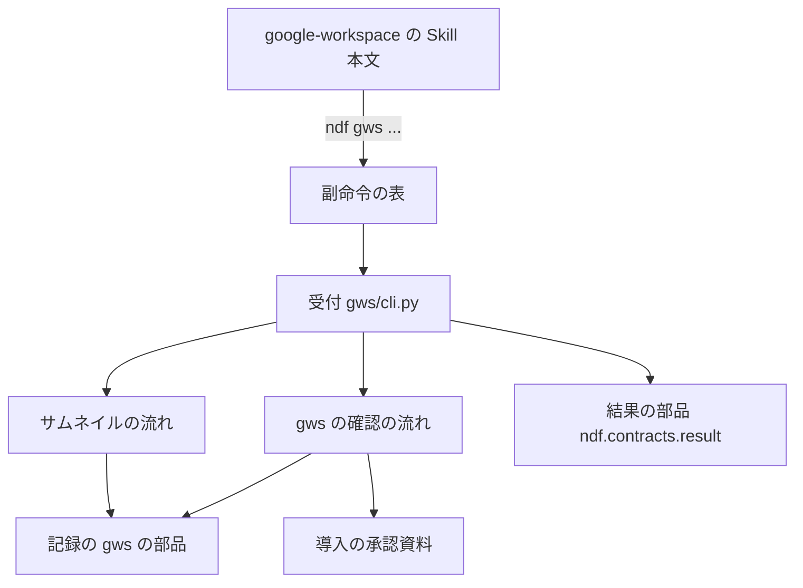

# ndf-next の `ndf gws`: gws の確認と Google Slides のサムネイルの保存を副命令で行い、認証済みの判定は記録の部品の 1 か所を使う

## 概要

ndf-next（`plugins/ndf-next/`。今の `plugins/ndf/` と入れ替わる作り直しの NDF）は、google-workspace の Skill が呼ぶ
2 つの機能を、エントリポイント `bin/ndf` の群 `ndf gws` の下位の命令として持つ。

| 副命令 | 何をするか | 今の NDF での置き場 |
| --- | --- | --- |
| `ndf gws check [--install]` | gws（Google Workspace CLI）の有無と認証の状態を確かめ、gws の状態と次の手（`routes`）を返す | `skills/google-workspace/scripts/gws-check.py` |
| `ndf gws thumbnails <ID> <出力のディレクトリ> [--size S]` | Google Slides の全ページのサムネイルを `p<番号>.png` で保存する | `skills/google-workspace/scripts/slides-thumbnails.py` |

例: gws を入れていない端末で、Skill の手順 1 が `ndf gws check` を打つ。gws が PATH に無く npm はあるので、
`gate`・終了コード 10・`metrics.state: missing` と、承認資料のパス（`presentation_path`）と
`routes.approved` → `ndf gws check --install` が返る。利用者が同意したら `routes.approved` を打ち、npm で入れた gws を
同じ起動の中で確かめ直して、`unauthenticated`（終了コード 11）か `authenticated`（0）を返す。

**判定・状態・承認資料の中身は、今の NDF の確定仕様と同じである。** 違いは結果 JSON の外枠（ndf-next の結果の契約）
と、既知の不具合 #2067 を引き継がない認証済みの判定だけである。

| 何を | 正本 |
| --- | --- |
| 流れ（確かめる → 同意のうえ入れる → 認証を案内する → 操作する）と操作の対応表 | [ndf-next の `google-workspace` の SKILL.md](../../plugins/ndf-next/skills/google-workspace/SKILL.md) |
| 2 つの副命令の引数（生成物） | [`contracts/schemas/io/gws.args.schema.json`](../../plugins/ndf-next/contracts/schemas/io/gws.args.schema.json) と [副命令の一覧](../../plugins/ndf-next/docs/contracts/commands.md) |
| 結果の `metrics`・`items` の形（手書き） | [`contracts/schemas/io/gws.result.schema.json`](../../plugins/ndf-next/contracts/schemas/io/gws.result.schema.json) |
| 4 つの状態の意味・認証済みかを `credential_source` で決める理由（gws 0.22.5 の実測）・承認資料の項目 | [ndf-google-workspace-gws.md](ndf-google-workspace-gws.md) |
| 結果の契約と終了コードの区分 | [`contracts/schemas/result.schema.json`](../../plugins/ndf-next/contracts/schemas/result.schema.json) と [`docs/contracts/exit-codes.md`](../../plugins/ndf-next/docs/contracts/exit-codes.md) |

## 用語

定義は [用語集](../glossary.md) が正である（`.ndf/glossary.json` の `document`）。この文書で使う語は「gws の状態」
「導入の同意の印」である。

この文書の説明用の語（用語集には載せない）:

| この文書の語 | 指すもの |
| --- | --- |
| gws の確認 | 副命令 `ndf gws check` |
| サムネイルの保存 | 副命令 `ndf gws thumbnails` |
| 認証の状態の読み取り | `gws auth status` を 1 回打ち、3 つのキー（`credential_source`・`auth_method`・`client_config_exists`）を確かめること |
| 記録の gws の部品 | `src/ndf/domains/records/gws.py`。`ndf records gws-check` も使う、認証の状態の読み取りと認証済みかの判定の置き場 |

パスは、ことわりが無い限り `plugins/ndf-next/` からの相対である。

## コンテキスト

| 上流（正本） | 下流（合わせる側） | 関係 | 何を合わせるか |
| --- | --- | --- | --- |
| 結果の契約（`ndf.contracts`） | Google Workspace の操作（`ndf gws`） | 順応者（下流が上流の形をそのまま使う） | 結果 JSON の外枠・止まった理由の種類・答えの語彙。`ndf gws` は語彙と種類を足さない |
| gws（外部の CLI） | Google Workspace の操作 | 順応者 | `gws auth status` の JSON を翻訳の層を置かずに読む |
| 記録（`ndf.domains.records`） | Google Workspace の操作 | 共有カーネル（2 つのコンテキストが同じ部品を使い、変えるときは両方の持ち主が合わせる） | 認証の状態の読み取り・3 つのキーの取り出し・認証済みかの判定 |

## 仕様

### 構成

| 要素 | 置き場 | 責務 |
| --- | --- | --- |
| 副命令の表 | `src/ndf/cli.py` の `COMMANDS` | 行 `"gws": "ndf.domains.gws.cli"` |
| 受付 | `src/ndf/domains/gws/cli.py` | 下位の命令 `check`・`thumbnails` の引数を argparse で読み、流れを呼び、結果 JSON を 1 行出す。止まる理由（`GwsStop`）を `stopped` の結果にする。`tool` は `gws` |
| 共有の部品 | `src/ndf/domains/gws/__init__.py` | 止まる理由の例外 `GwsStop`、結果と終了コードの組 `Outcome`、未認証の承認ゲートの結果（`unauthenticated_gate`）と終了コード（`unauthenticated_code`）、ログインの案内の文、上限の秒数で外部のコマンドを 1 回打つ `call` |
| gws の確認の流れ | `src/ndf/domains/gws/check.py` | gws と npm を PATH の上で探し、認証の状態の読み取り・承認資料の書き出し・npm の全体インストールを行う |
| サムネイルの流れ | `src/ndf/domains/gws/thumbnails.py` | gws と curl を PATH の上で探し、ページの ID の取得・各ページのサムネイルの URL の取得・画像の保存を行う |
| 結果の値の切り出し | `src/ndf/domains/gws/report_decide.py` | 純粋な判断。gws の状態の 4 つの値と、外部のコマンドの出力の末尾（`DETAIL_LINES` = 20 行）の切り出し。認証済みかの判定は持たない |
| 導入の承認資料 | `src/ndf/domains/gws/material.py` | 承認資料の Markdown を組み、状態の置き場の下へ置き換えで書く |
| 記録の gws の部品 | `src/ndf/domains/records/gws.py` | `auth_status(limit)`（読み取り。上限の名前を受け、読めない誤り `GwsError` は gws の標準エラーを持つ）・`STATUS_KEYS`・`public_keys`（3 つのキーだけを取り出す）・`authenticated`（判定） |
| 持ち主の登録 | `src/ndf/checks/children.json` | 子 S1d の `packages` が `ndf.domains.gws` |

依存は一方向である。受付が 2 つの流れを読み、流れが共有の部品・結果の値の切り出し・導入の承認資料・記録の gws の部品を
読む。記録の gws の部品は `ndf.domains.gws` を読まない。

### 常に成り立つ条件

| # | 条件 | 破れたときの扱い |
| --- | --- | --- |
| I1 | 導入の同意の印（`--install`）が無い限り `npm install -g` を起動しない | 起動の経路を持たない |
| I2 | `ndf gws check` は、どの引数でも gws の副命令として `auth status` だけを起動する（`auth login`・`setup`・`export`・`logout` を呼ばない） | 起動の経路を持たない |
| I3 | gws の状態を判定できた結果では、状態は 4 つのどれか 1 つで、状態ごとに `status` と終了コードが 1 つに決まる | 認証の状態を読めないときは 4 つのどれにもせず、`stopped`（`invalid`）・終了コード 2 で返す |
| I4 | 結果へ写す `gws auth status` の値は 3 つのキーだけで、資格情報のファイルとトークンを開かない | 結果のスキーマが `metrics` を閉じ、ほかのキーを持つ結果は出す前に落ちる |
| I5 | `uninstallable` と導入の失敗は 0 以外の終了コードで終わる | `stopped` で返す |
| I6 | 承認ゲートの結果は `routes` を持ち、キーは答えの語彙の中、行き先の `argv` の先頭は `ndf` | 結果の部品（`result.emit`）が出す前に落とす |
| I7 | サムネイルのファイル名はページ順に `p1.png` から振り、`items` の並びもページ順である | 1 ページでも保存できなければ `ok` を返さない |
| I8 | サムネイルの保存は、全ページを保存できたときは `gws auth status` を打たない。gws が失敗したときは 1 回だけ打ち、打ち直さない | 読めなかったときは未認証でないとして、元の gws の失敗で返す |
| I9 | 認証の状態の読み取りと認証済みかの判定は、ndf-next の中で記録の gws の部品の 1 か所にある。`ndf gws check`・`ndf gws thumbnails`・`ndf records gws-check` が同じ `authenticated` を呼ぶ | `ndf check` の事実の重複の規則（`const-fact`）が、判定の値の集まりの書き写しを落とす |

### 認証済みの判定

トークンを環境変数 `GOOGLE_WORKSPACE_CLI_TOKEN` で渡していれば認証済みとする。渡していなければ、`credential_source` が
`none` か `client_secret.json` のとき未認証、それ以外は認証済みとする。環境変数は値を読まず、あるかだけを見る。

`client_secret.json` だけがありトークンが無い状態で、gws 0.22.5 の `gws auth status` は
`credential_source: client_secret.json`・`auth_method: none` を返す。この状態を未認証にするため、今の `gws-check.py` の
判定（`credential_source` が `none` でなければ認証済み）とは同じにしない（#2067）。判定は #2067 を直した記録の
gws の部品のものを使い、gws の群には置かない。

### gws の確認の結果

| 場合 | `status` | 終了コード | `cause.kind` | `metrics` | ほかの項目 |
| --- | --- | --- | --- | --- | --- |
| gws があり、認証済み | `ok` | 0 | — | `state: authenticated` と 3 つのキー | — |
| gws があり、未認証 | `gate` | 11 | — | `state: unauthenticated` と 3 つのキー | `routes`: `retry` → `ndf gws check`、`cancel` → `null` |
| gws が無く npm があり、導入の同意の印が無い | `gate` | 10 | — | `state: missing` | `presentation_path`（承認資料）。`routes`: `approved` → `ndf gws check --install`、`rejected` → `null` |
| gws も npm も無い | `stopped` | 3 | `precondition` | `state: uninstallable` | `summary` は npm（Node.js）を入れてから打ち直す案内 |
| 導入の同意の印があり、npm が起動できない・0 以外で終わる | `stopped` | 1 | `unknown` | — | 0 以外のときは `items` に npm の出力の末尾（`result: failed`）。`summary` は `sudo` で打ち直さないと示す |
| 導入の同意の印があり、npm が上限の秒数を超えた | `stopped` | 1 | `interrupted` | — | — |
| 入れた後も gws が PATH に無い | `stopped` | 1 | `unknown` | — | `summary` が `npm prefix -g` の `bin` を PATH へ足す案内を持つ |
| 承認資料を書けない | `stopped` | 1 | `unknown` | — | — |
| 認証の状態を読めない（起動できない・上限の秒数を超えた・0 以外・JSON でない・3 つのキーが欠ける） | `stopped` | 2 | `invalid` | — | 標準エラーがあれば `items` にその末尾（`result: stderr`） |

- gws が既にあれば、導入の同意の印があっても npm を打たない。入れた後に gws が見つかったときは、同じ起動の中で
  1 行目か 2 行目を返す
- 未認証で `client_config_exists` が偽のときは、`summary` が `gws auth login` の前に `gws auth setup` か OAuth
  クライアントの用意を案内する。Skill 本文は分かれ目を `metrics.client_config_exists` で読む
- 未認証の終了コードは承認ゲートの最初の値に 1 を足した値（11）で、導入の同意の承認ゲート（10）と分ける

### サムネイルの保存の結果

| 場合 | `status` | 終了コード | `cause.kind` | 中身 |
| --- | --- | --- | --- | --- |
| 全ページを保存した | `ok` | 0 | — | `items`: ページごとに `name`（`p<番号>`）・`result: saved`・`objectId`・`detail`（保存先のパス）。`metrics`: `pages`・`size`・`out_dir` |
| gws が 0 以外で終わり、未認証 | `gate` | 11 | — | `items`: 失敗した操作の `name`・`result: unauthenticated`・`detail`（gws の出力の末尾）。`metrics`: `state: unauthenticated`。`routes`: `retry` → 同じ引数の `ndf gws thumbnails <ID> <出力のディレクトリ> --size <大きさ>`、`cancel` → `null` |
| gws が 0 以外で終わり、未認証でない（認証の状態を読めないときを含む） | `stopped` | 1 | `unknown` | `items`: `result: gws-failed`・`detail`（gws の出力の末尾） |
| 画像を取れない（curl が 28 以外の 0 以外） | `stopped` | 1 | `unknown` | `items`: `result: download-failed`・`detail`（curl の標準エラーの末尾） |
| gws・curl が起動できない・出力のディレクトリを作れない | `stopped` | 1 | `unknown` | — |
| gws のスライドの操作が上限の秒数を超えた・curl が終了コード 28 で終わった | `stopped` | 1 | `interrupted` | — |
| gws の応答が JSON でない・ページの ID が読めない・応答に `contentUrl` が無い | `stopped` | 2 | `invalid` | JSON でないときは `items` に `result: unreadable` と gws の出力の末尾 |
| gws か curl が PATH に無い | `stopped` | 3 | `precondition` | gws が無いときの `summary` は `ndf gws check` で確かめる案内 |
| 引数の誤り（足りない・知らない引数・3 つ以外の大きさ・下位の命令が無い） | `stopped` | 2 | `invalid` | argparse が止め、副命令の表の側（`ndf.cli`）が結果 JSON を出す |

- 打つ gws のコマンドは `gws slides presentations get`（`fields: slides(objectId)`）と
  `gws slides presentations pages getThumbnail`（`thumbnailProperties.thumbnailSize` に大きさ）である。画像は
  `contentUrl` を `curl -fsSL --max-time <上限の秒数>` で取る。打ち切りは curl に任せ、`subprocess` の上限を重ねない
- 大きさは `SMALL`・`MEDIUM`・`LARGE` の 3 つで、既定は `LARGE`
- 最初の失敗で残りのページを打たずに止まる。保存済みの画像は残し、打ち直すと全ページを同じ名前へ書き直す
- `contentUrl`（一時的な URL）は結果に載せない

### 止まった理由の種類

既存の種類から選び、種類の表（`contracts/causes.json`）に足さない。

| 事象 | 種類 | 終了コード |
| --- | --- | --- |
| gws・npm・curl が起動できない・0 以外で終わる（未認証を除く）・入れた後も gws が見つからない | `unknown` | 1 |
| gws のスライドの操作・npm・curl が上限の秒数を超えた | `interrupted` | 1 |
| gws の確認で認証の状態を読めない・gws の応答を読めない・引数の誤り | `invalid` | 2 |
| gws も npm も無い・gws か curl が無い | `precondition` | 3 |

認証の状態の読み取りの打ち切りは `interrupted` にせず、読めないときの 1 つとして扱う。gws の確認では `invalid`・2、
サムネイルの保存では未認証でないとして元の gws の失敗（`unknown`・1）になる。今の 2 本のスクリプトと同じ終了コードを
保つためである。

## データ・設定

| 項目 | 値 |
| --- | --- |
| 上限の秒数（`contracts/limits.json`） | gws の確認の認証の状態の読み取りと `npm prefix -g` は `google-workspace.call`（120 秒）、npm の導入は `google-workspace.install`（600 秒）、サムネイルの保存の gws・認証の状態の読み取り・curl は `google-workspace.thumbnails`（120 秒）。`ndf records gws-check` は既定の `gws.auth-status` を使い続ける |
| 承認資料の置き場 | 置き場の表（`contracts/domains/locations.json`）の `google-workspace`（起点 `state`・パス `gws`）。状態の置き場の下に置くので、リポジトリの外でも書ける |
| 承認資料のファイル | ファイルの表（`contracts/domains/ndf-files.json`）の `gws-install-material`（パス `install.md`・種類 `document`・書き手 S1d・消す時点 `replaced`）。同じディレクトリの一時ファイルへ書いてから付け替え、打つたびにファイルは増えない |
| 承認資料の中身 | 4 つの節（対象を開くためのもの・承認の判断に使うもの・同意を求めること・戻し方）。取得元 npm の `@googleworkspace/cli`・打つコマンド `npm install -g @googleworkspace/cli`・入る先（`npm prefix -g` の値。読めなければその旨）・Google の公式サポート外で版は 0.x・戻し方 `npm uninstall -g @googleworkspace/cli` |
| 結果のスキーマ | `gws.result.schema.json` は結果の契約を `allOf` で引き、`tool` を `gws` に固定し、`metrics`（`state`・3 つのキー・`pages`・`size`・`out_dir`）と `items` の要素（`name`・`result`・`objectId`・`detail`）を閉じる |
| 引数のスキーマ | `gws.args.schema.json` と副命令の一覧は、`ndf check --write-spec` が受付の argparse の定義から書く生成物 |
| 機能の対応表（`scripts/ndf-next-parity/parity/features.json`） | 今の 2 本のスクリプトの 2 行は `to: S1d` を持ち、置き場 `S1d`（`src/ndf/domains/gws/`）の下のモジュールを持つ副命令 `gws` を試走が副命令の表から引く |

## セキュリティ

- 読むのは `gws auth status` の応答だけで、`metrics` へ写すのは 3 つのキーだけである（I4）
- npm の全体インストール（利用者の環境の書き換え。共通原則の C6）は導入の同意の印があるときだけ行う。`sudo` を打たず、
  PATH と設定のファイルを書き換えない
- ログのモジュールには書かない。捕まえない例外は `ndf.cli` が `stopped`（`unknown`）・1 にする

## 決定の理由

| 決定 | 理由 |
| --- | --- |
| 群を `ndf gws`、下位の命令を `check` と `thumbnails` にする | どちらも gws を呼ぶ機能で、副命令の表と結果のスキーマを 1 つずつにでき、末尾の切り出しなどの部品を 1 か所に持てる。records は記録の領域で、gws の導入とスライドの操作は記録ではない |
| 引数のスキーマは argparse の定義から生成し、結果のスキーマは群に 1 本を手書きする | 引数の出所を argparse の 1 つにする。手書きの引数の表へ置くと出所が 2 つになる |
| 認証の状態の読み取りと判定は記録の gws の部品を使い、部品に上限の名前の引数・誤りの標準エラー・3 つのキーの公開の名前を足す | 同じ確かめ方を 2 か所に持たない。足すだけの変更で、`ndf records gws-check` の振る舞いは変わらない。記録の部品は子 M7 が持ち、子の表の依存（S1d → S1a → M7）で読んでよい |
| 未認証の行き先は `retry`、導入の同意は `approved` / `rejected` にする | 未認証で利用者に頼むのはログインの操作で承認ではなく、答えの語彙の「同じ作業を打ち直す」が意味に合う。語彙に語を足さない |
| 承認資料は状態の置き場の下に、書くたびに置き換える 1 ファイルで書く | gws の確認はリポジトリの外でも打たれる。置き場の表とファイルの表に載せ、ファイルの契約のページに現れるようにする |
| 利用者への案内は Skill 本文と `summary` に置き、分かれ目は `metrics` で読む | 結果の契約の `next` はそのまま打てるコマンドだけを持ち、文を持てない |
| 今のスクリプトのパスで呼ぶ互換の経路を持たない | ndf-next はまだ利用者へ配っておらず、壊れる呼び出し元が無い |

## テスト観点

偽の gws・npm・curl を PATH に置いた単体のテスト（`tests/domains/gws/test_check.py`・`test_thumbnails.py`）で
確かめる。テストの間に出た結果 JSON は、`tests/conftest.py` が結果の契約と `gws.result.schema.json` で確かめる。

| 観点 | 満たすこと |
| --- | --- |
| 認証済み（I3） | `credential_source` が `token_env_var` で `auth_method` が `none` の応答と、環境変数のトークンがあり `credential_source` が `none` の応答で、`ok`・0・`authenticated` と 3 つのキーが返ること |
| 未認証（I3・I9） | トークンが無く `credential_source` が `none` の応答と、`client_secret.json` の応答（#2067 の形）の両方で、`gate`・11・`unauthenticated` と gws が返した `client_config_exists` が返り、後者が `ndf records gws-check` と同じ答えになること |
| 同意なしに入れない（I1） | gws が無く npm があり印が無いとき、npm の `install` が起動されず、`gate`・10・`missing` と承認資料が返ること。2 回打っても承認資料は 1 つであること |
| 同意したときの導入 | 印を付けると npm が `install -g @googleworkspace/cli` で 1 回だけ起動され、入った gws で確かめ直すこと。gws が既にあれば npm を起動しないこと。npm の失敗・打ち切り・入れた後も見つからないときに `stopped`・1 になること |
| npm が無い（I5） | `stopped`・3・`uninstallable` になること |
| 状態を決められない（I2・I3） | 読めない応答・上限の超過で `stopped`・2 になり、未認証に倒れないこと。gws に渡る引数が `auth status` だけで、上限は `google-workspace.call` であること |
| 資格情報を写さない（I4） | 応答に余分のキーを混ぜても結果に現れないこと |
| 承認ゲートの行き先（I6） | 10・11 の結果の `routes` のキーが答えの語彙の中にあり、`argv` の先頭が `ndf` であること |
| サムネイルの保存（I7・I8） | 3 ページで `p1.png`〜`p3.png` がページ順に保存され、`items`・`metrics` が返り、`auth status` が打たれないこと。大きさが gws に渡ること |
| サムネイルの失敗（I8） | 未認証で `gate`・11 と同じ引数の `routes`。未認証でない失敗と認証の状態を読めないときで `stopped`・1 と出力の末尾。`auth status` は 1 回だけ。JSON でない応答・ID の欠けで 2。curl の失敗で 1、打ち切りで `interrupted`。gws か curl が無く 3。出力のディレクトリを作れず 1 |
| 引数 | 足りない・3 つ以外の大きさ・知らない引数で `stopped`・2 になること |
| 定数と契約の一致 | gws の状態の 4 つの値と大きさの 3 つが、結果のスキーマの列挙と一致すること |
| 記録の部品の互換 | `auth_status()` を引数なしで呼ぶと上限が `gws.auth-status` のままで、`GwsError` が標準エラーを持つこと |
| 規約の検査 | `plugins/ndf-next/bin/ndf check --base origin/develop` が 0 で終わり、副命令の一覧に 2 つの副命令の行があること |
| 手動 | 実の gws と Google のアカウントで、`ndf gws check` が `authenticated` を返し、`ndf gws thumbnails` が実のプレゼンテーションの全ページを保存すること（未確認。入れ替えの後のリリース後テストで確かめる） |

## 関連リンク

- [ndf-next の `google-workspace` の SKILL.md](../../plugins/ndf-next/skills/google-workspace/SKILL.md)
- [`ndf gws` の受付](../../plugins/ndf-next/src/ndf/domains/gws/cli.py)
- [記録の gws の部品](../../plugins/ndf-next/src/ndf/domains/records/gws.py)
- [今の NDF の gws の確定仕様](ndf-google-workspace-gws.md)
- [ndf-next の宣言と入出力の規約](ndf-next-declarations-and-io-contracts.md)
- 課題 [#3547](https://github.com/devbasex/ai-plugins/issues/3547)・[#2067](https://github.com/devbasex/ai-plugins/issues/2067)
