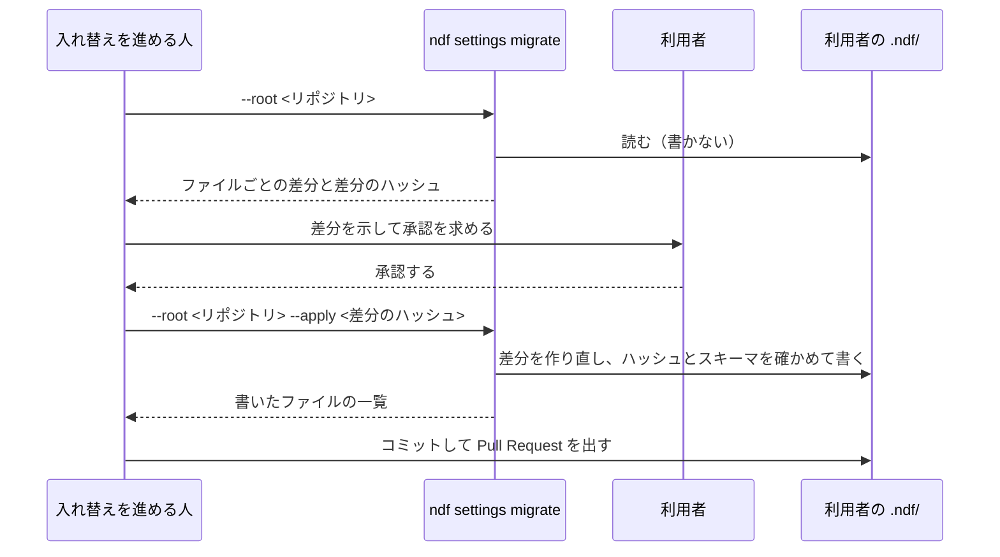

# ndf-next の用語の置き換えと設定のキーの改名: 直訳調の語を業界の語へそろえ、旧い語と旧いキーを検査と移行のコマンドで扱う

## 概要

ndf-next（`plugins/ndf-next/`）の Skill・コントラクトの文書・出力・コード・テストは、日本のエンジニア業界で流通している語で
書き、1 語が 1 つの意味を指す。旧い直訳調の語（版・置き場・宣言・副命令・進行表など）は用語集に廃止した語として持ち、
ndf-next の禁止語の規則が新しく書いた行から落とす。

あわせて、利用者が `.ndf/mvv.json` に書く MVV の各バージョンの確かめの記録のキーを、名前から何を決めるかが読める形へ改めた。
旧いキーの残る設定は ndf-next が読んだ時点で止まり、移行のコマンド `ndf settings migrate` が、利用者の承認した差分だけを
書き換える。

| 何を | SSOT |
| --- | --- |
| 旧い語と置き換え先の対応（語の項目と、その `deprecated`・`deprecated_standalone`） | 用語集のデータ [docs/glossary/glossary.json](../glossary/glossary.json) 。文書は [docs/glossary.md](../glossary.md) （`glossary.py render` が作る） |
| 禁止語の規則 | [plugins/ndf-next/src/ndf/checks/words.py](../../plugins/ndf/src/ndf/checks/words.py) と、例として外す箇所（`rules.json` の `words.examples`） |
| 設定のキーの改名表 | [plugins/ndf-next/contracts/data/ndf-settings-renames.json](../../plugins/ndf/contracts/data/ndf-settings-renames.json) |
| 設定のスキーマ | [plugins/ndf-next/contracts/schemas/ndf-settings/](../../plugins/ndf/contracts/schemas/ndf-settings/) と、生成した [docs/contracts/ndf-settings.md](../../plugins/ndf/docs/contracts/ndf-settings.md) |
| 移行のコマンド | [plugins/ndf-next/src/ndf/domains/settings/](../../plugins/ndf/src/ndf/domains/settings/) （`cli.py`・`renames.py`） |

`.ndf/worktree.json` の `branch_flow` を `.ndf/project.json` の `branch_strategy` へ移す行（リリース方式
`release_strategy` の値の改名を含む）も同じ改名表にあるが、読むのは `ndf project branch-strategy migrate` と旧い設定の検査
（`core/branch_strategy_legacy.py`）で、この文書の範囲外である（#3672）。

## 用語

「廃止した語」「単独でマッチする廃止した語」「設定のキーの改名表」「移行のコマンド」「ステートマシン」などの定義は、
用語集（[docs/glossary.md](../glossary.md) ）が正である。

## 背景

ndf-next では、直訳調の内部の呼び名 29 語が 1,061 ファイル中 828 ファイルに出ていた（2026-11-15 の `git grep` の実測）。
利用者から「直訳すぎて分からない。エンジニア業界で利用されている用語に」との指示があり、11.0 の公開の前に置き換えた。
印・枠・区間・`ledger` などは 1 語が 2〜4 の意味を持っていたため、意味ごとに別の語へ分けた。

## 仕様

### 常に成り立つ条件

| 条件 | 破れたときの扱い |
| --- | --- |
| 旧い語の 1 つの意味に、置き換え先の語は 1 つだけある。置き換え先の語は、用語集の別の意味の語と重ならない | `glossary.py check` の `schema`・`duplicate` が落とす |
| 廃止した語は、どの生きた語とも重ならず、語の項目と意味の欄に出ない | `glossary.py check` の `schema`・`deprecated_meaning` が落とす |
| 単独でマッチする廃止した語は、前後が漢字の出現に当たらない（「開発版」「出版」「問い合わせ」に当たらない） | 禁止語の規則の単体テストが落とす |
| ndf-next のファイルに、廃止した語が `words.examples` の箇所の外に 0 件である | `ndf check` の `banned-word` が終了コード 1 で落とす |
| コントラクトの文書（`docs/contracts/*.md`）は生成元から作り直した結果と一致する | `ndf check` の spec-docs が落とす |
| 改名表の新しいキーの位置はどれも設定のスキーマにあり、旧いキーの位置はどれもスキーマに無い。1 つの旧いキーの位置に新しいキーの位置は 1 つだけで、`old` と `new` が同じ行は無い | 改名表とスキーマを突き合わせる単体テストが落とす |
| 移行のコマンドが書くのは、利用者が承認した差分と今の差分が一致し、書き換えた結果が新しいスキーマに通るときだけである | 移行のコマンドの単体テストが落とす |
| 旧いキーが残る設定を読むと、既定の値へ倒さずに止まる | 設定を読む側の単体テストが落とす |

### 禁止語の規則

`banned_words` は、語ごとの理由と、単独でマッチする語の集合をまとめた値（`BannedWords`）を返す。

- 用語集の語の `deprecated` と、`.ndf/glossary.json` の禁止語は部分文字列でマッチする
- 用語集の語の `deprecated_standalone` は、前後が漢字でない出現にだけマッチする。漢字の範囲は定数 `KANJI`
  （CJK 統合漢字・拡張 A・互換漢字と「々」）が持つ
- 見る範囲は ndf-next の下のすべての文字のファイル（`skills/`・`agents/`・`contracts/`・`src/`・`tests/`・`bin/`・`hooks/` ほか）である。
  外部向けと内部で語を分けると 1 語 1 意味が成り立たないため、内部のコメントとテストも対象にする
- 外してよいのは、同等性の表が今の NDF（`plugins/ndf/`）の文言を引いた箇所だけで、`rules.json` の `words.examples` に
  ファイル・語・理由を書く

1 文字の語（版・鍵・枠・印など）と、長い語の一部に現れる語（「問い」。「問い合わせ」に当てない）は単独でマッチする欄に持つ。
「問い」に漢字が続く旧い用法は、別の廃止した語（問い直・問い返・問い方）で落とす。

### 置き換えずに残す語

| 語 | 残す理由 |
| --- | --- |
| 耐久（耐久ワークフロー・耐久ステップなど） | 利用者が設計承認で残すと決めた。用語集の語の項目もそのまま持つ |
| 提示 | 「示す」の意味の一般語で、指す対象が文脈で変わらない |
| 一時レーン | レーンは NDF の定義済みの語で、「一時」は修飾として通じる |
| 完了条件 | 業界で定着した語で、1 語 1 意味を崩さない |

### 識別子の改名の基準

英語の識別子は「旧い日本語の語の直訳で、業界の英語として置き換え先の意味に通じないもの」だけを改名する。
`version`・`key`・`subcommand`・`request`・`slot`・`budget`・`source`・`durable`・`backup`・`snapshot`・`owner`・
`template`・`contracts`・`route` は業界の英語として通じるため残し、用語集の置き換え先の語の項目の `code` に書いて
説明文の語と対応させる。改名した主な識別子は次のとおりである。

| 旧い識別子 | 新しい識別子 | 主な場所 |
| --- | --- | --- |
| `place`・`places` | `location`・`locations` | コントラクトの表 `domains/locations.json`、表 `ndf-files` の列 |
| `declaration`・`declarations` | `ndf_settings`（ディレクトリ名・文書名は `ndf-settings`） | `contracts/schemas/ndf-settings/`、`domains/worktree/ndf_settings.py`、`domains/release/ndf_settings.py` |
| `table_id` | `machine_id` | ステートマシンのデータベースの列（`progress/store.py`） |
| `marks`（兆候の検査の抑制コメント） | `suppressions` | `checks/suppressions.py` |
| `marks`（中継のマーカーのファイル） | `markers` | `domains/relay/markers.py` |
| `ledger` | `journal`・`allocations`・`durable_runs`・`usage_log`、クロスレビューの指摘の記録は `FindingJournal` | `domains/worktree/allocations.py`、`core/durable_runs.py`、`domains/crossreview/drive.py` |
| MVV の改訂の兆候の `revise` | `revision_due` | `domains/records/` |
| 承認ゲートの回答の値 `revise` | `request_changes` | `contracts/facts/answers.json`、`contracts/workflow/stage-io.schema.json` の enum、`ndf progress answer` の引数 |
| `vet_sprint`・`vet_key`・`VET_SPRINT`・`MvvVet`・`last_vet` | `mvv_validate_sprint`・`mvv_validation_key`・`MVV_VALIDATION_SPRINT`・`MvvValidation`・`last_mvv_validation` | `domains/records/mvv.py`・`mvv_decide.py`、MVV の設定のスキーマ |

`.ndf/` の設定ファイルの識別子を `settings` にしないのは、MVV の設定の中の最上位のキー `settings` と、Claude Code の起動の
引数 `--settings` が別の意味ですでに使っているためである。MVV 判定の内部の識別子に `mvv_` を付けるのも、原因の種類の値
`validation`（`contracts/causes/` の列 `std_type`）と分けるためである。言語モデルの判定の答えの欄 `verdict`
（`follow` / `not_follow` / `unknown`）は承認ゲートの判定と同じ形を共有するため改名せず、設定に書くときに `follow` を `pass` へ写す。

### 改名した保存先と記録

| 表 `ndf-files` の ID | ファイル名 | 読み手 |
| --- | --- | --- |
| `backlog-journal` | `journal.json` | ndf-next |
| `usage-log-file`（保存先の ID は `usage-log`） | `usage.jsonl` | ndf-next |
| `mvv-validation` | `mvv-validation.jsonl` | ndf-next |
| `ask-journal` | `ask.jsonl` | Factory のサービス |

読み手が Factory のサービスの記録のうち、改名が中身に出るのは ID `ask-journal` と、`gate-rejections.jsonl`・`loop.json` に
書く承認ゲートの回答の値 `request_changes` である。ndf-next は未公開で後方互換を守らないため、Factory の側と同時に改名する。
ほかの記録（`plan-progress`・`organizer-*`・`issue-request`）の中身のキーは改名の対象を含まない。

### ステートマシンの保存先の形

列の改名に伴い、チェックアウトの保存先の形の番号（`ndf.core.durable.STORE_FORMAT`）と表のバージョン
（`ndf.progress.store.SCHEMA_VERSION`）はどちらも 2 である。

- 既定の保存先の SQLite は、形の番号の古い保存先を既存の経路で `<名前>.v1-<日付>` へ退避し、新しい形で作り直す
- `NDF_PROGRESS_DB` で保存先の外を指した SQLite と PostgreSQL では、`ensure_schema` がバージョン 1 の表を見つけると、
  表を変えずに「表 ndf_progress_* を消して作り直す」手順を添えて `StoreBroken` で止まる。列を変える移行のコードは持たない
- 自分より新しいバージョンの表には触れず、`StoreFormatNewer` で止まる

## データ・設定

### 利用者の設定のキーと値の改名

`.ndf/mvv.json` の改名は、改名表の次の 3 行である。

| 行の id | 旧いキーの位置 | 新しいキーの位置 | 値の対応 |
| --- | --- | --- | --- |
| `mvv-validation` | `/versions/*/vet` | `/versions/*/validation` | — |
| `mvv-validation-result` | `/versions/*/validation/verdict` | `/versions/*/validation/result` | `follow` → `pass`、`unknown` → `unknown` |
| `mvv-validation-checked-at` | `/versions/*/validation/at` | `/versions/*/validation/checked_at` | — |

- 位置は JSON Pointer（RFC 6901）で書き、`*` は配列のすべての要素を指す
- 親のキーの行を子のキーの行より先に置き、子の行の `old` は親を改めた後の位置で書く。名前を変えない子のキー
  （`accepted_unknown`）は親の移動で新しい位置へ移るため、行を持たない
- 表に無いキー（`revise_after` など）は改名しない
- 改名表の列は `id`・`file`（表 `ndf-files` の ID）・`old`・`new_file`・`new`・`values`・`transform`・`issue` である。
  `ndf settings migrate` と設定を読む側の止める検査は、同じファイルの中でキーの名前と値を改める行だけを読む
  （振り分けは `ndf.contracts.settings_renames` が持つ）

MVV の設定のスキーマは各バージョンに `validation`（`result` は `pass` か `unknown`・`checked_at`・`accepted_unknown`）を
持ち、`vet`・`verdict`・`at`・値 `follow` を持たない。Skill の中のスキーマのコピー（`skills/development-workflow/schemas/mvv.schema.json`）も同じ形である。

### 設定の改名の関数（`domains/settings/renames.py`）

改名表をコントラクトの表の読み込みで読み、渡された設定の中身だけを扱う。設定ファイルを読み書きせず、終了コードを持たない。
旧いキーの名前と旧い値はコードに書かず、改名表から引く。

| 関数 | 返すもの |
| --- | --- |
| `load()` | 同じファイルの中で改める行（`Rename`）を表の並びのまま |
| `legacy_keys(file, data)` | 今の中身に実在する旧いキー（`LegacyKey`）。配列の要素は要素ごとの位置（`/versions/0/vet`）で返す。未移行の中身では親の行だけが当たる |
| `migrate(file, data)` | 変換した中身と JSON Patch（RFC 6902）の操作の列。キーは `move`、値の対応は `replace` で書き、どちらの直前にも元の位置の今の値を持つ `test` を置く。表に無いキーとキーの並び以外の値は変えない |
| `legacy_detail(file, data, root)` | 旧いキーが残れば停止理由の文（ファイル・旧いキーの位置 → 新しいキーの位置・打つコマンド）、無ければ `None` |

`move` は移す値を持たないため、`test` が無いと示した後に移す値を変えても差分とハッシュが変わらない。`test` を置くことで、
移す値が差分に表示され、ハッシュに入る。JSON Patch のライブラリ（jsonpatch）は採らない。使う操作が `test`・`move`・値の
`replace` の 3 つで、依存を 2 つ（jsonpatch・jsonpointer）増やすほどの量が無い。

## 外部連携

### 移行のコマンド `ndf settings migrate`

承認を対話の確認で受けず、差分を示す実行と書く実行の 2 回に分け、承認を差分のハッシュで結び付ける。ndf-next は AI が
`claude -p` からも打ち、対話の入力を受けられないためである。`--yes` のような旗は差分を見たかを表さないため持たない。

| 打ち方 | 振る舞い | 結果 |
| --- | --- | --- |
| `ndf settings migrate --root <リポジトリ>` | 改名表に当たる設定ファイルごとに、差分（JSON Patch の操作の列）と、差分を並べた JSON の sha256（差分のハッシュ）を `items` に出す。ファイルを書かない | 差分が 0 件なら `status: ok`。差分があれば `status: gate`（終了コード 0）で、`routes.approved` に `--apply` 付きのコマンドを出す |
| `ndf settings migrate --root <リポジトリ> --apply <差分のハッシュ>` | 今の差分を作り直し、ハッシュが一致し、変換した中身が新しいスキーマに通り、旧いキーと新しいキーが並存しないときだけ書く | 書けば `status: ok` と書いたファイルの一覧 |

差分のハッシュは根の絶対パスを含まないため、同じ中身なら別の clone でも同じ値になる。`--apply` の値は 64 桁の小文字の
16 進である。

### 入れ替えのときの移行の流れ

11.0 の入れ替え（#3304）まで、利用者の `.ndf/` を書くのは今の NDF で、旧いキーのまま読み書きする。ndf-next は `.ndf/` を
読むだけで書かない。入れ替えのときは、利用者のリポジトリごとに次の流れで書き換える。利用者の設定を書き換えるため、
承認は利用者が行う（C7）。

利用者が承認しなければ `--apply` を打たず、そのリポジトリの設定は書き換わらない。

## エラー処理

原因の種類は `contracts/causes/` の既存の行で、終了コードは `contracts/facts/exit-codes.json` が決める。

| 場面 | 原因の種類 | 終了コード | 行き先 |
| --- | --- | --- | --- |
| `--apply` のハッシュが今の差分と一致しない・差分が 0 件 | `refused` | 1 | 人。差分を示し直し、承認を取り直す |
| 書き換えた中身が新しいスキーマに通らない・旧いキーと新しいキーが並存する | `refused` | 1 | 人。1 バイトも書かない |
| 設定が JSON として読めない・`--apply` の値の形が違う・書き込みに失敗した | `invalid` | 2 | conductor。書き込みの失敗では書き終えたファイルを示す |
| ndf-next が旧いキーの残る MVV の設定を読んだ | `precondition` | 3 | 人。`legacy_detail` の文（旧いキーの位置 → 新しいキーの位置と `ndf settings migrate --root <リポジトリ>`）を理由に出す |

MVV の設定を読む側（`domains/records/mvv.py` の `_refuse_legacy`・`domains/records/preflight.py`）が止める。承認ゲート
（`progress/gate/`）は MVV の設定のパスだけを引いて中身を読まないため、止める検査を持たない。

### 入れ替えまでの規約の規則 spec-decl

規約の規則 spec-decl（`checks/spec_docs.py` の `_real_errors`）は、検査を打つリポジトリの `.ndf/` の実物をスキーマで
確かめる。実物に旧いキーがあれば `renames.migrate` で変換した中身をスキーマと突き合わせ、旧いキーが残ること自体は
指摘しない。入れ替えまで、このリポジトリの `.ndf/mvv.json` は今の NDF のために旧いキーのまま残るためである。変換で直らない
誤り（型の違う値など）はこれまでどおり示す。spec-decl のコードとテストは旧いキーの名前を文字として持たず、テストの入力は
改名表の `old` と `values` から組み立てる。

## 運用

- 新しい語を書くときは用語集の語を使う。旧い語を書いた行は CI の `ndf check` が落とす。禁止語の規則が示した行の意味が
  用語集に無ければ、置き換える前に用語集へ意味の行を足し、当たった行に必ず 1 つの置き換え先がある状態を保つ
- 旧い語の登録と置き換えは同じ Pull Request に入れる。登録だけを先に入れると、置き換えの済んでいないファイルで CI が落ちる
- 今の NDF（`plugins/ndf/`）は入れ替えで外れるため直さない。用語集の語の項目のうち出典が `plugins/ndf/` の下のものも新しい
  名前へ改めており、入れ替えまでは今の NDF の文書の語と用語集の語が食い違う。用語集の検査は語の項目と出典のファイルの
  中身を突き合わせないため、この食い違いでは落ちない
- 設定のキーを改名するときは、改名表・スキーマ（Skill の中のコピーを含む）・コントラクトの文書を同じ Pull Request で変える

## テスト観点

| 観点 | 縛るもの |
| --- | --- |
| 用語集の廃止した語を持つ語が、Skill の本文の 1 行に禁止語の 1 件を返すこと | `tests/checks/test_words.py` |
| 単独でマッチする語が「版の記録」に当たり、「開発版」「出版」に当たらないこと | `tests/checks/test_words.py` |
| 兆候の検査の抑制コメントが新しい名前で働くこと | `tests/checks/test_suppressions.py` |
| 改名表の新しいキーの位置がスキーマにあり、旧いキーの位置がスキーマに無く、`old` と `new` が同じ行が無いこと | `tests/domains/settings/test_renames.py` |
| `--apply` なしでは内容が 1 バイトも変わらず差分を返し、返したハッシュで `--apply` すると新しいスキーマに通る値になり、もう一度打つと差分が 0 件であること。表に無いキーとキーの並び以外の値が変わらないこと。示した後に設定を変えると書かないこと | `tests/domains/settings/test_cli.py` |
| MVV の設定を読む各関数が、旧いキーの残る設定で旧いキーと新しいキーの位置と移行のコマンドを理由に出して止まること | `tests/domains/settings/test_readers.py` |
| spec-decl が旧いキーを持つ実物を指摘せず、旧いキーと別の誤りは示すこと | `tests/checks/test_spec_docs.py` |
| バージョン 1 の表を見つけると、表を変えずに作り直す手順を添えて止まること | `tests/progress/test_store.py` |
| `ndf check --write-spec` の後に差分が出ず、`ndf check` の禁止語の規則が 0 件であること | CI の `ndf check` |
| `plugins/ndf/` が変わらないこと | `git diff --stat origin/main -- plugins/ndf` が空 |

## 関連リンク

- [docs/glossary.md](../glossary.md) — 置き換え先の語と廃止した語
- [ndf-next-declarations-and-io-contracts.md](ndf-next-declarations-and-io-contracts.md) — ndf-next の設定のスキーマと入出力の規約、`ndf check` の規約の規則
- [ndf-ubiquitous-language.md](ndf-ubiquitous-language.md) — 用語集の形と検査
- 一次情報: GitHub の Pull Request のレビュー（ https://docs.github.com/ja/pull-requests/collaborating-with-pull-requests/reviewing-changes-in-pull-requests/about-pull-request-reviews ）、JSON Pointer（ https://www.rfc-editor.org/rfc/rfc6901 ）、JSON Patch（ https://www.rfc-editor.org/rfc/rfc6902 ）
