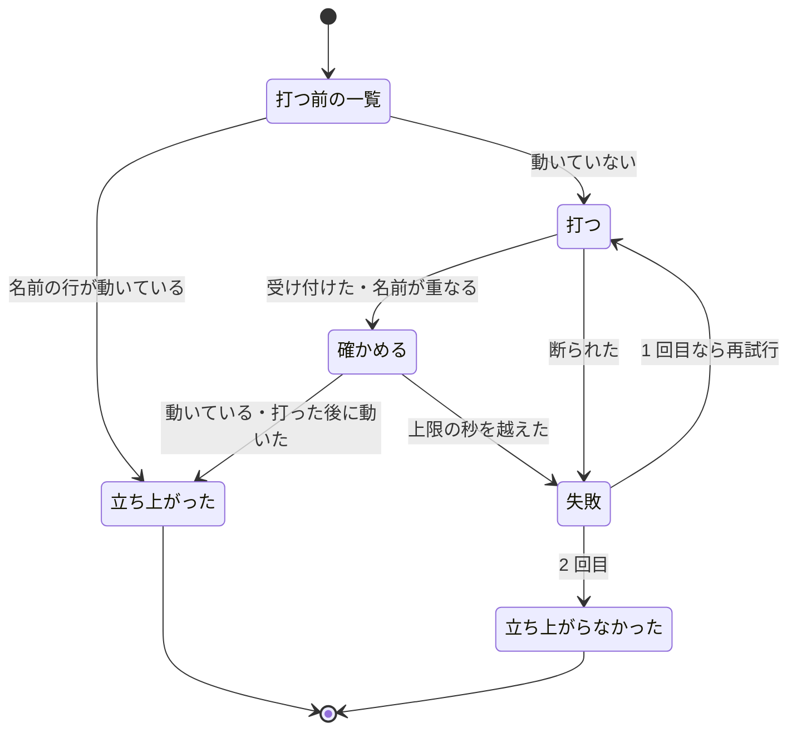

# 並列の計画: 一時レーンの起動とレーンの再起動を耐久ワークフローが打ち、オーガナイザーは問いと終わりだけで起きる

## 概要

並列の計画では、一時レーンの起動と止まったレーンの再起動を耐久ワークフロー（`parallel.py run`）が自分で打ち、
立ち上がりを確かめる。立ち上がらなければ 1 回だけ打ち直し、2 回とも立ち上がらないときだけ区分 `spawn` の問いにする。
手順どおりに自分を止めた一時レーンには「途中で止まった」の問い（区分 `helper`）を立てない。
`parallel.py wait` がオーガナイザーへ返すのは、人へ問うもの・答え待ちの停止の変化・終わり・異常だけである。
レーンの様子は `parallel.py status <計画名>` で 1 回に読める。

狙いは、オーガナイザーが起きる回数を承認ゲートの数と計画の終わりで決め、レーンの数とリリースの回数で増やさないことである。
オーガナイザーの費用は「起きる回数 × 文脈の大きさ」で決まり、2026-11-10 の計画 p4 の後半では、オーガナイザーの入力 token の
42% がレーンの起動・起こし直し・誤報の処理で、承認ゲートの問いは 1% だった。

**耐久ワークフローの 1 周・依頼と答え・メッセージとイベント・終了コード・エラー処理の正本は
[ndf-parallel-organizer.md](ndf-parallel-organizer.md) である。** この文書は、起動を耐久ワークフローへ移した判断と理由、
起動の記録の形、起動と止まりの判定で常に成り立つ条件、`wait` と `status` の契約を持つ。

## 用語

語の定義は用語集（ [docs/glossary.md](../glossary.md) ）が正である。この文書で使う主な語は次のとおり。

| 用語 | この文書での使い方 |
| --- | --- |
| オーガナイザー | 並列の計画の conductor。この文書では、`wait` で起きて人へ問い、`answer` で答えを送るだけの役割として扱う |
| 一時レーン | 耐久ワークフローが起動する役割 `helper` のラッパー（`<計画名>-rel<連番>`）。リリースの提示・確定と、保留したループの 1 回の残りを流す |
| 今の起動 | 一時レーンについては、耐久ワークフローが最後に打った起動。止まりの判定はこの起動より後の観測だけを数える |
| 立ち上がりの確認 | 起動か再起動を打った後に、`relay.py ls --json` の行でそのレーンが動いて観えるまで決まった間隔で一覧を読むこと |
| 起動の再試行 | 立ち上がりの確認で立ち上がらなかった起動か再起動を、耐久ワークフローがもう 1 回だけ打つこと |
| 手順どおりの停止 | 一時レーンが、リリース承認ゲートの依頼か `settle` を送った後に自分を止めること。区分 `helper` の問いの対象にしない |

## 背景

| 決めたこと | 理由 |
| --- | --- |
| 一時レーンの起動と止まったレーンの再起動を、耐久ワークフローの耐久ステップで打つ | 起動の 1 行をオーガナイザーに残すと、起動の回数がそのままオーガナイザーの起きる回数になり、立ち上がりの確認と誤報の問いも戻ってくる。個別の不具合を 1 つずつ直しても、中継をオーガナイザーに残す限り次の種類の例外が同じ形で現れる |
| 再試行は耐久ステップの中の自前の分岐で書き、永続ワークフローのライブラリ（DBOS）の再試行の機能を使わない | 「立ち上がらなかった」は例外ではなく一覧を読んで決める結果である。ライブラリの再試行は例外を引き金にし、使い切ると例外をワークフローへ上げるため、2 回目の失敗を問いへ変える分岐を結局自前で書くことになる |
| 立ち上がりの確認は 5 秒間隔・上限 120 秒 | リレーハブは依頼を受付箱から読んでラッパーを起動するため、打った直後は一覧に現れない。claude の起動を含むため、1 プロセスの起動を想定した短い上限では足りない。間隔を短くして早く立ち上がったものを早く返す |
| 一時レーンの止まり方を、台帳に新しい行を書かせずに、今の起動の時刻と既存の依頼・`settle` から判定する | 一時レーンに止まり方を書かせると、書き忘れた一時レーン（古い版・手順の途中で落ちたもの）が誤報に戻る。耐久ワークフローは自分で起動を打つため、今の起動の時刻と立ち上がりを知っている |
| `wait` は `pause` のイベントを読まず、オーガナイザーが答えを送った依頼だけの `questions` を読み飛ばす | `pause` は一時レーンが流すもの（`parallel.py helper`）を決めるため、立てるのはやめない。答えの後に問いの一覧を立て直すと残りが空でも `questions` が立つため、答えを送った依頼の控えと突き合わせる。イベントにオーガナイザー向けの印を足す形は、印の付け忘れで同じ誤報が戻る |
| 耐久ワークフローが立てた問い（区分 `stall`・`helper`・`spawn`）の答えは、耐久ワークフローが当てる | 答えの 1 行を `answer` の `metrics.next` に残すと、`relay.py restart`・`relay.py spawn` がオーガナイザーへ戻る。区分 `observe` の「ラッパーの環境を作り直す」（`relay.py status`）はレーンの起動ではないため 1 行のまま残す |
| `status` の費用はループの記録から読み、transcript を集計しない | ループの記録の各回は `cost` を持ち、読むだけで出せる。transcript の集計はレーンとセッションの対応を別に引く必要があり、1 回のコマンドで読む目的に対して重い |
| 答え待ちの停止の再開（`parallel.resume-lanes`）は、起動の耐久ステップへ移さない | 再開の断りは起動の断りと同じく 3 回で問う決まりがある。移すと断りの数え方が変わる |
| 起動の割り振りを通る分岐は、耐久の記録の印 `parallel-launch` の後ろに置く | 印の無い古い記録の打ち直しは、今までの道（`pause` に起動の 1 行を載せ、オーガナイザーが打つ）を通す。動いている古い run が版の途中で道を変えない |

## 仕様

### 担い手の分担

| 操作 | 打つもの | 道 |
| --- | --- | --- |
| リリースの提示・確定の一時レーンの起動 | 耐久ワークフロー | リリースを組んだ周・`confirm` で確定した周に、起動の耐久ステップ `parallel.launch` で `relay.py spawn` を打つ |
| 保留したループの 1 回の残りを流す一時レーンの起動 | 耐久ワークフロー | 計画の終わりの条件を満たした周に、同じ耐久ステップで起動する |
| 答えを受けた止まった持ち主の再起動 | 耐久ワークフロー | 持ち主を再起動の対象（`wake`）へ入れ、1 周の終わりに `relay.py restart` を打つ。問いを保留して止まった一時レーンは、答えを受けた場で再起動する |
| 区分 `stall`・`helper`・`spawn` の問いの「起こし直す」「続きから起こし直す」「止める」 | 耐久ワークフロー | 「起こし直す」は新しい起動の目的として耐久ステップへ流す。「止める」はレーンを止めるか、リリースを `failed` で締める |
| 答え待ちの停止からの再開 | 耐久ワークフロー | 今までどおり耐久ステップ `parallel.resume-lanes` |
| 人へ問い、答えを送る | オーガナイザー | `parallel.py wait` → `parallel.py answer` |

1 周の中の位置（提示はリリースを組んだ直後、確定は台帳の `confirm` の直後、再起動は観測と突き合わせの後）は
[ndf-parallel-organizer.md](ndf-parallel-organizer.md) の「耐久ワークフローの 1 周」にある。周の中で台帳を観測より先に読むため、
依頼を送ってから止まった一時レーンは、止まった観測より先に依頼が問いの一覧へ入る。

### 起動の耐久ステップ

起動の耐久ステップ（`plugins/ndf/scripts/lib/parallel_launch.py` の `step_launch`）は、起動の目的ごとに 1 回呼ばれ、結果を値で返す。

- 立ち上がったと読むのは、一覧の行の `state` が `running` か `awaiting_approval` のときと、`stopped` でも行の `at` が打った時刻より後のとき（短い作業を終えて止まったもの）である。時刻の比較には 0.5 秒の幅を置く
- 名前の重なり（`name-taken`）で断られたときは、同じ名前が動いているとみなして確かめに進む
- 一覧を読む間隔は 5 秒、上限は `NDF_PARALLEL_LAUNCH_SECONDS`（既定 120 秒）。上限を縮めたときは、間隔を上限の 1/10（下限 0.05 秒）まで縮める。待ちは共通の待ちの関数（`waits.wait_until`）で行う
- 区分 `stall` の答えの起こし直しは、動いて観えるまま止まったレーンが対象のため、打つ前の一覧を見ずに打ち、行の `at` が打った時刻より後になったときだけ立ち上がったと読む
- 2 回とも立ち上がらなければ、起動の割り振り（`LaunchRouting`）が区分 `spawn` の問い（「起こし直す」「止める」）を立てる

### 常に成り立つ条件

| # | 条件 | 破れたときの扱い |
| --- | --- | --- |
| I1 | 一時レーンの起動とレーンの再起動を打つのは耐久ワークフローだけである。印 `parallel-launch` のある記録では、`wait` と `answer` の結果に `relay.py spawn`・`relay.py restart` の 1 行を載せない | 試験で落とす |
| I2 | 1 つの起動の目的について打つのは最大 2 回である。2 回とも立ち上がらなければ区分 `spawn` の問いを 1 つ立てる。人が問いの答えで起こし直しを選んだときは、新しい目的として回数を 0 から数える | 試験で落とす |
| I3 | 起動の記録のある目的は、耐久ワークフローが作り直されても打ち直さない（`result` が `failed` でも打ち直さない）。打つ前の一覧でそのレーンが動いていれば打たずに立ち上がったと数える（区分 `stall` の答えの起こし直しを除く） | 二重の起動は名前の重複でリレーハブが断り、断りは立ち上がったと数える |
| I4 | 区分 `helper` の問いは、今の起動の立ち上がりを確かめた後に、その一時レーンの今の起動より後に止まった行を 2 回続けて観て、リリース承認ゲートの依頼も `settle` も届いておらず、その一時レーンの答えていない問いも無いときだけ立つ | 試験で落とす |
| I5 | `wait` が返す `action` は `questions`・`answer_hold`・`finished`・`stopped`・`error` だけである。`questions` は、オーガナイザーがまだ答えを送っていない依頼を 1 つ以上含むときだけ返す | 試験で落とす |
| I6 | `parallel.py status` は値の取れない欄を `null` にし、一覧・ループの記録・台帳のどれが読めなくても終了コード 0 で全レーンの行を返す | 試験で落とす |

I4 の「今の起動より後」は、続きの一時レーンを起動した直後に、前の一時レーンの止まった行を読んで問いを立てる誤報を防ぐ。

## データ・設定

### チェックポイントに足したキー

計画の台帳（`ledger.jsonl`）の行の形は変えない。耐久ワークフローの状態（チェックポイント `checkpoint.json`）に 2 つのキーを持つ。
古い計画の作り直しでは両方を空として始める。起動の記録が無い目的でも、打つ前の一覧で動いていれば打たない（I3）。

| キー | 型 | 中身 | 無いとき |
| --- | --- | --- | --- |
| `launches` | 起動の目的のキー → 起動の記録 | 記録は `lane`・`result`（`up` / `failed`）・`attempts`（打った回数。打つ前から動いていれば 0）・`at`（最後に打った時刻、UTC）・`reason`（立ち上がらなかった理由） | まだ打っていない |
| `helper_seen` | 一時レーンの名前 → 今の起動の後に続けて止まって観えた回数 | I4 の「2 回続けて」の猶予。起動を打つたび・動いて観えるたびに数え直す | 0 |

起動の目的のキーは次のとおりである。

| 目的 | キー |
| --- | --- |
| リリースの提示・確定 | `rel-<連番>-<提示の回>-present`・`rel-<連番>-<提示の回>-confirmed` |
| 保留したループの 1 回の残り | `held-<ループ名>` |
| 止まった持ち主の再起動 | `wake-<レーン>-<そのレーンを再起動した回数 + 1>` |
| 区分 `spawn`・`helper` の答えの起こし直し | 元の目的のキー + `-a<答えた問いのキー>` |
| 区分 `stall` の答えの起こし直し | `ans-<レーン>-<答えた問いのキー>` |
| 問いを保留して止まった一時レーンへの答え | `ans-<一時レーン>-<問いのキー>`（保留したループの残りを流す一時レーンは `held-<ループ名>-ans-<問いのキー>`） |

### 設定

| 名前 | 既定 | 中身 |
| --- | --- | --- |
| 環境変数 `NDF_PARALLEL_LAUNCH_SECONDS` | 120 | 立ち上がりを待つ上限の秒（試験で縮める） |
| 上限の宣言 `parallel-launch.up`（`plugins/ndf/contracts/limits.json`） | `seconds` 120・`interval` 5 | 上限の既定と一覧を読む間隔 |

### `parallel.py wait` の返り値

| 終了コード | `metrics.action` | 返す条件 |
| --- | --- | --- |
| 0 | `questions` | イベント `questions` の依頼に、計画のディレクトリの `answers-sent.json`（オーガナイザーが答えを送った依頼の控え）に無い id がある |
| 0 | `answer_hold` | イベント `answer-hold` が `--after` より新しい |
| 0 | `finished` / `stopped` | 耐久ワークフローが終わった |
| 1 | `error` ほか | 耐久ワークフローが失われた・失敗で終わった |
| 3 | 無し | 上限の秒に達した。`next` の `--after` は読み飛ばした最後のイベントの `seq` |

`metrics` に起動・再起動の 1 行（`spawn`・`wake`）と承認待ちのレーン（`attach`・`lanes`）は載らない。
印 `parallel-launch` の無い古い記録の `pause`（起動の 1 行を持つもの）だけは今までどおり返す。

### `parallel.py status <計画名>`

計画のレーンごとに 1 行、続けて一覧にある計画の一時レーン（名前が `<計画名>-rel` で始まり役割が `helper`）を 1 行ずつ返す。
`summary` は「レーン N 本（動いている a・承認待ち b・止まった c）」である。計画が無い・読めない・検査に通らないときは終了コード 2 で返す。

| 欄 | 出所 | 取れないとき |
| --- | --- | --- |
| `lane` | 計画の宣言（一時レーンは一覧） | — |
| `state` | `relay.py ls --json` の `state` | `null` |
| `lap` | ループの記録 `loop.json` の最後の回の `n` | `null`（1 スプリントのレーン・一時レーンも） |
| `issues` | 最後の回の `selection` のうち「選んだ」課題の番号 | `null` |
| `last_at` | 計画の台帳でそのレーンが送った行の最後の `at` | `null` |
| `cost_usd` | ループの記録の各回の `cost` の和 | `null` |
| `attach` | 承認待ち（`state` が `awaiting_approval`、または答えていない依頼をそのレーンが送った）なら `python3 <relay.py> attach <レーン>` | `null` |

## 運用

- オーガナイザーの手順は [parallel.md](../../plugins/ndf/skills/development-workflow/references/parallel.md) にある。オーガナイザーは `relay.py spawn`・`relay.py restart` を打たず、レーンの画面を見に行かない。レーンの様子と承認待ちのレーンへ入る 1 行は `parallel.py status` で読む
- プラグインを更新しても、動いている `parallel.py run` は古い版のまま `pause` で起動の 1 行を知らせ続ける。新しい版の分担は、更新の後に始めた計画で働く
- 提示の一時レーンが手順どおりに止まらず動き続けると、確定の起動は名前の重なりで断られ、立ち上がったと数える。この場合の検出は持たない
- 効果は、リリース後の並列の計画 1 本のオーガナイザーの transcript で確かめる。オーガナイザーが `relay.py spawn`・`relay.py restart`・`tmux capture-pane`・`ask.py decide` を打っていないことと、`wait` が返した `action` の列を数える

## テスト観点

試験は `plugins/ndf/scripts/tests/test_parallel_launch.py`・`test_parallel_run.py`・`test_parallel_rebuild.py`・`test_parallel_hold_flow.py` にあり、
合成した計画と、起動に失敗する回数を指定できる偽の `relay.py` で確かめる。

- リリースの提示・確定・保留したループの 1 回で一時レーンが耐久ワークフローから起動され、`wait` の結果の `metrics` に `relay.py spawn` を含む 1 行が載らないこと
- 答えを受けた止まった持ち主が耐久ワークフローの `restart` で起き、`wait` の `metrics` と `answer` の `metrics.next` に `relay.py restart` を含む 1 行が載らないこと。区分 `stall` の「起こし直す」でも同じであること
- 起動に失敗する回数が 0 回・1 回のときは問いが立たず、2 回のときだけ区分 `spawn` の問いが `questions` で 1 つ届くこと
- 区分 `spawn` の「起こし直す」が、`failed` の記録を残したまま新しい目的で最大 2 回打つこと。区分 `stall` の「起こし直す」が `running` のままのレーンにも `restart` を打つこと
- 起動の記録を持つチェックポイントから作り直したとき同じ目的を打たず、打つ前の一覧で動いているレーンに `spawn` を打たないこと
- 一時レーンがリリース承認ゲートの依頼を送って止まる・`settle` の後に止まる・確定の起動の直後に前の起動の止まった行が残る、の 3 通りで区分 `helper` と `stall` の問いが立たないこと。依頼も `settle` も無いまま 2 回続けて止まって観えたときは区分 `helper` の問いが立つこと
- 提示 → リリース承認ゲート → 承認 → 確定 → 結果を流す合成した計画で、`wait` を `--after` でつないで打ち続けた `action` の列が `questions` 1 回と `finished` 1 回であること（終了コード 3 は数えない）
- `wait` の `action` がどの道でも `questions`・`answer_hold`・`finished`・`stopped`・`error` のどれかであること
- `status` がレーンごとに 1 行を返し、承認待ちのレーンの行に `attach` があること。一覧・ループの記録・台帳を読めなくしても終了コード 0 で欄が `null` になること。計画が無ければ終了コード 2 であること
- リリース承認ゲート・区分 `build`・`stall`（ループのレーン）・`unmatched` の問いが、変更の前と同じ条件で `questions` に届くこと

## 関連リンク

- 要求: https://github.com/devbasex/ai-plugins/issues/2936 （取り込んだ不具合: https://github.com/devbasex/ai-plugins/issues/2629 ）
- 設計: https://github.com/devbasex/ai-plugins/pull/2947 ・実装: https://github.com/devbasex/ai-plugins/pull/2978
- 耐久ワークフローの 1 周・依頼と答え・終了コードの正本: [ndf-parallel-organizer.md](ndf-parallel-organizer.md)
- 答えの届け先と止まったループのレーンの再起動: [ndf-loop-human-answer-delivery.md](ndf-loop-human-answer-delivery.md)
- ループのレーンの答え待ちの停止: [ndf-workflow-development-loop.md](ndf-workflow-development-loop.md)
- オーガナイザーの手順: [parallel.md](../../plugins/ndf/skills/development-workflow/references/parallel.md)
