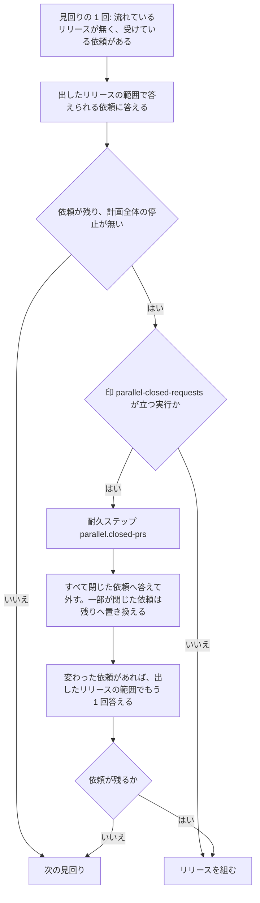

# 並列の計画: 中身の無いリリースの依頼と処理済みのリリース承認ゲートが、スプリントのまとめと計画の終わりを止めない

並列の計画のレーンでスプリントのまとめを流すとき、最終の検査が変更なしならリリースの依頼を送らずにまとめまで流れる。
耐久ワークフローは、載せた Pull Request がすべてマージされずに閉じた依頼へリリースを組まずに答えて外し、計画を
`finished` で終えられる。確定か締めで処理したリリース承認ゲートは答え待ちの依頼に数えず、オーガナイザーの切り替えの
判定を止めない（#3083。#3085・#3080 を含む）。

**手順の正本はスクリプトにある。** この文書は、決めたことの理由と、書く側と読む側が共有する形を残す。

| 何を読むか | 正本 |
| --- | --- |
| まとめのステージの並びと実行条件 | [`supervise_lib/sprint.py`](../../plugins/ndf/scripts/supervise_lib/sprint.py) の `close_waves`・`prod_plans` |
| 依頼を外す処理 | [`lib/parallel_route.py`](../../plugins/ndf/scripts/lib/parallel_route.py) の `split_closed`・`ReleaseRouting.drop_closed` |
| 答え待ちの依頼の数え方 | [`lib/parallel_ledger.py`](../../plugins/ndf/scripts/lib/parallel_ledger.py) の `settled_gates`・`pending_questions` |
| 並列の計画とオーガナイザーの全体 | [ndf-parallel-organizer.md](ndf-parallel-organizer.md) |
| 切り替えの判定 | [ndf-parallel-organizer-long-wait.md](ndf-parallel-organizer-long-wait.md) |

## 概要

| 事象（2026-11-12 の実測） | 今の振る舞い |
| --- | --- |
| レーン lgate-1 のまとめで、開発版のプランは最終の検査の変更なしで飛び、リリースの依頼のプランは飛ばずに依頼を送った | リリースの依頼のプランも開発版と同じ実行条件を持ち、変更なしなら依頼を送らずに飛ぶ |
| 計画 p5 のリリース 7・8 で、Pull Request がすべて閉じた依頼がどのリリースの範囲にも入らず、差し戻すたびに同じ依頼からリリースが組まれた | リリースを組む直前に依頼の Pull Request の状態を読み、すべて閉じた依頼へ答えて外す |
| `wait p5` で、確定・締め済みのリリース承認ゲート 9 行が `unanswered: 9` に数えられた | 同じ連番の確定か締めの行が後にあるリリース承認ゲートを数えない |

## 用語

中身の無い依頼・処理済みのリリース承認ゲート・最終の検査・実行条件・答え待ちの依頼の定義は、用語集
（[docs/glossary.md](../glossary.md)）にある。

## コンテキスト

NDF の開発ワークフロー（`ndf-workflow`）の中で閉じる。Pull Request の状態は既存の部品
`release_lib/included.py` の `pr_fields`（GitHub の GraphQL で 100 件ずつ読む）で読む。

## 構成要素

| 要素 | 責務 |
| --- | --- |
| `supervise_lib/sprint.py` の `close_waves` | 開発版のプランへ渡す実行条件 `changed`（`check.py changed --id <スプリント>-final`、飛ばす終了コード 3）を、本番のステージの `prod_plans` へも渡す |
| `supervise_lib/sprint.py` の `prod_plans` | 引数 `condition` を受け、レーンの分岐で組むリリースの依頼のプランへ `実行の条件` として載せる。省けば条件を載せない |
| `lib/parallel_route.py` の耐久ステップ `parallel.closed-prs` | 受けている依頼の Pull Request の番号を重ねずにまとめて 1 回読み、マージされずに閉じた番号を返す。取得に失敗すれば空を返す |
| `lib/parallel_route.py` の `split_closed` | 受けている依頼と閉じた番号から、中身の無い依頼と、閉じた番号を除いた残りの依頼を決める。純粋な関数 |
| `lib/parallel_route.py` の `ReleaseRouting.drop_closed` | 中身の無い依頼へ答えて外し、一部が閉じた依頼の `prs` を残りへ置き換える。答えて外した依頼で `wake_answered` を打つ |
| `lib/parallel_run.py` の `parallel_workflow`・`_tick_release` | 印 `parallel-closed-requests` が立つ実行だけ、`open_release` の直前に `drop_closed` を打つ |
| `lib/parallel_ledger.py` の `settled_gates` | 台帳の行から処理済みのリリース承認ゲートの行の ID を求める。`pending_questions` はそれを除く |
| `lib/parallel_status.py` の `unanswered` | `opened` の行の無い計画で、`settled_gates` の ID を除いて数える |

数え方を読む側（`lib/parallel_switch.py` の切り替えの判定、`lib/parallel_status.py` の `_ledger_view`、
`lib/parallel_answer.py`・`lib/parallel_machine.py`）は、数え方の 2 つの関数を通して正しい数を受ける。

## 仕様

### 常に成り立つ条件

| # | 条件 |
| --- | --- |
| I1 | レーンでまとめのプランが組むリリースの依頼のプランは、同じまとめの開発版のプランと同じ実行条件を持つ |
| I2 | レーンでないまとめの本番のプラン、`new sprint` と `pace: fast` の本番のステージ（リリースの依頼のプランを含む）は、実行条件を持たない形のまま組まれる |
| I3 | リリースを組む前に、Pull Request がすべてマージされずに閉じた依頼を一覧から外し、`released`・版なし・理由（閉じた Pull Request の番号）で答える。その依頼のためにリリースを組まない。答えを待って止まっていた宛先のレーンは、全レーンが止まっていないときに限り再起動の対象に入る |
| I4 | 一部の Pull Request だけが閉じた依頼は、閉じた番号を除いた残りで範囲の判定（`answerable`）を受ける。除いた番号は依頼の `closed` に残す |
| I5 | 状態を取得できなかった Pull Request は閉じたと見なさない。取得そのものが失敗したときは、どの依頼も外さない |
| I6 | Pull Request の状態の取得は、リリースを組もうとする直前の 1 回だけ行う。見回りごとには取得しない |
| I7 | 印 `parallel-closed-requests` の無い耐久ワークフローの記録の打ち直しは、依頼を外さない今までの道を通る |
| I8 | リリース承認ゲートの行は、同じ連番の確定（`resume:confirm:<連番>:…`）か締め（`resume:settle:<連番>`）の行が台帳でそれより後にあれば、答え待ちの依頼に数えない。`opened` の行がある計画でも同じ |
| I9 | 確定も締めも後に無いリリース承認ゲート（出し直しの提示で届いた 2 回目を含む）は、答え待ちの依頼に数える |
| I10 | 設計の承認（`gate1`）・承認ゲートの外の問い（`ask`）・宛先の無い答えの知らせ（`unmatched`）の数え方は変わらない |

### まとめのプランが最終の検査の結果で飛ぶ

queue は `{queue_prs}` を埋める Pull Request が無くても、プランに実行条件があれば止めずに条件へ判断を任せる。
リリースの依頼のプランに実行条件が載るため、検査の Pull Request が閉じた場合も Pull Request が無い場合も、最終の検査が
変更なし（終了コード 3）ならプランは `parallel.py request` を打たずに完了し、まとめのプランが続けて流れる。変更があれば
今どおり依頼を打って承認ゲートで終わる。

### 中身の無い依頼を外す

依頼が 1 件も残らず、ほかにリリースの途中も無く全レーンが止まっていれば、次の見回りの終わりの判定が計画を
`finished` で終える。

### 処理済みのリリース承認ゲートを除く

`settled_gates(rows, earlier)` は台帳の行を位置の順に読み、リリース承認ゲート（`gate2`）の行ごとに、同じ連番
（`msg.n`）で段階が確定（`confirm`）か締め（`settle`）の `resume` の行がそれより後にあるかを判定する。

| 関数 | 規則を当てる範囲 |
| --- | --- |
| `unanswered` | `opened` の行の無い計画で、台帳の全行 |
| `pending_questions` | チェックポイントの後の行。チェックポイントの問いの中のリリース承認ゲートは、チェックポイントの後に同じ連番の確定か締めの行があれば除く |

## データ・設定

台帳の行の形は変えない。新しい設定は無い。

| 値 | 置き場 | 意味 |
| --- | --- | --- |
| 中身の無い依頼への答え | イベント `answer-<依頼>`（チェックポイントの `published` に控える） | `result: released`・`version: null`・`reason: Pull Request #<番号> はマージされずに閉じた（出すものが無い）` |
| `closed` | 受けている依頼の項目（チェックポイントの `pending`） | 一部が閉じた依頼から除いた Pull Request の番号 |

## エラー処理

| 事象 | 扱い |
| --- | --- |
| Pull Request の状態の取得が失敗した | 耐久ステップの結果の `error` に理由を残し、その回はどの依頼も外さず、今どおりリリースを組む（I5） |
| 一部の Pull Request の状態だけが取れない | 取れなかった番号は閉じたと見なさない |

## 決定と理由

- **実行条件はまとめのプランの組み立てが `prod_plans` の引数で渡す。** 開発版と本番で同じ条件の書き手を `close_waves` の 1 か所に保つ。`plan_release_request` に条件を持たせないのは、リリースの依頼のプランが最終の検査の無いスプリントの途中のステージでも組まれるためである
- **Pull Request の状態はリリースを組む直前に確かめる。** 依頼を受けた時点で確かめると、受けた後に閉じた Pull Request を拾えない（計画 p5 のリリース 8 はリリース 7 の差し戻しの後に同じ依頼から組まれた）。見回りごとに確かめると、リリースの途中や停止の間も GitHub を読み続ける
- **中身の無い依頼への答えは `released`・版なし・理由つきにする。** レーンの読み手（`lib/sprint_loop_gate2.py` の `answered_lap`・`settle_release`・`settle_refused`）は `released` を「続きへ進む」と読み、ほかの値を差し戻しか失敗として扱う。リリースを組まないリポジトリへの答え（`skip_release`）と同じ形で、リリース済みとの区別は理由と版の有無で読める
- **一部が閉じた依頼は `prs` を残りへ置き換える。** 判定の関数・締め・出したリリースの範囲からの答えを変えずに済み、置き換えは耐久ステップの結果だけから決まるため打ち直しでも同じ値になる
- **依頼を外す処理は印 `parallel-closed-requests` が立つ実行だけで打つ。** 古い記録の途中に新しい耐久ステップを差し込むと、記録と打ち直しの道が食い違う
- **処理済みのリリース承認ゲートは台帳の位置の順で判定する。** 連番の一致だけで除くと、確定の後に届いた出し直しの提示の 2 回目まで除く。チェックポイントだけから数える形は、`opened` の行の無い計画がチェックポイントを持たないため採らない
- **規則は台帳の持ち主（`parallel_ledger.py`）に置き、2 つの数え方から呼ぶ。** `parallel_status.py` に置くと依存の向きが逆になる

## 運用

印 `parallel-closed-requests` の無い版で始まった計画の記録は、依頼を外さない今までの道を通る。新しい道は次に始めるか
作り直す計画から働く。GraphQL の取得の失敗の頻度は、耐久ワークフローの記録の `parallel.closed-prs` の結果を数えて確かめる
（未確認）。

## テスト観点

- レーンの計画の中で `close_waves` を組むと、リリースの依頼のプランが開発版のプランと等しい `実行の条件` を持つこと
- 最終の検査が変更なしのとき、`{queue_prs}` を埋める Pull Request がある場合も無い場合も、リリースの依頼のプランが依頼を打たずに完了し、まとめのプランが流れること。変更があれば今どおり依頼を打つこと
- レーンでないまとめ・`new sprint`・`pace: fast` の本番のステージが実行条件なしで組まれること
- すべて閉じた依頼だけを受けた耐久ワークフローが、リリースを組まずに `released`・版なし・閉じた番号を含む理由で答えて外し、宛先のレーンが再起動の対象に入り、全レーンが止まると `finished` を返すこと
- 一部が閉じた依頼が、残りが範囲に入ったときに答えられ、入らなければ残り、除いた番号が残ること
- マージ済み・開いている・状態を取れなかった Pull Request の依頼と、取得そのものが失敗したときの依頼が、今と同じ判定を受けること
- リリースが流れている見回りと計画全体の停止の見回りでは `parallel.closed-prs` が打たれず、組もうとする見回りで 1 回だけ打たれること。印の無い記録では打たれないこと
- リリースを 1 回出した計画で、ほかに問いが無ければ `wait` の上限の戻りの `metrics.switch.inputs.unanswered` が 0 になること
- 提示中のリリース承認ゲートと、確定の後に届いた出し直しの提示の 2 回目を数えること
- `gate1`・`ask`・`unmatched` の数え方が変わらず、`opened` の行のある計画の `pending_questions` も処理済みのリリース承認ゲートを返さないこと
- 処理済みのリリース承認ゲートだけを持つ一時レーンが `parallel.py status` の答えを待つレーンに載らないこと

テストは `plugins/ndf/scripts/tests/` の `test_lane_prod_stage.py`・`test_parallel_run.py`・`test_parallel_ledger.py`・
`test_parallel_switch.py` にある。

## 関連リンク

- [ndf-parallel-organizer.md](ndf-parallel-organizer.md)
- [ndf-parallel-organizer-long-wait.md](ndf-parallel-organizer-long-wait.md)
- [ndf-parallel-plan-ledger.md](ndf-parallel-plan-ledger.md)
- [ndf-production-release-record.md](ndf-production-release-record.md)
- [ndf-parallel-lane-end-and-verify-close.md](ndf-parallel-lane-end-and-verify-close.md)
