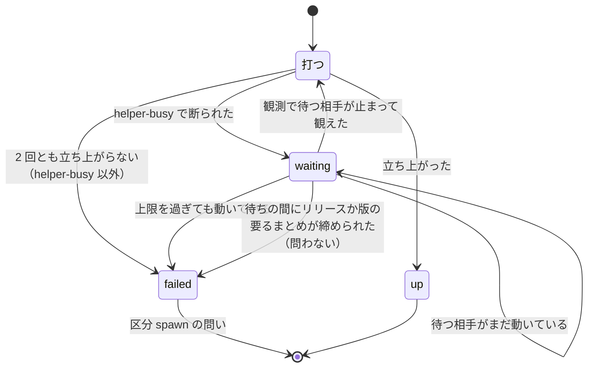

# 並列の計画の一時レーン: 確定の後の承認ゲートの依頼・送らなかった依頼の返し方・前の一時レーンの空き待ち

並列の計画の一時レーンは、リリース承認ゲートの承認（確定）の後に本番のプランが承認ゲートで終わると、
「打ち直す」「差し戻す」を選ぶ依頼をオーガナイザーへ送る。依頼を送るコマンドは、台帳に書かなかった依頼を
「送った」と返さない。一時レーンの起動が別の一時レーンが動いているために断られると、耐久ワークフローは人へ問わずに
前の一時レーンが止まるまで待ち、止まってから起動を打ち直す（#3597）。

**手順の正本はスクリプトと手順書にある。** この文書は、決めたことの理由と、書く側と読む側が共有する形を残す。

| 何を読むか | 正本 |
| --- | --- |
| 確定の後の依頼の組み立てと答えの当て方 | [`lib/parallel_gate2.py`](../../plugins/ndf/scripts/lib/parallel_gate2.py) |
| 送った結果と処理済みのリリース承認ゲート | [`lib/parallel_ledger.py`](../../plugins/ndf/scripts/lib/parallel_ledger.py) の `Sent`・`resent`・`settled_gates` |
| 一時レーンが流すものと自分の依頼の一覧 | [`lib/parallel_helper.py`](../../plugins/ndf/scripts/lib/parallel_helper.py) の `helper_task`、[`lib/parallel_question.py`](../../plugins/ndf/scripts/lib/parallel_question.py) の `asked_of` |
| 一時レーンの空き待ち | [`lib/parallel_launch.py`](../../plugins/ndf/scripts/lib/parallel_launch.py) の `step_launch`・`LaunchRouting.launch_waiting` |
| リレーハブの断り | [`relay_lib/hub.py`](../../plugins/ndf/scripts/relay_lib/hub.py) の `Hub.judge`・`HELPER_BUSY` |
| 一時レーン・オーガナイザーの手順 | `development-workflow` の [`references/parallel.md`](../../plugins/ndf/skills/development-workflow/references/parallel.md)・[`references/asking.md`](../../plugins/ndf/skills/development-workflow/references/asking.md) |
| 一時レーンの起動の全体 | [ndf-parallel-durable-lane-launch.md](ndf-parallel-durable-lane-launch.md) |
| 処理済みのリリース承認ゲートの数え方の全体 | [ndf-parallel-empty-requests-and-settled-gates.md](ndf-parallel-empty-requests-and-settled-gates.md) |

## 概要

| 事象（2026-11-15、並列の計画 p6 のリリース 17） | 今の振る舞い |
| --- | --- |
| 確定の後に本番のプランが承認ゲートで終わり、一時レーンが送った依頼の id が提示 1 の依頼と重なった。台帳に書かれないまま「送った」と返り、一時レーンは黙って止まった | 確定の後の依頼は確定の起動の連番を含む別の id を持つ。台帳に書かなかった依頼は、中身が同じなら「送り済み」、違えば終了コード 1 で返る |
| 一時レーンの起動が、前の一時レーンが動いている間に同じ秒に 2 回断られ、待たずに区分 `spawn` の問いになった | 断りの結果の値 `helper-busy` で他の断りと分け、耐久ワークフローが前の一時レーンが止まるまで待ってから打ち直す |

起き直した一時レーンが、答えのある区分つきの問い（例: `-D` でのブランチの削除）を新しい id で送り直す事象は、
この仕様の範囲に含めない。[ndf-parallel-sprint-design-gate-and-helper-reused-answers.md](ndf-parallel-sprint-design-gate-and-helper-reused-answers.md)
が扱う。この仕様が持つのは、一時レーンが自分の依頼と答えを読む一覧（`asked`）までである。

## 用語

確定の後の承認ゲート・依頼・起き直し・一時レーンの空き待ちの定義は、用語集（[docs/glossary.md](../glossary.md)）にある。

## コンテキスト

NDF の開発ワークフロー（`ndf-workflow`）の中で閉じる。リレーハブも同じコンテキストの語である。

## 構成要素

| 要素 | 責務 |
| --- | --- |
| `lib/parallel_ledger.py` の `Sent`・`resent` | 依頼を台帳へ書いた結果（書いたか・同じキーの行と中身が同じか・答え済みか・既にある id）を表す。`Sent` は `str` の派生で、値は依頼の id のまま読める |
| `lib/parallel_lane.py` の `deliver_message`・`send_inbox` | 台帳へ書いた結果を送り手へ返す。中身の違う同じキーの依頼は耐久ワークフローへ知らせない |
| `lib/parallel_gate2.py` の `request_gate2`・`request_confirmed` | 提示の依頼と確定の後の依頼の id と中身を組んで送る |
| `lib/parallel_gate2.py` の `ConfirmedGate.apply_confirmed` | 確定の後の依頼への答え「打ち直す」「差し戻す」を当てる。`_Run` が継ぐ |
| `lib/parallel_gate2.py` の耐久ステップ `parallel.close-release-pr` | 差し戻した本番の PR を閉じ、理由と依頼の id をコメントに残す |
| `lib/parallel_helper.py` の `helper_task` | 確定の起動で、本番のプランの承認ゲートの後に打つ確定の後の依頼の 1 行と、自分の名前の依頼と答えの一覧（`asked`）を返す |
| `parallel.py` の `request`・`request-ask`・`request-gate2` | 送った結果から終了コードと出力を決める |
| `relay_lib/hub.py` の `Hub.judge` | 一時レーンの同時数の断りを、結果の値 `helper-busy` と動いている一時レーンの名前（`busy`）で返す。ほかの役割の全体の上限の断りは `limit` のまま |
| `lib/parallel_launch.py` の `step_launch`・`LaunchRouting` | `helper-busy` の断りを空き待ちとして起動の記録に持ち、ループの 1 回の観測ごとに読み直す |
| `contracts/limits.json` の `parallel-launch.helper-wait` | 空き待ちの上限の秒を持つ |

## 仕様

### 常に成り立つ条件

| # | 条件 | 破れたときの扱い |
| --- | --- | --- |
| I1 | 1 つの依頼の id は 1 つの依頼だけを指す。確定の後の依頼の id は、提示の依頼の id とも、前の確定の起動の依頼の id とも重ならない | 同じキーで中身の違う依頼は台帳へ書かず、終了コード 1 で既にある id と理由を返す |
| I2 | 台帳に書かなかった依頼を、送ったと返さない | 中身が同じ再送は、答え待ち・答え済み・処理済みのどれでも「送り済み」と返す。中身が違えば終了コード 1 |
| I3 | 確定の後の承認ゲートは、必ず「打ち直す」「差し戻す」の依頼として人へ戻る。送らずに止まる場合を持たない | 同じ確定の起動の依頼が既にあれば「送り済み」が返り、台帳に依頼の行が残る |
| I4 | 確定の後の依頼は、確定の行では処理済みにならない。同じ id の答えの行か、それより後の同じ連番の締めの行があるときだけ処理済みになる | 台帳のチェックポイントを挟んでも問いの一覧に残り、区分 `helper`（途中で止まった）の問いが立たない |
| I5 | 一時レーンの空き待ちの間は、区分 `spawn` の問いを立てない。上限を過ぎても前の一時レーンが動いていれば立てる | — |
| I6 | 空き待ちはループの 1 回をまたいで起動の記録に持ち、ループの 1 回の中で眠らない | 待つ間も他のレーンの観測と答えの処理は止まらない |
| I7 | 台帳の既存の行を書き換えない。送った・答えたは追記だけで記録する | — |

### 確定の後の承認ゲートの依頼

確定の後の依頼は、種類 `gate2` のまま次の欄を持つ。新しい承認ゲートは足さない。

| 依頼 | id | `msg` の欄 |
| --- | --- | --- |
| 提示 | `<計画名>-p<連番>-<提示>` | `n`・`k`・`lane`・`report`・`stamp`（提示したコミット） |
| 確定の後 | `<計画名>-p<連番>-<提示>-c<確定の起動の seq>` | 提示の欄に `after: "confirmed"`・`reason`（承認ゲートの理由）・`pr`（本番の PR の番号。読めなければ `null`）・`options: ["打ち直す", "差し戻す"]`・`question` を足す。`stamp` は承認したコミット |

確定の起動の seq は、耐久ワークフローが確定の起動で立てるイベント `pause` の `seq` である。打ち直しは新しいイベント
`pause` を立てるため、打ち直した後の依頼は別の id になる。同じ起動の中で一時レーンが同じコマンドを 2 回打てば同じ id に
なり、1 つの依頼にまとまる。本番のプランの done の中身や台帳の行の数から id を作らないのは、同じ承認ゲートの結果から
同じ id を作れることを確かめられないか、打ち直すたびに新しい id になって送り直しが起きるためである。

理由と PR の番号は、本番のプランの done のうち結果が `関門` の項目の状態の `progress.jsonl` から、最後の実行の終了コード 10
のステップの出力を末尾から読み、`metrics.reason`（無ければ `summary`）と `metrics.main_pr` を取る。読めなければ理由に
`progress.jsonl` のパスを示す。

```text
parallel.py request-gate2 <計画名> <連番> <提示> --report <承認資料>                       # 提示
parallel.py request-gate2 <計画名> <連番> <提示> --confirmed --done <本番のプランの done>    # 確定の後
```

| 状態 | 終了コード |
| --- | --- |
| 送った・送り済み | 0 |
| `--report` と `--confirmed` が両方か両方とも無い・`--confirmed` に `--done` が無い・中身の違う同じキーの依頼 | 1 |
| done・耐久の記録・台帳を読めない・書けない | 2 |
| 最後の起動が同じ連番・提示の確定でない（出し直しを省いた確定 `carried` を含む）・done が承認ゲートで止まっていない | 4 |

### 確定の後の依頼への答え

オーガナイザーは止まった理由と本番の PR の URL を添えて人へ問い、`parallel.py answer <計画名> <id> --choice 打ち直す`
か `--choice 差し戻す` を送る。答えを当てるのは耐久ワークフローで、区分 `helper`・`spawn` の問いと同じ置き場である。
一般の持ち主の再起動（`wake_owners`）には入れない。

| 答え | 起きること |
| --- | --- |
| 打ち直す | 答えた問いの id を目的に添えた新しいイベント `pause`（`action: confirmed`）を立て、同じ承認のまま確定の一時レーンを起動し直す。一時レーンは前の本番のプランの done が残っていれば `supervise.py queue --resume <done> --from <プラン>=<ステップ>` で関門から流し直す |
| 差し戻す | 本番の PR を閉じてから、`parallel.py settle --rejected` と同じ締め（`_Run.settle` の `result: rejected`）を通す。範囲のレーンへは提示の差し戻しと同じ `rejected` と理由が返る |

打ち直しの開始のステップは、最後の実行の終了コード 10 のステップのうち、プランの並びで最も前のものである。最後の 10 を
選ばないのは、CD のある本番のプランでは release のステップの 10 の後に承認資料を組む facts のステップも 10 を返し、facts
から流すとマージを打ち直さずに同じ問いを繰り返すためである。関門で止まったのに開始のステップを決められなければ、
`helper_task` は流すものを組まずに `error` を返す。`--from` 無しで再開すると、関門の後に成功したステップだけが流れて
マージせずに完了と読まれるためである。

差し戻しで本番の PR を閉じる理由は次のとおりである。

- 閉じた PR は開き直せるため、戻せない操作（共通原則 C4）に当たらない
- 次のリリースの本番のプランは開いている本番の PR だけを使い回す（`release-steps.py` の `_merge_prod_pr`）。そのため閉じた PR とは重ならず、新しい PR で提示から承認を取り直す
- 閉じられなかったときも締めは進め、締めの理由に「本番の PR を閉じられない（理由）」を足す。PR の番号を読めなければ閉じずに締め、その旨を理由に足す

流れているリリースが無い・連番が違う・選択肢がどちらでもない・最後の起動の記録が無いときは、答えを当てずに何もしない。

**人へ問わずに打ち直す止まった理由は持たない。** 今の NDF の本番のプランは承認ゲートの理由を文で持ち、機械で分けられる
分類を持たない。分類の無い理由で問わずに打ち直すと、承認の証跡の不足のように打ち直しても通らない理由で繰り返す。
CI の待ちは承認ゲートではなく、本番のプランの release のステップの中（`release-steps.py release --ci-wait <秒>`）で持つ。

ndf-next のリリースの設計（#3572 の決定 3）とは、次の手が 2 つで承認ゲートを足さない点で揃う。差し戻しで本番の PR を
閉じること・既定の手（`suggested`）を示さないこと・問わずに打ち直せる理由を持たないことは食い違うが、いずれも今の NDF に
止まった理由の分類と、本番の PR を開いたまま直しを受ける道が無いためである。

### 依頼のコマンドの送った結果

| 台帳の状態 | `request` | `request-gate2` | `request-ask` |
| --- | --- | --- | --- |
| 書いた | 10 | 0 | 0 |
| 同じキーの行があり、中身が同じ | 10。要約は「送り済み」、`metrics.already: true`・`metrics.answered` | 0。同左 | 0。同左 |
| 同じキーの行があり、中身が違う | 1。`status: stopped`・`metrics.existing`（既にある id）・`metrics.reason`。依頼の記録のファイル（`request.txt`）を書かない | 1。同左 | 1。同左 |
| 台帳を書けない・読めない | 2 | 2 | 2 |

中身が同じとは、送るたびに変わる `at` を除いた `msg`（台帳へ書くときと同じく認証情報を伏せたもの）が一致することを指す。
答え済みは同じ id の `answer` の行があるか、処理済みのリリース承認ゲート（`settled_gates`）に入ることを指す。

中身が同じ再送を断らないのは、レーンと一時レーンが起き直しのたびに同じ依頼を同じ id で打ち直すためである。答えを受けた
後に起き直したレーンの `request` は 10 と「送り済み」で返り、続く `parallel.py await` が答えを読んで進む。この返し方は
IETF の Idempotency-Key の標準案（処理済みの再送には最初の結果に沿った応答、別の中身は断る）と Stripe の冪等な要求に倣う。
断る終了コードを 1 にするのは、5 が NDF の全体で「CD の結果が失敗」の意味を持つためである。

`answer`・`confirm`・`settle`・`stop` は依頼ではないため終了コードを変えず、同じキーの行があれば要約を「送り済み」にして
`metrics.already: true` を足す。

### 一時レーンが読む自分の依頼と答え

`parallel.py helper <計画名> <連番> <提示>` の結果は、両方の `phase` で `asked` を持つ。

| 欄 | 中身 |
| --- | --- |
| `asked[]` | 自分の名前の一時レーンが送った `gate2`・`ask` の依頼を台帳の順に並べる。各要素は `id`・`kind`・`source`・`target`・`at` |
| `asked[].answer` | `gate2` と、問いの対象（`target`）を持つ `ask` に答えの行があれば `result`・`choice` |
| `asked[].answered` | 問いの対象を持たない `ask` に答えがあれば `true`。代表の問いへまとめられた依頼は、依頼ごとの答えがあれば `true` |
| `asked[].settled` | 確定か締めで処理済みの `gate2` に `true` |

起き直した一時レーンは、答えのある `gate2` を出し直さない。`ask` は操作の対象を比べられないため、答えの中身を載せず、
今の問いへ前の答えを当てない（戻せない操作の答えを、対象の分からない問いへ当てない）。台帳を読めなければ `helper` は
終了コード 2 で止まり、一時レーンは問いを送らずに止まる。耐久ワークフローの途中停止の問いになる。

### 一時レーンの空き待ち

リレーハブは、役割 `helper` のラッパーが 1 本でも動いていれば、次の `helper` の起動を `helper-busy` で断り、
動いている名前を結果の `items[0].busy` に載せる。役割 `helper` は、動いている `helper` が無ければ全体の上限を 1 本超えて
通る。ほかの役割の全体の上限（`NDF_RELAY_MAX_NAMED`）の断りは `limit` のままである。
断りの文を照らして分けないのは、文が人の読むもので、変えると判定が黙って外れるためである。



- `step_launch` は `helper-busy` の断りで 2 回目を打たず、`result: waiting`・`busy`・`limit` を返す。1 回目が他の断りで 2 回目が `helper-busy` なら、2 回目で空き待ちになる
- `launch_once` は空き待ちを問いにせず、起動の記録に `since`（最初に断られた時刻）・`busy`・`limit`・`launch`（打ち直す引数）・`extra` を残す。記録のある目的を打ち直さない決まりの例外は `waiting` だけである
- `launch_waiting` はループの 1 回の観測ごとに空き待ちの記録を読み直す。待つ相手が一覧で `running`・`awaiting_approval` に観えなければ打ち直し、立ち上がれば `waited: {"busy": <名前>, "seconds": <秒>}` を残す。打ち直しが別の一時レーンの `helper-busy` で断られたら、最初に断られた時刻のまま待ちを続ける
- 上限を過ぎても待つ相手が動いていれば、記録を `failed` にして区分 `spawn` の問い（起こし直す / 止める）を立て、本文に一時レーンの同時数の上限・待った秒・待つ相手の名前を載せる

上限は既定 3,600 秒（`contracts/limits.json` の `parallel-launch.helper-wait`、`NDF_PARALLEL_HELPER_WAIT_SECONDS` で変える）
である。リレーハブの記録にある一時レーンの稼働時間の実測（84 回、中央値 165 秒・90 パーセンタイル 2,057 秒・最大 3,512 秒）の
最大を含む。ループの 1 回の中で眠る耐久の待ち（DBOS の `DBOS.sleep`）や同じプロセスの中の打ち直し（tenacity）を使わないのは、
待つ間に他のレーンの観測と答えの処理が止まるためである。

## 範囲

ndf-next（`plugins/ndf-next/`）は変えない。決まりごとに ndf-next へ移す要否は次のとおりである。

| 決まり | 移す要否 | 理由 |
| --- | --- | --- |
| 依頼の id が重ならない | 移さない | ndf-next の依頼の鍵は計画の進行表の依頼の数から振る連番で、提示と確定で同じ鍵を作る道が無い |
| 送らなかったことを送ったと返さない | 移さない | ndf-next の依頼は進行表へ追記してから鍵を返し、重複のキーで書かずに捨てる道を持たない |
| 同じ問いの答えの引き継ぎ | 移す | ndf-next のレーンの問いも問いごとに新しい依頼を開く。#3599 が扱う |
| 前の一時レーンを待つ | 移さない | ndf-next の中継に役割 `helper` と一時レーンの同時数の上限が無い |

プランを組んだ版の宣言と今の宣言の食い違い（リリース 17 では `cd-review` と `cd-admin`）は、承認ゲートで止まる理由の
1 つとして扱い、この仕様では直さない。#3598 が扱う。

## テスト観点

| 観点 | テスト |
| --- | --- |
| 確定の後の依頼が提示の id と違う id で台帳に 1 行増え、理由と本番の PR の番号が載ること | `test_parallel_run.py` の `request_confirmed` のテスト |
| 確定の起動でない・done が承認ゲートで止まっていない・引数の組が合わないときに送らず、4 か 1 で返ること | `test_parallel_lane.py` の `test_request_gate2_*`、`test_parallel_run.py` の `test_request_confirmed_*` |
| `helper_task` が確定の起動で確定の後の `gate2` の 1 行と `settle` を返し、打ち直しでは関門を返したステップから流し直すこと。開始のステップを決められなければ流すものを組まないこと | `test_parallel_run.py` の `test_helper_task_*` |
| 同じキーで中身が同じ再送は答え待ち・答え済み・処理済みのどれでも「送り済み」、中身が違えば送らずに既にある id を返すこと | `test_parallel_ledger.py` の `test_resent_*` |
| 確定の後の依頼が確定の行では処理済みにならず、答えか後の締めでだけ処理済みになること | `test_parallel_ledger.py` の `test_a_confirmed_gate_*` |
| 「打ち直す」が新しい seq で確定の起動を流し直し、「差し戻す」が `rejected` で締めて本番の PR を閉じること | `test_parallel_run.py` の `test_retry_after_a_confirmed_gate_*`・`test_reject_after_a_confirmed_gate_*` |
| `helper-busy` の断りが 2 回目を打たずに空き待ちになり、問いを立てないこと | `test_parallel_launch.py` の `test_helper_busy_*`・`test_a_helper_busy_launch_*` |
| 待つ相手が止まれば打ち直して `waited` を残し、上限を過ぎれば待つ相手の名前を載せた問いを立て、他の断りの打ち直しは問いにすること | `test_parallel_launch.py` の `test_waiting_*` |
| 待ちの間に締められたリリースか版の要るまとめは打ち直さないこと。ループの 1 回の中で眠らないこと | `test_parallel_launch.py` の `test_waiting_for_*`・`test_waiting_does_not_sleep_in_one_loop` |
| 一時レーンの同時数の断りが `helper-busy` と動いている名前で返り、他の役割は `limit` のままであること | `test_relay_hub.py` |
| 提示の依頼・`settle`・区分 `helper` の問いが立つ条件が変わらないこと | `plugins/ndf/scripts/tests/test_parallel_*.py` の既存のテスト |

次の並列の計画のリリースで、確定の後の承認ゲートと一時レーンの起動の重なりが起きたときの振る舞いは未確認である。
起きたときに台帳と起動の記録で確かめる。

## 関連リンク

- [ndf-parallel-organizer.md](ndf-parallel-organizer.md)
- [ndf-parallel-durable-lane-launch.md](ndf-parallel-durable-lane-launch.md)
- [ndf-parallel-empty-requests-and-settled-gates.md](ndf-parallel-empty-requests-and-settled-gates.md)
- [ndf-parallel-plan-ledger.md](ndf-parallel-plan-ledger.md)
- [IETF Idempotency-Key ヘッダの標準案](https://datatracker.ietf.org/doc/draft-ietf-httpapi-idempotency-key-header/)
- [Stripe の冪等な要求](https://docs.stripe.com/api/idempotent_requests)
