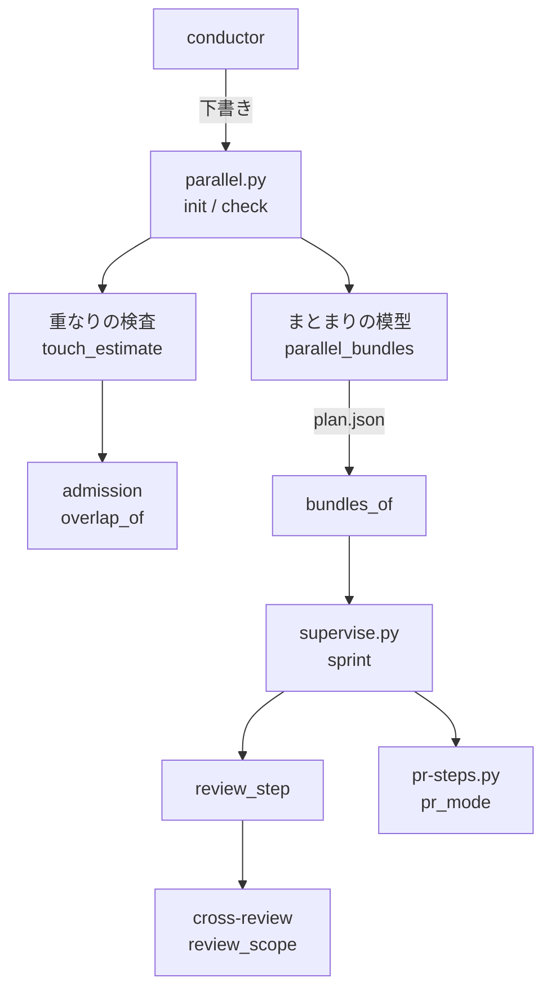
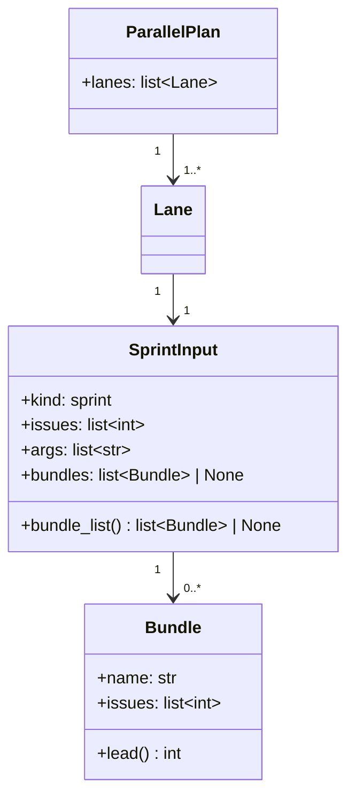
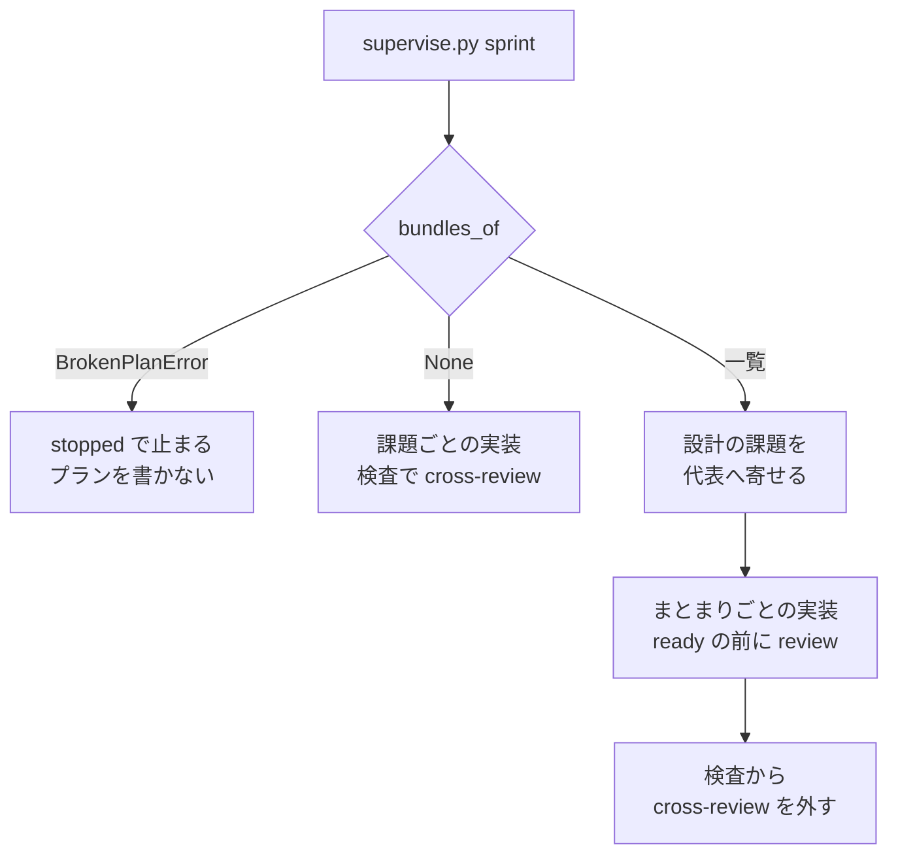

# 並列の計画: 課題のまとまりでスプリントを組み、まとまりごとにレビューする

## 概要

**並列の計画のスプリントのレーンは、似た課題を「課題のまとまり」へまとめて組める。** まとまり 1 つが実装の Pull Request 1 本に
なり、その Pull Request はスプリントブランチへ入る前に、まとまりの差分だけを範囲にして cross-review を回す。同じスプリントの
異なるまとまりの見込みが重なれば、並列の計画の検査（`parallel.py check`）が警告と組み替えの案を出す。

例: スプリントのレーンの入力が次のとき、まとまりは `review-scope`（#3004・#3001。代表は #3004）・`issue-3010`・`issue-3012` の
3 つになる。実装のプランは `impl-3004`・`impl-3010`・`impl-3012` の 3 本で、それぞれが Pull Request をスプリントブランチへ
入れる前に cross-review を通す。スプリントの Pull Request の検査は cross-review を回さない。

```json
{"kind": "sprint", "issues": [3001, 3004, 3010, 3012],
 "bundles": [{"name": "review-scope", "issues": [3004, 3001]}]}
```

**まとまりの欄（`bundles`）を書いたレーンだけが、この組み方になる。** 欄の無い計画のレーン・並列の計画を経ない単独のスプリント・
開発ループのスプリントは、課題ごとの実装のプランと、スプリントの Pull Request の全差分への cross-review 1 回で組まれる。

この文書は、まとまりの形・検査の規則・スプリントの組み方の契約と、その形にした理由を持つ。手順は Skill の文書が正本である。

| 何を読むか | 正本 |
| --- | --- |
| 似た課題をまとめる手順・まとめ方の条件・まとまりの欄の書き方・検査の規則の一覧 | `plugins/ndf/skills/issue-plan-strategy/references/parallel-plan.md` |
| まとまりのあるスプリントのステージの組み方 | `plugins/ndf/skills/issue-plan-strategy/references/execution-plan.md` |
| 規則 `bundle-overlap` の読み方 | `plugins/ndf/skills/development-workflow/references/parallel-checks.md` |
| スプリントブランチ宛ての Pull Request のレビューの区分 | `plugins/ndf/skills/pr/SKILL.md` |
| 見込みの出し方と規則 `I21` | [ndf-loop-selection-touch-estimate.md](ndf-loop-selection-touch-estimate.md) |
| cross-review のレビュー範囲 | [cross-review-review-scope.md](cross-review-review-scope.md) |

## 用語

「課題のまとまり」「代表の課題」「疎なまとまり」「まとまりの単位のレビュー」の定義は用語集（[docs/glossary.md](../glossary.md)）の
「NDF の工程（`ndf-workflow`）」が正である。

## コンテキスト

| コンテキスト | 何の語が 1 つの意味に決まるか |
| --- | --- |
| 並列の計画（`parallel`） | レーン・課題のまとまり・代表の課題・見込みの重なり |
| スプリントの進行（`sprint`） | 実装のプラン・課題の Pull Request・スプリントの Pull Request |
| 収束レビュー（`cross-review`） | レビュー範囲・ラウンド |

関係は公開された言語である。並列の計画が並列の計画の記録（`plan.json`。pydantic のモデル `ParallelPlan`）の形を公開し、
スプリントの進行はそのまとまりの欄を読むだけで書き換えない。収束レビューはまとまりを知らず、Pull Request の base と head から
レビュー範囲を求める。

## 背景

テーマの似た課題でスプリントを組むと、触るファイルが重なって実装が 1 本ずつしか流れず（実測の例: 480 分のあいだ同時に
動いた実装が 1 本）、スプリントの Pull Request で複数のテーマを 1 回にレビューするため収束しない（実測の例: 11 ラウンドで
上限に達した）。1 つの変更を自己完結した 1 つの内容にすると、小さい変更ほど速く丁寧にレビューされる（Google Engineering
Practices「Small CLs」 https://google.github.io/eng-practices/review/developer/small-cls.html ）。

設計判断の結論と理由:

| 判断 | 理由 |
| --- | --- |
| 似た課題は、親の課題を起こさずに代表の課題へ寄せる。同じ要求の課題だけを重複として閉じる（`gh issue close --duplicate-of`） | 親の課題は受け入れ条件を子から写すことになり、同じ事実を 2 か所に持つ。GitHub の sub-issue へ写すと、計画の記録との 2 か所をそろえる手間が生まれる |
| まとまり 1 つを実装の Pull Request 1 本にし、スプリントブランチへ入れる前に cross-review する | まとまりの Pull Request はまとまりの課題の変更だけを持つため、範囲が自然にまとまりへ限られる。まとまりごとに独立して収束し、ほかのまとまりの完了を待たない |
| まとまりはスプリントのレーンの入力の中に置く | まとまりがレーンをまたがないことが形で決まる。課題の集合の正本は `input.issues` のままにし、既存の読み手（規則 `I19`・見込みの集計・起動の組み立て・引継ぎの名前）を書き換えない |
| まとまりのあるスプリントの Pull Request では cross-review を回さない | まとまりの間の食い違いは見込みに出ない間接の依存で起き、全体テストと完了判定が見る。全差分を 1 ラウンド見る形でも、広い範囲の指摘を直す繰り返しが戻る。構造改善（cross-refactoring）と完了判定は残す |
| 開発ループのレーンには欄を置かない | ループのスプリントの中身はループが動く時点の選定が決め、見込みの重なる課題を同じスプリントに集めない並べ替えが既にある。計画の時点のまとまりは、ループが後で選ぶ課題に届かない |
| マイルストーンはテーマ別のまま残す | マイルストーンは計画に入れる課題を集める単位で、レーンとスプリントの組み方はまとまりと見込みの重なりが決める |
| 組み方は計画のレーンごとのまとまりの欄の有無で分け、全体の切り替えの設定は置かない | 欄の無い既存の記録とスプリントを、移行なしで今の組み方のまま動かすため |

## 仕様

### 構成要素

| 要素 | 責務 |
| --- | --- |
| まとまりの模型（`plugins/ndf/scripts/lib/parallel_bundles.py` の `Bundle`・`check_bundles`・`bundle_list`、`parallel_plan.py` の `SprintInput.bundles`） | まとまりの形と I1〜I3 の検証。I4 の補い（`SprintInput.bundle_list()`） |
| まとまりの重なりの検査（`touch_estimate.py` の `bundle_overlaps`） | 規則 `bundle-overlap` の項目。規則 `I21` の項目へ `bundles` の欄を足す |
| 計画の描画（`parallel_bundles.render_rows`） | `plan.md` に「課題のまとまり」の表を足す（欄のあるレーンだけ） |
| レーンのまとまりの読み出し（`parallel_bundles.bundles_of`） | 動いている計画のこのレーンのまとまりの一覧を返す。壊れた計画のレーンでは `BrokenPlanError` を投げる |
| スプリントの組み立て（`supervise_lib/sprint_bundles.py`・`sprint_waves.py`・`absorb.py`・`design_stage.py`） | 設計の課題を代表へ寄せ、実装のステージをまとまりごとのプランにし、検査のプランから cross-review を外す |
| レビューのステップ（`supervise_lib/templates.py` の `review_step`） | コードレビューの cross-review のステップを 1 か所で組む。検査のプランとまとまりの実装のプランが共有する |
| レビュー範囲（cross-review の `review_lib/review_scope.py`・`commands/start_round.py`） | 全差分の base を、base のブランチの今の先頭との merge base にする |
| 宛て先の区分（`lib/pr_mode.py` の `needs_review`・`pr-steps.py` の `bundled_sprint`） | まとまりの記録のあるスプリントブランチ宛てを、レビューを通す区分として返す |





- `Bundle.lead()` は `issues[0]`（代表の課題）を返す
- `SprintInput.bundle_list()` は、`bundles` が None なら None を返す。あれば、書かれたまとまりと、どのまとまりにも無い課題の
  1 件のまとまりを `input.issues` の順に返す
- ループのレーンの入力（`LoopInput`）には欄が無い。`extra="forbid"` のため、ループのレーンにまとまりを書くと形の誤り（`form`）になる

### 常に成り立つ条件

| # | 条件 | 破れたときの扱い |
| --- | --- | --- |
| I1 | どの課題も 2 つ以上のまとまりに入らない | 規則 `bundle` の誤り。`init` は記録を書かない |
| I2 | まとまりの課題は、そのまとまりを持つスプリントのレーンの `input.issues` にある | 規則 `bundle` の誤り |
| I3 | まとまりの名前は形（英小文字・数字・`-`・`_`、32 字まで）に合い、同じレーンの中で、I4 が補う名前を含めて一意。別のレーンのまとまりとは同じ名前でもよい | 規則 `bundle` の誤り |
| I4 | まとまりの欄があるレーンで、どのまとまりにも入っていない課題は、その 1 件だけのまとまり（名前は `issue-<番号>`）として扱う | 誤りにしない。検査とスプリントが同じ関数で補う |
| I5a | 同じスプリントのレーンの異なるまとまりの課題の見込みが重なれば、規則 `bundle-overlap` の警告を出す | 警告。終了コードは 0 のまま |
| I5b | 同じまとまりの課題どうしの見込みの重なりには、規則 `bundle-overlap` を出さない | テストが落とす |
| I6 | 見込みの重なりの判定は、実装のキューと同じ `admission.overlap_of` と共有の一覧だけで行い、規則 `I21` と同じ入力に同じ組を返す | テストが落とす |
| I7 | まとまりの欄の無い計画は欄が無いまま読み、既存の規則（`I4`・`I19`・`I21`）の項目の欄は消さず、足すだけにする | テストが落とす |
| I8a | まとまりの記録があるスプリントでは、まとまり 1 つにつき実装のプランが 1 本 | テストが落とす |
| I8b | まとまりの記録があるスプリントでは、実装のプランの Pull Request はスプリントブランチへ入る前に cross-review を通す | テストが落とす |
| I8c | まとまりの記録があるスプリントでは、スプリントの Pull Request の検査は cross-review を回さない | テストが落とす |
| I9 | まとまりの記録の無いスプリントは、課題ごとの実装のプランと、スプリントの Pull Request の全差分への cross-review 1 回で組む | テストが落とす |
| I10 | レビュー範囲の全差分の base は、PR の base のブランチの今の先頭と head の merge base である | テストが落とす |

**起動の後に `plan.json` を手で直して I1〜I3 が破れた計画は、どの経路からも誤りとして止まる。** `init`・`check` と、計画を読む
経路（`load_valid_plan`。レーンの起動・スプリントの組み立てが通る）が同じ検証を通す。レーンの判定（`parallel_lane.lane_of`）は
検証に通らない計画を飛ばして「レーンでない」と返すため、`bundles_of` はレーンの判定の前に計画の置き場を見て、検証に通らない
計画が次の 3 つをすべて満たせば `BrokenPlanError`（計画の名前と検証の誤りを持つ `ValueError` の派生）を投げる。

- `plan.json` の生の値の `lanes[].name` に、このレーンの名前（`NDF_RELAY_NAME`）がある
- そのレーンのリポジトリ（`repo`。省略時は計画の置き場）が、自分のメインディレクトリと一致する
- 計画の状態が `running` か `lost` である

3 つは `lane_of` がレーンを当てる条件と同じ範囲で、閉じた計画と別のリポジトリの計画は止める理由にしない。

### まとまりのあるスプリントの組み立て



| 段 | 振る舞い |
| --- | --- |
| まとまりの読み出し | `bundles_of` が `BrokenPlanError` を投げたら、`supervise-new` の結果を `stopped` で返し、プランを書かない。読んだまとまりはこのスプリントの課題に絞り、課題を 1 つも持たないまとまりは外す |
| 設計 | 設計の課題を代表の課題へ寄せる。代表の設計のプランへ、まとまりのほかの課題を「課題」と要求・設計の指示として渡し、まとまりの設計文書は代表の番号で 1 本作る |
| 設計の結果の取り込み | まとまりのプランは、閉じる・取り込むとした課題を外し、実装する課題が残れば流す。残らなければ `実行の条件` で飛ばし、飛ばす理由は外した課題の扱い（閉じる・取り込む）から取る。触るファイルは、プランが実装するすべての課題の設計の結果から集める |
| 取り込み（`--absorb`） | 取り込み先・取り込む課題は、その課題を実装するプラン（まとまりの代表）で引く。取り込む課題が複数件のまとまりにいるときは、プランを飛ばさずにその課題だけを `課題` から外す |
| 実装 | まとまり 1 つにつきプラン `impl-<代表>` を 1 本組む。プランはまとまりのすべての課題を `課題` に持ち、ブランチと Pull Request は代表の課題の番号で作る（`feat/issue-<代表>-<スプリント名>`） |
| 実装のプランのレビュー | `ready`（Draft を外す）の前に `review-push`（`git push -q`）→ `review`（`review_step`）→ `review-pull`（`git pull -q --ff-only`）を置く。手元の未送信のコミットを送ってからレビューし、別の作業場所から送られたレビューの直しを早送りで受けてから `ready` へ進む |
| 検査 | 検査のプランから `review` のステップを外し、構造改善（`assess` → `refactor`）から振る舞いの確認へ進む |

`review_step` は `cross-review {pr} --max-rounds 4` を回す drive のステップで、収束しなかった終わり（終了コード 6 と gaps）も
落ちたとして `on_fail` へ行き、後続へ進まない。まとまりの実装のプランでは `on_fail` は `stop` である。

## データ・設定

並列の計画の記録（`plan.json`）のスプリントのレーンの入力に、任意の欄 `bundles` を持つ。版（`version: 1`）は変えず、
リポジトリの設定は増やさない。まとまりの形の正本は `ParallelPlan` の pydantic のモデルで、契約の登録
（`plugins/ndf/contracts/files/plan-json.json`）は変えない。

| 欄 | 型 | 空の扱い | 意味 |
| --- | --- | --- | --- |
| `bundles` | まとまりの配列 | 省くと「まとまりの記録なし」（課題ごとの組み方）。空の配列は「すべての課題が 1 件のまとまり」 | このレーンのスプリントをまとまりの単位で組む |
| `bundles[].name` | 文字列 | 省けない | まとまりの名前（I3） |
| `bundles[].issues` | 整数の配列（1 件以上） | 省けない | まとまりの課題。先頭が代表の課題 |

課題の集合の正本は `input.issues` で、`bundles` は課題をどのまとまりに入れるかの対応だけを持つ。重複として閉じた課題は
`input.issues` にも `bundles` にも書かない（閉じた記録は GitHub の重複の印が持つ）。

| 機能 | `input.issues` | `bundles` |
| --- | --- | --- |
| 計画を書く（`init`） | 作る | 作る |
| 検査（`check`） | 読む | 読む |
| スプリントを組む | 読む | 読む |
| 起動の前の手の直し | 更新する | 更新する |

## 外部連携

### 検査の規則

`parallel.py init` / `check` の統一 JSON レポートの `items[]` に、規則を 2 つ持つ。

| 規則 | 水準 | 出す条件 | 欄 |
| --- | --- | --- | --- |
| `bundle` | error | I1〜I3 が破れた | `level`・`rule`・`at`（例: `lanes.1.input.bundles`）・`message` |
| `bundle-overlap` | warning（`check` だけ） | 同じスプリントのレーンの異なるまとまりの課題の見込みが重なる（I5a） | `level`・`rule`・`at: "lanes"`・`message`・`lanes`（1 レーン）・`bundles`（2 つの名前）・`issues`（2 つの課題）・`paths`・`proposals` |

```json
{"level": "warning", "rule": "bundle-overlap", "at": "lanes",
 "message": "同じスプリントの異なるまとまりの課題の見込みが重なる: s1 の review-scope #3004・issue-3010 #3010（plugins/ndf/scripts/lib/parallel_plan.py）",
 "lanes": ["s1"], "bundles": ["review-scope", "issue-3010"], "issues": [3004, 3010],
 "paths": ["plugins/ndf/scripts/lib/parallel_plan.py"],
 "proposals": [{"kind": "move", "bundle": "issue-3010", "from": "s1"},
               {"kind": "after", "bundle": "issue-3010", "from": "s1"}]}
```

| 案 | 意味 |
| --- | --- |
| `move` | 後ろのまとまりを、同じ時間帯に動かない別のスプリントのレーンへ移す。移す先は conductor が決める |
| `after` | 後ろのまとまりを新しいレーンへ移し、そのレーンの `after` に `from` のレーンを足す |

規則 `I21` の項目は、2 つのレーンのどちらかにまとまりの欄があるとき、欄 `bundles`（2 つのまとまりの名前。欄の無いレーンの側は
`issue-<番号>`）と、`move` の案に欄 `bundle` を足す。既存の欄は変えない（I7）。

### スプリントブランチ宛ての Pull Request の区分

`pr-steps.py plan` の `metrics.review` は、スプリントブランチ宛てでも、動いている並列の計画のこのレーンにまとまりの記録があれば
`true` を返す（`pr_mode.needs_review(base, bundled)`）。宛て先の区分 `metrics.target` は `sprint` のままである。計画を読めない・
壊れた計画は `false`（まとまりの無い扱い）にする。壊れた計画のレーンはスプリントの組み立てが止めるためである。

### レビュー範囲

cross-review の状態ファイルの `rounds[].review_scope` の形（`range`・`base_sha`・`head_sha`・`files`）は変えない。`range` が
`full` のときの `base_sha` は、PR の base のブランチ（状態ファイルの `base_branch`）を `origin` から取得した先頭と head の
merge base にする。取得できない・求められないときは、REST の `base.sha` を使う。

まとまりの Pull Request は、実装のプランの取り込み（base-sync）でスプリントブランチを何度も取り込む。merge base を取ると、
Pull Request の差分の画面（three-dot。GitHub Docs「About comparing branches in pull requests」
https://docs.github.com/en/pull-requests/collaborating-with-pull-requests/proposing-changes-to-your-work-with-pull-requests/about-comparing-branches-in-pull-requests ）
と同じ範囲になり、取り込んだ他のまとまりのファイルは範囲に入らない。詳細は [cross-review-review-scope.md](cross-review-review-scope.md) にある。

## 運用

- 似た課題をまとめる判断と、まとまりをレーンとスプリントへ割り当てる判断は conductor（オーガナイザー）が行う。スクリプトは
  まとまりの形の検査と見込みの重なりの検査だけを持つ。まとめ方の条件（重複として閉じる・同じまとまりにする・まとめない）は
  `parallel-plan.md` の手順にある
- レビューの回数はまとまりの数だけ増える。スプリントあたりのレビューの合計の所要時間と費用は、スプリント単位で回した値と並べて
  記録する

## テスト観点

| 観点 | 確かめること |
| --- | --- |
| I1・I2 | 2 つのまとまりに同じ課題を書いた下書き・`input.issues` に無い課題をまとまりに書いた下書きで、規則 `bundle` の誤りが出て `init` が書かないこと |
| I3 | 名前の形が違うまとまり・同じレーンの中で名前が重なるまとまり（補う `issue-<番号>` と重なる名前を含む）で規則 `bundle` の誤りが出ること。別のリポジトリの同じ番号の課題を持つ 2 レーンに `bundles: []` を書いた計画は誤りにならないこと |
| 計画を読む経路 | 起動の後に I1〜I3 を破った `plan.json` のレーンで、`bundles_of` が誤りを投げ、`supervise.py sprint` が `stopped`（プランを書かない）で止まること。このレーンを含まない壊れた計画・閉じた壊れた計画・別のリポジトリをレーンのリポジトリに持つ壊れた計画では止まらないこと |
| I4 | `bundles: []` のレーンで `bundle_list()` が課題ごとの 1 件のまとまりを返し、`bundle-overlap` が 1 件のまとまりの間でも出ること |
| I5a | 同じレーンの異なるまとまりの見込みが重なると、`bundle-overlap` が `bundles`・`issues`・`paths`・`move` / `after` の案を出すこと。`after` の付かない 2 レーンの異なるまとまりの重なりは、規則 `I21` が `bundles` の欄つきで出すこと |
| I5b | 同じまとまりの 2 課題の見込みが重なっても `bundle-overlap` が出ないこと |
| I6 | 同じ見込みと共有の一覧に対して、`bundle-overlap` の課題の組と、同じ 2 課題を別レーンに置いたときの規則 `I21` の組が一致すること |
| I7 | まとまりの欄の無い既存の `plan.json` を `check_data` と `load_valid_plan` が同じ計画として読み、規則 `I4`・`I19`・`I21` の項目の既存の欄が変わらないこと |
| I8a〜I8c | まとまりの記録のあるスプリントで、実装のプランがまとまりの数だけあり、各プランに `review` のステップがあって `metrics.review` が `true` になり、検査のプランに `review` が無いこと |
| 設計と取り込み | まとまりの課題が代表の設計へ渡り、閉じる・取り込むとした課題がまとまりのプランから外れ、残る課題が無いプランは外した課題の扱いで飛ぶこと。`--absorb` が代表のプランへ寄ること |
| I9 | まとまりの記録の無いスプリント（レーンでない・ループのレーン・欄の無いレーン）の組み立てが、課題ごとのプランと検査の cross-review を返すこと |
| I10 | base のブランチが head へ取り込まれた後でも、全差分の `files` がまとまりの変えたファイルだけを数えること |

テストは `plugins/ndf/scripts/tests/test_parallel_bundles.py`・`test_sprint_bundles.py`・`test_parallel_touch_estimate.py` と
`plugins/ndf/skills/cross-review/tests/test_review_scope.py` にある。

まとまりで組んだ計画の同時に動く本数（`parallel-measure.py concurrency`）と、まとまりの Pull Request ごとの差分の行数・
ラウンド数・所要・費用は、実際に回した計画の記録から集計して、起点の課題に記録する。

## 関連リンク

- [ndf-loop-selection-touch-estimate.md](ndf-loop-selection-touch-estimate.md): 見込みの出し方と規則 `I21`
- [cross-review-review-scope.md](cross-review-review-scope.md): レビュー範囲
- [ndf-supervise-base-sync.md](ndf-supervise-base-sync.md): スプリントの検査のプランと base-sync
- [ndf-execution-plan-and-parallel-capacity.md](ndf-execution-plan-and-parallel-capacity.md): 実行計画と並列の容量
