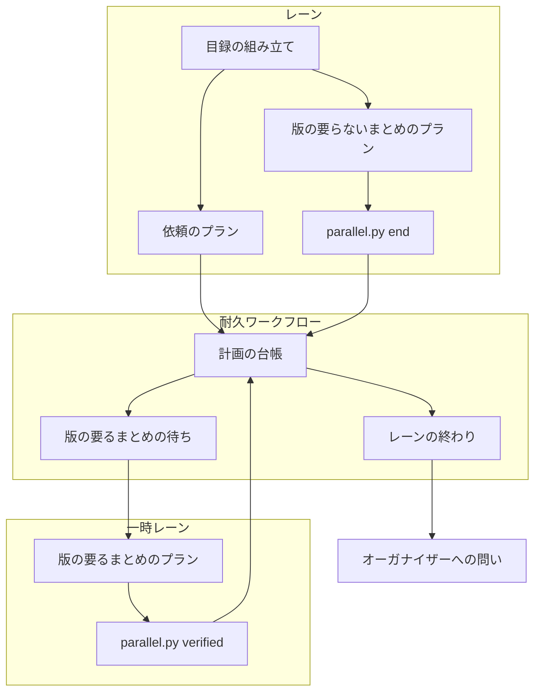
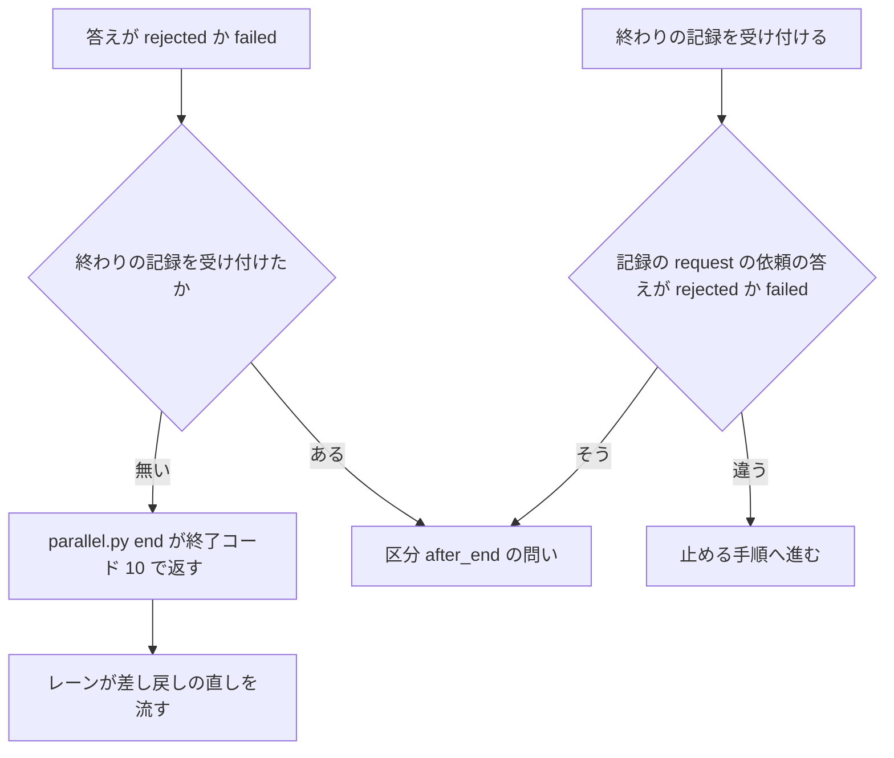

# 並列の計画: 1 スプリントのレーンはリリースを待たずにまとめへ進み、耐久ワークフローに止められ、承認した範囲のまま出る

並列の計画（`--parallel <計画名>`）の 1 スプリントのレーンは、リリースの依頼を送った後、答えを待たずに版の要らない
まとめ（確定仕様化・振り返り・棚卸し）を流し、最後に終わりの記録を計画の台帳へ書いて終わる。耐久ワークフロー
（`parallel.py run`）はその記録を読んでレーンのラッパーを止め、`after` でそのレーンを待つレーンを起動する。
リリース後テストと課題を閉じる作業（版の要るまとめ）は、`released` の答えの後に、出した版の上で一時レーンが流す。
承認したリリースは、承認したコミットのまま本番へ入る（#3058。#3060・#3070 を含む）。

**手順の正本は Skill とスクリプトにある。** この文書は、決めたことの理由と、書く側と読む側が共有する形を残す。

| 何を読むか | 正本 |
| --- | --- |
| まとめたリリース・一時レーン・レーンの側・止める・異常のときのオーガナイザーの手順 | [`development-workflow` の `references/parallel.md`](../../plugins/ndf/skills/development-workflow/references/parallel.md) |
| レーンの終わり・止める・問い・版の要るまとめの待ち | [`lib/parallel_end.py`](../../plugins/ndf/scripts/lib/parallel_end.py) |
| レーンのまとめのプランの組み立て | [`supervise_lib/sprint_lane_close.py`](../../plugins/ndf/scripts/supervise_lib/sprint_lane_close.py) |
| 台帳の行の種類 | [`contracts/forms/parallel-ledger.json`](../../plugins/ndf/contracts/forms/parallel-ledger.json)・[ndf-parallel-plan-ledger.md](ndf-parallel-plan-ledger.md) |
| 並列の計画とオーガナイザーの全体 | [ndf-parallel-organizer.md](ndf-parallel-organizer.md) |
| レーンの本番のステージと経路 | [ndf-parallel-lane-prod-stage-and-dropped-issues.md](ndf-parallel-lane-prod-stage-and-dropped-issues.md) |

## 概要

| 順 | 起きること |
| ---: | --- |
| 1 | 1 スプリントのレーンが依頼のプランでリリースの依頼を送る。依頼には版の要るまとめのプランのパス（`verify_plan`）が載る |
| 2 | 依頼のプランは終了コード 10 を完了として扱い、目録の次のステージ「まとめ」へ進む |
| 3 | 版の要らないまとめが流れ、最後のステップ `parallel.py end` が台帳へ `lane_end` の行を書く |
| 4 | 耐久ワークフローが行を受け付け、60 秒の後に `relay.py stop <レーン>` を打ち、一覧で止まったかを確かめ、台帳へ `lane_halt` の行を残す |
| 5 | 止まったレーンを終わったと数え、`after` で待つレーンを起動する。止められなければ区分 `halt` の問いでオーガナイザーへ返す |
| 6 | 利用者がリリース承認ゲートで承認すると、提示 1 で承認したコミットのまま本番へ入る（`released`） |
| 7 | `released` の答えから版の要るまとめの待ちができ、流れているリリースが無いときに一時レーンが流し、`parallel.py verified` で結果を返す |

この経路は、印 `parallel-lane-end`（数え方・止める）と `parallel-approved-sha`（確定）が立つ耐久ワークフローの
記録でだけ働く。印の無い古い記録の打ち直しは、止まって観えたレーンを止まったと数え、承認の答えで出し直しを判定する
今までの道を通る。

## 用語

1 スプリントのレーン・まとめ・版の要らないまとめ・版の要るまとめ・レーンの終わり・終わりの記録・一時レーン・
出し直しの提示・加わった範囲・止められなかったレーンの問い・終わりの記録の無い停止の問いの定義は、
用語集（[docs/glossary.md](../glossary.md)）にある。

## コンテキスト

すべて NDF の開発ワークフロー（`ndf-workflow`）の中で閉じる。

## 構成要素

| 要素 | 責務 |
| --- | --- |
| 目録の組み立て（`supervise_lib/sprint.py`） | 1 スプリントのレーンのとき、本番の後にまとめのステージを足す。依頼の経路では依頼のプランへ版の要るまとめのプランのパスを渡す |
| レーンのまとめのプラン（`supervise_lib/sprint_lane_close.py`） | 版の要らないまとめのプラン（`lane_close_plan`）・版の要るまとめのプラン（`verify_plan`）・本番をレーンの中で流し終えた経路のまとめのプランを組む。最後のステップ以外は今のまとめのステップを使い回す。依頼の経路では、依頼のプラン（`lib/parallel_release.py` の `plan_release_request` が組む）の依頼のステップへ、終了コード 10 を完了へ向ける `on_exit` を足す |
| レーンの CLI（`parallel.py` の `end`・`request --verify-plan`・`verified`） | 終わりの記録・版の要るまとめの知らせ・版の要るまとめの結果を台帳へ書いて耐久ワークフローへ送る |
| レーンの開始の入力（`lib/parallel_plan.py` の `Lane.start_command`） | 1 スプリントのレーンの開始の 1 行へ「-- 終わり:」を足す |
| レーンの終わり（`lib/parallel_end.py` の `LaneEnding`。`_Run` が継ぐ） | 終わりの記録の受け付け・猶予の後の停止・止められなかったレーンの問い・終わりの記録の無い停止の問い・依存の判定で止まったと数える集合・版の要るまとめの待ちと一時レーン・差し戻しの問い |
| 一時レーンの組み立て（`lib/parallel_helper.py` の `verify_spawn`・`verify_task`） | 版の要るまとめを流す一時レーンの入力（`--parallel-helper <計画名> verify <依頼>`）と流すもの |
| 計画の台帳（`lib/parallel_ledger.py`） | 行の種類 `lane_end`・`lane_halt`・`verify`・`verified` を読み、チェックポイントへ版の要るまとめの待ち（`verifies`・`verifying`・`verify_plans`）を持つ |

## 仕様

### 集約

| 集約 | 持ち主 | 根 | エンティティ | 値オブジェクト |
| --- | --- | --- | --- | --- |
| 計画の進行 | 耐久ワークフロー（`parallel.py run`） | 計画の進行 | レーン・まとめたリリース・受けている依頼・版の要るまとめの待ち | 終わりの記録・止めた結果・承認したコミット |
| スプリントの目録 | `supervise.py new sprint` | 目録（`sprint.json`） | ステージ | まとめのプランのパス・版の要るまとめのプランのパス |

レーン・一時レーン・オーガナイザーの CLI は計画の進行を書き換えず、台帳へ行を足して知らせるだけである。

### 常に成り立つ条件

| # | 条件 | 破れたときの扱い |
| --- | --- | --- |
| I1 | 終わりの記録は 1 スプリントのレーン 1 本につき最初の 1 件だけが効く | 2 件目とほかの種類のレーンからの記録は読み捨て、標準エラーへ理由を出す |
| I2 | 1 スプリントのレーンを `after` の依存と計画の終わりで「止まった」と数えるのは、止まって観え、かつ終わりの記録があるか、人が止めたままにしたか、起動を諦めたときだけである | 終わりの記録の無い停止は数えない |
| I3 | 終わりの記録のあるレーンへ止める 1 行を打つのは、耐久ワークフローの作り直しを越えて 1 回だけである | 止めた結果を耐久ステップの戻り値・チェックポイントの `lanes`・台帳の `lane_halt` の行に持ち、どれかがあれば打たない |
| I4 | 止められなかったレーンの問いは、そのレーンが止まって観えるまで消えない | 答え「止めた」の後も動いて観えれば、新しい ID で立て直す |
| I5 | 承認したリリースの範囲は提示 1 のコミットまでで、承認の答えの時点のベースブランチの先頭で変わらない | 提示 2 を作らない |
| I6 | 版の要るまとめは `released` で答えた依頼についてだけ流れ、待ちが残る間は計画を終えない | 終わりの判定を偽にする |
| I7 | 一時レーンは同時に 1 本までである | リリースが流れている間と版の要るまとめを流している間は、もう片方を起動しない |
| I8 | 版の要らないまとめのプランは課題を閉じるステップを持たない | 課題を閉じるのは版の要るまとめのプランか、本番をレーンの中で流し終えた経路のまとめのプランだけ |
| I9 | 差し戻し（`rejected`）と失敗（`failed`）の答えは失われない | レーンが終わる前ならレーンへ、終わった後ならオーガナイザーへの問いとして届く |
| I10 | 開発ループのレーンと一時レーンの開始の入力・終わり方・止め方は変わらない | — |

### まとめのステージ（目録）

| レーンの本番の経路 | まとめのステージのプラン | 版の要るまとめのプラン |
| --- | --- | --- |
| リリースの依頼（同じリポジトリでテンプレートで出す） | 確定仕様化 → Pull Request → 起動の判定 → 振り返り → 棚卸し → マージ → 終わりの記録 | リリース後テスト（控えを取る・比べるを含む）→ 課題を閉じる。`released` の後に一時レーンが流す |
| レーンの中で本番を流し終える（リリースの Pull Request・マージで届く・別のリポジトリ） | 今のまとめ（リリース後テストと課題を閉じるを含む）→ 終わりの記録 | 作らない |

印 `parallel-lane-end` の前に始めた計画の打ち直しか、その記録を読めないときは、目録は依頼の答えを待ってから今までの
まとめを流し、その最後に終わりの記録を書く（`sprint_lane_close.plan_ends`）。外のオーガナイザー
（`NDF_ORGANIZER_DIR`）のレーンと計画の外のスプリントの目録は変わらない。

### 依頼のプランの終わり方

1 スプリントのレーンの依頼のプランは、依頼のステップの終了コード 10（承認ゲート）を `on_exit` で完了へ向け、
`--then` のつながりでまとめのステージへ進む。開発ループのレーンは、承認ゲートで終わった依頼のプランを
「リリース待ち」として読むため、今のままにする。`parallel.py request` の終了コードは変えない。

### 終わりの記録と止める

- 1 スプリントのレーンの開始の 1 行は `/goal /ndf:development-workflow #<課題> -- 終わり: [ndf-parallel] lane-end <計画> <レーン> の行を出したとき` である
- 耐久ワークフローは、終わりの記録の時刻から `HALT_DELAY`（60 秒）が過ぎた観測で、耐久ステップ `parallel.halt` を打つ。まとめのプランの queue が結果のファイルを書き終えるのを待つためである
- `parallel.halt` は `relay.py stop <レーン> --json` を打ち、続けて `relay.py ls --json` を 1 回読む。止める 1 行が 0 か 3（既に止まっている）で、一覧でそのレーンが動いていない（`running`・`awaiting_approval` でない、または一覧に無い）なら `stopped`、ほかは `failed` とし、台帳へ `lane_halt` の行を足す
- 書き手が `organizer` の終わりの記録（区分 `unended` の問いへの「終わったと数える」）は、ラッパーが止まっているため止める 1 行を打たず、`stopped` として扱う

### 耐久ワークフローが立てる問い

区分 `halt`・`unended`・`after_end` の問いは、答えても持ち主のレーンを起こさない（終わったレーンを起こし直さない）。

| 区分 | 立てる条件 | 選択肢 | 答えの扱い |
| --- | --- | --- | --- |
| `halt` | 止めた結果が `failed`、または `stopped` でも次の観測で動いて観えた | `止めた`（`commands` に `python3 <relay.py> stop <レーン>`） | 次の観測で確かめ、まだ動いていれば新しい ID で立て直す。止まって観えたら問いを片付ける |
| `unended` | 起動済みの 1 スプリントのレーンが、終わりの記録・答え待ち・再開の印・起こし直しの待ち・依頼のどれも無いまま、停滞の区切り（`NDF_PARALLEL_STALL_MINUTES`、既定 60 分）より長く止まって観えた。区切りごとに 1 回 | `終わったと数える`・`起こし直す`・`待つ` | `終わったと数える` は書き手 `organizer` の終わりの記録として反映する。`起こし直す` は再起動の対象へ入れる |
| `after_end` | 終わりの記録を受け付けた後に、そのレーンの依頼が `rejected` か `failed` で答えられた | `レーンを足して直す`（`commands` に `parallel.py lane <計画> add --from <JSON>`）・`見送る` | オーガナイザーがレーンを足すか見送る |
| `helper` | 版の要るまとめの一時レーンが `verified` を送らずに、立ち上がりの後に 2 回続けて止まって観えた | `続きから起こし直す`・`止める` | `止める` は結果 `止めた` で待ちから外す |

### 差し戻しと失敗を届ける

- `parallel.py end --request <依頼の記録>` は、記録を書く前に自分の依頼の答えを読み、`rejected` か `failed` なら記録を書かずに `status: gate`・終了コード 10 で返す
- 耐久ワークフローは終わりの記録を受け付けるときにも、行の `request` が指す依頼の答えを照らし、確定していれば区分 `after_end` の問いを立てる。`end` が答えを確かめた後に確定した答えを失わないためである
- 照らすのは行の `request` が指す依頼だけで、レーン名から依頼を引かない。差し戻しの直しで新しい依頼を送ってから終わったレーンに、古い依頼の差し戻しで問いを立てないためである

### 版の要るまとめの待ち

- `released` の答えで、依頼の `verify_plan` から待ち（`id`・`lane`・`plan`・`version`・`release`）を作る。組み直しの依頼は元の依頼のプランを使う
- 自分の Pull Request が既に本番にあり依頼を送らないときは、`parallel.py request --verify-plan` が台帳へ `verify` の行を書いて待ちを作る
- 流れているリリースも流している待ちも無く、計画全体の停止の間でもなければ、待ちのうちレーンの終わりの記録があるものの先頭を一時レーン（名前は `<一時レーンの名前>v`）で流す。まとめより先に課題を閉じないためである。流している間は新しいリリースを開かない
- 一時レーンは `parallel.py verified <計画> <依頼>` で流すものを受け取り、プランを `supervise.py queue` で流し、`--done <結果>` で結果（全項目が `完了` なら `完了`、ほかは `失敗`）を返す
- 終わりの記録を得られないまま人が止めたままにしたか起動を諦めたレーンの待ちは、計画の終わりを止めない

### 承認したコミットのまま出す

印 `parallel-approved-sha` の後の記録では、提示 1 への承認の答えでベースブランチの先頭と比べず、提示 1 で確定する。
本番のプランは提示 1 で承認したコミットから `release/v<版>` を切る。承認の後に入った変更（加わった範囲）の依頼は、
範囲の Pull Request で全部が出る依頼にだけ答える規則のまま、次のリリースで答えられる。出し直しの提示と、
出し直しを省く経路（`carried`）は、印の無い古い記録の打ち直しでだけ通る（[ndf-parallel-organizer.md](ndf-parallel-organizer.md) の I28）。

## データ・設定

台帳に足す行の種類:

| 行の種類 | 書き手 | `key` | `msg` の値 | 状態への反映 |
| --- | --- | --- | --- | --- |
| `lane_end` | `parallel.py end` | `lane_end:<レーン>` | `lane`・`by`・`at`・`request`（`--request` を渡したときだけ） | `lanes[<レーン>].ended`（最初の 1 件だけ） |
| `lane_halt` | 耐久ステップ `parallel.halt` | `lane_halt:<レーン>` | `lane`・`result`（`stopped` / `failed`）・`code`・`state`・`at` | `lanes[<レーン>].halt` |
| `verify` | `parallel.py request`（既に本番にあるとき） | `verify:<依頼>` | `id`・`lane`・`plan`・`version` | 版の要るまとめの待ちへ足す |
| `verified` | `parallel.py verified --done` | `verified:<依頼>` | `id`・`result`（`完了` / `失敗`）・`at` | 待ちから外す |

印 `parallel-lane-end` の無い古い記録では、これらの行を状態へ反映しない。依頼（`parallel-request.json`）には任意の
`verify_plan`（版の要るまとめのプランの絶対パス）が載る。空は本番をレーンの中で流し終えた経路か開発ループのレーンで、
待ちを作らない。新しい設定項目は足していない。猶予の 60 秒は定数である。

## 外部連携

| 名前 | 入力 | 成功 | 失敗の形 |
| --- | --- | --- | --- |
| `parallel.py end <計画> --lane <レーン> [--request <依頼の記録>]` | 計画名・レーン名・依頼の記録のパス | `status: ok`、標準エラーに `[ndf-parallel] lane-end <計画> <レーン>`、台帳に `lane_end` の行 | 答えが `rejected` / `failed`: `gate`・10・行を書かない。計画が動いていない: `stopped`・1。依頼の記録か台帳を読み書きできない: `stopped`・2。外のオーガナイザーのレーン: `ok`・行を書かない |
| `parallel.py request ... --verify-plan <パス>` | 今の引数に版の要るまとめのプランのパスを足す | 依頼に `verify_plan` が載る | 今のとおり |
| `parallel.py verified <計画> <依頼> [--done <結果>]` | `--done` 無しは流すものの照会、ありは queue の結果 | `status: ok` | プランが台帳に無い: 1。結果を読めない・台帳へ書けない: 2 |

## 決定と理由

- **終わりはまとめのプランの最後のステップが台帳へ書き、止めるのは耐久ワークフローにする。** 終わりを知るのはまとめのプラン自身で、conductor の判断と画面の出力を通らない。止める主体を耐久ワークフロー、予備をオーガナイザーにするのは利用者の指示による。引継ぎ文書へ印を書く形は、耐久ワークフローの入力が台帳とメッセージの 2 つから増えるため採らない
- **止める 1 行の終了コードだけで止まったと決めない。** 止めた後も動いて観えることがあるため、続く一覧で確かめる
- **止められなかったレーンは `wait` の問いで返す。** オーガナイザーが読む経路が既にあり、答え待ちとして計画の終わりも止め、作り直しでも台帳から戻る
- **版の要るまとめは `released` の後に一時レーンで流す。** レーンは版の要らないまとめの後に止まっているため、`released` を受け取れるのは耐久ワークフローだけである。終わったレーンを起こし直すと、レーンの数の上限で後続のレーンと枠を取り合う。リリース後テストは Claude の作業で、耐久ステップの中では流せない
- **一時レーンは同時に 1 本に保ち、版の要るまとめを流している間はリリースを開かない。** 同時の数はメモリの上限から来ている。リリースを優先すると、依頼が続く計画で課題が閉じない
- **承認したコミットから出し、加わった範囲は次のリリースへ回す。** git-flow のリリースブランチと同じ形で、計画 p5 では 6 回のリリースのうち 3 回で出し直しの提示が作られていた
- **数え方と確定の変更は耐久ワークフローの印（`DBOS.patch()`）で分ける。** 動いている計画の記録の打ち直しと食い違わないためである

## エラー処理

| 事象 | 扱い |
| --- | --- |
| 止める 1 行が失敗・止めた後も動いて観える | 区分 `halt` の問い |
| 終わりの記録の無いまま止まった 1 スプリントのレーン | 依存の判定で数えず、区切りを越えたら区分 `unended` の問い |
| 終わった後の差し戻しか失敗 | 区分 `after_end` の問い |
| 版の要るまとめの一時レーンが結果を返さずに止まった | 区分 `helper` の問い |
| 台帳へ `lane_halt` を書けない | 標準エラーへ出し、止めた結果は耐久ステップの戻り値とチェックポイントに残す |

## 運用

未確認のまま残っていることは次の 3 つで、次の並列の計画の台帳とプランの状態ディレクトリを読むと分かる。

| 項目 | 確かめ方 |
| --- | --- |
| 猶予 60 秒の足り方 | 止めた時刻（`lane_halt` の `at`）とまとめのプランの結果のファイルの時刻を比べる |
| 版の要るまとめが次のリリースを待たせる時間 | 台帳の `verify`・`verified` の行の時刻 |
| 版の要るまとめのプランのファイルが流す時点まで残るか | プランはレーンのスプリントの状態ディレクトリに置く。レーンの終わりからリリースまでに後片付けが消すかを見る |

## テスト観点

- 1 スプリントのレーンの開始の 1 行が「-- 終わり:」を持ち、`parallel.py end` が `lane_end` の行を書くこと
- 終わりの記録から猶予の後に止める 1 行が 1 回だけ打たれ、`lane_halt` の行が 1 行残り、作り直しの後も打たないこと
- 止める 1 行の失敗と止めた後も動いて観える場合に区分 `halt` の問いが立ち、止まって観えるまで消えないこと。止める 1 行が 3 を返したレーンも `stopped` として数えること
- 終わりの記録があり止まって観えたレーンを待つレーンが起動し、終わりの記録の無いまま止まったレーンを待つレーンは起動しないこと
- 1 スプリントのレーンの目録で本番の後にまとめのステージがあり、版の要らないまとめのプランに課題を閉じるステップが無く、計画の外のスプリントの目録が変わらないこと
- 開発ループのレーンの開始の 1 行・依頼のプランの承認ゲート・一時レーンの終わり方が変わらないこと
- 1 スプリントのレーンの依頼のプランが終了コード 10 で完了し、まとめのステージへ進むこと
- `released` で版の要るまとめの待ちができ、一時レーンが流し、`verified` で外れ、待ちが残る間は計画が終わらないこと。一時レーンが 2 本同時に起動しないこと
- 終わる前の差し戻しで `end` が 10 で返り、終わった後の差し戻しと、`end` の確認の後に確定した差し戻しで区分 `after_end` の問いが立ち、直しの後に新しい依頼で終わったレーンには古い依頼で問いが立たないこと
- 新しい記録で承認の答えの時点にベースブランチが進んでいても提示 2 を作らずに提示 1 のコミットで `released` になり、加わった範囲の依頼が次のリリースで答えられること。印の無い古い記録では今の出し直しの判定を通ること
- 2 件目の終わりの記録と開発ループのレーンからの記録で状態が変わらないこと
- 終わりの記録も答え待ちも無いまま区切りより長く止まったレーンに区分 `unended` の問いが立ち、「終わったと数える」で数えられること

テストは `plugins/ndf/scripts/tests/` の `test_parallel_end.py`・`test_parallel_run.py`・`test_parallel_plan.py`・
`test_parallel_carry.py`・`test_sprint_lane_close.py` にある。

## 関連リンク

- [ndf-parallel-organizer.md](ndf-parallel-organizer.md)
- [ndf-parallel-plan-ledger.md](ndf-parallel-plan-ledger.md)
- [ndf-parallel-lane-prod-stage-and-dropped-issues.md](ndf-parallel-lane-prod-stage-and-dropped-issues.md)
- [ndf-parallel-durable-lane-launch.md](ndf-parallel-durable-lane-launch.md)
- [ndf-production-release-record.md](ndf-production-release-record.md)
- Kubernetes の Job と TTL-after-finished: https://kubernetes.io/docs/concepts/workloads/controllers/job/
- git-flow のリリースブランチ: https://nvie.com/posts/a-successful-git-branching-model/
- DBOS のワークフローの更新（patching）: https://docs.dbos.dev/python/tutorials/upgrading-workflows
