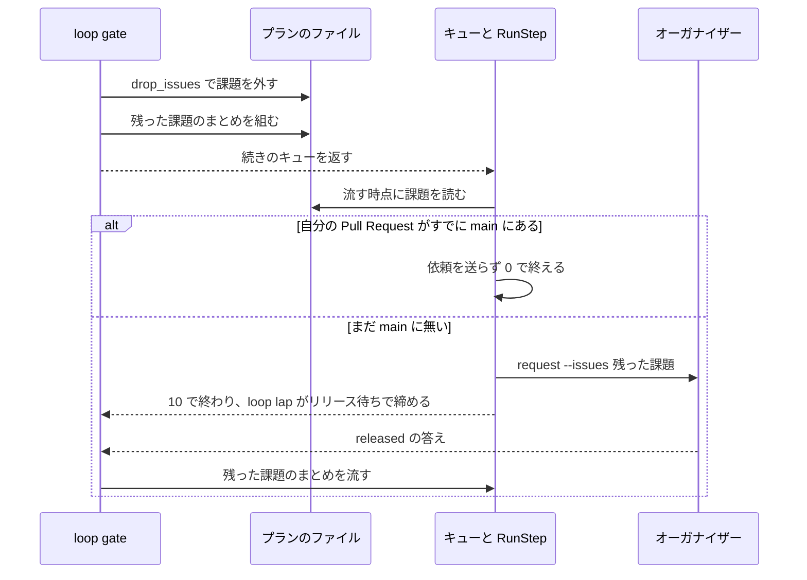

# 並列の計画のレーンの本番のステージと、設計承認ゲートで外した課題

## 概要

並列の計画のレーンは、`loop sprint`（開発ループの 1 回）と `supervise.py new sprint`（1 スプリント）が組んだプランを、手で書き換えずに最後まで流す。
本番のステージはリリースの経路ごとに組み上がっており、リリースの Pull Request で届く経路ではレーンが本番チャネルへ入れるリリースプランをそのまま流す。設計承認ゲートで課題を外したループの 1 回では、
続きのプラン（本番チャネルへ入れるリリースプラン・リリースの依頼のプラン・まとめのプラン）が残った課題だけを持ち、外した課題に確定仕様化・閉じる判定・リリースの依頼が掛からない。

リリースの依頼のプランを組む位置とリリース記録は [ndf-production-release-record.md](ndf-production-release-record.md) の
「並列の計画のレーンの本番のステージ」、オーガナイザーが依頼をまとめる仕組みは [ndf-parallel-organizer.md](ndf-parallel-organizer.md) が持つ。
この文書は、レーンの本番のステージの経路ごとの扱いと、課題の一覧を 1 か所に置く仕組みを持つ。

## 用語

用語の定義は用語集（[docs/glossary.md](../glossary.md)）が持つ。この文書で使う主な語は次のとおりである。

| 用語 | 用語集の語 |
| --- | --- |
| 課題の差し込み | リリースの依頼のプランのコマンドが課題の番号の代わりに持つ `{plan_issues}` |
| リリースの依頼 | レーンがリリースをオーガナイザーへ頼むメッセージ。テンプレートで出すリポジトリのレーンだけが送る |
| ループの 1 回・レーン・リリースプラン・リリース待ち | 用語集の同名の語 |

## 背景

リリースの Pull Request でリリースするリポジトリのレーンで、conductor が本番チャネルへ入れるリリースプランをリリースの依頼へ手で置き換える運用が続いていた。原因は、
手順書と並列の計画の文書が経路を分けずに「レーンは本番を自分で出さない」と書いていたことにある。プランの組み立てはリリースの Pull Request で届く経路で本番チャネルへ入れるリリースプランを組む
（レーンの判定を真にして `route_waves` を実行すると `[('本番', ['promote'])]`）。本番チャネルへ入れるリリースプランを依頼へ置き換えると、オーガナイザーはリリースの Pull Request で届く経路で
リリースを組まずにその場で `released` と答えるため、本番へ届く前にループの 1 回が完了で締まる。利用者の判断に従い、リリースの Pull Request で届く経路ではレーンが本番チャネルへ入れるリリースプランを直接流す。

あわせて、リリースの依頼のコマンドに課題の番号を埋めていたため、設計承認ゲートで課題を外してもコマンドの `--issues` に外した課題が残っていた。

## 仕様

### プランの持ち主

| 集約 | 持ち主（書き換えてよいもの） | 根 | 値オブジェクト |
| --- | --- | --- | --- |
| プラン | 組み立て（`supervise.py new`）が作る。組んだ後は続きの組み立て（`loop gate` の `drop_issues`）だけが `課題` を書き換える | プランのファイル | 課題の一覧・コマンド |
| ループの 1 回 | ループの記録（`sprint_loop`） | ループの 1 回 | 残った課題（`issues_kept`）・保留のまとめ（`close_plans`） |

ステップの実行はプランを読むだけで、`課題` を書き換えない。まとめのプランは `build_close` が `supervise.py new close` で残った課題の分を別のプランとして新しく作り、
元のまとめを書き換えない。どのまとめを流すかはループの 1 回の `close_plans` が持つ。

### 常に成り立つ条件

| # | 条件 | 守るもの |
| --- | --- | --- |
| I1 | リリースの Pull Request で届くリポジトリのレーンでは、本番のステージは本番チャネルへ入れるリリースプラン 1 本で、リリースの依頼のプランを持たない | テスト |
| I2 | テンプレートで出すリポジトリのレーンでは、本番のステージはリリースの依頼のプランである | テスト |
| I3 | リリースの依頼のプランは課題の一覧を `課題` だけに持つ。流すコマンドの `--issues` は流す時点の `課題` と一致する | テスト |
| I4 | 設計承認ゲートで課題を外したループの 1 回の続きのプランの `課題` は、外した課題を含まない | テスト |
| I5 | リリース待ちで締めたループの 1 回が答えの後に流すまとめの `課題` は、残った課題と一致する | テスト |
| I6 | 設計承認ゲートで課題を外さなかったループの 1 回のプランの課題の一覧は、組んだときのままである | テスト |

### リリースの経路ごとのレーンの本番のステージ

経路は `.ndf/supervise.json` の `release.form` と `.ndf/project.json` の `delivery` で決まる。テンプレートで出す経路は `supervise_lib/sprint.py` の
`prod_plans` がレーンを判定してリリースの依頼のプランを置き、それ以外の経路は `supervise_lib/sprint_routes.py` の `route_waves` がレーンを判定せずに組む。

開発ループの 1 回（`pace: auto`）:

| リリースの経路 | 本番のステージ | レーンがすること | ループの 1 回の締め方 |
| --- | --- | --- | --- |
| テンプレートで出す | リリースの依頼のプラン | 依頼を送る | リリース待ち。答えの後にまとめを流す |
| リリースの Pull Request | 本番チャネルへ入れるリリースプラン | そのまま流す | 同じキューでまとめを流して締める。MVV 判定が通らなければ `gate2_returned` で止まる |
| マージで届く | 導入の確認のプラン | そのまま流す | 同じキューでまとめを流して締める |
| 手で届ける | 手で行うリリースのステージ | 手で行うリリースの手順に従う | オーガナイザーはこの経路のリリースを組めない |

1 スプリントのレーン:

| リリースの経路と進め方 | 本番のステージ | レーンがすること |
| --- | --- | --- |
| テンプレートで出す | リリースの依頼のプラン | 依頼を送り、答えを待たずに続くまとめのステージ（版の要らないまとめ）へ進む。`released` の後の版の要るまとめ（リリース後テスト → 課題を閉じる）は耐久ワークフローが一時レーンで流す |
| リリースの Pull Request・`pace: normal`・1 台の中のレーン | 本番チャネルへ入れるリリースプラン | `promote` がリリース承認ゲートで終わり、問いをオーガナイザーへ送る。承認の後に `--from promote-approved` で続ける |
| リリースの Pull Request・`pace: normal`・外のオーガナイザーのレーン | 本番チャネルへ入れるリリースプラン | `promote` がリリース承認ゲートで終わり、問いを送らずに止まって人へ戻す（`parallel_lane.py` の `sender_of` は外のレーンを送り手と認めない） |
| リリースの Pull Request・`pace: fast`・`auto` | 本番チャネルへ入れるリリースプラン | MVV 判定が通ると本番チャネルへマージする |
| マージで届く・`pace: fast`・`auto` | 導入の確認のプラン | そのまま流す |
| マージで届く・`pace: normal` | 置かない | 目録のまとめのステージを流す |

1 スプリントのレーン（外のオーガナイザーのレーンを除く）の目録は、本番の後にまとめのステージを持つ（`supervise_lib/sprint_lane_close.py`）。まとめのステージの最後のステップ
`parallel.py end` が計画の台帳へ終わりの記録を書き、耐久ワークフローがレーンのラッパーを止める。テンプレートで出す経路でも、計画の耐久ワークフローがイベント `lane-end` を立てていない
（印 `parallel-lane-end` の前に始めた計画の打ち直し）か読めないときは、目録は依頼の答えを待ってから今までのまとめ（リリース後テストと課題を閉じるを含む）を流し、
その最後に終わりの記録を書く。版の要るまとめのプランは作らない（`supervise_lib/sprint_lane_close.py` の `plan_ends`）。外のオーガナイザーのレーンの目録はまとめのステージを持たず、
本番チャネルへ入れるリリースプランが流れ切った後に conductor が `new close` のプランを流す。

### 課題の差し込み

リリースの依頼のプラン（`lib/parallel_release.py` の `plan_release_request`）のコマンドは、課題の番号の代わりに `--issues {plan_issues}` を持つ。
`supervise_lib/steps.py` の `RunStep` がステップを流す時点に、`{plan_issues}` をプランの `課題` の番号の空白区切りで埋める。`課題` が空なら空文字で、
`parallel.py request` はこれを断らない。課題の一覧の置き場を `課題` の 1 か所にするため、`drop_issues` を変えずに流す時点の一覧がコマンドへ入る。

設計承認ゲートで課題を外したループの 1 回の続きの流れ（テンプレートで出す経路）:

| 場合 | 動き |
| --- | --- |
| 差し込みを埋めた後の `request` が失敗した | ステップの失敗として止まる |
| リリースの Pull Request で届く経路 | 差し込みを持たず、本番チャネルへ入れるリリースプランの `課題` を `drop_issues` が書き換える |
| リリースの Pull Request で届く経路で MVV 判定が通らなかった | `gate2_returned` で止まる |

### 手順書と生成する文書

手順書と、レーンが最初に読む生成の文書は、経路ごとの動きと「組み上がったプランを手で置き換えない」ことを書く。

| 場所 | 書くこと |
| --- | --- |
| `development-workflow` の [references/parallel.md](../../plugins/ndf/skills/development-workflow/references/parallel.md) の「レーンの側」 | 経路ごとの本番のステージとレーンがすることの表（正本） |
| 同じく [references/loop.md](../../plugins/ndf/skills/development-workflow/references/loop.md) の「並列の計画のレーン」 | 経路ごとのループの 1 回の締め方の表。詳細は `parallel.md` を指す |
| 同じく [references/asking.md](../../plugins/ndf/skills/development-workflow/references/asking.md) の「並列の計画のレーン」 | 依頼として送るリリースはテンプレートで出すリポジトリに限ること |
| 並列の計画の文書と引継ぎ文書（`lib/parallel_plan.py` の `render_md`・`render_handoff`） | 経路ごとの動きを 1 行で書く。宣言は読まない（宣言を直した後に文書が古くならないようにするため。経路の判定は `prod_plans` と `route_waves` が持つ） |

2 つの手順書は別の軸の表を持ち、同じ表をコピーしない。

## 外部連携

リリースの依頼の形（`contracts/forms/parallel-request.json`）と `parallel.py request` の引数は変わらない。設計承認ゲートで課題を外したループの 1 回では、
依頼の `issues` が残った課題だけになる。

オーガナイザーの範囲の内訳は `lib/parallel_release.py` の `map_lanes` が、レーンの `input.issues` と Pull Request の閉じる課題から決める。計画の置き場と違うリポジトリのレーン（別のリポジトリのレーン）は自分のリポジトリの設定で本番を出すため、対応づけない。

| オーガナイザー | レーンの `input.issues` の出所 | 依頼の `issues` の影響 |
| --- | --- | --- |
| 1 台の中（`parallel.py`） | 並列の計画のレーンの入力 | 無い |
| 外のオーガナイザー（`lib/parallel_external.py`） | 依頼の `issues` を集めた `lanes[].issues` | 外した課題が入力から消える |

外のオーガナイザーでは、依頼の `prs` に載らず外した課題だけを閉じる Pull Request が、提示の表の「レーンの無い Pull Request」（`orphans`）へ移る。
変わるのは提示の表だけで、リリースの範囲は承認資料の Pull Request、答える依頼は `answerable` が依頼の `prs` で決めるため、どちらも `issues` の影響を受けない。
外した課題はそのレーンのリリースに含まれないため、この結果を受け入れる。

## テスト観点

| 観点 | テスト |
| --- | --- |
| リリースの Pull Request で届く経路のレーンの本番のステージが本番チャネルへ入れるリリースプラン 1 本で、`pace: normal` では `promote` がリリース承認ゲートで終わり `promote-approved` を持つこと（I1） | `test_lane_prod_stage.py` の `test_promote_route_lane_keeps_one_promote_plan` |
| テンプレートの経路のレーンの本番がリリースの依頼で、コマンドが課題の番号を持たないこと（I2・I3） | `test_template_route_lane_requests_the_release_with_the_issue_placeholder`、`test_parallel_lane.py` の `test_release_request_plan_has_one_gate_step` |
| リリースの Pull Request で届く経路で 3 件中 2 件を外すと、本番チャネルへ入れるリリースプランの `課題` が 1 件になること（I4） | `test_dropped_issues_leave_the_promote_plan` |
| 2 件を外して依頼のステップを流すと、`--issues` と依頼の記録の `issues` が 1 件になること（I3・I4） | `test_request_after_dropping_issues_carries_only_the_kept_issue` |
| 課題を外さなかったループの 1 回では、依頼の `--issues` が組んだときの全件であること（I6） | `test_request_without_dropping_keeps_every_issue` |
| `課題` が空のプランで `--issues` が空になり、`request` が断らないこと | `test_request_with_no_issues_is_not_refused` |
| 続きのキューのまとめと、リリース待ちの答えの後に流すまとめの `課題` が残った課題だけであること（I4・I5） | `test_sprint_loop.py` の `test_gate_1_points_the_held_close_at_the_close_without_the_waiting_issue`・`test_released_answer_after_gate_1_runs_the_close_of_the_kept_issue_only` |
| 手順書が経路ごとの表を持ち、手で置き換えないと書くこと | レビューで確かめる。`.md` の文言を照合するテストは書かない |
| 開発対象リポジトリのレーンのループの次の 1 回で、プランのディレクトリに `*.bak` が無く、本番のステージが流れ切ること | リリース後テスト |

## 運用

- 本番チャネルへのマージだけのループの 1 回（キューの先頭のステージが本番チャネルへ入れるリリースプラン）では、`record` が `{queue_prs}` の未置換で落ちる不具合が残っている。本番チャネルへのマージの後に落ち、
  リリース記録は残らずまとめは流れない。検査のステージと同じキューで流すループの 1 回では、`{queue_prs}` が前のステージの Pull Request で埋まるため当たらない
- 課題を外してもモードが変わらないとき、設計の結果のステージの `--design` は `continuation` が書き換えないため、外した課題の番号が残る（モードが下がったときは残った課題だけでステージを作り直すため残らない）。外した課題の設計 Pull Request はマージされていないため、
  報告の「設計の結果を読めなかった設計の課題」に載るだけで、実装のプランの振る舞いは変わらない
- 未確認: レーンが直接流す本番チャネルへ入れるリリースプランで MVV 判定が通らなかったときの問いがオーガナイザーへ届き `loop hold-question` で質問待ちへ移れるか、
  1 台の中のレーンでリリースの Pull Request のリリース承認ゲートの問いが送られ `--from promote-approved` で続くかは、実例のループの 1 回で動かしていない

## 関連リンク

- [ndf-production-release-record.md](ndf-production-release-record.md)
- [ndf-parallel-organizer.md](ndf-parallel-organizer.md)
- 課題 https://github.com/devbasex/ai-plugins/issues/2717
