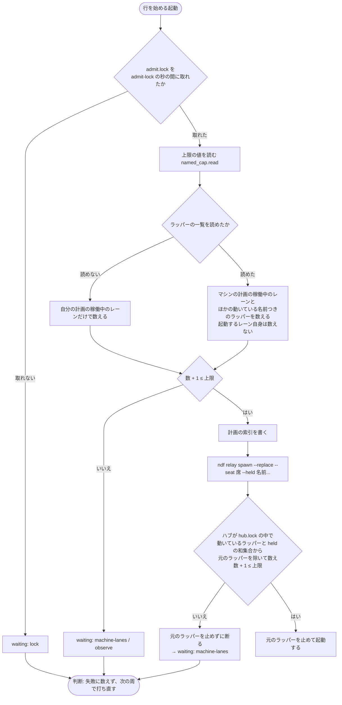

# 並列の計画の同時実行の制御: マシン全体の稼働中のレーンの数とテストのスロットの 2 層で絞る

## 概要

**並列の計画の同時実行は 2 つの層で絞る。** 計画とレーンは同時実行の値を持たない。

| 層 | 何を絞るか | 仕組み |
| --- | --- | --- |
| セッションの数 | マシン全体の稼働中のレーンと、ほかの動いている名前つきのラッパー（claude のセッション）の数 | 上限 `relay.max-named`（既定 6）。耐久ワークフローの起動の許可が 1 本ずつ数えて起動を待たせ、リレーハブが同じ値で起動を断る |
| 重い処理 | テスト・LLM の CLI | テストのスロット（`plugins/ndf/src/ndf/testing/slots.py`）。重みを数え、メモリが下限を割れば待たせるか止める。この仕様の外 |

例: 上限 6 のマシンで、計画 p9 のレーン 3 本が実行中の行を持ち、別のリポジトリの計画のレーン 2 本と、計画に無いオーガナイザーのセッション 1 本が動いている。合わせて 6 本なので、p9 の `after` がそろったレーン lz2-ci は起動の待ちになり、`ndf lanes status` のそのレーンの行に `machine_wait: {"reason": "machine-lanes", "machine_lanes": 6, "cap": 6, "unreadable": []}` が出る。別の計画のレーンが 1 本終わると、次の周で lz2-ci が起動する。`after` で待つ未着手のレーンは何本あっても数えないので、計画にレーンを足すのに上限を上げなくてよい。

数える範囲は、同じ状態の保存先を共有するマシン 1 台である。上限の値はリポジトリの設定にも計画の設定にも置かず、マシンの設定（`ndf relay cap`）か環境変数で受ける。並列の計画の全体は [ndf-parallel-organizer.md](ndf-parallel-organizer.md) が、役割と用語の関係は [docs/ndf-parallel-model.md](../ndf-parallel-model.md) が持つ。

## 用語

「稼働中のレーン」「起動の許可」「起動の待ち」「起動の排他」「マシンの設定」「レーン数の上限」の定義は用語集（[docs/glossary.md](../glossary.md)）の「NDF の並列の計画（`ndf-parallel`）」が正である。

この文書の「行」はレーンの順番表の 1 行（スプリント 1 つか開発ループ 1 つ）を、「周」は耐久ワークフローが計画とレーンのステートマシンを読み直す 1 回（上限の設定 `parallel-run.poll` の秒ごと）を指す。

## 背景

同時に動くセッションの数を絞る目的は、マシンのメモリとコアを使い切らないことである。2026-11-21 の実測（8 コア・30 GB）では claude のセッション 8 本で合計 2.4 GB（1 本 0.3〜0.5 GB）だった。supervisor はサブエージェントとして conductor のプロセスの中で動き、プロセスを増やさない。メモリの山を作るのは全体テストの同時実行で、それはテストのスロットが絞る。

以前は計画の `max_lanes`（終わっていないレーンの数の上限、検査 I20）・`max_plans`（レーンの `plans` の上限、検査 I2）・レーンの `plans`（マシンで数える申告の重み）があった。`after` 待ちの未着手のレーンが上限の数を占め、`plans` は conductor へ渡らない申告で実際に動くプロセスと結び付かなかった。同時実行の制御を上の 2 層にし、3 つの値と I20・I2・`ndf lanes limits`・`ndf lanes set --plans` を廃止した（#3989、利用者の決定）。I20・I2 の番号は欠番で、別の規則に使い回さない（番号で過去の記録と文書を引くと別の規則を指すため）。

1 つの計画だけを少なく流す（マシンには空きがあるのにこの計画は 2 本まで）手段は、`after` で並びを書くことだけである。同時に動く数を抑える目的はマシン全体の上限が持つ。

## 対象範囲

- 計画の設定（`plan.json`）・レーンの設定・計画の状態（`ndf lanes status`）から同時実行の値を持たないこと
- 耐久ワークフローの起動の許可（`ndf.progress.lane.machine`）と、その判定に使う上限の値の読み方（`ndf.contracts.named_cap`）
- リレーハブの起動の判定（`ndf relay spawn`・`--replace`・`--seated`）と一覧（`ndf relay ls`）
- マシンの設定を書くサブコマンド `ndf relay cap`
- `ndf lanes status` の起動の待ちとマシンの集計

テストのスロットの振る舞い、`relay.max-named` の既定の値、触る場所の重なり（I13）・課題の重なり（I19）・`after` の輪（I21）の検査は含まない。

## 仕様

### 構成要素と責務

| 要素 | 責務 |
| --- | --- |
| `plugins/ndf/src/ndf/contracts/named_cap.py` | 上限の値の唯一の読み手と、マシンの設定の書き手。`read`（マシンの設定 → `NDF_RELAY_MAX_NAMED` → `relay.max-named`）・`fallback`（マシンの設定を読まずに環境変数 → 上限の設定）・`parse`（1 以上の整数だけを通す）・`write`（一時ファイルからの改名で書く・消す）・`path` を持つ。`ndf.contracts` だけに依存し、状態の保存先のパスは呼ぶ側が渡す |
| `plugins/ndf/src/ndf/progress/lane/machine.py` | マシンの数え方と起動の許可。`count`（稼働中のレーンと動いているラッパーを 1 本ずつ）・`admit`（数 + 1 ≤ 上限）・`admitted`（起動の排他の中で数えてから起動の手を打つ）・`machine_plans`（マシンの計画を 1 計画 1 回読む）・`held_seats`・計画の索引（`index_plan`・`unindex_plan`・`indexed`）・`lock_free`・`cap`（`named_cap.read` の値）を持つ |
| `plugins/ndf/src/ndf/progress/lane/launch.py` | レーンのラッパーの起動。行を始める起動と続きの起動は `replace(..., seat: Seat)` で `ndf relay spawn --replace --seat <席>`（続きは `--seated`、許可が数えた名前ごとに `--held <名前>`）を打つ。`read_spawn` はハブの上限の断りを起動の待ちに変える |
| `plugins/ndf/src/ndf/progress/plan/run.py` | 耐久ワークフローの起動の手 `launch_lane`（行を始める起動だけを `admitted` に掛ける）と、耐久ワークフローが終わるときの索引の削除 |
| `plugins/ndf/src/ndf/progress/plan/__init__.py` | `ndf lanes status` の `machine_waits`（起動の待ちの理由と数・マシンの集計） |
| `plugins/ndf/src/ndf/domains/relay/hub.py`・`hub_decide.py` | リレーハブの判定。判定のたびに上限を読み（`_max_named`）、置き換えの起動（`hub_decide.replace`）は元のラッパーを止める前に本数を判定する。続きの起動は席を確かめる（`_seated_ok`）。一覧（`listing`）は錠を持つラッパーをすべて載せる |
| `plugins/ndf/src/ndf/domains/relay/cli.py` | `ndf relay cap [--named <数> \| --clear]` と、`ndf relay spawn` の `--replace`・`--seat`・`--seated`・`--held` |
| `plugins/ndf/contracts/limits.json` | `relay.max-named`（6）・`parallel-machine.admit-lock`（10 秒）・`parallel-run.poll`（60 秒） |

置き換えの起動の手は、引数の多い関数の検査（PLR0913）に掛からないよう、`launch.spawn` の引数を増やさず別の関数 `launch.replace` に分けてある。上限の読み手を `ndf.contracts` に置くのは、既存の子 D1 が持つパッケージで、`progress` と `domains` のどちらからも依存の向きが逆にならないためである。

### 常に成り立つ条件

| 条件 | 破れたときの扱い |
| --- | --- |
| 計画の設定・レーンの設定・計画の状態・`ndf lanes set` の引数・検査の規則に `max_lanes`・`max_plans`・レーンの `plans`・I20・I2 は無く、`ndf lanes limits` のサブコマンドは無い | 計画の設定とレーンの設定にこれらのキーがあれば、`ndf lanes init`・`start`・`lane add` がキーの名前を名指す誤り（原因 `invalid`、終了コード 2）で断る。消したサブコマンドと引数は引数の誤り（終了コード 2） |
| ステートマシンの記録（計画の作成・レーンの追加・レーンの変更・上限の変更の事象）に 3 つの値が残っていても、計画の状態を読め、耐久ワークフローが動く。3 つの値だけを変えた事象は、何も変えない事象として読む | 畳み込み（`fold.py`）がこれらのキーを読まない。テストが落とす |
| `after` で直列にした未着手のレーンを何本書いても、計画の作成とレーンの追加は数で断られない | テストが落とす |
| 耐久ワークフローは、マシン全体の稼働中のレーンとほかの動いている名前つきのラッパーの数に 1 を足すと上限を超えるとき、行を始める起動をせず起動の待ちに置く | テストが落とす |
| 起動の待ちは起動の失敗に数えず、起動できない知らせ（`launch_failed`）のリクエストを書かない。待った起動はその周は打ち直さず、次の周で打ち直す | テストが落とす |
| 数えてから起動するまでを起動の排他（`<状態の保存先>/parallel/admit.lock`）の中で行う。2 つの計画の耐久ワークフローが同時に起動を求めても、起動した後の稼働中の数は上限を超えない | 排他を `parallel-machine.admit-lock` の秒の間に取れなければ、その起動は理由 `lock` の待ちになる |
| ラッパーの一覧を読めたとき、起動の許可が数える数は、リレーハブが数える数（この NDF の動いている名前つきのラッパー）以上である。実行中の行を持つレーンのラッパーがどれも動いていれば等しい | 許可を通った起動をハブが上限で断ったときは、元のラッパーを止めずに断り、起動の手が待ち（`machine-lanes`）に戻す |
| 上限の値は判定のたびに読み、プロセスの中に持ち越さない。`ndf relay cap --named <数>` で書けば、動いている耐久ワークフローとリレーハブも次の判定から新しい値を使う | テストが落とす |
| 上限の値はどの出所でも 1 以上の整数だけを受ける。`0`・`-1`・`0.5`・`1.5`・`1e1`・`inf`・`nan`・数でない値は切り捨てずに断る | `NamedCapError`（`ContractError` の子）。呼び手ごとの扱いは「エラー処理」 |
| 上限を稼働中の数より下へ下げても、稼働中のレーンを止めない。続きの起動（中止・回答の後の next・`/goal` の入れ直し）は上限で待たず、計画の中止の処理は終わる | 下げた上限は次の行を始める起動から効く |
| 続きの起動は、同じ名前のラッパーの登録簿の行にある席を使うだけで、新しい名前のラッパーを増やさない | 席の無い・席の違う `--seated` の起動はハブが `refused` で断る |

### 稼働中の数の数え方

起動の許可（`machine.count`）は、次の 3 つのラッパーの名前の和集合から、起動しようとしているレーン自身のラッパーを除いた数を数える。同じ名前は 1 回だけ数え、重み（`plans`）は無い。

| 数えるもの | 理由 |
| --- | --- |
| マシンの計画の、実行中の行を持つレーン（承認ゲート・質問の回答を待つ行と、区切りで止めた計画で流し続けている行を含む）。ラッパーの生死は見ない | ラッパーが止まったレーンの `/goal` の入れ直しや回答の後の再起動の席を残す |
| ラッパーの一覧（`ndf relay ls`）で動いているラッパー。計画のレーンか否か・役に依らず、登録簿に無く錠だけを持つものを含む | 起動の直後でまだ行が実行中でないレーンと、オーガナイザーのセッションのような計画に無いラッパーを数え、ハブが数えるラッパーを含める |
| 状態を読めない計画の動いているラッパー | その計画を `unreadable` に載せる |

マシンの計画は、自分の計画・一覧の conductor の役の行（`role` が conductor で `plan` と `cwd` を持つ行）から読む計画・マシンの計画の索引に載る計画の和である。`machine_plans` は同じ計画を 1 回だけ読む（別の worktree の所在に載っても、計画のステートマシンの ID で飛ばす）。

計画の索引（`<状態の保存先>/parallel/plans/<計画のステートマシンの ID>.json`）は、ラッパーがすべて止まって登録簿から消えた計画を、実行中の行を持つ間見つけるためにある。起動の許可が通ったときに起動の排他の中で書き、耐久ワークフローが終わるとき（区切り・中止・完了・失敗のどれでも）に消す。異常終了で残ったファイルは、実行中の行が無い計画として 0 本と数える。

ラッパーの一覧を読めないときは、ほかの計画を数えられないので、自分の計画の実行中の行を持つレーンだけで決め、収まらなければ理由 `observe` で待たせる。このときはハブの数え方と合わせられない。

### 起動の判定の流れ

起動の許可に掛けるのは、行を始める起動だけである。続きの起動（中止・回答の後の next・`/goal` の入れ直し）と止める手は起動の許可を通らない。



- 判断（`run_decide`）は毎周、起動できるレーンを計画のレーンの並び順に試す。空きが 1 つできれば並びの先のレーンが 1 本起動し、続くレーンは排他の中で数え直してその起動を数えて待つ。並びの先のレーンの起動が許可の後に失敗すると、その周は後ろのレーンが空きを使い、先のレーンは次の周に打ち直す
- 起動の許可は、数えた計画のうち実行中の行を持つレーンの名前（`held_seats`。ラッパーの生死を問わない）を `--held` でハブへ渡す。許可の後・ハブの判定の前にラッパーだけが止まっても、ハブはその稼働中のレーンを数え落とさない
- 起動の許可（`admit.lock`）とハブの判定（`hub.lock`）は別の排他である。耐久ワークフローは `admit.lock` を持ったまま子のハブを待つので、ハブが同じ排他を取ると詰まる。代わりに、置き換えの起動は 1 つの要求（`--replace`）にまとめ、ハブが元のラッパーを止める前に判定する。排他の隙間で `admit.lock` を取らない `ndf relay spawn` が残りの枠を使っても、`ndf relay cap --named` が上限を下げても、元のラッパーは動いたまま残り、起動は待ちに戻る
- 待ちを解く周は、上限を上げた後の周も同じである

### リレーハブの起動の判定

`ndf relay spawn` の判定の順:

1. バージョンの混在の判定（`hub_decide.mixed`）。`--replace` なら置き換える対象（同じ名前）を除いた動いているラッパーで判定し、対象だけが旧いバージョンなら通す
2. `--replace` でなく同じ名前が動いていれば断る
3. `--seated` なら席を確かめる（`_seated_ok`）。そうでなければ上限を読んで本数を判定する
4. `--replace` なら、対象を止める前に導入の入口と作業ディレクトリを確かめる（`_preflight`）
5. `--replace` で対象が動いていれば止め、止まったのを確かめてから起動する

| 要求 | 本数の判定 | 登録簿の行 |
| --- | --- | --- |
| `spawn`（`--replace` なし） | `hub_decide.spawn`（動いている本数 + 1 ≤ 上限） | `seat: null` で書く |
| `spawn --replace --seat <席>`（行を始める起動） | `hub_decide.replace`（動いているラッパーと `--held` の名前の和集合から対象を除いた本数 + 1 ≤ 上限）。超えれば対象を止めずに断る | `seat` に席を書く |
| `spawn --replace --seat <席> --seated --name <名前>`（続きの起動） | しない（上限を読まない）。登録簿のその名前の行の `seat` が要求と同じなら通す | 同上 |
| `restart` | `hub_decide.restart`（本数だけ） | 今のまま |

1 日の起動・再起動の回数は判定にも登録簿にも持たない（#3864 の決定 13。暴走止めはラッパーの再起動ループの検出が持つ）。前のバージョンが登録簿に書いた `starts` は読まず、書き戻す行と一覧から外す。

- 席は `<レーンのステートマシンの ID>:<行のキー>` で、名前ごとに 1 つ。`stop` は席を消さないので、中止のために止まった対象も正規の続きの起動で起動できる。席を書く前のバージョンが書いた行（`seat` のキーが無い）は、役（`role`）と計画（`plan`）が要求と同じなら通し、その続きの起動が席を書く。今のバージョンが席を持たずに書いた行（`seat: null`）は通さない
- 本数で断るときは、結果の `cause` を `refused` にし、`items` に `{"refusal": "max-named", "running": <数えた本数>, "cap": <上限>}` を載せる。バージョンの混在の断りには載せない。耐久ワークフローの `launch.read_spawn` はこの項目だけを起動の待ち（`machine-lanes`）として読む
- `--seat` は `--replace` を、`--seated` は `--replace`・`--seat`・`--name` をすべて、`--held` は `--replace` を要し、`--replace` は `--seat` を要する。欠ければ引数の誤り（名前の採番で新しい名前の続きの起動を作らせない）
- 置き換えの要求は種別 `replace` で書く。その種別を知らない旧いバージョンのハブが「知らないリクエスト」（`invalid`）で断ったら、頼む側はその回答を捨て、同じ中身を新しい要求 ID で書き直して対応するバージョンのハブが処理するまで待つ。旧いバージョンのハブが通常の起動として席を書かずに処理しないためである
- 続きの起動は本数で断られないので、上限を下げた直後や、許可を通らない起動（オーガナイザーや手の `ndf relay spawn`）が席を使った後は、動くラッパーの数が一時的に上限を超え得る。その後の行を始める起動と通常の `spawn` は断られる

### 上限の値の読み方

| 出所 | 読む順 | 書き手 |
| --- | --- | --- |
| マシンの設定（`<状態の保存先>/relay/hub/cap.json`） | 1 | `ndf relay cap --named <数>`・`--clear` |
| 環境変数 `NDF_RELAY_MAX_NAMED` | 2 | 起動した環境 |
| 上限の設定 `relay.max-named`（`plugins/ndf/contracts/limits.json`、6） | 3 | プラグイン |

マシンの設定を環境変数より先に読むのは、動いているプロセスが引き継いだ古い値より、後から書いた値を効かせるためである。起動の許可（`machine.cap`）・リレーハブの判定（`spawn`・`restart`）・`ndf lanes status` が同じ関数 `named_cap.read` で読む。

マシンの設定が無いとき（未作成・`--clear` の後）の値は、要求を出した側の環境で決める。

- 頼む側（`ndf relay spawn`・`restart` の `submit`）は、マシンの設定を読まずに環境変数 → 上限の設定で解いた値と出所（`named_cap.fallback`）を要求の `cap`（`{"value", "source"}`）に載せる。解けなければ止めずに `{"error": <文>}` を載せる。続きの起動（`--seated`）は上限を使わないので載せない
- ハブはマシンの設定を読み直し、あればその値で、無ければ要求の `cap` の値で判定する（要求の `error` ならその文で `invalid`）。要求に `cap` が無いときだけハブ自身の環境と上限の設定を読む。要求を処理したプロセス（`drain` を打った側）の環境は判定に使わない
- マシンの設定の値を要求に載せないのは、要求を書いた後・ハブの判定の前に `ndf relay cap --clear` が済んだとき、消した値で判定させないためである
- 耐久ワークフローの `ndf relay spawn` は耐久ワークフローの環境を引き継ぐので、起動の許可とハブの判定は同じ値になる

この順は 11 系の 1 つ前の決定（値を書き込むサブコマンドを持たない。[ndf-next-closed-children-subcommands.md](ndf-next-closed-children-subcommands.md) の `from-issue:3569-relay-cap`）を改めたものである。計画の上限の値を廃止すると、動いている耐久ワークフローの上限を変える手段がほかに無いためである。

## データ・設定

### 計画の設定（`plan.json`）とレーンの設定

形は `plugins/ndf/contracts/workflow/parallel-plan.schema.json`（`additionalProperties: false`）。計画の項目は `version`・`name`・`lanes`・`rules` など、レーンの項目は `name`・`input`・`rows`・`after`・`touches` などで、`max_lanes`・`max_plans`・`plans` は無い。計画の設定は手元のファイルで、リポジトリに入らない（`.ndf/.gitignore` の `parallel/`）。3 つのキーを持つ古い計画の設定は、次の 1 行で消してから `ndf lanes start` を打ち直す。

```bash
jq 'del(.max_lanes, .max_plans) | .lanes |= map(del(.plans))' plan.json > plan.json.new && mv plan.json.new plan.json
```

ステートマシンの記録は書き換えない。3 つの値を持つ古い事象は畳み込みが読み捨てる（計画の設定のように形で断ると、書き換えられない記録の計画を再開できなくなるため）。

### マシンの設定（`<状態の保存先>/relay/hub/cap.json`）

| キー | 型 | 意味 |
| --- | --- | --- |
| `version` | 整数 `1` | 形のバージョン |
| `max_named` | 1 以上の整数 | 同時に動かす稼働中のレーンと名前つきのラッパーの数の上限 |

`ndf relay cap --named <数>` が一時ファイルからの改名で書き、`--clear` が消す。読む側は書く前か後のどちらかの中身を丸ごと読む（排他は取らない）。

### マシンの計画の索引（`<状態の保存先>/parallel/plans/<計画のステートマシンの ID>.json`）

`{"version": 1, "cwd": <作業ディレクトリ>, "plan": <計画の名前>}`。同じ中身なら書き直さない。読めないファイルは飛ばす。

### 起動の待ち（耐久ワークフローの起動の結果の `waiting`、`ndf lanes status` のレーンの行の `machine_wait`）

| キー | 型 | 意味 |
| --- | --- | --- |
| `reason` | `"machine-lanes"` / `"lock"` / `"observe"` | 上限に当たった / 起動の排他を取れなかった / ラッパーの一覧を読めなかった |
| `machine_lanes` | 整数か null | 判定に使った稼働中の数（`lock` は数えていないので null） |
| `cap` | 整数か null | 判定に使った上限（`lock` は null） |
| `unreadable` | 文字列の配列 | 状態を読めなかった計画 |

### 上限の設定（`plugins/ndf/contracts/limits.json`）

| 名前 | 値 | 意味 |
| --- | --- | --- |
| `relay.max-named` | `count` 6 | 上限の値の最後の出所。並列 6 本の実測に合わせる |
| `parallel-machine.admit-lock` | `seconds` 10 | 起動の判定で起動の排他を待つ上限 |
| `parallel-run.poll` | `interval` 60 | 周の間隔（`NDF_PARALLEL_POLL` で変えられる） |

## 外部連携

### `ndf relay cap`

| 打ち方 | 振る舞い |
| --- | --- |
| `ndf relay cap` | 今の上限と出所を出す（`metrics.value`・`metrics.source`。`source` は `machine`・`env`・`limits`） |
| `ndf relay cap --named <数>` | マシンの設定へ書き、書いた値と `machine` を出す。1 未満は原因 `invalid`（終了コード 2）で断り、書かない |
| `ndf relay cap --clear` | マシンの設定を消し、環境変数 → 上限の設定で読んだ値と出所を出す |

`--named` と `--clear` は同時に渡せない（引数の誤り）。

### `ndf relay ls`

登録簿の行（`registered: true`）に加え、登録簿に無く錠を持つ動いているラッパーを `{"name", "running": true, "state", "registered": false}` の行で載せる。`running: true` の行の名前の集まりは、ハブが数えるラッパーの名前の集まりを含む。`role`・`plan`・`cwd` の無い行は、耐久ワークフローの生死の判定と計画の発見で conductor の行と読まない。

### `ndf lanes status`

- 起動できる行を持つのに起動の待ちになるレーンの行に `machine_wait`（上の表の形）を載せる。`status` は起動の許可と同じ数え方でその場で数え直す。打った時点の数え直しなので、耐久ワークフローが同じ周に見た値と一致するとは限らない
- 起動の排他は待たずに 1 回だけ取ってすぐ放す（`lock_free`）。取れなければ起動できるレーンのすべてに `lock` の待ちを載せる。その瞬間だけの値なので、オーガナイザーは打ち直して読む
- 計画の集計 `metrics.machine` に `lanes`（稼働中のレーンと動いているラッパーの数）・`cap`（上限）・`unreadable`・`others`（ほかの計画のステートマシンを読んだか）・`error`（上限を読めないときの文）を載せる。生死を読んだときだけ出る
- ほかの計画のステートマシンは、起動できるレーンがあり一覧を読めたときだけ、1 回の `status` で 1 計画 1 回読み、集計とレーンごとの判定が同じ読み取りを使う。起動できるレーンが無ければほかの計画を読まず、集計は自分の計画と一覧で数えて `others` を偽にする（このときの集計は、ほかの計画のうちラッパーが止まったまま実行中の行を持つレーンを数えないので、起動の許可の数より少なく出得る）

## エラー処理

| 失敗 | 扱い |
| --- | --- |
| 上限の値（マシンの設定・環境変数・上限の設定のどれか）が 1 以上の整数でない、マシンの設定が JSON でない・`version` が 1 でない | `NamedCapError`。例外のまま呼び手の外へ出さない（下の行） |
| 起動の許可で上限を読めない | 起動の手の失敗 `{"ok": false, "final": true, "detail": <文>}`。`launch_failed` の知らせの詳細にファイルか環境変数の名前が出る。`ndf relay cap` で直してリクエストを閉じれば起動の候補へ戻る |
| ハブの `spawn`・`restart` で上限を読めない | `Outcome(False, 文, "invalid")`。起動しない・対象を止めない。`drain` はその要求に結果を書いて、後ろの要求（`stop` を含む）を続けて処理する |
| 頼む側の環境変数が壊れている | 要求の `cap` に `{"error": 文}` を載せて書く。ハブはマシンの設定があればその値で判定し、無ければ `invalid` |
| 引数なしの `ndf relay cap` で上限を読めない | 原因 `invalid`（終了コード 2）の結果 JSON |
| `ndf lanes status` で上限を読めない | 止めない。待ちを載せず、`metrics.machine.cap` を null・`error` に文を載せる。終了コードは変えない |
| 続きの起動の席が登録簿に無い・違う | `refused`（起動しない・本数が増えない）。`--seated` を外して上限の判定を受けて打ち直せる |
| 置き換えの起動で導入の入口か作業ディレクトリが無い | `precondition`（対象を止めない） |
| 計画の索引を書けない | 起動の手の失敗（`final` でない）。起動しない。回数が尽きたら `launch_failed` |
| `lock_free` で排他のファイルを開けない | 偽を返し、待ちの理由を `lock` にする |

マシンの設定が壊れていても、続きの起動（`--seated`）は上限を読まないので通り、計画の中止の処理は終わる。

## 運用

- 上限を変えるときは `ndf relay cap --named <数>` を打つ。動いている耐久ワークフローとハブは次の判定から新しい値を使う。上げれば待ちのレーンが次の周に起動し、下げても稼働中のレーンは止まらない。`ndf relay cap --clear` で環境変数 → 上限の設定に戻る
- 待っているレーンと理由は `ndf lanes status` の `machine_wait` と `metrics.machine` で読む（手順は `development-workflow` の `references/parallel-checks.md` が正）
- `plans` を 2 以上にしていたマシンでは、以前より多くのレーンが同時に動く。重い処理はテストのスロットが絞るので、上限 6 のままで足りる
- オーガナイザーや手で起動したラッパーが動いているマシンでは、ハブに断られる代わりに起動の待ちになる

### 既知の限界

| 項目 | 内容 |
| --- | --- |
| ハブより早く待つ | ラッパーが止まったまま実行中の行を持つレーンが 1 本あるごとに、耐久ワークフローはハブより 1 本分早く待つ。そのレーンの続きの起動の席を残すためである |
| 状態のファイルを持たない起動の途中のラッパー | ハブは状態のファイルにバージョンを持つラッパーだけを数え、一覧は錠を持つものを載せる。状態のファイルが無い起動の途中のラッパーは起動の許可だけが数える（多い側に倒れる） |
| 起動の排他を待つ 10 秒 | 排他の中で打つ `spawn` はハブが起動を確かめる待ちを含む。2 つの計画が同じ周で重なったときに足りるかは `status` の理由 `lock` の出方で確かめる |
| ネットワークのファイルシステム | 状態の保存先はローカルのディスクに置く前提で、`flock` の振る舞いを確かめていない |

## テスト観点

- 計画の状態と `ndf lanes status` に 3 つの値が無く、`ndf lanes limits` と `ndf lanes set --plans` が引数の誤りで断り、検査の誤りに I20・I2 が出ないこと（`tests/progress/test_plan.py`）
- 3 つの値のどれかを書いた計画の設定・レーンの設定を `ndf lanes init`・`lane add` に渡すと、誤りの文にその名前が出て断り、消した設定は通ること
- 計画の作成・レーンの追加・レーンの変更・上限の変更の事象に 3 つの値を持つ記録を畳み込むと計画の状態を読め、値だけの事象が状態を変えないこと
- `after` で直列にした未着手のレーン 3 本の計画が、上限 1 でも `ndf lanes init` を通ること（`tests/progress/test_lane.py`）
- 稼働中のレーンとほかの動いているラッパーの数 + 1 が上限を超えると `admitted` が `waiting`（`machine-lanes`）を返し、判断がそれを失敗にも `launch_failed` にもしないこと。起動するレーン自身を数えず、実行中の行を持つのにラッパーが止まったレーンを数えること（`tests/progress/test_lane_machine.py`）
- 待ちのレーンが 2 本あり、稼働中のレーンが終わって 1 本分の空きができた周で、計画の並び順の先のレーンだけを起動すること
- 計画に無く conductor でもない役の動いているラッパーと、登録簿に無く錠を持つラッパーを、起動の許可が 1 本ずつ数えること。マシンの設定が無く、耐久ワークフローの環境が `NDF_RELAY_MAX_NAMED=8`・ハブを兼ねるプロセスの環境に変数が無いとき、6 本が動く間に許可した起動をハブが通すこと
- 起動の許可の後、ハブの判定の前に別の `ndf relay spawn` が残りの枠を使う（か上限が下がる）と、`spawn --replace` が元のラッパーを止めずに断り、起動の手が `waiting` を返すこと（`tests/progress/test_lane_launch.py`・`tests/domains/relay/test_relay_hub.py`）
- 3 本が動く間に上限を 2 へ下げると、中止・回答の後の next・`/goal` の入れ直しのそれぞれが待たずに通り、元のラッパーを止めてから起動して 3 本のままで、中止した計画が中止の処理を終えること。同じ状態で別のレーンの行を始める起動は待つこと
- 前のバージョンが `starts` を書いた登録簿の行でも `spawn --replace`・`restart` が回数で断らず、書き戻した行と一覧に `starts` が無いこと（#3864 の決定 13）
- 登録簿に行の無い名前・席の違う `--seated` が `refused` で起動せず、席を書く前のバージョンの行は役と計画が同じなら通ること。`--seated` で `--replace`・`--seat`・`--name` のどれかが無ければ引数の誤りになること（`tests/domains/relay/test_relay_cli_parse.py`）
- 別の 2 つの計画の起動の許可を同時に走らせても、起動した後の稼働中の数が上限を超えないこと。上限 1 で計画 A が回答待ちの行を持ち、A のラッパーがすべて止まって登録簿から消えても、計画 B の起動が待つこと（A は索引から見つかる）
- 起動できるレーンに、上限で待つときは `machine-lanes`、一覧を読めないときは `observe`、排他が取られているときは `lock`（`machine_lanes`・`cap` が null）の `machine_wait` が載り、`metrics.machine` に稼働中の数と上限が載ること。起動できるレーンが無い `status` がほかの計画のステートマシンを開かず、ある `status` がレーンの数に依らず 1 計画 1 回だけ開くこと。壊れた `cap.json` でも `status` が計画とレーンを出し、`metrics.machine.error` に文が載ること
- `ndf relay cap --named` で書いた値を、同じプロセスの次の判定（起動の許可・ハブ・`status`）が使い、環境変数より先に読むこと。`--clear` の後は環境変数 → 上限の設定に戻ること。3 つの出所のどれでも `1` は通り、`0`・`0.5`・`1.5`・`inf`・`nan`・`-1`・数でない値が `NamedCapError` で断られること（`tests/contracts/test_named_cap.py`・`tests/domains/relay/test_relay_cli.py`）
- マシンの設定が 6・頼む側の環境が `NDF_RELAY_MAX_NAMED=2` で、3 本が動く間に `spawn` の要求を書き、ハブの `drain` の前に `ndf relay cap --clear` を済ませると、ハブが 2 で判定して断り、要求の `cap` の `source` が `env` で値が 2 であること
- 壊れた `cap.json` で、ハブの `spawn` の要求が `invalid` になり、同じ `drain` の後ろの `stop` の要求も処理されること。引数なしの `ndf relay cap` が `invalid`（終了コード 2）の結果 JSON を出し、耐久ワークフローの起動の手が `final` の失敗を返すこと
- テストのスロット（`plugins/ndf/src/ndf/testing/` とそのテスト）が変わらないこと
- どのテストも事象の数・回数・状態で判定し、時間で区切らないこと

テストのパスは `plugins/ndf/` からの相対で、ほかに `tests/progress/test_run_lanes.py`・`test_plan_run.py`・`tests/support/plan_decls.py` がある。

## 関連リンク

- [ndf-parallel-organizer.md](ndf-parallel-organizer.md) — 並列の計画のオーガナイザー
- [ndf-parallel-other-repo-lanes-and-outside-plan.md](ndf-parallel-other-repo-lanes-and-outside-plan.md) — 計画の所在の一覧
- [ndf-next-closed-children-subcommands.md](ndf-next-closed-children-subcommands.md) — 11 系のサブコマンドの対応
- [docs/ndf-parallel-model.md](../ndf-parallel-model.md) — 並行開発の役割と用語
- Issue #3989・#2999
