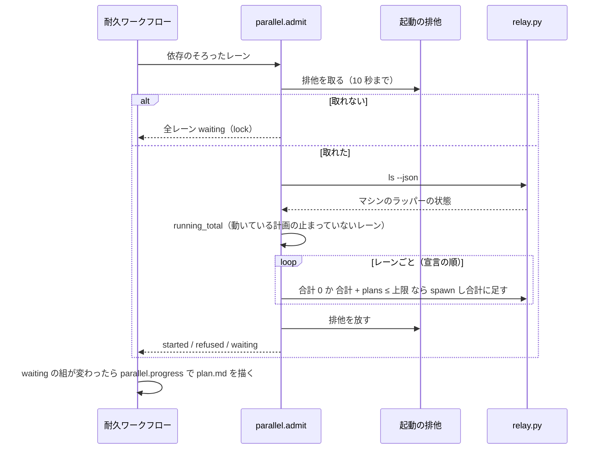

# 並列の計画のマシン全体のプランの上限: 動いている計画の合計で数え、超えるレーンの起動を待たせる

## 概要

**プランの本数の上限（既定 6）は、同じマシンで動いているすべての並列の計画の合計で数える。** 計画の検査と開始
（`parallel.py check` / `start`）は、ほかの動いている計画の宣言とこの計画の宣言の和が上限を超えると警告
（`rule: machine-plans`）を出して通す。耐久ワークフローは、マシンのプランの本数にレーンの `plans` を足すと上限を超える
レーンを起動せず、起動の待ちに置き、空いた後の見回りで起動する。

例: 上限 6 のマシンで、別のリポジトリの計画のレーンが合わせて 5 本を流しているとき、依存のそろった `plans: 2` のレーンは
起動の待ちになり、`plan.md` の進行の表の「起動」の欄に `起動待ち（マシン 5 + このレーン 2 > 上限 6）` が出る。別の計画の
レーンが止まって合計が 4 になると、次の見回りで起動する。

数える範囲は、同じ状態の根（`<状態の根>`）を共有するマシン 1 台である。上限の値はリポジトリの設定に置かず、マシンの設定か
環境変数で受ける。並列の計画の全体は [ndf-parallel-organizer.md](ndf-parallel-organizer.md) が、計画の所在の一覧とマシンの
設定のファイルは [ndf-parallel-other-repo-lanes-and-outside-plan.md](ndf-parallel-other-repo-lanes-and-outside-plan.md) が持つ。

## 用語

「プランの本数の上限」「マシンのプランの本数」「起動の待ち」「起動の排他」の定義は用語集（[docs/glossary.md](../glossary.md)）の
「NDF の工程（`ndf-workflow`）」が正である。

## 背景

上限 6 の根拠はマシンの資源（8 コア・30 GB の実測）で、計画 1 つの宣言ではない。計画 1 つの中だけで数えると、同じマシンの
2 つのリポジトリの計画がそれぞれ 6 本を宣言でき、合わせて 12 本まで並んでスワップを使い切ることがあった。

## 仕様

### 常に成り立つ条件

| 条件 | 破れたときの扱い |
| --- | --- |
| プランの本数の上限は、マシンの設定の `max_plans` → `NDF_PARALLEL_MAX_PLANS` → 既定 6 の順で決まり、同じマシンのどのリポジトリから読んでも同じ値になる | テストが落とす |
| マシンの設定へ一方の上限を書いても、もう一方のキーの値は残る。正の整数でない値は書かずに終了コード 1 で断る | テストが落とす |
| 1 つの計画の宣言の合計が上限を超える下書きは、検査の規則 `I2` の誤りで断る | テストが落とす |
| 検査と開始は、ほかの動いている計画の宣言の合計とこの計画の宣言の合計の和が上限を超えるとき、`machine-plans` の警告を 1 件出す。終了コードは変えない。和が上限以下か、ほかに動いている計画が無ければ出さない | テストが落とす |
| マシンのプランの本数が 1 以上で、それにレーンの `plans` を足すと上限を超えるとき、耐久ワークフローはそのレーンを起動せず起動の待ちに置く。本数が 0 なら、レーンの `plans` が上限を超えていても起動する | テストが落とす |
| 起動の待ちのレーンは、合計にそのレーンの `plans` を足して上限以下になった後の見回りで起動する | テストが落とす |
| 数えてから起動するまでを起動の排他の中で行う。同じマシンの 2 つの耐久ワークフローが同時に判定しても、起動の後の合計は上限を超えない（本数 0 で起こした 1 本を除く） | テストが落とす |
| 起動の排他を待ちの上限までに取れなかった見回りでは起動せず、起動の待ちに置く | テストが落とす |
| 起動の待ちは起動の断りに数えない（3 回続く断りの問いを出さない） | テストが落とす |
| 状態を読めない計画は動いている計画として数え、宣言を読めない計画は 0 本として数え、その置き場と計画名を警告と起動の待ちに載せる | テストが落とす |
| 承認の答えを待って保留の手順で止まった宣言のレーン（`stopped` で、計画の台帳に答えていない問いを持つ）は、止まっている間もマシンのプランの本数に入る。それ以外の理由で止まったレーンは入らない | テストが落とす |
| 印 `parallel-admit` の無い耐久ワークフローの記録は、打ち直しても起動を待たせない | テストが落とす |

### 構成要素と責務

| 要素 | 責務 |
| --- | --- |
| [`lib/parallel_machine.py`](../../plugins/ndf/scripts/lib/parallel_machine.py) | マシンの数え方の唯一の置き場。動いている計画（`parallel_guard.live_plans`）の宣言の合計（検査と開始用）と、動いているレーンの合計（起動の判定用）を数える。`plan_warnings` が警告を作り、`admit` が起動の排他の中で数えてから宣言の順に起動する |
| `lib/relay_limit.py` | `max_plans` の読み（`plans_cap`）と、ほかのキーを残して 1 つのキーを書く `write_limit` |
| `relay.py cap`（`relay_lib/__init__.py`） | `--plans <n>` を受けて書く。引数を省くと 2 つの上限の値と出所を出す |
| `lib/parallel_plan.py` | `max_plans()` を `relay_limit.plans_cap()` から読む。進行の表の「起動」の欄に起動の待ちを描く |
| `parallel.py` | 検査の結果へマシンの警告を足す（`check`・`start`・`run` が通る） |
| `lib/parallel_run.py` | 耐久ステップ `parallel.admit`（起動の判定と起動）と `parallel.progress`（`plan.md` の描画）を持ち、起動の待ちを `lanes[<名前>].waiting` に持つ |
| `lib/parallel_status.py` | チェックポイントのレーンの進行から `waiting` を読み、行と要約に出す |
| `plugins/ndf/contracts/limits.json` | 起動の排他を待つ秒の方針 `parallel-machine.admit-lock`（10 秒） |

### 起動の判定の流れ



リレーハブは登録簿へ名前を書いてから `spawn` に答えるため、排他を放した後に別の判定が打つ `ls` は、起動したレーンを動いている
として返す。レーンの状態の一覧（`relay.py ls`）を読めないときは、ほかに動いている計画が無ければ今までどおり起動し、あれば
理由 `observe` で待たせる。

マシンのプランの本数に数えるのは、動いている計画（自分を含む）のレーンのうち、一覧の `state` が `running` か
`awaiting_approval` のものと、上の条件の保留で止まった宣言のレーンである。

起動の判定に掛けるのは、依存がそろって初めて起こすレーンだけである。答えを当てる再起動・止まったレーンの起こし直し・
一時レーンの起動は待たせない。

### 決定と理由

| 決定 | 理由 |
| --- | --- |
| 検査・開始・起動の判定が同じ数え方を読むよう、マシンの数え方を 1 つのモジュールに置く | `parallel_plan` は 1 つの計画の宣言の検査で、耐久ステップ `parallel.init` も通る。ほかの計画の状態を読む処理を混ぜると、初期化がほかのリポジトリの状態に依存する |
| プランの本数の上限をレーン数の上限と同じマシンの設定のファイル（`<状態の根>/relay/hub/limits.json`）に置き、書き手を `relay.py cap` 1 つにする | どのリポジトリからも同じ値を読む。書き手が 2 つに分かれると、出所の順序の正本も 2 つになる |
| 検査と開始はマシンの超過を警告で通す | 断ると、先に動く計画が終わるまで別のリポジトリの計画を宣言すらできない。資源の使いすぎは起動の時点の待ちで防ぐ。宣言と起動が別の操作なので、割り当ての時点（起動）で守る |
| 数えてから起動するまでを filelock（`lib/locks.py` の `exclusive`）の排他で直列にする | `flock` の排他は持ち主の記述子がすべて閉じると放され（flock(2)）、持ち主が落ちても錠が残らない。リレーハブの起動の判定へ足すと、動いている古い版のリレーハブでは効かない。耐久の記録の排他はリポジトリごとに別でマシンをまたげない。名前つきのセマフォはレーンごとに本数が違う数え方に合わず、持ち主が落ちると値が戻らない |
| 起動の待ちを断りと分け、理由と数をレーンの進行に持つ | 待ちは資源が空けば解ける正常な状態で、人の判断が要らない。ジョブスケジューラ（Slurm）が待ちの状態と理由のコードを分けて見せるのと同じ形である |
| 新しい耐久ステップは印 `parallel-admit` の付いた記録だけが通る | 打ち直しは記録した耐久ステップの順に結果を当てる。印で分けないと、この形の前に始まった記録のステップの並びが変わる |
| 再起動と一時レーンは起動の待ちに掛けない | 待たせると承認ゲートの答えがレーンに届かず計画が進まない。再起動するレーンは止まっている間も本数に入っているため、待たせずに打っても上限は破れない |
| ほかの計画の宣言は JSON として読み、`lanes[].plans` だけを取り出す。正の整数でなければ 1 本と数える | 同じマシンの別のリポジトリは別の版の NDF で計画を書いていることがある。モデルで検証すると、項目が 1 つ増えただけで読めず 0 本になる |
| 承認の答えを待って止まった宣言のレーンを本数に入れたままにする | 止まっている間に別の計画のレーンが空きを使うと、再起動の後に合計が上限を超える。保留が長いと別の計画の新しいレーンが待つが、承認の答えは止めない |

## データ・設定

### マシンの設定のファイル（`<状態の根>/relay/hub/limits.json`）

| キー | 型 | 書き手 |
| --- | --- | --- |
| `max_named` | 正の整数 | `relay.py cap --named <n>` |
| `max_plans` | 正の整数 | `relay.py cap --plans <n>` |
| `at` / `by` | 時刻 / 文字列 | 最後に書いた `relay.py cap` |

書くときは今のファイルを読み、書くキーと `at`・`by` だけを置き換えて一時ファイルから置き換える。読めないファイルは空として扱う。

### 起動の待ち（`lanes[<名前>].waiting`。チェックポイントの `lanes` に入る）

| キー | 型 | 意味 |
| --- | --- | --- |
| `reason` | `"machine-plans"` / `"lock"` / `"observe"` | 上限に当たった / 起動の排他を取れなかった / レーンの状態の一覧を読めなかった |
| `machine_plans` | 整数か null | 判定の時点のマシンのプランの本数（`lock`・`observe` のときは null） |
| `plans` | 整数 | このレーンの `plans` |
| `max_plans` | 整数 | 判定に使った上限 |
| `since` | 時刻 | 最初に待たせた時刻。同じ待ちが続く間は変えない |
| `unreadable` | 文字列の配列 | 宣言を読めなかった計画（`<置き場>:<計画名>`） |

起動したか断られたときに `waiting` を消す。

## 外部連携

### `parallel.py check` / `start` の警告

`items` に 1 件足す。終了コードと既存の項目は変えない。`metrics.max_plans` は上限の値である。

```json
{"level": "warning", "rule": "machine-plans", "at": "lanes",
 "message": "マシンのプランの本数 8 が上限 6 を超える（この計画 4・他の計画 4: /home/u/carul:c1）",
 "machine_plans": 8, "own_plans": 4, "max_plans": 6,
 "plans": [{"plan": "/home/u/carul:c1", "plans": 4}], "unreadable": []}
```

`rule` を `I<番号>` にしないのは、`I<番号>` が並列の計画の検査の規則の番号で、別の意味と混ざるためである。

### `parallel.py status`

レーンの行の `waiting` は、起動の待ちのとき上の表と同じ形で、待っていなければ null である。要約は
`レーン 3 本（動いている 1・承認待ち 0・止まった 0・起動待ち 1）` の形で出る。

### `relay.py cap`

| 打ち方 | 振る舞い |
| --- | --- |
| `relay.py cap` | 2 つの上限の値と出所を出す（`metrics.max_named`・`max_plans`・`source`・`plans_source`・`path`） |
| `relay.py cap --named <n>` | `max_named` を書く。`max_plans` を残す |
| `relay.py cap --plans <n>` | `max_plans` を書く。`max_named` を残す。正の整数でなければ 1 で断り、何も書かない |

## 運用

上限の値は `relay.py cap --plans <n>` でマシンの設定へ書く。全体テストを同時に流したメモリの山の実測は
[ndf-parallel-organizer.md](ndf-parallel-organizer.md) の「上限の根拠の実測」にある。

### 既知の限界

| 項目 | 内容 |
| --- | --- |
| 起動の排他を待つ 10 秒の妥当さ | 排他の中で打つ `spawn` はリレーハブが起動を確かめる待ちを含む。2 つの計画が同じ見回りで重なったときに 10 秒で足りるかは未確認で、`status` の理由 `lock` の出方で確かめる |
| ネットワークのファイルシステム | 状態の根がネットワークのファイルシステムにあると `flock` の振る舞いが変わる。状態の根はローカルのディスクに置く前提で、確かめていない |
| 待った秒の記録 | 起動の待ちの秒は supervise の queue の結果の `plan_limit` には入らない（[ndf-supervise-progress-host-and-queue-waits.md](ndf-supervise-progress-host-and-queue-waits.md)） |

## テスト観点

- 2 つの置き場を計画の所在の一覧へ書き、片方の動いている計画（4 本）の後に 4 本の計画へ `check` を打つと、終了コードが変わらず `machine-plans` の警告 1 件に 8・6・置き場と計画名が載ること。`start` も開始して同じ警告を載せること
- 和が上限以下か、ほかに動いている計画が無いとき、警告が無いこと
- 別の計画の動いているレーンの合計が 5 のとき、依存のそろった `plans: 2` のレーンを起動せず、`status` の `waiting` に 5・2・6 が、`plan.md` に起動待ちが出ること
- 合計が 4 になると次の見回りで起動し、`waiting` を消すこと
- 2 つのプロセスが同時に起動の判定を打っても、起動の後の合計が上限を超えないこと
- 動いているレーンが無いマシンで、`plans` が上限を超える 1 本を起動すること
- マシンの設定に `max_plans` を書くと 2 つのリポジトリの `check` の `metrics.max_plans` が同じ値になり、設定が無いときは `NDF_PARALLEL_MAX_PLANS` → 6 の順で読むこと
- `cap --plans` の後に `cap --named` を打っても `max_plans` が残ること（逆も同じ）。`cap --plans 0`・`cap --plans x` が 1 で断り、ファイルを変えないこと
- 別のプロセスが起動の排他を持つ間の見回りは起動せず、理由 `lock` の待ちになること。起動の待ちが 3 見回り続いても問いが出ないこと
- 状態を読めない計画を数え、宣言を読めない計画を 0 本として出力に載せること
- 印 `parallel-admit` の無い記録の打ち直しは待たせないこと
- 別の計画の `plans: 2` のレーンが `stopped` で台帳に答えていない問いを持ち、ほかの動いているレーンの合計が 4 のとき、`plans: 1` のレーンを待たせ、問いに答えた後は待たせないこと

テストは `plugins/ndf/scripts/tests/test_parallel_machine.py`・`test_parallel_run.py`・`test_parallel_hold_flow.py`・`test_relay_hub.py`・`test_limits_migration.py` にある。

## 関連リンク

- [ndf-parallel-organizer.md](ndf-parallel-organizer.md) — 並列の計画のオーガナイザー
- [ndf-parallel-other-repo-lanes-and-outside-plan.md](ndf-parallel-other-repo-lanes-and-outside-plan.md) — 計画の所在の一覧・マシンの設定
- [ndf-development-loop-limits.md](ndf-development-loop-limits.md) — 上限の一覧
- [docs/ndf-parallel-model.md](../ndf-parallel-model.md) — 並行開発の役割と用語
- Issue #2999
