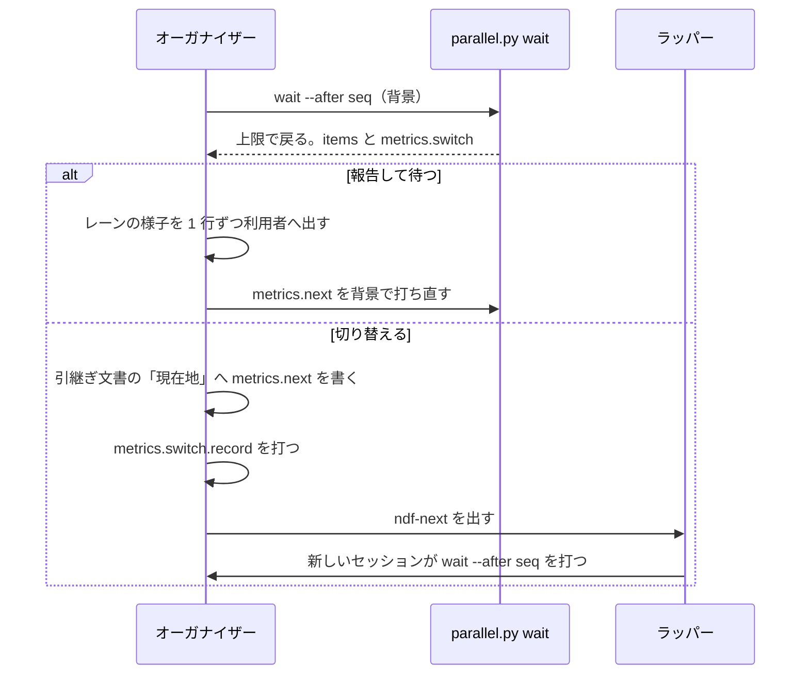

# 並列の計画のオーガナイザー: 長い待ちの間は 30 分ごとに状況報告し、さらに長い待ちの前にはセッションを切り替える

並列の計画のオーガナイザーが打つ `parallel.py wait` は、上限（既定 1800 秒）で戻るたびにレーンごとの様子と切り替えの判定
（`metrics.switch`）を返す。判定が「報告して待つ」なら、オーガナイザーはレーンの様子を 1 行ずつ利用者へ出して `wait` を
打ち直す。判定が「切り替える」なら、引継ぎ文書の「現在地」を更新し、再起動の判定の記録へ理由「待ち」で 1 行残して
`ndf-next` を出す。判定は `parallel.py` が持ち、オーガナイザーは返された結果に従うだけである。

例: 計画 p5 のオーガナイザー（Opus 5.5、会話の最後の文脈 47 万 token）が、答えていない問いの無い状態で待っているとき。

| 順 | 起きること |
| ---: | --- |
| 1 | `wait p5 --after 40` が 1800 秒で戻る（終了コード 3）。`items` にレーンごとの行、`summary` に「レーン N 本（動いている…）」が載る |
| 2 | 計画の台帳の問いの間隔から、待ちの見込み W を出す。W が 2 時間なら、報告を続ける費用が切り替える費用以下なので「報告して待つ」 |
| 3 | オーガナイザーがレーンの様子を利用者へ 1 行ずつ出し、`metrics.next` の 1 行を背景で打ち直す。この報告がプロンプトキャッシュを延ばす |
| 4 | 次の戻りで W が 4 時間を超えると「切り替える」になり、`metrics.switch.record` に再起動の判定の記録の 1 行が載る |
| 5 | オーガナイザーが引継ぎ文書の「現在地」へ `metrics.next`（`wait p5 --after <seq>`）を書き、`record` の 1 行を打ち、`ndf-next` を出す |
| 6 | 新しいセッションが引継ぎ文書を読んで `wait p5 --after <seq>` を打ち、切り替えの間に届いた知らせを受け取る |

この文書は、その形に**なぜしたか**（常に成り立つ条件・判定の規則と費用の式・出力の契約・決定と理由・テスト観点）を残す。
**手順の正本は Skill とスクリプトにある。**

| 何を読むか | 正本 |
| --- | --- |
| 状況報告と切り替えのオーガナイザーの手順・背景の `wait` を止める順 | [`development-workflow` の `references/parallel.md`](../../plugins/ndf/skills/development-workflow/references/parallel.md) の「長い待ちの状況報告と切り替え」と「セッションの切り替え」 |
| 判定の材料の読み取りと判定の関数 | [`lib/parallel_switch.py`](../../plugins/ndf/scripts/lib/parallel_switch.py) |
| `wait` の上限の戻りの出力 | [`lib/parallel_cli.py`](../../plugins/ndf/scripts/lib/parallel_cli.py) の `wait_plan` |
| 閾値とラッパーの確かめの上限 | [`contracts/limits.json`](../../plugins/ndf/contracts/limits.json) の `parallel-switch.long-wait`・`parallel-switch.relay-check` |
| 再起動の判定の記録と理由の集合 | [ndf-context-restart-policy.md](ndf-context-restart-policy.md) |
| 並列の計画とオーガナイザーの全体 | [ndf-parallel-organizer.md](ndf-parallel-organizer.md) |

## 用語

「長い待ち」「状況報告」「切り替えの判定」「プロンプトキャッシュの寿命」の定義は用語集（[docs/glossary.md](../glossary.md)）が
正である。

## 背景

オーガナイザーは `wait` の知らせを受けるたびに、それまでの会話の全文を入力として読み直す。プロンプトキャッシュは最後に
使われてから寿命（1 時間）の間だけ残り、使うたびに無料で延びる。寿命を過ぎた読み直しはキャッシュに当たらず、全量を
書き直す費用（入力の 2 倍。読み込みは Opus 5.5・Sonnet 5.5 で 0.05 倍）になる
（ https://docs.claude.com/en/docs/build-with-claude/prompt-caching 、2026-11-11 に確認）。`wait` の上限がキャッシュの寿命と
同じ 3600 秒だと、上限で戻った時点でキャッシュが切れている。

計画 p5 のオーガナイザーの実測（2026-11-11）:

| 会話（JST） | 始めた直後の文脈 | 最後の文脈 |
| --- | --- | --- |
| 11-10 21:41〜11-11 08:07 | 45,991 | 474,303 |
| 11-11 08:08〜12:14 | 46,085 | 187,691 |
| 11-11 12:03〜12:05 | 42,444 | 119,021 |

計画の台帳の問いの行は 11 件で、10 個の間隔は短い順に 17・23・35・43・66・79・132・327・364・475 分（中央値 72.5 分）である。
5 時間を超える間隔が 3 個あり、長い待ちでは報告を続けるより会話を切り替えて文脈を小さくした方が安い。

## 対象範囲

| 含む | 含まない |
| --- | --- |
| `wait` の上限の既定（1800 秒）と、上限で戻ったときのレーンごとの行と切り替えの判定 | 文脈の量が上限を超えたときの切り替え（hook の判定） |
| 判定が「切り替える」のときのオーガナイザーの手順と、再起動の理由「待ち」 | レーン（スプリントの conductor）の切り替え |
| 読み込みの倍率の表の Sonnet 5.5・Fable 5.2 | プロンプトキャッシュの寿命そのものを延ばす設定 |

## 仕様

### 構成要素

| 要素 | 責務 |
| --- | --- |
| `parallel.py` | `wait` の `--timeout` の既定を 1800 にする |
| `lib/parallel_cli.py` の `wait_plan` | 上限で戻るとき、`items` にレーンごとの行、`summary` にレーンの数え上げ、`metrics.switch` に判定を載せる |
| `lib/parallel_switch.py` | 材料を読む `read_inputs`、材料から判定を出す純粋な関数 `judge_switch`、出力の辞書を組む `wait_metrics` |
| `lib/parallel_status.py` | 答えていない問いの一覧（`unanswered`）とレーンごとの行。`status` と判定の両方が使う |
| `lib/context_policy.py` | 理由「待ち」（`REASON_WAIT`）と、再起動の固定の費用の式（`restart_fixed_cost`）。`estimate_cost` と判定の両方が使う |
| `lib/token_rates.py` | モデルごとのキャッシュの読み込みの倍率（`read_rate`） |

判定は待ちの後に 1 回だけ行い、待ちの長さを変えない。

### 判定の規則

`judge_switch` は次の順に見て、最初に当たった行で決める。

| 順 | 条件 | 判定 | 理由に書くこと |
| ---: | --- | --- | --- |
| 1 | 答えていない問いが 1 件以上（読めなければ 1 件以上として扱う） | 報告して待つ | 答えていない問いの数 |
| 2 | ラッパーとの位置が `relay`（直接の子）でない | 報告して待つ | 位置（`outside`、読めなければ「読めない」） |
| 3 | 待ちの見込み W が出せない | 報告して待つ | 標本の数 |
| 4 | 会話の最後の文脈 C か、新しいセッションの文脈 Q が出せない | W ≥ 14,400 秒（4 時間）なら切り替える。ほかは報告して待つ | W と閾値 |
| 5 | 上のどれでもない | 報告を続ける費用 > 切り替える費用 なら切り替える。ほかは報告して待つ | 2 つの費用 |

**待ちの見込み W**: 計画の台帳の問いの行（`gate1`・`gate2`・`ask`・`unmatched`）を時刻の順に並べた間隔を標本にする。最後の問いの
行から今までの経過を e とし、e を超える間隔 g だけを選び、`g − e` の中央値を W とする。選んだ標本が 3 件未満なら W は出せない
（`context_policy.MIN_SAMPLES`）。

**費用の式**（入力の単価を 1 とした量。上限の秒数 T ごとに 1 回報告すると数える）:

| 量 | 式 |
| --- | --- |
| 報告の回数 n | ⌈W ÷ T⌉ |
| 報告を続ける費用 | n · r · C |
| 切り替える費用 | h · r · C + 5 · H + 2 · Q + q · r · Q + n · r · Q |

r はモデルの読み込みの倍率、h は引継ぎの呼び出し回数、H は引継ぎの出力 token、q は復元の呼び出し回数である。h・H・q・Q は
リポジトリの費用の見込み（`context-policy.py calibrate` が書く）の標本が 3 件以上あればその値を使う。無ければ h = 3・H = 2,000・
q = 5 を使い、Q はこの会話の最初の文脈で代える。使った既定値は `metrics.switch.defaults` に出す。切り替える費用の最初の 4 項は
`restart_fixed_cost` から得る。

実測の値（Opus 5.5、r = 0.05、Q = 46,000、既定値）では、C = 474,303 なら W が 4 時間を超える（n = 9）と切り替える。
C = 187,691 なら 9.5 時間を超える（n = 20）と切り替える。

**材料の読み方**:

| 材料 | 読み方 |
| --- | --- |
| 答えていない問い | `parallel_status.unanswered`（計画の台帳の答えていない問い。業務時間外に溜めた依頼も含む） |
| ラッパーとの位置 | `relay.py is-child` を子プロセスで打ち、0 なら `relay`、ほかは `outside`。上限は `parallel-switch.relay-check`（10 秒） |
| C・Q・モデル | 環境変数 `CLAUDE_CODE_SESSION_ID` から会話の記録を探す。C とモデルは末尾 200 行の最後の応答、Q の代わりは最初の応答の入力 token（入力・キャッシュの読み・書きの和） |
| 費用の見込み | `context_decisions.read_cost_estimates` を `context_policy.Estimates` にする |

### 常に成り立つ条件

| # | 条件 | 破れたときの扱い |
| --- | --- | --- |
| I1 | 答えていない問いが 1 件以上あれば、判定は「切り替える」にならない | 判定を「報告して待つ」にし、理由に件数を書く |
| I2 | ラッパーの直接の子でない会話から打った `wait` では、判定は「切り替える」にならない | 判定を「報告して待つ」にし、理由に位置を書く |
| I3 | 待ちの見込みが出せなければ（標本が 3 件未満）、判定は「切り替える」にならない | 判定を「報告して待つ」にし、欠けた材料に `wait_s` を書く |
| I4 | 判定には、使った材料と値・欠けた材料・判定の理由が必ず載る | 出力の形で守る |
| I5 | 材料の読み取りや判定が例外を出しても、`wait` の終了コード（3）と `metrics.next` は変わらない | 読めない材料を `missing` に入れて規則の順に従う。判定まで例外なら `missing: ["all"]` で「報告して待つ」 |
| I6 | `--timeout` を省いた `wait` の上限は 1800 秒で、プロンプトキャッシュの寿命 3600 秒より短い | 既定値で守る |
| I7 | 理由「待ち」の再起動の記録は、オーガナイザーが判定「切り替える」に従って切り替えるときだけ書く | `metrics.switch.record` は判定が「切り替える」のときだけ値を持つ |

## データ・設定

### 上限で戻ったときの出力（終了コード 3）

既存のキー（`seq`・`next`・台帳のキー）は変えない。`metrics.next` は `wait <計画名> --after <seq> [--changes-after <n>]` のまま
で、判定が「切り替える」のときはこの 1 行を引継ぎ文書の「現在地」へ書く。

| 場所 | 値 |
| --- | --- |
| `summary` | 既存の文の後ろに `parallel.py status` の要約を足す |
| `items` | `parallel.py status <計画名>` の `items` と同じレーンごとの行。計画を読めなければ空 |
| `metrics.switch.verdict` | `"切り替える"` / `"報告して待つ"` |
| `metrics.switch.reason` | 判定の理由の 1 文 |
| `metrics.switch.inputs` | `unanswered`・`relay`・`samples`・`elapsed_s`・`wait_s`・`context`・`base_context`・`model`・`read_rate`・`interval_s` |
| `metrics.switch.cost` | `{"stay", "switch", "reports"}`。文脈を読めず W だけで判定したときは `null` |
| `metrics.switch.defaults` | 較正した値が無く既定値を使った項（`handoff_calls`・`handoff_output`・`restore_calls`・`restore_context`） |
| `metrics.switch.missing` | 読めなかった材料 |
| `metrics.switch.record` | 判定が「切り替える」のときだけ `context-policy.py record --verdict 再起動 --reason 待ち --work "parallel <計画名>" [--context <C>]` の 1 行。ほかは `null` |

知らせで戻ったとき（`questions`・`answer_hold`・終わり）と、業務時間外に依頼を溜めただけで戻ったときは `metrics.switch` を
載せない。

### 設定

| 置き場 | キー | 値 |
| --- | --- | --- |
| `contracts/limits.json` | `parallel-switch.long-wait` | 14,400 秒。文脈を読めないときに切り替える W の閾値 |
| `contracts/limits.json` | `parallel-switch.relay-check` | 10 秒。`relay.py is-child` の上限 |
| `lib/token_rates.py` の `READ_RATES` | — | Opus 5.5・Sonnet 5.5 は 0.05、Fable 5.2・5.1 は 0.025、表に無いモデルは 0.1 |

再起動の判定の記録の理由は 7 つ（容量・運用上限・費用・独立性・手動・カットポイント・待ち）で、行の形は変えない。作業の
識別子 `parallel <計画名>` は課題番号を含まないため、記録では同じセッションの前の行の作業で補われる。

## 決定と理由

- **待ちの長さを、計画の台帳の問いの間隔から経過を条件にした残りの時間の中央値で見積もる。** 材料は台帳だけで足り、どの計画でも
  同じ形で読める。経過を条件にするのは、すでに長く待っている待ちほど残りも長いという間隔の偏りを反映するためである。流れている
  リリースや承認待ちのレーンの数は、問いの間隔にすでに表れているため材料に足さない。標本は 1 計画で数十件で中央値だけで足りる
  ため、生存時間分析のライブラリ（lifelines。依存が 7 つ増える）ではなく標準ライブラリの `statistics` を使う
- **`metrics.switch` は上限で戻ったときだけ載せる。** 知らせで戻ったときはオーガナイザーがまず利用者へ問うか、答えていない問いが
  残り、判定は必ず「報告して待つ」になる。答えを送って次の `wait` を打った後の長い待ちは、30 分後に上限で戻ったときに判定する。
  その時点ではキャッシュはまだ切れていない
- **報告を続けるか切り替えるかを費用で比べ、再起動の費用の固定の項を `estimate_cost` と共有する。** 待ちの見込みと文脈の大きさの
  組み合わせを 1 つの比較にまとめられる。固定の閾値の組（待ちの時間 × 文脈の大きさ）は、読み込みの倍率がモデルで 4 倍違い
  モデルごとに組が要るため使わない。文脈を読めないときの閾値 4 時間は、実測で文脈が最も大きかった会話で切り替えに変わる時点である
- **再起動の理由に「待ち」を足す。** 「費用」は文脈の量の判定（hook）が、「手動」は conductor が自分で決めた切り替えを数える。
  どちらに入れても、長い待ちによる切り替えの回数を他の再起動と分けて数えられない
- **読み込みの倍率の表へ Sonnet 5.5（0.05）と Fable 5.2（0.025）を足す。** 報告を続ける費用は倍率に比例し、表に無いモデルは
  0.1 倍で数えられる。Sonnet 5.5 のオーガナイザーでは報告の費用を 2 倍に見積もり、早く切り替えてしまう
- **答えていない問いは、業務時間外に溜めた依頼も含めて数える。** 溜めた依頼は台帳に答えていない問いとして残っており、`status`
  と同じ一覧を使えば数え方が 1 つになる
- **切り替えの経路は既存のカットポイントの経路をそのまま使う。** `wait --after <seq>` は耐久ワークフローの記録の `seq` より後の
  イベントを返すため、切り替えの間に届いた知らせは新しいセッションの `wait` が受け取る。引継ぎ文書で書き換えるのは「現在地」の
  `wait` の 1 行だけで、「進め方」（利用者の指示）は書き換えない
- **ラッパーとの位置の判定を `relay.py is-child` に任せる。** 親のプロセスをたどる判定を 1 か所に置く。会話の記録は
  `hook_lib/token_guard.py` を読み込まずに同じ量を読む。読み込むと `parallel.py` が hook の設定の読みまで依存するためである

## 運用

- 切り替えの回数は `context-policy.py report` の理由「待ち」の行で数える
- 上限を明示した `wait --timeout <秒>` と、業務時間外の上限の切り詰め（次の業務時間の始まりで切る）は変わらない

**未確認のまま残ること**:

| 項目 | 内容 |
| --- | --- |
| 判定の閾値の当たり | 4 時間の閾値と既定値（h = 3・H = 2,000・q = 5）が実際の切り替えの得失に合うかは、リリース後の最初の並列の計画で、理由「待ち」の行の数と各切り替えの `metrics.switch.cost` の 2 つの費用の差を測って分かる |
| 背景の `wait` からのラッパーの判定 | 背景で打った `wait` の親をたどってラッパーの直接の子の claude に当たるかは、ラッパーの下で 1 回切り替えて確かめる |
| Codex のオーガナイザー | 会話の記録を読めないため、待ちの見込みの時間だけで判定する。Codex のオーガナイザーがラッパーの下で動くかは、Codex で並列の計画を回したときに分かる |

## テスト観点

テストは [`tests/test_parallel_switch.py`](../../plugins/ndf/scripts/tests/test_parallel_switch.py)（判定と材料）・
[`tests/test_parallel_defer.py`](../../plugins/ndf/scripts/tests/test_parallel_defer.py)（`wait` の上限の経路）・
[`tests/test_context_policy.py`](../../plugins/ndf/scripts/tests/test_context_policy.py)（理由「待ち」）にある。

| 観点 | 満たすこと |
| --- | --- |
| 出力（I4） | 上限で戻った `wait` の `metrics.switch` に、判定・理由・材料の値・欠けた材料が載る |
| 切り替える | 答えていない問いが 0 件・ラッパーの子・標本が 3 件以上・報告を続ける費用が大きい材料で「切り替える」になり、`metrics.next` が `--after <seq>` を持ち、`record` が理由「待ち」の 1 行を持つ |
| 切り替えない（I1〜I3） | 答えていない問いが 1 件以上、ラッパーの子でない、標本が 3 件未満のどれでも「報告して待つ」。経過を超える間隔だけを標本にする |
| 文脈を読めない | W ≥ 4 時間で「切り替える」、未満で「報告して待つ」、`cost` は `null` |
| 例外（I5） | 材料の読み取りが例外を出しても、`wait` は終了コード 3 と `metrics.next` を返し、判定は「報告して待つ」 |
| 上限（I6） | `--timeout` を省いた `wait` が 1800 秒で待つ。上限で戻った `items` が `status` の `items` と同じ行 |
| 知らせの経路 | 知らせで戻った `wait` には `metrics.switch` が無い |
| 理由「待ち」 | `context-policy.py record --reason 待ち` が 0 で 1 行を書き、`report` が理由「待ち」で数える |
| 倍率 | `read_rate("claude-sonnet-5-5")` が 0.05、`read_rate("claude-fable-5-2")` が 0.025 |
| 退行しない | 問い・終わりで戻る、失われた計画で終了コード 1、業務時間外の上限の切り詰めの既存テストが通る |
| 性能 | レーン 10 本の計画で、判定を加えた上限の経路の時間の増分が 1 秒以内 |

## 関連リンク

- [ndf-parallel-organizer.md](ndf-parallel-organizer.md)（並列の計画とオーガナイザーの全体）
- [ndf-context-restart-policy.md](ndf-context-restart-policy.md)（再起動の判定の記録と費用の見込み）
- #3006（要求と受け入れ条件）
