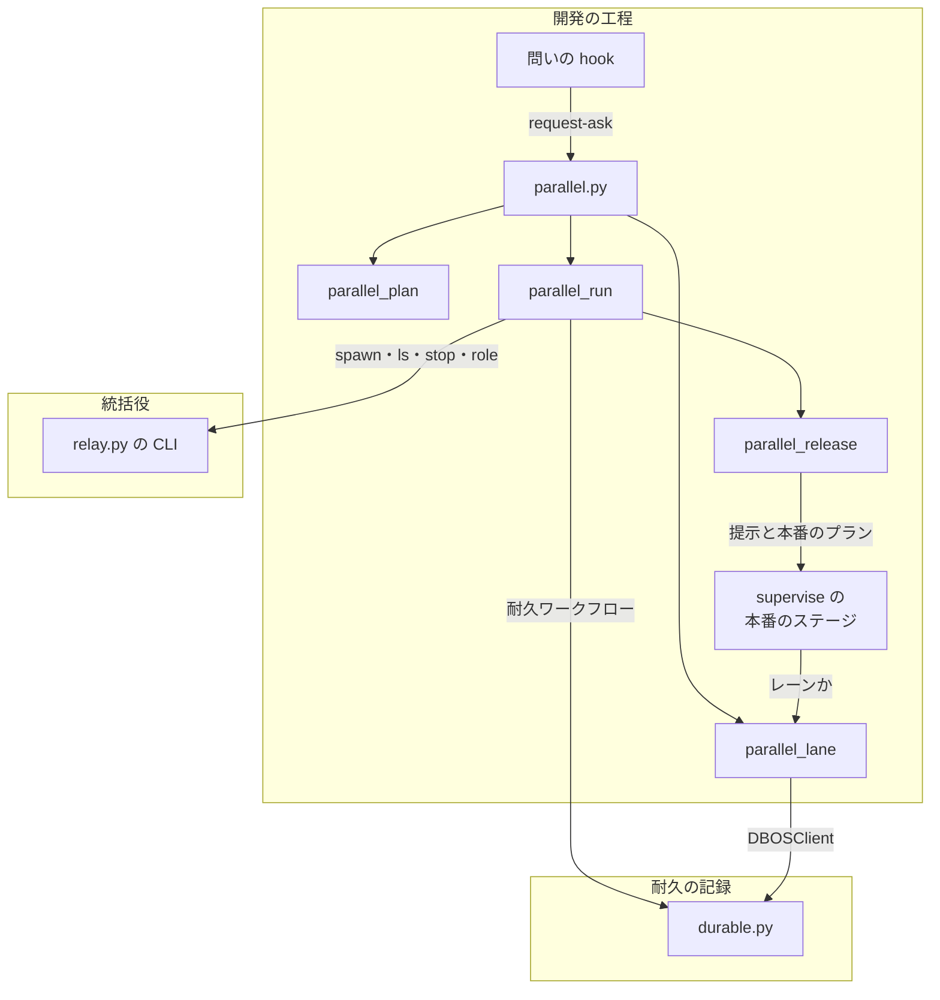
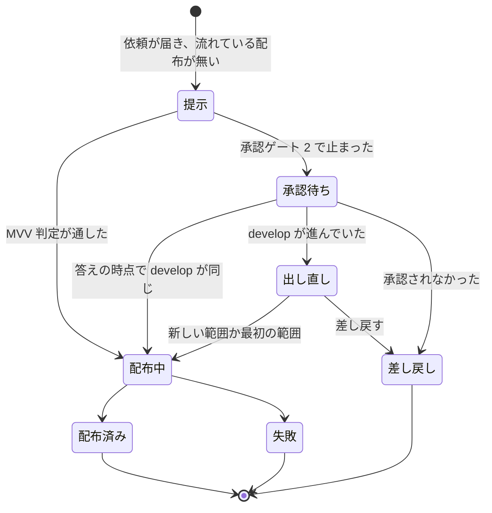

# 並列の計画を 1 度書き、オーガナイザーがレーンを起動して本番の配布を 1 本にまとめる

1 つのリポジトリで複数の開発ループかスプリントを tmux のレーンとして同時に進めるために、並列の計画（`plan.json`）を 1 度書き、
`/goal /ndf:development-workflow --parallel <計画名>` の 1 行でオーガナイザーを始める。進行は DBOS の耐久ワークフロー
`parallel-<計画名>` 1 本が持つ。耐久ワークフローはレーンの起動・観測と、配布の依頼のまとめを行う。区分つきの問いもここへ集まる。
オーガナイザーの conductor は返った 1 手を打つだけである。この文書は、Skill の文書に書いていない部分を残す。
扱うのは設計判断の結論と理由・常に成り立つ条件・メッセージとイベントの形・置き場・テスト観点である。

**手順と利用者向けの形は Skill の文書が正である。ここへは写さない。**

| 何を読むか | 正本 |
| --- | --- |
| 並列の計画の作り方・`plan.json` の項目・検査の種類（I1〜I4・I19）・`init` が書くもの | `plugins/ndf/skills/issue-plan-strategy/references/parallel-plan.md` |
| オーガナイザーの手順・`wait` の `action` ごとの 1 手・問い方・`answer` / `confirm` / `settle` の打ち分け・セッションの切り替え・一時レーンの手順・レーンの側・止める・異常のときの問い・数え方 | `plugins/ndf/skills/development-workflow/references/parallel.md` |
| `--parallel` / `--parallel-helper` の振り分け | `plugins/ndf/skills/development-workflow/SKILL.md` の「並列開発（`--parallel`）」 |
| レーンの問いを問いの hook がオーガナイザーへ送る判定と、送られたときの保留の手順 | `plugins/ndf/skills/development-workflow/references/asking.md` の「並列の計画のレーン」と [ndf-ask-guard.md](ndf-ask-guard.md) の「並列の計画のレーンの問い」 |
| ループのレーンの `配布待ち`・`質問待ち`・`waiting_only`・周回の境で答えを読む順 | `plugins/ndf/skills/development-workflow/references/loop.md` の「並列の計画のレーン」と [ndf-workflow-development-loop.md](ndf-workflow-development-loop.md) |
| レーンの本番のステージを配布の依頼のプラン（`parallel-request`）へ置き換える | [ndf-production-release-record.md](ndf-production-release-record.md) の「並列の計画のレーンの本番のステージ」 |
| 本番チャネルへの Pull Request の規則（head が `release/v<版>`・承認したコミットから切る・`release/v<版>-sync` で版数の衝突を解く・`scripts/check-pr-base.sh`） | [docs/versioning-and-distribution.md](../versioning-and-distribution.md) の「正式版を出す」の前後と、`plugins/ndf/skills/release/references/release-steps.md` の `release` の項 |
| オーガナイザーと一時レーンの数え方（役割 `organizer` / `helper`） | [ndf-relay-multi-session-supervisor.md](ndf-relay-multi-session-supervisor.md) の決定と理由、parallel.md の「数え方」 |
| 用語（並列の計画・レーン・オーガナイザー・配布の依頼・一時レーン・保留の周回・配布待ち・質問待ち） | [docs/glossary.md](../glossary.md)（正本は `docs/glossary/glossary.json`） |
| 配布の依頼の形 | `plugins/ndf/contracts/forms/parallel-request.json` |
| 環境変数の宣言 | `plugins/ndf/contracts/env/NDF_PARALLEL_MAX_PLANS.json`・`NDF_PARALLEL_STALL_MINUTES.json`・`NDF_PARALLEL_POLL.json`・`NDF_PARALLEL_RELAY.json`・`NDF_RELAY_MAX_NAMED.json` |

## 概要

**例: 2026-11-02 の配布の衝突。** 利用者は 3 本の開発ループ（lroot2・lflow・lfactory2）を tmux のセッションとして手で起動した。
3 本の引継ぎ文書には、共通の決まりを手で書き写した。lflow が ndf v10.27.14 を出したとき、`develop` にあった lfactory2 と
lroot2 の変更もまとめて出た。そのため lroot2 が出していた本番の Pull Request https://github.com/devbasex/ai-plugins/pull/2420 は閉じることになった。

並列の計画の下では、同じ状況は次のように進む。

| 順 | 誰が | 何をする | 何が起きるか |
| ---: | --- | --- | --- |
| 1 | conductor | `parallel.py init p1` に 3 レーンの下書きを渡す | `.ndf/parallel/p1/plan.json`・`plan.md` と、レーンごとの引継ぎ文書を書く。決まりは `plan.json` の `rules` の 1 か所だけに置く |
| 2 | 利用者 | `/goal /ndf:development-workflow --parallel p1 -- 終わり: …` を打つ | オーガナイザーが `parallel.py start p1` で耐久ワークフローを切り離して起動する。耐久ワークフローが 3 レーンを `relay.py spawn` で起動する |
| 3 | lflow | 本番のステージに来る | 本番の代わりに配布の依頼を送り、周回を `配布待ち` で締めて次の周回へ進む |
| 4 | 耐久ワークフロー | 依頼を受ける。流れている配布は無い | 他のレーンを待たずに、まとめた配布 1（提示 1）を組む。中身は承認資料を作る時点の `origin/develop` のコミットまでの範囲 `main..<SHA>` で決まる。範囲には lroot2・lfactory2 の Pull Request も入り、内訳に載る |
| 5 | 一時レーン `p1-rel1` | 提示のプランを流す | 承認ゲート 2 で止まり、`kind: gate2` の依頼をオーガナイザーへ送る |
| 6 | オーガナイザー | 承認ゲート 2 を 1 回だけ問い、`confirm` を打つ | `develop` が進んでいなければ提示 1 で確定する。一時レーンが本番のプランを流し、結果を `settle` で返す |
| 7 | 耐久ワークフロー | 範囲の依頼へ答え、`range-1` を立てる | lroot2 は後で本番のステージに来たとき、自分の Pull Request がすでに `main` にあるため依頼を送らずに `released` で進む。2 本目の本番の Pull Request は作られない |

## 背景

- 統括役（#2346）で名前つきのラッパーを並べて起動できるようになったが、並列開発を計画して始める手順と、本番の配布を調整する役が無かった
- 本番の配布は `develop` の先頭を `main` へ出していた。レーンごとに本番を出すと、先に出したレーンが `develop` にある他のレーンの変更も出す
- 人の答え待ちは 10 分〜40 時間あり（`.ndf/loop/*/loop.json` の `waiting`）、本番のプランの所要（855〜1,406 秒）より 1 桁以上長い。
  答えを待つ間に他のレーンのマージが `develop` へ入る見込みが高い
- 夜の間にすべてのレーンが問いで止まると、利用者はレーンを回って答えることになる

## 対象範囲

- **働く範囲**: NDF を導入したすべてのリポジトリ。起動まで行うのは、Claude Code をラッパー（`relay.py`）の下で動かしていて、tmux と統括役があるときだけである。
  それ以外は、`start` / `run` がレーンごとに手で起動する 1 行を返して終了コード 3 で終わる。
  手で起動したレーンは耐久ワークフローに属さないため、今どおり自分で本番を出す
- **1 台の中に閉じる**: まとめるのは 1 台の中のレーンだけである。進行は 1 つの SQLite（DBOS）に閉じる。
  Neural Development Factory の実行をまとめるのは Factory のオーガナイザー（https://github.com/devbasex/ai-plugins/issues/2439）で、
  同じ層の別の実装として互いに排他にする。依頼の形は契約 `parallel-request.json` として公開してある。
  Factory の実行ジョブ（環境変数 `NDF_FACTORY_RUN`）では、`parallel.py` の `init`・`start`・`run` が終了コード 1 で断る。
  外のオーガナイザーのレーン（環境変数 `NDF_ORGANIZER_DIR`）は、計画名の代わりに `--external` を付けて依頼と答えを置き場のファイルで受け渡す。
  置き場の形は契約 `parallel-external.json`、手順は parallel.md の「外のオーガナイザーのレーン」にある
- **モード**: オーガナイザーはモードを持たない。レーンの中のスプリントは今どおりモードを判定する
- **扱わないもの**: `main` へのホットフィックス、動いている計画へのレーンの追加（新しい計画名で `init` し直す）、GitHub API の同時本数の枠

## 決定と理由

| 決定 | 理由 |
| --- | --- |
| 新しい Skill を作らず、計画は `issue-plan-strategy`、起動は `development-workflow` の `--parallel <計画名>` で受ける | 分割と並行の手順は既存の 2 つの Skill の担当で、同じ役割の手順を 2 か所に分けない。`--loop` と同じ形の引数で、覚えるエントリポイントが増えない |
| オーガナイザーを置き、起動の後も残して本番の配布を 1 本にまとめる | 調整する役が無ければ配布の衝突は再発する。起動のブロックを並べるだけの形では衝突を防げない |
| 並列の計画の正本を `plan.json`（pydantic の `ParallelPlan`）にし、`plan.md` を描画にする | 検査はスクリプトが行い、表の解析より JSON の検証の方が誤りが少ない。`loop.json` と `laps.md` の組と同じ読み方で済む。JSON Schema では名前の重なりと依存先の照合が schema の外に出て、検査が 2 か所に分かれる |
| 進行を DBOS の耐久ワークフロー 1 本とメッセージ・イベントで作り、検査を pydantic と `graphlib.TopologicalSorter` で行う | 状態を残す・別のプロセスから依頼を受けて答える・待つ・落ちた後に続ける、を依存にある部品がすでに持つ。状態ファイル・依頼のファイル・停止の印を自分で書かない。Optuna・Prefect・Airflow・Snakemake などは、長く動いて人の承認を待つ流れに合わないか、サーバーが要る |
| オーガナイザーの conductor は記録から決まる 1 手だけを打つ | 切り替えのたびに状態を読み直して判断する費用と、判断の揺れを無くす。再開のコマンドは起動と同じ 1 行になる |
| `run` は `start` がセッションから切り離して起動する（`start_new_session=True`、出力は `run.log`、pid は `run.pid`） | Bash の背景の子は、セッションの切り替えで消える恐れがある。2 本目の `run` は実行の鍵の排他で動いている `run` を指して 0 で終わる |
| オーガナイザーと一時レーンの印を、作業ディレクトリの役割のファイル（`role.json`）で持つ | 統括役は作業ディレクトリのファイルだけを読んで数える。環境変数は統括役から読めない。登録簿は名前の無い前景のラッパーを表せない |
| レーンかどうかを、ラッパーの名前（`NDF_RELAY_NAME`）と終わっていない計画のレーン名の照合で決める（`parallel_lane.lane_of`） | レーンの最初の入力（`--loop`・`#<課題>`）に引数を足さずに済む。ループの記録・再開のコマンド・スプリントの状態の 3 か所へ引数を引き継がなくてよい |
| 本番のステージを組む 1 つの関数だけが、レーンのときに配布の依頼のプランを返す | `supervise_lib/sprint.py` の 4 か所の組み立てに同時に効き、ループでないスプリントのレーンにも効く |
| 配布の中身を、依頼の集合ではなく承認資料を作る時点の `origin/develop` のコミットの範囲で決める | 依頼を送った時点で、他のレーンの変更もすでに `develop` にある。依頼の集合で中身を決めると、実際に出る中身と一致しない（Pull Request 2420 の件） |
| 依頼が届いた時点で流れている配布が無ければ、他のレーンを待たずに直ちに配布を組む。配布は 1 本ずつ直列にする | まとめるための待ち時間を置かない。範囲に入らない依頼は、今の配布の直後に組む次の配布になる |
| 承認の答えの時点で `develop` が進んでいれば、同じ承認ゲート 2 を 1 回だけ出し直す。出し直しへの答えでは比べない | 出し直さないと、待つ間にマージしたレーンが次の配布で 2 回目の答え待ちを負う。回数の上限なしで出し直すと配布が始まらない。資料の無い範囲を承認させると、承認したものと出すものが食い違う |
| 承認ゲート 2 は提示のプランが持ち、本番のプランは確定の後にだけ流す | 本番のプランは流し始めるときに worktree と `release/v<版>` を作る。答えの前に作ると、提示 2 の本番のプランが同じ名前のブランチを作り直せない |
| 本番チャネルへの Pull Request の head を、承認したコミットから切った `release/v<版>` にする | `develop` を止めずに、承認したコミットと版上げだけを `main` へ出せる。`main` へ出るコミットはすべて `develop` に含まれる。並列の計画の外の配布にも同じ規則が効く |
| 並列の計画の下では、区分つきの問いはオーガナイザーだけが出す。レーンの問いは問いの hook が送る | レーンは問いで止まらず別の作業へ進める。conductor の手順だけで送ると、手順に書いていない場所の問いが漏れる。送れなければ今どおり通すので、DBOS が読めないときも今の振る舞いに戻る |
| オーガナイザーは、設計の承認の答えで設計 PR をマージするほかは作業を持たない。答えの後の処理は持ち主のレーンが、持ち主のいない共有の作業は一時レーン（同時に 1 本）が行う | オーガナイザーに作業を積むと、その間は問いと配布の取りまとめが止まる。空いているレーンへ移す形は、空きの判定と他のレーンの周回への割り込みが要る |
| 計画名での停止は `relay.py` ではなく `parallel.py stop` に置く | 統括役はリポジトリをまたぐ層で、並列の計画を知らない。統括役が知る語を役割の印だけに留める |
| レーンの数の上限は `NDF_RELAY_MAX_NAMED` から読み、依存のあるレーンも数える | 統括役が実際に断る値と同じにする。同時に動く本数を依存から求めると、起動の前に確かめられない |
| プランの本数の合計の上限は `NDF_PARALLEL_MAX_PLANS`（既定 6） | 2026-09-25 の実測（8 コア・30 GB で 6 本）。マシンごとに違うため環境変数で変える（2026-11-03 の承認ゲート 1 で利用者が決めた） |
| 異常は、耐久ワークフローの観測と依頼の印で見つけ、人が決めることは問いに、直す作業は持ち主のレーンか一時レーンへ返す | 新しい仕組みを足さず、オーガナイザーが作業を持たないまま扱える |

## 仕様

### 常に成り立つ条件

検査の条件（I1〜I4・I19）は `parallel-plan.md` の「検査」が正本である。ここでは進行の条件を挙げる。

| # | 条件 | 破れたときの扱い |
| --- | --- | --- |
| I5 | 作る前から在る引継ぎ文書と計画を上書きしない | `init` は 1 つも書かずに終了コード 1 で止まり、名前を返す |
| I6 | 検査に誤りがある計画では、レーンを 1 本も起動しない | `start` / `run` は耐久ワークフローを始めずに 1 で終わる |
| I7 | 1 本のレーンは、1 つの計画の進行の中で 1 回だけ起動する。打ち直した `run` も二重に起動しない | 起動は耐久ステップで、成功の記録（`started`）があるレーンは対象から外す。同じ名前の 2 本目の断りも成功として扱う。上限による断り（`refused`）は次の周で起動し直す |
| I8 | 依存のあるレーンは、依存先のレーンがすべて止まってから起動する。問いを保留して止まったレーン（答えていない問いを持つ・答えをまだ当てていない・`waiting_only` で止まったループ）は、止まったと数えない | 依存先が止まるまで起動の対象から外す |
| I9 | 流れている本番の配布は、1 つの計画につき 1 本まで。依頼が届いた時点で流れている配布が無ければ、直ちに配布を組む。中身は提示したコミットの範囲で決まる | 流れている間に届いた依頼は、範囲に入ればその配布の答えを受け、入らなければ `pending` に残って次の配布になる |
| I10 | 依頼 1 件への最終の答え（`released` / `rejected` / `failed`）は、イベント `answer-<依頼>` に 1 回だけ立つ。次の配布へ回した知らせは `defer-<依頼>` で、答えではない | 答えのイベントは耐久ワークフローの中でだけ立てる。`parallel.py answer` もメッセージ（`kind: answer`）を送るだけで、イベントを直接立てない |
| I11 | 耐久ワークフローが終わるのは、全レーンが止まり、流れている配布も、答えていない依頼と問いも無いときか、停止の指示を受けたときだけである | 終わる前に、答えを当てていない持ち主のレーンがあれば起こす 1 行を添え続ける。止まったループのレーンに保留の周回が残れば、一時レーンを起こして流させる |
| I12 | 動いている並列の進行（耐久ワークフローが `PENDING` か `ENQUEUED`）に属さないレーンは、依頼を送らず今の本番のプランを流す | `lane_of` が None を返し、今の本番のプランを組む |
| I13 | 同時に動かせる数から外すのは、オーガナイザーの印を持つ動いているラッパー 1 本だけ。役割 `helper` のラッパーは 1 本だけ、上限を 1 本超えて許す | 2 本目以降のオーガナイザーの印は数に入る。2 本目の `helper` は統括役が断る |
| I14 | 出すのは確定したコミットと版上げのコミットだけ。提示は 1 つのまとめた配布につき 2 つまで | 出し直しの提示への `confirm` は比べずに確定し、提示 3 を組まない |
| I15 | 範囲に入ったレーンは、依頼していなくても配布の結果を受ける。自分の Pull Request のマージのコミットがすべて `origin/<本番チャネル>` にあれば、依頼を送らずに `released` で進む | 出せた配布ごとに範囲のイベント `range-<連番>` を立てる。`request` は送る前に本番チャネルを照らし、版は `range-<連番>` から読む |
| I16 | 本番チャネルへ出すコミットは、すべて `develop` に含まれる | `scripts/check-pr-base.sh`（継続的統合の `pr-base-guard`）が落とす |
| I17 | 並列の計画の下で区分つきの問いを出すのはオーガナイザーだけである | レーンと一時レーンの問いは依頼（`kind: gate1` / `gate2` / `ask`）としてオーガナイザーへ届く |
| I18 | オーガナイザーは、設計の承認で設計 PR をマージするほかは作業を持たない。一時レーンは同時に 1 本まで | `answer --approved` は設計の承認の依頼なら、承認した先端のままで必須の検査が緑の設計 PR を待たずにマージしてから答えのメッセージを送り、ほかの答えはメッセージを送るだけである。ラベル・記録・直し・マージし直し・後片付けは持ち主のレーンが周回の境で行う |
| I20 | 依頼の `id` は送る側が依頼の中身から決め、受け取った数から採番しない | 打ち直しで同じ `id` になり、冪等の鍵（`<ID>:inbox:<依頼>`）が 2 度目を数えない。受け取りの前後で打ち直しても `id` が変わらない |

### 構成要素

| 要素 | 責務 |
| --- | --- |
| `plugins/ndf/scripts/parallel.py` | 並列の計画と進行の CLI。副命令を下の部品へ振り分け、統一 JSON レポートを 1 行で返す |
| `plugins/ndf/scripts/lib/parallel_plan.py` | pydantic のモデル（`ParallelPlan`・`Lane`・`LoopInput`・`SprintInput`）と検査、`plan.md` と引継ぎ文書の描画、起動できるレーンの判定（`ready_lanes`） |
| `plugins/ndf/scripts/lib/parallel_run.py` | 耐久ワークフロー `parallel` と耐久ステップ（起動・観測・配布を組む・停止・要約）。一時レーンが流すもの（`helper_task`） |
| `plugins/ndf/scripts/lib/parallel_release.py` | まとめた配布: 範囲の Pull Request をレーンへ対応づける（`present`・`map_lanes`）、先頭が進んだかを比べる 1 つの関数（`moved`）、範囲で答えられる依頼（`answerable`）、提示のプランと本番のプランの組み立て（`build_plans`・`present_gate_steps`）、配布の依頼のプラン（`plan_release_request`） |
| `plugins/ndf/scripts/lib/parallel_lane.py` | レーンの側: 自分が属する計画の判定（`lane_of`）・送り手の資格（`sender_of`）・本番チャネルにあるかの判定（`merged_on_production`）・依頼を送る（`send_release_request`・`request_gate1`・`request_ask`・`request_gate2`）・答えを読む（`read_answer`・`answers_of`）・プランの本数（`lane_plans`・`queue_max`） |
| `plugins/ndf/scripts/lib/parallel_files.py` | DBOS を読まずにファイルだけで、レーンか一時レーンかを決める（`lane_name_in_plans`。問いの hook の 10 秒の上限の中で使う） |
| `plugins/ndf/scripts/lib/durable.py` | 外のプロセスから記録を開く関数（`open_client`・`send_to`・`event_from`・`status_from`・`output_from`・`wait_from`）と、耐久ワークフローの中の `recv`・`set_event`。DBOS を import するのはこのファイルだけである |
| `plugins/ndf/scripts/relay_lib/hub.py`・`hub_client.py` | 役割のファイルの読み書き（`relay.py role`・`spawn --role helper --plan`）と数え方（I13）。`ls --json` の `metrics.hub`・`metrics.tmux` |
| `plugins/ndf/scripts/lib/sprint_loop_gate.py` | ループのレーンが設計の承認を「人の判断待ち」へ移すときに、`kind: gate1` の依頼を送る。答えを当てる前に設計 PR の先頭を比べる |
| `plugins/ndf/scripts/lib/design_pr_merge.py` | 承認した設計のマージ（`merge_approved`）。`parallel.py answer --approved`・`loop answer --approved`・周回の境が呼ぶ |
| `plugins/ndf/scripts/lib/parallel_answer.py` | 答えの後に起こす 1 行（`owner_restart`）と、答えの後に残る依頼の一覧と除外の印（`after_items`・`mvv_mark`） |
| `plugins/ndf/scripts/hook_lib/ask_guard.py` | 判定が通す問いを、レーンか一時レーンなら `parallel.py request-ask` で送って止める |

**統括役との境界。** 開発の工程は統括役の CLI を子プロセスで打ち、統一 JSON レポートだけを読む。統括役は `plan.json` を読まない。
役割のファイルの計画名は、問いの hook とレーンの側が読む値で、統括役は解釈しない。

### 耐久ワークフローの 1 周

耐久ワークフローの中の分岐は、耐久ステップの結果とメッセージだけで決まる。時刻・外のコマンド・ファイルを読むのは、すべて耐久ステップである。
打ち直しで同じ道を通るためである。

1. 最初に計画を読んで検査し、`relay.py role organizer --plan <計画名>` を打つ
2. 停止の指示を受けていて、流れている配布が無いか `--force` なら、起動済みのレーン（`--force` なら一時レーンも）へ `relay.py stop` を打ち、`stopped` で終わる
3. 起動の条件がそろったレーンを `relay.py spawn --name <レーン> --json -- <最初の入力>` で起動する。3 回続けて断られるたびに `kind: spawn` の問いを立てる
4. 流れている配布が無く `pending` があれば、出せた配布の範囲で答えられる依頼に答える。残りがあれば、まとめた配布を組む（下の「まとめた配布」）
5. I11 を満たせば、役割の印を消して `finished` で終わる
6. `inbox` を最長 60 秒（`NDF_PARALLEL_POLL`。配布の途中は 30 秒）待つ。配布の途中なら `resume` も読む
7. 耐久ステップ「観測」で `relay.py ls --json` を読む。状態が `awaiting_approval` へ移ったレーンがあれば `notice` を立てる。動かないレーンと、止まった一時レーンには問いを立てる。2 へ戻る

### まとめた配布

- **1 つの提示は 2 つのプランを持つ。** 提示のプラン（`present.json`）は、今の開発版の承認資料のステップ（approval-facts など）を版上げ無しで流す。
  続く `parallel.py present` が範囲の Pull Request をレーンへ対応づけ、最後に承認ゲート 2（MVV 判定 → `approve`）を置く。
  本番のプラン（`release.json`）は `plan_mvv_release` で作り、承認ゲート 2 を持たない。承認の記録は提示のプランの状態ディレクトリから読む
- **本番のプランへ範囲を渡す。** 本番のプランは、差し込み `{queue_prs:present}`・`{queue_approved:present}` で範囲を受け取る。
  中身は提示のプランの状態ディレクトリの `work/prs.txt`・`work/approved.txt` である。worktree と `release/v<版>` の起点は、承認したコミットにする（項目「起点のコミット」）。
  版の判定が読む「起点」は `origin/<ベースブランチ>` のままにする
- **出す版の決め方。** 配布を組む時点の `origin/develop` の開発版の版数から、接尾辞を外して決める。依頼はレーンの希望の版を持たない
- **範囲をレーンへ対応づける。** 依頼のあるレーンは、依頼の `prs` が範囲にあるかで決める（依頼済みの印をつける）。依頼の無いレーンは、範囲の Pull Request が閉じる課題が、スプリントのレーンの `input.issues` にあるかで決める。
  どちらにも当たらないものは、レーンの無い Pull Request（`orphans`）として内訳に並べる。内訳は承認する人が読むための表示で、配布の中身は範囲である
- **承認の答えを受けたら 1 度だけ比べる。** 提示 1 への `confirm` で、耐久ステップが `origin/develop` の先頭を読む。`moved` が偽なら提示 1 で確定する。
  真なら提示 2 を組み、加わった範囲を載せた `release`（`represent: true`）を立てる。提示 2 への `--take new` は提示 2、`--take first` は提示 1 で確定する
- **確定の後に一時レーンが打つ 3 手。** 答えを `releases/<n>/<k>/answer.json` へ書く（`sprint-state.py gate … '関門 2' --by user --outcome approved`）。
  次に提示のプランを `approve` から続け、最後に本番のプランを初めて流す。確定しなかった提示の本番のプランは流さない。
  1 つのまとめた配布で `release/v<版>` を作るのは 1 回だけである
- **答えを返す。** `settle` を受けると、前の配布で出た Pull Request と合わせて、`prs` がすべて範囲に入る依頼へ答えを立てる。
  `released` なら `range-<n>` も立てる。範囲に入らない依頼には `defer-<依頼>` を立て、`pending` に残す。差し戻しと失敗は、範囲の依頼へ `rejected` / `failed` を返す

### 依頼と答え

| 依頼の `kind` | 送り手 | `id` の形 | 問いの時点の印（`stamp`） |
| --- | --- | --- | --- |
| `request`（配布の依頼） | レーンのプランのステップ `parallel-request`（`parallel.py request`） | `<レーン名>-r<乱数 12 桁>`。最初の実行でプランの状態ディレクトリの `work/request-id.txt` へ書き、打ち直しでは読む | — |
| `gate1`（設計の承認） | ループのレーン（`sprint_loop_gate.py`） | `<レーン名>-g<設計 PR>-<先頭の SHA の 12 桁>` | 設計 PR の先頭の SHA |
| `ask`（承認ゲートの外の問い。1 スプリントのレーンの承認ゲート 1 も含む） | 問いの hook（`parallel.py request-ask`） | `<送り手>-q<判定の記録の id>` | 作業の場所の `HEAD` |
| `gate2`（承認ゲート 2） | 一時レーン（`parallel.py request-gate2`） | `<計画名>-p<連番>-<提示>` | 承認資料の承認したコミット |
| `stall`・`helper`・`spawn` | 耐久ワークフロー自身 | `<レーン>-s<時刻>`・`<一時レーン>-h<起動の連番>`・`<計画名>-spawn-<レーン>-<回数>` | — |

- レーンは、答えを使う前に今の印と答えの `stamp` を比べる。違えば答えを使わずに問い直す（ループのレーンの設計の承認で実装済み）
- 同じ原因の問いは 1 つにまとめる。対象は `ndf-ask:human-action` の問いで、区分・選択肢・文面が同じものである。文面はレーン名・パス・数字を伏せ、空白をまとめてから比べる。
  答えは依頼してきた全レーンへ `answer-<依頼>` で配る。取り消せない操作・レッドライン・費用の問いは、番号の違いで別の対象になり得るためまとめない
- 1 スプリントのレーンの持ち主が止まっていれば、`answer` は `metrics.next` に `relay.py restart <レーン>` の 1 行を返す。
  起こすかは、ラッパーの状態ではなくレーンの側の待ちの記録で決める（`lane_waits`）

## データ・設定

### 置き場

どちらもコミットしない。

| 置き場 | 中身 | 書き手 |
| --- | --- | --- |
| メインディレクトリの `.ndf/parallel/<計画名>/plan.json` | 並列の計画の正本 | `init`（起動の前は人と AI も直してよい） |
| 同 `plan.md` | 人が読む描画（レーンの表・決まり・配布の内訳） | `init`・耐久ステップ |
| 同 `run.pid`・`run.log` | 切り離した `run` の pid と出力 | `start` |
| 同 `releases/requests.json` | 耐久ワークフローが受けた配布の依頼の写し（`present` が内訳に使う） | 耐久ステップ「配布を組む」 |
| 同 `releases/<連番>/<提示>/present.json`・`release.json`・`answer.json` | 提示のプラン・本番のプラン・提示の答えの記録（スプリントの状態ファイルの形。承認済みのプロジェクト MVV の参照を持つ） | 耐久ステップ「配布を組む」 |
| 同 `releases/<連番>/<提示>/presented.json`・`breakdown.md` | 提示したコミット・範囲の Pull Request・レーンの対応・レーンの無い Pull Request・出し直しで加わった範囲、承認資料へ足す内訳 | `parallel.py present` |
| 同 `releases/<連番>/<提示>/done.json`・`release-done.json` | 提示と本番のプランの queue の done | 一時レーン |
| レーンのプランの状態ディレクトリの `work/request-id.txt`・`work/request.txt` | 依頼の `id`、送った依頼か配布済みの結果 | `parallel.py request` |
| ラッパーの作業ディレクトリの `role.json` | 役割（`organizer` / `helper`）と計画名 | `relay.py role`・`relay.py spawn --role helper` |
| 耐久の記録（種類 `parallel`、識別は計画の置き場の絶対パス） | 耐久ワークフロー `parallel-<計画名>` の入力・耐久ステップの結果・メッセージ・イベント | 耐久ワークフロー（外のプロセスはメッセージを送るだけ） |

### メッセージとイベント

| 種類 | 名前 | 送り手・書き手 | 読み手 | 中身 |
| --- | --- | --- | --- | --- |
| メッセージ | 話題 `inbox` | `request`・`request-ask`・`request-gate2`・ループのレーン（`gate1`）・`answer`・`stop` | 耐久ワークフロー | `{kind: request \| gate1 \| gate2 \| ask \| answer \| stop, …}`。冪等の鍵は `<ID>:inbox:<依頼>` など |
| メッセージ | 話題 `resume` | `confirm`・`settle` | 配布の途中の耐久ワークフロー | `{n, phase: confirm, take}` / `{n, phase: settle, result, version, reason}` |
| イベント | `pause` | 耐久ワークフロー | `wait` | `{seq, action, …}`。`action` は `running` / `notice` / `release` / `confirmed` / `held`。`running` では `wait` は返らない。起こす 1 行（`wake`）を添える |
| イベント | `questions` | 耐久ワークフロー | `wait` | `{seq, items}`。答えていない問いの依頼の全件 |
| イベント | `answer-<依頼>` | 耐久ワークフロー | `await`・周回の境（`answers_of`） | 配布: `{result, version, release, reason, at}`。問い: `{result, note, choice, stamp, merge, by, at}`（`merge` は設計の承認で試みたマージの結果、`by` は `user` か `mvv`） |
| イベント | `defer-<依頼>` | 耐久ワークフロー | `await` | `{seq, reason, at}`。知らせのたびに上書きしてよい |
| イベント | `range-<連番>` | 耐久ワークフロー | `request`（`released_version`） | 出せた配布の `{sha, version, prs, lanes}`。差し戻し・失敗の配布の連番は欠ける |
| イベント | `lane-<レーン名>` | 耐久ワークフロー | 状態の表示 | `{received}`。依頼の `id` の採番には使わない |
| 出力 | 耐久ワークフローの戻り値 | 耐久ワークフロー | `wait`・`run` | `{status: finished \| stopped, lanes, releases, pending}` |

### 環境変数

| 名前 | 既定 | 意味 |
| --- | --- | --- |
| `NDF_RELAY_MAX_NAMED` | 3 | レーンの数の上限（統括役の上限と同じ値）。正の整数でなければ既定を使い、検査の結果に書く |
| `NDF_PARALLEL_MAX_PLANS` | 6 | レーンのプランの本数の合計の上限。扱いは同上 |
| `NDF_PARALLEL_STALL_MINUTES` | 60 | 承認待ちでも止まってもいないレーンを「動かない」として問うまでの分 |
| `NDF_PARALLEL_POLL` | 60 | `inbox` と `resume` を待つ秒（テストで縮める） |
| `NDF_PARALLEL_RELAY` | — | 統括役の CLI の打ち方の差し替え（テスト用） |
| `NDF_RELAY_NAME`・`NDF_RELAY_DIR` | — | レーンの判定と役割のファイルの置き場（ラッパーが立てる） |
| `NDF_FACTORY_RUN` | — | Factory の実行ジョブの印。あれば `init`・`start`・`run` を断る |
| `NDF_ORGANIZER_DIR`・`NDF_ORGANIZER_LANE` | — | 外のオーガナイザーの置き場とレーンの名前。あれば副命令は `--external` で置き場のファイルを読み書きする |

### 副命令の終了コード

各副命令の意味と打つ場面は parallel.md と `parallel.py` の冒頭の表にある。ここでは終了コードだけを挙げる。
`NDF_FACTORY_RUN` があるときの `init`・`start`・`run` は 1 で終わる。`--external` の副命令の終了コードは `lib/parallel_external_cli.py` の冒頭の表にある。

| 副命令 | 0 | 1 | 2 | 3 | ほか |
| --- | --- | --- | --- | --- | --- |
| `init` | 書いた | 検査の誤り・在る文書（何も書かない） | 読めない・書けない | — | — |
| `check` | 通った（警告だけを含む） | 誤り | 読めない | — | — |
| `start` | 切り離して起動した・動いている `run` を指した | 計画が無い・検査の誤り | 計画を読めない | ラッパーの外・tmux が無い・統括役が居ない（`manual: true`） | — |
| `run` | 終わった・同じ計画の `run` が動いている（`running: true`） | 計画が無い・検査の誤り | 耐久の記録を開けない | `start` と同じ | — |
| `wait` | `notice` / `release` / `confirmed` / `held` / `questions` / 終わり | 耐久ワークフローが失敗で終わった | 耐久の記録が無い | 上限に達した・まだ変化が無い | — |
| `request` | すでに本番チャネルにある（`released`） | 計画が動いていない | — | — | 10: 依頼を送った |
| `await` | `released` | `failed` | 依頼の記録を読めない | 答えがまだ無い | 10: `rejected` |
| `settle` | 送った | 計画が動いていない | done を読めない | — | 4: 本番のプランが承認ゲートで止まっている |
| `request-ask` | 送った | 計画が動いていない | 標準入力を読めない | — | 4: 送り手の資格が無い（hook は問いを通す） |
| `stop` | 停止を打った | 止まらないレーンがある・検査の誤り | — | — | — |

## エラー処理

| 起きること | 検知 | 扱い |
| --- | --- | --- |
| オーガナイザーのセッションが切り替わる・`run` が落ちる | 新しいセッションが同じ 1 行で始まる | `start` が動いている `run` を指すか、切り離して起動し直す。耐久ワークフローは記録から続き、居ない間に届いたメッセージを読む。`wait --after 0` が答えていない問いを返す |
| 動かないレーン | 観測で、`relay.py ls` の `at` が `NDF_PARALLEL_STALL_MINUTES` より前で、承認待ちでも止まってもいない | `kind: stall` の問い（起こし直す / 止める / 待つ）。「待つ」の後は次の区切りまで問わない |
| 配布の途中で一時レーンが止まる | 観測で一時レーンが `stopped`、`settle` も `gate2` の依頼も無い | `kind: helper` の問い（続きから起こし直す / 止める）。「止める」は配布を `failed` で締める |
| レーンの起動が断られ続ける | `relay.py spawn` の断りが 3 回続く | `kind: spawn` の問い。「止める」は止まったレーンとして数える |
| 同じ原因の問いが複数のレーンから届く | 「依頼と答え」の正規化した鍵が同じ | 1 つにまとめ、答えを全レーンへ配る |
| 手元が待ちだけになったループのレーン | 周回の境で、選べる課題が無く保留の周回か答えの無い設計の承認がある | ループは `waiting_only` で止まり、統括役の枠を空ける。答えの後、オーガナイザーが起こす（loop.md） |
| 止まったレーンの保留の周回が残る | I11 を満たした時点で、`released` を受けたのにまとめを流していない保留の周回がある | `action: held` で一時レーン（`--parallel-helper <計画名> pending <ループ名>`）を 1 本ずつ起こし、流し終えてから終える |
| 配布の途中の `stop` | 一時レーンが動いていて `settle` がまだ | `settle` が届くまで待ってから `stopped` で終える。`--force` は待たずに一時レーンも止め、本番のプランの状態ディレクトリを残す |
| 複数のレーンがメインディレクトリで git を動かす | — | 後片付け・worktree の作成・メインディレクトリの追従を `<メインディレクトリ>/.git/ndf-main.lock` の排他で 1 本ずつにする（`merged_lib/main_lock.py`・`worktree-session.sh`） |
| `main` へのマージの後に配布が止まる | — | `release-steps.py release` が、マージ済みならマージを飛ばし、無いタグと GitHub Release だけを作って続ける |
| 耐久の記録が読めない・消えた | `run` が `DurableError` | `run` が 2 で止まる。計画は新しい計画名で始め直す。レーンは計画に属さなくなり（I12）、今の本番のプランを流す |
| 同じ課題で設計の「直して出し直す」が続く | `loop answer --revise` が人の判断待ちの行へ `revise_count`（その課題の「直して出し直す」の回数）を書く | 回数を記録するだけで、問いの選択肢は変えない |

## セキュリティ

- 置き場はどれもコミットしない。耐久の記録はユーザーの状態ディレクトリにあり、#1142 の掃除（30 日）に従う
- 問いの hook がオーガナイザーへ送るのは、問いの文面・選択肢・区分・作業の場所・レーン名・判定の記録の `id` だけである

## テスト観点

耐久ワークフローのテストは、`NDF_DBOS_DIR` を一時ディレクトリにして本物の DBOS（SQLite）で流す。`relay.py`（`NDF_PARALLEL_RELAY`）と `git`・`gh` は差し替える。

| 観点 | 縛るテスト |
| --- | --- |
| `init` が計画・描画・レーンの数だけの引継ぎ文書を書き、在る文書があれば何も書かない（I5）。検査の誤りの種類（I1〜I3・I19）と警告（I4）、上限の比較（「より大きい」で誤り）、環境変数の値が正の整数でないときの既定 | `plugins/ndf/scripts/tests/test_parallel_plan.py` |
| 検査に誤りがあると `relay.py spawn` を 1 回も打たない（I6）。依存先が止まった後の周で起動し、保留中のレーンは止まったと数えない（I8）。打ち直しで起動に成功したレーンを起動し直さず、断られたレーンは起動し直す（I7） | `plugins/ndf/scripts/tests/test_parallel_run.py` |
| 依頼が 1 件届けば他のレーンを待たずに提示 1 を組み、範囲は提示したコミットで決まり、依頼の無いレーンの Pull Request も内訳に載る（I9） | 同上 |
| 答えの時点で先頭が同じなら確定、進んでいれば提示 2 を組む。提示 2 への答えでは比べず、提示 3 を組まない。確定まで本番のプランを流さない（I14） | 同上 |
| 範囲に入ったレーンは後で依頼に来ても送らずに `released` で進み、2 本目の本番のプランが組まれない（I15、Pull Request 2420 の件） | `test_parallel_run.py`・`test_parallel_lane.py` |
| 答えは `answer-<依頼>` に 1 回だけ立ち、`defer-<依頼>` では `await` が返らない（I10）。全レーンが止まり答えていない依頼が無いときだけ `finished`（I11） | `test_parallel_run.py` |
| 動いている計画に属さないレーンでは依頼を送らない（I12）。送り手の資格を `lane_of` だけで見ない（一時レーン） | `test_parallel_lane.py` |
| 依頼の `id` は受け取りの前後の打ち直しで変わらず、別の設計 PR では別になる（I20） | `test_parallel_lane.py` |
| 問いの依頼をまとめて 1 回で返し、答えの間に届いた依頼だけを続けて返す。同じ原因の問いを 1 つにまとめて全レーンへ答える。止まった持ち主を起こす 1 行を返す | `test_parallel_run.py` |
| 問いの hook がレーン・一時レーンの問いを送って止め、レーンでない・送れないときは通す | `plugins/ndf/scripts/tests/test_ask_guard.py` |
| オーガナイザーの印 1 本だけを数から外し、`helper` は 1 本だけ上限を超えて通る（I13） | `plugins/ndf/scripts/tests/test_relay_hub.py` |
| 配布の依頼の形の例が契約の形を通る | `plugins/ndf/scripts/tests/test_parallel_request_form.py` |
| `check-pr-base.sh` が `develop` と、先頭が `origin/develop` の祖先の `release/v*` だけを通す（I16） | `scripts/tests/test_pr_base_guard.py` |
| 版数を持つ箇所だけの衝突を本番の版で解き、ほかの衝突は止める | `plugins/ndf/scripts/tests/test_release_version_merge.py` |
| ループのレーンの `配布待ち`・`質問待ち`・`waiting_only` | `plugins/ndf/scripts/tests/test_sprint_loop.py` |
| 起動から配布までの通し | 単体テストでは縛れない。2 レーンの計画を `--parallel` で起動するリリース後テストで確かめる |

## 運用

- 計画の途中でプロジェクト MVV が変わったり、耐久の記録を失ったりしたら、新しい計画名で始め直す。`finished` / `stopped` の計画は `running` に戻らない
- 1 本だけを止めるのは `relay.py stop <名前>`、計画の全レーンを止めるのは `parallel.py stop <計画名>` である
- 確かめ切れていないことが 4 つある。複数のプロセスが同じ SQLite に書くときのロックの待ちと、長く動く耐久ワークフローの記録の量（観測の周ごとに増える）である。
  加えて、レーン 3 本と一時レーンが同時に動くときのメモリ・CPU と、GitHub API の同時本数の枠もまだ測っていない。いずれもリリース後テストで測る

## 関連リンク

- [issue #2436](https://github.com/devbasex/ai-plugins/issues/2436) — 要求と受け入れ条件
- [PR #2437](https://github.com/devbasex/ai-plugins/pull/2437) — 設計
- [PR #2451](https://github.com/devbasex/ai-plugins/pull/2451) / [PR #2454](https://github.com/devbasex/ai-plugins/pull/2454) / [PR #2455](https://github.com/devbasex/ai-plugins/pull/2455) / [PR #2462](https://github.com/devbasex/ai-plugins/pull/2462) / [PR #2452](https://github.com/devbasex/ai-plugins/pull/2452) — 実装（v10.27.15）
- [issue #2439](https://github.com/devbasex/ai-plugins/issues/2439) — Factory のオーガナイザー（同じ層の別の実装）
- [ndf-relay-multi-session-supervisor.md](ndf-relay-multi-session-supervisor.md) — 統括役（#2346）
- [ndf-execution-plan-and-parallel-capacity.md](ndf-execution-plan-and-parallel-capacity.md) — 1 つのスプリントの中の並列の実行計画と本数（この文書のレーンの並列とは別の層）
- [ndf-ask-guard.md](ndf-ask-guard.md)・[ndf-workflow-development-loop.md](ndf-workflow-development-loop.md)・[ndf-production-release-record.md](ndf-production-release-record.md) — レーンの側の問い・周回・本番のステージ
