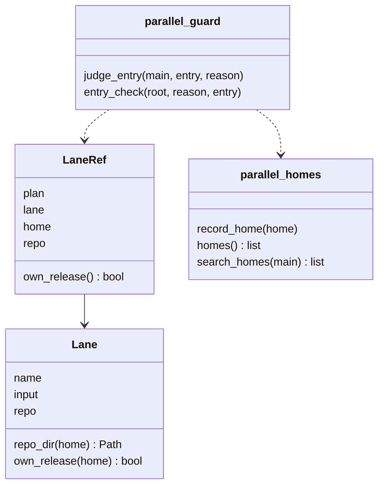
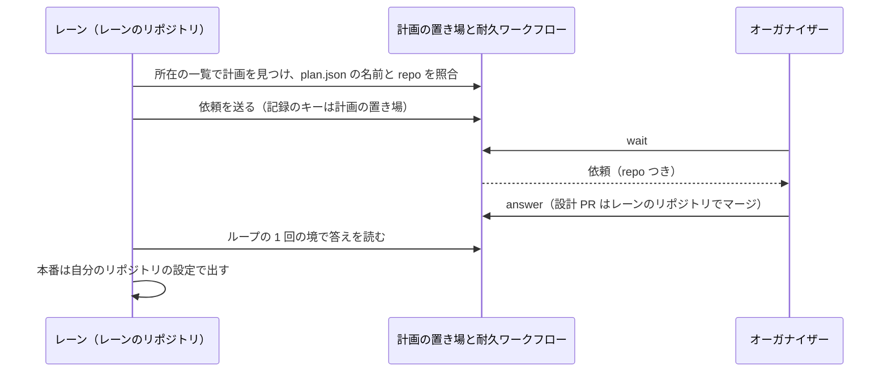
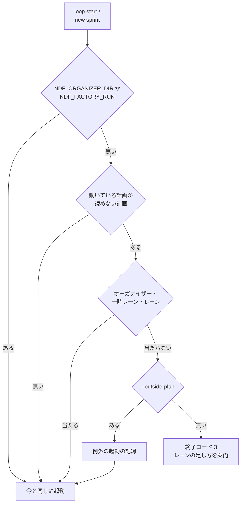

# 別のリポジトリのレーンと計画の外のセッション: 人との窓口をオーガナイザー 1 つにする

並列の計画を動かしているマシンで、人との窓口をオーガナイザーの 1 か所にする仕組みである。計画を置いたリポジトリと違う
リポジトリのセッションも計画のレーンになり、問いと承認はオーガナイザーへ届く。計画のレーンでもオーガナイザーでもない
セッションが開発ループかスプリントを始めようとすると、起動の判定が止め、レーンの足し方を案内する。あわせて、並行開発の語と
supervisor の定義を [docs/ndf-parallel-model.md](../ndf-parallel-model.md) と用語集にそろえた。

この文書は設計判断の結論と理由・常に成り立つ条件・置き場の形・テスト観点を残す。**手順と利用者向けの形は Skill の文書が正である。ここへは写さない。**

| 何を読むか | 正本 |
| --- | --- |
| 並行開発の役割と語の関係（3 つの軸・実行の形・語の決定） | [docs/ndf-parallel-model.md](../ndf-parallel-model.md) |
| レーンの動き方の規定（形によらない規定と 1 台だけの規定）・計画の外のセッションの扱い・レーンの足し方 | `plugins/ndf/skills/development-workflow/references/parallel.md` の「レーンの動き方」 |
| 計画の宣言のレーンの `repo`・レーンの名前の付け方 | `plugins/ndf/skills/issue-plan-strategy/references/parallel-plan.md` の「レーンごとに決めること」 |
| 開発ループの起動の `--outside-plan` | `plugins/ndf/skills/development-workflow/references/loop.md` |
| オーガナイザー・耐久ワークフロー・まとめたリリースの全体 | [ndf-parallel-organizer.md](ndf-parallel-organizer.md) |
| 副命令の入出力 | `plugins/ndf/contracts/entrypoints/`（`parallel.py` の `lane`、`sprint-state.py` と `supervise.py` の `--outside-plan`）と `plugins/ndf/scripts/relay_lib/__init__.py` の副命令の表（`relay.py cap`） |
| ファイルの形 | `plugins/ndf/contracts/files/plan-json.json`・`outside-plan-jsonl.json` |

## 概要

**例: 2026-11-07 の計画 p3。** `/work/factory` で動く開発セッション `factory1` の設計の問いが、オーガナイザーへ届かず自分の
画面に出た。オーガナイザーが画面を読みに行き、答えをキー入力で渡した。レーンの判定がセッションのリポジトリの
`.ndf/parallel/` しか探さず、別のリポジトリのセッションはレーンになれなかったためである。

同じ状況は、今は次のように進む。

| 順 | 誰が | 何をする | 何が起きるか |
| ---: | --- | --- | --- |
| 1 | オーガナイザー | `parallel.py lane p3 add --from <JSON>` に `"repo": "/work/factory"` を持つレーンを渡す | 検査を通れば `plan.json`・`plan.md`・引継ぎ文書を書き、計画の所在の一覧へ `/work/ai-plugins` を書き、耐久ワークフローへ `lanes_changed` を送る |
| 2 | 耐久ワークフロー | 計画を読み直す | 足したレーンを起動の候補に入れ、`/work/factory` を作業ディレクトリにして `relay.py spawn` で起動する |
| 3 | レーン | 設計承認ゲートに着く | 計画の所在の一覧から `/work/ai-plugins` の計画 p3 を見つけ、依頼を計画の置き場の記録へ送る。画面には問いを出さない |
| 4 | オーガナイザー | `parallel.py wait` で依頼を受け、答える | 依頼の行には `repo`（`/work/factory`）が付く。設計 PR のマージは `/work/factory` で行う |
| 5 | レーン | ループの 1 回の境で答えを読み、本番のステージへ進む | 自分のリポジトリの設定で本番を出す。計画 p3 のまとめたリリースには入らない |

計画の外のセッションが `sprint-state.py loop start` を打つと、終了コード 3 で止まり、レーンの足し方と例外の起動の 1 行が出る。

## 用語

語の定義は [docs/glossary.md](../glossary.md)（正本は `docs/glossary/glossary.json`）にある。この文書で使う語は、計画の置き場・
レーンのリポジトリ・計画の所在の一覧・別のリポジトリのレーン・計画の外のセッション・例外の起動・レーン数の上限・リレーハブ・
ループの 1 回・ランナー・ランナーのエージェント・物理層・ロール層・フロー層・supervisor である。

## 背景

- レーンの判定（`parallel_lane.lane_of`）・依頼の送り先・答えの読み先は、セッションのメインディレクトリの `.ndf/parallel/` だけを見ていた
- 計画の外で開発を始めるセッションを止める仕組みが無く、人との窓口が 2 か所に割れた
- レーン数の上限は環境変数 `NDF_RELAY_MAX_NAMED` だけで、リレーハブのプロセスの環境から読む。リレーハブは最初に起動したラッパー（多くはオーガナイザー）が兼ねるため、上限を変えるにはオーガナイザーを起動し直す必要があった
- 動いている計画へレーンを足すには `plan.json` を手で書き換えるしかなく、`plan.md` の描き直し忘れと古いループ名が残った
- 並行開発の語（今のリレーハブ・ランナー・レーン・ループの 1 回に当たる語）と supervisor の主と代行の向きが、用語集・手順書・実際の動きと食い違っていた

## 対象範囲

- **働く範囲**: 利用先のリポジトリでも働く。別のリポジトリのレーンは、計画と同じマシン（実行の形 A: 1 台）で、同じ利用者が動かすものに限る
- **Factory の実行ジョブ**: 環境変数 `NDF_ORGANIZER_DIR` か `NDF_FACTORY_RUN` があるときは、レーンの判定も起動の判定も変わらない。`NDF_ORGANIZER_DIR` は計画の所在の一覧より先に判定する
- **扱わないもの**: Factory の形とマシンをまたぐ形での別のリポジトリのレーンの登録、識別子（JSON のキー・環境変数・状態のファイルの名前・`relay_hub`・`--lap`・`laps.md` などのコード上の名前）の改名、Factory のサービス側の語

## 決定と理由

| 決定 | 理由 |
| --- | --- |
| マシンに計画の所在の一覧を置き、`parallel.py init`・`start`・`lane add`・`lane set` が計画の置き場を書く。一覧は置き場を指すだけで、計画の中身をコピーしない | 耐久ワークフローの記録は計画の置き場の絶対パスと計画名から導くキーで持つため、置き場が分かればどのリポジトリからも今のキーで開ける。足りないのは「マシンのどこに計画があるか」だけである。環境変数で置き場を渡す形は、手で起動したレーンと再起動したレーンに届かず、計画の外の判定にはマシンのすべての計画が要る |
| 記録のキーは変えず、レーンの側は依頼・答え・止める指示を計画の置き場で読み書きする。ループの記録と引継ぎ文書はレーンのリポジトリに置く | 記録をレーンのリポジトリへコピーすると、2 か所のどちらが正かを決める規則が要り、片方の書き込みの失敗が食い違いになる |
| レーンのリポジトリは計画の宣言のレーンの任意の `repo` で持つ。レーンの判定は、`repo` と自分のメインディレクトリが一致する計画だけを当てる | 検査・描画・起動の作業ディレクトリ・記録の読み先が 1 か所から決まる。起動の場所から導くと、判定の正しさが起動の仕方に依存する |
| 別のリポジトリのレーンは自分のリポジトリの設定で本番を出し、まとめたリリースの対応づけに入らない | まとめたリリースは計画の置き場のリポジトリの 1 本の `main` と版を組む。別のリポジトリの変更は版もチャネルも違う |
| 計画の外の判定は、開発ループとスプリントの起動のエントリポイントで、何かを書く前に行う | セッションの開始の hook で判定すると対話だけのセッションも止まる。リレーハブの `spawn` に置くと、人が端末で起動したセッションを通らない |
| 計画の状態を読めないときは、動いている計画として扱う | 読めない計画を読み飛ばして通すと、記録の壊れた計画が 1 つあるだけで止める仕組み全体が働かない。止める出力には読めなかった計画と例外の起動の 1 行を出す |
| 例外の起動は理由つきのコマンドの指定 `--outside-plan <理由>` だけで通し、理由をマシンの記録に残す | 環境変数での指定はシェルの設定に残り、利用者が選んだと分からないまま毎回の起動が通る |
| レーン数の上限はマシンの設定のファイルで持ち、`relay.py cap --named <n>` だけが書く。リレーハブの起動の判定と計画の検査が同じ関数で読む | 動いている計画とオーガナイザーを止めずに上限を変えられる。上限はマシンの資源を守る値で、計画ごとの宣言には置かない |
| 動いている計画のレーンの追加と書き換えは `parallel.py lane add`・`set` が検査を通してから 3 つのファイルを書き、耐久ワークフローは耐久ステップで計画を読み直す | 手の書き換えでは `plan.json`・`plan.md`・引継ぎ文書が食い違う。耐久ステップで読むため、記録の再生でも同じ計画を読む |
| レーンの名前と `repo` は `lane set` で変えない。名前に役割を含めない | 名前は答え待ちの停止・再開の印・依頼の持ち主のキーで、改名するとキーを持つ記録をすべて書き換えることになり、動いている計画では戻せない |
| 語は説明文と表示の文字列だけを置き換え、識別子は変えない | 置き換え前の版で書いた計画・状態・ループの記録を、そのまま読める |

語の決定（リレーハブの名前、ランナーはマシンの意味でプログラムはランナーのエージェント、レーンへの統一、
並列の計画ではオーケストレーターを使わずオーガナイザー、ループの 1 回への言い換え、supervisor の定義）と、その理由は
[docs/ndf-parallel-model.md](../ndf-parallel-model.md) の「語の決定」と用語集が持つ。

## 仕様

### 常に成り立つ条件

| # | 条件 | 破れたときの扱い |
| --- | --- | --- |
| I1 | レーンの `repo` を省くと、計画の置き場のリポジトリのレーンとして扱う。省いた計画は今と同じに検査・起動・リリースされる | テストで落とす |
| I2 | `repo` は絶対パスで、Git のメインディレクトリそのものを指す | 検査の規則 `I20` で断る（終了コード 1）。`I20` の誤りがある計画は書かない・起動しない |
| I3 | 課題・マイルストーンの重なり（検査の規則 `I19`）・触る場所の重なり（検査の規則 `I4`）・課題の触る場所の見込みの重なり（検査の規則 `I21` の警告）・引継ぎ文書の名前の重なりは、同じリポジトリのレーンの間だけで判定する | テストで落とす |
| I4 | 計画の所在の一覧は置き場を指すだけで、指す先に計画の置き場が無い所在と、持ち主が自分でない置き場は読み飛ばす | テストで落とす |
| I5 | レーンの側が依頼を送る・答えを読む・止める指示を読むときは、計画の置き場を使う。耐久ワークフローの記録のキーは変えない | テストで落とす |
| I6 | オーガナイザーの側がレーンの記録（ループの記録・引継ぎ文書）を読み書きするとき、レーンを起動するとき、レーンの設計 PR をマージするときは、レーンのリポジトリを使う | テストで落とす |
| I7 | 別のリポジトリのレーンはリリースの依頼を送らず、自分のリポジトリの設定で本番を出す。まとめたリリースの対応づけ（`map_lanes`）に入らない | テストで落とす |
| I8 | 問いの一覧の各行は、レーンのリポジトリ（`repo`）を計画の宣言から導いて持つ。依頼の本文からは読まない | テストで落とす |
| I9 | 開発ループかスプリントの起動は、動いている計画があるマシンで、レーン・一時レーン・オーガナイザーのどれでもなく、`--outside-plan` も無ければ、終了コード 3 で止まり、何も書かない | テストで落とす |
| I10 | 動いている計画が無いマシンと、Factory の実行ジョブでは、起動の判定は通す | テストで落とす |
| I11 | 計画の状態を読めない計画は動いている計画として扱い、読めなかった計画を出力に出す。止めるかは I9 の条件で決める | テストで落とす |
| I12 | レーン数の上限は、マシンの設定 → `NDF_RELAY_MAX_NAMED` → 既定 3 の順で決まる。リレーハブと計画の検査は同じ値を読む | テストで落とす |
| I13 | 動いている計画へのレーンの追加と書き換えは、上限を含む計画の検査を通ったときだけ書く。上限を超えるときは上限の変え方の 1 行を出し、何も書かない | 終了コード 1 で断る |

### 構成要素

| 要素 | 責務 |
| --- | --- |
| 計画の宣言（`lib/parallel_plan.py`） | レーンの任意の `repo` と `repo_dir(home)`・`own_release(home)`。検査の規則 `I20`、リポジトリごとの重なりの判定、`plan.md` のリポジトリの列、引継ぎ文書をレーンのリポジトリへ書くこと。上限は `named_limit` で `relay_limit` から読む |
| 計画の所在の一覧（`lib/parallel_homes.py`） | 置き場の書き込み（`record_home`）・一覧の読み出し（`homes`）・レーンの判定で探す置き場の並び（`search_homes`。自分のメインディレクトリを先に、一覧を後に）。問いの hook も読むため、pydantic と DBOS を import しない |
| レーンの判定（`lib/parallel_lane.py`） | `lane_of` が `LaneRef`（計画名とレーンの 2 つ組として読め、計画の置き場 `home` とレーンのリポジトリ `repo` を持つ）を返す。外のオーガナイザーのレーンは今と同じ `(--external, レーン)` の 2 つ組を返す |
| リリースの経路（`supervise_lib/sprint.py` の `parallel_lane`・`prod_plans`） | 別のリポジトリのレーンは、リリースの依頼のプランでなく本番のプランを組む |
| オーガナイザーの側（`lib/parallel_run.py`・`lib/parallel_reply.py`・`lib/parallel_route.py`・`lib/parallel_answer.py`・`lib/parallel_release.py`） | レーンの起動・ループの記録の読み出し・設計 PR のマージをレーンのリポジトリで行う。`lanes_changed` を受けて計画を読み直す（`take_lanes_changed`）。問いの各行へ `repo` を足す（`with_repo`）。`map_lanes` から別のリポジトリのレーンを外す |
| 起動の判定（`lib/parallel_guard.py`） | 計画の外のセッションの判定（`judge_entry`・`entry_check`）・例外の起動の記録・止めたときの統一 JSON レポート。呼ぶのは `sprint-state.py loop start`（`lib/sprint_loop_cli.py`）と `supervise.py new sprint` |
| レーンの追加と書き換え（`lib/parallel_lane_cli.py`、`parallel.py lane`） | 宣言を検査に通して書き、`plan.md` と引継ぎ文書を書き直し、`lanes_changed` を送る。上限を超えたら `relay.py cap` の 1 行を、入力か引継ぎ文書の名を変えたら起こし直しの 1 行を出す |
| マシンの上限（`lib/relay_limit.py`、`relay.py cap`） | マシンの設定の読み書き（レーン数の上限の `named_cap`・プランの本数の上限の `plans_cap`・`write_limit`） |
| 用語集の検査（`lib/glossary_words.py` の `word_pattern`） | カタカナだけの廃止語は、前後がカタカナ（長音符を含む）のときに一致させない。漢字の廃止語は部分一致のまま拾う。単独で照合する廃止した語（`standalone`）は、前後が漢字の出現に一致させない |

`LaneRef.home` は計画を作ったリポジトリのメインディレクトリ（例: `/work/ai-plugins`）で、`.ndf/parallel/<計画名>` を含まない。
`LaneRef.repo` は省いたレーンでは `home` と同じ値になり、`own_release()` は 2 つが違うときに真になる。

### 別のリポジトリのレーンの問いの往復

答え待ちの問いの件数は、リポジトリによらずレーン名で数える。

### 起動の判定

- 探す計画は、自分のメインディレクトリと計画の所在の一覧の置き場にある計画である。終わった計画は DBOS を開かずに判定する（`settled_status`）
- オーガナイザーと一時レーンは、ラッパーの作業ディレクトリ（`NDF_RELAY_DIR`）の役割のファイルの `organizer`・`helper` で判定する
- 止めたときの出力は `status: stopped`・`metrics.blocked: true` の統一 JSON レポートで、`items` に動いている計画（`running`）と読めなかった計画（`unreadable`）、手順書の置き場、`relay.py cap --named <n>` と `parallel.py lane <計画名> add --from <JSON>` の 1 行を持つ。`next` は例外の起動の 1 行である
- 開発ループは例外の起動の理由をループの記録の `outside_plan` に持ち、再開の `loop start` が理由を省いても記録の理由で判定し、ループが組む `supervise.py new sprint` へ `--outside-plan` で渡す（[ndf-workflow-development-loop.md](ndf-workflow-development-loop.md)）

### レーンの追加と書き換え

| 副命令 | 受けるもの | 出力 |
| --- | --- | --- |
| `parallel.py lane <計画名> add --from <JSON>` | レーン 1 本の宣言（`-` は標準入力） | 検査を通れば 3 つのファイルを書き、置き場を一覧へ書き、`lanes_changed` を送る |
| `parallel.py lane <計画名> set --lane <名> --from <JSON>` | 書き換えるキー（`input`・`plans`・`touches`・`after`・`handoff`） | 同上。`input` か `handoff` を変えたら、レーンを止めて新しい最初の入力で `relay.py spawn` する 1 行を出す（`relay.py restart` は前の入力を使い直すため使わない） |
| `relay.py cap [--named <n> \| --plans <n>]` | 正の整数。省くと読むだけ。書かない方の値は残す | `metrics.max_named`・`metrics.source`（`file`・`env`・`default`）・`metrics.max_plans`・`metrics.plans_source`・`metrics.path` |

耐久ワークフローは `lanes_changed` を受けると耐久ステップ（`parallel.reload-lanes`）で計画を読み直し、足したレーンを起動の候補に
入れ、書き換えたレーンの依存と入力の種類を反映する。名前を消したレーンは起動済みの状態を残す（止めるのは `relay.py stop`）。

## データ・設定

置き場の `<状態の根>` は `NDF_STATE_HOME` → `$XDG_STATE_HOME/ndf` → `~/.local/state/ndf` の順で決まる（`lib/state_home.py` の `container_home`）。
ディレクトリは 0700 で作る。

| 置き場 | 中身 | 書き手 |
| --- | --- | --- |
| 計画の宣言のレーン（`plan.json`）の `repo` | レーンのリポジトリのメインディレクトリの絶対パス。キーが無ければ計画の置き場のリポジトリ。`version` は 1 のまま | `parallel.py init`・`lane add` |
| `<状態の根>/parallel/homes/<置き場の sha256 の先頭 12 字>.json` | `{"home": <絶対パス>, "at": <時刻>}`。所在 1 つにつき 1 ファイルで、一時ファイルからの置き換えで書く。消さない | `parallel.py init`・`start`・`lane add`・`lane set` |
| `<状態の根>/relay/hub/limits.json` | `{"max_named": <正の整数>, "max_plans": <正の整数>, "at": <時刻>, "by": "relay.py cap"}`。書くときは書くキーと `at`・`by` だけを置き換える。壊れていれば次の出所へ進み、理由を出力に添える | `relay.py cap --named <n>`・`--plans <n>` |
| `<状態の根>/parallel/outside-plan.jsonl` | 例外の起動 1 回に 1 行（`at`・`repo`・`entry`・`reason`・`plans`）。追記だけ | 起動の判定 |
| 問いの一覧（`parallel.py wait` の届いている依頼）の各行の `repo` | レーンのリポジトリ。既存のキーは変えない | オーガナイザーの側 |
| inbox のメッセージ `{"kind": "lanes_changed"}` | 計画の読み直しの合図 | `parallel.py lane add`・`set` |

## エラー処理

| 場面 | 扱い |
| --- | --- |
| `repo` が相対パス・存在しないパス・worktree のパス | 検査の規則 `I20` で終了コード 1 |
| `lane add` で上限を超える | 終了コード 1。何も書かず、`items` に `relay.py cap --named <n>` の 1 行（`rule: limit`）を足す |
| `lane set` に `name` か `repo` を渡す | 終了コード 1 |
| 計画が無い・読めない・書けない（`lane`） | 終了コード 2 |
| `relay.py cap --named`・`--plans` に正の整数でない値 | 終了コード 1。何も書かない |
| 理由が空の `--outside-plan` | 終了コード 1 |
| 計画の外のセッションの起動 | 終了コード 3（`step_result.EXIT_PRECONDITION`。正常な否定の結果） |
| `lanes_changed` の後に計画を読み直せない | 前の計画のまま続け、`wait` の知らせに出す |
| レーンかどうかを読めない（起動の判定の中） | レーンでないものとして判定を続ける |

## セキュリティ

別のリポジトリのレーンが書くのは、同じマシンの同じ利用者が持つ計画の状態の置き場だけである。計画の所在の一覧が指す置き場の
持ち主が自分でなければ読み飛ばす。新しい置き場はすべて `<状態の根>` の下に 0700 で作る。依頼と答えの形は変えず、秘密を載せない。

## 運用

- レーン数の上限は人の指示を受けたときだけ変える。オーガナイザーは手順書の案内に従い、上限の値を人へ問うてから `relay.py cap` を打つ
- 手で起動するレーンも、レーンのリポジトリのメインディレクトリで、計画の宣言と同じレーン名（`relay.py run --name <レーン名>`）で起動する。一致しないセッションは計画の外のセッションとして止まる

## テスト観点

テストは `plugins/ndf/scripts/tests/test_parallel_other_repo.py` が持つ。用語集の検査は `test_glossary.py` が持つ。

- 別のリポジトリ Y のメインディレクトリからの `lane_of` が、計画の所在の一覧にあるリポジトリ X の計画名・レーン・X を返すこと（I5）
- Y のレーンの依頼が X の依頼の一覧に載り、行の `repo` が Y になること。答えを Y のループの 1 回の境で読めること（I8）
- Y のレーンのループの記録の読み出し・設計 PR のマージ・前のループの待ちの送り先が Y で行われること（I6）
- Y のレーンの本番のステージが本番のプランになり、X のまとめたリリースの対応づけに入らないこと（I7）
- Y のレーンの問いが、答え待ちの依頼の件数にレーン名で数えられること
- 相対パス・存在しないパス・worktree のパスの `repo` を `I20` で断ること。X と Y のレーンが同じ課題番号を持っても `I19` にならないこと（I2・I3）
- 指す先に計画の置き場が無い所在を読み飛ばすこと（I4）
- 動いている計画があるとき、計画の外のセッションの `loop start` と `new sprint` が終了コード 3 で止まり、何も書かないこと。`--outside-plan` で起動し、記録に 1 行残ること。理由が空なら 1 で断ること（I9）
- 動いている計画が無いマシン・Factory の実行ジョブ・オーガナイザーの役割で、起動の判定が通すこと（I10）
- 状態を読めない計画を動いている計画として扱うこと（I11）
- 上限の値がマシンの設定 → 環境変数 → 既定の順で決まり、`relay.py cap` が書いて読めること（I12）
- 上限を超える `lane add` が 1 で何も書かず、`relay.py cap` の 1 行を出すこと。`lane set` が `name`・`repo` を断ること（I13）
- `repo` の無い計画の検査・起動・まとめたリリースが今と同じに動くこと（I1。既存の並列の計画のテストの全量）
- `glossary.py check` が、用語集に廃止語として載せた旧い呼び名 3 語に、それぞれリレーハブ・レーン・ループの 1 回と書くよう出し、ガイドライン・ステータスラインには出さないこと

## 関連リンク

- [docs/ndf-parallel-model.md](../ndf-parallel-model.md)
- [ndf-parallel-organizer.md](ndf-parallel-organizer.md)
- [ndf-parallel-lane-prod-stage-and-dropped-issues.md](ndf-parallel-lane-prod-stage-and-dropped-issues.md)
- [ndf-workflow-development-loop.md](ndf-workflow-development-loop.md)
- [ndf-relay-multi-session-supervisor.md](ndf-relay-multi-session-supervisor.md)
