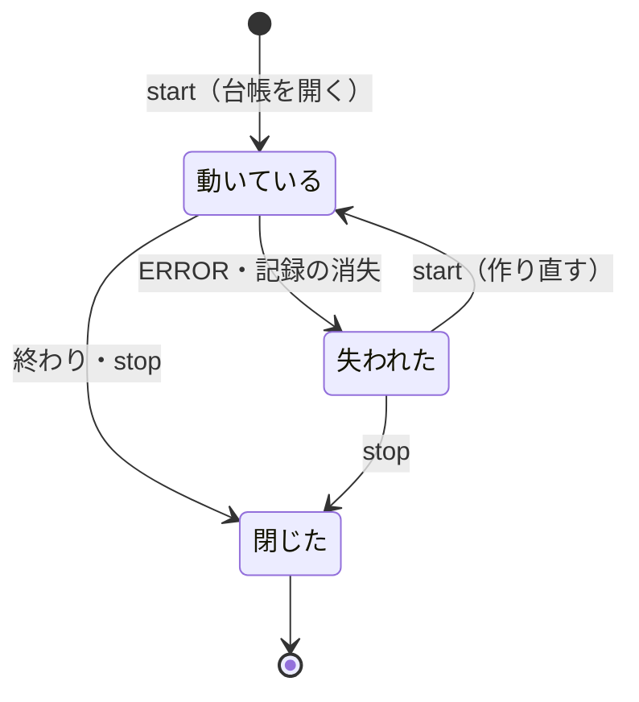
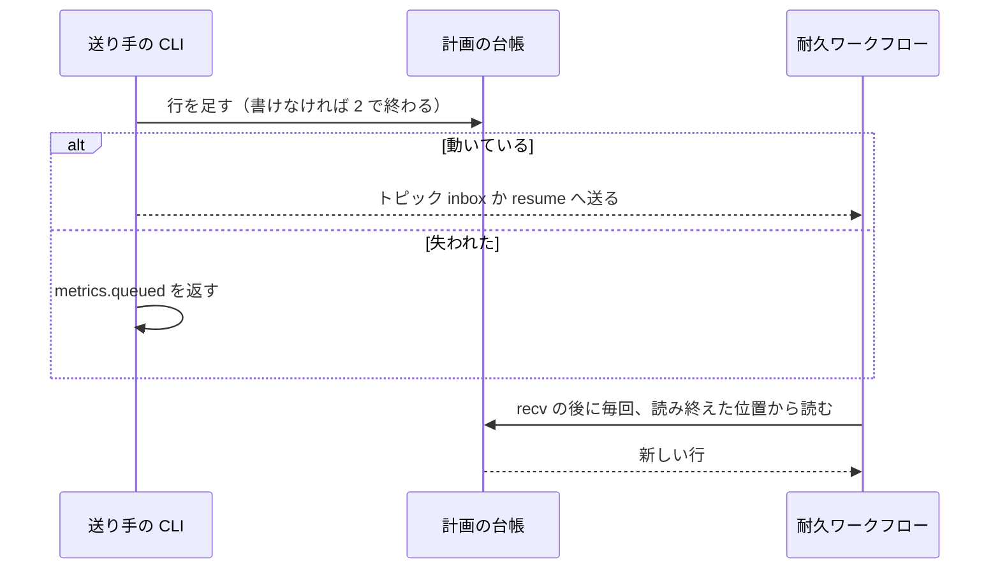
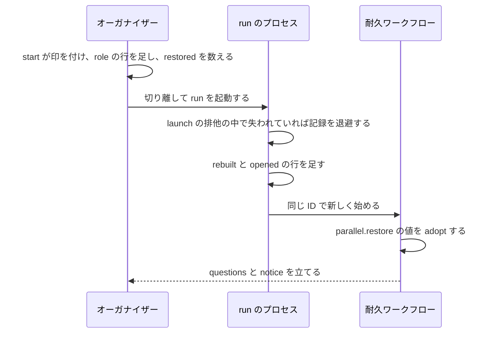

# 並列の計画の台帳と、失われた計画の作り直し

並列の計画を続けるのに要る状態（受けたリリースの依頼・答えていない問い・送った答え・リリースの連番・起動したレーン）を、
計画の置き場 `.ndf/parallel/<計画名>/` の計画の台帳に持つ。耐久ワークフローが ERROR になっても、耐久の記録が消えても、
オーガナイザーが `parallel.py start <計画名>` を 1 回打てば、同じ耐久ワークフローの ID で新しく始めて台帳から状態を戻す。
あわせて、オーガナイザーの印を打ったセッションへ付け直し、リレーハブの python の置き場が消えてもレーンを起こす。

例: レーン 2 本の計画 `p1` で、耐久ワークフローが例外で ERROR になったとき。

| 順 | 起きること |
| --- | --- |
| 1 | オーガナイザーの `parallel.py wait p1` が終了コード 1・`action: error` で終わり、`metrics.next` に `python3 .../parallel.py start p1` の 1 行が載る |
| 2 | ERROR の間にレーンが打った `request` と、オーガナイザーが打った `answer` は、台帳へ行を足して終了コード 0 で終わる。結果の `metrics.queued` が true になる |
| 3 | オーガナイザーが `start p1` を打つ。結果は `metrics.rebuilt: true` と `metrics.restored`（戻す依頼と問いの数・外した行数）を返し、`run` を切り離して起動する |
| 4 | `run` は排他の中で耐久の記録を `<実行の鍵>.sqlite.retired-<時刻>` へ退避し、台帳へ `rebuilt:1` の行を足して、同じ ID の耐久ワークフローを始める |
| 5 | 耐久ワークフローは台帳のチェックポイントと、その後の行から状態を戻す。答えていない問いが `wait` の `questions` に出て、流れているリリースがあれば `notice` が出る。起動済みのレーンは起動し直さない |

利用者向けの手順（`wait` の項目の読み方・失われた計画で打つコマンド）の正本は
[`development-workflow` の `references/parallel.md`](../../plugins/ndf/skills/development-workflow/references/parallel.md) の
「失われた計画」にある。オーガナイザーと耐久ワークフローの全体の契約は [ndf-parallel-organizer.md](ndf-parallel-organizer.md) にある。

## 用語

計画の台帳・台帳のチェックポイント・失われた計画・耐久の記録の退避・耐久ワークフローの作り直しの定義は、
用語集 [docs/glossary.md](../glossary.md) にある（コンテキスト `ndf-workflow`）。

## 背景

台帳を持つ前は、受けた依頼・答えていない問い・送った答えが耐久ワークフローのメモリにだけあった。耐久ワークフローが ERROR に
なると続ける手段が無く、作り直すとこれらを失った。他のリポジトリの計画では、2 時間あまりどのレーンも進まなかった。
オーガナイザーの印とリレーハブの使う版も、セッションと版の置き場に結び付いて消えた。いずれも「計画の状態が計画より短命な
入れ物にしか無い」ことが原因であり、状態を計画と同じ寿命の置き場へ移して 1 か所で直す。

## 対象範囲

| 区分 | 内容 |
| --- | --- |
| 対象 | NDF を導入したリポジトリで、ラッパーの下で動く並列の計画 |
| 対象外 | Factory の実行と、外のオーガナイザーのレーン |
| 置き場 | `.ndf/parallel/<計画名>/` に固定する。プロジェクトごとの設定は持たない。観測の間隔は既存の `NDF_PARALLEL_POLL` を使う |

## 仕様

### 構成要素と責務

| 要素 | 責務 |
| --- | --- |
| 台帳のモジュール（[`lib/parallel_ledger.py`](../../plugins/ndf/scripts/lib/parallel_ledger.py)） | 行の追記・読み出し・形の検査・チェックポイントの読み書き・復元の材料の組み立て・`wait` への報告。DBOS を import しない |
| 状態の出し入れ（`parallel_ledger.RunState`） | 耐久ワークフローの値をチェックポイントの形へ出し（`state`）、作り直しで戻す（`adopt`・`apply`）。`_Run` が継ぐ |
| 耐久ワークフロー（[`lib/parallel_run.py`](../../plugins/ndf/scripts/lib/parallel_run.py)） | 入力を台帳の行だけから受ける。ループの 1 周の終わりにチェックポイントを書き、始まりに状態を戻す |
| `start`・`wait` の本体（[`lib/parallel_cli.py`](../../plugins/ndf/scripts/lib/parallel_cli.py)） | 失われた計画の判定・作り直しの結果・台帳の報告を返す |
| レーンの側（[`lib/parallel_lane.py`](../../plugins/ndf/scripts/lib/parallel_lane.py)） | `run` の生死の判定（`live_run_pid`）と、受け付ける計画のレーン名の照合（`lane_of`） |
| 耐久の記録（[`lib/durable.py`](../../plugins/ndf/scripts/lib/durable.py)） | `launch` の排他の中で記録を退避する（`retire_if`）。退避した記録を記録と同じ日数で消す |
| リレーハブの CLI（[`relay_lib/hub_client.py`](../../plugins/ndf/scripts/relay_lib/hub_client.py)） | `role` が計画の置き場の絶対パスでオーガナイザーの印を照合して消す |
| リレーハブ（[`relay_lib/hub.py`](../../plugins/ndf/scripts/relay_lib/hub.py)・[`relay_lib/version_dir.py`](../../plugins/ndf/scripts/relay_lib/version_dir.py)） | レーンを起こす python を決め、切り替えを記録に残す |

### 集約

| 集約 | 持ち主（書き換えてよいもの） | 根 | エンティティ | 値オブジェクト |
| --- | --- | --- | --- | --- |
| 計画の台帳 | 台帳のモジュール。送り手はこのモジュールを通して行を足す | 計画（計画名） | 台帳の行（キーで一意） | メッセージの本体・版・書いた時刻 |
| 台帳のチェックポイント | 耐久ワークフロー。書くのは耐久ステップ `parallel.checkpoint` の 1 か所だけ | 計画（計画名） | リリースの状態（連番）・レーンの状態（名前）・問い（依頼の id） | 読み終えた位置・立てた答え |
| オーガナイザーの印 | リレーハブの CLI（`relay.py role`） | ラッパーの作業ディレクトリ | — | 計画名・計画の置き場の絶対パス（`plan_dir`）・役割 |
| リレーハブの起動の手段 | リレーハブ（`Hub`） | リレーハブの 1 プロセス | — | 使う python のパス |

### 常に成り立つ条件

| # | 条件 | 破れたときの扱い |
| --- | --- | --- |
| I1 | 送り手は台帳へ書いてから耐久ワークフローへ知らせる | 台帳を書けなければ知らせず、終了コード 2 で終わる（送ったと扱わない） |
| I2 | 行は足すだけで、書き換えも消しもしない。最初の `opened` の行より後に、同じキーの行は 1 行だけである | 2 度目の追記は何も足さずに成功を返す。最初の `opened` より前の行は重複に数えず、同じ id の再送を受ける |
| I3 | 同時に追記しても行が混ざらない。途中で切れた末尾の行は次の行と 1 行に混ざらない | 追記は改行で終わらない末尾へ改行を足して閉じる。読み出しは改行で終わらない末尾の行を追記の途中として扱い、行にも壊れた行にも数えない |
| I4 | 壊れた行は外して続け、外した行数を結果へ返す | 計画を止めない |
| I5 | 知らない形の行は状態へ反映せずに残し、件数と id を出す | 位置をチェックポイントの `unread` に控え、読める版で作り直したときに反映する |
| I6 | チェックポイントの読み終えた位置より前の行は、チェックポイントの状態へ反映済みである | 読めないチェックポイントは無いものとして台帳の全行から戻し、警告を `run.log` へ出す |
| I7 | 答えた依頼は作り直しの後に問いの一覧へ戻らず、同じ依頼へ 2 度答えない | — |
| I8 | イベントの `seq` は作り直しをまたいで増え続ける | — |
| I9 | リリースの連番を作り直しの後に使い回さない | 置き場 `releases/<連番>/` があるのに状態に無い連番は、状態 `lost` の記録で埋める |
| I10 | 起動済みのレーンを作り直しで起動し直さない | チェックポイントが無いときは、`relay.py ls` に居る計画のレーンを起動済みと読む |
| I11 | 閉じた計画は作り直さない。受け付けるのは動いている計画と失われた計画だけである | `start` は耐久ワークフローを始めず、閉じていることを終了コード 1 で返す |
| I12 | 台帳とチェックポイントへ認証情報を書かない | 文字列の値を書く前に `secret_redact` の規則で伏せる |
| I13 | 同じ計画のオーガナイザーの印は 1 本のラッパーだけが持つ。同じ計画とは計画の置き場の絶対パスが同じものを指す | 新しいセッションへ付けた時点で、`plan_dir` が一致する他のオーガナイザーの印を消す |
| I14 | リレーハブの python の置き場が消えていても、`relay.current` の仮想環境でレーンを起こす | どちらも無ければ `tmux-failed`・終了コード 1 |

耐久の記録の SQLite は書き換えない。退避はファイルの移動だけで行う。

### 計画の状態

`parallel_ledger.plan_state` が、耐久ワークフローの状態と台帳の行から計画の状態を決める。

| 耐久ワークフローの状態 | 台帳 | 計画の状態 | `start` |
| --- | --- | --- | --- |
| `PENDING` / `ENQUEUED` | 問わない | 動いている（`running`） | 印を付ける。`run` が死んでいれば起動して続ける |
| `SUCCESS` | 問わない | 閉じた（`closed`） | 作り直さない |
| `ERROR` / `CANCELLED` / `MAX_RECOVERY_ATTEMPTS_EXCEEDED` | `opened` があり `closed` が無い | 失われた（`lost`） | 作り直す |
| 同上 | `opened` も `closed` も無い | 台帳を持たない古い計画（`legacy`） | 作り直す。作り直すまで依頼は受け付けない |
| 問わない | `closed` がある | 閉じた（`closed`） | 作り直さない |
| 記録が無い | `opened` があり、進行の行かチェックポイントがある | 失われた（`lost`） | 作り直す |
| 記録が無い | 無い・`opened` と `role` だけ | 未開始（`fresh`） | 新しく始める |

依頼・問い・答えを受け付けるのは、動いている計画と失われた計画である（`accepts`）。台帳の無い ERROR の記録を受け付けないのは、
放棄した古い計画と区別できないためである。`lane_of` は動いている計画を先に探し、見つからないときだけ失われた計画を探す。
同じレーン名を持つ放棄した計画より、動いている計画を優先するためである。放棄する計画は `stop` で閉じる。

### 送る

耐久ワークフローは台帳の行だけを入力にする。トピック `inbox`・`resume` のメッセージは、読みを早める知らせとして残す。
入力の経路が 1 つなので、知らせの失敗も作り直しも同じ処理で済む。メッセージは本体を持ったまま送る。動いている古い版の
耐久ワークフローが、新しい版のレーンの依頼を受けるためである。

- 読み出しは耐久ステップ `parallel.ledger-read` が行い、行を `take` か `resume` へ渡す
- 受け取ったメッセージに同じキーの行が無ければ（台帳を書かない古い版の送り手から届いたとき）、同じステップが先に台帳へ足す。
  足せなければメッセージをそのまま行として渡し、受け取りを落とさない
- 知らせが失敗しても、観測の間隔の次の 1 回で台帳から読む

### 作り直す

耐久ワークフローの ID（`workflow_id(name)`）は変えない。記録を退避すれば、読み手は 1 行も変わらず、記録が消えた計画と同じ道を
通る。退避は `launch` の排他の中で行うため、2 つの `start` が重なっても 1 回で済む。DBOS の resume は、例外がステップの結果として
記録に残り流し直しても同じ例外になるため、使わない。

`adopt` は次の順で状態を戻す。

1. チェックポイントの値を戻す。流れているリリース（`current`）を、`releases` のうち `presented` か `confirmed` の行から導く
2. チェックポイントが無い作り直しでは、耐久ステップが読んだ `relay.py ls` に居る計画のレーンを起動済みにする（I10）
3. 計画の置き場の `releases/<連番>/` のうち状態に無い連番を、状態 `lost` の記録で埋める（I9）
4. `seq` を `rebuilt` の行の数 × 1,000,000 から始める（I8）
5. 読み終えた位置より後の行と、`unread` のうち読める版で分かった行を、位置の順に `apply` する
6. 問いがあれば `questions` を立てる。流れているリリースがあれば `notice` を立てる

`seq` の基準をチェックポイントの `seq` から取らないのは、ループの 1 周の途中で立てたイベントがチェックポイントより先へ進むことがあり、
チェックポイントが無いときに基準が 0 へ戻るためである。`seq` は問いと知らせを立てるたびに 1 増えるだけで、1 秒に 1 回立てても
100 万に届くまで 11 日かかる。

チェックポイントが無いときは、最初の `opened` の行から読む。それより前の行は台帳を読まない途中の記録がすでに処理したもので、
戻さない。

### ループの 1 周の終わり

観測の後に `save` を打つ。状態が前に書いたものと違うときだけ、耐久ステップ `parallel.checkpoint` がチェックポイントを書く。
状態を変える箇所の数に依らず、書き忘れが状態の欠けにならない。

### 答えの読み出し

答えのイベントは作り直しで立て直さない。`read_answer`・`answers_of`・`released_version` は耐久の記録を読み、無ければ
チェックポイントの `published` を読む。`set_event` は 1 回 11 ms あまりで 1,000 件に 11.1 秒かかるため、読み手の側で補う。
失われた計画の問いの一覧は、台帳から読む（`pending_questions`）。

### 途中の記録の扱い

耐久ワークフローの先頭で `durable.patched("parallel-ledger")` を 1 度だけ判定し、結果を `ledgered` に持つ。偽（台帳を持つ前に始まった
途中の記録）なら台帳を読まず、チェックポイントも書かず、今までの道を通る。動いている計画を止める手順は要らず、切り戻しは前の版へ
戻すだけで済む。

### オーガナイザーの印

- `start` は、`run` が動いている経路・作り直す経路・新しく始める経路のどれでも、打ったセッションのラッパーへ印を付ける。`run` を直接
  打って「動いている」と返る経路でも同じである
- `live_run_pid` は `run.pid` の pid が生きていても、起動の引数に `parallel.py run <計画名>` が無ければ動いていないと読む。起動の引数を
  読めないときは動いていると読み、二重起動を避ける（二重に起動しても `launch` の排他が止める）
- 印は計画の置き場の絶対パス（`parallel_lane.record_identity` の値）を `plan_dir` に持ち、照合はこの値で行う。リレーハブの状態の置き場は
  同じコンテナの複数のリポジトリに共通で、計画名だけでは別のリポジトリの同じ名前の計画と区別できないためである
- `plan_dir` を持たない既存の印は消さない。どのリポジトリの印か分からず、残っても印が 2 本ある状態で、そのラッパーが終われば解消する

### リレーハブの起こす python

`Hub.launch` は起動の直前に `version_dir.launch_python` で python を決める。リレーハブの python（`sys.executable`）の置き場が消えていれば、
`relay.current` が指すバージョンディレクトリの仮想環境へ切り替え、`hub-log.jsonl` へ `version-switched` の 1 行を足す。使う版を台帳へ
移さないのは、リレーハブが計画を知らない層であり、持ち主を増やすためである。

## データ・設定

計画の置き場に 2 つのファイルを置く。どちらもコミットしない。

### `ledger.jsonl`（台帳の行）

1 行 1 値の JSON Lines。形の正本は [`contracts/forms/parallel-ledger.json`](../../plugins/ndf/contracts/forms/parallel-ledger.json) にある。

| 項目 | 型 | 空を許すか | 意味 |
| --- | --- | --- | --- |
| `v` | 整数 | 許さない | 行の形の版。1 |
| `key` | 文字列 | 許さない | 重複の判定のキー |
| `kind` | 文字列 | 許さない | 行の種類（下の表） |
| `id` | 文字列 | 許す | 依頼の id。空は依頼に属さない行 |
| `at` | 文字列 | 許さない | 書いた時刻（UTC の ISO 8601） |
| `by` | 文字列 | 許す | 書いた者のレーン名か `organizer`。空はラッパーの外 |
| `ver` | 文字列 | 許さない | 書いた者の NDF の版 |
| `msg` | オブジェクト | 許す | 耐久ワークフローへ渡す本体。トピックのメッセージの形のまま。空は記録だけの行 |

| `kind` | キー | 耐久ワークフローの扱い |
| --- | --- | --- |
| `request` / `gate1` / `gate2` / `ask` / `unmatched` / `answer` | `<kind>:<id>` | `take` |
| `left_stopped` / `lanes_changed` | `<kind>:<送り手の冪等の鍵>` | `take` |
| `lane_end` / `lane_halt` / `verify` / `verified` | `<kind>:<レーン>`（`lane_end`・`lane_halt`）/ `<kind>:<依頼>`（`verify`・`verified`） | `take`（1 スプリントのレーンの終わりの記録・止めた結果・版の要るまとめの待ちと結果。印 `parallel-lane-end` の無い古い記録では反映しない。#3058） |
| `stop` | `stop` / `stop:force` | `take` |
| `resume` | `resume:confirm:<連番>:<take>` / `resume:settle:<連番>` | `resume` |
| `opened` / `closed` | `opened` / `closed` | 反映しない。`opened` は `run` が耐久ワークフローを始める直前、`closed` は計画の終わりと失われた計画の `stop` が書く |
| `rebuilt` | `rebuilt:<回>` | 反映しない。回数を `seq` の基準に使う。`msg.retired` に退避先を持つ |
| `role` | `role:<時刻>:<pid>` | 反映しない。持ち主の記録。`id` はラッパーの名前、`msg.plan_dir` は計画の置き場の絶対パス |

耐久ワークフローが自分で作る組み直しの依頼と問いは行にせず、チェックポイントが持つ。

追記は `locks.exclusive` の排他の中で重複のキーと末尾の改行を確かめてから `O_APPEND` で書く。POSIX は `PIPE_BUF` を超える書き込みが
割り込まれないかを定めておらず、行の長さには上限が無いため、`O_APPEND` だけに頼らない。

### `checkpoint.json`（台帳のチェックポイント）

項目の正本は [`contracts/files/checkpoint-json.json`](../../plugins/ndf/contracts/files/checkpoint-json.json) にある。
`jsonio.write_atomic` で書くたびに全体を置き換える。

| 項目 | 型 | 意味 |
| --- | --- | --- |
| `v` | 整数 | 形の版。1 |
| `offset` | 整数 | 読み終えた `ledger.jsonl` のバイト位置 |
| `unread` | 整数の配列 | 知らない形として飛ばした行のバイト位置 |
| `published` | オブジェクト | イベント名 → 値。答え・次のリリースへ回した知らせ・範囲のイベント（`answer-*`・`defer-*`・`range-*`） |
| `lanes` / `pending` / `questions` / `releases` / `launch` / `held` / `answered` / `received` / `refusals` / `stall_until` / `helper_asked` / `held_spawned` / `wake` / `revive` / `revive_at` / `stop` / `force` / `left_stopped` / `superseded` / `holds` | `_Run` と同じ | `_Run` の同名の値（`parallel_ledger.FIELDS`） |

`seq` と観測の値（最後に観測した時刻・一覧の成否）は持たない。`seq` は作り直しの回数から導き、観測の値は次の観測で決まる。
チェックポイントを上書きにするのは、外から届いた事実が台帳に残り、失うのが導いた値の古い時点だけだからである。チェックポイントが
無くても、台帳の全行から依頼・問い・答えが戻る。

### 退避した耐久の記録

退避先は `<実行の鍵>.sqlite.retired-<時刻>` で、`purge_old` が記録と同じ 30 日（`durable.KEEP_DAYS`）で消す。

## 外部連携

`parallel.py` の副命令の引数は変えない。

| 名前 | 出力 | 失敗の形 |
| --- | --- | --- |
| `start <計画名>` | どの経路でも `metrics.organizer`。作り直すとき `rebuilt: true` と `restored: {requests, questions, broken}` | 閉じた計画は 1。台帳を書けなければ `run` を起動せず 2 |
| `run <計画名>` | 打ったセッションへ印を付ける。動いている経路も `metrics.organizer` を返す | — |
| `wait <計画名>` | `metrics.versions: {organizer, lanes}`（レーンの版がオーガナイザーと違うときだけ）・`unknown`（件数）・`unknown_ids`・`broken`・`orphans`（レーンのループの記録が待つのに台帳に無い依頼の id） | 失われた計画は 1 で `action: error`、`metrics.next` に `start` の 1 行。作り直しの `run` が記録を開く前は 3 |
| `request`・`request-gate2`・`request-ask`・`answer`・`confirm`・`settle` | 失われた計画でも受け付け、`metrics.queued: true`。要約に「作り直しの後に反映する」と書く | 閉じた計画は 1。台帳を書けなければ 2 |
| `stop <計画名>` | 失われた計画なら `closed` の行を書く | — |
| `await <計画名>` | 答えが耐久の記録に無ければチェックポイントの `published` を読む | 記録が無く答えも無ければ 3 |
| `relay.py role organizer --plan <計画名> [--plan-dir <絶対パス>]` | 印に `plan_dir` を書き、`plan_dir` が一致する他のオーガナイザーの印を消す。`items[0].cleared` に消した数 | `--plan-dir` が無ければ他の印を消さない |
| `relay.py role --clear [--plan-dir <絶対パス>]` | `--plan-dir` があれば、ラッパーの外でも全ラッパーを走査し、`plan_dir` が一致するオーガナイザーの印をすべて消す | `--plan-dir` が無くラッパーの外なら 1 |

`parallel.py` と耐久ワークフローの計画の終わりは、`--plan-dir` に `parallel_lane.record_identity` の値を渡す。`run` がラッパーの外で
再開されても、計画の終わりに印が残らない。

## セキュリティ

台帳の行の `msg` とチェックポイントの文字列の値は、書く前に `secret_redact.redact_text` で伏せる（I12）。

## 運用

- 作り直しの回数・戻した依頼と問いの件数・外した行数は、`run.log` の 1 行（`parallel: 台帳から戻した（作り直し n 回・依頼 n・問い n・外した行 n）`）と
  `start` の `metrics.restored` に残る
- 台帳と耐久の記録を手で編集しない。復旧の操作は `start` の 1 回である
- 台帳の無い途中の記録が ERROR になったときは、それまでの依頼と問いは戻らない。レーンの待ちは `wait` の `orphans` に出るため、レーンに送り直させる

### 既知の限界

| 項目 | 内容 |
| --- | --- |
| 古い版の読み手 | チェックポイントを読まない古い版のレーンは、作り直しの前に立った答えを読めない |
| `.ndf/parallel/` のコミット防止 | 無視の設定は無い。台帳もこの扱いを変えない |

## テスト観点

テストは [`tests/test_parallel_ledger.py`](../../plugins/ndf/scripts/tests/test_parallel_ledger.py) を中心に、耐久の記録を実際に開いて確かめる。

| 観点 | 満たすこと |
| --- | --- |
| 作り直し | ERROR の記録でも記録が無くても、`start` 1 回で `wait --after 0` に答えていない問いとリリースの知らせが出る |
| 答え | 作り直しの前に答えた依頼の答えを作り直しの後に読め、その問いが再び出ない。台帳に無い依頼への答えは保留され、作り直しをまたいで後から届いた問いへ当たる |
| 連番 | 作り直しの前に連番 3 まで使ったとき、次の連番は 4 で、置き場を上書きしない。チェックポイントが無くても同じ |
| 流れているリリース | 流れている途中で作り直しても、一時レーンの `settle` がそのリリースへ当たる |
| `seq` | 作り直しの前の `seq` で打った `wait` が、作り直しの後の知らせを取りこぼさない |
| レーン | 起動済みのレーンは動いていても止まっていても起動し直さず、未起動のレーンだけ依存の条件どおりに起動する |
| 壊れた行 | 切れた行を含む台帳で読める行が戻り、外した行数が返り、次の追記が混ざらない。改行で終わらない末尾の行は数えず、位置がその行の先頭に止まる |
| 失われた間の受け付け | ERROR の間の `request`・`request-ask`・`answer` が 0 で終わり `queued` を返し、作り直しの後に反映される |
| 知らせの失敗 | 台帳へ書いた後に知らせが失敗しても、次の観測で `wait` に出る |
| 版 | 知らない形の行が残り件数と id が出て、読める版の作り直しで反映される。レーンの版が違うときだけ両方の版が出る |
| 台帳に無い待ち | レーンのループの記録が待つ依頼が台帳に無いと `orphans` に出る |
| オーガナイザーの印 | pid が死んだ `start`・動いている `run` の経路で印が付き、使い回された pid を動いていると読まない。`relay.py ls` の `organizer` は 1 本で、計画の終わりにはラッパーの外からでも消え、別のメインディレクトリの同じ名前の計画の印は残る |
| リレーハブ | ラッパーの更新を 2 回行った後も `restart` でレーンが起動する。python の置き場を消すと `relay.current` の仮想環境で起動し、記録に 1 行残る |
| 途中の記録 | 台帳の無い途中の記録は `start` で台帳なしの道を通る |
| 重複・閉じた計画・伏せ字 | 同じキーの 2 度目の追記は行を足さない。閉じた計画への `start` は作り直さず依頼を断る。認証情報の形の文字列が伏せられる |
| 契約 | `python3 scripts/check-ndf-contracts.py` が通り、`parallel-ledger.json` の `cases` が形の検査と一致する |
| 性能 | 依頼 1,000 行の台帳の復元が 1 秒以内で、観測 1 回の読み出しが 1 秒以内である |
| 同時の追記 | 複数プロセスの追記で壊れた行が 0 である |

## 関連リンク

- [ndf-parallel-organizer.md](ndf-parallel-organizer.md): 並列の計画のオーガナイザーと耐久ワークフローの契約
- [ndf-relay-multi-session-supervisor.md](ndf-relay-multi-session-supervisor.md): リレーハブの副命令（`role` を含む）
- [`development-workflow` の `references/parallel.md`](../../plugins/ndf/skills/development-workflow/references/parallel.md): オーガナイザーの手順
- 課題: https://github.com/devbasex/ai-plugins/issues/2647
