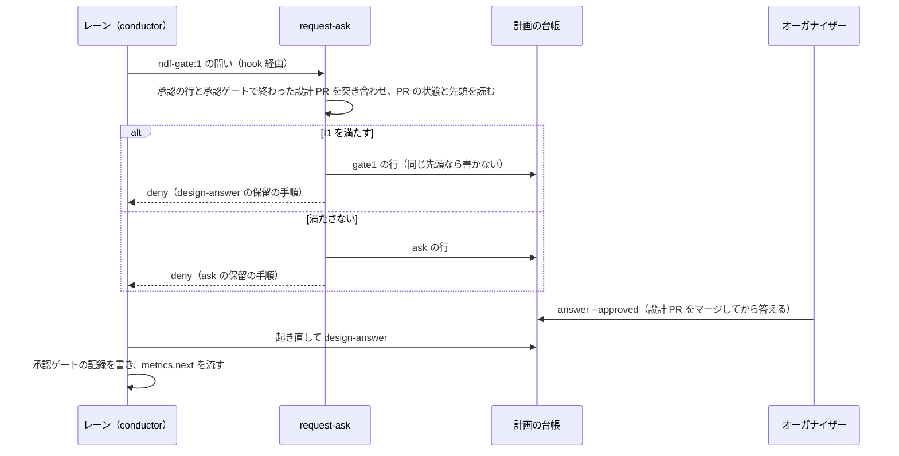

# 並列の計画: 1 スプリントのレーンの設計承認の依頼と、起き直した一時レーンの同じ問い

並列の計画の 1 スプリントのレーンは、設計 PR のマージの承認を求める問いを、開発ループのレーンと同じ設計承認の依頼
（台帳の `kind: gate1` の行）としてオーガナイザーへ送る。オーガナイザーの承認（`parallel.py answer --approved`）は
設計 PR をマージし、MVV 判定と古い依頼の整理もそのまま掛かる。起き直した一時レーンは、同じ問いの前の依頼に答えが
あればその答えを使い、答え待ちならその依頼を引き継ぐ。同じ問いを新しい id で人へ送り直さない（#3603・#3608）。

**手順の正本はスクリプトと手順書にある。** この文書は、決めたことの理由と、書く側と読む側が共有する形を残す。

| 何を読むか | 正本 |
| --- | --- |
| 問いの送り分け（設計承認の依頼・同じ問い・`ask` の依頼） | [`lib/parallel_ask.py`](https://github.com/devbasex/ai-plugins/blob/30f9608fda36c712afac43fc3893ac6c038a0145/plugins/ndf/scripts/lib/parallel_ask.py) の `route_ask` |
| 設計承認の依頼の組み立てと答えの読み取り | [`lib/parallel_design_gate.py`](https://github.com/devbasex/ai-plugins/blob/30f9608fda36c712afac43fc3893ac6c038a0145/plugins/ndf/scripts/lib/parallel_design_gate.py) の `design_gate`・`answer_design` |
| 対象の行・同じ問いの判定・結果の復元 | [`lib/parallel_question.py`](https://github.com/devbasex/ai-plugins/blob/30f9608fda36c712afac43fc3893ac6c038a0145/plugins/ndf/scripts/lib/parallel_question.py) の `target_line`・`prior_of`・`outcome_of`・`asked_of` |
| 設計承認の依頼の id | [`lib/gate1_ids.py`](https://github.com/devbasex/ai-plugins/blob/30f9608fda36c712afac43fc3893ac6c038a0145/plugins/ndf/scripts/lib/gate1_ids.py) の `gate1_id` |
| 問いの hook の拒否の理由 | [`hook_lib/ask_guard.py`](https://github.com/devbasex/ai-plugins/blob/30f9608fda36c712afac43fc3893ac6c038a0145/plugins/ndf/scripts/hook_lib/ask_guard.py) の `forward_to_organizer`・`held_text` |
| マージ済みの設計 PR の承認の確かめ | [`supervise_lib/design_merge.py`](https://github.com/devbasex/ai-plugins/blob/30f9608fda36c712afac43fc3893ac6c038a0145/plugins/ndf/scripts/supervise_lib/design_merge.py) の `cmd_design_approved`・`mvv_approval` |
| 台帳の行の形 | [`contracts/forms/parallel-ledger.json`](https://github.com/devbasex/ai-plugins/blob/30f9608fda36c712afac43fc3893ac6c038a0145/plugins/ndf/contracts/forms/parallel-ledger.json) |
| レーン・一時レーンの手順 | `development-workflow` の [`references/asking.md`](../../plugins/ndf/skills/development-workflow/references/asking.md)・[`references/parallel.md`](../../plugins/ndf/skills/development-workflow/references/parallel.md)・[`references/approval-request.md`](../../plugins/ndf/skills/development-workflow/references/approval-request.md) |
| 台帳の全体 | [ndf-parallel-plan-ledger.md](ndf-parallel-plan-ledger.md) |
| 一時レーンが読む依頼と答えの一覧（`asked`） | [ndf-parallel-helper-confirmed-gate-and-launch-wait.md](ndf-parallel-helper-confirmed-gate-and-launch-wait.md) |

## 概要

| 事象（2026-11-15、並列の計画 p6） | 今の振る舞い |
| --- | --- |
| 1 スプリントのレーンの設計承認の問いが、問いの hook から `kind: ask` の依頼として届いた（台帳に区分 `ndf-gate:1` の `ask` が 43 行、`gate1` は 0 行）。承認しても設計 PR がマージされず、オーガナイザーが手でマージした | 承認の行（`承認: #<設計 PR>`）を持つ問いは `kind: gate1` の依頼になる。承認の答えが設計 PR をマージし、起き直したレーンは `parallel.py design-answer` で答えを読んで続きへ進む |
| 起き直した一時レーンが、答えのある `git branch -D` の可否の問いを新しい id で送り直した | 問いの文の対象の行（`対象: <ブランチ名>`）から問いの対象を読み、同じ一時レーン・区分・対象の前の依頼の答えを返す |

問いの入力（`AskUserQuestion`）は問いの対象を載せる欄を持たず、`metadata` は `source` だけを通す。そのため、
承認する設計 PR と問いの対象は、どちらも最初の問いの文に置く固定の 1 行で届ける。

## 用語

1 スプリントのレーン・一時レーン・設計承認の依頼・区分つきの問い・問いの対象・対象の行・承認の行・同じ問い・答えの引き継ぎの
定義は、用語集（[docs/glossary.md](../glossary.md)）にある。

## コンテキスト

NDF の開発ワークフロー（`ndf-workflow`）の中で閉じる。

## 構成要素

| 要素 | 責務 |
| --- | --- |
| `parallel.py request-ask` | 送り手を確かめ、`route_ask` の結果（`gate1`・`reused`・`ask`・書かなかった）を統一 JSON レポートで返す |
| `lib/parallel_ask.py` | 送り手の種類（`sender_kind`）・問いの対象の先端の解決（`ask_target`）・`reused` の行の書き込み（`record_reused`）・上限の時刻の判定（`expired`）・送り分け（`route_ask`） |
| `lib/parallel_design_gate.py` | 承認の行の読み取り（`approval_prs`）・承認ゲートで終わった設計 PR の表（`gated_design_prs`）・問い直しの id（`next_gate1_id`）・依頼の中身（`design_gate`）・答えの読み取りと記録（`answer_design`） |
| `lib/parallel_question.py` | 対象の行の読み取り・同じ問いの前の依頼の引き当て・判定の記録の id からの結果の復元。純粋な関数だけを持つ |
| `lib/gate1_requests.py` | 設計のプランの報告の PR の番号（`report_pr`・`pr_numbers`）と MVV 判定の記録（`last_verdict`）の読み取り。開発ループのレーン（`sprint_loop_gate.py`）と 1 スプリントのレーンが同じ関数を使う |
| `parallel.py design-answer` | 設計承認の依頼の答えを読み、スプリント状態へ承認ゲートの記録を書き、続きの 1 行を返す |
| `hook_lib/ask_guard.py` | `request-ask` の結果の種類ごとに拒否の理由を組む。上限の秒を過ぎたら台帳から結果を復元する |
| `supervise_lib/design_merge.py` の `cmd_design_approved` | 承認ラベルも利用者の承認の記録も無いとき、マージ済みで MVV 判定の承認の記録がある設計 PR を通す |
| `sprint-state.py gate` | `--by mvv` の記録にも `--pr` と `--outcome` を残す |

## 仕様

### 常に成り立つ条件

| # | 条件 | 破れたときの扱い |
| --- | --- | --- |
| I1 | 1 スプリントのレーンの区分 `ndf-gate:1` の問いを設計承認の依頼にするのは、承認の行がちょうど 1 行で、その番号がレーンのスプリントで承認ゲートで終わった設計のプランの設計 PR で、その PR が開いていて先頭のコミットを読めたときだけである | どれかを欠けば `kind: ask` で送る。問いの文や選択肢で PR を参照しただけの問いへ、設計 PR の承認を当てない |
| I2 | 設計承認の依頼の id は `<レーン>-g<設計 PR>-<先頭の SHA の 12 桁>` で、送り手の種類によらない。同じ先頭の打ち直しは同じ id になる | 台帳へ書かずに既存の id を `already: true` で返す |
| I3 | 開発ループのレーンの設計承認の依頼は `sprint_loop_gate.lane_gate1` が組み、`request-ask` の送り分けを通らない | — |
| I4 | MVV 判定（`by: mvv`）で承認した依頼の設計 PR が開いたまま同じ先頭で問い直されたら、id に `-r<連番>` を付け、印 `returned` とマージの結果の理由を足した新しい依頼にする | 印 `returned` の依頼は MVV 判定の対象から外れ、人へ届く |
| I5 | 同じ問いの判定は、送り手が一時レーンのときだけ行う。前の答えを使うのは、同じ一時レーンの名前・同じ区分・同じ問いの対象（ブランチなら先端の 40 桁まで）の依頼に答えがあるときだけである。区分がレッドライン（`ndf-ask:redline:*`）なら、問いの文面（空白を除く）と選択肢の label の並びも一致したときだけである | 新しい依頼を送る |
| I6 | 問いの対象が空の問い（対象の行が無い・ブランチ名の形に合わない・先端を求められない）は、前の依頼と比べない | 新しい依頼を送る |
| I7 | 同じ問いの前の依頼に答えが無ければ、その id を返し、新しい依頼の行を書かない | 前の id で保留の手順を返す |
| I8 | 前の答えを使ったときと答え待ちの依頼を引き継いだときは、台帳に `reused` の行が 1 行残る | 行を書けなければ答えを使わず、新しい依頼を送る |
| I9 | 承認ラベルも利用者の承認の記録も無い設計 PR は、マージ済みで、スプリント状態にその PR の設計承認ゲートの `by: mvv`・`outcome: approved` の記録があるときだけ、設計 PR のマージのプランの承認の確かめ（`design-approved`）を通る | 開いている設計 PR は MVV 判定の記録だけでは通さない。記録の無いマージ済みの PR は承認ゲートで止まる |
| I10 | `request-ask` は読む処理をすべて済ませてから、台帳へ高々 1 行だけ書く。書く直前に hook の上限の時刻（`deadline_at`）を過ぎていれば書かない | 書く前なら問いは人へ通る。書いた後に hook が上限の秒を過ぎたら、hook は判定の記録の id で台帳の行を探し、あれば保留の側へ倒す |

### 送り分けの順序

`request-ask` は、送り手を確かめた後（送り手でなければ終了コード 4）、次の順で最初に当たった分岐へ送る。

| 順 | 分岐 | 入る条件 | 台帳に書く行 |
| --- | --- | --- | --- |
| 1 | 設計承認の依頼 | 送り手が 1 スプリントのレーンで、区分が `ndf-gate:1` で、I1 を満たす | `gate1`（同じ id があれば書かない） |
| 2 | 同じ問い | 送り手が一時レーンで、問いの対象が空でなく、同じ問いの前の依頼がある | `reused` |
| 3 | `ask` の依頼 | 上の 2 つに当たらない問いのすべて（開発ループのレーンの区分つきの問いを含む） | `ask`（`target` に問いの対象か `null`） |

送り手の種類は計画の宣言のレーンの `kind` で決まる（`loop` なら開発ループのレーン、ほかの宣言のレーンは 1 スプリントのレーン、
宣言に無い名前は一時レーン）。前の依頼は台帳の最初の `opened` の行より後から引き、同じ鍵が複数あれば最も新しいものを使う。



### 問いの文に置く行

どちらも最初の問いの文（`questions[0].question`）に、行頭から書く。前後の空白は読み捨てる。

| 行 | 形 | 誰が置くか | 読み方 |
| --- | --- | --- | --- |
| 承認の行 | `承認: #<設計 PR の番号>` | 1 スプリントのレーンが、設計 PR のマージの承認を求める `ndf-gate:1` の問いに置く。設計 PR を参照するだけの問いには置かない。設計 PR が 2 本あるスプリントは PR ごとに問いを分ける | 承認の行が 2 行以上の問いは、承認を当てる設計 PR が 1 本に決まらないため `ask` で送る |
| 対象の行 | `対象: <ブランチ名>` か `対象: #<番号>` | 区分つきの問いのうち、ブランチ・課題・PR を操作するもの | 2 行あれば最後の行を使う。ブランチ名は `git check-ref-format --branch` を通り、問いの作業ディレクトリで `refs/heads/<名>` の先端の 40 桁を読めたときだけ `<名>@<40 桁>` にする。`#<番号>` はそのまま。先端は `request-ask` が求め、一時レーンに書き写させない |

```text
後片付けで sprint/lr-t2 を git branch -D で消してよいか。
対象: sprint/lr-t2
```

承認の行・対象の行で届ける理由: `header` は短い語として表示され、長いブランチ名が収まる保証が無い。問いの前に対象を
登録する形は、登録と問いが別の操作になり、戻せない操作の答えが別の対象へ当たりうる。区分（`metadata.source`）に対象を
足すと、区分の形の判定が問いを止める。固定の 1 行なら入力の検証で落ちず、人が読む問いにも対象が見える。

### `request-ask` の入出力

入力は標準入力の JSON（`tool_input`・`cwd`・`ledger_id`・`deadline_at`）。`deadline_at` は hook の上限の秒が尽きる UNIX 時刻で、
無い呼び出しは時刻を見ない。`metrics` に次を載せる。

| 項目 | 値 |
| --- | --- |
| `kind` | `gate1` / `ask` / `reused` |
| `id` | 保留する依頼の id（1 つの問いにつき 1 つ） |
| `answer` | `reused` で前の依頼に答えがあるとき、その `result`・`choice` |
| `target` | `ask`・`reused` の問いの対象（空なら `null`） |
| `sprint_state` | `gate1` のときのスプリント状態のパス |
| `already` | `gate1` で同じ id の行が既にあったとき `true` |

| 失敗 | 終了コード |
| --- | --- |
| 標準入力を読めない・台帳を読めない・書けない・上限の時刻を過ぎた | 2（hook は問いを通す） |
| 送り手でない | 4 |
| 同じ id で中身の違う `ask` の行がある | 1 |

### 問いの hook の出力

| `request-ask` の結果 | hook の出力 |
| --- | --- |
| `gate1` | `deny`。引継ぎ文書の「次にやること」へ `parallel.py design-answer <計画> <id> --state <スプリント状態>` と依頼の id を書き、自分のラッパーを止めて終える手順 |
| `reused` で答えがある | `deny`。前の依頼の id と答え（`choice` があれば選択肢、無ければ `result`）を載せ、その答えで操作を進めるよう示す |
| `reused` で答え待ち・`ask` | `deny`。`ask` の保留の手順（答え待ちの引き継ぎは前の依頼の id で） |
| 送れない | 何も返さず、問いを通す |
| 上限の秒を過ぎた | 判定の記録の id（`ledger_id`）を持つ `gate1`・`ask`・`reused` の最後の行を台帳から 1 回だけ探し、あればその種類の出力を返す。無ければ問いを通す |

前の答えは `deny` の理由で返す。`allow` と `updatedInput` の `answers` で問いに自動で答える形は、レーンの中の Claude Code で
効かなかったときに問いが人のいない画面で開いたまま止まるため採らない。

### `parallel.py design-answer <計画> <依頼> --state <スプリント状態>`

| 答え | 書くもの | 状態・終了コード | `metrics.next` |
| --- | --- | --- | --- |
| `approved`（マージ済み） | スプリント状態へ `設計承認ゲート` の記録（`--pr <P> --by <答えの by> --outcome approved`。`by: mvv` なら判定と理由も） | `ok`・0 | 設計のステージの後で最初に `resume` を持つステージ（設計 PR のマージのステージ）の `queue --resume`。そのキューをまだ起動していなければステージの `command`。続きが設計と同じキューなら `--from design-<課題>=merge`（マージ済み）か `=approve` を足す |
| `approved` で、答えのマージの結果が `head_moved`・`no_stamp` | 書かない | `gate`・10 | 今の先端で設計承認を問い直す |
| `approved` で、答えのマージの結果が `not_green`・`conflict`・`failed` | 依頼の stamp でマージをやり直す（`design_pr_merge.merge_approved`）。CI の基盤待ちの再実行は、同じ依頼・同じ stamp の累計をプランの状態ディレクトリの `work/design-merge-<P>.json` に残し、上限の残りだけを渡す。マージ済みになったときだけ記録を書く | マージ済みなら `ok`・0、ほかは `gate`・10 | マージを止めた原因を解き、同じ `design-answer` を打ち直す |
| `approved` で、答えのマージの結果が `production` | 設計 PR が MERGED なら記録を書く | MERGED なら `ok`・0、ほかは `gate`・10 | 人がリリース承認ゲートで設計 PR をマージした後に打ち直す |
| `revise` | 指摘をプランの状態ディレクトリの `work/design-revise-<P>.md` へ書く（一時ファイルから置き換える） | `gate`・10 | 指摘を読んで設計を直し、設計のプランを流し直す |
| `rejected` | スプリント状態へ `--by user --outcome rejected` の記録と、印 `work/design-rejected-<P>.json` | `gate`・10 | 課題を進めない |
| まだ無い | 書かない | `stopped`・3 | — |
| 設計承認の依頼でない・承認・直し・差し戻しのどれでもない答え | 書かない | `stopped`・1 | — |
| 台帳・スプリント状態を読めない・書けない | 書かない | `stopped`・2 | — |

`metrics` は `result`・`by`・`merge`・`pr`・`next` を持つ。同じ依頼で何度打っても、承認ゲートの記録は同じ `pr`・`by`・`outcome` で 1 件である。

マージ済みでない承認の記録を書かないのは、続く `design-approved` と `--expect-head` の無いマージが、CI を直す push や衝突を
解く取り込みで生まれた未承認の先端を通さないためである。同じ先端で問いを出し直しても同じ id に答え済みが返るため（I2）、
先端を変えずに解ける結果は問い直しではなく `design-answer` の打ち直しで進める。

## データ・設定

計画の台帳（`ledger.jsonl`）の行。スキーマの移行は無い。

| 行 | 中身 |
| --- | --- |
| `gate1` | `id`・`lane`・`issue`・`pr`・`report`・`sprint_state`・`stamp`・`verdict`・`reasons`・`boundary`・`at`。1 スプリントのレーンの行は `ledger_id`（問いの判定の記録の id）も持つ。問い直しでは `returned: true` と id の接尾辞 `-r<連番>` |
| `ask` | `target` に `<ブランチ名>@<40 桁>` か `#<番号>`。無ければ `null` |
| `reused` | 鍵は `reused:<判定の記録の id>`。`id`（前の依頼の id）・`lane`・`source`・`target`・`ledger_id`・`answered`（答えを使ったか、答え待ちの引き継ぎか）・`at`。耐久ワークフローの状態へ反映しない（`parallel_ledger.RECORD`）。答えの中身は答えの行が持ち、写さない |

`parallel.py helper` の `asked` は、`gate2` と、問いの対象を持つ `ask` に答えの中身（`answer: {result, choice}`）を載せる。
対象を持たない `ask` とレッドラインの区分の `ask` は `answered: true` だけを付ける。問いの中身を比べられるのは今の問いを持つ
`request-ask` だけで、同じ問いの判定の正本はそちらである。

スプリント状態の承認ゲートの記録は、`by: mvv` でも `--pr`・`--outcome` を渡せば `pr`・`outcome` を持つ。

| 値 | 置き場 |
| --- | --- |
| hook の上限の秒（8） | `contracts/limits/` の `hook.ask-forward` |
| 依頼の id の SHA の桁（12） | `lib/gate1_ids.py` の `HEAD_LEN` |

## 決定と理由

- **設計承認の依頼に組むかは `request-ask` の中で決める。** 1 スプリントのレーンの設計承認の問いはすべて hook が `request-ask` へ
  渡すため、台帳へ書く手前の 1 か所で決めれば conductor の手順に依らない。設計のプランが承認ゲートで終わった時点に送る形は、
  conductor がその後も `ndf-gate:1` の問いを出すため送り手が 2 か所になる。hook の中で組む形は、上限の秒の扱いが子プロセスと二重になる
- **承認の行だけを見分けの印にする。** 区分 `ndf-gate:1` には、実装の途中で設計の前提が崩れたときの判断なども入り、その問いも
  設計 PR を参照する。参照するだけの問いを依頼にすると、元の判断が人へ届かず、承認が設計 PR のマージとして実行される
- **開いていない設計 PR・先頭を読めない設計 PR は `ask` で送る。** `0` を並べた先頭で依頼を組むと、承認の答えが `no_stamp` で
  マージされない
- **答えは `design-answer` が読んで書く。** conductor が答えを写すと、書き忘れで設計 PR のマージのプランが承認ゲートで止まる。
  `parallel.py await` はリリースの依頼の記録と答えの値を前提にするため広げない
- **マージ済みかつ `by: mvv` の記録で `design-approved` を通す。** このステップが守るのはマージの操作で、マージ済みの PR には
  守る操作が残っていない。MVV 判定の記録を利用者の承認として数える形は、開いている設計 PR を MVV 判定だけでマージする道を作るため採らない
- **同じ問いの鍵は（一時レーンの名前・区分・問いの対象）で、レッドラインの区分は中身も比べる。** 同じキーの再送には最初の結果を
  返し、同じキーを別の中身で使わない冪等キーの扱い（IETF の Idempotency-Key ヘッダーの標準案）に倣う。レッドラインの区分は
  同じ先端のブランチへの強制 push の許可と削除の可否が同じ区分になりうるため、文面と選択肢も一致させる

## テスト観点

- 1 スプリントのレーンの承認の行つきの問いが `gate1` の行（`issue`・`pr`・`stamp`）を 1 行だけ書き、`ask` の行を書かないこと
- 承認の行が無く問いの文で PR を書いただけの問い・承認の行が 2 行の問い・マージ済みの PR・先頭を読めない PR では `ask` の行だけを書くこと
- 1 スプリントのレーンの `gate1` へ `answer --approved` を打つとマージを試みて `metrics.merge` を返し、マージできなくても答えが送られること
- 1 スプリントのレーンの `gate1` の行で `mvv.eligible` が真になり、境界がある行で偽になること。先頭の違う 2 行で古い方に `resend`、新しい方へ答えた後に `settled` が付くこと
- 同じ先頭の打ち直しで行が増えず、MVV 判定で承認済みのまま開いている PR では `-r<連番>` と `returned: true` の新しい依頼になること
- `design-answer` が答えの種類ごとに表の記録・状態・終了コードを返し、2 回打っても記録が 1 件であること
- マージ済みの PR と `by: mvv` の承認の記録で `design-approved` が 0、開いている PR か記録の無いマージ済みの PR で 10 を返すこと
- 開発ループのレーンの設計承認の依頼の id と中身が `lane_gate1` の組み方のままであること
- 一時レーンの同じ名前・区分・対象の答え済みの依頼があれば `reused` の行を書いて答えを返し、答え待ちなら前の id を返すこと
- 先端が動いた同じブランチ名・別の名前の一時レーン・対象の無い問い・1 スプリントのレーンと開発ループのレーンの問いでは新しい依頼になること
- レッドラインの区分で文面か選択肢の違う問いは新しい依頼になること
- 対象の行 `対象: sprint/lr-t2` の `ask` の行の `target` が `sprint/lr-t2@<40 桁>` になること
- `deadline_at` を過ぎた `request-ask` が台帳へ書かず、台帳に判定の記録の id の行があるまま hook が上限を過ぎたら、その行の種類の `deny` を返すこと
- `reused` の行を書けないときは新しい依頼を送ること

テストは `plugins/ndf/scripts/tests/` の `test_parallel_ask.py`・`test_parallel_design_gate.py`・`test_parallel_question.py`・
`test_ask_guard.py`・`test_parallel_answer.py`・`test_parallel_ledger.py`・`test_gate1_requests.py`・`test_sprint_state.py`・
`test_supervise_sprint_chain.py` にある。

## 未確認・残リスク

| 項目 | 内容 |
| --- | --- |
| hook の上限の 8 秒に収まるか | 設計承認の依頼の分岐は `gh pr view` を 1 回打つ。秒は実測していない。書く前に過ぎれば問いを通し、書いた後に過ぎれば保留の側へ倒す（I10） |
| 計画の外への I9 の影響 | 計画の外で設計承認ゲートの `by: mvv` の記録を書く経路として `pace: fast`・`auto` の設計（`supervise_lib/sprint_waves.py`）を確かめた。承認ラベルを付けてからマージするため I9 の条件に来ない。ほかの経路は全件を洗い出していない |

## 関連リンク

- [ndf-parallel-organizer.md](ndf-parallel-organizer.md)（並列の計画の全体）
- [ndf-ask-guard.md](ndf-ask-guard.md)（問いの hook）
- [ndf-parallel-helper-confirmed-gate-and-launch-wait.md](ndf-parallel-helper-confirmed-gate-and-launch-wait.md)（一時レーンの確定の後の依頼）
