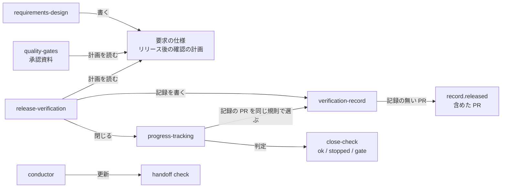
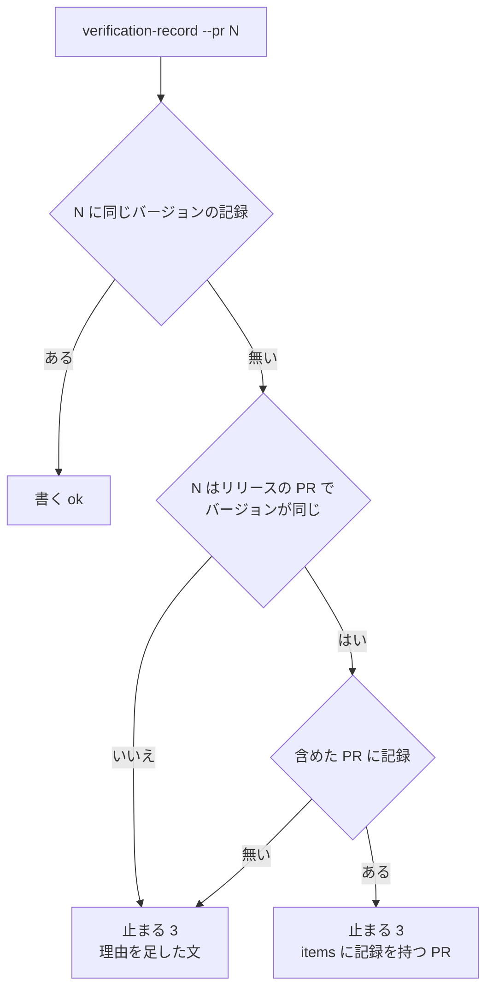
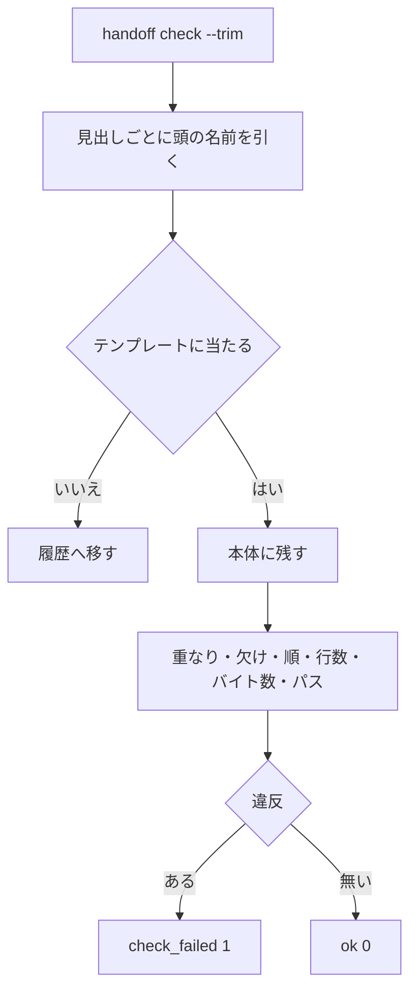

# リリース後の記録の置き先・保留の閉じる判定・引継ぎ文書のセクションの見分け方

## 概要

スプリントの仕上げ（リリース後テスト・スプリントを閉じる）と引継ぎ文書の更新で、手順書とコマンドは同じ規則で
記録を書く先・確かめる時点・閉じるかの判定・引継ぎ文書の形を扱う。止まったときは、結果だけで次の手が決まる。

例: workflow でリリースする形で 11.0.8 をリリースした後、リリースの PR #3849 を
`ndf release-steps verification-record --pr 3849` に渡すと、何も書かずに終了コード 3（`precondition`）で止まり、
`summary` に「#3849 はリリースの PR で、v11.0.8 のリリース記録を持たない。記録は含めた PR の各々にある: #3845, #3848。
--pr に番号が最も小さい #3845 を渡す」を、`items[]` に `{"kind": "pull", "number": 3845}` と
`{"kind": "pull", "number": 3848}` を返す。

| 何を | 正本 |
| --- | --- |
| 記録を置く PR の書き分けと、保留の記録の書き方 | `release-verification` の SKILL.md の「出力物」と手順 2 |
| 「リリース後の確認の計画」のセクションの形と書く規則 | `requirements-design` の [`references/spec-template.md`](../../plugins/ndf/skills/requirements-design/references/spec-template.md)・[`references/acceptance-criteria.md`](../../plugins/ndf/skills/requirements-design/references/acceptance-criteria.md) |
| 承認資料の「未実施のリリース後テスト」で保留を分けて載せる規則 | `quality-gates` の SKILL.md |
| スプリントを閉じる条件と `close-check` の読み方 | `progress-tracking` の SKILL.md |
| 引継ぎ文書のテンプレートと `check` の終了コードごとの扱い | `development-workflow` の [`references/handoff.md`](../../plugins/ndf/skills/development-workflow/references/handoff.md) |
| 結果の契約と終了コードの区分 | [`docs/contracts/exit-codes.md`](../../plugins/ndf/docs/contracts/exit-codes.md) |

この文書は、コマンドの振る舞いと、手順とコマンドがそろえる規則の理由だけを持つ。Skill の手順は上の正本が持つ。

## 用語

定義は [用語集](../glossary.md) が正である（`.ndf/glossary.json` の `document`）。この文書で使う語は
「リリース記録」「リリースの PR」「含めた PR」「リリース後テストの記録」「経路を動かすバージョン」「スプリント課題」
「引継ぎ文書」である。

## コンテキスト

| コンテキスト | 何の語が 1 つの意味に決まるか |
| --- | --- |
| `ndf-release`（リリース） | リリース記録・リリースの PR・含めた PR・リリース後テストの記録・経路を動かすバージョン |
| `ndf-workflow`（工程） | スプリント課題・閉じる条件・閉じるかの判定（閉じてよい / 閉じない / 人が決める） |
| `ndf-relay`（中継） | 引継ぎ文書・テンプレートのセクション・必須のセクション |

`ndf-workflow` は `ndf-release` の下流（顧客と供給者）である。閉じる判定はリリース後テストの記録の JSON の
`result` の語（`passed` / `failed` / `not_run`）をそのまま読み、言い換えない。

## 仕様

### 集約

| 集約 | オーナー（書き換えてよいもの） | 根 | エンティティ | 値オブジェクト |
| --- | --- | --- | --- | --- |
| リリース記録 | `ndf release-steps record`（workflow） | リリースの PR | 含めた PR | バージョン・単位 |
| リリース後テストの記録 | `ndf release-steps verification-record`（会話のセッション） | 記録を持つ PR | 課題ごとの行 | `result` |
| 要求の仕様 | `requirements-design`（課題の本文） | 課題 | 受け入れ条件・リリース後の確認の計画の行 | 経路を動かすバージョン・確かめる時点 |
| 引継ぎ文書の本体 | conductor | 本体のファイル | セクション | 見出しの頭の名前 |

### 常に成り立つ条件

| # | 集約 | 条件 | 破れたときの扱い |
| --- | --- | --- | --- |
| I1 | リリース後テストの記録 | 同じバージョンのリリース記録を持つ PR にだけ書く。workflow でリリースする形では、リリース記録の `included` のうち番号が最も小さい PR へ書き、閉じる側も同じ PR から読む | `verification-record` が書かずに `precondition`（3）で止まる。リリースの PR なら記録を持つ PR を小さい順に示す。番号が最も小さい PR を選ぶことは手順の規則で守る（`verification-record` は記録を持つ PR なら番号を問わず書く） |
| I2 | リリース後テストの記録 | 課題に `failed` の行があれば閉じない。`failed` が無く `not_run` の行があれば人が決める | `close-check` が `stopped`（`refused`・1）か `gate`（10）を返す |
| I3 | 要求の仕様 | 確かめる処理が今回のバージョンで初めて入り、今回のバージョンを更新元として動かす必要がある条件は、確かめる時点が次のリリースの後である。旧いバージョンが既にその処理を持つなら、確かめる時点はこのリリースの後である | 規則だけで守る（検査を置かない） |
| I4 | 引継ぎ文書の本体 | 必須のセクションをすべて持ち、テンプレートの順に並び、同じセクションを 2 つ持たない | `check` が `check_failed`（1） |
| I5 | 引継ぎ文書の本体 | 見出しの頭がテンプレートのセクションに当たるセクションは `--trim` で移さない | 移した後の検査が I4 で落ちる |

### リリース後テストの記録を書く PR

リリース後テストの記録は 1 本の PR にだけ書く。閉じる側が別の PR を選ぶと、リリース記録は読めても同じバージョンの
リリース後テストの記録が見つからず、`--require` で課題を閉じられない。そのため置き先はリリースの形ごとに次の 1 本に決まり、
書く側（`release-verification` の「出力物」）と読む側（`progress-tracking` の手順 1 の「記録の PR」）が同じ文で持つ。

| リリースの形 | 記録を書く PR |
| --- | --- |
| workflow でリリースする形 | そのバージョンのリリース記録の `included` のうち番号が最も小さい PR |
| それ以外の形 | リリース記録を置いた PR |

`included` はどの含めた PR のリリース記録にも同じ並びで載るため、書く側も読む側も、手元の 1 本の PR のリリース記録を
読むだけで同じ PR に決まる。分け方は `release` の `references/release-steps.md` の「デプロイの後にリリース記録を置く」の
2 行と同じである。`release` の SKILL.md の手順 3 と「出力物」の「リリースの Pull Request の本文へ置く」は、
workflow でリリースする形を除く。

### `ndf release-steps verification-record`

引数は `--pr <PR>` と `--record <記録の JSON>` で、足していない。記録の無い PR で止まったときの結果が、書く先を示す。

| 場合 | status・終了コード | `cause.kind` | `summary` | `items[]` |
| --- | --- | --- | --- | --- |
| 同じバージョンのリリース記録を持つ PR | `ok`・0 | — | `#<PR> へリリース後テストの記録を書いた: <URL>` | 無し |
| リリースの PR で、含めた PR のどれかが記録を持つ | `stopped`・3 | `precondition` | `#<PR> はリリースの PR で、v<バージョン> のリリース記録を持たない。記録は含めた PR の各々にある: #<N>, #<M>。--pr に番号が最も小さい #<N> を渡す` | `{"kind": "pull", "number": <N>}` を記録を持つ PR ごとに 1 つ（番号の小さい順） |
| それ以外で記録が無い | `stopped`・3 | `precondition` | `#<PR> はバージョン <V> のリリース記録を持たない（持つバージョン: …）。リリース後テストの記録はリリース記録と同じ PR へ書く。workflow でリリースする形ではリリース記録は含めた PR の各々にあるが、記録を持つ PR を示せない: <理由>` | 無し |
| 記録の形が違う・書く token が信用されない | `stopped`・3 | `precondition` | 理由の文 | 無し |

記録を持つ PR を示せない理由は次の 4 つである。

| 理由 | 文 |
| --- | --- |
| ブランチ戦略の設定が読めない | `ブランチ戦略の設定が読めない` |
| リリースの PR でない | `#<PR> はリリースの PR でない: <判定の理由>` |
| バージョンが違う | `#<PR> はバージョン <V'> のリリースの PR で、記録のバージョン <V> と違う` |
| 含めた PR のどれも持たない | `含めた PR（#<N>, …）のどれも v<V> のリリース記録を持たない` |

探し方は次のとおりである（`plugins/ndf/src/ndf/domains/release/record.py` の `write_verification`・`_record_holders`）。

- リリースの PR と含めた PR の判定は、`record` が含めた PR を決めるのと同じ `released` を使う。単位ごとの行があれば
  バージョンの合う単位の含めた PR を、無ければバージョンの合うリリース記録の含めた PR を調べる
- 含めた PR の各々は、書き込み先の検証と同じ `record_decide.has_record_of` で、信用する書き手（write 以上の権限）の
  コメントに同じバージョンのリリース記録があるかを照らす
- 書く先を自動で選び直さない。書く先は打つ側が決め、どの PR へ書いたかの判断を手順に残す
- 本番ブランチと名前の書式は、`record` と同じくブランチ戦略の設定（`branches.production`・`release`）から読む。
  CLI は設定を読む関数を `write_verification` へ渡し、`write_verification` は記録が無いと分かった後にだけ呼ぶ。
  そのため設定が読めないリポジトリでも、記録を持つ PR へ書く経路は止まらない
- 番号が最も小さい PR を選ぶことはコマンドで強制しない。強制すると、同じバージョンのリリース記録を持つ別の含めた PR を
  渡したときに書ける経路が止まる

### リリース後の確認の計画と保留

要求の仕様は、リリース後に確かめる条件があるときだけ、任意のセクション `## リリース後の確認の計画` を持つ。

| 列 | 値 |
| --- | --- |
| `条件` | 受け入れ条件番号（課題本文のチェックボックスの順）で始める。例: `2. 11.0.8 から次のバージョンへ更新できる` |
| `経路を動かすバージョン` | `配ったバージョン` / `利用者の手元の旧いバージョン` |
| `確かめる時点` | `このリリースの後` / `次のリリースの後` |

- `次のリリースの後` にするのは、確かめる処理が今回のバージョンで初めて入り、今回のバージョンを更新元として動かして
  初めて確かめられる行だけである（I3）。旧いバージョンが経路を動かすことだけでは次へ回さない。11.0.8 の更新の条件は、
  11.0.7 のラッパーが更新の処理を持たず、11.0.8 で初めて入った処理を 11.0.8 から次のバージョンへ上げるときに初めて
  動かせたため `次のリリースの後` に当たる
- 行は番号で受け入れ条件と結び付ける。文の要約や似た条件の並びに依らず、保留にする条件が 1 つに決まる。番号は
  チェックボックスの順なので、受け入れ条件を足す・消す・並べ替える編集は同じ編集で番号を付け直し、承認の時点と
  `release-verification` の手順 2 で番号の指す条件と行の要約を突き合わせる（食い違えば保留を記録せず止まる）
- `release-verification` は `次のリリースの後` の行の条件を確かめずに保留として記録し、記録の JSON を `not_run` にする。
  `not_run` は閉じる判定で「人が決める」になる
- リリースの承認資料の「未実施のリリース後テスト」は同じ計画を読み、`次のリリースの後` の行を今回の実施予定と分けて
  「次のリリースの後に確かめる（保留）」として載せる。承認資料の機械で作れる部分（`ndf release-steps materials`）は
  受け入れ条件を読まないため、規則は手順の側に置き、コマンドは変えない
- 書き落としは検査で止めない。どの変更が届け方を変えるかは差分の語やファイルの名前から機械で見分けられず、
  検査を置くと誤検知か見逃しが出る。要求を書く担い手と、設計承認ゲート・リリース承認ゲートで人が見る
- 確認の区分（`## 受け入れ条件の確認` の表、`マージ前` / `リリース後`）には列を足さない。表は
  `ndf loop acceptance record` が書き直すため、手で足した列は打ち直しで消える

### `ndf records close-check`

閉じるかの判定を 3 つの値で返す（`plugins/ndf/src/ndf/domains/records/close_decide.py` の `verdict` と
`plugins/ndf/src/ndf/domains/records/cli.py` の `_close_check`）。引数は `<課題>`・`--verification <記録>`・`--require`。

| 課題の行 | 判定 | status・終了コード | `items[0]` | `routes` |
| --- | --- | --- | --- | --- |
| `failed` が 1 行以上（`not_run` の有無に依らない） | 閉じない（`KEEP`） | `stopped`・1（`refused`） | `closable: false`・`reason: "リリース後テストに不合格の行が N 件ある"` | 無し |
| `failed` が無く `not_run` が 1 行以上 | 人が決める（`ASK`） | `gate`・10 | `closable: false`・`reason: "保留（not_run）の行が N 件ある。閉じるかを人が決める"` | `{"approved": null, "rejected": null}` |
| どちらも無い（`passed` だけ・課題の行が無い） | 閉じてよい（`CLOSE`） | `ok`・0 | `closable: true` | 無し |
| 記録を渡さず `--require` | 閉じない | `stopped`・1（`refused`） | `closable: false`・`reason: "リリース後テストの記録が無い"` | 無し |
| 記録を渡さず `--require` も無い | 閉じてよい | `ok`・0 | `closable: true`・`reason: "リリース後テストの記録が無い（条件 2 を見ない）"` | 無し |
| 記録が読めない・形がスキーマ `release-verification` に合わない | — | `stopped`・3（`precondition`） | 無し | 無し |

- 行は課題の番号の行だけを数える。`failed` を `not_run` より優先する（悪い方を優先する）
- `gate` の `routes` が両方 `null` なのは、閉じる操作が `gh issue close` で ndf のコマンドを持たないためである
- `gate` は承認を待って止まる合図として使わない。`close-check` はプランのステップから打たれず、`progress-tracking` の
  手順の中で担い手が打つ。読み手は「`ok` でなければ閉じない」で動き、`gate` の課題を報告の「閉じなかった」に
  理由つきで載せて次の課題へ進む。人は報告を読み、確かめてから手で閉じるか開いたまま残す
- `not_run` を `refused` で返さないのは、「閉じない」と「人が決める」が同じ結果になるためである。`ok` のまま
  `reason` だけを変えないのは、`status` だけで次の手を決める読み手に違いが見えないためである

### `ndf records handoff check`

セクションは見出しの頭で見分ける（`plugins/ndf/src/ndf/domains/records/handoff_decide.py` の `section_of`）。
見出しがテンプレートのセクションの名前と同じか、名前の直後が空白（全角を含む）・`（`・`(` のとき、そのセクションとする。

| 見出し | 当たるセクション |
| --- | --- |
| `## 現在地` | 現在地 |
| `## 現在地（2026-11-19）`・`## 次にやること 2026-11-19` | 現在地・次にやること |
| `## 現在地メモ` | 無し（テンプレートに無い） |
| `## 前の会話の進み` | 無し（テンプレートに無い） |

単なる前方一致にしないのは、`## 現在地メモ` を「現在地」と読まないためである。`（` より前だけを比べる形を採らないのは、
`進め方（利用者の指示）` の名前自体が括弧を持つためである。テンプレートの 7 つの名前は、どの 2 つを取っても一方が
他方の頭にならないため、1 つの見出しが 2 つのセクションに当たることは無い。

テンプレートの名前は `TEMPLATE_SECTIONS` の 7 つ（この順）で、そのうち必須は `REQUIRED_SECTIONS` の 5 つである。

| セクション | 必須 |
| --- | --- |
| 進め方（利用者の指示） | ○ |
| 課題の順 | ○ |
| 現在地 | ○ |
| 次にやること | ○ |
| 今の会話の進み | — |
| 運用の知見 | — |
| 次に実行するコマンド | ○ |

`check_body` は見出しを頭の名前へ写してから、次の違反を `items[].violation` に数える。違反があれば `check_failed`（1）である。

| 違反 | `violation` の文 |
| --- | --- |
| テンプレートに当たらない見出し | `テンプレートに無いセクション: <見出し>` |
| 頭の名前で同じセクションに当たる見出しが 2 つ以上 | `セクションが重なる: <名前>` |
| 必須のセクションが無い | `必須のセクションが無い: <名前>` |
| 順が逆（上から読み、テンプレートの位置が 1 つ前の見出しより前に戻るたびに 1 件） | `セクションの順が逆: <後ろの名前> が <前の名前> より前にある` |
| 行数・バイト数の上限と、本文に書いたパスの実在 | 従来どおり |

`trim` は頭の名前を持たない見出しのセクションだけを履歴へ移す。時点を足した見出しは本体に残る。

必須と順の検査は、形の違う既存の引継ぎ文書を次の更新のときに落とす。引継ぎ文書はコミットせず、`check` を打つのは
conductor が更新するときだけで、落ちたときは違反のセクションを直して打ち直す（`handoff.md` の表）。移す手当ては置かない。
見出しに時点を足すことを禁じないのは、SSOT（`handoff.md`）が「見出しに時点を足してよい」と定め、conductor の書き方として
既に使われているためである。

## 範囲外・後の課題

| 課題 | 内容 |
| --- | --- |
| [#3873](https://github.com/devbasex/ai-plugins/issues/3873) | リリース記録の部分失敗・履歴・複数の記録があるときに、書く側と閉じる側が別の PR を選ぶ。書く先を記録が既にある PR や候補の順で決める直しを一度入れたが、同じバージョンのリリース記録を持つ PR を渡せば今と同じく書く（#3852 の受け入れ条件 4）ことと「番号が最も小さい PR」の規則に反するため取り消し、この課題へ回した |
| [#3860](https://github.com/devbasex/ai-plugins/issues/3860) | `close-check --require` で、リリース後テストの記録にその課題の行が無くても「閉じてよい」を返す。課題の行が無い記録の閉じる判定は、この仕様では `ok` のままである |

## 運用

- workflow でリリースする形のリポジトリでリリースの PR を `verification-record` に渡したときは、結果の `items[]` の
  先頭の PR を `--pr` に渡して打ち直す
- `close-check` の `gate` は報告の「閉じなかった」に載る。人が確かめてから `gh issue close` で閉じる
- `strict` の squash（リリースの PR をマージせずに閉じ、同じ中身のコミットを本番ブランチへ早送りで入れる形）では、
  `released` がリリースの PR と読めないため記録を持つ PR は示されず、「リリースの PR でない」の理由で止まる

## テスト観点

| 観点 | テスト |
| --- | --- |
| リリースの PR を渡すと何も書かずに `precondition`（3）で止まり、`summary` と `items[]` に記録を持つ含めた PR だけを番号の小さい順で示すこと（単位ごとの行があれば同じバージョンの単位から引くこと） | `plugins/ndf/tests/domains/release/test_release_record.py` の `test_issue_3852_release_pull_points_to_the_record_holders_and_writes_nothing`・`test_issue_3852_only_the_pulls_with_records_are_holders`・`test_issue_3852_holders_come_from_the_unit_of_the_same_version`・`test_issue_3852_cli_shows_the_holders_as_items` |
| リリースの PR でない・バージョンが違う・含めた PR のどれも持たない・設定が読めないとき、何も書かずに理由を足した文で止まること | `test_issue_3852_refuses_without_holders_when_they_cannot_be_shown` |
| 記録を持つ PR を渡せば、ブランチ戦略の設定を読まずに今と同じく書くこと | `test_issue_3852_cli_writes_to_a_holder_without_the_branch_strategy` |
| 止まる文が PR・バージョン・最も小さい PR を挙げること | `test_record_elsewhere_states_the_pull_version_and_smallest_holder`・`test_record_elsewhere_with_one_holder_points_to_it` |
| `not_run` の行だけの課題に `gate`（10）を返し、`closable` が `false`・`routes` が両方 `null` であること。`failed` があれば `not_run` に依らず `refused`（1）であること | `plugins/ndf/tests/domains/records/test_cli.py` の `test_close_check_leaves_a_not_run_issue_to_a_person`、`plugins/ndf/tests/domains/records/test_close.py` の `test_verdict_leaves_a_not_run_row_to_a_person_and_prefers_failed` |
| `passed` だけ・課題の行が無い記録に `ok`、記録が無ければ `--require` で決まること。読めない・形の違う記録で `precondition` | `test_verdict_without_a_record_depends_on_require`・`test_verdict_reads_the_record_even_without_the_flag`・`test_close_check_judges_only_the_rows_of_the_issue`・`test_close_check_stops_when_the_record_cannot_be_read`・`test_close_check_stops_on_a_record_of_the_wrong_shape` |
| 時点を足した見出しを本体に残し、`## 現在地メモ` と「前の会話の進み」を移すこと | `plugins/ndf/tests/domains/records/test_handoff.py` の `test_trim_keeps_dated_headings_and_moves_lookalikes`・`test_section_of_matches_the_head_followed_by_a_space_or_an_open_paren`・`test_section_of_boundaries_of_the_exact_and_head_match` |
| 必須のセクションの欠けを 1 つずつ名前つきで、順の逆と頭の名前での重なりを `check_failed`（1）で返すこと | `test_check_body_reports_each_missing_required_section`・`test_check_body_reports_reversed_order_and_overlap_by_the_head`・`test_handoff_check_keeps_a_dated_heading_and_reports_missing_and_reversed_sections` |
| 任意のセクションを欠いたテンプレートどおりの本体が通ること | `test_check_body_passes_the_full_template_and_dated_headings_without_the_optional_ones`・`test_required_sections_are_a_template_subsequence` |
| 記録を置く PR の書き分け・リリース後の確認の計画・閉じる条件の文が、上のコマンドの振る舞いと一致すること | 文書の規則だけで、文言を照らすテストは置かない。参照切れは CI の文書の検査が見る |

次のことは実物の GitHub でまだ確かめていない。

- リリースの PR を渡したときに含めた PR の番号が出るか（偽の GitHub のテストで確かめた。次のリリースのリリース後テストで確かめる）
- `strict` の squash のリリースの PR で、止まる文が足りるか

## 関連リンク

- 課題: [#3852](https://github.com/devbasex/ai-plugins/issues/3852)・[#3853](https://github.com/devbasex/ai-plugins/issues/3853)・[#3855](https://github.com/devbasex/ai-plugins/issues/3855)・[#3843](https://github.com/devbasex/ai-plugins/issues/3843)
- [ndf-cleanup-and-bundle-closing.md](ndf-cleanup-and-bundle-closing.md)（スプリント課題を最終工程で閉じる条件と、リリース記録の形と読み方）
- [`docs/contracts/exit-codes.md`](../../plugins/ndf/docs/contracts/exit-codes.md)
