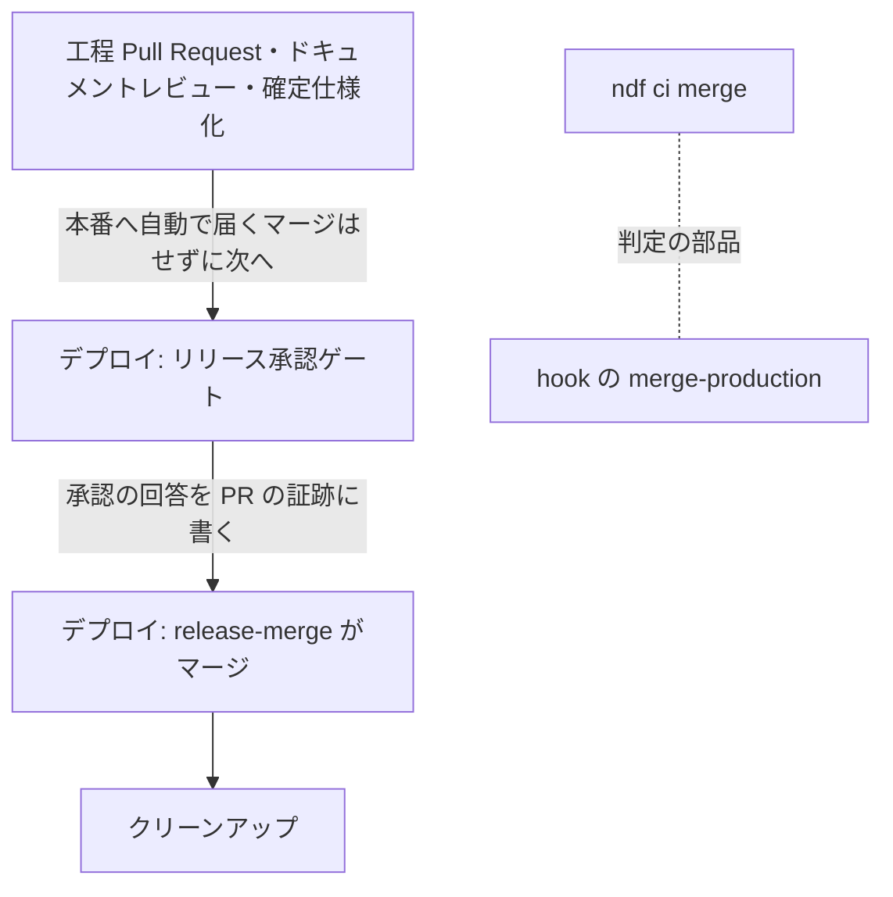

# 自動反映の本番チャネルへのマージ: 工程のどこから流しても、承認の記録が無ければマージしない

マージした時点で利用者へ届くブランチ（自動反映の本番チャネル）へのマージを、マージのコマンド `ndf ci merge` が人の承認の記録で止める仕組みの、決定と理由、常に成り立つ条件、入出力の契約を残す（ https://github.com/devbasex/ai-plugins/issues/4409 ）。

**工程の進み方と打ち方は Skill が正である。ここに書き写さない。**

| 何の正か | 置き場 |
| --- | --- |
| マージ先ごとに承認が要るかと、承認の取り方 | [`development-workflow` の references/production-merge.md](../../plugins/ndf/skills/development-workflow/references/production-merge.md) |
| モードごとの工程の順 | [`development-workflow` の SKILL.md](../../plugins/ndf/skills/development-workflow/SKILL.md) |
| 引数の一覧 | `ndf ci merge --help`・`ndf ci ask --help`・`ndf ci answer --help` |

## 概要

承認が要るかは、PR のベースリポジトリのマージ先のブランチにある `.ndf/project.json` の `branch_strategy` だけから決める。承認が要るマージは、PR のコメントに残った**マージの承認の証跡**（今の HEAD と今のマージ先への承認）があるときだけ行う。呼び手が引数で「承認済み」と伝える形は無い。

| 構成要素（`plugins/ndf/src/ndf/`） | 責務 |
| --- | --- |
| `core/production_merge.py` | `branch_strategy` とマージ先から判定の値を返す。標準ライブラリだけで書き、hook と `ndf ci` が共有する |
| `core/merge_approval.py` | 承認の対象と、証跡の組み立て・読み取り・判定・書き込み |
| `core/approval_words.py`・`core/actors.py` | 回答の語と、回答した者の形 |
| `ci_cli.py` | `ndf ci merge`・`ndf ci ask`・`ndf ci answer` |
| `adapters/github.py`・`adapters/github_merge.py` | マージ先の設定の読み取り、マージとマージキューへの投入の直前の照合 |
| `core/plan/runner.py` | 単発のプランの回答の記録と、待ちに固定した回答コマンド |
| `progress/gate/`・`domains/records/mvv_gate.py` | 工程の承認ゲートの回答と MVV 判定の通過で証跡を書く |
| `progress/invoke.py` | 工程から組むプランの `production_gate`・`approved_head`・`approved_base` |
| `domains/hooks/strict.py` | hook の検査 `merge-production`。AI が端末から打つマージと、証跡のマーカーを含むコメントの投稿を止める |

## 背景

マージ先を判定する規則は hook の中にしか無く、工程のプランが共通で打つ `ndf ci merge` はマージ先を見ていなかった。そのため工程を自動で進めると、確定仕様化・工程「Pull Request」・工程「ドキュメントレビュー」のマージのステップが、人の承認の前にスプリントの PR を `main` へマージした。判定をマージのコマンドに置いたのは、テンプレートごとに条件を足すと、足し忘れた経路と工程を通らない単発のプランが塞がらないためである。

## 仕様

### 承認の対象と証跡

承認の対象は、ベースリポジトリ・PR の番号・マージ先・HEAD の 4 つの組である。証跡の行は、これに回答（承認・却下）・担い手（利用者 `user` / MVV 判定 `mvv`）・「本番へ反映されるか」・回答の記録の識別子を足す。

証跡のコメントのマーカーは `<!-- ndf:merge-approval -->` である。リリースの PR の証跡（`ndf:release-approval`）とは別にする。同じマーカーにすると、CD の workflow がリリースの承認として数えるためである。

### 常に成り立つ条件

- 数える証跡は、マーカーを持ち、編集されておらず、書き手がマージを打つ token の利用者と同じ GitHub のアカウント ID で、承認の対象が今の PR と同じものである
- 承認が要るマージは、数える証跡のうち「本番へ反映される: はい」の承認とすべての却下を残し、その最新の 1 件が承認のときだけ行う
- 本番へ反映されないマージの承認は、証跡を書かない（読む側が無い）。却下は反映されないときも書き、先の承認を取り消す
- 担い手 `mvv` の行は、MVV 判定の記録のコメントにあるものだけを数える
- token の利用者のアカウント ID を読めないときは、証跡を数えも書きもせず `precondition` で止まる
- `--approved-head` と `--approved-base` を渡されたマージは、今の HEAD かマージ先が違えば、承認が要らなくても `approval_stale` で止まる
- 担い手 `user` の証跡は、利用者の回答（`human`、または中継を確かめられた `organizer`）の記録からだけ書く
- 工程の承認ゲートは、本番へ反映され得る対象への `conductor`・`service:<主体>` の回答を断る。反映されない対象では、証跡を書かずに回答を記録する
- 本番へ反映される PR は、承認の後の変更が文書だけでも承認を繰り上げず、質問し直す
- 承認資料には、本番へ反映され得るときに「この承認で PR がマージされ、本番へ反映され得る」と書く

### 判定の値

| マージ先と設定 | 値 | `ndf ci merge` | hook |
| --- | --- | --- | --- |
| `branches.production` でない | `not_production` | 承認は要らない | 使わない |
| 本番チャネルで、`channel` が `production`・省略・`null` で `kind` が `manual` でない行がある。または `deliveries` が無く `release.cd` がオブジェクト | `automatic` | 承認が要る | 止める |
| 本番チャネルで、`deliveries` が配列で当たる行が無い | `manual` | 承認は要らない | 通す |
| 本番チャネルで、`deliveries` が無く `release.cd` が `null` | `unset` | 承認が要る | 通す |
| 設定を読めない・形が違う・読んだリポジトリが違う | `unknown` | 承認が要る | 止める |

### 承認の記録が無いときの終え方

| `--production-gate` | 使う所 | 終え方 |
| --- | --- | --- |
| `stop`（既定） | 単発のプラン（`fix`・`close`・`merge`） | 承認待ち（終了コード 10） |
| `defer` | 工程の `pr-merge`・`docs-merge`・確定仕様化と、承認ゲートを持たない工程（`light` の設計）の `design-merge` | マージせずに `ok`（`metrics.merge` が `deferred`）。承認はデプロイの工程で取る |
| `stale` | 工程の `design-merge`・`release-merge` | `approval_stale` で停止する。工程の結果の `routes` に `ndf progress retry <ID> <工程> --reason approval_stale` と `ndf progress next <ID>` が順に載り、承認ゲートが質問し直す |

工程の中で承認を待たせないのは、デプロイのリリース承認ゲートと合わせて 2 回の承認になるためである。

### 証跡を書く 3 つの経路

| 経路 | 流れ |
| --- | --- |
| 工程の承認ゲート（設計・リリース） | `ndf answer` が、提示した対象と今の PR を照らし、証跡を書いてから回答を記録する。送り直しても証跡は 1 件である |
| MVV 判定の通過 | `fast`・`auto` の設計承認ゲートを省くとき、判定の記録のコメントに証跡の行を入れる。リリース承認ゲートは省かない（ https://github.com/devbasex/ai-plugins/issues/4105 まで） |
| 単発のプランの承認待ち | `ndf plan next <プラン> --answer <回答> --by human` が回答を記録し、`approve-*`・`reject-*` のステップの `ndf ci answer` が証跡を書く |

単発のプランの回答コマンドは、結果の `routes` に載ったものをそのまま打つ。今の待ち（`--waiting`）と提示の識別子（`--presented`）が付いていて、前の待ちや出し直す前の資料への回答は `approval_stale` で断る。更新前の版が残した待ちで、同じ回の資料を確かめられないものへの回答は、記録せず `precondition` で停止する。

### デプロイのマージと工程の順

テンプレート `release` の最初のステップ `release-merge` が、リリース承認ゲートで承認した HEAD とマージ先を添えて、工程の入力 `pr` の PR をマージする。マージ済みの PR には何もしない。

`release-merge` は、承認した HEAD の必須のチェック（`.ndf/project.json` の `ci.required_checks`）の結論を待ってからマージする。承認資料は先行する CI の後に進んだ HEAD で作られ得るので、HEAD の一致だけでは CI を通していないコミットをマージし得るためである。設定が無いか空のリポジトリでは待たない。

クリーンアップは 5 つのモードのどれでもデプロイの直後に流れる。

古い順（クリーンアップ → デプロイ）の定義の写しで始めた状態機械は、デプロイが始まっておらずクリーンアップが終わっていなければ、`ndf progress next` が順を入れ替え、事象 `definition_migrated` を 1 回記録する。

### 直前の照合

`GitHub.merge` は、マージかマージキューへの投入を送る直前に、PR のマージ先・HEAD・ベースリポジトリと、マージ先の設定の blob の oid を 1 回の GraphQL で読み直す。

| 見つけた違い | 扱い |
| --- | --- |
| マージ先か HEAD が違う | 承認の対象を持つ呼び出しは `approval_stale`、ほかは `refused` |
| 設定の oid だけが違う | 同じ応答の本文で判定し直し、承認が要るようになって証跡が無ければ `--production-gate` の形で終える |
| 停止した PR がマージキューに入っている（初めの読み取りで承認した対象と違う場合を含む） | キューから外す |

## データ・設定

新しい設定は足さない。読むのは、マージ先の `branch_strategy` の `branches.production` と `release.deliveries`・`release.cd`、`release-merge` が待つ `ci.required_checks` である。

| ファイル（プランの状態の保存先の下） | 中身 |
| --- | --- |
| `presented-<ステップ>.json` | 提示の識別子・承認の対象・「本番へ反映されるか」 |
| `answer-records/<ステップ>.json` | ステップ・回答・回答した者・時刻・回の id・提示の識別子 |

## エラー処理

| 停止理由 | 起きる場面 |
| --- | --- |
| `approval_stale` | 承認の後に承認の対象が変わった、有効な承認が無い、回答コマンドが今の待ちと合わない |
| `precondition` | token の利用者を読めない、提示や回答の記録を書けない、更新前の待ちへの回答 |
| `refused` | `ndf ci answer` に回答の記録が無い・利用者の回答でない・提示や承認の対象が違う |

## セキュリティ

防ぐのは、うっかりと、承認の権限を持たない人の操作である。承認の権限を持つ利用者のアカウントを使う AI が、回答した者を `human` と偽る・回答の記録ごと偽る・hook の外から証跡を書くことは防げない（承認の仕組みの脅威の整理。 https://github.com/devbasex/ai-plugins/issues/2773 ）。

直前の照合とマージの要求の間にマージ先が変わる余地と、マージキューで待つ間に設定が自動反映へ変わる余地は残る。

人が端末や GitHub の画面で行うマージは停止しない。

## テスト観点

- 自動反映の設定で、確定仕様化・`pr-merge`・`docs-merge` がマージせずに終え、デプロイのリリース承認ゲートまで進むこと
- 単発のプランが承認待ちで止まり、結果の回答コマンドをそのまま打つとマージされること。承認ゲートを持つプランで承認を 2 回求めないこと
- 承認の後の HEAD の変更・マージ先の変更・却下で、マージしないこと
- `release-merge` が、承認した HEAD の必須のチェックが落ちるか結論が出なければマージしないこと
- 本番チャネルでないマージ先と、自動反映の行が無い本番チャネルへは、そのままマージすること
- テストは `plugins/ndf/tests/` の `progress/test_production_merge_flow.py`・`progress/test_definition_migration.py`・`progress/test_gate_answering.py`・`core/test_production_merge.py`・`adapters/test_ci_cli.py`・`adapters/test_ci_cli_answer.py`・`adapters/test_github_merge.py`

## 関連リンク

- [CD を前提にしたリリース](ndf-release-via-cd.md)
- [承認ゲートの手前の MVV 判定](ndf-mvv-gate-every-pace.md)
