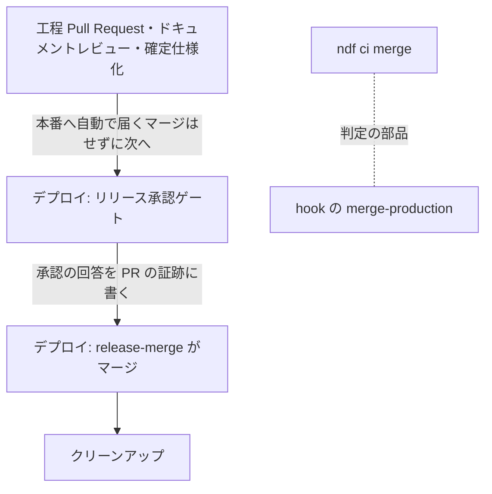

# 自動反映の本番チャネルへのマージ: 工程のどこから流しても、承認の記録が無ければマージしない

マージした時点で利用者へ届くブランチ（自動反映の本番チャネル）への PR を、承認の記録が無ければマージのコマンド `ndf ci merge` がマージしない仕組みの、決定と理由、常に成り立つ条件、入出力の契約を残す（ https://github.com/devbasex/ai-plugins/issues/4409 ）。

**工程の進め方とコマンドの実行方法は、Skill の記述を正とする。ここに書き写さない。**

| 何の正か | 置き場 |
| --- | --- |
| マージ先ごとに承認が要るかと、承認の取り方 | [`development-workflow` の references/production-merge.md](../../plugins/ndf/skills/development-workflow/references/production-merge.md) |
| モードごとの工程の順 | [`development-workflow` の SKILL.md](../../plugins/ndf/skills/development-workflow/SKILL.md) |
| 引数の一覧 | `ndf ci merge --help`・`ndf ci ask --help`・`ndf ci answer --help` |

## 概要

承認が要るかは、PR のベースリポジトリのマージ先のブランチにある `.ndf/project.json` の `branch_strategy` だけから決める。承認が要るマージは、PR のコメントに残った**マージの承認の証跡**（今の HEAD と今のマージ先への承認）があるときだけ行う。呼び出し側が引数で「承認済み」と伝える方法は無い。引数を渡すだけで、承認の無い変更もマージできるためである。

承認は、利用者本人の回答か、MVV 判定の通過である。MVV 判定は、進め方の指定（`pace`）が `fast` か `auto` のときに、利用者が承認したプロジェクトの判断基準（MVV）に照らして、AI が承認ゲートを人に問わず通す仕組みである。今は設計承認ゲートだけを通す。

| 構成要素（`plugins/ndf/src/ndf/`） | 責務 |
| --- | --- |
| `core/production_merge.py` | `branch_strategy` とマージ先から判定の値を返す。標準ライブラリだけで書き、hook と `ndf ci` が共有する |
| `core/merge_approval.py` | 承認の対象と、証跡の組み立て・読み取り・判定・書き込み |
| `core/approval_words.py`・`core/actors.py` | 回答の語と、回答した者の形 |
| `ci_cli.py` | `ndf ci merge`・`ndf ci ask`・`ndf ci answer` |
| `adapters/github.py`・`adapters/github_merge.py` | マージ先の設定の読み取り、マージとマージキューへの投入の直前の照合 |
| `core/plan/runner.py` | 単発のプランの回答の記録と、待ちに固定した回答コマンド |
| `progress/gate/`・`domains/records/mvv_gate.py` | 工程の承認ゲートの回答と MVV 判定の通過で証跡を書く |
| `progress/invoke.py` | 工程から組むプランの `production_gate`・`approved_head`・`approved_base` |
| `domains/hooks/strict.py` | hook の検査 `merge-production`。AI が端末から打つマージと、証跡のマーカーを含むコメントの投稿を止める |

## 背景

マージ先を判定する規則は hook の中にしか無く、工程のプランが共通で打つ `ndf ci merge` はマージ先を見ていなかった。そのため工程を自動で進めると、確定仕様化・工程「Pull Request」・工程「ドキュメントレビュー」のマージのステップが、人の承認の前にスプリントの PR を `main` へマージした。テンプレート（工程やコマンドが組む手順の定義）ごとに条件を足す方法では、足し忘れた経路と、工程を通さずに実行する単発のプランからマージできる。そのため、判定はマージのコマンドに置いた。

## 仕様

### 承認の対象と証跡

承認の対象は、ベースリポジトリ・PR の番号・マージ先・HEAD の 4 つの組である。証跡の行は、これに回答（承認・却下）・担い手（利用者 `user` / MVV 判定 `mvv`）・「本番へ反映されるか」・回答の記録の識別子を足す。

証跡のコメントのマーカーは `<!-- ndf:merge-approval -->` である。リリースの PR の証跡（`ndf:release-approval`）とは別にする。同じマーカーにすると、CD の workflow がリリースの承認として数えるためである。

### 常に成り立つ条件

- 数える証跡は、マーカーを持ち、編集されておらず、書き手がマージを打つ token の利用者と同じ GitHub のアカウント ID で、承認の対象が今の PR と同じものである
- 承認が要るマージでは、数える証跡から「本番へ反映される: はい」の承認と、すべての却下を抜き出す。その中で最新の 1 件が承認のときだけマージする
- 下の「判定の値」の表で承認が要る値を「本番へ反映され得る」、要らない値を「本番へ反映されない」と呼ぶ
- 回答を記録した時点で本番へ反映されないマージの承認は、人の回答では証跡を書かない（読む側が無い）。却下は反映されないときも書き、先の承認を取り消す。値が「本番へ反映される: いいえ」の承認の行は、MVV 判定が反映されない対象を通したときに残る。後で設定が変わって承認が要るようになっても、この行は数えない
- 担い手 `mvv` の行は、MVV 判定の記録のコメントにあるものだけを数える
- token の利用者のアカウント ID を読めないときは、証跡を数えも書きもせず `precondition` で止まる
- `--approved-head` と `--approved-base` を渡されたマージは、今の HEAD かマージ先が違えば、承認が要らなくても `approval_stale` で止まる
- 担い手 `user` の証跡を書けるのは、回答した者が利用者本人（`human`）と記録されている場合である。例外として、取りまとめ役の AI（`organizer`）が取り次いだ回答も、利用者への質問に同じ回答が記録されていれば、本人の回答として扱う
- MVV 判定の通過は、回答した者を `service:mvv`、証跡の担い手を `mvv` と記録する
- 工程の承認ゲートは、本番へ反映され得る対象では、作業を進める AI（`conductor`）や外部のサービス（`service:<主体>`。MVV 判定の `service:mvv` を除く）の回答を受け付けない。反映されない対象では、証跡を書かずに回答を記録する
- 本番へ反映され得る PR では、承認の後に変わったのが文書だけでも、以前の承認を引き継がず、承認を取り直す
- 承認資料には、本番へ反映され得るときに「この承認で PR がマージされ、本番へ反映され得る」と書く

### 判定の値

| 値 | マージ先と設定 | 本番へ反映され得るか（`ndf ci merge` が承認を求めるか） | hook `merge-production` |
| --- | --- | --- | --- |
| `not_production` | マージ先が `branches.production` でない | されない（求めない） | この値を返さない（hook はマージ先を見ない） |
| `automatic` | 本番チャネルで、下の (1) か (2) | され得る（求める） | 止める |
| `manual` | 本番チャネルで、`deliveries` が配列で (1) の要素が無い | されない（求めない） | 通す |
| `unset` | 本番チャネルで、`deliveries` が無く `release.cd` が `null` | され得る（求める） | 通す |
| `unknown` | 設定を読めない・形が違う・読んだリポジトリが違う | され得る（求める） | 止める |

- (1) `release.deliveries` に、`channel` が `production`・`null`・省略のどれかで、かつ `kind` が `manual` でない要素がある
- (2) `deliveries` が無く、`release.cd` がオブジェクトである

`unset` を hook が通すのは、配布しているブランチ戦略のプリセットがこの形で、hook の振る舞いを変えないためである。

### 承認の記録が無いときの終え方

| `--production-gate` | 使う所 | 終え方 |
| --- | --- | --- |
| `stop`（既定） | 単発のプラン（`fix`・`close`・`merge`） | 承認待ち（終了コード 10） |
| `defer` | 工程の `pr-merge`・`docs-merge`・確定仕様化と、承認ゲートを持たない工程（`light` の設計）の `design-merge` | マージせずに `ok`（`metrics.merge` が `deferred`）。承認はデプロイの工程で取る |
| `stale` | 承認ゲートを持つ工程の `design-merge` と、`release-merge` | `approval_stale`（承認の取り直しが要る）で停止する。工程の結果の `routes` に `ndf progress retry <ID> <工程> --reason approval_stale` と `ndf progress next <ID>` が順に載り、承認ゲートが質問し直す |

途中の工程で承認を待つと、後のリリース承認ゲートと合わせて 2 回承認することになる。そのため、工程の途中では待たない。

### 証跡を書く 3 つの経路

| 経路 | 流れ |
| --- | --- |
| 工程の承認ゲート（設計・リリース） | `ndf answer` が、提示した対象と今の PR を照らし、証跡を書いてから回答を記録する。同じ回答をもう一度送っても、証跡は増えない |
| MVV 判定の通過 | 設計承認ゲートを省くとき、判定の記録のコメントに担い手 `mvv` の証跡の行を入れる。リリース承認ゲートは省かない。判定は、レビューで人の判断に回した指摘を読むが、リリースではどの PR の指摘まで読むかが決まっていないためである（ https://github.com/devbasex/ai-plugins/issues/4105 で決めるまで） |
| 単発のプランの承認待ち | `ndf plan next <プラン> --answer <回答> --by human` が回答を記録し、`approve-*`・`reject-*` のステップの `ndf ci answer` が証跡を書く |

単発のプランの回答コマンドは、結果の `routes`（次に打つコマンドの一覧）に載ったものをそのまま打つ。このコマンドには、どの承認待ちへの回答か（`--waiting`）と、どの版の承認資料を見たか（`--presented`）が付く。今のものと違えば `approval_stale` で断る。

NDF を更新する前に作られた承認待ちでは、回答した人が見た承認資料が今の待ちのものかを確かめられないことがある。その場合は回答を記録せず、`precondition` で停止する。

### デプロイのマージと工程の順

テンプレート `release` の最初のステップ `release-merge` が、リリース承認ゲートで承認した HEAD とマージ先を添えて、工程の入力 `pr` の PR をマージする。マージ済みの PR には何もしない。

`release-merge` は、承認した HEAD の必須のチェック（`.ndf/project.json` の `ci.required_checks`）の結論を待ってからマージする。工程「Pull Request」の CI の確認が済んだ後にコミットが足され、その新しい HEAD で承認資料が作られることがある。HEAD の一致だけを確かめると、CI を通していないコミットをマージし得る。設定が無いか空のリポジトリでは待たない。

工程の分け方（モード）が 5 つ（一覧は `development-workflow` の SKILL.md）のどれでも、クリーンアップはデプロイの直後に実行する。

スプリントの進行の記録（状態機械）は、始めた時点の工程の定義の複製を持つ。複製の工程の順が「クリーンアップ → デプロイ」のままの記録は、デプロイが未開始でクリーンアップが未完了なら、`ndf progress next` が順を入れ替え、事象 `definition_migrated` を 1 回記録する。

### 直前の照合

`GitHub.merge` は、マージかマージキューへの投入を送る直前に、PR のマージ先・HEAD・ベースリポジトリと、マージ先の設定の blob の oid を 1 回の GraphQL で読み直す。

| 見つけた違い | 扱い |
| --- | --- |
| マージ先か HEAD が違う | 承認の対象を持つ呼び出しは `approval_stale`、ほかは `refused` |
| 設定の oid だけが違う | 同じ応答の本文で判定し直し、承認が要るようになって証跡が無ければ `--production-gate` の形で終える |
| 照合でマージを中止した PR が、すでにマージキューに入っている（最初の読み取りで承認の対象と違っていた場合も含む） | キューから外す |

## データ・設定

新しい設定は足さない。読むのは、マージ先の `branch_strategy` の `branches.production` と `release.deliveries`・`release.cd`、`release-merge` が待つ `ci.required_checks` である。

| ファイル（プランの状態の保存先の下） | 中身 |
| --- | --- |
| `presented-<ステップ>.json` | 提示（承認資料を利用者に見せること。見せるたびに識別子を作る）の識別子・承認の対象・「本番へ反映されるか」 |
| `answer-records/<ステップ>.json` | ステップ・回答・回答した者・時刻・プランの実行 1 回ごとの id・提示の識別子 |

## エラー処理

| 停止理由 | 起きる場面 |
| --- | --- |
| `approval_stale` | 承認の後に承認の対象が変わった、有効な承認が無い、回答コマンドが今の待ちと合わない |
| `precondition` | token の利用者を読めない、提示や回答の記録を書けない、更新前の待ちへの回答 |
| `refused` | `ndf ci answer` に回答の記録が無い・利用者の回答でない・提示や承認の対象が違う。承認の対象を持たない呼び出しで、直前の照合がマージ先か HEAD の違いを見つけた |

## セキュリティ

防ぐのは、うっかりと、承認の権限を持たない人の操作である。承認の権限を持つ利用者のアカウントを使う AI が、回答した者を `human` と偽る・回答の記録ごと偽る・hook の外から証跡を書くことは防げない（承認の仕組みの脅威の整理。 https://github.com/devbasex/ai-plugins/issues/2773 ）。

直前の照合とマージの要求の間にマージ先が変わる余地と、マージキューで待つ間に設定が自動反映へ変わる余地は残る。

人が端末や GitHub の画面で行うマージは停止しない。

## テスト観点

- 自動反映の設定で、確定仕様化・`pr-merge`・`docs-merge` がマージせずに終え、デプロイのリリース承認ゲートまで進むこと
- 単発のプランが承認待ちで止まり、結果の回答コマンドをそのまま打つとマージされること。承認ゲートを持つプランで承認を 2 回求めないこと
- 承認の後の HEAD の変更・マージ先の変更・却下で、マージしないこと
- `release-merge` が、承認した HEAD の必須のチェックが落ちるか結論が出なければマージしないこと
- 本番チャネルでないマージ先と、自動反映の行が無い本番チャネルへは、そのままマージすること
- テストは `plugins/ndf/tests/` の `progress/test_production_merge_flow.py`・`progress/test_definition_migration.py`・`progress/test_gate_answering.py`・`core/test_production_merge.py`・`adapters/test_ci_cli.py`・`adapters/test_ci_cli_answer.py`・`adapters/test_github_merge.py`

## 関連リンク

- [CD を前提にしたリリース](ndf-release-via-cd.md)
- [承認ゲートの手前の MVV 判定](ndf-mvv-gate-every-pace.md)
