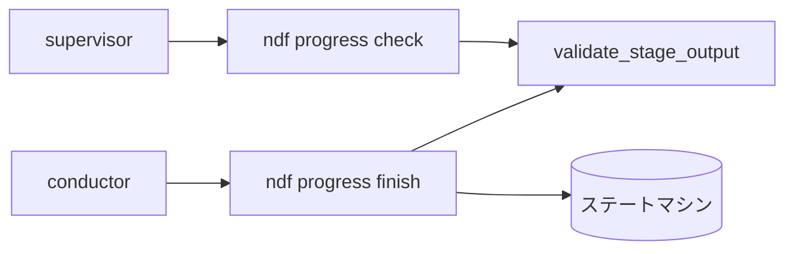

# 工程の出力の確かめ: `ndf progress check` で finish と同じ規則で書かずに確かめる

`ndf progress check <ステートマシンの ID> <工程> --output <ファイル>` は、工程の出力の JSON を conductor の
`ndf progress finish` と同じ規則で確かめ、ステートマシンへは何も書かずに返す。返りには、その工程の定義が置いてよい
キー（`metrics.outputs`）と、`finish` が捨てるキー（`warnings`）が載る。supervisor は工程の出力を書くたびにこれを打ち、
`ok` になってからフェーズレポートの欄 `終えた工程` に足す。

例: 振り返りの工程の出力に、規約に無いキー `retrospective_comment` を書いた。

| 順 | 起きること |
| ---: | --- |
| 1 | supervisor が `{"steps": [], "summary": "…", "outputs": {"retrospective_comment": "https://…"}}` を書き、`ndf progress check <ID> 振り返り --output <ファイル>` を打つ |
| 2 | `status: stopped`・`cause.kind: refused` が返る。`summary` は「振り返り の出力が規約に合わない: outputs: Additional properties are not allowed ('retrospective_comment' was unexpected)」で、`finish` が返す誤りと同じ文である |
| 3 | supervisor は `metrics.outputs` を見てキーを直し、打ち直して `ok` を得てから返す。conductor の `finish` は同じ出力で止まらない |

| 何を読むか | 正本 |
| --- | --- |
| supervisor が工程の出力を書いて確かめる規則 | `plugins/ndf/skills/development-workflow/references/agent-layers.md` の supervisor の規則 15 |
| 引数と結果の `metrics` の一覧 | `plugins/ndf/docs/contracts/commands.md` の `ndf progress` |
| 工程の出力の形 | `plugins/ndf/contracts/workflow/stage-io.schema.json` の `stage-out` と、工程ごとの `plugins/ndf/contracts/workflow/stages/<工程>.json` |

## 概要

### 構成要素と責務

| 要素 | 責務 |
| --- | --- |
| `plugins/ndf/src/ndf/progress/command.py` の `check` のサブコマンド | 出力を読み、工程の定義を引き、`finish` と共通の前半（出力の読み込みと `definition.validate_stage_output`）で確かめる。合えば `stages.keep_declared` で捨てるキーを求めて `warnings` に載せる。書かない |
| `plugins/ndf/contracts/schemas/io/progress.result.schema.json` | `metrics.outputs`（文字列の配列）を受ける |
| `plugins/ndf/agents/supervisor.md`・`supervisor-waits.md` | 工程の出力は規則 15 で書き、`ndf progress check` で確かめる、と規則の番号と手段の名前だけを書く（規則の本文は写さない） |



## 用語

用語の定義は用語集 [docs/glossary.md](../glossary.md) が正である。この文書で使う語は「工程の出力の確かめ」「工程の出力」「文脈のキー」。
定義のキーは、文脈のキー（`context.schema.json` の値の名前）のうち、ある工程が書くと工程の定義に挙げたものを指す。

## 背景

#3812 の仕上げのフェーズで、supervisor が工程の出力の `outputs` に規約に無いキーを書き、conductor の
`ndf progress finish` が止まった（振り返りの `retrospective_comment`、棚卸しの `apply`・`candidates`・`rank`）。
起動指示が規則 15 を渡さず、supervisor は JSON として読めるかだけを確かめていた。書いた側が `finish` と同じ判定を
得る手段が無かったため、`check` を足した。supervisor の定義から規則 15 を指すのは、定義の本文が起動指示によらず
毎回読まれるためである。

## 対象範囲

- NDF を入れたすべてのリポジトリで、Claude Code と Codex の両方で同じに働く
- モードに依らない
- `finish` の検査とプランの工程の検査の振る舞いは変えない。定義の外の文脈のキーは、`finish` が今のとおり捨てて警告にする
- conductor の起動指示は検査しない

## 仕様

### 常に成り立つ条件

| # | 条件 | 破れたときの扱い |
| --- | --- | --- |
| I1 | `check` はステートマシンの行と履歴を書かない（読み取りのトランザクションだけを使う） | — |
| I2 | `check` と `finish` は同じ関数（`validate_stage_output`）で確かめ、同じ出力に同じ誤りを返す | — |

### 入出力

```text
ndf progress check <machine_id> <stage> --output <ファイル> [--cwd <パス>]
```

| 場合 | `status` | `cause.kind` | `metrics` | `warnings` |
| --- | --- | --- | --- | --- |
| 規約に合う | `ok` | — | `machine_id`・`stage`・`outputs`（その工程の定義のキーの一覧） | 定義に無い文脈のキー（`finish` が捨てるもの）ごとに 1 行 |
| 規約に合わない | `stopped` | `refused` | 同上 | — |
| ステートマシン・工程が無い・出力のファイルを読めない | `finish` と同じ | `finish` と同じ | — | — |

合わないときの `summary` は「<工程> の出力が規約に合わない: <誤り>」で、`finish` の文と同じである。

`outputs` のキーの扱いは 3 つに分かれ、`finish` と同じである。

| `outputs` のキー | 例 | `check` | `finish` |
| --- | --- | --- | --- |
| 工程の定義のキー | 設計の `design_pr` | `ok` | 文脈へ書く |
| 文脈のキーだが工程の定義のキーでない | 振り返りの `pr` | `ok` と `warnings` | 捨てて警告 |
| 文脈のキーでない | 振り返りの `retrospective_comment` | `refused` | `refused` |

`outputs` を省いた出力は、空の `outputs` として扱う。

## データ・設定

設定は持たない。`metrics.outputs` は `progress.result.schema.json` の `metrics` の欄で、`check` だけが出す。
`machine_id`・`stage` は既存の欄で、`warnings` は共通の `result.schema.json` が文字列の配列で受ける。

## 運用

- supervisor は工程の出力を書いた後に `check` を打ち、`refused` なら `cause.detail` の誤りに従って直して打ち直す。起動指示が規則 15 を渡さなくても行う
- `check` は `--reason` を取らない。確かめに理由は要らない

## 決定と理由

| 決定 | 理由 |
| --- | --- |
| 新しいサブコマンドにし、`finish --check` にしない | `finish` は `--reason` が必須で、確かめに理由を書かせるか、引数の要否を条件で変えることになる |
| `ndf contracts emit --outputs` を使わない | 結果 JSON の語彙で確かめ、工程の出力の語彙と違う |
| 定義のキーを `metrics.outputs` で返す | supervisor が `ndf progress show` を読まずに置いてよいキーを知る |
| 定義の外の文脈のキーを `refused` にせず `warnings` にする | `finish` とプランの工程の検査の振る舞いを変えない |

## テスト観点

テストは `plugins/ndf/tests/progress/test_command.py`・`test_command_parser.py` にある。

- 規約に合う出力で `ok` と定義のキーが返り、合わない出力（文脈のキーに無いキー・定義のキーの欠け・`summary` の欠け）で `finish` と同じ誤りの文の `refused` が返ること
- `ok` と `refused` の両方の結果 JSON が `progress.result.schema.json` に通ること
- `check` の前後で `ndf progress show` の `items` と `history` が同じであること
- 振り返りに `pr` を置いた出力で `ok` と `warnings` が返ること。`outputs` を省いた出力が通ること
- `finish` とプランの工程の検査の既存テストが通ること

## 関連リンク

- 3 層の運転: [ndf-agent-layers-unattended-run.md](ndf-agent-layers-unattended-run.md)
- 課題: [#3856](https://github.com/devbasex/ai-plugins/issues/3856)
