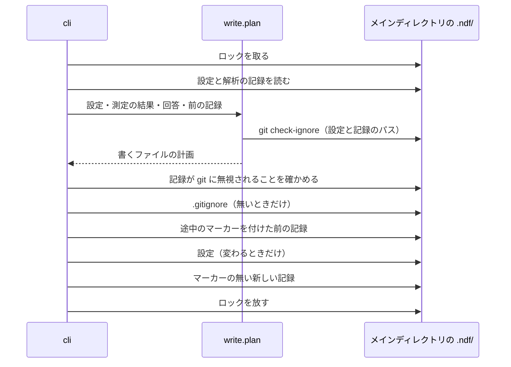

# プロジェクトの設定の解析の記録（`.ndf/analysis/project.json`）

## 概要

プロジェクトの設定 `.ndf/project.json` は git で追跡してチームで共有する。解析の書き出し（`ndf project write`）は、このファイルに設定の値と書いた値の指紋だけを書く。解析をどの入力で行ったかの値（解析の記録）は、git で追跡しない `.ndf/analysis/project.json` に書く。どの仕組みも読まない値は、測定も保存もしない。そのため、解析をやり直しても、追跡するファイルに差分が出るのは設定の値が変わったときだけになる。

手順 0 での打ち方・回答の書き方・旧い形の設定の移行の手順・止まったときの直し方は、`development-workflow` の [references/project-analysis.md](../../plugins/ndf/skills/development-workflow/references/project-analysis.md) が正である。この文書は、仕組みと、その形にした理由を持つ。

## 用語

用語の定義は用語集の [NDF のプロジェクトの設定](../glossary/ndf-project-settings.md) にある（解析・解析の記録・書いた値の指紋・入力の指紋・測った値）。コードとスキーマでは、解析の記録を `analysis_record`・`project-analysis`、書いた値の指紋を `analysis.written` と呼ぶ。

## コンテキスト

プロジェクトの設定（`ndf-project-settings`）。

## 構成要素と責務

| 要素（`plugins/ndf/src/ndf/domains/project/`） | 責務 |
| --- | --- |
| `analysis_record.py` | 解析の記録の形を持つ。記録を読む。設定から旧い形のキーを取り除く |
| `measure_ci.py`・`measure_repo.py` | CI とリポジトリを測る。読み手のある値だけを返す |
| `write.py` | 設定の値を決め、解析の記録を組み立て、書くファイルの計画を作る（何も書かない） |
| `cli.py` | ロックを取る。記録が git に無視されることを確かめる。計画のファイルを書き、結果を表示する |
| `check.py` | 設定が古くなっていないかを解析の記録から判定する |
| `items.py` | 書いた値の指紋を作る `value_digest` を持つ。`write.py` と `analysis_record.py` が共用する |
| `strategy_write.py` | `ndf project branch-strategy` と書き出しが共有するロックのパスを作る（`lock_at`） |

保存先は、保存先の表（`plugins/ndf/contracts/domains/locations.json` の項目 `analysis`）とファイルの表（`ndf-files.json` の行 `project-analysis`・`project-analysis-ignore`）が持つ。

## 背景

追跡する設定に、解析した時刻・入力のファイルのハッシュ・ファイル数のように実行のたびに変わる値を書くと、設定の値が同じでも未コミットの差分が出る。差分は `git pull`・ブランチの切り替え・worktree の後片付けを止め、コミットすれば、人が確かめる `.ndf/` の変更に意味の無い行が混ざる。CI の実行時間・ジョブ数・テストの所要時間のように読み手の無い値は、測るために GitHub の API の利用枠と解析の時間も使う。

このため、値は読み手の有無で扱いを決める。

| 値 | 読み手 | 扱い |
| --- | --- | --- |
| 設定の値 | 各 Skill とスクリプト | `.ndf/project.json` に書く |
| 書いた値の指紋 | 次の書き出し | `.ndf/project.json` の `analysis.written` に書く |
| 解析器のバージョン・入力のファイルのハッシュ・ブランチの構成 | `ndf project check` | 解析の記録に書く |
| 解析した時刻・言語ごとのファイル数・CI のワークフローの一覧と種類・実行時間・ジョブ数・テストの所要時間 | 無い | 測定も保存もしない |

### 決定と理由

| 決定 | 理由 |
| --- | --- |
| 読み手の無い値は、別のファイルへ移すのではなく、測るのをやめる | 移しても使われず、測る時間と API の利用枠だけがかかる。後で使う仕組みを作るときは、その仕組みと一緒に測る処理を作る |
| 記録は `.ndf/analysis/` に置き、同じディレクトリの中身 `*` の `.gitignore` で外す | pytest・ruff のキャッシュと同じ形で、利用者の `.gitignore` と `.ndf/.gitignore` を書き換えずに済む。clone を消せば記録も消えるので、リポジトリの外に残るファイルが無い |
| ファイル名に `.local` を使わず、ディレクトリを分ける | `.local` は `worktree.local.json` で「共有の設定を上書きする個人の値」を指す。記録は何も上書きしない |
| 書いた値の指紋は設定に残す | 指紋は設定の値が変わったときだけ変わる。追跡すれば、新しく clone した場所でも、人が直した値と解析が書いた値を同じように見分けられる |
| 記録が無い・読めないときは「壊れている」でなく「古い」にする | 記録は人が書かないファイルで、解析をやり直せば作り直せる。「壊れている」にすると、利用者が直すまで作業が進まない |
| 旧い形の設定は、移行のコマンドを別に持たず、次の書き出しが移す | 記録は次の解析で作り直せるので、旧い値を移し替える必要が無い。旧い形を読み続ける互換の仕組みは持たない |

新しく clone した場所には記録が無いので、最初の作業で解析が 1 回走る（worktree はメインディレクトリの記録を読むので走らない）。入力のハッシュを追跡する設定に残せばこの 1 回は省けるが、入力のファイルを変えるたびに差分が出るので採らない。

## 対象範囲

解析の書き出しと判定が扱う `.ndf/project.json`・`.ndf/analysis/` の形と手順を対象にする。ブランチ戦略のセクション `branch_strategy` は `ndf project branch-strategy` だけが書き、解析の書き出しは変えない。

## 仕様

### 集約

| 集約 | 集約ルート | 書き換えてよい主体 |
| --- | --- | --- |
| 設定 | `.ndf/project.json` | 人と解析の書き出し。人が直した値を解析は書き換えない |
| 解析の記録 | `.ndf/analysis/project.json` | 解析の書き出しだけ |

どちらもメインディレクトリ（clone した元のディレクトリ）に置く。worktree から打っても同じ位置を読み書きする。

### 常に成り立つ条件

| # | 条件 |
| --- | --- |
| I1 | 書き出しの後の設定に、`analysis` の `written` 以外のキー・`languages[].files`・`ci.workflows`・`ci.provider`・`test_duration` が無い |
| I2 | 解析は読み手の無い値を測らない。`gh` で呼ぶ API は `rules/branches`・`pulls`・`issues` だけである |
| I3 | 解析が書いた値かどうかは、旧い形のキーを取り除く前の値と前の指紋で見分ける |
| I4 | 書き出しが `.ndf/analysis/` の下へ書くとき、記録のパスは git に無視され、追跡されていない。確かめられなければ何も書かない |
| I5 | 記録が無い・読めない（不正な UTF-8 を含む）・形が違うとき、判定は「古い」である |
| I6 | 設定に旧い形のキーが残るとき、判定は「古い」である。「壊れている」にしない |
| I7 | 設定か記録を書き換えるときは、先に前の記録へ途中のマーカー（`pending: true`）を付け、最後にマーカーの無い記録を書く |
| I8 | 記録は `version`・`analyzer`・`inputs`・`branches`・`written_digest`・`pending` だけを持つ |
| I9 | 記録の `written_digest` が今の設定の書いた値の指紋と対応しないとき、判定は「古い」である |
| I10 | 書き出しは、設定と記録を読む前にメインディレクトリ単位のロックを取り、最後のファイルを書き終えるまで放さない |

### 測定

- CI について測るのは、既定ブランチの必須のチェックだけである。時間切れなら `ci` を不明にする。それ以外の理由で取得できなければ空の並びにする
- 言語の行は `name`・`frameworks`・`version` を持ち、名前の順に並べる。ファイル数は言語を見つけるために数えるだけで、結果に入れない。件数の順に並べると、順位が入れ替わるだけで差分が出るためである

### 書き出し

項目ごとに、旧い形のキーを取り除く前の値のハッシュが前の指紋と一致すれば解析が書いた値とみなして置き換え、違えば人が直した値として残す（残す値からは旧い形のキーを取り除く）。書き出す設定の `analysis` は、指紋が 1 つも無くても `{"written": …}` の形にする。

書く順は次のとおりである。



- 記録は、設定を書くとき・記録の中身が前と違うとき・前の記録に途中のマーカーが残るときに書く。どれでもなければ書かない
- 途中のマーカーは、前の記録があり、記録を書くときだけ入れる。マーカーを入れた計画には、マーカーの無い記録が必ず続く
- 途中のマーカーを設定より先に書くのは、書き込みの途中で止まったときに、前の記録の入力が今と同じでも次の判定を「古い」にするためである
- 記録は解析した時刻を持たないので、同じ入力で打ち直すと書くファイルが無くなる

### 記録を git に入れないための確かめ（I4）

`.ndf/analysis/` の下のファイル（`.gitignore` だけの場合を含む）を書く計画のときに、どのファイルを書くよりも前に確かめる。

| 状態 | 確かめ方と、止まる条件 |
| --- | --- |
| どちらの場合も | `write.plan` の `git check-ignore` が判定できなければ止まる（`.ndf/analysis` が別の場所へのシンボリックリンクのときなど） |
| `.gitignore` を作る | `git ls-files -- .ndf/analysis` が失敗するか、出力があれば止まる。追跡していた `.gitignore` を利用者が消した状態を、作り直して打ち消さないためである |
| `.gitignore` がある | `write.plan` の `git check-ignore -v -z --stdin` の答えを使う。記録のパスが否定でない除外の行に当たらなければ止まる（追跡済みのパスは当たらない） |

- 条件にするのは、記録が実際に無視されることである。どの除外の設定（`.ndf/analysis/.gitignore`・ルートの `.gitignore`・`.git/info/exclude`・`core.excludesFile`）で無視されるかは問わない
- `.gitignore` の中身を読んで判断しないのは、否定のパターン・利用者の全体の除外の設定・追跡済みのファイルを見落とすためである
- `.gitignore` を作る回に除外の行の答えを使わないのは、同じディレクトリの `.gitignore` の `*` がほかの除外の設定より優先され、追跡していない記録は必ず無視されるためである
- 書くものが無い書き出しは、この確かめで止めずに終了コード 0 で終わる

### ロック（I10）

ロックは `ndf project branch-strategy` が設定を書くときと同じ `<git の共通ディレクトリ>/ndf-branch-strategy.lock` で、待ちの上限は `branch-strategy.write-lock`（30 秒）である。どちらも `.ndf/project.json` 全体を読んで書き直すので、同じロックで互いを待たせる。ロックが無いと、2 つの worktree からの書き出しで設定と記録が別々の解析の組み合わせになり、片方の書き込みがもう片方の変更を消すこともある。`--dry-run` は何も書かないのでロックを取らない。

### 判定（`ndf project check`）

上から順に当てはめ、最初に当たった行の結果にする。

| 条件 | 判定（終了コード） |
| --- | --- |
| 設定が無い | 無い（3） |
| 旧い形のキーを取り除いても設定がスキーマに合わない | 壊れている（2） |
| 設定に旧い形のキーがある | 古い（3） |
| 記録が無い・読めない・形が違う | 古い（3） |
| 記録に途中のマーカーがある | 古い（3） |
| `written_digest` が今の設定と合わない | 古い（3） |
| 解析器のバージョンが古い・入力のファイルのハッシュかブランチの構成が変わった・`--force` | 古い（3） |
| どれでもない | 新しい（0） |

`written_digest` は設定のファイル全体でなく `analysis.written` から作る。設定だけを `git restore` で戻した場合やブランチを切り替えた場合は、指紋も戻るので「古い」になる。人が値を直した場合や `branch_strategy` を書いた場合は、指紋が変わらないので「新しい」のままである。

### ドメインイベント

| # | イベント | 次に起きること |
| --- | --- | --- |
| E1 | 設定が古くなっていないかを確かめた | 「古い」なら、開発の作業の始めの手順が解析をやり直す |
| E2 | リポジトリと CI を測った | 書き出す |
| E3 | 記録が git に無視されることを確かめた | 設定と記録を書く |
| E4 | 前の記録に途中のマーカーを付け、設定を書き出した | ここで止まると、次の E1 は「古い」 |
| E5 | 解析の記録を書き出した | 次の E1 の材料になる |

## データ・設定

解析の記録の形（スキーマは [project-analysis.schema.json](../../plugins/ndf/contracts/schemas/internal/project-analysis.schema.json)。ほかのキーを許さない）:

```json
{
  "version": 1,
  "analyzer": 4,
  "inputs": {".github/workflows/pytest.yml": "2187b0d3…", "pyproject.toml": "3634277f…"},
  "branches": {"head": "main", "present": ["develop", "main"]},
  "written_digest": "9f2c41aa…"
}
```

| キー | 中身 |
| --- | --- |
| `version` | 記録の形のバージョン |
| `analyzer` | 解析器のバージョン（`check.ANALYZER`）。測る項目か入力のパスの表を変えたら上げる |
| `inputs` | 入力のファイルのパス → HEAD の blob の ID |
| `branches` | リモートの HEAD の指すブランチと、既知の名前・設定の名前のうちリモートにあるブランチ |
| `written_digest` | 書き出しの後の設定の `analysis.written`（無ければ `{}`）の SHA-256 |
| `pending` | 書き出しの途中のマーカー。付くときは `true` |

`.ndf/analysis/.gitignore` は無いときだけ作り、あれば変えない。中身は `# NDF の解析が書く記録。コミットしない` と `*` の 2 行である。

設定の側の形は [project.schema.json](../../plugins/ndf/contracts/schemas/ndf-settings/project.schema.json) が持つ。`analysis` は `written` だけ、`ci` は `required_checks` だけを持ち、どちらのキーも省ける。旧い形のキーを取り除くと `analysis: {}`・`ci: {}` になる設定を、「壊れている」にしないためである。

## 外部連携

`ndf project measure` が `gh api --method GET` で呼ぶのは、必須のチェック（`rules/branches/<既定ブランチ>`）・閉じた PR（`pulls`）・課題（`issues`）の 3 つである。

必須のチェックを取れなかったときは、理由（未認証・ネットワーク・時間切れなど）によらず `ci` を不明にする。空の一覧として書くと、認証が切れた状態での再解析が、前の解析で書いた必須のチェックを消してしまうためである。不明の項目は前の値を残すので、NDF が PR で待つチェックは変わらない。

## エラー処理

`ndf project write` は、次のとき終了コード 1 で止まる。設定が壊れているときは 2 である。

| 失敗 | 残る状態 |
| --- | --- |
| ロックを 30 秒待っても取れない | 何も読まず書かない |
| `.ndf/analysis/` の下のファイルが追跡されている・記録が無視されない・git が確かめられない | 何も書かない |
| 書き出す設定か記録がスキーマに合わない | 何も書かない |
| 計測の後にブランチの構成（既定ブランチと、リモートにある既知のブランチ）が変わった | 何も書かない。`ndf project measure` からやり直す |
| 途中のファイルを書けない | 書けた分は残る。途中のマーカーが残るか記録が無いので、次の判定は「古い」 |

途中のマーカーを書けずに止まった場合は、設定も記録も前のままである。前の判定が「新しい」なら、その回の回答の変更は、入力が変わるか `ndf project check --force` で解析をやり直すまで反映されない。

## 運用

- 旧い形の設定は、最初の書き出しで新しい形へ移り、差分を利用者がコミットする。書き換えの前に承認は求めない（コミットしなければ取り込まれない）
- 前のバージョンの NDF は新しい形の設定を「壊れている」と判定する。設定を共有するチームは、NDF を更新してから使う
- 書き出しの表示は、設定の変更を差分で出し、`.ndf/analysis/` の下のファイルは 1 行の要約で出す。記録を差分で出すと、入力のファイルの数だけハッシュの行が出るためである

## テスト観点

テストは `plugins/ndf/tests/domains/project/` にある。

- 同じ測定の結果で入力のハッシュだけを変えて書き出しても、設定は書かれない。言語のファイル数の順位が入れ替わっても並びは変わらない
- 測定が呼ぶ API は 3 つだけで、結果にファイル数・ワークフローの一覧・実行時間・ジョブ数・テストの所要時間が無い
- 記録のキーは決めたものだけで、解析した時刻が無い。追跡するファイルの変更は設定だけである
- 追跡済みの記録・無視しない `.gitignore`・追跡していた `.gitignore` の削除・git の失敗では、何も書かずに止まる。書くものが無い回は止まらない
- 記録が無い・読めない・形が違う・途中のマーカーがある・設定と対応しない・旧い形の設定は、終了コード 3 になる。人の直しと `branch_strategy` の追加では「新しい」のままである
- 旧い形の設定からの移行で、解析が書いた項目と人が直した項目の区別が変わらない
- 書き込みを途中で失敗させると次の判定は「古い」になり、成功した打ち直しの後はマーカーが残らない
- ロックを持たれている間は、設定と記録を読まずに終了コード 1 で止まる

## 関連リンク

- [NDF プロジェクトの設定を解析する手順](../../plugins/ndf/skills/development-workflow/references/project-analysis.md)
- [テストの上限を全体テストの実測から決める仕様](ndf-supervise-test-limits-from-whole-runs.md)（`test_duration` を使っていた仕組み）
- [解析が書く項目を読み手のあるものだけにする課題](https://github.com/devbasex/ai-plugins/issues/4521)
- [この仕様の元の課題](https://github.com/devbasex/ai-plugins/issues/4516)
