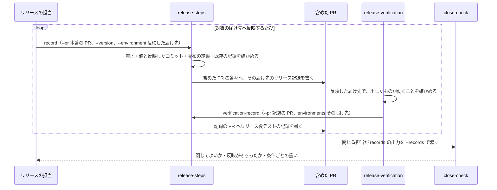

# 課題を閉じる条件の除外と、バージョン番号の無いリリースの記録

## 概要

NDF を使うリポジトリは、課題を閉じる条件の 2 つ（リリース後テストの記録と、課題の本文の「振り返り:」の行）を、`.ndf/project.json` の `workflow.close` で理由つきで外せる。
バージョン番号を持たないリポジトリ（`branch_strategy.release.version_store.kind` が `none`）は、出したコミットを指す値（例: `main abc1234`）でリリース記録とリリース後テストの記録を届け先ごとに書き、その記録で課題を閉じる。

- 設定を書かないリポジトリでは、課題を閉じる条件は変わらない
- 不合格のテストの記録がある課題は、どの設定でも閉じない
- 判定は手順書を読む AI でなくコマンド（`ndf records close-check`・`ndf release-steps record`・`ndf release-steps records`）が行い、実行ごとに結果がぶれない

この文書は、課題 [開発の流れをプロジェクトの設定で選べるようにする](https://github.com/devbasex/ai-plugins/issues/4580) （#4580）のうち、1 回目のリリース（PR [#4628](https://github.com/devbasex/ai-plugins/pull/4628) ）で入った部分の仕様である。

## この仕様の今の状態

**リポジトリの種類の既定（`workflow.kind`）・モードごとの工程の要否（`workflow.modes`）・設定の確かめが示す食い違い・種類ごとの流れの文書は、まだ実装されていない。**
これらは 2 回目のリリースとして、課題 [種類の既定・モードごとの工程の要否・設定の確かめ・流れの文書](https://github.com/devbasex/ai-plugins/issues/4657) （#4657）で実装する。
承認済みの設計（`issues/issue-4580-design.md`・`issues/issue-4580-design-detail.md`・`issues/issue-4580-design-release-records.md`）と実装計画（`issues/issue-4580-plan.md`）は #4657 が使うため、まだ消さない。#4657 の確定仕様化で、この文書へ 2 回目の分を書き足し、設計と計画を消す。

今のスキーマ（`plugins/ndf/contracts/schemas/project-workflow.schema.json`）は、流れの設定として `stages` と `close` だけを受ける。`kind` と `modes` を書くと形の誤りになる。

## 用語

用語の定義は用語集（`docs/glossary/glossary.json`。表示は `docs/glossary.md`）にある。この文書で使う語は次のとおりである。

| 用語 | この文書での意味 |
| --- | --- |
| 流れの設定 | `.ndf/project.json` の `workflow` のうち、スキーマで `x-ndf-flow` が真の項目（今は `stages` と `close`）。書くのは利用者だけで、NDF は書き換えない |
| 値 | 記録の項目 `version` に入るもの。バージョン番号を持たないリポジトリでは出したコミットを指す値（例: `main abc1234`）、持つリポジトリではバージョン番号である |
| 届け先 | `branch_strategy.release.deliveries` の要素 1 つ。本番の届け先は、`channel` が `production`・省略・`null` で、`production` が `false` でないものをいう。手動の届け先（`kind: manual`）も含む |
| 本番の PR | 本番ブランチへマージした PR |
| 含めた PR | 本番の PR と、そのマージに含まれた作業の PR。リリース記録を書く先である |
| 記録の PR | 含めた PR のうち番号が最も小さい 1 本。リリース後テストの記録の書き先で、閉じる担当の読み先である |
| 反映したコミット | 本番の PR が本番ブランチへ入れたコミット（マージのコミットか、`strict` の squash では `--production-sha`）。記録の `commit` に 40 文字で入る |
| push の `after` | 反映したコミットを本番ブランチへ入れた 1 回の push の、更新の後のコミット。merge queue が複数の PR を 1 回で入れると push の先端になる |
| 正の `targets` | その値の今回の対象の届け先の一覧。記録の PR にある信用する書き手の訂正の記録のうち最後のものの一覧、訂正が無ければ同じ値の最初の有効なリリース記録の一覧 |
| 信用する書き手 | 対象のリポジトリで write 以上の権限を持つ書き手 |

## 背景

バージョン番号を持たない Web サービスのリポジトリでは、NDF の手順が ai-plugins の形（バージョン番号を持つプラグインの配布）を前提にしていたため、スプリントを最後まで進められなかった。
リリース記録は、本番へマージした PR の head がリリースブランチの名前のときだけ書かれ、バージョンもブランチの名前から読んでいた。そのためリリース後テストの記録も書けず、課題を閉じる判定が読むものが無かった。
また、リリース後に確かめる対象が配ったプログラムでなく反映した環境であるリポジトリでは、決まった形のテストの記録と振り返りの行を必ず求める閉じる条件を満たせなかった。

主な決定と理由は次のとおりである。

| 決定 | 理由 |
| --- | --- |
| 流れの設定は今の `.ndf/project.json` の `workflow` に足す | 工程の要否（`workflow.stages`）と同じ場所に置き、同じ事実を 2 つのファイルに分けない |
| 外した条件は `close-check` が設定を読んで返す | 手順書に「設定を読む」と書くだけでは、読み方が実行ごとに変わり、テストで確かめられない |
| 外せるのは 2 つの条件だけで、渡した記録の不合格は外せない | 確かめていないことを済んだと記録しない |
| バージョンの無いリリース記録は `release-steps record --version` が、値と届け先の反映を確かめてから書く | 値を照合せずに受けると、別の変更を指す値でも書けてしまう |
| 記録は届け先ごとに書く | 段階的に配るとき、先に反映した届け先のテストを最後の届け先まで待たせない。記録を置き換える形では、並行して足すと片方の届け先が消える |
| CD の結果と対象の届け先は、反映したコミットを入れた 1 回の push に結び付ける | CD は push ごとに起動する。PR ごとのコミットや後の push の実行で読むと、CD が実際に配ったものと食い違う |
| 対象の一覧の訂正は前の記録を消さず、訂正の記録を足す | どの一覧で何を判定したかを後から追えるようにする |

## 対象範囲

| 対象 | 変わること |
| --- | --- |
| `ndf records close-check` | `workflow.close` を読み、条件ごとの扱いとテストで確認できたかを返す。任意の `--records` を受ける |
| `ndf release-steps record` | 任意の `--version`・`--environment`・`--target`・`--observed`・`--correct-targets`・`--reason` を受ける |
| `ndf release-steps records` | 任意の `--version`・`--release`・`--unit`・`--bodies`・`--issues`・`--pr-body-only` を受ける |
| `ndf release-steps verification-record` | 記録に任意の `environments`・`unit` と、行ごとの `retest_reason` を持てる |
| 設定のスキーマ | `workflow.close`、届け先の `paths`・`observe`・`result.env` |
| 手順書 | `progress-tracking`（閉じる条件とスプリントを閉じる手順）・`release`（`references/release-steps.md`）・`release-verification`・`development-workflow`（`references/parallel.md`） |

対象外: リポジトリの種類の既定、モードごとの工程の要否、`ndf project check` の食い違い、`ndf progress new` の変更、種類ごとの流れの文書（#4657）。本番へのマージに承認が要るかの判定（[#4579](https://github.com/devbasex/ai-plugins/issues/4579) ）。結果 JSON の `product_version` と記録の `version` の形（[バージョン番号の無いリポジトリでデプロイの工程を終える](ndf-release-deploy-without-version-number.md) 、#4513）。

## 仕様

### 構成要素と責務

| 要素 | 責務 |
| --- | --- |
| 流れの設定の読み取り（`plugins/ndf/src/ndf/progress/flow.py`） | `workflow` をスキーマで検査して読み、閉じる条件ごとの要否と理由を返す。条件の名前と `--require` が求める条件は、スキーマ（`x-ndf-require-flag`）から読み、コードに持たない |
| 閉じる判定（`domains/records/close_decide.py`・`domains/records/cli.py`） | 条件ごとの扱い（`conditions`）、テストで確認できたか（`verified`）、反映の判定（`release`）を返す |
| リリース記録の判定（`domains/release/record_decide.py`） | 記録の読み取り、値とコミットの組、正の `targets`、行の判定、テストする組の判定。GitHub・git・HTTP を呼ばない |
| バージョンの無い記録の書き込み（`domains/release/record_unversioned.py`） | 確かめ 1〜8 と書く順、対象の一覧の訂正 |
| 届け先ごとの反映の確かめ（`domains/release/delivery_confirm.py`） | push の時点の届け先の設定の読み取りと分類、CD の結果の照会、結果を読むコマンドの実行、実環境の確認、待ち |
| 前処理の共有（`domains/release/record_share.py`） | 届け先ごとに並べて打った `record` の間で、着地・push・設定・差分を共有する |
| 閉じる手順の読み取り（`domains/release/record_read.py`） | 書き手の権限を確かめ、今回のリリースの記録と本文だけを選ぶ |
| 権限の照会（`adapters/github.py` の `permission_strict`・`trusts_strict`） | 照会できない書き手を「権限が無い」と扱わず、例外（`PermissionUnknown`）で返す |

### 常に成り立つ条件

| 条件 | 破れたときの扱い |
| --- | --- |
| 不合格の行がある課題は、どの設定でも閉じない | `close-check` が閉じないと返す |
| 条件を外す指定（`required: false`）は理由を持つ | 形の誤り。`close-check` は `precondition` で閉じない |
| NDF のコマンド（`project write`・`branch-strategy` の書き出し）は、利用者が書いた `workflow` を保持する | テストが落ちる |
| 流れの設定が無く `--records` を渡さなければ、バージョンを持つリポジトリの `close-check` の判定は変更の前と同じである | テストが落ちる |
| 値とコミットは、記録の PR の中で 1 対 1 に対応する | 対応を崩す記録は無効にし、どの判定にも数えない |
| 1 つの値の対象の届け先の一覧は 1 つに決まる（正の `targets`） | 正と違う `targets` の記録は書かないか、書いても数えない |

### 閉じる条件の除外

`workflow.close` は条件ごとに `required` を持つ。`false` なら `reason` が要る。省いた条件は `required: true` と同じである。

```json
{
  "workflow": {
    "close": {
      "release_verification": {"required": false, "reason": "反映した環境は監視で確かめる"},
      "retrospective_line": {"required": false, "reason": "振り返りは週次の会で行う"}
    }
  }
}
```

`close-check` は `outputs.conditions` に、条件ごとに次の 3 つを返す。閉じる担当は外した条件を閉じる報告に転記する。

| 項目 | 決め方 |
| --- | --- |
| `excluded` | `required` が `false` なら真 |
| `reason` | 外したときの理由。外していなければ `null` |
| `enforced` | `release_verification` は、`--require` があり `excluded` が偽のときだけ真。`retrospective_line` は `excluded` の否定 |

`required: true` でも `--require` を足さない。呼び出し元が `--require` を付けるのはリリース後テストを通る経路だけで、設定だけを理由に記録を求めると、記録が作られない経路（`light` など）で課題を閉じられなくなるためである。

条件を外しても、渡した記録の不合格は閉じず、保留（`not_run`）は人が決める。テストの記録を外しても、手順書は既存の記録を取得して渡す。`retrospective_line` の行を確かめるのは手順書の AI で、`close-check` は「求めるか」までを返す。

`progress-tracking` の「閉じる条件」の条件 3（最終工程の記録がある）にも同じ除外を当てる。

| 外した条件 | 免除するもの | 引き続き確かめるもの |
| --- | --- | --- |
| `release_verification` | テストの記録の存在。最終工程が「リリース後テスト」なら条件 3 の記録の存在も | リリース記録、渡した記録の不合格と保留 |
| `retrospective_line` | 条件 3 の「振り返り:」の行だけ | リリース記録、テストの記録の条件 |

### close-check の判定

`close-check` は記録を次のどれかで受ける。両方を渡すと `precondition` である。

| 渡すもの | 使う経路 |
| --- | --- |
| `--verification <テストの記録の JSON>` | バージョンを持つリポジトリだけ。バージョンの保存先が `none` なら `precondition` で、`--records` を渡すよう示す（1 件のテストの記録からは、どのリリースか、対象の届け先のすべてに反映とテストがそろったかを確かめられない） |
| `--records <ndf release-steps records の出力>` | どちらのリポジトリでも使える。閉じる手順は普通こちらを使う |
| どちらも渡さない | デプロイを飛ばした経路。リリース記録が無いことを理由に閉じないとは返さない |

`verified` が真になる条件は次のとおりである。

| 渡したもの | 代表のリリース記録 | `verified` が真になる条件 |
| --- | --- | --- |
| `--verification` | — | 渡した記録にその課題の行があり、すべて合格 |
| `--records` | バージョン付き（`targets` を持たない） | 代表と `version`・`unit` が同じテストの記録のうち、記録の PR で最も後の 1 件にその課題の行があり、すべて合格。`release.complete` は `null` |
| `--records` | バージョンの無いもの（`targets` を持つ） | `release.complete` が真で、対象の届け先のそれぞれで、届け先と課題の組の判定が合格 |

バージョンの無い記録の判定は、悪い方を優先して次の順に決まる。

| 状態 | 判定 |
| --- | --- |
| リリース記録が無いか、`release.complete` が偽 | 閉じない |
| どれかの対象の届け先で、組の判定が不合格 | 閉じない |
| 不合格が無く、どれかの組の判定が保留 | 人が決める |
| その課題の行が無い対象の届け先があり、`enforced` が真 | 閉じない |
| その課題の行が無い対象の届け先があり、`enforced` が偽 | 閉じることを妨げない。`verified` は偽 |
| すべての対象の届け先で合格 | 閉じてよい。`verified` は真 |

`outputs.release` は `--records` を渡したときだけ値を持つ。

| 項目 | 決め方 |
| --- | --- |
| `complete` | 代表と `version`・`release`・`unit`・`commit` が同じで、`targets` が正の一覧と同じリリース記録の `environments` の和集合が `targets` を覆えば真 |
| `missing` | 反映の記録がまだ無い対象の届け先 |
| `unconfirmed` | 反映を CD の結果でなく、実環境の確認（`observed`）か申告（`attested`）で記録した対象の届け先と区分。閉じる報告に載せる |

受け入れ条件のチェックは、バージョンの保存先が `none` の経路と、`release_verification` を外した経路では、`verified` が真のときだけ付ける。偽なら付けず、閉じる報告に「テストで未確認」と書く。ほかの経路は変更の前と同じである。

#### 判定に使う行

届け先と課題の組の行は、投稿の順によらずに合わせて判定する。重なって起動したテストの結果が後から届いても、閉じる判定が変わらないようにするためである。`close-check` と `to_test` と `verification-record` は同じ規則を使う。

1. 組の行を古い順に並べ、最後に `retest_reason` を持つ行より前の行を捨てる
2. 残った行に不合格が 1 つでもあれば不合格
3. 不合格が無く、合格が 1 つでもあれば合格（保留は合格を打ち消さない）
4. 保留だけなら保留

`verification-record` は、組の今の判定が不合格なら、新しい行に `retest_reason` を求め、無ければ書かずに `precondition` で止まる。理由を書いてよいのは、不合格の原因がリリースした変更でなく検証の側（検証環境・接続・テストデータ）にあり、それが直ったときだけである。手で書かれた理由の無い合格の行でも、不合格は覆らない。

### バージョンの無いリリース記録の書き方

```bash
ndf release-steps record --pr <本番の PR> --production <本番ブランチ> --version "main abc1234" --environment web [--target web --target worker] [--observed web] [--production-sha <SHA>]
```

`--environment`・`--target`・`--observed` は繰り返せる。`record` は次の順に確かめる。確かめ 0〜7 は記録の PR・リポジトリ・push の記録だけで決まるので、CD を照会する確かめ 8 より先に行う。既存の記録だけで止まるか書かなくてよいかが分かる呼び出しでは、CD を照会しない。確かめ 0〜6 のどれかに当たれば、どの PR にも書かずに `precondition` で止まる。

| # | 確かめること | 止まるとき |
| --- | --- | --- |
| 0 | `--version` と `--environment` はそろえて渡し、バージョンの保存先が `none` のときだけ受ける | 保存先が `none` でないのに渡した。片方だけを渡した |
| 1 | 本番の PR が本番ブランチへ入ったか。マージ済みでなければ、`--production-sha` を `landed_squash` で正規の squash と確かめる | マージ済みでなく、`--production-sha` が無いか正規の squash でない |
| 2 | 値の中に、反映したコミットの SHA の先頭 7 文字以上と一致する 16 進の語がある | 一致する語が無い（止まる文に SHA を載せる） |
| 3 | 今回の対象の届け先（`targets`）を決める（下の「対象の届け先の決め方」） | push や push の時点の設定を読めない、`--target` の要否に合わない、`targets` が空 |
| 4 | `--environment` が `targets` の部分集合で、`--observed` が `--environment` に含まれる | 設定に無い名前か、`targets` の外の名前がある |
| 5 | 今回の `targets` が正の `targets` と同じ（記録がまだ無ければ今回の一覧が正の候補） | 違う（止まる文に正の一覧と訂正の打ち方を載せる） |
| 6 | 値とコミットが 1 対 1 に対応する（下の「値とコミットの組」） | 同じコミットの記録が別の値で、または同じ値の記録が別のコミットで既にある |
| 7 | 届け先ごとに、同じ値・正の `targets` の記録が含めた PR のすべてに既にあるか | 止まらない。すべてにあれば `kept` に載せ、照会も書き込みもしない |
| 8 | 残った届け先ごとに、反映を何で確かめたか（`confirmation`）を決める（下の「届け先ごとの反映の確かめ」）。届け先ごとの判定は互いに待たない | 止まらない。失敗は `failed`、未確定は `pending` に載せる |

リリース記録は含めた PR の各々に書き、テストの記録は記録の PR にだけ書く。作業の PR は今の `record` と同じ規則で読み、リリースブランチの組み立て（`release-steps assemble`）を通ったときはコミットのメッセージの `Ndf-Included-Pulls:` の行から読む。

#### 対象の届け先の決め方

`record` は、作業ツリーでなく配布した時点の届け先の設定で、対象・確かめ方・結果を読むコマンドを決める。CD が実際に動いたのはその時点の設定であり、作業ツリーの設定で決めると、設定を外した後に、外す前に CD が失敗した届け先を `--target` で反映済みと記録できてしまうためである。

1. 記録の PR の同じ値の信用する記録が `push` を持てば、その push の `after` の設定を読む
2. 持たなければ、`git log --first-parent --sparse --no-follow --diff-merges=first-parent ... <反映したコミット>..<本番ブランチの先端> -- .ndf/project.json` の 1 回で、先端までの第一親の履歴と設定のファイルを変えたコミットを読み、`git cat-file --batch` の 1 回で反映したコミットとそれらのコミットの時点の設定を読む。先端から反映したコミットまで第一親の履歴がつながらなければ（追跡参照が古い、浅い clone で切れている）、`git fetch <リモート> +refs/heads/<本番ブランチ>:refs/remotes/<リモート>/<本番ブランチ>`（浅い clone なら `--unshallow`）を示して止まる
3. どれかの時点に届け先の設定があれば、push を決めてその `after` の設定だけで決める。push の時点に設定があれば `--target` を受けない
4. どの時点にも設定が無ければ、push を読まず、`--target`（1 つ以上が要る）の集合を `targets` にする

push は、GitHub のリポジトリのアクティビティ（`GET /repos/{owner}/{repo}/activity?ref=refs/heads/<本番ブランチ>`）を新しい順に読み、`after` が反映したコミットから先端までの第一親の集合にあり、`before` がその外にある更新として決める。見つからなければ止まり、追跡参照を取得してから打ち直すか、push の直後なら時間を置いて打ち直すよう示す。見つけた push の `before`・`after` は記録の `push` に残す。

push の `after` の設定は、次の 5 つに分ける。分ける規則は `delivery_confirm.py` の 1 か所にある。

| 読んだ結果 | 扱い |
| --- | --- |
| push の `after` が手元に無い | `precondition`。本番ブランチを取得してから打ち直す |
| 設定が無い（`branch_strategy` か `release.deliveries` が無い場合を含む） | `--target` で受ける |
| 読めない、または予約した名前の誤り以外の形の誤りがある | `precondition`。この push の記録は書けず、課題は人が確かめて手で閉じる |
| 形の誤りが、`result.env` の予約した名前だけ | 止まらずに読む。その届け先は `result.command` を実行せず、`--observed` でだけ記録できる |
| 誤りが無い | そのまま使う |

`targets` は、本番の届け先のうち、`paths` を持たないものと、次の 2 つの差分の両方に出るパスが `paths` のどれかに当たるものである。本番の PR が変えたものを、CD が起動した push の差分の中で配ったときだけ対象にするためである。

| 差分 | 起点 | 終点 |
| --- | --- | --- |
| 本番の PR の差分 | 本番の PR をマージする直前の本番ブランチの先端（反映したコミットから第一親を、同じ PR に紐づくコミットが続く間たどった下の第一親） | 反映したコミット |
| push の差分 | push の `before` | push の `after` |

差分は `git diff --name-only -z --no-renames` で読み、移動したファイルは前と後の両方のパスを使う。パスと `paths` は git の pathspec の `:(glob)` と同じ規則で照らす。同じ push の中で後の PR が変更を打ち消すと push の差分に出ないので、その届け先は対象にならない。PR のコミットの数は `GET /pulls/{番号}` の `commits`、コミットに紐づく PR は GraphQL の `associatedPullRequests` を 100 件ずつまとめて読む。

リリース記録が示すのは「この PR の変更を含む push を、その届け先の CD が配った」ことまでで、変更が稼働している版に残っていることではない。それはリリース後テストが届け先と課題の組で確かめる。

#### 届け先ごとの反映の確かめ

| 届け先の状態 | `confirmation` | 扱い |
| --- | --- | --- |
| 結果を読む手段（`result`）があり、push の `after` の結果が成功 | `cd` | 書く |
| `result` があり、結果が失敗 | — | 書かず `failed` に載せる |
| `result` があり未確定。`--observed` で指定し、設定の `observe.url` の応答の JSON で `observe.pointer` が指す 1 つの値が push の `after` の SHA と一致する | `observed` | 書き、読んだ URL と値を `evidence` に残す |
| `result` があり未確定で、上に当たらない | — | 書かず `pending` に載せ、理由を届け先ごとに載せる |
| `result` が無い（手動など） | `attested` | 打つ人の申告として書く |

CD の結果は次のどちらかで読む。

- `result.workflow`: `gh run list --workflow <ファイル名> --branch <本番ブランチ> --commit <push の after> --event push`。イベントを `push` で絞り、同じ SHA の手動の実行の成功を根拠にしない
- `result.command`: `{revision}` を push の `after` の 40 桁の SHA に置き換えて実行する。終了コード 0 は成功、75 は未完了、1 は失敗、ほかは未確定である（契約は `plugins/ndf/skills/release/references/cd-setup.md` の「結果の読み方を決める」）

1 つの届け先の判定は、CD の結果を 1 回照会し、未完了で `--observed` があれば実環境の確認をすぐ 1 回試し、確かめられなければ間隔ごとに両方を続ける。上限は届け先の設定の `result.timeout_seconds`（無ければ時間の上限の表の `release-record.cd-wait`）で、1 回目の照会を始めた時刻からの期限を、照会・コマンド・HTTP の読み取り・待機のすべてに効かせる。`--environment` を 2 つ以上渡した呼び出しは待たず、未完了の届け先を `pending` で返す。待つときは届け先ごとに `record` を並べて打つ。

#### 値とコミットの組と正の `targets`

値とコミットは、記録の PR の信用する書き手のリリース記録の全体から、コメントの古い順に 1 対 1 の組を決める。値もコミットもまだ組になっていなければ組にし、そのままの組なら有効、どちらかが別の相手と組になっていれば無効にする。`main abc1234` と `main abc123456` のように同じコミットを違う長さの SHA で書いた値と、2 つの SHA を含む同じ値を別のコミットで書いた記録は、後に書かれた側が無効になる。無効な記録は、正の `targets`・重ねない判定・代表・`complete`・訂正の照合のどれにも数えない。

正の `targets` の元になる記録は、信用する書き手の記録だけを数える。権限を照会できない書き手の候補があれば、正を決めずに止まる。

#### 書く順

確かめ 8 で書けると決まった届け先ごとに、互いを待たずに書く。GitHub のコメントには条件つきの書き込みが無いため、重なりは書いた後の読み直しで戻す。

1. 記録の PR に、同じ値・同じ `environments`・正の `targets` の記録が無ければ書く
2. 記録の PR を読み直し、正の `targets` と値とコミットの組を決め直す。自分の記録が正と違うか無効になれば、自分のコメントを消し、ほかの PR へ書かずに止まる
3. 残りの含めた PR のうち、同じ記録が無い PR へ書く
4. 書いた PR を読み直し、自分より前に同じ記録があれば自分のコメントを消す

消すのは、その実行が書いたばかりのコメントだけである。消せなかったコメントは残るが、読み手（`records` と `close-check`）は同じ記録を 1 件として数え、正と違う記録と無効な記録を数えないので、判定も打ち直しも変わらない。

結果の `outputs.complete` は、確かめ 5〜7 で読んだ記録、手順 2 で読み直した記録、この実行が書いたか `kept` にした届け先を合わせて決める。並べて打った別の呼び出しが後から書いた記録も数え、記録がそろえば少なくとも 1 つの呼び出しの `complete` が真になるためである。

#### 対象の一覧の訂正

```bash
ndf release-steps record --pr <本番の PR> --production <本番ブランチ> --version "main abc1234" --correct-targets --target web --target worker --reason "worker の届け先を落としていた"
```

- 受けるのは、バージョンの保存先が `none` で、配布した時点に届け先の設定が無い値だけである（設定があれば一覧は設定で決まる）。`--environment` と `--observed` は受けない
- 記録の PR に信用する書き手の同じ値のリリース記録が要る。書く token の書き手も write 以上の権限が要る
- 確かめ 1・2・6 を通し、記録の PR にだけ訂正の記録（`version`・`commit`・新しい `targets`・前の `targets`・理由）を 1 件足す。前の記録は消さない
- 信用する書き手の最後の訂正が正になる。訂正の後は、反映済みの届け先を配り直さずに新しい一覧で `record` を打ち直す。前の一覧のときのテストの記録は、届け先が新しい一覧にあれば判定に使う

#### 前処理の共有

届け先ごとに並べて打った `record` は、push を読むときの前処理（反映したコミット・push・push の `after` の設定・2 つの差分のパスの集合）を、共通の git ディレクトリの下の `ndf/release-record/<本番の PR>.json` で共有する。共有で減るのは照会の回数で、経過時間は変わらない。

- 置き場の `kind` は `ndf-release-record.prefix/v1`。NDF は、この名前と `kind` の置き場だけを読み、書き直し、消す。利用者のファイルは消さない
- 並べて打った呼び出しは `filelock` でロックを取ってから読む。push を読まないと決めた結果は置き場に書かない
- 書くときは `ndf/release-record/tmp/` に `<本番の PR>.json.<16 進 16 文字>.ndf-tmp` を `O_CREAT | O_EXCL` で作り、書き終えてから `os.replace` で差し替える。一時ファイルを作れなければ、ロックを外して共有をやめる
- 置き場と一時ファイルは、読む前と消す前に、リンクでない通常のファイルかを確かめる
- `complete` が真になった呼び出しが置き場を消す。残った置き場と一時ファイルは、ロックを取れて、届け先の `result.timeout_seconds` の最大値（無ければ上の待ちの上限）より長く経っていれば、`record` の起動のたびに消す

### 閉じる手順の読み取り

閉じる手順（`progress-tracking` の「スプリントを閉じる」）は、記録の PR のコメントと含めた PR の本文を、書き手の権限を確かめる `ndf release-steps records` の 1 回で読み、その出力を `close-check --records` に渡す。

```bash
ndf release-steps records --pr <記録の PR> --version <値> [--unit <単位>] [--release <本番の PR>] --bodies
```

権限の照会の扱いは次のとおりである。今の `GitHub.permission` は 403・404 を `none` に変えるが、そのままでは照会に失敗した書き手の新しい不合格の記録が落ち、古い合格の記録で課題を閉じてしまうため、`records` は `permission_strict` を使う。

| 照会の結果 | `records` の扱い |
| --- | --- |
| 200 で `admin`・`maintain`・`write` | 信用する |
| 200 で `read`・`triage`・`none` | 信用しない |
| 403・404（レート制限によるものを除く） | 照会できない。記録を選ばず、書き手の名前を載せて失敗で返す |
| レート制限・ほかの失敗 | 失敗で返す |

OWNER は照会せずに信用し、MEMBER・COLLABORATOR は照会し、ほかの区分は照会せずに信用しない。照会するのは今回のリリースの判定に使うものの書き手だけで、関係の無いコメントの書き手を照会できないことで閉じられなくなることは無い。

`records` は次の順に読む。

1. 記録の PR のコメントのうち、リリース記録・テストの記録・訂正の記録のマーカーを持つものを候補にする。形の誤った候補は照会せずに除く
2. バージョン付きの記録とテストの記録は、渡した `--version`・`--release`・`--unit` が一致する候補だけを残す
3. バージョンの無い記録は、`--version` の値の記録を起点に、信用を確かめた記録と値かコミットを共有する記録だけを広げて集め、値とコミットの組と値ごとの正の `targets` を決めてから、`--version`・`--release`・`--unit` で絞る
4. 訂正の記録は、組のコミットと一致し信用する書き手のものだけで正の `targets` を置き換える
5. 代表を 1 件選ぶ。バージョンの無い記録は正の `targets` と一致する記録の最後の 1 件、バージョン付きの記録は最後の 1 件である
6. `--bodies` があれば、代表の `included` の PR ごとに本文を読み、書き手を照会して `trusted` を付ける

出力に足す項目は、代表と同じ `version`・`unit` の有効なリリース記録（`releases`）、正の一覧（`targets`）、本文（`bodies`）、テストを始めてよい組（`to_test`）である。手順は信用しない本文（`trusted` が偽）から課題を集めず、その PR を報告に載せる。

| 引数 | 振る舞い |
| --- | --- |
| `--issues <課題>...` | 含めた PR の本文を読まず、渡した課題で `to_test` を作る |
| `--pr-body-only` | リリース記録を選ばず、`--pr` の PR の本文だけを `trusted` つきで返す。デプロイを飛ばした経路で使い、`--version`・`--release`・`--unit`・`--bodies`・`--issues` とは一緒に渡せない |

`to_test` に入るのは、反映の記録がある対象の届け先と信用する本文の課題の組のうち、判定が「行が無い」か「保留」の組である。合格の組と不合格の組は入らない。不合格の組は、直した変更を出した次のリリースで確かめる。

### 処理の流れ



| 進め方 | 記録する人 | `complete` が偽のとき | `complete` が真のとき |
| --- | --- | --- | --- |
| スプリントを 1 つだけ進める | デプロイ担当の worker | 反映した届け先のテストを始め、残りの届け先の反映を続ける | デプロイの工程を終える |
| 複数のレーンをまとめて本番へ出す | オーガナイザー | 反映した届け先のテストを始める。`ndf lanes release` は打たない | `ndf lanes release` で各レーンへ知らせる |

デプロイの工程を終える（レーンへ知らせる）のは、`complete` が真になり、デプロイの工程が始めたテストがすべて記録を書いた後だけである。知らせを受けたレーンの工程（リリース後テスト・振り返り・課題を閉じる）は、レーンの conductor が進める。打つ時点・組の引き方・担当の引き継ぎの手順は、`release` の `references/release-steps.md`、`release-verification` の「テストする組の引き方」、`development-workflow` の `references/parallel.md` にある。

## データ・設定

### 流れの設定（`.ndf/project.json` の `workflow`）

形は `plugins/ndf/contracts/schemas/project-workflow.schema.json` が持ち、`plugins/ndf/contracts/schemas/ndf-settings/project.schema.json` と `plugins/ndf/skills/development-workflow/schemas/project.schema.json` から参照される。

| 項目 | 値 | 省いたとき |
| --- | --- | --- |
| `stages` | 工程の名前 → `enabled` と理由（変更の前と同じ） | 変更の前と同じ |
| `close.release_verification` | `required` と、`false` のときの `reason`。`x-ndf-require-flag` が真で、`--require` が求める条件 | 求める |
| `close.retrospective_line` | 同上 | 求める |

### 届け先の設定に足した項目（`branch_strategy.release.deliveries[]`）

| 項目 | 値 |
| --- | --- |
| `paths` | その届け先の CD が配るパスの glob の一覧（`:(glob)` の書き方）。無ければ毎回対象 |
| `observe.url` | その届け先で稼働している版を JSON で返す、認証の要らない URL |
| `observe.pointer` | 応答の中で稼働している版のコミットの SHA を持つ項目の JSON Pointer（RFC 6901） |
| `result.env` | `result.command` に渡す環境変数の名前の配列。`GH_TOKEN`・`GITHUB_TOKEN`・`GH_ENTERPRISE_TOKEN`・`GITHUB_ENTERPRISE_TOKEN`・`SSH_AUTH_SOCK` と `GIT_`・`NDF_` で始まる名前は形の誤り（規則「`result.env` の予約した名前」） |

### 記録の項目

リリース記録（マーカー `<!-- ndf:release-record -->`）は、バージョンの無いリポジトリでは `version`・`release`・`included`・`unit` に加え次を持つ。バージョン付きの記録はこれらを持たない。

| 項目 | 意味 |
| --- | --- |
| `environments` | この記録で反映を確かめた届け先（普通は 1 つ） |
| `targets` | 今回の対象の届け先の一覧 |
| `commit` | 反映したコミットの 40 文字の SHA |
| `push` | 反映したコミットを入れた push の `before`・`after` |
| `confirmation` | 届け先 → `cd`・`observed`・`attested` |
| `evidence` | `observed` の届け先 → 読んだ `url` と `value` |

リリース後テストの記録（`plugins/ndf/contracts/schemas/release-verification.schema.json`）は、任意の `environments`（確かめた届け先）と `unit`（配布単位の名前）を持ち、課題の行ごとに任意の `retest_reason` を持つ。バージョンの保存先が `none` のリポジトリでは、`verification-record` は次のどれかに当たれば書かない（`precondition`）。

- `environments` が無い
- 同じ値のリリース記録（反映の記録）が無い届け先を含む
- `--pr` が記録の PR でない（正しい記録の PR の番号を `items` に入れて返す）
- 同じ値のリリース記録が配布単位を持つのに `--unit` が無い

## 外部連携

| 相手 | 使う所 |
| --- | --- |
| GitHub REST のリポジトリのアクティビティ（`GET /repos/{owner}/{repo}/activity`） | 反映したコミットを入れた push を決める |
| GitHub REST の PR（`GET /pulls/{番号}`）と GraphQL の `associatedPullRequests` | 本番の PR の差分の起点 |
| GitHub REST の権限（collaborators の permission） | 書き手の信用 |
| GitHub のコメントの投稿と削除 | 記録の書き込み、重なりの戻し |
| `gh run list` | `result.workflow` の CD の結果 |
| 届け先の `observe.url`（HTTP） | 実環境の確認 |
| git（`log`・`cat-file --batch`・`diff`・`rev-list`・`worktree`） | push の時点の設定と差分、コマンドを動かす作業場所 |

## エラー処理

`record` の終わり方は次のとおりである。終了コードの値は `plugins/ndf/contracts/facts/exit-codes.json` が持つ。

| 確かめ 0〜6 | 確かめ 7・8 の後 | 状態（終了コード） | 呼び出し元の続き |
| --- | --- | --- | --- |
| どれかに当たった | — | `precondition`（3）。何も書かない | 止まる文に従って引数か記録を直す |
| 通った | `recorded` か `kept` が 1 つ以上 | `ok`（0）。`failed` と `pending` も載せる | テストを始める。`pending` の届け先はその届け先だけで打ち直す |
| 通った | 書けた届け先が無く `failed` がある | `refused`（1） | 反映の失敗として報告し、打ち直さない |
| 通った | すべて `pending` | `precondition`（3）。`items` に未確定の理由 | 結果が確定してから打ち直す |
| 通った | 投稿か自分のコメントの削除が失敗した | `unknown`（1）。待つ時間が分かるレート制限は `infra_wait`（75）。消せなかったコメントの URL を `items` に載せる | 正しい引数で打ち直す |

| 場合 | 打ち直したときの動き |
| --- | --- |
| 一部の PR への投稿が失敗した | 書けた PR は飛ばし、残りへ書く |
| 並行して打たれ、自分の `targets` が正でなかった | 自分のコメントは消えている。正の一覧で打ち直す |
| 同じ引数で 2 回打った | すべての届け先が `kept` になり、CD を照会しない |
| CD が失敗し、後の push で配り直した | 記録は失敗のまま。課題は人が確かめて手で閉じる |

`close-check` は、流れの設定が形に合わないとき、`--records` と `--verification` を両方渡したとき、保存先が `none` で `--verification` を渡したときに `precondition` で閉じない。`records` は、今回のリリースの書き手の権限を照会できなければ失敗で返し、閉じる手順はそれを「記録が無い」と扱わずに課題を閉じない。

## セキュリティ

- **閉じる判定は write 以上の権限を持つ書き手の記録と本文だけを根拠にする。** 権限の無い PR の作成者が本文に別の課題を閉じる指定を書いても、閉じる候補に入らない。正の `targets` と訂正も、信用する書き手の記録だけで決める
- **結果を読むコマンドは、レビューとマージを経たものだけを、照会に要る環境変数だけで動かす。** コマンドは `record` を打つ人の権限で動くためである

| 境界 | 決まり |
| --- | --- |
| コマンドの取得元 | push の `after` の設定の `result.command`。作業ツリーの設定は使わない |
| 作業ディレクトリ | push の `after` を取り出した一時の作業場所。`git -c core.hooksPath=/dev/null worktree add --detach` で作り、同じ指定の `worktree remove --force` で外す（`post-checkout` フックを起動しない） |
| 渡す環境変数 | `PATH`・`HOME`・`LANG`・`LC_ALL`・`TZ`・`TMPDIR` と `result.env` の名前だけ。予約した名前は渡さない |
| コマンドがしてよいこと | 配布の結果の照会だけ。照会の間隔ごとに打ち直されるため、配布を起動しない（宣言を書く人が守る契約で、cd-setup.md に書く） |

`HOME` の下の認証のファイルはコマンドから読める。照会だけの権限の認証情報を使うかは、設定を書く人が決める。

## 運用

- **互換を壊す変化が 1 つある。** バージョンの保存先が `none` のリポジトリで `close-check --verification` を打つ呼び出しは、流れの設定の有無によらず `precondition` で止まり、`--records` へ移す必要がある。NDF の手順書は移した。NDF を呼ぶ別のリポジトリの Web サービス（Neural Development Factory）の呼び出しの移行は、別の課題で扱う
- 新しい引数と記録の項目はどれも任意で、使わなければ変更の前と同じに動く。結果に足した項目は今の項目を変えない
- 段階的に配るリポジトリは、届け先の設定（`paths` を含む）を書くと `targets` が設定から決まり、`--target` の打ち間違いが起きない
- GitHub のアクティビティに push が載るまでの遅れの大きさは未確認である。載る前に打つと `record` は止まり、時間を置いた打ち直しを示す
- `record` の照会は、CD の結果の照会（届け先ごとに 1 回以上）、書き手の権限の照会（同じ実行の中で 1 人 1 回）、push の読み取り（設定があるときだけ）、書いた後の読み直し（書いた PR だけ）の分だけ増える。同じ引数の打ち直しでは CD も push も読まない
- 切り戻し: 足した引数と項目は任意なので revert しても既にある記録は読める。ただし前の版の `records` はバージョンの無い記録（`targets` を持つ）を読み飛ばすので、その課題は人が確かめて手で閉じる

## テスト観点

| 観点 | 確かめる振る舞い |
| --- | --- |
| 設定が無いときの互換 | 流れの設定が無いリポジトリで、`close-check` の判定（`--require` の有無・`--verification` の不合格と保留）と、バージョン付きの `record`・`records`・`verification-record` の結果が変更の前と同じ |
| 条件の除外 | `release_verification` を外すと、記録なしで `--require` を付けても閉じてよいと返し、`excluded` が真・`enforced` が偽で理由が載り、`verified` は偽。省略と `required: true` では `--require` の有無どおり |
| 振り返りの行の除外 | `retrospective_line` を外すと `enforced` が偽で理由が載る |
| 外しても不合格は閉じない | 両方を外した設定で、不合格の `--verification` と、不合格を含む `--records` が閉じないと返す |
| 理由の必須 | 理由の無い `required: false` は形の誤り |
| 設定の保持 | `close` を持つ `workflow` を、`project write` と `branch-strategy` の書き出しが保持する |
| 閉じる手順の経路 | 保存先が `none` で `--verification` を渡すと `precondition`。どちらも渡さない呼び出しは、リリース記録が無いことで閉じないとは返さない |
| 読み取りと権限 | 候補の書き手の照会が 403・404 なら失敗。候補でない書き手は照会しない。`read` の書き手の候補は除いて続ける。信用しない本文は `trusted` が偽。正と違う記録が最後にあっても正の記録を代表にする。`--version`・`--unit` で選ぶ。`--pr-body-only` は `--pr` の本文だけを返す |
| テストの記録 | `environments` が無いか反映の記録が無い届け先を含むと書かない。記録の PR でない PR を渡すと記録の PR を返す。不合格の組の再テストは `retest_reason` が要る |
| 閉じる判定 | 課題の行が無い届け先があれば `--require` で閉じない。別の課題だけの再テストの記録で、その課題の不合格が覆らない。バージョン付きの記録では `complete` が `null` で、最後の 1 件で `verified` を決める |
| 判定に使う行 | 投稿の順によらず不合格を優先し、保留は合格を打ち消さず、`retest_reason` の行より前を捨てる |
| `record` の引数と着地 | 保存先が `none` でないと `--version` を断る。SHA を含まない値は書かない。`strict` の squash は `--production-sha` で書ける。含めた PR の各々へ書き、打ち直しで重ねない |
| 対象の届け先 | `production: false`・設定に無い名前・`targets` の外の名前は書かない。`paths` に当たらない届け先は対象外。rebase の PR は最初のコミットで変えたパスも当たり、途中で戻したパスは当たらない。移動の前のパスも当たる。日本語のパスも当たる。設定が無いのに `--target` が無ければ書かない |
| push と設定の時点 | merge queue がまとめて入れた途中の PR は push の `after` の CD の結果で書ける。手動の実行の成功では書かない。作業ツリーの設定を書き換えても実行するコマンドは変わらない。追跡参照が古いか浅い clone で切れていれば止まる |
| 反映の確かめ | CD の失敗は書かない。未確定で `--observed` が無ければ書かない。`observe.pointer` の値が一致すれば書き `evidence` を残し、応答のほかの場所の SHA は数えない。2 つの届け先の一方だけ完了なら `recorded` と `pending` に分ける |
| コマンドの境界 | 予約した名前を渡さない。フックを起動しない。予約した名前の誤りだけの設定は止まらずに読み、その届け先は `--observed` でだけ書ける |
| 並行と打ち直し | 同じ引数の 2 回を並行させても各 PR に 1 件だけ残る。違う長さの SHA の値を並行させると後の側が自分のコメントを消す。一部の投稿の失敗の後の打ち直しで残りへ書ける。並べて打った呼び出しの `complete` のどれかが真になる |
| 訂正 | 訂正は記録の PR に足し、前の記録を消さない。設定のあるリポジトリと記録の無い値では止まる |
| 前処理の共有 | `kind` の違うファイルと利用者のファイルを消さない。FIFO で止まらない。一時ファイルを作れなければ共有をやめて前処理する。期限切れの掃除はロックを取れたときだけ消す |
| テストする組 | `to_test` に行の無い組と保留の組が入り、合格と不合格の組は入らない。`--issues` では本文を読まない |

## 関連リンク

- 課題: https://github.com/devbasex/ai-plugins/issues/4580 （1 回目のリリース分の PR: https://github.com/devbasex/ai-plugins/pull/4628 ）
- 2 回目のリリース分: https://github.com/devbasex/ai-plugins/issues/4657
- 手順書: `plugins/ndf/skills/progress-tracking/SKILL.md`（閉じる条件・スプリントを閉じる）、`plugins/ndf/skills/release/references/release-steps.md`（バージョン番号を持たないリポジトリで届け先ごとに記録する）、`plugins/ndf/skills/release-verification/SKILL.md`（テストする組の引き方）、`plugins/ndf/skills/release/references/cd-setup.md`（結果の読み方を決める）
- 関連する確定仕様: [ndf-release-deploy-without-version-number.md](ndf-release-deploy-without-version-number.md)（デプロイの工程の値の形）、[ndf-production-release-record.md](ndf-production-release-record.md)（バージョン付きのリリース記録）、[ndf-post-release-records-close-gate-and-handoff-sections.md](ndf-post-release-records-close-gate-and-handoff-sections.md)（記録の PR と close-check の 3 つの判定）
