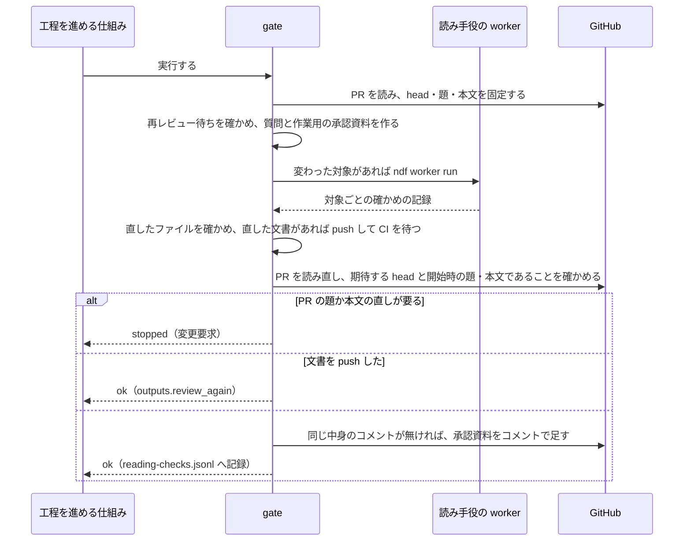

# 承認の前の確認: 承認資料と質問の文を、承認ゲートより前のステップで読み手役に確かめさせる

## 概要

**承認ゲートで示す承認資料と質問の文は、人に示す前に読み手役に読ませて記録する。** 読み手役は、文書を書いた経緯を知らずに、想定した読み手の立場で文書を読む AI である。確かめるコマンドは `ndf document-rebuild gate` で、どこで実行するかは承認の取り方で違う。

- 工程の中で人に承認を求める場合は、承認ゲートの直前の読み手役のステップ（種類 `reading`）で実行する。省略する条件は「工程の定義」にある
- 会話のセッションのリリースと、まとめたリリースでは、承認を求める担当が直接実行する

工程の承認ゲートでは、人に承認を求める担当は、資料も質問の文も書かず、読み手役も起動しない。提示の前に `ndf records reading check` で記録と突き合わせ、成功した場合に、そのコマンドが書き出した質問をそのまま出す。この担当は AI で、並列の計画（複数の開発の流れ = レーンを同時に進める仕組み）の下ではオーガナイザー、それ以外ではスプリントを進める AI（conductor）である。

工程の外の承認（会話のセッションのリリースと、まとめたリリース）では、承認を求める担当が承認資料の元を用意し、承認を問う直前に `gate` を実行する。読み手役は `gate` の中で起動される（下の「まとめたリリース」）。

例: 設計のステージは次の順に進む。

| 順 | ステップ | すること |
| ---: | --- | --- |
| 1 | 設計のプラン | 設計書を書き、組み直しの worker が読み手役に読ませる。読ませた文書は記録に残る |
| 2 | 設計のレビュー | 指摘を直す |
| 3 | `design-mvv` | MVV 判定をする。LLM が PR の本文と差分をプロジェクトの判断の基準（MVV）と突き合わせ、人に尋ねずに設計承認ゲートを通せるかを決める |
| 4 | `design-reading` | PR の本文を元に承認資料を作り、決まった形の質問の文と、前に読ませた後で変わった部分を読み手役に読ませる。承認資料の最終版を PR のコメントに足す |
| 5 | `design-gate` | 承認を求める担当が `ndf records reading check` で突き合わせ、質問を出す |

手順と書式の定義は次のファイルにある。この文書にはコピーしない。

| 何を | 定義があるファイル |
| --- | --- |
| 読み手役の対象・渡すもの・合否・回数・直し方、worker が承認資料を書いて読ませる手順 | [document-rebuild の SKILL.md](../../plugins/ndf/skills/document-rebuild/SKILL.md#承認の前の確認) |
| 承認を求める担当の手順、承認資料に載せる項目 | [approval-request.md](../../plugins/ndf/skills/development-workflow/references/approval-request.md#読み手役の確認) |
| オーガナイザーの質問とまとめたリリースの手順 | [parallel.md](../../plugins/ndf/skills/development-workflow/references/parallel.md) |
| 会話のセッションのリリースの承認の手順 | [release-steps.md](../../plugins/ndf/skills/release/references/release-steps.md) |
| 読み手役の worker への指示 | [document-rebuild-gate.md](../../plugins/ndf/contracts/worker/document-rebuild-gate.md) |
| 読み手役に読ませた記録（`reading-docs.jsonl`）の行のスキーマ | [reading-docs.schema.json](../../plugins/ndf/contracts/schemas/internal/reading-docs.schema.json) |

読み手役の確認の中身と、質問を止める hook `reading-check` は [ndf-writing-criteria-and-reading-check.md](ndf-writing-criteria-and-reading-check.md) が扱う。

## 用語

「読み手役」「承認資料」「承認ゲート」「版上げの PR」「まとめたリリース」「オーガナイザー」「conductor」「一時レーン」「MVV 判定」の定義は、用語集（[docs/glossary.md](../glossary.md)）にある。この文書では、次の語を次の意味で使う。

| 語 | 意味 |
| --- | --- |
| gate のサブコマンド | `ndf document-rebuild gate` |
| 読み手役のステップ | 工程の定義の種類 `reading` のステップ（`design-reading`・`release-reading`） |
| 承認を求める担当 | 人に承認を尋ねる AI。並列の計画の下ではオーガナイザー、それ以外では conductor |
| PR の本文の経路 | `--material` を渡さない実行。承認資料は PR の本文を元に作る |
| `--material` の経路 | 承認資料のファイルを引数で受ける実行（会話のセッションのリリースとまとめたリリース） |
| 確認 | gate か組み直し（`ndf document-rebuild run`）の 1 回の実行で読ませたまとまり。id を持ち、終えると完了の行が付く |
| 残った文 | 読み手役が 2 回目の確認で「判断や作業を誤らせる文」として挙げた文（1 回目に挙げたかは問わない）と、前の確認から引き継いだ文 |
| 変更要求（`sent_back`） | PR の題か本文を直さないと通じないときに、gate が承認を求めずに工程を止めること。承認する人が回答として返す変更要求（`request_changes`）とは別である |

## 背景

従来は、承認を求める担当が提示の直前に読み手役を起動していた。通じない文が承認の直前に見つかり、承認を求めては変更を求められる往復が増えていた（ https://github.com/devbasex/ai-plugins/issues/4446 ）。承認を求める担当が提示の直前に質問の文を書いていたため、質問の確認記録を事前に用意できなかった。

## 対象範囲

含む: 設計承認ゲートとリリース承認ゲートの承認資料と質問の文の確認、その記録と突き合わせ、まとめたリリースの承認の経路、会話のセッションのリリースの承認の証跡。

含まない: 判断の質問（`ndf-ask:`）の確認（質問を出す AI が読ませる）、読み手役の合否と回数の決まり、hook の判定の条件、承認ゲートの数と位置、PR を伴わない承認。

## 仕様

### 構成要素と責務

パスは `plugins/ndf/` からの相対で書く。

| 要素 | 責務 |
| --- | --- |
| `src/ndf/domains/docrebuild/gate.py`・`gate_decide.py` | gate の 1 回の実行と、その判断の部品（ファイル・git・GitHub を触らない） |
| `src/ndf/domains/docrebuild/drive.py` | 組み直し（`run`）で読み手役が読んだ文書を、読ませたものの記録へ書く |
| `src/ndf/domains/records/reading.py` | 承認の質問の組み立て、2 つの記録の読み書き、`check` の突き合わせ |
| `src/ndf/domains/records/pull_view.py` | PR の題・本文・head・変更量・コメントを 1 回の問い合わせで読み、コメントを足す（gate と `check` が使う） |
| `src/ndf/progress/`（`stages.py`・`model.py`・`run.py`・`folding.py`・`gate/`） | 読み手役のステップを実行するか決め、設計のレビューへの戻しと待ちの出し直しを行う |
| `src/ndf/domains/release/approval_decide.py`・`trail.py` | 会話のセッションのリリースの提示と回答を、資料のハッシュで結び付ける |

依存の向きは `docrebuild` → `records.reading` → `release.forms_decide` の一方向で、`ndf.progress` は gate を子プロセスのコマンドとして実行する（`reread` が古い定義で直接実行する場合も同じ）。

### 工程の中の位置

| 工程 | 読み手役のステップ | 位置 | モード |
| --- | --- | --- | --- |
| 設計のステージ | `design-reading` | `design-mvv` と `design-gate` の間 | `standard`・`legacy-refactor`・`documentation` |
| デプロイのステージ | `release-reading` | `release-mvv` と `release-gate` の間 | すべて |

工程を進める仕組みは、次の表を上から順に調べて、読み手役のステップを実行するか決める。省略したステップには出力が無い。

| 順 | 条件 | 扱い |
| ---: | --- | --- |
| 1 | 直前の MVV 判定が設計承認ゲートを省くと決め（下の条件）、そのゲートに待ちの記録が無い | 省略する |
| 2 | リリース承認ゲートの前で、スプリントが並列の計画のレーンの行にある（一時レーンの行を含む） | 省略する。そのリリースはまとめたリリースに入り、オーガナイザーが承認を問う直前に、版上げの PR を読み手役に読ませる（下の「まとめたリリース」） |
| 3 | ほか（レーンのスプリントの設計承認ゲートの前を含む） | 実行する |

- 「MVV 判定が省くと決めた」は、直前のステップの出力 `mvv_gate` が次のすべてを満たすことである: `gate` がこれから処理する承認ゲートと同じ、`skip` が `true`、レビューの保留 `holds` が空の配列。省けるのは設計承認ゲートだけで、リリース承認ゲートは MVV 判定では省かない
- 「待ちの記録」は、承認ゲートのステップが一度でも回答待ちになった記録である（回答の後に対象が変わって待ちへ戻した場合や `reread` を含む）。承認する人が変更要求を返して工程を最初から実行し直すと、数え直す
- 承認ゲートが MVV 判定の出力を探すときは、読み手役のステップを飛ばして、その直前を見る

### 承認する PR と承認資料

| どこで gate を実行するか | 承認する PR | 承認資料の元 | 資料の示し方 |
| --- | --- | --- | --- |
| `design-reading` | 作業場所のブランチの開いた PR（`--pr` があればそれ） | PR の本文のコピー | PR のコメント（gate が足す） |
| デプロイのステージの `release-reading` | 工程の入力の `pr`（`--pr` があればそれ） | 同上 | 同上 |
| 会話のセッションのリリースとまとめたリリース | `--pr` | `--material` のファイル | `ndf release-steps present` |

gate は PR の題と本文を書き換えない。`--material` の経路では入力のファイルも変えず、`--state-dir` の下の `material.md` を直す。

### 承認の質問の決まった形

質問の文は、ゲートの種類・PR の番号・PR の題から作る。リリース承認では、下の `<操作>` も使う。同じ値からは同じ質問になり、承認を求める担当は文を書かない。

| ゲート | 質問の文 | 選択肢 |
| --- | --- | --- |
| `design` | `設計 Pull Request #<番号>（<題>）をマージしてよいですか` | `承認する`・`変更を求める` |
| `release` | `リリースの Pull Request #<番号>（<題>）を承認し、<操作>してよいですか` | `承認する`・`変更を求める` |

`<操作>` は、リリースの形の表（[release-forms.json](../../plugins/ndf/contracts/domains/release-forms.json)）の列 `approve` の値である。承認すると何が実行されるかを、承認する人が質問から読めるようにする。形は `.ndf/project.json` の `branch_strategy.release.form` で決まる。形の設定が無いか、扱わない形なら、`gate` と `check` は `stopped`（`precondition`）で終える。

記録と質問は「質問のキー」で突き合わせる。キーは、質問の文・複数選択かどうか・選択肢の名前と説明（それぞれ前後の空白を除く）の SHA-256 である。リリースの方式の設定を変えて `<操作>` が変わると、キーも変わる。見出し（`header`）と区分はキーに含まない。

質問のファイルは `questions` だけを持ち、`metadata` を持たない。区分（`ndf-gate:1`・`ndf-gate:2`）は提示するときに足す。

### gate の 1 回の実行



1. **head・題・本文を固定する。** 解消していない再レビュー待ちの行があり、`--reviewed` がそのコミットを指していなければ、読み手役を起動せずに `outputs.review_again` を返す（必要なら push し、CI を待つ）。設計のゲートでは、作業場所の HEAD が PR の head と同じで変更が無いことを求める
2. **承認資料の作業用のファイルを作る。** PR の本文の経路では、前の確認が記録した head と本文のハッシュが今の head と本文とどちらも同じなら、前に読ませた資料のコピーを使う。違えば本文のコピーから始め、前に読ませた資料と違う部分を読ませる。コミットが足された PR に、古い head について書いた資料を使わないためである。PR の本文を使う場合も、`--material` でファイルを受け取る場合も、作業用のファイルには、PR へ書くときと同じように秘密などを伏せた本文を保存する。読み手役が読んだ本文、コメントに出る本文、回答が持つハッシュを同じにするためである。worker が伏せる値を書き足したら止める。`ndf release-steps present` も、伏せると変わる資料は提示せずに止める。`--material` の経路では、ファイルの最初の `提示したコミット:` の行を読み、固定した head と違えば止める（2 行目以降は読まない。行が無いか、値が 40 桁の SHA で始まらない場合も止める）
3. **読ませるものを決める。** 下の「読ませるもの」の表による。worker が直してよいファイルもここで決める
4. **worker に書かせて読ませる。** worker は素材のファイル `approval-facts.json`（URL・題・ベースと head・変更量・直前の MVV 判定）を使って判断の材料を書き足し、読み手役に読ませる。対象 1 件につき最大 2 回である。読ませる対象が無ければ worker を起動せず、手順 7 へ進む。この場合も、今回の確認として `reading-checks.jsonl` の行と完了の行を追記する
5. **確かめる。** 対象ごとに、最後に読ませた後で中身が変わっていないこと、worker が直してよいファイルの外を変えていないことを確かめる。worker の起動の前からある未コミットの変更は、中身が同じなら数えない
6. **直した設計 PR の文書を push する。** 再レビュー待ちの行を書いてから、コミットして push し（強制しない）、`ndf ci watch` で CI を待つ
7. **PR を読み直す。** worker を起動せず、push もコメントの追加もしない場合は読み直さず、手順 1 の取得を使う（最新の状態は、質問の前の `check` が確かめる）。読み直す場合の期待する head は、手順 6 で push していなければ手順 1 で固定した head、push していれば gate が push したコミットである。head が期待と違うか、題か本文が手順 1 から変わっていれば、止める
8. **変更要求にするか、コメントを足す。** 変更要求の条件に当たれば止まる。当たらず、PR の本文の経路で文書を push していなければ、承認資料の最終版（残った文があれば末尾に載る）をコメントで足す。直近の 100 件に同じ中身のコメントがあれば足さない。足す直前に、本文が参照するリポジトリの公開範囲を照会し直す。読み手役の実行中に参照先が非公開へ変わるなどして、伏せる所ができていれば、足さずに止める
9. **記録して返す。** 結果ごとに残すものは次の表のとおりである。上の行から順に行う

| 残すもの・返すもの | 承認へ進む（`ok`） | 文書を push した（`ok`） | 変更要求（`stopped`） |
| --- | --- | --- | --- |
| PR の承認資料のコメント | PR の本文の経路だけ足す | 足さない | 足さない |
| `reading-docs.jsonl` の読ませた行 | 書く | 書く | 書かない（`sent_back` の行だけを書く） |
| 承認資料のコピー | 置き換える | 置き換える | 置き換えない |
| `reading-checks.jsonl` の行 | 書く | 書かない | 書かない |
| `reading-docs.jsonl` の完了の行 | 書く | 書く（行の指紋と質問のキーは null） | 書かない |
| 返すもの | 下の「gate の引数と結果」の出力 | `outputs.review_again` と `outputs.check`（`fingerprint` は null） | 停止理由 `cause` |

読み手役を起動できないと、読み手役のステップと組み直しは `stopped`（`precondition`）で止まる。worker が自分で読み直して代わりにはしない。

### 読ませるもの

| 対象 | 立場 | 前の記録を引くキー | 比べる中身 | 読ませる範囲 |
| --- | --- | --- | --- | --- |
| 質問の文 | 承認する人 | リポジトリ・ゲート・PR | 質問のキー | 違えば全体 |
| 承認資料 | 承認する人 | リポジトリ・ゲート・PR | 残った文のセクションを除いた本文の SHA-256 | 初回は全体。違えば変わった段落とその前後（コピーが使えなければ全体） |
| 設計 PR の文書（要求仕様のコピー・設計書・詳細設計書） | エンジニア | リポジトリ・ブランチ・パス | 固定した head の blob | 初回は全体。違えば変わった段落とその前後（前の blob が手元に無ければ全体） |
| 実装計画 | — | — | — | 読ませない |

- 組み直し（`run`）の時点では PR が無いので、文書の行はブランチで引く
- 比べる元には、完了の行のある確認の行だけを使う
- 設計 PR の文書は、固定した head で通常ファイルで、作業場所でもシンボリックリンクを経由しない通常ファイルでなければ止まる。この条件は `--material` の入力ファイルには当てない（入力ファイルは作業ツリーの外にあってもよく、コミットされていなくてよい）
- `reading-checks.jsonl` の行の `reads` は、今回読ませなかった対象も含む。対象ごとに、完了の行がある過去の確認と今回の確認の読ませた行のうち、今の中身とハッシュが同じものを選び、その中で最も新しい確認の最後の結果を入れる

### 残った文

**残った文があっても、gate は `ok` で承認ゲートへ進め、残った文を承認する人に見せる。**

- 承認資料の末尾に、見出し「読み手役が残した文」のセクションを、記録の残った文から gate が作る。worker は書かない。前後に HTML コメントのマーカー（`ndf-reader-remained:begin`・`end`）を置く
- マーカーは誰でも書けるので、末尾の 1 組の中身が記録から作ったセクションと 1 字も違わないときだけ、読ませた本文から除く。違えばマーカーの行だけを消し、中の文は本文として読ませる
- 前の確認の残った文は、引用した文が対象に残っていて、今回読ませた部分の外にある間は、次の確認へ引き継ぐ
- 承認資料に載せる引用と理由は、PR へ書くときと同じように秘密などを伏せる。伏せて引用が変わった場合は、元の引用そのものは残さず、その SHA-256 と文字数を `reading-docs.jsonl` に残して、次の確認で対象の中を探すのに使う
- 結果 JSON の `items` に `reader-<番号>` で並ぶ

### 設計のレビューへ戻す

読み手役の指摘で設計 PR の文書を直したコミットは、設計のレビューを通るまで承認へ進まない。

- gate は `outputs.review_again`（コミットと文書のパス）を返す。工程を進める仕組みは、設計のレビュー・MVV 判定・読み手役のステップを未完了に戻し、設計のレビューから再開する
- 再レビュー待ちの行は push の前に書く。push か CI で止まって実行し直しても、レビューを飛ばせない
- 戻した後にレビューのステップが済んでいれば、仕組みは gate に `--reviewed <コミット>` を渡し、gate が行を解消する。判定は工程の記録の順序で行う
- push したコミットが PR にも作業場所のブランチにも無くなっていれば、行を取り消して先へ進む

### 変更要求（`sent_back`）

PR の本文の経路で、worker が PR の題の案を書いたか、承認資料の最終版が PR の本文からコピーした行を消すか変えたときは、gate は `stopped`（`precondition`）で止める。`cause.detail` に直す対象・指摘・直しの案のパスを載せる。書き足した判断の材料の直しは、変更要求にしない。同じ実行で設計 PR の文書も直していれば、push してから止まる。この場合は、次の実行がまず設計のレビューへ戻す。

PR の題と本文を誰が直すかは決めていない（工程を進めている AI 自身でもよい）。直した後に工程を再開すると、新しい worker の読み手役が変わった部分を読む。

### 往復の上限

設計のレビューへの戻しと変更要求は、別々に数え、どちらも 1 回までである。

| | 設計のレビューへの戻し | 変更要求 |
| --- | --- | --- |
| 数える元 | スプリントの工程の記録にある、同じ承認ゲートの戻しの記録 | `reading-docs.jsonl` の、同じリポジトリ・ゲート・PR の `sent_back` の行 |
| 数え直し | 承認する人が変更要求を返して工程を最初から実行し直すと数え直す | 数え直さない（記録を消さない） |
| 2 回目からの扱い | `--no-doc-fix` を渡し、worker は文書を直せない | worker は PR の題の案を書けず、PR の本文からコピーした行を直せない |

直せない対象も、読み手役は不合格なら 2 回目まで読む。2 回目の確認で挙げた文は、すべて残った文になる。工程を通さずに gate を手で実行する場合、戻しの上限は `--no-doc-fix` を渡したときだけ働く。

### 突き合わせ（`ndf records reading check`）

```text
ndf records reading check --gate <design|release> --pr <番号> [--material <ファイル>] --questions-out <ファイル>
```

`check` は PR を 1 回読み、その題で決まった形の質問を作り直して `--questions-out` のファイルへ書き、記録と突き合わせる。hook と同じ選び方（リポジトリと質問のキーが一致する最後の行）で `reading-checks.jsonl` の行を選び、行の指紋（行の JSON の SHA-256）で完了の行と結び付ける。完了の行の無い記録は使わない。

**承認を求める担当は、`check` の結果が `ok` の場合にだけ、`--questions-out` のファイルの質問を提示する。** 突き合わせに失敗しても質問のファイルは書かれるので、ファイルがあることは提示してよい根拠にならない。PR を読めない場合と質問を作れない場合は、ファイルを書かない。

| 返す語 | 条件 |
| --- | --- |
| `no_record` | 同じ質問の記録が無い（題が変わった場合を含む）か、行の指紋を持つ完了の行が無い |
| `no_pr` | 承認する PR が記録に無い |
| `head_moved` | PR の head が記録と違う |
| `material_changed` | PR の本文の経路: 記録と同じ中身のコメントが直近の 100 件に無いか、PR の本文が確認の開始時と違う。`--material` の経路: ファイルから求めた 2 つのハッシュ（読ませた本文・ファイル全体）のどちらかが違う |

足りないものがあれば `stopped`（`precondition`）で、`items` の `missing` に上の語を返す。PR を読めなければ `stopped`（`unknown`）である。hook は PR の本文とコメントを比べないので、承認を求める担当は、どのランタイムでも質問の前に `check` を実行する。

### 回答の固定と待ちの出し直し

工程の承認ゲートへの回答（`ndf answer`）は、回答した人が見た対象を引数で持つ。値は承認ゲートを提示した時点で採り、回答のコマンドに埋め込む。回答を受けるときと、受けた回答を読む前に、今の値と比べる。

| 持つ値 | 引数 |
| --- | --- |
| PR の head | `--head` |
| 進行の仕組みが承認ゲートで示した資料（`gate-materials/<質問の id>-<head>.md`）の SHA-256 | `--material-sha256` |
| PR の本文の SHA-256 | `--body-sha256` |
| PR の題の SHA-256 | `--title-sha256` |
| 提示の識別子（承認の対象がそろう PR の場合。[ndf-production-merge-approval.md](ndf-production-merge-approval.md)） | `--presentation` |

- 違いがあれば回答を断るか、承認ゲートを待ちへ戻し、読み手役のステップを実行し直す
- 例外: マージが本番へ反映されないリリース承認の後に文書だけを変えるコミットが加わり、資料・本文・題が同じなら、待ちへ戻さない
- MVV 判定で設計承認ゲートを省いた回答は本文と題を持たず、判定した PR の番号と head を比べる

`ndf progress reread <ステートマシンの ID>` は、人の回答を待っている承認ゲートだけで使える。次の順に進む。

1. 承認ゲートがまだ同じ回答待ちであることを確かめ、新しい質問の id の待ちに書き直す。同じトランザクションで読み手役のステップを未完了に戻す。この時点で回答が書かれていれば、何も書かず、gate も実行しない
2. 読み手役のステップを実行し直し、今の対象の待ちの知らせを返す。1 より後は、古い質問の id への回答は断られる

- `outputs.review_again` が返れば、設計のレビューから再開する
- 読み手役のステップの無い定義で始めたスプリントでは、gate を直接実行する

質問を止める hook は、承認ゲートの質問を止めた理由の文で、この `reread` を案内する。hook の判定の条件は、同じ質問の記録の有無と PR の head の一致である。

### まとめたリリース

**まとめたリリース（複数のレーンのリリースを 1 本の版上げの PR にまとめて出すこと）は、会話のセッションのリリースと同じ経路で承認を取る。** まとめるリリースが 1 本だけでも同じである。

1. 各レーンのスプリントがリリース承認ゲートに着くと、並列の計画にリリースのリクエスト（承認を求める 1 件のメッセージ）が書かれる。レーンのスプリントは個別の `release-reading` を省略する
2. オーガナイザーが、版上げの PR（workflow の `assemble` が作る）と承認資料を用意する
3. 承認を問う直前に `ndf document-rebuild gate --gate release --pr <番号> --material <承認資料>` を実行する。この中で読み手役が起動され、質問と資料が記録される
4. `ndf records reading check` で突き合わせ、`ndf release-steps present` で提示し、記録した質問をそのまま尋ねる。回答は `ndf release-steps answer` で記録する
5. 結果を `ndf lanes release` と `ndf lanes answered` で各レーンへ届ける

打つコマンドと引数は [parallel.md の「まとめたリリース」](../../plugins/ndf/skills/development-workflow/references/parallel.md#まとめたリリース) にある。

要求の受け入れ条件 4（リリース承認の資料と質問の文を工程のステップで読ませ、承認を問う直前には読み手役を起動しない）は、まとめたリリースでは満たさない。読み手役は承認を問う直前に起動される。版上げの PR・承認資料・質問を工程で自動で用意する手順は作っていない。https://github.com/devbasex/ai-plugins/issues/4564 で作る。

### 会話のセッションのリリースの証跡

提示のコメントは行 `提示した資料: <SHA-256>` を、利用者の回答の証跡は行 `回答した資料: <SHA-256>` を持つ。同じ head に別の資料を提示し直したときに、前の資料への回答でリリースが進まないようにする。

判定が数えるのは、信用する書き手の編集されていない証跡のうち、PR の今の head への回答である。数えた回答のうち最も新しいものが、承認か変更要求かを決める。

| 回答の種類 | 数える条件（今の head への回答に限る） |
| --- | --- |
| 利用者の承認 | 今の head の最新の提示より後で、その提示と同じ資料のハッシュを持つ |
| 資料のハッシュを持たない利用者の承認（旧い形式） | 今の head に、行 `提示した資料:` を持つ提示が 1 件も無い |
| MVV 判定の承認 | 今の head の最新の提示より後（提示が無ければ数える）。資料のハッシュは持たない |
| 変更要求 | 担当・提示との前後・資料のハッシュを問わず数える |

| コマンド（`ndf release-steps`） | 振る舞い |
| --- | --- |
| `present` | 今の head の最新の提示と資料が同じで、数える回答（承認か変更要求）があるときは提示しない |
| `answer` | `--by user` は `--material-sha256` が最新の提示と一致することを求める。`--by mvv` はこの引数を受けない |
| `approval-state` | `merge` と同じ条件の判定を、何も書かずに読む。`approval.via: review` の設定では、証跡でなく今の head への GitHub のレビューの承認を読む |
| `pull-checks` | 版上げの PR に含まれる各 PR の最新の CI の結果を取得して出力する。版上げの PR を作った後に対象の PR が増えていれば停止する |

## データ・設定

次の記録と承認資料のコピーは、環境変数 `NDF_MVV_STATE_DIR` のディレクトリ（無ければ NDF の状態の保存先）に置く。gate の作業用のファイル（`material.md`・`questions.json` など）は別で、引数 `--state-dir` の下に置く。承認資料の作業用のファイルとコピー、残った文の引用を持つ `reading-docs.jsonl` は、所有者だけが読める権限（0600）で作る。置き先がシンボリックリンクでも、リンクの先へは書かない。

| ファイル | 中身 | 消す時点 |
| --- | --- | --- |
| `reading-checks.jsonl` | 質問のキー・PR の番号とブランチと head・読ませた結果。hook が読む | 消さない |
| `reading-docs.jsonl` | 読ませた行（対象・中身のハッシュ・立場・回・合否・残った文の引用）、完了の行、再レビュー待ちの行とその解消、変更要求の行 | 消さない |
| `reading-materials/<リポジトリ>/<ゲート>-<PR の番号>.md` | 最後に読ませた承認資料のコピー（PR ごとに 1 版） | `ndf worktree merged` が、閉じていると確認できた PR（マージ済みを含む）のものを消す。確認の件数には上限がある（「分かっている制約」） |

gate の引数と結果は次のとおりである。引数の形は [document-rebuild.args.schema.json](../../plugins/ndf/contracts/schemas/io/document-rebuild.args.schema.json) が持つ。

```text
ndf document-rebuild gate --gate <design|release> [--pr <番号>] [--material <ファイル>] [--reviewed <コミット>]
                          [--no-doc-fix] --state-dir <保存先> --out <ファイル>
```

| `ok` の出力 | 中身 |
| --- | --- |
| `outputs.questions` | 記録した質問のファイル |
| `outputs.head` | 確かめた PR の head |
| `outputs.material` | 承認資料の最終版の `path`・`sha256`（残った文のセクションを除く）・`file_sha256`（ファイル全体） |
| `outputs.check` | 確認の `id` と記録の行の `fingerprint` |
| `outputs.review_again` | 文書を push した回だけ。このときの出力は、これと `outputs.check` だけである |
| `metrics.reads` | 読ませた行の `name`・`reader`・`round`・`verdict` |

## エラー処理

| 場面 | gate の結果 |
| --- | --- |
| PR が決まらない・読めない、設計のゲートで作業場所が head と違う | `stopped`（`precondition`） |
| 設計 PR の文書が、固定した head か作業場所で通常ファイルでない | `stopped`（`precondition`） |
| `--material` のファイルを読めない、`提示したコミット:` の行が無いか head と違う | `stopped`（`precondition`） |
| 読み手役を起動できない、worker が `ok` 以外で終えた | `stopped`。記録は書かない |
| 確かめの記録の欠け、読ませた後の中身の変化、worker による直してよいファイルの外の変更、worker による `提示したコミット:` の行の変更 | `stopped`（`incomplete`。`gaps`） |
| 読ませている間の head・題・本文の変化、push の失敗 | `stopped`（`precondition`） |
| 直した文書の CI の失敗 | `stopped`（`check_failed`）。再レビュー待ちの行は残る |
| 変更要求 | `stopped`（`precondition`） |

## セキュリティ

- NDF は承認の前の確認で PR の題と本文を書き換えない。GitHub の PR の更新には前の版を条件にした書き換えが無く、ほかの人の編集を上書きしうるためである
- worker はコミット・push・PR への書き込みを行わない。push とコメントの追記は gate が行う
- `reading-docs.jsonl` は残った文の引用を持ち、承認資料のコピーは本文を持つ。どちらもリポジトリの外に置く

## 運用

### 常に成り立つ条件

| # | 条件 |
| --- | --- |
| I1 | 承認ゲートの質問と資料の読み手役は gate の中だけで起動し、承認を求める担当は自分で起動しない |
| I2 | 読み手役を起動できなければ、「読ませていない」まま承認へ進まない |
| I3 | `reading-checks.jsonl` には、読み直した時点で head が固定した値のままで、題と本文も同じ確認だけを書く |
| I4 | 読み手役の指摘で push した文書のコミットは、設計のレビューを通るまで承認の記録を持たない |
| I5 | 完了の行の無い確認は、比較の元にも `check` の根拠にもしない |

### 決定と理由

| 決定 | 理由 |
| --- | --- |
| 質問の文を決まった形にする | 承認を求める担当が提示の直前に文を書くと、記録を事前に用意できない |
| 読み手役のステップを MVV 判定と承認ゲートの間に置く | 承認する時点の内容を読ませ、ゲートを省くときは費用をかけない |
| gate を `ndf document-rebuild` のサブコマンドにし、手順を `document-rebuild` の Skill に置く | 読み手役の決まりと worker の起動の部品が 1 か所にある |
| 読ませたものを中身のハッシュごとに追記する | PR の本文だけを直すと head が動かないので、head では変化を見分けられない |
| PR の本文の経路では承認資料を PR のコメントで足し、題と本文の直しは工程を止めて求める | ほかの人の編集を上書きしない |

### 分かっている制約

| 制約 | 内容 |
| --- | --- |
| 回答の前のコメントの変更 | `check` の後から回答までに承認資料のコメントが編集・削除されても、回答を適用する前の確かめは見つけない。この確かめは head・PR の本文と題・`gate-materials/` の資料を比べ、コメントを読まない |
| 閉じた PR のコピーの確認の上限 | 引数で渡していない PR の状態は、GitHub の 1 回の取得（100 件）の、渡した PR で埋まらない残りの件数だけを、番号の小さい順に読む。REST へ切り替えたときは読まない。読まなかった PR のコピーは残る |
| 記録が事実か | 読み手役に本当に読ませたかは、記録からは分からない |

## テスト観点

テストは `plugins/ndf/tests/` にある。テストでは worker・GitHub・git・CI をテスト用の代替実装に置き換える。

| 観点 | テスト |
| --- | --- |
| gate が資料と質問を読ませて記録する。変わった部分だけを読ませる。読み手役を起動できなければ止まる。設計のレビューへの戻しと変更要求。残った文の引き継ぎとコメントの追記 | `domains/docrebuild/test_docrebuild_gate.py` |
| 組み直しで読ませた文書が記録に残り、`not_run` で止まる | `domains/docrebuild/test_docrebuild_run.py`・`test_docrebuild_checked.py` |
| 質問の決まった形、読ませた行の選び方、`check` が本文・題・コメントの変化を見つける | `domains/records/test_reading_docs.py`・`test_reading.py` |
| 工程の定義の順序、読み手役のステップを省略する条件 | `progress/test_definition.py`・`progress/test_run.py` |
| 本文と題の変化で待ちへ戻る、`reread` | `progress/gate/test_gate_answer.py`・`test_gate_reread_direct.py` |
| 提示と回答が資料のハッシュで結び付く | `domains/release/test_release_approval.py` |
| 閉じた PR の承認資料のコピーを消し、ほかを残す | `domains/worktree/test_worktree_merged.py` |

実行環境での確認（この文書を書いた時点では未実施）: 設計のプランと、並列の計画に入らない 1 つのスプリントのリリースを 1 回ずつ流し、承認ゲートで人に尋ねる直前に読み手役が起動されず、hook が質問を止めないことを実行の記録で確かめる。

## 関連リンク

- 要求と受け入れ条件: https://github.com/devbasex/ai-plugins/issues/4446
- 設計の PR: https://github.com/devbasex/ai-plugins/pull/4477 ・実装の PR: https://github.com/devbasex/ai-plugins/pull/4547
- [ndf-writing-criteria-and-reading-check.md](ndf-writing-criteria-and-reading-check.md) — 書き方の基準、読み手役の合否、質問の直前の hook
- [ndf-document-rebuild-default-launch.md](ndf-document-rebuild-default-launch.md) — 組み直しの既定のコマンドと worker
- [ndf-release-approval-on-pr.md](ndf-release-approval-on-pr.md) — リリース承認の証跡
