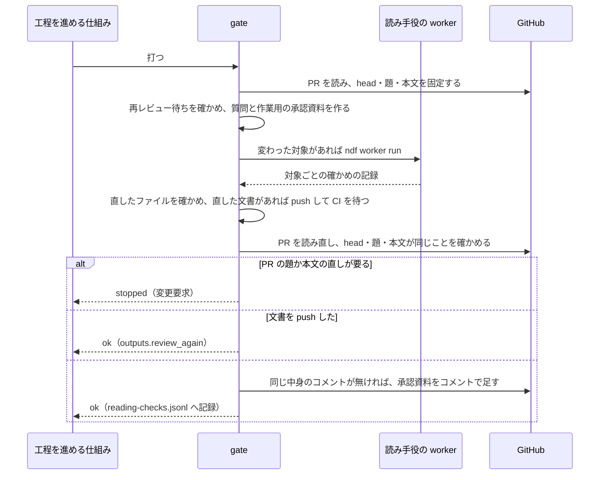

# 承認の前の確認: 承認資料と質問の文を、承認ゲートの 1 つ前のステップで読み手役に確かめさせる

## 概要

**承認ゲートで示す承認資料と質問の文は、承認ゲートの 1 つ前の工程のステップが作り、読み手役に読ませて記録する。** 読み手役は、文書を書いた経緯を知らずに、想定した読み手の立場で文書を読む AI である。このステップは `ndf document-rebuild gate` を打つ。承認を問う側（レーンの conductor・オーガナイザー）は、資料も質問の文も書かず、読み手役も起動しない。記録と突き合わせて、記録された質問をそのまま出す。

例: 設計のステージは次の順に進む。

| 順 | ステップ | すること |
| ---: | --- | --- |
| 1 | 設計のプラン | 設計書を書き、組み直しの worker が読み手役に読ませる。読ませた文書は記録に残る |
| 2 | 設計のレビュー | 指摘を直す |
| 3 | `design-mvv` | MVV 判定で承認ゲートを省けるかを決める |
| 4 | `design-reading` | PR の本文を元に承認資料を作り、決まった形の質問の文と、前に読ませた後で変わった部分を読み手役に読ませる。合格した資料を PR のコメントに足す |
| 5 | `design-gate` | 承認を問う側が `ndf records reading check` で突き合わせ、記録された質問を出す |

手順と書式は次のファイルが正で、この文書にはコピーしない。

| 何を | 正 |
| --- | --- |
| 読み手役の対象・渡すもの・合否・回数・直し方、worker が承認資料を書いて読ませる手順 | [document-rebuild の SKILL.md](../../plugins/ndf/skills/document-rebuild/SKILL.md#承認の前の確認) |
| 承認を問う側の手順、承認資料に載せる項目 | [approval-request.md](../../plugins/ndf/skills/development-workflow/references/approval-request.md#読み手役の確認) |
| オーガナイザーの質問とまとめたリリースの手順 | [parallel.md](../../plugins/ndf/skills/development-workflow/references/parallel.md) |
| 会話のセッションのリリースと、版上げのスプリントの承認の手順 | [release-steps.md](../../plugins/ndf/skills/release/references/release-steps.md) |
| 読み手役の worker への指示 | [document-rebuild-gate.md](../../plugins/ndf/contracts/worker/document-rebuild-gate.md) |
| 読ませたものの記録の行の形 | [reading-docs.schema.json](../../plugins/ndf/contracts/schemas/internal/reading-docs.schema.json) |

読み手役の確認の中身と、質問を止める hook `reading-check` は [ndf-writing-criteria-and-reading-check.md](ndf-writing-criteria-and-reading-check.md) が扱う。

## 用語

「読み手役」「承認資料」「承認ゲート」「版上げの PR」「オーガナイザー」の定義は、用語集（[docs/glossary.md](../glossary.md)）にある。この文書では、次の語を次の意味で使う。

| 語 | 意味 |
| --- | --- |
| gate のサブコマンド | `ndf document-rebuild gate` |
| 読み手役のステップ | 工程の定義の種類 `reading` のステップ（`design-reading`・`release-reading`） |
| PR の本文の経路 | `--material` を渡さない実行。承認資料は PR の本文を元に作る |
| `--material` の経路 | 承認資料のファイルを引数か工程の入力で受ける実行（会話のセッションのリリースと版上げのスプリント） |
| 確認 | gate か組み直し（`ndf document-rebuild run`）の 1 回の実行で読ませたまとまり。id を持ち、終えると完了の行が付く |
| 残った文 | 読み手役が 2 回目にも「判断や作業を誤らせる文」として挙げた文 |
| 変更要求（`sent_back`） | PR の題か本文を直さないと通じないときに、gate が承認を求めずに工程を止めること。承認する人が回答で返す変更要求とは別である |
| 版上げのスプリント | モード `release-bump` のスプリント。複数のレーンのリリースを 1 本の版上げの PR にまとめる |

## 背景

従来は、承認を問う側が問う直前に読み手役を起動していた。通じない文が承認の直前に見つかり、承認を求めては変更を求められる往復が増えていた（ https://github.com/devbasex/ai-plugins/issues/4446 ）。承認の質問の文を問う側が問う時点で書いていたので、記録を前もって作る手段が無かった。

## 対象範囲

含む: 設計承認ゲートとリリース承認ゲートの承認資料と質問の文の確認、その記録と突き合わせ、版上げのスプリント、会話のセッションのリリースの承認の証跡。

含まない: 判断の質問（`ndf-ask:`）の確認（質問を出す AI が読ませる）、読み手役の合否と回数の決まり、hook の判定の条件、承認ゲートの数と位置、PR を伴わない承認。

## 仕様

### 構成要素と責務

パスは `plugins/ndf/` からの相対で書く。

| 要素 | 責務 |
| --- | --- |
| `src/ndf/domains/docrebuild/gate.py`・`gate_decide.py` | gate の 1 回の実行と、その判断の部品（ファイル・git・GitHub を触らない） |
| `src/ndf/domains/docrebuild/drive.py` | 組み直し（`run`）で読み手役が読んだ文書を、読ませたものの記録へ書く |
| `src/ndf/domains/records/reading.py` | 承認の質問の組み立て、2 つの記録の読み書き、`check` の突き合わせ |
| `src/ndf/domains/records/pull_view.py` | PR の題・本文・head・変更量・コメントを 1 回の問い合わせで読み、コメントを足す（gate と `check` が使う） |
| `src/ndf/progress/`（`stages.py`・`model.py`・`run.py`・`folding.py`・`gate/`） | 読み手役のステップを流すか決め、設計のレビューへの戻しと待ちの出し直しを行う |
| `src/ndf/progress/gate/bump.py` | 版上げのスプリントのステップ |
| `src/ndf/domains/release/approval_decide.py`・`trail.py` | 会話のセッションのリリースの提示と回答を、資料のハッシュで結び付ける |

依存の向きは `docrebuild` → `records.reading` → `release.forms_decide` の一方向で、`ndf.progress` は gate をコマンドとして子のプロセスで打つ（`reread` が古い定義で直接打つ場合も同じ）。

### 工程の中の位置

| 工程 | 読み手役のステップ | 位置 | モード |
| --- | --- | --- | --- |
| 設計のステージ | `design-reading` | `design-mvv` と `design-gate` の間 | `standard`・`legacy-refactor`・`documentation` |
| デプロイのステージ | `release-reading` | `release-mvv` と `release-gate` の間 | すべて |
| 版上げ | `release-reading` | `release-mvv` と `bump-present` の間 | `release-bump` |

工程を進める仕組みは、次の表を上から順に調べて、ステップを打つか決める。打たずに済ませたステップは出力を持たない。

| 順 | 条件 | 扱い |
| ---: | --- | --- |
| 1 | 直前の MVV 判定の出力 `mvv_gate` が同じゲートで `skip: true` で、後ろの承認ゲートに待ちの記録が無い | 打たない |
| 2 | リリースのゲートで、モードが `release-bump` | 打つ |
| 3 | リリースのゲートで、スプリントが計画のレーンの行にある | 打たない。オーガナイザーが問うのは版上げの PR の質問だけである |
| 4 | ほか（設計のゲートはレーンでも） | 打つ |

- 承認ゲートが MVV 判定の出力を探すときは、読み手役のステップを飛ばして、その直前を見る
- 定義の検査は、読み手役のステップと同じ工程の承認ゲートの間に、種類 `record` のステップだけを許す

### 承認する PR と承認資料

| どこから打つか | 承認する PR | 承認資料の元 | 資料の示し方 |
| --- | --- | --- | --- |
| `design-reading` | 作業場所のブランチの開いた PR（`--pr` があればそれ） | PR の本文のコピー | PR のコメント（gate が足す） |
| デプロイのステージの `release-reading` | 工程の入力の `pr`（`--pr` があればそれ） | 同上 | 同上 |
| 会話のセッションのリリース | `--pr` | `--material` のファイル | `ndf release-steps present` |
| 版上げのスプリントの `release-reading` | 工程の入力の `pr` | 工程の入力の `material.path` のファイル | `bump-present` |

gate は PR の題と本文を書き換えない。`--material` の経路では入力のファイルも変えず、`--state-dir` の下の `material.md` を直す。

### 承認の質問の決まった形

質問の文は、ゲートの種類・PR の番号・PR の題から作る。同じ値からは同じ質問になり、問う側は文を書かない。

| ゲート | 質問の文 | 選択肢 |
| --- | --- | --- |
| `design` | `設計 Pull Request #<番号>（<題>）をマージしてよいですか` | `承認する`・`変更を求める` |
| `release` | `リリースの Pull Request #<番号>（<題>）を承認し、<操作>してよいですか` | `承認する`・`変更を求める` |

`<操作>` は、リリースの形の表（[release-forms.json](../../plugins/ndf/contracts/domains/release-forms.json)）の列 `approve` の値である。承認すると何が実行されるかを、承認する人が質問から読めるようにする。形は `.ndf/project.json` の `branch_strategy.release.form` で決まる。形の設定が無いか、扱わない形なら、`gate` と `check` は `stopped`（`precondition`）で終える。

質問のファイルは `questions` だけを持ち、`metadata` を持たない。区分（`ndf-gate:1`・`ndf-gate:2`）は出すときに足す。区分は質問のキーに入らない。

### gate の 1 回の実行



1. **head を固定する。** 以後はこの head・題・本文を基準にする。解消していない再レビュー待ちの行があれば、読み手役を起動せずに設計のレビューへ戻す経路へ入る。設計のゲートでは、作業場所の HEAD が PR の head と同じで変更が無いことを求める
2. **承認資料の作業用のファイルを作る。** PR の本文の経路では、前の確認が記録した本文のハッシュと今の本文が同じなら、前に読ませた資料のコピーを使う。違えば本文のコピーから始める。`--material` の経路では、行 `提示したコミット:` が固定した head と違えば止める
3. **読ませるものを決める。** 下の「読ませるもの」の表による。worker が直してよいファイルもここで決める
4. **worker に書かせて読ませる。** worker は素材のファイル `approval-facts.json`（URL・題・ベースと head・変更量・直前の MVV 判定）を使って判断の材料を書き足し、読み手役に読ませる。対象 1 件につき最大 2 回である。読ませる対象が無ければ worker を起動せず、固定した head で記録を作り直す
5. **確かめる。** 対象ごとに、最後に読ませた後で中身が変わっていないこと、直してよいファイルの外が変わっていないことを確かめる
6. **直した設計 PR の文書を push する。** 再レビュー待ちの行を書いてから、コミットして push し（強制しない）、`ndf ci watch` で CI を待つ
7. **PR を読み直す。** head が基準と違う、または題か本文が変わっていれば、記録を書かずに止める
8. **変更要求にするか、コメントを足す。** PR の本文の経路で文書を push していなければ、合格した資料の最終版をコメントで足す。直近の 100 件に同じ中身のコメントがあれば足さない
9. **記録する。** 読ませた行、承認資料のコピー、`reading-checks.jsonl` の 1 行（文書を push した回は書かない）、完了の行の順に書く

読み手役のステップと組み直しは、読み手役を立てられないと `stopped`（`precondition`）で止まる。worker が自分で読み直して代えない。

### 読ませるもの

| 対象 | 立場 | 前の記録を引くキー | 比べる中身 | 読ませる範囲 |
| --- | --- | --- | --- | --- |
| 質問の文 | 承認する人 | リポジトリ・ゲート・PR | 質問のキー | 違えば全体 |
| 承認資料 | 承認する人 | リポジトリ・ゲート・PR | 残った文のセクションを除いた本文の SHA-256 | 初回は全体。違えば変わった段落とその前後（コピーが使えなければ全体） |
| 設計 PR の文書（要求仕様のコピー・設計書・詳細設計書） | エンジニア | リポジトリ・ブランチ・パス | 固定した head の blob | 初回は全体。違えば変わった段落とその前後（前の blob が手元に無ければ全体） |
| 実装計画 | — | — | — | 読ませない |

- 組み直し（`run`）の時点では PR が無いので、文書の行はブランチで引く
- 比べる元には、完了の行のある確認の行だけを使う
- 文書は、作業場所と head の両方で通常ファイル（シンボリックリンクを経由しないもの）だけを開く
- `reading-checks.jsonl` の行の `reads` には、今の中身を読ませた最も新しい確認の最後の結果を、今回読ませなかった対象も含めて入れる

### 残った文

**2 回目にも残った文があっても、gate は `ok` で承認ゲートへ進め、残った文を承認する人に見せる。**

- 承認資料の末尾に、見出し「読み手役が残した文」のセクションを、記録の残った文から gate が作る。worker は書かない。前後に HTML コメントのマーカー（`ndf-reader-remained:begin`・`end`）を置く
- マーカーは誰でも書けるので、末尾の 1 組の中身が記録から作ったセクションと 1 字も違わないときだけ、読ませた本文から除く。違えばマーカーの行だけを消し、中の文は本文として読ませる
- 引用した文が対象に残っていて、今回読ませた部分の外にある間は、次の確認へ引き継ぐ
- 結果 JSON の `items` に `reader-<番号>` で並ぶ

### 設計のレビューへ戻す

読み手役の指摘で設計 PR の文書を直したコミットは、設計のレビューを通るまで承認へ進まない。

- gate は `outputs.review_again`（コミットと文書のパス）を返す。工程を進める仕組みは、設計のレビュー・MVV 判定・読み手役のステップを未了に戻して流し直す
- 再レビュー待ちの行は push の前に書く。push か CI で止まって打ち直しても、レビューを飛ばせない
- 戻した後にレビューのステップが済んでいれば、仕組みは gate に `--reviewed <コミット>` を渡し、gate が行を解消する。判定は工程の記録の順序で行う
- 1 つの承認ゲートの前で戻すのは 1 回までである。以後は `--no-doc-fix` を渡し、指摘は残った文になる
- push したコミットが PR にも作業場所のブランチにも無くなっていれば、行を取り消して先へ進む

### 変更要求（`sent_back`）

PR の本文の経路で、worker が PR の題の案を書いたか、承認資料の最終版が PR の本文からコピーした行を消すか変えたときは、gate は `reading-checks.jsonl` と完了の行を書かずに `stopped`（`precondition`）で止める。`cause.detail` に直す対象・指摘・直しの案のパスを載せる。

直す担当は決めていない（レーンの conductor 自身でもよい）。直した後に工程を再開すると、新しい worker の読み手役が変わった部分を読む。同じ PR とゲートで変更要求にするのは 1 回までで、以後は題と本文の指摘を残った文にする。書き足した判断の材料の直しは、変更要求にしない。

### 突き合わせ（`ndf records reading check`）

```text
ndf records reading check --gate <design|release> --pr <番号> [--material <ファイル>] --questions-out <ファイル>
```

PR を 1 回読み、その題で質問を作り直してファイルへ書き、記録と突き合わせる。hook と同じ選び方で `reading-checks.jsonl` の行を選び、行の指紋で完了の行と結び付ける。完了の行の無い記録は使わない。

| 返す語 | 条件 |
| --- | --- |
| `no_record` | 同じ質問の記録が無い（題が変わった場合を含む）か、行の指紋を持つ完了の行が無い |
| `no_pr` | 承認する PR が記録に無い |
| `head_moved` | PR の head が記録と違う |
| `material_changed` | PR の本文の経路: 記録と同じ中身のコメントが直近の 100 件に無いか、PR の本文が確認の開始時と違う。`--material` の経路: ファイルから求めた 2 つのハッシュ（読ませた本文・ファイル全体）のどちらかが違う |

足りないものがあれば `stopped`（`precondition`）で、`items` の `missing` に語を返す。PR を読めなければ `stopped`（`unknown`）である。hook は PR の本文とコメントを比べないので、問う側はどのランタイムでも質問の前に `check` を打つ。

### 回答の固定と待ちの出し直し

承認ゲートの回答は、head と `gate-materials/<質問の id>.md` に加えて、PR の本文と題の SHA-256 を固定する（`ndf answer` の `--body-sha256`・`--title-sha256`）。回答を適用する前の確かめで本文か題が違えば、承認ゲートを待ちへ戻し、読み手役のステップを打ち直す。リリース承認の後に文書だけが加わった場合に待ちへ戻さない扱いは、本文と題が同じときに限る。MVV 判定の回答は head だけを固定する。

`ndf progress reread <ステートマシンの ID>` は、人の回答を待っている承認ゲートだけで使える。待ちを新しい質問の id で書き直し、読み手役のステップを打ち直して、今の対象の待ちの知らせを返す。

- 打ち直す間に回答が書かれていれば、何も書かない
- 読み手役のステップの後ろに `bump-present` が残る場合は、作業を起動して待ち（`wait`）を案内する
- `outputs.review_again` が返れば、設計のレビューから流し直す
- 読み手役のステップの無い定義で始めたスプリントでは、gate を直接打つ

質問を止める hook の承認ゲートの質問向けの理由の文は、この打ち直しを案内する。判定の条件は、同じ質問の記録の有無と PR の head の一致である。

### 版上げのスプリント

オーガナイザーは版上げの PR を作らず、承認資料も組まない。一時レーンを足し、行の入力を `{"kind": "release", "requests": [<リクエスト>...]}` にする。耐久ワークフローはこの行を `ndf progress new <名前> --mode release-bump --release-requests <リクエスト>...` で起動する。

| ステップ | すること |
| --- | --- |
| `bump-assemble` | 設定の `release.cd.workflow` の `assemble` を起動し、成功を待って、版上げの PR の本文を承認資料のファイルへコピーする。出力は `pr` と `material` |
| `release-mvv` | リリースの MVV 判定 |
| `release-reading` | gate を `--material` の経路で打つ |
| `bump-present` | 確かめた資料を `ndf release-steps present` で提示する |
| `release-gate` | 計画へ種類 `bump-release` のリクエストを書き、回答を待つ |
| `release` | 承認の後にリリースする |
| `bump-record` | 回答（`product_version` があれば `released`、無ければ `rejected`）を、まとめたリクエストと各スプリントのレーンの行へ 1 回のトランザクションで書く |

- 後ろのステップは、同じ工程の済んだステップの出力（工程の `outputs` のキー）を文脈に重ねて受ける。`bump-present` は `release-reading` が直した資料を受ける
- 承認されなければ（却下・変更要求）、`release` を打たずに `bump-record` へ進む（定義の `on_reject`）
- `bump-assemble` は起動した実行の id と版上げの PR を保存し、打ち直しでは起動し直さない。開いた版上げの PR が既にあるとき、実行の後の開いた版上げの PR が 1 件でないとき、承認の対象が `production_pr` の設定のときは止まる
- まとめたリリースに入るレーンのスプリントは、`release-reading` を打たない。レーンの外で PR が要る作業は、一時レーンの普通のスプリントで流す

### 会話のセッションのリリースの証跡

提示のコメントは行 `提示した資料: <SHA-256>` を、利用者の回答の証跡は行 `回答した資料: <SHA-256>` を持つ。同じ head に別の資料を提示し直したときに、前の資料への回答でリリースが進まないようにする。

| 対象 | 振る舞い |
| --- | --- |
| 判定 | 利用者の承認は、今の head の最新の提示より後で、同じ資料のハッシュを持つものを数える。MVV 判定の承認は head で数え、後から提示があれば数えない。変更要求は担当と資料を問わず数える |
| 資料のハッシュを持たない利用者の承認 | 同じ head に行 `提示した資料:` を持つ提示が無い間だけ数える |
| `present` | 今の head の最新の提示と資料が同じで、回答があるときは提示しない |
| `answer` | `--by user` は `--material-sha256` が最新の提示と一致することを求める。`--by mvv` はこの引数を受けない |
| `approval-state` | `merge` と同じ条件の判定を、何も書かずに読む |
| `pull-checks` | 版上げの PR の含む PR の CI の結果を読み直す。組み立ての後に含む PR が増えていれば止まる |
| `open-releases` | 開いている版上げの PR の番号を返す |

## データ・設定

保存先は MVV の状態の保存先（`NDF_MVV_STATE_DIR`、無ければ NDF の状態の保存先）である。

| ファイル | 中身 | 消す時点 |
| --- | --- | --- |
| `reading-checks.jsonl` | 質問のキー・PR の番号とブランチと head・読ませた結果。hook が読む | 消さない |
| `reading-docs.jsonl` | 読ませた行（対象・中身のハッシュ・立場・回・合否・残った文の引用）、完了の行、再レビュー待ちの行とその解消、変更要求の行 | 消さない |
| `reading-materials/<リポジトリ>/<ゲート>-<PR の番号>.md` | 最後に読ませた承認資料のコピー（PR ごとに 1 版） | `ndf worktree merged` が閉じた PR のものを消す |

gate の引数と結果は次のとおりである。引数の形は [document-rebuild.args.schema.json](../../plugins/ndf/contracts/schemas/io/document-rebuild.args.schema.json) が持つ。

```text
ndf document-rebuild gate --gate <design|release> [--pr <番号>] [--material <ファイル>] [--reviewed <コミット>]
                          [--no-doc-fix] --state-dir <保存先> --out <ファイル>
```

| `ok` の出力 | 中身 |
| --- | --- |
| `outputs.questions` | 記録した質問のファイル |
| `outputs.head` | 確かめた PR の head |
| `outputs.material` | 承認資料の最終版の `path`・`sha256`（残った文のセクションを除く）・`file_sha256`（ファイル全体） |
| `outputs.check` | 確認の `id` と記録の行の `fingerprint` |
| `outputs.review_again` | 文書を push した回だけ。このときの出力は、これと `outputs.check` だけである |
| `metrics.reads` | 読ませた行の `name`・`reader`・`round`・`verdict` |

## エラー処理

| 場面 | gate の結果 |
| --- | --- |
| PR が決まらない・読めない、作業場所が head と違う、文書が通常ファイルでない、`--material` の対象のコミットが head と違う | `stopped`（`precondition`） |
| 読み手役を立てられない、worker が `ok` 以外で終えた | `stopped`。記録は書かない |
| 確かめの記録の欠け、読ませた後の中身の変化、直してよいファイルの外の変更 | `stopped`（`incomplete`。`gaps`） |
| 読ませている間の head・題・本文の変化、push の失敗 | `stopped`（`precondition`） |
| 直した文書の CI の失敗 | `stopped`（`check_failed`）。再レビュー待ちの行は残る |
| 変更要求 | `stopped`（`precondition`） |

## セキュリティ

- NDF は承認の前の確認で PR の題と本文を書き換えない。GitHub の PR の更新には前の版を条件にした書き換えが無く、ほかの人の編集を上書きしうるためである
- worker はコミット・push・PR への書き込みを行わない。push とコメントの追記は gate が行う
- `reading-docs.jsonl` は残った文の引用を持ち、承認資料のコピーは本文を持つ。どちらもリポジトリの外に置く

## 運用

### 常に成り立つ条件

| # | 条件 |
| --- | --- |
| I1 | 承認ゲートの質問と資料の読み手役は gate だけが起動し、承認を問う側は起動しない |
| I2 | 読み手役を立てられなければ、「読ませていない」まま承認へ進まない |
| I3 | `reading-checks.jsonl` には、固定した head・題・本文が読み直した時点でも同じ確認だけを書く |
| I4 | 読み手役の指摘で push した文書のコミットは、設計のレビューを通るまで承認の記録を持たない |
| I5 | 完了の行の無い確認は、比較の元にも `check` の根拠にもしない |

### 決定と理由

| 決定 | 理由 |
| --- | --- |
| 質問の文を決まった形にする | 問う側が文を書くと、記録を前もって作れない |
| 読み手役のステップを MVV 判定と承認ゲートの間に置く | 承認する時点の内容を読ませ、ゲートを省くときは費用をかけない |
| gate を `ndf document-rebuild` に置き、手順を `document-rebuild` の Skill に足す | 読み手役の決まりと worker の起動の部品が 1 か所にある |
| 読ませたものを中身のハッシュごとに追記する | PR の本文だけを直すと head が動かないので、head では変化を見分けられない |
| 合格した資料はコメントで足し、題と本文の直しは止めて求める | ほかの人の編集を上書きしない |
| オーガナイザーが問う承認の資料も、スプリントの工程が作る | 承認の資料の作成をオーガナイザーの文脈に残さない |

### 分かっている制約

| 制約 | 内容 |
| --- | --- |
| 版上げのスプリントのリリース記録の PR | `ndf progress bump-record` は、リリース記録の PR の値（`release_pr`）に版上げの PR の番号を記録する。版上げの PR はリリース記録を持たない（記録は含めた PR の各々にある）。コードを読んだ限りであり、実行では確かめていない |
| 回答の前のコメントの変更 | `check` の後から回答までに承認資料のコメントが編集・削除されても、回答を適用する前の確かめは見つけない。この確かめは head・PR の本文と題・`gate-materials/` の資料を比べ、コメントを読まない |
| 閉じた PR のコピーの確認の上限 | 引数で渡していない PR の状態は、GitHub の 1 回の取得（100 件）の、渡した PR で埋まらない残りの件数だけを、番号の小さい順に読む。REST へ切り替えたときは読まない。読まなかった PR のコピーは残る |
| 記録が事実か | 読み手役に本当に読ませたかは、記録からは分からない |

## テスト観点

テストは `plugins/ndf/tests/` にある。worker・GitHub・git・CI は偽物に替える。

| 観点 | テスト |
| --- | --- |
| gate が資料と質問を読ませて記録する。変わった部分だけを読ませる。読み手役を立てられなければ止まる。設計のレビューへの戻しと変更要求。残った文の引き継ぎとコメントの追記 | `domains/docrebuild/test_docrebuild_gate.py` |
| 組み直しで読ませた文書が記録に残り、`not_run` で止まる | `domains/docrebuild/test_docrebuild_run.py`・`test_docrebuild_checked.py` |
| 質問の決まった形、読ませた行の選び方、`check` が本文・題・コメントの変化を見つける | `domains/records/test_reading_docs.py`・`test_reading.py` |
| 工程の定義の順序、読み手役のステップを省く条件、前のステップの出力の受け渡し | `progress/test_definition.py`・`progress/test_run.py` |
| 本文と題の変化で待ちへ戻る、`reread`、版上げのステップ | `progress/gate/test_gate_answer.py`・`test_gate_reread_direct.py`・`test_gate_bump.py` |
| 提示と回答が資料のハッシュで結び付く | `domains/release/test_release_approval.py` |
| 閉じた PR の承認資料のコピーを消し、ほかを残す | `domains/worktree/test_worktree_merged.py` |

リリースの後に人が確かめる観点: 設計のプランと次のリリースを 1 回ずつ流し、承認ゲートで問う直前に読み手役が起動されず、hook が質問を止めないことを実行の記録で見る。

## 関連リンク

- 要求と受け入れ条件: https://github.com/devbasex/ai-plugins/issues/4446
- 設計の PR: https://github.com/devbasex/ai-plugins/pull/4477 ・実装の PR: https://github.com/devbasex/ai-plugins/pull/4547
- [ndf-writing-criteria-and-reading-check.md](ndf-writing-criteria-and-reading-check.md) — 書き方の基準、読み手役の合否、質問の直前の hook
- [ndf-document-rebuild-default-launch.md](ndf-document-rebuild-default-launch.md) — 組み直しの既定のコマンドと worker
- [ndf-release-approval-on-pr.md](ndf-release-approval-on-pr.md) — リリース承認の証跡
