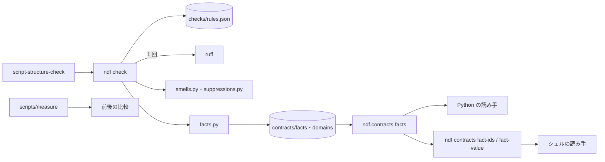

# 作り直しの事実の表と兆候の検査

## 概要

**例: ランタイムを 1 つ足すとき。** ランタイムの一覧は事実の表 `plugins/ndf/contracts/domains/runtimes.json` の 1 か所だけにある。
足す人はこの表に行を 1 つ足す。cross-review の既定の相手役は、相手役の割り当て（`ndf.core.converge.participants.assign`）が
表から引くので、読み手のコードは変えない。選ばれるのは次をすべて満たす行だけで、`default_seat` が真なだけでは選ばれない。

- `default_seat` が真である（`facts.ids("runtimes", default_seat=True)`）
- 読むだけの起動の引数 `review_args` を持つ
- プロジェクトの `.ndf/runtimes.json` があれば、その `allowed` に入っている（無ければこの条件は掛からない）
- 修正担当（既定は `claude`）でない。修正担当が `allowed` の外なら、どの相手役も起動する前に止まる（`FixerNotAllowed`）

足す行が相手役に入るには、`default_seat` と `review_args` の両方が要る。別のモジュールに `RUNTIMES = ("claude", "codex", ...)` のような定数を書き戻すと、
`plugins/ndf/bin/ndf check` の規則 `const-fact` が `table-set: RUNTIMES が表 runtimes の id を写す` で落とす。

**例: ループの中で `gh` を呼ぶコードを足したとき。** `for pr in prs: github.pull(pr)` は規則 `NDF201`（ループの中の外部呼び出し）の
兆候で、同じ `ndf check` が違反にする。兆候の基準は持たず、初日から 0 件なので、1 件でも足せば Pull Request の CI が落ちる。
直し方は番号を GraphQL のエイリアスで 1 回のクエリへまとめる（`ndf.adapters.github` の `aliased`）か、回数に上限がある
ループなら `# noqa: NDF201 上限: <件数と根拠>` を行末に付ける。

この本は、作り直した NDF（#1142）の 2 つの主題の仕様と、そう決めた理由を持つ。

- **事実の表**: 同じ事実を 1 か所の表に置き、読む側は表から引く。新しい重複は CI が止める
- **兆候の検査**: AI が陥りやすい作り（7 種類）を数え、1 件でも足す変更を CI が止める

作り直し全体の索引・番号の対応表・子の記号の表は [ndf-rebuild.md](ndf-rebuild.md) にある。この本の決定は 36〜53 である。

### 構成要素と責務

| 要素 | 責務 |
| --- | --- |
| 事実の表（`plugins/ndf/contracts/facts/*.json`・`plugins/ndf/contracts/domains/*.json`） | 1 つの事実を行と列で持つ。`facts/` はコントラクトそのものの表（終了コードの区分・回答の語彙）、`domains/` は領域の表（ランタイム・収束ループのフェーズ・設定の保存先など） |
| 表の共通の形（`plugins/ndf/contracts/facts/fact.schema.json`） | すべての表が満たす形（JSON Schema draft 2020-12） |
| 実行時の読み手（`plugins/ndf/src/ndf/contracts/facts.py`） | 表を名前で引き、1 プロセスに 1 回読む。読むときに形を確かめ、行・`id`・列の条件での絞り込み・列の値を返す。列の参照先（`ref`）の有無を確かめる |
| シェルの読み手（`ndf contracts fact-ids`・`ndf contracts fact-value`。`plugins/ndf/src/ndf/contracts/cli.py`） | 条件に合う `id` か 1 つの値を改行区切りで出す |
| 検査（`plugins/ndf/bin/ndf check`。`plugins/ndf/src/ndf/checks/`） | `plugins/ndf/` だけを見る検査。兆候の規則・事実の重複の規則・構造の規則などを 1 回の走査で当て、結果 JSON を出す |
| 規則のデータ（`plugins/ndf/src/ndf/checks/rules.json`） | 兆候の規則の一覧・ruff のしきい値・境界の種類・例外の型の分類・事実の重複の設定 |
| 兆候の自作の規則（`smells.py`）・ruff の起動（`lint.py`）・抑制コメント（`suppressions.py`）・事実の重複（`facts.py`） | それぞれ `plugins/ndf/src/ndf/checks/` の下。規則の値は写さずに `rules.json` から読む |
| 計測（`scripts/measure/ai-smells.py`・`scripts/measure/const-facts.py`） | 作り直しの前後を同じ数え方で測る。CI の合否には使わない |



## 用語

語の定義は用語集の [ndf-rebuild.md](../glossary/ndf-rebuild.md) と [ndf-code-structure.md](../glossary/ndf-code-structure.md)（兆候・抑制コメント・事実の表・重複の組）にある。
用語集の「兆候の基準ファイル」「重複の基準」が指す基準のファイルは、今のコードに無い（決定 37・50）。

## 背景

作り直しの前の NDF は、同じ事実（ランタイムの名前・モード・設計文書の種類・閾値）を複数のファイルの最上位の定数が
文字列で持ち、一致をテストで確かめていた。2026-11-13 の計測（`scripts/measure/const-facts.py`）では、文字列の定数
1,563 個のうち 479 個が 417 の重複の組に入っていた。設計文書の種類を 1 つ足すのに 4 つの定数を直す形だった。

兆候も同じ時点で、テストと試行を除く 529 ファイルに、例外の握りつぶし 450 箇所・空のフォールバック 2,780 箇所・
ループの中の外部呼び出し 52 箇所などがあった（`scripts/measure/ai-smells.py`）。検査が無く、AI が書く変更が同じ作りを足し続けていた。

利用者の指示は 2 つである。「定数が多すぎる。全体再設計で直すしかない」（2026-11-13）と、「AI が陥りやすい作りを撲滅する。
…再び入らないようにする」（同日）。作り直しは新しいディレクトリへ書き直したため、古い重複と兆候を基準として持ち込まず、
最初の子（X1 #3283・D1 #3284・D2 #3287）から検査を当てた。

## 仕様

### 検査の入口と結果

`plugins/ndf/bin/ndf check` を、CI の `script-structure-check`（`.github/workflows/script-structure.yml`）が Pull Request・merge queue・push で打つ。
Pull Request では差分が NDF の検査の入力（ワークフローの `NDF_PATHS`）に当たるときだけ打つ。

- 見るファイルを 1 回集め、`.py` の構文木を 1 ファイルにつき 1 回だけ作る。すべての規則が同じ木を読む
- `--only <規則>` はその規則の指摘だけを違反にする（繰り返せる）
- 結果 JSON を標準出力の最後の 1 行に出す。違反は 1 件につき 1 行を標準エラーへ出す。違反の一覧は `items`、規則ごとの件数は `metrics.findings`

| 場合 | `status` | `cause.kind` | 終了コード |
| --- | --- | --- | ---: |
| 違反が無い | `ok` | 無し | 0 |
| 違反がある | `stopped` | `check_failed` | 1 |
| 構文の誤りで読めない `.py` がある | `stopped` | `invalid` | 2 |
| 規則のデータ・子の表・用語集・git の結果が読めない | `stopped` | `config_broken` | 2 |

兆候の規則と事実の重複の規則が見るのは `plugins/ndf/src/` の下の `.py` である。規則の全体と見る範囲の表は `plugins/ndf/src/ndf/checks/README.md` にある。

### 事実の表

- 1 つの事実を 1 つのファイルに置き、行の `id` が事実の値である。部分集合は列で表し、別の定数へ写さない
- 表の名前はファイル名の拡張子を除いた部分で、`facts/` と `domains/` をまたいで 1 つに決まる。読み手は名前だけで引く（保存先を知らない）
- 表は `owner`（書き換えてよい子とパッケージ）を持つ。ほかの子は読むだけ
- 列の `ref` は外部キーで、2 つの形がある。`limits#<接頭辞>`（例 `limits#monitor.phase.` は `contracts/limits/` の `monitor.phase.<id>` の方針を指す）と、`<保存先>/<表>`（別の表の `id`）
- 工程とモードは事実の表でなく `plugins/ndf/contracts/workflow/` の文書が持ち、設計文書の種類は `contracts/domains/ndf-files.json` の行が持つ（決定 49）

読み手の関数（`ndf.contracts.facts`）:

| 関数 | 返すもの |
| --- | --- |
| `table(name)` | 表 1 本（`summary`・`owner`・`columns`・`rows`） |
| `rows(name, **where)`・`ids(name, **where)` | 条件（列 = 値）に合う行・`id` を表の並びで。列を持たない行は条件に合わない |
| `row(name, id)`・`value(name, id, col)` | 1 行・1 つの値。行・列が無ければ `FactsError` |
| `column(name, col)` | 列を持つ行の `id` → 値 |
| `ref_errors(name, policy_names)` | 列の `ref` の先に無い値の一覧 |

シェルは `ndf contracts fact-ids <表> [<列>=<値>...]` と `ndf contracts fact-value <表> <id> <列>` で引く。値の `true`・`false` は真偽、
数字だけは整数、ほかは文字列として条件にする。配列の値は 1 行に 1 要素で出す。`ndf contracts check` は、事実の表の `ref` の先・停止理由の表・
上限の設定・スキーマ・コントラクトのバージョンをまとめて確かめ、誤りがあれば `stopped`（`invalid`）で止まる。

hook の経路は `ndf.contracts`（`jsonschema` を読む）を import しない。hook が読む表（`contracts/limits/`・`contracts/hooks/*.json`）は
`ndf.domains.hooks.tables` が標準ライブラリの `json` で直に読み、形は CI のテストが確かめる。

### 事実の重複の規則

| 規則 | 違反と数えるもの |
| --- | --- |
| `const-fact` | 2 つ以上のファイルの最上位の大文字の定数が同じ事実を持つ組。種類は下の表 |
| `fact-table` | 事実の表（`*.schema.json` を除く）が共通の形か列の設定から作る行の形に合わない・読めない・`id` が重なる・表の名前が 2 つの保存先で重なる |

| `const-fact` の種類 | 拾うもの |
| --- | --- |
| `same-str` | 4 字以上（`rules.json` の `facts.min_str`）の同じ文字列 |
| `same-set` | 同じ文字列の集まり（2 つ以上の要素） |
| `same-num` | 同じ名前で同じ数 |
| `subset` | 集まりが別のファイルの集まりに真に含まれる |
| `member` | 文字列が別のファイルの集まりの要素 |
| `table-set` | 事実の表の `id` を 2 つ以上含む集まり |
| `table-str` | 事実の表の `id` に等しい 4 字以上の文字列 |

- 定数として読むのは、文字列・数・文字列だけの集まり（tuple・list・set・dict の鍵・`set(...)` などの呼び出し）である
- `shared_names` が真の表（`id` が他の名前空間と共有する名前。`ndf-files`・`release-forms`・`skill-io`）は、`table-set`・`table-str` の照合から外し、形だけを確かめる
- 重複は基準に残さない。片方をもう片方から読む形へ直す（定数を import する・事実の表から読む）

### 兆候の規則

次の表の 1 行に当たる箇所を 1 件と数える（`NDF201` だけは、下の表のとおりループの行ごとに 1 件と数える）。どの規則にも基準は無く、抑制コメントで外したもの以外はすべて違反になる。

| 種類 | 規則 | 兆候と数えるもの | 数える | 抑制コメント |
| ---: | --- | --- | --- | --- |
| 2 | `NDF201` | ループ（`for`・`while`・内包表記）の回ごとに評価する部分の中の外部呼び出し。名前が `calls` の関数か、根の名前が `modules` の属性の呼び出し。回ごとに評価する部分は、`for` の本体と `else`、`while` の条件と本体と `else`、内包表記の要素・`if`・2 つ目以降の `for` である（`for` の反復対象と内包表記の最初の `for` の反復対象は、そのループにつき 1 回だけ評価するので、そのループの回ごとの部分には含まない。ただし外す対象はそのループ自身だけで、そのループが別のループの回ごとの部分にあれば、反復対象の中の呼び出しは外側のループの 1 件に数える。たとえば外側の `for` の本体にある `for pr in github.pulls(ids):` の `github.pulls` は外側の `for` の行で 1 件になる。ループの中の `def`・`lambda`・`class` の中は含まない）。件数と位置は、呼び出しを直に含む最も内側のループの行（`for`・`while` の行か内包表記の始まりの行）に 1 件で、同じループの中の呼び出しが何本あっても 1 件である。抑制コメントも呼び出しの行ではなくそのループの行に付ける（`smells.loop_calls`） | 自作 | 境界の種類か `上限` |
| 3 | `NDF301` | `elif` が 4 本以上続く連鎖（連鎖の先頭の `if` で 1 件） | 自作 | 受けない |
| 3 | `PLR0912` | 分岐が 9 を超える関数 | ruff | 受けない |
| 3 | `PLR1702` | ブロックの入れ子が 3 を超える関数 | ruff | 受けない |
| 4 | `S110`・`S112` | 本体が `pass`・`continue` だけの `except`（型を指定した `except` も数える） | ruff | 境界の種類 |
| 4 | `BLE001` | `Exception`・`BaseException` を受け、送出し直さない | ruff | 境界の種類 |
| 4 | `E722` | 素の `except:` | ruff | 境界の種類 |
| 4 | `NDF401` | 本体が定数の `return` を含み、`pass`・`continue`・定数の `return` だけでできた `except` | 自作 | 境界の種類 |
| 4 | `NDF402` | `contextlib.suppress(...)` の呼び出し | 自作 | 境界の種類 |
| 5 | `NDF501` | 右端が空の値（`{}`・`[]`・`()`・`""`・`0`・`None`）の `or` と、`x if x else {}` | 自作 | 境界の種類 |
| 5 | `NDF502` | 位置引数がちょうど 2 つの `.get(k, 既定)`。受け手が `boundary_receivers`（`os.environ`）なら数えない | 自作 | 境界の種類 |
| 7 | `NDF701` | `def` の行から最後の行までが 60 行を超える関数 | 自作 | 受けない |
| 7 | `PLR0913` | 引数が 6 を超える関数（`self`・`cls` を数えない） | ruff | 受けない |

種類の番号は要求の 7 種類である（1 定数の重複・2 ループの中の外部呼び出し・3 分岐の多用・4 例外の握りつぶし・5 フォールバックの多用・
6 コピーで生まれた重複・7 長い関数と多い引数）。種類 1 は事実の重複の規則が見る。種類 6 は検査で落とさない（決定 44）。

ruff は見るファイルすべてへ 1 回だけ、`--isolated --no-cache --ignore-noqa --output-format=json --preview --select=<ruff の規則>` と
`rules.json` の `ruff.config` のしきい値で起動する。ruff が `except` の兆候を型の式の行へ置いても、構文木の `except` の行へ揃えてから
抑制コメントを当てる。入れ子の関数・クラス・`lambda` は、それぞれ 1 つの関数として数える。

### 抑制コメント（境界の印）

兆候が境界（外から来る失敗や値を受ける所）にあって直せないときだけ、その行の行末に付けて外す。

```python
tool_input = payload.get("tool_input", {})  # noqa: NDF502 利用者の入力: ランタイムが鍵を省いたら入力の無い呼び出しとして扱う
for attempt in range(1, ATTEMPTS + 1):  # noqa: NDF201 上限: 決定 60 の 2 回
```

- 形は `# noqa: <規則>[,<規則>] <境界の種類>: <理由>`。境界の種類は `外部コマンド`・`ネットワーク`・`利用者の入力`・`ファイル`（`rules.json` の `boundaries`）
- `NDF201` だけは `上限: <件数と根拠>`（`limit_label`）も使える
- 次の抑制コメントは兆候を外さず、その行は外せない理由を添えて違反に数える: 形の誤り（境界の種類か理由が無い）・「受けない」の規則・`NDF201` 以外の `上限:`・4 つ以外の境界の種類・受ける型がすべて内部の型の `except`
- 兆候の無い行の正しい形の抑制コメントは `suppression-unused` の違反になる

例外の型の分類は `rules.json` の `exception_types` が持つ。

| 分類 | 型 |
| --- | --- |
| 境界 | `OSError`・`FileNotFoundError`・`PermissionError`・`SubprocessError`・`CalledProcessError`・`TimeoutExpired`・`JSONDecodeError`・`UnicodeDecodeError`・`URLError`・`HTTPError` |
| 内部 | `TypeError`・`AttributeError`・`KeyError`・`IndexError`・`NameError`・`AssertionError` |

### 計測（前後の比較）

| スクリプト | 測るもの |
| --- | --- |
| `scripts/measure/ai-smells.py [plugins/ndf] [--summary]` | 7 種類の兆候の数と箇所。見る範囲は `*.py` のうちパスに `/tests/`・`/experimental/` を含まないもの |
| `scripts/measure/const-facts.py [plugins/ndf] [--json] [--limit N]` | 重複の組。`ndf check` の種類に加え、`affix`（6 字以上の要素が別の集まりの要素の接頭辞か接尾辞）とテストの側の組（`test-bind`・`test-parse`・`test-literal`）も拾い、シェルの配列も読む |

計測は数え方が検査と違う（`elif` の連鎖を途中の `if` からも数える・入れ子のループで同じ呼び出しを 2 回数える・`run` を属性の名前だけで拾う）。
前後の比較はこのスクリプトで行い、合否は検査で見る。

### 常に成り立つ条件

| # | 条件 | 破れたときの扱い |
| --- | --- | --- |
| IA1 | `plugins/ndf/src/` の `.py` の兆候の数は、抑制コメントで外したものを除き、ファイルごと・規則ごとに 0 である | `ndf check` が `check_failed` で落とす |
| IA4 | 兆候を外す抑制コメントは、抑制コメントを受ける規則に付き、4 つの境界の種類のどれかと理由を持つ。`NDF201` に限り、境界の種類の代わりに `上限: <件数と根拠>` を持ってよい。内部の型だけを受ける `except` の抑制コメントは兆候を外さない。兆候の無い行に正しい形の抑制コメントを置かない | 形の誤った・受けない規則の・内部の型の抑制コメントは兆候を外さず、その行は理由つきで違反に数える（IA1 で落ちる）。兆候の無い行の正しい形の抑制コメントは `suppression-unused` で落とす |
| IA5 | `scripts/measure/ai-smells.py` の数え方は、作り直しの前の計測（2026-11-13）から後の測り直しまで変えない | 振り返りで前の出力と見比べる |
| I-DT1 | 1 つの事実は、1 つの表か 1 つの持ち主のモジュールの定数にだけ文字列で書かれる。ほかは引くか import する | `ndf check` の `const-fact` が落とす |
| I-DT2 | 表は `contracts/facts/fact.schema.json` と列の設定から作る行の形を満たし、`id` が表の中で重ならない。表の名前は 2 つの保存先で重ならない | `ndf check` の `fact-table` が落とす。実行時の読み手は `FactsError` で止まる |
| I-DT3 | 表の列の `ref` が指す値は、相手（`contracts/limits/` の方針か別の表の `id`）にある | `ndf contracts check` が `invalid` で止まる。コントラクトの写しで `check_all()` が空であることをテストが確かめる |

## データ・設定

### 事実の表の形

```json
{
  "summary": "NDF が起動し、席に着け、使用量を測るランタイム（AI の CLI）",
  "owner": "D2（contracts/domains）",
  "columns": {
    "default_seat": {"type": "boolean", "summary": "cross-review と cross-refactoring の既定の母集合に入る"},
    "executable": {"type": "string", "summary": "起動する実行ファイルの名前"}
  },
  "rows": [
    {"id": "claude", "default_seat": true, "executable": "claude"}
  ]
}
```

| キー | 型 | 意味 |
| --- | --- | --- |
| `summary` | 文字列（必須） | 事実の説明 |
| `owner` | 文字列（必須） | 表を書き換えてよい子とパッケージ（例 `D1+（#3284 の追補。ndf.contracts）`） |
| `shared_names` | 真偽（任意） | 真なら `id` は他の名前空間と共有する名前で、定数が同じ字を持っても写しと数えない |
| `columns` | 名前 → `{type, summary, optional?, ref?}`（必須） | 列。名前は `^[a-z][a-z0-9_]*$`。`type` は `boolean`・`string`・`integer`・`array`（文字列の配列）・`object`。`optional` が真の列だけ欠いてよい。列 `id` にも `ref` を書ける |
| `rows` | 配列（必須） | 行。どの行も文字列の `id` を持ち、設定に無い列を持たない。並びは意味を持つ（輪番の順・フェーズが進む順など） |

表の形式の版（`version`）は持たない。実行時の読み手は `id` を空でない文字列に限る（`id` の列の設定があればそれで置き換える）。

### 規則のデータ（`plugins/ndf/src/ndf/checks/rules.json`）

| キー | 中身 |
| --- | --- |
| `smells.<規則>` | `kind`（要求の種類の番号）・`suppress`（`boundary`・`boundary-or-limit`・`none`）・`by`（`ruff` なら ruff が数える）・`summary`・`params`（`NDF201` の `calls`・`modules`、`NDF301` の `min_elif`、`NDF502` の `boundary_receivers`、`NDF701` の `max_lines`） |
| `ruff` | `preview` と `config`（`lint.flake8-bandit.check-typed-exception = true`・`lint.pylint.max-branches = 9`・`max-nested-blocks = 3`・`max-args = 6`） |
| `boundaries`・`limit_label` | 境界の種類の 4 つと `上限` |
| `exception_types` | `boundary`・`internal` の型の並び |
| `facts` | `min_str`（4）と `contracts_dir`（`contracts`） |

ruff の版はプラグインの lock（`plugins/ndf/uv.lock`）が固定し、`jsonschema` 4.26.0 はプラグインの依存（`plugins/ndf/pyproject.toml`）にある。

## 決定と理由

### 決定 36: 既存の規則で見られるものを自作しないため、握りつぶし・分岐・引数の数を ruff の規則で数え、無いものだけを自作する

ruff に同じものを見る規則があるのは `S110`・`S112`・`BLE001`・`E722`・`PLR1702`・`PLR0912`・`PLR0913` で、しきい値を要求の数え方に合わせて使う。
ループの中の外部呼び出し・`elif` の連鎖・定数の `return` と `contextlib.suppress` の握りつぶし・空のフォールバック・関数の行数は ruff に無いため、
`smells.py` に自作する（`NDF` で始まる規則）。ruff は同じものを速く数え、版は lock が固定するので preview の振る舞いも版を上げるときにだけ変わる。

採らなかった案: `SIM105` と `FURB110` を採る（握りつぶしを `contextlib.suppress` へ移して `S110` から見えなくし、フォールバックを増やす向きに書き換えさせる）。
pylint の `R0801` でコピーの重複を見る（依存が増える）。

代償: ruff の preview の規則（`PLR1702`）は版で数え方が変わりうる。版を上げる Pull Request で検査が落ちたら、その PR で直す。

### 決定 37: 古い兆候を持ち込まないため、兆候の基準を持たず、初日から兆候 0 件にする

作り直しは新しいディレクトリへ書き直したため、古いコードの兆候を残す理由が無い。検査は最初の子（X1 #3283）から当て、
見つけた兆候はすべて違反にする（IA1）。ruff は違反の数の基準を持たないが、基準が要らないので ruff の出力をそのまま数える。

採らなかった案: 古い兆候を元のファイル 1 本に 1 つの基準の JSON に残し、増やす変更だけを落とす（SonarQube の「新しいコード」の合否の形）。
古いコードを残したまま直す前の企画の形で、作り直しでは持ち込む古いコードが無い。

代償: 境界でない箇所の兆候は、書いた Pull Request の中で直すほかない。

### 決定 38: 減らした分を次の変更が使い戻せないため、基準の値を置かない

基準が 0 に固定されているので、直して減った分の余白は生まれず、ファイルを分ける・移す変更でも合計を比べる必要が無い。

採らなかった案: 基準を今の数に合わせることを求め、規則ごとの合計を merge-base と比べる（基準を持つ形でだけ要る仕組みで、決定 37 で基準を持たない）。

代償: 無し。

### 決定 39: 許した箇所の理由をコードの隣に残すため、境界の印を行末の `noqa` の抑制コメントに書き、外せるかは検査が 1 か所で決める

抑制コメントは理由がコードの隣にあり、行が動いても付いて動く。ruff は `--ignore-noqa` で抑制コメントを無視した全件を返し、
`suppressions.py` が ruff の規則と自作の規則の抑制コメントを同じ規則で読む。ruff に外させると、外した行が出力に現れず、
形の誤った抑制コメント（理由の無い `# noqa: S110`）を見分けられない。兆候の無い行の正しい形の抑制コメントは `suppression-unused` で落とす
（`RUF100` は選んでいない規則の抑制コメントも指摘するため、その代わりに置く）。形の誤った抑制コメントは落とさずに兆候を外さず、理由を添えて違反に数える。
`NDF` で始まる抑制コメントは ruff の側で誤りにならないため、`lint.external` は足さない。

採らなかった案: 例外リスト（1 項目 1 ファイル）に「ファイル:関数:規則」で載せる（1 つの関数に同じ規則の箇所が複数あると区別できず、理由がコードから離れる）。

代償: 許した箇所の一覧を出す口は持たない。`git grep -n 'noqa: '` で拾う。

### 決定 40: 内部の契約違反を握りつぶさないため、例外の型を境界と内部に分ける表をデータに置き、内部の型には抑制コメントを許さない

境界での失敗は `OSError`・`JSONDecodeError` などで、内部の契約違反は `TypeError`・`AttributeError`・`KeyError`・`IndexError` などで現れる。
`rules.json` の `exception_types` に 2 つを分けて持ち、受ける型がすべて内部の型の `except` は抑制コメントで外せない。`Exception` を受ける `except` は `BLE001` が見る。
フォールバックは境界で 1 回だけ形を確かめて型へ直し、内部は確かめた型を信じて `.get(k, 既定)` と `or {}` を持たない。

古い形を読むためのフォールバックは境界として許さず、持たない。旧いキーを新しいキーの別名として読まない。利用者の設定の旧いキーは、
改名表（`plugins/ndf/contracts/data/ndf-settings-renames.json`）から探して止め、移行のコマンド（`ndf settings migrate` など。#3613・#3672）で書き換える。

採らなかった案: 型で分けずに抑制コメントだけで許す（`KeyError` の握りつぶしにも「ファイル」と書けば通る）。

代償: どちらの表にも無い型（`ValueError` など）は、境界の抑制コメントで外せる。

### 決定 41: 外部の呼び出しを件数に比例させないため、ループの中の `gh`・`git` を 1 回のクエリへまとめ、まとめない箇所には上限を抑制コメントに残す

番号やブランチごとの GitHub の読み取りは、GraphQL のフィールドのエイリアスで 1 回のクエリにまとめる（`ndf.adapters.github` の `aliased`。
1 回にまとめる件数は `contracts/limits/` の `github.graphql-batch`）。まとめる部品はアダプターに置き、コンテキストのモジュールに書かない。
ループが上限の小さい回数で済む箇所は直さず `# noqa: NDF201 上限: <件数と根拠>` を残す。PR へのコメントのように 1 回へまとめられない書き込みは、
境界の種類「外部コマンド」か「ネットワーク」の抑制コメントに理由を書く。

採らなかった案: スレッドで並列に呼んで待ち時間だけを縮める（API のレート制限を同じだけ使う）。

代償: エイリアスのクエリは件数の上限ごとに切るため、件数が上限を超えると呼び出しが複数回になる。

### 決定 42: 判定を読めて足せる形にするため、分岐の多い判定を判定データと、データを引く 1 つの関数へ直す

`elif` の長い連鎖・深い入れ子・分岐の多い関数（`NDF301`・`PLR1702`・`PLR0912`）は抑制コメントを受けず、「キー → 値か判定の関数」の表と、
表を引く関数 1 つへ直す。表の置き場は決定 45 に従う。ほかのファイルやテストも使う事実は事実の表（`plugins/ndf/contracts/`）に、
モジュールの中だけで使う表は最上位の辞書に置く。新しい場合を足すときは表に 1 行足すだけになる。

採らなかった案: `match` 文へ書き換えるだけ（分岐の数が変わらず、表として読めない）。

代償: 表を引く関数が 1 段増える。

### 決定 43: 子と触るファイルを重ねないため、検査と規則を最初の子で入れ、後の子は検査の下で書く

検査（`ndf.checks`）と規則のデータは X1（#3283）が新しいディレクトリの最初の子として入れた。以後の子は検査の当たるコードを書くので、
兆候を持ち込めず、ほかの子の兆候を直すために触るファイルも生まれない。

採らなかった案: 古いコードの兆候を、子の範囲の内と外に分けて順に直す（前の企画の移行の順序で、作り直しでは直す古いコードが無い）。

代償: 検査の規則を変える Pull Request は、そのとき動いているすべての子のコードに当たる。

### 決定 44: 同じ検査を 2 つ作らないため、種類 1 は事実の重複の規則で見て、種類 6 は検査で落とさない

種類 1（定数の重複）は同じ `ndf check` の `const-fact` が見る。兆候の規則でも数えると、同じ違反が 2 つの規則で落ちる。
種類 6（コピーで生まれた重複）のうち 4 つ以上のファイルに出る文字列は、大半が `argparse` の説明と案内の文で、同じ事実は種類 1 が定数として拾う。
種類 6 は `scripts/measure/ai-smells.py` で前後を比べるだけにする。

採らなかった案: 兆候の検査で 7 種類すべてを数える（上の重なりを生む）。

代償: 2 つ以上のファイルの同じ本体の関数は CI で落ちない。

### 決定 45: 事実を文字列で書く場所を 1 つにするため、2 つ以上のモジュールか言語が読む事実は事実の表に、1 つのモジュールだけが読む事実は持ち主のモジュールの定数に置く

表へ移すと、読み手が増えても値は 1 か所で、シェルの読み手と検査も同じ値を引ける。1 つのモジュールの中だけで読む事実まで表へ移すと、
import 1 つで済むものにファイルと読み手の呼び出しが増える。外部の仕様の値も、2 つ以上の読み手が数えるなら表に置く（CI の結論の `ci-outcomes.json`）。

採らなかった案: すべてを表へ移す（1 つのモジュールの事実にも表と検査が要る）。すべてを持ち主のモジュールの定数にする（シェルと文書が写しのまま残る）。

代償: 事実ごとに、読み手の数で置き場を決める判断が要る。

### 決定 46: 表の形をそろえて機械で確かめるため、表は 1 事実 1 ファイルにし、JSON Schema の draft 2020-12 で形を確かめる

表は `contracts/facts/` か `contracts/domains/` の 1 事実 1 ファイルにし、共通の形を `fact.schema.json` に置く。形の確かめは
`jsonschema`（プラグインの依存）の draft 2020-12 で行い、工程の文書（`contracts/workflow/`）と同じ draft を使う。1 事実 1 ファイルにすると、
子ごとに触るファイルが分かれ、並行の Pull Request が衝突しない。

採らなかった案: 1 つの大きな JSON に全事実をまとめる（すべての子が同じファイルを触る）。YAML で書く（標準ライブラリで読めず、hook の経路で使えない）。

代償: 表の名前を 2 つの保存先で重ねないことを、検査で確かめる（I-DT2）。

### 決定 47: 同じ表をどこでも同じ形で読むため、実行時の読み手を `ndf.contracts.facts` の 1 つにし、読むときに形を確かめ、部分集合は列の条件で引く

読み手は表を 1 プロセスに 1 回読み（`contracts.cached_reader`）、共通の形と列の設定から作った行の形を確かめ、合わなければ `FactsError` で止まる。
表ごとの読み手を作らず、部分集合は `ids(name, **where)` の条件で引いて定数へ写さない。hook の経路は `ndf.contracts` を import せず、
hook の表（`contracts/limits/`・`contracts/hooks/*.json`）を標準ライブラリの `json` で読む（`ndf.domains.hooks.tables`）。

採らなかった案: 実行時の読み手を標準ライブラリの `json` だけにし、形の検査を CI に任せる（hook の経路は自分の表を `json` で読むので、ほかの読み手まで縛る理由が無い）。
`pydantic` で表ごとに型付きの読み手を作る（読み方が表の数だけ増える）。

代償: 事実の表を読むモジュールは `jsonschema` を読むため、hook の経路から import できない。

### 決定 48: シェルに値を写さずに同じ表を読むため、シェルは `ndf contracts fact-ids`・`fact-value` を呼んで値を受ける

条件は `<列>=<値>` で渡し、`id` か値を改行区切りで受ける。表の値をシェルの定数に持たない。

採らなかった案: シェルの定数を残して表との一致を検査で確かめる（値を足すときに直すファイルが 2 つのまま）。ビルドの時点でシェルの定数を生成する（生成物と生成の手順が増える）。

代償: 引くたびに `ndf` を 1 回起動する。

### 決定 49: 工程・モード・設計文書の種類を 2 か所の表に持たないため、それぞれの既存の置き場を正とし、事実の表を別に作らない

工程とモードは `contracts/workflow/` の文書が持ち、工程のフェーズは工程の文書の `metadata.ndf.phase`（`design`・`implement`・`release`・`close`）に置く。
設計文書の種類は保存先の表 `contracts/domains/ndf-files.json` の行（`design`・`design-detail`）が持つ。事実の表を別に作ると、同じ事実が 2 つの表に分かれる。

採らなかった案: 工程とモードの表を事実の表として先に作る（#3092 と同じ事実を別の置き場に持つ）。

代償: 工程とモードを引く読み手は事実の表の読み手と別になる（`ndf.progress.definition`）。

### 決定 50: 新しい重複を止めるため、`ndf check` に規則 `const-fact` と `fact-table` を置き、重複の基準を持たない

コードと表を突き合わせる規則は、兆候と同じ `ndf check`（`plugins/ndf/src/ndf/checks/facts.py`）が 1 回の走査で当てる。新しいディレクトリは重複を持たずに始めたので、
見つけた組はすべて違反にする（決定 37 と同じ理由）。

採らなかった案: 重複の基準を 1 ファイルに置き、merge-base より行が増えた変更を落とす（古い 417 組を残す前の企画の形）。
既存の静的解析の規則で済ませる（ruff の `PLR2004` は比較の中の名前の無い値だけを見て、2 つの定数が同じ事実を持つことを見ない。pylint の `duplicate-code` は似た行の検出で、値の集合の一致を見ない）。

代償: 計測が拾う `affix` とテストの側の組は、検査では落ちない。

### 決定 51: 別の事実を同じ事実として結び付けないため、`id` が他の名前空間と共有する名前の表は `shared_names` で照合から外す

文字列が同じでも事実が違う組（CI の結論の `failed` と投稿キューの `failed`）を 1 つにすると、片方の事実の変更がもう片方を壊す。
保存先・リリースの形・Skill の名前のように `id` が他の名前空間でも使われる名前の表は、`shared_names` を真にして `table-set`・`table-str` の照合から外す（形は確かめる）。
4 字に満たない文字列は `same-str`・`table-str` で数えない。定数どうしの偶然の一致は、名前か値を事実に合わせて分ける。

採らなかった案: 組ごとに「移す」か「移さない: 理由」を基準の行に書く（基準を持たないため、決定 50）。

代償: `shared_names` の表の `id` をコードの定数に写しても落ちない。

### 決定 52: 一致を確かめるテストを置かないため、事実は 1 か所から引き、振る舞いのテストは表から引いた値で書く

事実が 1 か所なら、2 つの定数の一致は成り立つ以外にない。テストに値を写した文字列の集まりは、表の行を足すたびにテストも直す写しになる。
表の形と外部キーは `fact-table` と `ndf contracts check` が見るため、テストで重ねて確かめない。古い形を読む分岐と別名も持たない（決定 40）。

採らなかった案: 一致のテストを残す（同じことを検査とテストが重ねて確かめる）。

代償: 無し。

### 決定 53: 子と触るファイルを重ねないため、表ごとに書き手の子を決め、共有の表へ書く子に順序を持たせる

事実の表は `owner` に書き手の子を 1 つ持ち、ほかの子は読むだけにする。複数の子が書く共有の表は、子の表（`plugins/ndf/src/ndf/checks/children.json`）の
`tables` に書き手を並べ、規則 `child-deps` が、閉じていない 2 つの書き手がどちらも他方の先に要る子に無いときに落とす（#3378）。
後に流れる子は、先の子のマージを取り込んでから衝突を解く。

採らなかった案: 構文木の解析の統合と工程の進行表の後に検査を置き、子の触るファイルを除いて先に移す（前の企画の移行の順序で、作り直しでは移す古い定数が無い）。

代償: 共有の表を足すたびに、子の表の `tables` へ書き手を足す。

## テスト観点

- 兆候の規則ごとに、その兆候を 1 つ持つコードで規則が当たり、しきい値の 1 つ手前では当たらない（入れ子の深さ 3 と 4・引数 6 個と 7 個・`elif` 3 本と 4 本・60 行と 61 行）
- `NDF201` はループの本体の呼び出しを最も内側のループの行で 1 件と数え、入れ子の関数の中の呼び出しを数えない。ループの `iter` の呼び出しは、どのループの回ごとの部分にも無い最上位のループなら 0 件、外側のループの回ごとの部分にある内側のループなら外側のループの行に 1 件と数える（外側の `for` の本体の `for pr in github.pulls(ids):` は外側の行に 1 件）
- `except` の握りつぶしを `contextlib.suppress` へ書き換えても、件数が減らない
- 抑制コメント（IA4）: 理由の無い形・4 つ以外の境界の種類・内部の型だけを受ける `except`・`NDF201` 以外の `上限:`・「受けない」の規則に付けたものは、その行を違反に数え、外せない理由を添える。`上限:` の `NDF201` と正しい境界の抑制コメントは兆候を外す。兆候の無い行の正しい形の抑制コメントは `suppression-unused` で落ちる
- ruff の兆候が複数行の `except (` の型の行に置かれても、`except` の行の抑制コメントで外れる
- IA1: 兆候を 1 件足したツリーで `ndf check` が `stopped`・`check_failed`・終了コード 1 を返し、構文の誤りのある `.py` では `invalid`・終了コード 2 を返す
- I-DT1: 事実の表の `id` を 2 つ含む集まりの定数か、`id` に等しい 4 字以上の文字列の定数を足すと `const-fact` が落とす。`shared_names` が真の表では落とさない。2 つのファイルの同じ文字列・同じ集まり・含まれる集まり・要素・同じ名前と数の定数を、それぞれの種類で落とす
- I-DT2: `id` の重なる表・列の型の違う行・設定に無い列を持つ行・2 つの保存先で名前の重なる表を `fact-table` が落とし、実行時の読み手は `FactsError` で止まる
- I-DT3: 列の `ref` の先に無い値（`contracts/limits/` に無い方針・別の表に無い `id`）を `ndf contracts check` が誤りに挙げ、コントラクトの写しでは誤りが 0 件である
- 値を足すときに直すファイルが 1 つになる: ランタイムの表に行を 1 つ足すだけで、`default_seat` の条件で引く読み手の結果に現れる
- シェルの読み手: `ndf contracts fact-ids exit-codes status=gate` が条件に合う `id` だけを改行区切りで返し、`fact-value` が配列を 1 行に 1 要素、真偽を `true`・`false` で返す
- IA5: `scripts/measure/ai-smells.py` の出力を読む側のテストは置かない。測り直しで前の値と並べて残す

## 関連リンク

- [ndf-rebuild.md](ndf-rebuild.md): 作り直しの索引・番号の対応表・子の記号の表
- [ndf-rebuild-libraries.md](ndf-rebuild-libraries.md): ライブラリの選択と依存
- `plugins/ndf/src/ndf/checks/README.md`: `ndf check` の規則の全体（構造・子の表・規約・禁止語・不変条件）
- `plugins/ndf/src/ndf/checks/rules.json`・`plugins/ndf/contracts/facts/fact.schema.json`: 規則のデータと表の共通の形
- [ndf-next-declarations-and-io-contracts.md](ndf-next-declarations-and-io-contracts.md): Skill の入出力・起動スクリプト・手書きの引数の表
- [ndf-limits-declaration-and-retry-policy.md](ndf-limits-declaration-and-retry-policy.md): 上限の設定（`contracts/limits/`）
