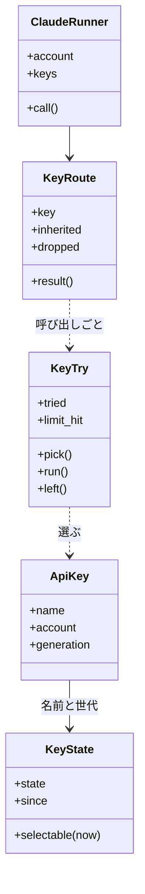
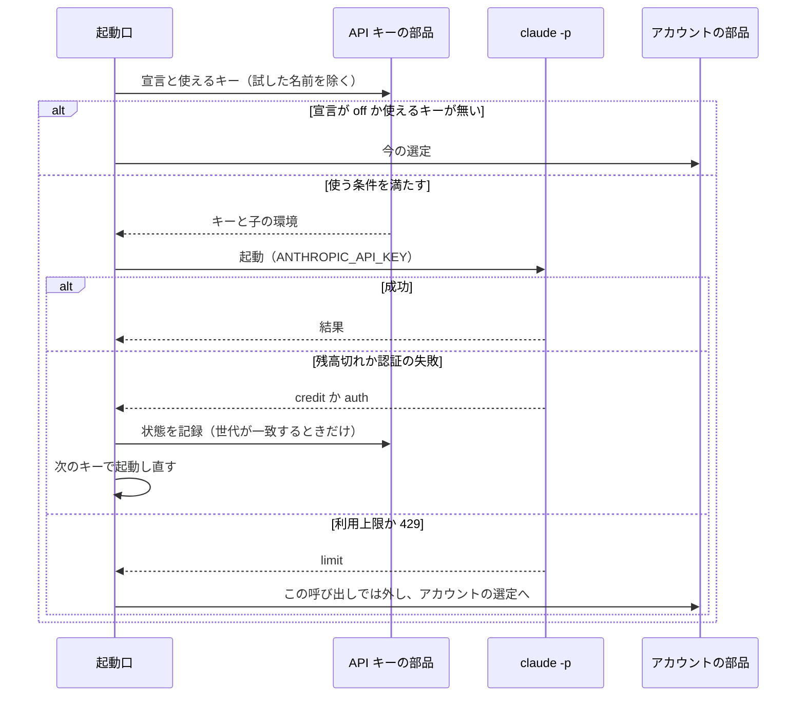

# 登録済み API キーで worker の claude -p を動かす（サブスクリプションの API クレジット）

Max・Ultra・Team のサブスクリプションにリンクした Console 組織の API キーを `relay.py account` で名前を付けて登録し、
`supervise.py` が起動する `claude -p` を月の API クレジットで動かす。API クレジットは利用上限（5 時間・週）と別枠で、
使った分だけ利用上限の消費を逃がせる。残高切れか認証の失敗を受けても、ステップは止まらず次のキーか今のアカウントの
選び方で同じ呼び出しを起動し直す。Claude Code だけが対象である。

例: 登録済みアカウント `main` と `gmail` に、それぞれのサブスクリプションにリンクした組織のキーがある利用者のとき。

| 順 | 起きること |
| --- | --- |
| 1 | `printf '%s\n' "$KEY" \| relay.py account add-api-key key-main --account main` が Messages API へ 1 回要求を打って確かめ、置き場の登録簿（0600）に保存する。`key-gmail` も同じく登録する |
| 2 | `relay.py account api-key-use always` で使い方の宣言を「常に使う」にする |
| 3 | `supervise.py` の worker は、名前の順の先頭の `key-gmail` を `ANTHROPIC_API_KEY` に入れた環境で起動する。進捗ログに `account` の行（`reason: api_key`・`to_key: key-gmail`）が残る |
| 4 | `key-gmail` の組織の残高が尽き、worker が "credit balance is too low" で終わる。状態を残高切れにし、進捗ログに `api_key` の行（`name: key-gmail`・`reason: credit_low`）を残して、`key-main` で同じ呼び出しを起動し直す |
| 5 | `relay.py account list` に、`key-gmail` が `残高切れ`、`key-main` が `使える` と出る。24 時間後の起動で `key-gmail` を 1 回だけ試す |

この文書は、その形に**なぜしたか**（背景・常に成り立つ条件・データの形・入出力の契約・決定と理由・既知の限界・
テスト観点）を残す。**利用者向けの使い方と画面の文の正は Skill とスクリプトにある。**

| 何を読むか | 正本 |
| --- | --- |
| 副命令の打ち方・使い方の宣言の 3 つの値・起動の結果ごとの扱い | [`development-workflow` の `references/relay-accounts.md`](../../plugins/ndf/skills/development-workflow/references/relay-accounts.md) の「worker の claude -p を API キーで動かす」 |
| 登録簿と状態の記録の読み書き・選定・子の環境 | [`lib/claude_api_keys.py`](../../plugins/ndf/scripts/lib/claude_api_keys.py) |
| 副命令の中身と画面の文 | [`relay_lib/api_keys.py`](../../plugins/ndf/scripts/relay_lib/api_keys.py)・[`relay_lib/accounts.py`](../../plugins/ndf/scripts/relay_lib/accounts.py) |
| 確かめの要求と残高切れの文言の判定 | [`lib/claude_usage.py`](../../plugins/ndf/scripts/lib/claude_usage.py) の `check_api_key`・`is_credit_low` |
| 起動口での試し方 | [`supervise_lib/claude.py`](../../plugins/ndf/scripts/supervise_lib/claude.py) の `ClaudeRunner.call` |
| 残高切れの保留の秒・確かめの待ちの上限 | [`contracts/limits.json`](../../plugins/ndf/contracts/limits.json) の `claude-api-keys.credit-hold`・`claude-api-keys.check` |
| 登録済みアカウントと従量の接続の切り替え | [ndf-relay-auth-failure.md](ndf-relay-auth-failure.md) |

## 用語

「サブスクリプション」「API クレジット」「登録済み API キー」「残高切れ」「API キーの使い方の宣言」「API キーの登録簿」の
定義は用語集（[docs/glossary.md](../glossary.md)）が正である。

## 背景

並列の計画では worker の `claude -p` がすべてサブスクリプションのログインで動き、利用上限に当たると待つか従量の接続へ
移っていた。Max・Ultra・Team に毎月付く API クレジットを NDF から使う手段は無かった。`NDF_SUPERVISE_CLAUDE_FALLBACK` で
`ANTHROPIC_API_KEY` を従量の接続として宣言できるが、1 本だけで、登録済みアカウントがすべて上限のときにだけ使われる。

公式の文書（2026-11-09 に確かめた）が定めること:

- API クレジットは利用上限と別枠で、未使用分は請求の周期の終わりで消える。払えるのはリンクした組織の API キーで動かす
  `claude -p`・Agent SDK・Messages API で、対話の Claude Code は払えない
  （ https://platform.claude.com/docs/en/about-claude/api-credits-for-subscribers ・
  https://support.claude.com/en/articles/17154008-monthly-api-credits-for-max-ultra-and-team-plans ）
- 尽きて買ったクレジットも自動チャージも無ければ、要求は "Your credit balance is too low to access the Anthropic API." で止まる。
  Team プランは全席の分を 1 つの残高（上限は月 $500）にまとめ、組織で API キーを持つ全員が同じ残高から使う
- `-p` では `ANTHROPIC_API_KEY` がサブスクリプションのログインより先に使われる
  （ https://code.claude.com/docs/en/authentication ）。偽の値で `claude -p --output-format json` を打つと、
  OAuth のログインがあっても `api_error_status` 401 で 0.6 秒で終わる（`claude` 2.1.319 で実測）

## 対象範囲

| 含む | 含まない |
| --- | --- |
| `relay.py account` の `add-api-key`・`api-key-use` と、`list`・`remove`・`check` の API キーの分岐 | ラッパーが起こす対話のセッション（API クレジットで払えない） |
| `supervise.py` の起動口（`ClaudeRunner`）が起動する `claude -p`（work・worker・判定・遅れの判定・Pull Request） | cross-review の担当の CLI（`lib/assignee_env.py` の経路） |
| 残高切れ・認証の失敗の記録と起動し直し | 残高を API で読むこと（Admin API が要る） |
| `account list` への状態の表示 | Console 組織の作成・リンク・キーの発行、`relay.py ls` への表示、claude 以外の CLI |

## 仕様

### 構成要素

| 要素 | 責務 |
| --- | --- |
| API キーの部品（`lib/claude_api_keys.py`） | 登録簿と状態の記録の読み書き（0600）・名前の検査・選定・子の環境の組み立て・状態の遷移。起動口での試し方（`KeyRoute`・`KeyTry`） |
| 確かめの要求（`lib/claude_usage.py`） | Messages API へ `max_tokens` 1 の要求を 1 回打ち、結果を読み分ける。`http_json` は失敗の応答の本文も返す |
| API キーの副命令（`relay_lib/api_keys.py`） | キーの値の受け取り・確かめ・結果の文の組み立て |
| 副命令のエントリポイント（`relay_lib/accounts.py`） | 副命令の登録と分岐 |
| アカウントの部品（`lib/claude_accounts.py`） | OAuth の `add` も API キーの名前を拒む。置き場の場所（`store_dir()`）を持つ |
| 起動口（`supervise_lib/claude.py` の `ClaudeRunner`） | 呼び出しごとに宣言を読み、キーを試し、尽きたら既存のアカウントの選び方へ進む |

`ClaudeRunner` は今の呼び出しのアカウント（`account`）と別にキーの持ち方（`KeyRoute`）を持つ。キーを外したときに元の
アカウントの選び方へそのまま戻るためである。`call_claude` の結果は残高切れ（`credit`）を持ち、利用上限（`limit`）と
認証の失敗（`auth`）より先に判定する。

### 常に成り立つ条件

| # | 条件 | 破れたときの扱い |
| --- | --- | --- |
| I1 | キーの名前は登録済みアカウントの名前とも予約の名前 `metered` とも重ならない（OAuth の `add` の側でも拒む） | `name_conflict`（終了コード 1） |
| I2 | 結び付いたアカウントは、登録の時点で登録済みアカウントである | `not_registered`（1） |
| I3 | 保存するのは確かめが成功したキーだけで、書きかけを残さない | 保存せず 1 |
| I4 | 登録簿は 0600 で、キーの値は登録簿の外（画面・進捗ログ・判断の記録・状態の記録・`account list`）に出ない | 出力は値を持たない型（名前・アカウント・状態）から組む。引数を読めないときは引数を写さない |
| I5 | キーの値が入るのは起動口が作る `claude -p` の環境だけで、ラッパーの対話のセッションの環境には入らない | ラッパーの起動の経路は登録簿を読まない |
| I6 | 宣言が無い・読めないときは `off` として動く | 登録簿が壊れていれば 1 行表示し、キーを使わない |
| I7 | 認証の失敗のキーと、保留の中の残高切れのキーは選ばない | 選定の候補から外す |
| I8 | 同じ状態からは同じキー（名前の順の先頭）を選ぶ | — |
| I9 | 1 つの登録済みアカウントに結び付くキーは 0 本か 1 本である。同じ名前の置き換えは数えない | `account_taken`（1） |
| I10 | 状態は、起動の時に選んだ世代が登録簿の今の世代と一致するときだけ書く。一致しない行は無いものとして扱う | 書かず、進捗ログの `api_key` の行の理由を `stale_generation` にする |

### 使う条件と選定

| 宣言 | API キーで起動する条件 |
| --- | --- |
| `off`（既定） | 起動しない。起動口の振る舞いは登録が無いときと同じ |
| `always` | 使えるキーがあれば、すべての呼び出しで |
| `near-limit` | (1) アカウントの選び方（`choose`）が候補を返さない、(2) 選んだ候補の使用率が `NDF_ACCOUNT_SWITCH_AT`（既定 90）以上、(3) この呼び出しで利用上限に当たり替えるアカウントが無い（従量の接続へ移る前と、解除を待つ前に試す）のどれか |

登録済みアカウントが 2 つ以上あるときの上限の後の替え先は、アカウント → API キー → 従量の接続の順である。1 つ以下なら
API キー → 従量の接続の宣言（1 度だけ）→ 解除の待ちの順である。

**子の環境**: 起動したときの環境から、OAuth のトークンとスコープ・`ANTHROPIC_AUTH_TOKEN`・Bedrock と Vertex の変数・
既存の `ANTHROPIC_API_KEY`・従量の接続の宣言のキーを外し、親のアカウントの環境を元へ戻す。その上で `ANTHROPIC_API_KEY` に
選んだ 1 本、`NDF_CLAUDE_API_KEY_NAME` に名前、`NDF_CLAUDE_API_KEY_GENERATION` に世代、`NDF_CLAUDE_KEY_ACCOUNT` にキーを
外したときに戻る登録済みアカウントの名前を足す。

**送り先の確かめ**: 子の環境の `ANTHROPIC_BASE_URL` か、子が読む設定のファイル（管理・利用者・プロジェクト・手元）の
`env` の `ANTHROPIC_BASE_URL` のどれかが `https://api.anthropic.com` の外を指すときは、キーを使わずに今の認証で起動する。
登録のときに Anthropic へだけ送って確かめたキーを、ゲートウェイなど別のサービスへ送らないためである。

**入れ子の起動**: worker の中で起動した `supervise.py` は、起動したときの環境の名前と世代を受け継いだキーとして扱い、
残高切れなら同じく状態を記録する（I10）。受け継いだキーが使えなくなったら以後の子から外し、`NDF_CLAUDE_KEY_ACCOUNT` の
アカウントの環境へ戻す。

### 起動の流れ

### 状態の遷移

| 今の状態 | 引き金 | 次の状態 |
| --- | --- | --- |
| — | 登録（確かめが成功） | 使える |
| 使える | 起動か確かめで残高切れ | 残高切れ |
| 使える | 起動か確かめで 401 | 認証の失敗 |
| 残高切れ・認証の失敗 | `account check` が成功 | 使える |
| 残高切れ | 保留（最後の観測から `claude-api-keys.credit-hold`）が過ぎた後の起動が成功 | 使える |
| どれでも | `account remove` | （行を消す） |

残高切れは観測し直すたびに `since` を今へ進める。保留が過ぎて試し、尽きたままならまた保留の間は選ばない。認証の失敗は
時間で戻らない。失効・削除したキーは時間で戻らないためである。

## データ・設定

置き場はアカウントの置き場（`${NDF_ACCOUNTS_DIR:-<共有の設定ディレクトリ>/ndf/accounts}/`）。2 つのファイルを持ち、
既存のファイルの形は変えない。どちらも無ければ登録 0 本・宣言 `off` として動く。

**`api-keys.json`（API キーの登録簿。0600）**

| 列 | 型 | 意味 |
| --- | --- | --- |
| `version` | 整数 | 形の版。`1` |
| `use` | 文字列 | 使い方の宣言。`off`・`always`・`near-limit`。無いときは `off` |
| `keys.<名前>.key` | 文字列 | キーの値。このファイルの外へ出さない |
| `keys.<名前>.account` | 文字列 | 結び付いた登録済みアカウントの名前。アカウントを外しても残る（一覧に出すだけ） |
| `keys.<名前>.added_at` | ISO 8601 | 登録した時刻（UTC） |
| `keys.<名前>.generation` | 文字列 | 世代。登録と置き換えのたびに新しく作る UUID（版 4） |

**`api-key-state.json`（API キーの状態。0600）**

| 列 | 型 | 意味 |
| --- | --- | --- |
| `<名前>.generation` | 文字列 | この状態を観測したキーの世代 |
| `<名前>.state` | 文字列 | `ok`・`credit_low`・`auth_failed` |
| `<名前>.since` | ISO 8601 | 今の状態になった時刻（残高切れは最後に観測した時刻） |
| `<名前>.checked_at` | ISO 8601 か null | 最後に確かめた時刻 |

行が無いキー・世代が登録簿と一致しないキー・形が違う行は `ok` として扱う。状態は上書きし、過去の遷移は進捗ログの
`api_key` の行が持つ。登録簿と状態を別のファイルに分けるのは、起動のたびに書く状態の更新でキーの値を持つファイルを
書き直さないためである。

書くときは一時ファイルへ 0600 で書いて置き換え、アカウントの置き場の `.locks/.api-keys` の排他を取る。

## 外部連携

| 副命令 | 入力 | 成功の出力 | 失敗の `reason`（終了コード） |
| --- | --- | --- | --- |
| `account add-api-key <名前> --account <アカウント> [--key-file <パス>]` | キーの値は標準入力の 1 行目（端末なら表示しない入力）か `--key-file`。引数では受けない | `登録した: <名前>（アカウント <アカウント>）` と、買ったクレジットの注意の 1 行（標準エラー）。JSON は `name`・`account`・`replaced` | `name_conflict`・`not_registered`・`account_taken`・`auth_failed`・`credit_low`・`network`・`unclassified`・`write_failed`（1）、`missing_args`・`invalid_name`（2） |
| `account api-key-use [off\|always\|near-limit]` | 省くと今の宣言を出す | `API キーの使い方: <値>` | `invalid_name`（2）・`write_failed`（1） |
| `account check <API キーの名前>` | — | `使える: <名前>`。状態を `ok` に戻す | 確かめの失敗は状態を変えずに返す（1） |
| `account remove <API キーの名前>` | — | `外した: <名前>（API キー）` | `write_failed`（1） |
| `account list` | — | 既存の行の後に、キーごとに `name`・`kind: api_key`・`account`・`state`・`since`。表では「識別」の列に結び付いたアカウント、「状態」の列に `使える`・`残高切れ`・`認証の失敗` | 登録簿が壊れていれば 1 行出して行を足さない |

`check` と `remove` は、名前が登録済み API キーのときだけ API キーの分岐へ入る。`metered`・OAuth のアカウントの名前の
ときの出力と終了コードは変えない。

**確かめの要求**: `POST https://api.anthropic.com/v1/messages` へ `max_tokens` 1 で打つ。宛先は `NDF_API_KEY_CHECK_URL`、
モデル（既定 `claude-haiku-4-5`）は `NDF_API_KEY_CHECK_MODEL` で差し替えられる。待ちの上限は `claude-api-keys.check`（30 秒）。

| 応答 | 結果 |
| --- | --- |
| 200 | 使える |
| 401 か `error.type` が `authentication_error` | 認証の失敗 |
| `error.message` に "credit balance" と "too low" の両方を含む（大文字と小文字を問わない） | 残高切れ |
| 通信の失敗 | 通信の失敗 |
| それ以外 | その他。状態コードと `error.type` だけを表示し、`message` は値を含みうるので表示しない |

## 決定と理由

- **キーの値を標準入力とファイルでだけ受ける。** 引数は `ps` とシェルの履歴に残る。AI が代わりに打つときも
  `printf '%s\n' "$KEY" |` で対話なしに渡せる。10 分で切れる 1 回きりのコードと違い、長く効くキーは漏れたときの影響が大きい
- **使う範囲を起動口の `claude -p` に限る。** 対話の Claude Code は API クレジットで払えない。起動口は `supervise.py` の
  すべての `claude -p` の唯一の呼び出し元で、1 か所で済む。cross-review の担当は失敗の後の振り替えが別の規則を持つため含めない
- **子の環境の `ANTHROPIC_API_KEY` に値を入れる。** `-p` では公式にログインより先に使われ、401 が速く返る。
  `apiKeyHelper` は環境に値を置かずに済むが、偽の値で 401 の後に 60 秒で終わらなかった（`claude` 2.1.319 で実測）。失敗が
  速く返らないと、起動し直す経路が待ちで詰まる
- **使えるキーの中から名前の順の先頭を選ぶ。** 残高は API キーでは読めず、量で比べられない。名前の順なら利用者が名前の
  付け方で順を決められる。結び付いたアカウントの使用率は API クレジットの残高と関係しない
- **確かめの要求を既存の `urllib` の部品で打つ。** ラッパーは標準ライブラリだけで動く。`anthropic` の SDK は 1 回の要求の
  ために依存を足すことになり、`claude -p` で打つと設定とツールの定義を送るため費用が大きい
- **残高切れを文言で読み、利用上限より先に判定する。** 公式の文言が 2 つの形（"Your credit balance is too low ..." と
  "Credit balance too low ..."）を持つため、共通部分で読む。利用上限と 429 は多くが一時的なので、この呼び出しでだけ外して記録しない
- **残高切れの保留を時間（既定 24 時間）で解く。** 請求の周期の日付は読めない。尽きた組織への要求は数秒で止まり課金されない
  ため、過ぎたら 1 回試す。失敗した鍵を一定の時間だけ外す形は LiteLLM の `cooldown_time` と同じである
- **買ったクレジットへの課金を NDF の側で抑えない。** 何回で月のクレジットが尽きるかは読めず、回数の上限に根拠が無い。
  費用の上限は Console の workspace の spend limit で利用者が決め、登録のときにそのことを 1 行出す
- **`near-limit` の閾値に既存の切り替えの閾値（`NDF_ACCOUNT_SWITCH_AT`）を使う。** アカウントを替える判断と API キーへ
  移る判断はどちらも「このアカウントの利用上限をこれ以上使わない」判断で、閾値を 2 つ持つと大小の組み合わせで振る舞いが変わる

## セキュリティ

- キーの値は 0600 の登録簿にだけ置く。確かめの失敗の表示は状態コードと型だけで、応答の `message` は出さない
- 名前の位置にキーを誤って渡したときも、`invalid_name` と引数の誤りの文は入力値を写さない
- 子の環境へ渡すのは選んだ 1 本だけで、送り先が Anthropic の外ならキーを使わない
- **既知の限界**: worker の `claude -p` の中で動くツール（Bash など）は、子の環境の `ANTHROPIC_API_KEY` を読める。OAuth の
  アカウントの子が設定ディレクトリの認証ファイルを読めるのと同じ水準で、環境の値を worker から隠す手段は採らない

## 運用

- 状態の確認は `account list`、残高切れと認証の失敗の解除は `account check <名前>` で、利用者のコマンドで完結する
- 登録簿が壊れていれば、起動口は最初の呼び出しの前に標準エラーと進捗ログ（`api_keys_invalid`）へ 1 行出し、キーを使わずに動く

**未確認のまま残ること**:

| 項目 | 内容 |
| --- | --- |
| 課金の扱い | ラッパーの対話のセッションの中から `supervise.py` が起こす `claude -p` が API クレジットで払われるかは、公式の文書に書かれていない。払われず残高切れが返るときは、起動し直す経路でサブスクリプションへ戻り、ステップは止まらない |
| 残高切れの `claude -p` の出力 | `result` の文言と `api_error_status` は実物で確かめていない。公式の 2 つの文言の共通部分で読む |
| 確かめの要求のモデル | モデルの ID は版で変わる。存在しないモデルは「その他」で失敗するため、`NDF_API_KEY_CHECK_MODEL` で差し替える |

## テスト観点

テストは [`tests/test_claude_api_keys.py`](../../plugins/ndf/scripts/tests/test_claude_api_keys.py)（部品と副命令）と
[`tests/test_supervise_api_keys.py`](../../plugins/ndf/scripts/tests/test_supervise_api_keys.py)（偽の `claude` を使う起動口）にある。

| 観点 | 満たすこと |
| --- | --- |
| 値の受け取り | 端末でない標準入力とファイルから登録できる。引数の位置にキーを渡すと引数の誤り（2）で、値を写さない |
| 確かめ（I3） | 偽の宛先が 401・残高切れ・通信の失敗を返すと、理由を出して 1 で終わり、登録簿が作られない |
| 値を出さない（I4） | 偽のキーの値の文字列が、すべての副命令の標準出力・標準エラー・`--json`・進捗ログ・状態の記録に 0 回。登録簿は 0600 |
| 登録の規則（I1・I2・I9） | 2 本を別のアカウントへ登録して 1 本ずつ外せる。同じ名前で置き換わる。名前の衝突・無いアカウント・別のキーが結び付いたアカウントを拒む。OAuth の `add` は API キーの名前を拒む |
| 世代（I10） | 置き換える前の世代で起動した worker が 401 を返しても、置き換えた後のキーは `ok` のまま候補に残る |
| 使う範囲（I5） | `always` で子の環境に `ANTHROPIC_API_KEY` が 1 本入り、OAuth のトークンと `ANTHROPIC_AUTH_TOKEN` が無い。ラッパーの区間の起動の環境に値が無い。送り先が Anthropic の外ならキーを使わない |
| 宣言（I6） | 宣言が無い・壊れているときは `off` として動き、3 つの値を設定し読み返せる |
| 退行しない | `off` と登録 0 本で、子の環境・アカウントの選び方・上限の後の切り替え・OAuth と `metered` の副命令の出力と終了コードが変わらない |
| 選定（I7・I8） | 同じ状態から名前の順の先頭を選ぶ。保留の中の残高切れと認証の失敗は選ばず、保留が過ぎた残高切れは選ぶ |
| 起動し直し | 残高切れ・401 を返すと状態が `credit_low`・`auth_failed` になり、次のキー、無ければサブスクリプションのログインの環境で同じ呼び出しが起動し直され、ステップが成功で終わる。進捗ログにキーの名前と理由の行が 1 行 |
| 一覧と確かめ直し | `account list` に名前・結び付いたアカウント・状態が出る。`account check` が成功すると `ok` に戻り、失敗なら変えない |
| `near-limit` | 使用率が閾値未満なら使わず、閾値以上・候補なし・上限に当たった後なら使う |

## 関連リンク

- [ndf-relay-auth-failure.md](ndf-relay-auth-failure.md)（登録済みアカウントの認証の失敗の扱い）
- [ndf-relay-segment-restart.md](ndf-relay-segment-restart.md)（ラッパーの本体の契約）
- #2855（要求と受け入れ条件）・#1468（Bedrock の登録）・#1576（アカウントの置き場）・#1586（上限に達した後の切り替え）
