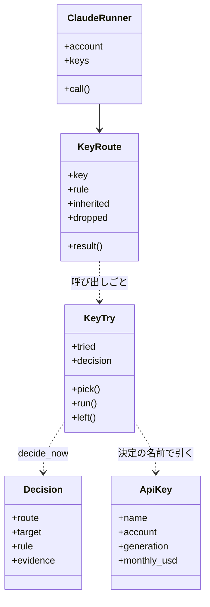
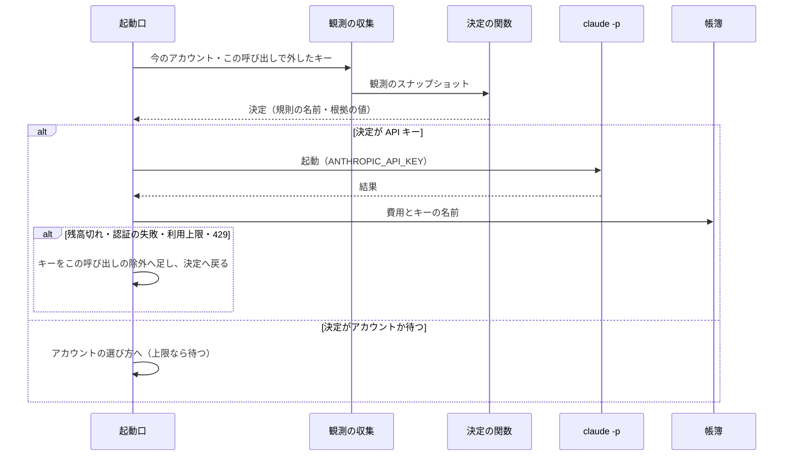

# 登録済み API キーで worker の claude -p を動かす（サブスクリプションの API クレジット）

Max・Ultra・Team のサブスクリプションにリンクした Console 組織の API キーを `relay.py account` で名前を付けて登録し、
`supervise.py` が起動する `claude -p` を月の API クレジットで動かす。API クレジットは利用上限（5 時間・週）と別枠で、
使った分だけ利用上限の消費を逃がせる。どこで起動するかは起動先の決定（`lib/launch_rules.py`）が、その時点の観測と
使用量の帳簿だけから決める（#2930）。残高切れか認証の失敗を受けても、ステップは止まらず次のキーか今のアカウントの
選び方で同じ呼び出しを起動し直す。Claude Code だけが対象である。

例: 登録済みアカウント `main` と `gmail` に、それぞれのサブスクリプションにリンクした組織のキーがある利用者のとき。

| 順 | 起きること |
| --- | --- |
| 1 | `printf '%s\n' "$KEY" \| relay.py account add-api-key key-main --account main` が Messages API へ 1 回要求を打って確かめ、置き場の登録簿（0600）に保存する。`key-gmail` も同じく登録する |
| 2 | `relay.py account api-key-monthly key-main 200` と `key-gmail 100` で月の額を宣言し、`relay.py account api-key-use near-limit` で使い方の宣言を「全アカウントの週の上限が近いときだけ使う」にする（閾値 T は既定の 85%） |
| 3 | `main` の週の使用率が 90%、`gmail` が 40% の間は、キーを使わない。`main` は週が T 以上（組 3）なので、worker は週が T 未満の `gmail` で起動する |
| 4 | `gmail` も 86% になると、2 本のうち使用の割合（直近 7 日の使用額 ÷ 週の利用枠）の小さいキーを `ANTHROPIC_API_KEY` に入れて起動する。進捗ログに `account` の行（`reason: api_key`・`to_key`・`rule: near_limit_key`・`evidence`）が残り、帳簿の行に `api_key` の列（キーの名前）が載る |
| 5 | キーの組織の残高が尽き、worker が "credit balance is too low" で終わる。その呼び出しでだけそのキーを外し、もう 1 本で同じ呼び出しを起動し直す。次の呼び出しではまた候補に入る |
| 6 | 週の枠がリセットされて `gmail` の週が 0% に戻ると、次の起動ではキーを使わず `gmail` で起動する |

この文書は、その形に**なぜしたか**（背景・常に成り立つ条件・データの形・入出力の契約・決定と理由・既知の限界・
テスト観点）を残す。**利用者向けの使い方と画面の文の正は Skill とスクリプトにある。**

| 何を読むか | 正本 |
| --- | --- |
| 副命令の打ち方・使い方の宣言の 3 つの値・起動の結果ごとの扱い | [`development-workflow` の `references/relay-accounts.md`](../../plugins/ndf/skills/development-workflow/references/relay-accounts.md) の「worker の claude -p を API キーで動かす」 |
| 起動先の決定（規則の表・選ぶ順の組） | [`lib/launch_rules.py`](../../plugins/ndf/scripts/lib/launch_rules.py) |
| 観測の収集（使用率・帳簿の直近 7 日の使用額） | [`lib/launch_observe.py`](../../plugins/ndf/scripts/lib/launch_observe.py) |
| 登録簿の読み書き・子の環境・起動口での試し方 | [`lib/claude_api_keys.py`](../../plugins/ndf/scripts/lib/claude_api_keys.py) |
| 副命令の中身と画面の文 | [`relay_lib/api_keys.py`](../../plugins/ndf/scripts/relay_lib/api_keys.py)・[`relay_lib/accounts.py`](../../plugins/ndf/scripts/relay_lib/accounts.py) |
| 確かめの要求と残高切れの文言の判定 | [`lib/claude_usage.py`](../../plugins/ndf/scripts/lib/claude_usage.py) の `check_api_key`・`is_credit_low` |
| 起動口での試し方 | [`supervise_lib/claude.py`](../../plugins/ndf/scripts/supervise_lib/claude.py) の `ClaudeRunner.call` |
| 確かめの待ちの上限 | [`contracts/limits.json`](../../plugins/ndf/contracts/limits.json) の `claude-api-keys.check` |
| 登録済みアカウントと従量の接続の切り替え | [ndf-relay-auth-failure.md](ndf-relay-auth-failure.md) |

## 用語

「サブスクリプション」「API クレジット」「登録済み API キー」「残高切れ」「API キーの使い方の宣言」「API キーの登録簿」
「閾値 T」「週の利用枠」「選ぶ順の組」「切り替えの余裕」「観測のスナップショット」の定義は用語集（[docs/glossary.md](../glossary.md)）が正である。

## 背景

並列の計画では worker の `claude -p` がすべてサブスクリプションのログインで動き、利用上限に当たると待つか従量の接続へ
移っていた。Max・Ultra・Team に毎月付く API クレジットを NDF から使う手段は無かった。`NDF_SUPERVISE_CLAUDE_FALLBACK` で
`ANTHROPIC_API_KEY` を従量の接続として宣言できるが、1 本だけで、登録済みアカウントがすべて上限のときにだけ使われる。

公式の文書（2026-11-09 に確かめた）が定めること:

- API クレジットは利用上限と別枠で、未使用分は請求の周期の終わりで消える。払えるのはリンクした組織の API キーで動かす
  `claude -p`・Agent SDK・Messages API で、対話の Claude Code は払えない
  （ https://platform.claude.com/docs/en/about-claude/api-credits-for-subscribers ・
  https://support.claude.com/en/articles/17154008-monthly-api-credits-for-max-ultra-and-team-plans ）
- 尽きて買ったクレジットも自動チャージも無ければ、要求は "Your credit balance is too low to access the Anthropic API." で止まる。
  Team プランは全席の分を 1 つの残高（上限は月 $500）にまとめ、組織で API キーを持つ全員が同じ残高から使う
- `-p` では `ANTHROPIC_API_KEY` がサブスクリプションのログインより先に使われる
  （ https://code.claude.com/docs/en/authentication ）。偽の値で `claude -p --output-format json` を打つと、
  OAuth のログインがあっても `api_error_status` 401 で 0.6 秒で終わる（`claude` 2.1.319 で実測）

## 対象範囲

| 含む | 含まない |
| --- | --- |
| `relay.py account` の `add-api-key`・`api-key-monthly`・`api-key-use` と、`list`・`remove`・`check` の API キーの分岐 | ラッパーが起こす対話のセッション（API クレジットで払えない） |
| `supervise.py` の起動口（`ClaudeRunner`）が起動する `claude -p`（work・worker・判定・遅れの判定・Pull Request） | cross-review の担当の CLI（`lib/assignee_env.py` の経路） |
| 残高切れ・認証の失敗の起動し直し（その呼び出しの中だけ） | 残高・期限を API で読むこと（Admin API が要る。利用者が使わないと決めた） |
| `account list` への月の額・直近 7 日の使用額・週の利用枠の表示 | Console 組織の作成・リンク・キーの発行、`relay.py ls` への表示、claude 以外の CLI |

## 仕様

### 構成要素

| 要素 | 責務 |
| --- | --- |
| 起動先の決定（`lib/launch_rules.py`） | 観測のスナップショットから起動先の決定（アカウント・API キー・待つ と規則の名前・根拠の値）を返す。I/O を持たない |
| 観測の収集（`lib/launch_observe.py`） | アカウントの使用率（控えを通す）・上限の観測・起動できるか・登録簿の宣言・帳簿の直近 7 日の使用額を集め、決定を呼ぶ（`decide_now`） |
| API キーの部品（`lib/claude_api_keys.py`） | 登録簿の読み書き（0600）・名前の検査・子の環境の組み立て。起動口での試し方（`KeyRoute`・`KeyTry`） |
| 確かめの要求（`lib/claude_usage.py`） | Messages API へ `max_tokens` 1 の要求を 1 回打ち、結果を読み分ける。`http_json` は失敗の応答の本文も返す |
| API キーの副命令（`relay_lib/api_keys.py`） | キーの値の受け取り・確かめ・結果の文の組み立て |
| 副命令のエントリポイント（`relay_lib/accounts.py`） | 副命令の登録と分岐 |
| アカウントの部品（`lib/claude_accounts.py`） | OAuth の `add` も API キーの名前を拒む。置き場の場所（`store_dir()`）を持つ |
| 起動口（`supervise_lib/claude.py` の `ClaudeRunner`） | 呼び出しごとに起動先の決定を求め、キーを試し、外したら同じ決定でアカウントの選び方へ進む。キーで起動した行の帳簿にキーの名前を書く |

`ClaudeRunner` は今の呼び出しのアカウント（`account`）と別にキーの持ち方（`KeyRoute`）を持つ。キーを外したときに元の
アカウントの選び方へそのまま戻るためである。`KeyTry.tried` はこの呼び出しで外したキーの名前で、呼び出しが終われば捨てる。
`call_claude` の結果は残高切れ（`credit`）を持ち、利用上限（`limit`）と認証の失敗（`auth`）より先に判定する。

### 常に成り立つ条件

| # | 条件 | 破れたときの扱い |
| --- | --- | --- |
| I1 | キーの名前は登録済みアカウントの名前とも予約の名前 `metered` とも重ならない（OAuth の `add` の側でも拒む） | `name_conflict`（終了コード 1） |
| I2 | 結び付いたアカウントは、登録の時点で登録済みアカウントである | `not_registered`（1） |
| I3 | 保存するのは確かめが成功したキーだけで、書きかけを残さない | 保存せず 1 |
| I4 | 登録簿は 0600 で、キーの値は登録簿の外（画面・進捗ログ・判断の記録・使用量の帳簿・`account list`）に出ない | 出力は値を持たない型（名前・アカウント・月の額）から組む。引数を読めないときは引数を写さない |
| I5 | キーの値が入るのは起動口が作る `claude -p` の環境だけで、ラッパーの対話のセッションの環境には入らない | ラッパーの起動の経路は登録簿を読まない |
| I6 | 宣言が無い・読めないときは `off` として動く | 登録簿が壊れていれば 1 行表示し、キーを使わない |
| I7 | 判定のための状態のファイルを読まず、書かない。残高切れ・認証の失敗・上限を返したキーは、その呼び出しの除外へ足すだけである | 旧版の `api-key-state.json` が残っていても決定は変わらない |
| I8 | 同じ観測のスナップショットからは同じ決定（起動先・規則の名前・根拠の値）が出る | 決定の関数は時刻・ファイル・API を読まない |
| I9 | 1 つの登録済みアカウントに結び付くキーは 0 本か 1 本である。同じ名前の置き換えは数えない | `account_taken`（1） |
| I10 | near-limit では、再登録が要るものを除いた登録済みアカウントの週の使用率がすべて読めて閾値 T 以上のときだけキーを使い、月の額を宣言して直近 7 日の使用額が週の利用枠未満のキーだけを選ぶ | 規則の表の順序の誤り。表のテストが落とす |

### 使う条件と選定

| 宣言 | API キーで起動する条件 |
| --- | --- |
| `off`（既定） | 起動しない。起動口の振る舞いは登録が無いときと同じ |
| `always` | 外していないキーがあれば、すべての呼び出しで。名前の順の先頭 |
| `near-limit` | 再登録が要るものを除いた登録済みアカウントの週の使用率（週の枠とモデル別の週の枠の最大）がすべて閾値 T（既定 85%）以上。5 時間の枠の使用率は見ない |

起動先の決定の規則の表（上から当て、最初に決定を返したものを採る）:

| 規則の名前 | 起動先 | 当たる条件 |
| --- | --- | --- |
| `always_key` | API キー（名前の順の先頭） | `always` で、外していないキーがある |
| `near_limit_key` | API キー（使用の割合の最も小さいもの） | near-limit の条件がそろい、帳簿を読め、月の額を宣言し週の利用枠の残るキーがある |
| `near_limit_ledger_unreadable` | アカウントか待つ | 上の条件のうち帳簿を読めない |
| `near_limit_no_declared_key` | アカウントか待つ | 外していないキーのどれも月の額を宣言していない |
| `near_limit_budget_used_up` | アカウントか待つ | 宣言のあるキーがすべて週の利用枠を使い切った |
| `account` | アカウント | 上のどれにも当たらず、候補のアカウントがある |
| `wait_reset` | 待つ | 候補のアカウントが無い（解除の時刻は上限にあるアカウントの最も早いもの） |

**週の利用枠**は月の額 × 7 ÷ 30、使用の割合は直近 7 日の使用額 ÷ 週の利用枠である。直近 7 日の使用額は、使用量の帳簿の
`api_key` の列がそのキーの名前の行の `cost_usd` の合計で、判定のたびに読み直す。アカウントの選ぶ順の組（5 時間の枠を
先に使う）は [relay-accounts.md](../../plugins/ndf/skills/development-workflow/references/relay-accounts.md) にある。

登録済みアカウントが 2 つ以上あるときの上限の後の替え先は、アカウント → API キー（その時点の決定が選べば）→ 従量の接続の順
である。1 つ以下なら API キー（同じ）→ 従量の接続の宣言（1 度だけ）→ 解除の待ちの順である。

**子の環境**: 起動したときの環境から、OAuth のトークンとスコープ・`ANTHROPIC_AUTH_TOKEN`・Bedrock と Vertex の変数・
既存の `ANTHROPIC_API_KEY`・従量の接続の宣言のキーを外し、親のアカウントの環境を元へ戻す。その上で `ANTHROPIC_API_KEY` に
選んだ 1 本、`NDF_CLAUDE_API_KEY_NAME` に名前、`NDF_CLAUDE_API_KEY_GENERATION` に世代、`NDF_CLAUDE_KEY_ACCOUNT` にキーを
外したときに戻る登録済みアカウントの名前を足す。

**送り先の確かめ**: 子の環境の `ANTHROPIC_BASE_URL` か、子が読む設定のファイル（管理・利用者・プロジェクト・手元）の
`env` の `ANTHROPIC_BASE_URL` のどれかが `https://api.anthropic.com` の外を指すときは、キーを使わずに今の認証で起動する。
登録のときに Anthropic へだけ送って確かめたキーを、ゲートウェイなど別のサービスへ送らないためである。

**入れ子の起動**: worker の中で起動した `supervise.py` は、起動したときの環境の名前と世代を受け継いだキーとして扱う。
受け継いだキーは決定の外にあり、使えなくなったら進捗ログに 1 行残して以後の子から外し、`NDF_CLAUDE_KEY_ACCOUNT` の
アカウントの環境へ戻す。

### 起動の流れ

## データ・設定

置き場はアカウントの置き場（`${NDF_ACCOUNTS_DIR:-<共有の設定ディレクトリ>/ndf/accounts}/`）。登録簿だけを持ち、
無ければ登録 0 本・宣言 `off` として動く。

**`api-keys.json`（API キーの登録簿。0600）**

| 列 | 型 | 意味 |
| --- | --- | --- |
| `version` | 整数 | 形の版。`1` |
| `use` | 文字列 | 使い方の宣言。`off`・`always`・`near-limit`。無いときは `off` |
| `weekly_at` | 数（%） | 閾値 T。1 以上 100 以下。無い・範囲の外のときは 85 |
| `keys.<名前>.key` | 文字列 | キーの値。このファイルの外へ出さない |
| `keys.<名前>.account` | 文字列 | 結び付いた登録済みアカウントの名前。アカウントを外しても残る（一覧に出すだけ） |
| `keys.<名前>.added_at` | ISO 8601 | 登録した時刻（UTC） |
| `keys.<名前>.generation` | 文字列 | 世代。登録と置き換えのたびに新しく作る UUID（版 4）。入れ子の起動で受け継いだキーを見分ける |
| `keys.<名前>.monthly_usd` | 正の数 | 月の額（ドル）。無ければ未宣言で、near-limit で選ばない。宣言し直しても世代は変えない |

旧版が書いた `api-key-state.json` は読まず、書かず、消さない（利用者のファイルを黙って消さない）。

**使用量の帳簿の `api_key` の列**: API キーで起動した `claude -p` の行だけに、そのキーの名前を書く。値は書かない。
アカウントで起動した行と古い行には列が無い。帳簿の版（`schema`）は上げない。

書くときは一時ファイルへ 0600 で書いて置き換え、アカウントの置き場の `.locks/.api-keys` の排他を取る。

## 外部連携

| 副命令 | 入力 | 成功の出力 | 失敗の `reason`（終了コード） |
| --- | --- | --- | --- |
| `account add-api-key <名前> --account <アカウント> [--key-file <パス>] [--monthly <ドル>]` | キーの値は標準入力の 1 行目（端末なら表示しない入力）か `--key-file`。引数では受けない。`--monthly` は正の数 | `登録した: <名前>（アカウント <アカウント>）` と、買ったクレジットの注意の 1 行（標準エラー）。JSON は `name`・`account`・`replaced` | `name_conflict`・`not_registered`・`account_taken`・`auth_failed`・`credit_low`・`network`・`unclassified`・`write_failed`（1）、`missing_args`・`invalid_name`（2。月の額の誤りも値を写さない） |
| `account api-key-monthly <名前> <ドル>` | 正の数。`0` は宣言を外す | `月の額: <名前> <ドル> ドル（週の利用枠 <ドル> ドル）` | `not_registered`・`write_failed`（1）、`invalid_name`・`missing_args`（2） |
| `account api-key-use [off\|always\|near-limit] [--weekly-at <百分率>]` | 省くと今の宣言と T を出す。`--weekly-at` は 1 以上 100 以下 | `API キーの使い方: <値>（閾値 T <百分率>%）`。JSON は `use`・`weekly_at` | `invalid_name`（2）・`write_failed`（1） |
| `account check <API キーの名前>` | — | `使える: <名前>`。状態は記録しない | 確かめの失敗の理由を返す（1） |
| `account remove <API キーの名前>` | — | `外した: <名前>（API キー）` | `write_failed`（1） |
| `account list` | — | アカウントの行に `has_five_hour`・`group`・`next`（表は「5時間枠」「組」の列）。キーごとに `name`・`kind: api_key`・`account`・`monthly_usd`・`spent_7d`・`weekly_budget`・`ratio`。表では「識別」の列に結び付いたアカウント、「枠の大きさ」の列に月の額（`月 未宣言`）、「残り」の列に直近 7 日の使用額 / 週の利用枠（割合） | 登録簿が壊れていれば 1 行出して行を足さない |

`check` と `remove` は、名前が登録済み API キーのときだけ API キーの分岐へ入る。`metered`・OAuth のアカウントの名前の
ときの出力と終了コードは変えない。

**確かめの要求**: `POST https://api.anthropic.com/v1/messages` へ `max_tokens` 1 で打つ。宛先は `NDF_API_KEY_CHECK_URL`、
モデル（既定 `claude-haiku-4-5`）は `NDF_API_KEY_CHECK_MODEL` で差し替えられる。待ちの上限は `claude-api-keys.check`（30 秒）。

| 応答 | 結果 |
| --- | --- |
| 200 | 使える |
| 401 か `error.type` が `authentication_error` | 認証の失敗 |
| `error.message` に "credit balance" と "too low" の両方を含む（大文字と小文字を問わない） | 残高切れ |
| 通信の失敗 | 通信の失敗 |
| それ以外 | その他。状態コードと `error.type` だけを表示し、`message` は値を含みうるので表示しない |

## 決定と理由

- **キーの値を標準入力とファイルでだけ受ける。** 引数は `ps` とシェルの履歴に残る。AI が代わりに打つときも
  `printf '%s\n' "$KEY" |` で対話なしに渡せる。10 分で切れる 1 回きりのコードと違い、長く効くキーは漏れたときの影響が大きい
- **使う範囲を起動口の `claude -p` に限る。** 対話の Claude Code は API クレジットで払えない。起動口は `supervise.py` の
  すべての `claude -p` の唯一の呼び出し元で、1 か所で済む。cross-review の担当は失敗の後の振り替えが別の規則を持つため含めない
- **子の環境の `ANTHROPIC_API_KEY` に値を入れる。** `-p` では公式にログインより先に使われ、401 が速く返る。
  `apiKeyHelper` は環境に値を置かずに済むが、偽の値で 401 の後に 60 秒で終わらなかった（`claude` 2.1.319 で実測）。失敗が
  速く返らないと、起動し直す経路が待ちで詰まる
- **`always` は名前の順の先頭、`near-limit` は使用の割合の最も小さいキーを選ぶ。** 残高は API キーでは読めないが、
  直近 7 日の使用額は帳簿から数えられる。月の額で割った割合で比べると、額の違うキーを均等に使える（#2930）
- **起動先を「観測のスナップショット → 決定」の純粋な関数と、規則の関数の並びで決める。** 規則と組を名前の並びにすると、
  並びがそのまま設計の表になり、決定に当たった規則の名前を載せられる（#2930 の決定 1）
- **判定のための状態を持たない。** 残高切れ・認証の失敗はその呼び出しの除外へ足すだけで、次の呼び出しではまた候補に入る。
  費用は尽きたキーで起動した 1 回の失敗だけである。状態を持つと、プロセスの終了と再起動のたびの扱いが要る（#2930 の決定 2）
- **週の利用枠を月の額 × 7 ÷ 30、使用額を帳簿の直近 7 日の合計で数える。** 月のクレジットは請求の周期ごとに付与され
  繰り越さないので、どの 7 日を取っても利用枠に収まる。付与日と残高を持たずに済む（#2930 の決定 4）
- **確かめの要求を既存の `urllib` の部品で打つ。** ラッパーは標準ライブラリだけで動く。`anthropic` の SDK は 1 回の要求の
  ために依存を足すことになり、`claude -p` で打つと設定とツールの定義を送るため費用が大きい
- **残高切れを文言で読み、利用上限より先に判定する。** 公式の文言が 2 つの形（"Your credit balance is too low ..." と
  "Credit balance too low ..."）を持つため、共通部分で読む
- **買ったクレジットへの課金を NDF の側で抑えない。** 何回で月のクレジットが尽きるかは読めず、回数の上限に根拠が無い。
  費用の上限は Console の workspace の spend limit で利用者が決め、登録のときにそのことを 1 行出す
- **`near-limit` を全アカウントの週の使用率で発動し、5 時間の上限では使わない。** 月のクレジットは対話の Claude Code に
  使えないので、週の枠が尽きかけたときだけ `claude -p` を逃がして対話のセッションの週の枠を残す。5 時間の枠は数時間で戻る
- **閾値 T（既定 85%）を、アカウントの選ぶ順の組と API キーへ逃がす条件の両方に使う。** 閾値を 2 つ持つと大小の組み合わせで
  振る舞いが変わる。85% の根拠は #2930 の設計の決定 10（発動の時点でアカウントの残りと API キーの利用枠で `claude -p` の約 1.6 日分）

## セキュリティ

- キーの値は 0600 の登録簿にだけ置く。確かめの失敗の表示は状態コードと型だけで、応答の `message` は出さない
- 名前の位置にキーを誤って渡したときも、`invalid_name` と引数の誤りの文は入力値を写さない
- 子の環境へ渡すのは選んだ 1 本だけで、送り先が Anthropic の外ならキーを使わない
- **既知の限界**: worker の `claude -p` の中で動くツール（Bash など）は、子の環境の `ANTHROPIC_API_KEY` を読める。OAuth の
  アカウントの子が設定ディレクトリの認証ファイルを読めるのと同じ水準で、環境の値を worker から隠す手段は採らない

## 運用

- 月の額・直近 7 日の使用額・週の利用枠の確認は `account list`、キーの確かめ直しは `account check <名前>` で、利用者のコマンドで完結する
- 起動先が変わったとき（キーへ移った・アカウントへ戻った・規則 3〜5 に当たった・アカウントを替えた）に、進捗ログの `account` の行へ
  規則の名前と根拠の値を残す。決定が変わらない呼び出しでは書かない
- 登録簿が壊れていれば、起動口は最初の呼び出しの前に標準エラーと進捗ログ（`api_keys_invalid`）へ 1 行出し、キーを使わずに動く

**未確認のまま残ること**:

| 項目 | 内容 |
| --- | --- |
| 課金の扱い | ラッパーの対話のセッションの中から `supervise.py` が起こす `claude -p` が API クレジットで払われるかは、公式の文書に書かれていない。払われず残高切れが返るときは、起動し直す経路でサブスクリプションへ戻り、ステップは止まらない |
| 残高切れの `claude -p` の出力 | `result` の文言と `api_error_status` は実物で確かめていない。公式の 2 つの文言の共通部分で読む |
| 確かめの要求のモデル | モデルの ID は版で変わる。存在しないモデルは「その他」で失敗するため、`NDF_API_KEY_CHECK_MODEL` で差し替える |

## テスト観点

テストは [`tests/test_launch_rules.py`](../../plugins/ndf/scripts/tests/test_launch_rules.py)（決定の表）・
[`tests/test_launch_observe.py`](../../plugins/ndf/scripts/tests/test_launch_observe.py)（観測の収集と帳簿）・
[`tests/test_claude_api_keys.py`](../../plugins/ndf/scripts/tests/test_claude_api_keys.py)（部品と副命令）と
[`tests/test_supervise_api_keys.py`](../../plugins/ndf/scripts/tests/test_supervise_api_keys.py)（偽の `claude` を使う起動口）にある。

| 観点 | 満たすこと |
| --- | --- |
| 値の受け取り | 端末でない標準入力とファイルから登録できる。引数の位置にキーを渡すと引数の誤り（2）で、値を写さない |
| 確かめ（I3） | 偽の宛先が 401・残高切れ・通信の失敗を返すと、理由を出して 1 で終わり、登録簿が作られない |
| 値を出さない（I4） | 偽のキーの値の文字列が、すべての副命令の標準出力・標準エラー・`--json`・進捗ログ・使用量の帳簿に 0 回。登録簿は 0600 |
| 登録の規則（I1・I2・I9） | 2 本を別のアカウントへ登録して 1 本ずつ外せる。同じ名前で置き換わる。名前の衝突・無いアカウント・別のキーが結び付いたアカウントを拒む。OAuth の `add` は API キーの名前を拒む |
| 使う範囲（I5） | `always` で子の環境に `ANTHROPIC_API_KEY` が 1 本入り、OAuth のトークンと `ANTHROPIC_AUTH_TOKEN` が無い。ラッパーの区間の起動の環境に値が無い。送り先が Anthropic の外ならキーを使わない |
| 宣言（I6） | 宣言が無い・壊れているときは `off` として動き、3 つの値を設定し読み返せる |
| 退行しない | `off` と登録 0 本で、子の環境・アカウントの選び方・上限の後の切り替え・OAuth と `metered` の副命令の出力と終了コードが変わらない |
| 決定（I7・I8・I10） | 観測と期待する決定（規則の名前）の表。同じ観測から同じ決定。状態のファイルを置いても決定が変わらない |
| 起動し直し | 残高切れ・401 を返すと、次のキー、無ければサブスクリプションのログインの環境で同じ呼び出しが起動し直され、ステップが成功で終わる。次の呼び出しではまた同じキーが候補に入る。進捗ログにキーの名前と理由の行が 1 行 |
| 一覧と確かめ直し | `account list` に名前・結び付いたアカウント・月の額・直近 7 日の使用額・週の利用枠が出る。`account check` は状態を書かない |
| `near-limit` | 週の使用率が T 未満のアカウントがあれば使わず（5 時間の上限では解除を待つ）、すべて T 以上なら使う。8 日前の帳簿の行は使用額に入らない |

## 関連リンク

- [ndf-relay-auth-failure.md](ndf-relay-auth-failure.md)（登録済みアカウントの認証の失敗の扱い）
- [ndf-relay-segment-restart.md](ndf-relay-segment-restart.md)（ラッパーの本体の契約）
- #2855（要求と受け入れ条件）・#2930（起動先の決定・near-limit の条件・週の利用枠）・#1468（Bedrock の登録）・#1576（アカウントの置き場）・#1586（上限に達した後の切り替え）
