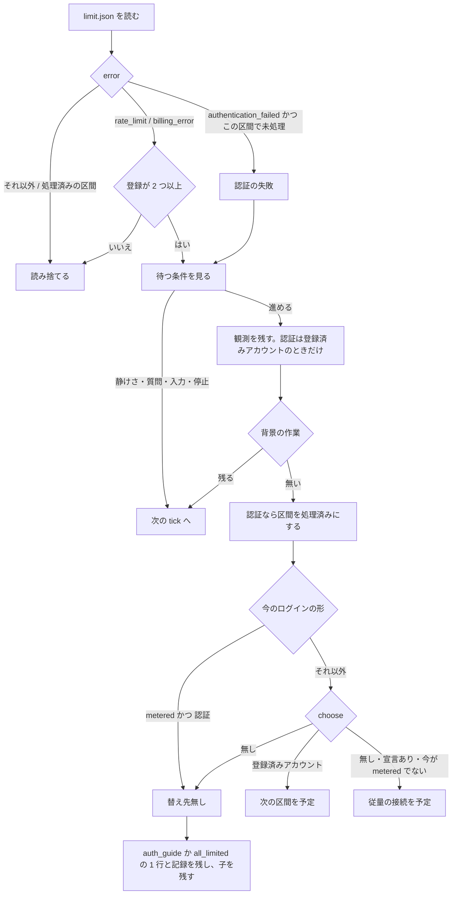

# ラッパーの認証の失敗（401）の扱いと、再登録が要るアカウントの除外

ラッパー（`plugins/ndf/scripts/relay.py`）の下で動く子の `claude` の応答が認証の失敗（401）で終わったとき、ログインの形
（既定のログイン・登録済みアカウント・従量の接続）に依らず同じ経路で扱う。替えられる先があれば替えて次の区間を起動し、
無ければログインの形に合う直し方を画面に 1 行出して子を残す。あわせて、認証ファイルのリフレッシュトークンが空の登録済み
アカウントを「再登録が要る」として切り替えの候補から外し、ラッパーの起動時に 1 行ずつ知らせる。Claude Code だけが対象である。

例: 登録済みアカウントが `work1` の 1 つで、従量の接続の宣言もある利用者が、既定のログインでラッパーを起動したとき。

| 順 | 起きること |
| --- | --- |
| 1 | 既定のログインで動く子が `Please run /login · API Error: 401` で止まり、StopFailure hook が `limit.json` に `error: authentication_failed` を書く |
| 2 | ラッパーは登録が 1 つでも 401 を扱い、`work1` を選んで次の区間を起動する（`log.jsonl` に `reason: auth`・`from: null`・`to: work1`）。以後の区間も `work1` のまま続き、既定のログインへ戻らない |
| 3 | `work1` も 401 になり、ほかに使える登録済みアカウントが無い。ラッパーは従量の接続へ替える |
| 4 | 従量の接続でも 401 になると、ラッパーは替えずに `account check metered` で宣言を確かめる案内を 1 行出し、子を残す（`from: metered`・`to: null`） |
| 5 | 次の起動で、`work1` の認証ファイルのリフレッシュトークンが空なら `ndf-relay: アカウント work1 は再登録が要る。…` が 1 行出て、`work1` は切り替え先に選ばれない |

この文書は、その形に**なぜしたか**（背景・決定と理由・常に成り立つ条件・境界・データの形・既知の限界・テスト観点）を残す。
**利用者向けの振る舞いの説明と画面の文の正は Skill とスクリプトにある。**

| 何を読むか | 正本 |
| --- | --- |
| 401 のときにラッパーが何をするか（替え先の順・直し方の 3 つ・区間ごとに 1 度）・再開の最初の入力 | [`development-workflow` の `references/relay.md`](../../plugins/ndf/skills/development-workflow/references/relay.md) の「アカウントの切り替え」の表の「認証が通らなかった（401）」 |
| リフレッシュトークンが空のアカウントが `再登録が要る` になること・起動時の 1 行・`account list` が認証ファイルを確かめないこと・「1 アカウント = 1 ログイン」 | 同じ `relay.md` の `account list` の状態の説明 |
| `log.jsonl` の `account` の行の項目 | 同じ `relay.md` の「記録の読み方」 |
| 画面の文（直し方の 1 行・従量の接続へ替えた 1 行・既定のログインから替えた 1 行・背景の作業を待つ 1 行） | [`relay_lib/switch.py`](../../plugins/ndf/scripts/relay_lib/switch.py) の `auth_guide`・`login_on`・`_msg_auth`・`AccountSwitch.tell_account`・`_wait_background` |
| 再登録が要るにする判定 | [`lib/claude_accounts.py`](../../plugins/ndf/scripts/lib/claude_accounts.py) の `_usable_held` |
| ラッパーの本体の契約（区間・上限シグナルファイル・`log.jsonl`） | [ndf-relay-segment-restart.md](ndf-relay-segment-restart.md) |

## 用語

「既定のログイン」「登録済みアカウント」「従量の接続」「従量の接続の宣言」「再登録が要る」「上限シグナルファイル」の定義は
用語集（[docs/glossary.md](../glossary.md)）が正である。

## 背景

ラッパーは、上限シグナルファイルの `error` が `authentication_failed` のとき、上限（429）と同じ経路で次のアカウントへ
替えていた。ただし認証の失敗として扱うのは区間のアカウントが登録済みアカウントのときだけで、既定のログインと従量の接続の
401 は読み捨てていた。このとき子は `Please run /login · API Error: 401 OAuth access token has been revoked.` を出したまま
止まり、利用者が端末を見るまで進まなかった（2026-10-04、novel コンテナで観測）。

もう 1 つの穴は候補の判定にあった。Claude Code はトークンの更新で `invalid_grant` を受けると認証ファイル
（`.credentials.json`）の refreshToken を空にする。認証ファイルは複数のコンテナが同じボリュームで共有しているため、1 つの
コンテナでの失敗が全コンテナへ広がる。今までの判定（#1576。リフレッシュトークンか期限内のアクセストークンがあれば使える）
では、refreshToken が空でもアクセストークンが期限内なら候補に残り、期限が来た時点で区間の途中で 401 になった。同じ日に
`claude -p "reply OK" --model haiku` で各アカウントを試すと、refreshToken も expiresAt も無いアカウントだけが
`OAuth session expired and could not be refreshed` で失敗した。

利用者は 2026-10-04 に「既定のログイン・従量の接続でも 401 を出して案内し、すべて認証できないときは従量の接続へ退避する」を
採った。認証ファイルのボリュームをコンテナごとに分ける案は、ログインの手間が増え上限の切り替えの効果も落ちるため採らない。
同じアカウントを 2 つの設定ディレクトリで別々にログインしない運用（1 アカウント = 1 ログイン）は案内に留める。

**Claude Code 本体は外部の系で、NDF は本体の形に合わせる（順応者）。** 認証ファイルの形と、refreshToken を空にする
振る舞いは本体が決める。この仕組みは認証ファイルを読むだけで、書き換えない。

## 決定と理由

| # | 決定 | 理由 | 採らなかった案 |
| ---: | --- | --- | --- |
| 1 | どのログインの形の 401 も、上限シグナルファイルの同じ読み取り・待ち・選び直しで扱う。`_tick_limit` の認証の条件からログインの形の除外を外し、登録の数の条件（`multi`）は上限（`rate_limit` / `billing_error`）にだけ掛ける | ログインの形ごとに違うのは選び直しの分岐と替え先が無いときの 1 行だけで、既存の関数の中の分岐で足りる。登録の数の条件を上限だけに残すので、上限の振る舞いは変わらない（Value 6） | 子の画面の文字列を読む・別のシグナルファイルを置く（hook と待ちの条件を写すことになる） |
| 2 | 区間の起動は、上限・認証の失敗の後の予定を登録の数に依らず使い、予定の無い区間は登録が 1 つ以下なら今のアカウントを引き継ぐ（`AccountSwitch.section_plan`） | 予定を使うだけでは、次の `ndf-next` の区間で 401 の出た既定のログインへ戻る。予定の無い区間を引き継ぎにすれば、登録が 1 つ以下の最初の区間は今と同じ既定のログインのままで、401 の後だけ先が変わる（Value 2 / Value 6） | 登録が 1 つ以下でも `multi` を真にする（使用率の定期の確認と区間ごとの選び直しが動き、上限の振る舞いが変わる） |
| 3 | 理由が認証で今が従量の接続なら、候補を選ばずに替え先無しとする | 従量の接続は最後の退避先で、そこへ来たのは登録済みアカウントがすべて使えないからである。選び直すと宣言の誤りを直さないまま登録済みアカウントとの間を行き来しうる。直し方は宣言を確かめることなので案内を出す。上限の後の戻し（`recovered`）は変えない（Value 2） | 上限と同じく `choose` を呼んで戻す |
| 4 | 替え先が無いときの 1 行を理由で分け、認証の文はモジュールの関数 `auth_guide` 1 つが作る。従量の接続へ替えた 1 行と既定のログインから替えた 1 行も同じ語（`既定のログインで`・`アカウント <名前> で`。`login_on`）を使う | 認証の失敗を「すべて上限にある」と取り違えない。ログインの形ごとの直し方を 1 か所に置く（Value 6 / Value 8） | 呼び出しの場所ごとに文を書く（同じ直し方が複数の場所に分かれる） |
| 5 | refreshToken の判定は `_usable_held` の 1 か所で変え、起動時の知らせもその判定を通す（`tell_relogin` が `usable` を呼んでから印を読む） | 「知らされたが選ばれる」「知らされないが選ばれない」が起きない（Value 6） | 起動時に認証ファイルを別の関数で読み直す（判定が 2 か所に分かれる） |
| 6 | refreshToken が空なら、期限内のアクセストークンがあっても再登録が要るにする。refreshToken があるときの扱いは #1576 のまま | 期限が来た時点で区間の途中で 401 になり、ログインし直すまで戻らない（Value 2） | 期限内なら残す |
| 7 | 「1 アカウント = 1 ログイン」の助言は `relay.md` に 1 文で置き、起動時の 1 行には添えない | 起動時の 1 行はアカウントごとに出て、直す操作（`account add <名前>`）だけを持つ。助言は 1 度読めば足りる（Value 2 / Value 7） | 起動のたびに添える |
| 8 | 既定のログインの 401 の案内は、refreshToken の有無で文を変えない | 既定のログインの 401 はどちらでも `/login` で直る。文を変えるには共有の `~/.claude/.credentials.json` を読む経路が要り、`relay.md` の「共有の `~/.claude/.credentials.json` は読み書きしない」に反する（C1 / Value 1） | 既定のログインの認証ファイルを読んで文を変える |

根拠の Value・C の番号は MVV 版 2 のものである。

## 仕様

`AccountSwitch`（`relay_lib/switch.py`。`relay_lib/run.py` の `Relay` が継ぐ）が区間のアカウントを持ち、`lib/claude_accounts.py` が
登録の記録（アカウントごとの `account.json`）を持つ。**既定のログインと従量の接続は登録の記録を持たず、その 401 は
`AccountSwitch` の中だけで扱う。**



読み取りから起動の許可までの順（読み取り → 関わるか → 待つか → 観測の記録 → 背景の作業 → 選び直し → 起動の許可）は
上限のときと同じである。

### 常に成り立つ条件

| # | 条件 | 破れたときの扱い |
| --- | --- | --- |
| I1 | 認証の失敗の扱い（案内の 1 行・記録の行・切り替え）は、1 つの区間で 1 度だけ行う（`auth_section`） | 同じ区間の 2 度目の上限シグナルファイルは読み捨てる |
| I2 | 従量の接続で動く区間の認証の失敗では、別の先へ替えない | 案内を出して子を残す |
| I3 | 認証ファイルの refreshToken が空（無い・空の文字列）の登録済みアカウントは、アクセストークンの期限に依らず候補にならず、`needs_relogin` が真になる | 候補から外す |
| I4 | 上限での切り替えは、今と同じく登録が 2 つ以上のときだけ行う | 登録が 1 つ以下なら上限シグナルファイルを読み捨てる |
| I5 | 画面の行と `log.jsonl` には、アカウントの名前・`metered`・変数の名前だけを書き、トークン・API キー・宣言の値を書かない | — |
| I6 | 認証の失敗の観測（`note_auth_failed`）は登録済みアカウントにだけ残す。既定のログインと従量の接続の名前で登録の記録を作らない | 記録しない |
| I7 | 認証の失敗で替えた先は、以後の区間でも引き継ぐ。登録が 1 つ以下でも既定のログインへ戻さない | — |
| I8 | 起動時の知らせの判定が失敗しても、ラッパーの起動を止めない | 何も出さずに最初の区間を起動する |

### 境界

401 の後の替え先（`AccountSwitch._pick_after_limit`）:

| 今のログインの形 | 使える登録済みアカウントがある | 無く、従量の接続の宣言がある | どちらも無い |
| --- | --- | --- | --- |
| 既定のログイン | そのアカウントへ（登録の数に依らない） | 従量の接続へ | 直し方の 1 行（`/login`）を出して子を残す |
| 登録済みアカウント | 今のアカウントを除いて選んだアカウントへ | 従量の接続へ | 直し方の 1 行（`account add <名前>`）を出して子を残す |
| 従量の接続 | 替えない（I2） | 替えない | 直し方の 1 行（`account check metered`）を出して子を残す |

区間の起動で使うアカウント（`AccountSwitch.section_plan`）:

| 予定 | 登録が 2 つ以上 | 登録が 1 つ以下 |
| --- | --- | --- |
| 予定あり（上限・認証の失敗の後） | 予定の先 | 予定の先 |
| 予定なし（`ndf-next`・最初の区間） | `pick(None)` で選ぶ | 今のアカウント（最初の区間は既定のログイン） |

アカウントで動いた区間（使う先が None でない）は、登録の数に依らず `start` の行に `account` を持ち、`tell_account` の 1 行を出す。
共有の `.claude.json` への書き戻し（`settle_account`）も、登録の数に依らず登録済みアカウントの区間の後に行う。

起動時の知らせ（`AccountSwitch.tell_relogin`）は `Relay.loop` が最初の区間の前に呼ぶ。入れ替えた後の版（`Relay.from_handover`）は
起動ではないので呼ばない。登録済みアカウントを順に `usable` で確かめ（I3 の判定で印を付ける）、`needs_relogin` が真の名前ごとに
1 行出す。排他を取れない・読めないアカウントは印が付かないので出ない。例外は捕まえて何も出さずに戻る。既定のログインの
refreshToken は調べない（決定 8）。

### データの形

`log.jsonl` の `account` の行は項目を変えず（`event`・`section`・`reason`・`from`・`to`・`earliest`、従量の接続へ替えたときは
`keys`）、認証の失敗で次の値の組が加わった。

| 場面 | `reason` | `from` | `to` |
| --- | --- | --- | --- |
| 既定のログインの 401・替え先無し | `auth` | `null` | `null` |
| 従量の接続の 401 | `auth` | `metered` | `null` |
| 既定のログインの 401・替えた | `auth` | `null` | 名前か `metered` |
| 登録済みアカウントの 401・替え先無し | `auth` | 名前 | `null` |

```json
{"event": "account", "section": 1, "reason": "auth", "from": null, "to": null, "earliest": null}
```

起動時の知らせは記録に残さない（画面だけ）。`relay.py` のサブコマンドと引数、`limit.json` の形、StopFailure hook、
登録の記録のスキーマは変わらない（`needs_relogin` が真になる条件が 1 つ増えただけである）。

## セキュリティ

1 行と記録の行を作る関数（`auth_guide`・`tell_account`・`tell_relogin`）は、名前・`metered`・変数の名前（`fallback_env` の鍵）
だけを受け取り、値を受け取らない（I5）。認証ファイルは読むだけで、書き換えもトークンの更新もしない（動いている claude の
トークンは claude が更新する。#1576 の I8）。

## 運用

### 既知の限界

| 項目 | 内容 |
| --- | --- |
| refreshToken を持たない正しいログインの形 | `account add` の登録は `claude auth login` の OAuth で refreshToken を持つ前提である。refreshToken を持たない正しい認証ファイル（長期の token など）が登録済みアカウントに入る経路は確かめていない。あれば I3 で外れ、起動時に「再登録が要る」と出る |
| Claude Code が refreshToken を空にする時点 | `invalid_grant` で空にする振る舞いは 2026-10-04 の観測からの推定で、本体の版で変わりうる（順応者）。変われば I3 が働く場面が減るだけで、誤って外すことはない |
| 既定のログインの 401 から替えた後 | 登録が 1 つ以下で替えた区間では `multi` が偽のままなので、使用率の定期の確認と上限の切り替えは働かない（I4） |
| `account list` の表示 | `usable` を通らないため、refreshToken が空のアカウントはラッパーの起動か切り替えの前は `使える` と出る（`relay.md` に書いてある） |

## テスト観点

上限シグナルファイルとアカウントの記録を偽物で置く形で、[`test_relay_account.py`](../../plugins/ndf/scripts/tests/test_relay_account.py)
の「どのログインの形でも 401 を扱う（#1727）」の節と、[`test_claude_accounts.py`](../../plugins/ndf/scripts/tests/test_claude_accounts.py)
の `usable` と `choose` のテストが縛る。

| 観点 | 満たすこと |
| --- | --- |
| 既定のログインの 401・替え先無し | 登録 0 件・既定のログインの区間で `authentication_failed` を置くと、`/login` を含む 1 行と `reason: auth`・`from: null`・`to: null` の行が残り、次の区間を起動しないこと |
| 既定のログインの 401・替える（I7） | 使える登録済みアカウントがあればそれを、無く宣言があれば `metered` を予定にすること。登録 1 件の起動でも予定の先で次の区間を起動し、次の `ndf-next` の区間も同じ先で起動すること |
| 従量の接続の 401（I2） | 上限の外れた登録済みアカウントがあっても予定を作らず、`account check metered` の 1 行と `from: metered`・`to: null` の行が残ること |
| 登録済みアカウントの 401・替え先無し | 1 行が「上限にある」を含まず、そのアカウントの `account add <名前>` を含むこと |
| 従量の接続へ替えた 1 行 | 認証の失敗で従量の接続へ替えた 1 行が「上限にある」を含まないこと。既定のログインからの切り替えで `None` と出ないこと |
| refreshToken が空（I3） | refreshToken が空で期限内のアクセストークンを持つアカウントは `choose` に選ばれず、`needs_relogin` が真になること。refreshToken があるアカウントは今と同じく選ばれること |
| すべて認証できない | すべての登録済みアカウントが再登録が要るか認証の失敗の観測を持つとき、401 で宣言があれば `metered` を予定にすること |
| 起動時の知らせ（I8） | 再登録が要るアカウントが 2 つあれば起動時に 2 行、無ければ 0 行出ること。判定が例外を投げても、例外を外へ出さず何も出さずに戻ること |
| 1 度だけ（I1） | 同じ区間で `authentication_failed` を 2 度置いても、1 行と記録の行と予定は 1 度だけであること |
| 秘密を書かない（I5） | 宣言とトークンに目印の値を入れて上の場面を通し、画面の出力と `log.jsonl` に目印が現れないこと |
| 上限は変わらない（I4） | 登録 1 件・既定のログインの区間で `rate_limit` を置くと読み捨てること。既存の上限のテストが通ること |
| 観測の記録先（I6） | 既定のログインと従量の接続の区間の 401 の後に、`note_auth_failed` が呼ばれないこと |
| 手動 | リリース後テストで、refreshToken を空にした登録済みアカウントの複製を置いてラッパーを起動し、起動時の 1 行と候補から外れることを見る |

## 関連リンク

- [ndf-relay-segment-restart.md](ndf-relay-segment-restart.md)（ラッパーの本体の契約）
- [ndf-relay-install-and-restart.md](ndf-relay-install-and-restart.md)（導入と `/ndf:restart`）
- [`relay_lib/switch.py`](../../plugins/ndf/scripts/relay_lib/switch.py) / [`relay_lib/run.py`](../../plugins/ndf/scripts/relay_lib/run.py) / [`lib/claude_accounts.py`](../../plugins/ndf/scripts/lib/claude_accounts.py)
- 課題 [#1727](https://github.com/devbasex/ai-plugins/issues/1727)・トークンの更新とアカウントの記録は [#1576](https://github.com/devbasex/ai-plugins/issues/1576)
