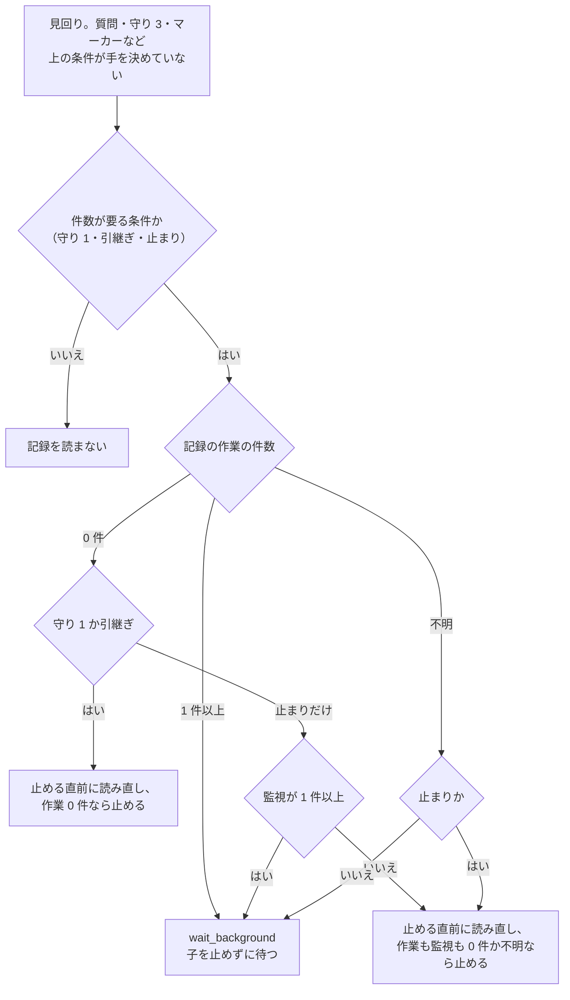

# 中継: バックグラウンドの作業が残る子を止めずに待つ

中継のラッパー（`ndf relay run`）は、claude を子プロセスとして起動し、条件がそろうと子を止めて起動し直す。子を止めると、
バックグラウンドで動く supervisor や `ndf plan queue` も一緒に終わり、途中の成果が失われる。そこでラッパーは、
**バックグラウンドの作業が残っている間は、次の 3 つの理由では子を止めずに、作業の終わりを待つ**（#4049）。

- 会話の文脈の量が運用上限以上になり、子が静かになった（引継ぎ）
- 子の出力と端末への入力が `relay.stall`（1,800 秒）途絶えた（止まりの起動し直し）
- 利用上限に達する前に、別のアカウントへ切り替える（[アカウントの切り替え](ndf-relay-account-switching.md)の守り 1 と、従量の接続からの戻り）

`ndf lanes wait` のような待つだけのコマンドは、止めても打ち直せば同じ結果を受け取れる。これだけが残る子は、引継ぎと
アカウントの切り替えでは待たずに止める。待つと、監視を続けるオーガナイザーが引継ぎへ一度も進めないためである。
この文書は、構成要素・常に成り立つ条件・データの形・決定と理由・テスト観点を残す。Claude Code だけが対象である。

| 何を読むか | 正本 |
| --- | --- |
| 作業と監視の例・場面ごとに待つかの表・画面に出る理由・拒否されたときと待ち続ける子への対処 | [`development-workflow` の `references/relay-background.md`](../../plugins/ndf/skills/development-workflow/references/relay-background.md) |
| ラッパーが次の手を決める順 | [`references/relay.md` の「承認ゲートを越えない守り」](../../plugins/ndf/skills/development-workflow/references/relay.md#承認ゲートを越えない守り) |
| 子を止めるロック・今の起動の記録・質問の扱い | [ndf-relay-pending-question-guard.md](ndf-relay-pending-question-guard.md) |
| 止めてよい時点・守り 1〜3 | [ndf-relay-account-switching.md](ndf-relay-account-switching.md) |
| 運用上限の値 | [ndf-context-thresholds.md](ndf-context-thresholds.md) |
| 待つだけのコマンドの一覧 | [`contracts/hooks/guards.json`](../../plugins/ndf/contracts/hooks/guards.json) の `relay-busy` の `params.wait_commands` |

## 概要

**例: レーンの conductor が supervisor を 1 つ起動して応答を終えた。会話の文脈の量は運用上限を超えている。**

| 順 | 起きること |
| ---: | --- |
| 1 | Agent を呼び出す直前に、hook `relay-busy` が子の記録 `busy-<起動の ID>.json` へ作業「1 件以上」と書く |
| 2 | 応答が終わると、hook `relay-marker` が Stop の入力の `background_tasks` から数えて、作業 1 件に書き直す |
| 3 | 子が 5 秒（`relay.quiet`）静かになる。ラッパーは記録を読み、子を止めずに待つ（`wait_background`）。`ndf relay ls` に `waiting` と件数・時刻が出る |
| 4 | 30 分を超えて supervisor の報告が来なくても、ラッパーは起動し直さない |
| 5 | supervisor が終わると Claude Code が子へ知らせ、子が応答する。その Stop で記録は作業 0 件になる |
| 6 | 応答が `ndf-next` のブロックを持てば次のセグメントへ切り替わる。持たなければ、次に静かになったときにラッパーが引継ぎを求める |

オーガナイザーが `ndf lanes wait` だけを張って応答を終えた場合、Stop は作業 0 件・監視 1 件を書く。運用上限を超えて静かに
なれば、ラッパーは待たずに引継ぎを求める。30 分を超えて知らせが無い場合は、監視が残っているので起動し直さない。

### 用語

「バックグラウンドの作業」「作業」「監視」「バックグラウンドの作業の記録」「シグナルファイル」の定義は、用語集
（[docs/glossary.md](../glossary.md) のコンテキスト `ndf-relay`）にある。「起動の ID」「今の起動の記録」は
[ndf-relay-pending-question-guard.md](ndf-relay-pending-question-guard.md) の「用語」、「見回り」「守り 1・2・3」は
[ndf-relay-account-switching.md](ndf-relay-account-switching.md) の「用語」のとおりである。

| 語 | この文書での意味 |
| --- | --- |
| 記録 | バックグラウンドの作業の記録（`busy-<起動の ID>.json`） |
| 子の会話 | ラッパーが起動した claude の会話。hook の入力の `session_id` が環境変数 `NDF_RELAY_SESSION` と同じもの |
| 入れ子の claude | 子のシェルから起動した別の claude（`ndf plan queue` の worker・`claude -p` など）。子の環境変数を引き継ぐが、会話の ID が違う |
| 不明 | 記録が無い・読めない・形が違う・別の会話のものである、のどれか |

### コンテキスト

hook の guard（`relay-busy`・`relay-marker`）が記録を書き、ラッパー（`ndf-relay`）が読む。両者は中継の作業ディレクトリ
（`NDF_RELAY_DIR`）のファイルだけでやり取りし、`ndf.domains.relay.signals` の同じ関数で読み書きする。

### 構成要素と責務

パスは `plugins/ndf/src/ndf/domains/` からの相対である。

| 要素 | 責務 |
| --- | --- |
| guard `relay-busy`（`hooks/guards/relay_busy.py`） | 子の会話の開始で 0 件を書く。作業と監視を始める呼び出しの前に記録し、作業の開始を書けなければ呼び出しを拒否する。作業と監視を見分ける（`task_kind`・`work_count`） |
| guard `relay-marker`（`hooks/guards/relay_mark.py`） | Stop で作業と監視の件数を書く。作業が残る間は次のセグメントのマーカーを書かずに変更要求する |
| `only_commands`（`hooks/context.py`） | シェルの文の全体が、許す形と受け入れるコマンドだけでできているかを構文木で確かめる |
| `signals`（`relay/signals.py`） | 記録の読み書き（`write_busy`・`record_start`・`record_monitor`・`read_busy`）、ほかの起動の記録の削除（`drop_other_busy`）、子へ渡す環境変数（`launch_env`）、子を止めるロックの名前（`STOP_LOCK`） |
| `switch_decide`（`relay/switch_decide.py`） | 見回り 1 回の状態から次の手を返す純粋な関数。件数が要る見回りかも返す（`needs_background`） |
| `BusySteps`（`relay/wrapper_busy.py`） | 件数が要る見回りでだけ記録を読む。待ちが解けたら状態を `running` に戻す |
| `StopSteps._stop_if_clear`（`relay/wrapper_stop.py`） | 子を止める直前に、ロックの中で記録を読み直す |

## 背景

引継ぎと止まりの起動し直しは、子の出力が止まったことだけを見ていた。supervisor の報告を待つ conductor は応答を終えて
入力を待つので、静かに見える。止めると supervisor とキューが途中で終わり、フェーズを最初からやり直すことになった。止まりの
起動し直しでは子へ何も送らないので、起動し直した会話は知らせも受け取らず、入力を待つだけになった。

2026-11-22 に利用者が、待つだけの `ndf lanes wait` は終了してよい、オーガナイザーを監視の終わりで待たせない、と決めた。
同じ日に全体の設計方針（#4069。文脈を再利用し、処理待ちを作らない）を示した。下の決定 9 は、この方針と比べた結果である。

## 対象範囲

含む:

- 引継ぎ（`handover`）・止まりの起動し直し（`restart`）・見回りによるアカウントの切り替え（`account`）が、バックグラウンドの作業を見ること
- 作業と監視の見分け、記録の書き込みと読み取り、待つ間の状態の表示
- 次のセグメントのマーカーを、作業が残る間だけ書かないこと

含まない:

- 利用上限に達した後・認証に失敗した後の切り替え（守り 3）、API キーの子の停止、設定が壊れたときの終わり、子が終わった後の起動し直し。
  どれも作業を見ずに止める（守り 3 で失われる分は #4063）
- 次のセグメントのマーカーを書いた後に始まった作業（#4381）
- 長く待つ子のプロンプトのキャッシュ（#4068）と、待ちをオーガナイザーへ知らせること（#4070）
- Codex（ラッパーは Claude Code だけを起動する）

## 仕様

### 集約

**集約は、ラッパーが 1 回起動した子である。** 記録は起動の ID ごとに 1 つで、その子の会話の hook だけが書く。子を止めると、
その起動は「今の起動」でなくなり、開始の記録を書けなくなる。

### 常に成り立つ条件

| # | 条件 | 守り方 |
| --- | --- | --- |
| B1 | 記録が作業 0 件なら、その記録の後に、hook から見える作業の開始（Agent・Monitor・`run_in_background` が真の Bash）は無い | 開始を書けない呼び出しを拒否する。記録の 0 件は子の会話の hook だけが書く |
| B2 | 引継ぎと見回りによる切り替えで子を止めるのは、止める直前の読み直しが作業 0 件のときだけである | `_BUSY_ALLOW` の `zero` |
| B3 | 止まりの起動し直しで子を止めるのは、止める直前の読み直しが作業も監視も 0 件か、不明のときだけである | `_BUSY_ALLOW` の `none_running` |
| B4 | 止める直前の読み直しから子を止め終えるまでの間に、作業の開始は記録されない | 読み直しと開始の記録が同じロックを取る。止めた子の起動は今の起動から外す |
| B5 | 止めた子の遅れた hook と入れ子の claude は、今の子の記録を書き換えない | 起動ごとのファイルと、会話の ID の一致 |
| B6 | 不明を作業 0 件として扱わない | `read_busy` が None を返し、判断が別に扱う |
| B7 | 監視だと確かめられないものは作業である | `task_kind` は、例外を含めて既定で作業を返す |
| B8 | 子の会話でない呼び出しと、作業も監視も始めない呼び出しは、記録にもコマンドの構文解析にも触れずに通る | `_may_start`・`is_child` を先に確かめる |
| B9 | 件数が要る見回りでだけ記録を読む | `needs_background` |

### 作業と監視の見分け

`background_tasks` の 1 行、または開始の呼び出し 1 つを、種類（`type`）とコマンドの文で分ける。開始では Agent を `subagent`、
Monitor を `monitor`、バックグラウンドの Bash を `shell` として同じ関数へ渡す。

**監視は、種類が `monitor` か `shell` で、コマンドの文の全体が次の形のものだけである。** ほかはすべて作業とする。

- 単純なコマンドを `;`・`&&`・`||`・改行でつないだ列と、コマンドに付いたリダイレクトだけでできている。パイプ・ループ・条件分岐・
  サブシェル・コマンドの置き換え・末尾の `&`・変数の代入・ヒアドキュメント・コマンドの無いリダイレクト・構文の誤りがあれば作業
- どの単純なコマンドも、`timeout` などのラッパーを外した先頭の語が `params.wait_commands` のどれかに一致する。環境・引数を変える
  ラッパー（`env`・`xargs`・`exec`）が付くと作業
- `bash -c`・`sh -c`・`eval` は、中の文が展開によらず決まり、中の文にも同じ条件が成り立つ。展開を含む中の文（`bash -c "ndf lanes wait $ARGS"`）・
  起動ファイルを読みうる形（`bash -lc`・`zsh -c`）・入れ子の深さの上限を超えた文は作業

コマンドが無い・文字列でない・Claude Code が途中で切った（末尾に `… [+N chars]` が付く）ものも作業である。

### 記録を書く時点

| 時点 | 書く hook | 書く中身 | 書けないとき |
| --- | --- | --- | --- |
| 会話の開始（SessionStart の `startup`・`resume`） | `relay-busy` | 作業 0 件・監視 0 件（`source` は `session`） | 記録が無いまま（不明）。会話は続く |
| 作業を始める呼び出しの前（PreToolUse） | `relay-busy` | 作業 1 件・監視 0 件（`source` は `start`。「少なくとも 1 件」の意味） | その呼び出しを拒否する |
| 監視を始める呼び出しの前（PreToolUse） | `relay-busy` | 作業の件数と `source` を保ち、監視が 0 件なら 1 件にする | 通す。記録が無ければ書かない |
| 応答の終わり（Stop） | `relay-marker` | `background_tasks` を分けて数えた件数（`source` は `stop`） | 前の記録が残る |

- `compact`・`clear` の SessionStart では書かない（前のバックグラウンドの作業が残りうる）
- 開始の 2 つは、子を止めるのと同じロック `question.json.lock` を `hook.counter-lock`（0.2 秒）まで待って取り、今の起動の記録が
  自分の起動のときだけ書く。監視が既に 1 件以上なら、ロックを取らずに通す
- Stop は、入力に `background_tasks` が無い・リストでないとき、`NDF_HOOK_OFF` で `relay-busy` を止めた環境では書かない。
  後者で 0 件を書くと、開始が記録されない子を作業 0 件と取り違える
- `relay-busy` は `fail_closed` で、hook の予算を使い切っても呼ばれる。締め切りの経路（`on_deadline`）でも、記録し終えていない作業の
  開始だけを拒否する
- 会話の ID の一致は、環境変数の名前をコントラクト（`contracts/domains/env.json`）から引いて確かめる。コントラクトから名前を引けなければ、
  子の会話でないものとして扱い、Tool を止めない（#4126）

### ラッパーの判断



- 読み直しで止めないと決まった見回りは、子に何もせず、セグメントの終わりの時刻（`Section.ended_at`）を取り消して、次の見回りで
  決め直す。待った時間はセグメントの長さに数える
- 守り 1 の条件がそろっても止めてよい時点でなければ、守り 1 のためには記録を読まず、引継ぎと止まりの判断へ進む。どちらにも
  当たらなければ `active` を返す
- 見回りによる切り替えで送る最初の入力には、監視を始め直す手順（`MONITOR_RESUME`）を足す。監視の件数によらず足す。守り 3 と
  API キーの子の停止の後の入力には足さない
- 再起動ループの検出に当たって `spin` になった手も、読み直しの条件（`Step.busy`）を引き継ぐ

待つ間は状態を `waiting`、理由を件数と記録の時刻で書く。`source` が `start` の記録は「1 件以上」と書く。子が動いている見回りは
`active` で状態を `running` に戻す。

### 次のセグメントのマーカー

応答が `ndf-next` のブロックを持つ Stop では、作業が残っていればマーカー（`next.json`）を書かずに変更要求し、監視だけなら書く。
`background_tasks` が無い Stop では記録の件数を使い、記録も無ければ書く。子でない会話では、件数は書かないがマーカーの扱いは同じである。

### ドメインイベント

| イベント | 引き金 | 失敗したとき |
| --- | --- | --- |
| 子を起動した | セグメントの開始・起動し直し。今の起動を書き、ほかの起動の記録を消す | 消せない記録は残るが、起動ごとの名前なので読まれない |
| 作業を始めた | Agent と、作業に当たる Monitor・バックグラウンドの Bash の呼び出し | 記録できなければ呼び出しを拒否する |
| 監視を始めた | 監視に当たる Monitor・バックグラウンドの Bash の呼び出し | 記録できなくても始める |
| 残りの件数が分かった | Stop（Esc で中断した応答では来ない） | 前の記録が残る |
| 作業の終わりを待った | 3 つの理由のどれかで止める条件がそろい、作業が残るか不明である | — |
| 子を止めた | 止める条件がそろい、ロックの中の読み直しも通った | ロックを取れない・質問が在る・読み直しが通らないなら、次の見回りで決め直す |

## データ・設定

### 記録（`<中継の作業ディレクトリ>/busy-<起動の ID>.json`）

実行の間だけあり、コミットしない。一時の名前で書いて置き換える。

| 項目 | 型 | 意味 |
| --- | --- | --- |
| `launch` | 文字列（`[0-9a-f]{32}`） | 書いた起動の ID。ファイルの名前と同じ |
| `session_id` | 文字列 | 書いた会話の ID |
| `count` | 0 以上の整数 | 作業の件数 |
| `monitors` | 0 以上の整数 | 監視の件数。無い記録は 0 と読む |
| `source` | `session`・`start`・`stop` | 書いた時点。`start` の `count` は「少なくとも 1 件」 |
| `at` | タイムゾーン付きの ISO 8601 の時刻 | 書いた時刻 |

例: supervisor 1 件と `ndf plan wait` 1 件が残る Stop の記録

```json
{"launch": "9f2c0b1d4e5f60718293a4b5c6d7e8f9", "session_id": "e1ed0000-0000-0000-0000-000000000000", "count": 1, "monitors": 1, "source": "stop", "at": "2026-11-24T02:16:05+00:00"}
```

`read_busy` は、形が 1 つでも違えば不明を返す。`source` が `start` で `count` が 0 の記録も不明である。起動の ID の形が違う値は
ファイルの名前に使わない。

### 環境変数・表

| 場所 | 内容 |
| --- | --- |
| `NDF_RELAY_SESSION` | ラッパーが子へ渡す会話の ID（`launch_env`。`NDF_RELAY_DIR`・`NDF_RELAY_LAUNCH` と一緒に渡す） |
| `contracts/hooks/guards.json` の `relay-busy` | SessionStart・PreToolUse、`tools` は空（すべての Tool）、`order` 65、`deny_key` は `none`、`fail_closed` は真 |
| `contracts/hooks/runtimes.json` | Codex の `skipped` に `relay-busy` |
| `contracts/domains/ndf-files.json` の `relay-busy` | 記録のファイル |
| `contracts/limits/` の `hook.counter-lock`・`relay.quiet`・`relay.stall` | ロックを待つ 0.2 秒・静かな 5 秒・止まりの 1,800 秒 |
| `ndf relay decide` の入力の `background` | `{"count", "source", "at", "monitors"}`。無ければ不明として判断する。結果の項目に `busy` は出ない |

利用者の設定は足さない。`log.jsonl` の行の種類には `wait_background` と `active` がある。

## 外部連携

| 相手 | 頼る振る舞い | 出典 |
| --- | --- | --- |
| Claude Code の Stop の hook | 入力の `background_tasks` に、動いているバックグラウンドの作業が載る（`type`・`status`・`command` など）。利用者の Esc の中断では Stop は動かない | https://code.claude.com/docs/en/hooks （2026-11-22） |
| Claude Code 2.1.330 | バックグラウンドの Agent は `subagent`、Bash は `shell` で載り、終わると消える。サブエージェントの中の hook は、親と同じ `session_id` を持つ | 実測（2026-11-22） |
| Claude Code 2.1.331 | Monitor は `type` が `monitor` で、`command` に起動した文が載る | `plugins/ndf/tests/domains/hooks/samples/claude/2.1.331/Stop.json` |

## エラー処理

| 失敗 | 扱い |
| --- | --- |
| 作業の開始を記録できない（ロックを取れない・書けない・保存先が無い・締め切り・例外） | その呼び出しを拒否する（`BUSY_START_FAILED`）。モデルが呼び直せる |
| 監視の開始を記録できない | 通す |
| Stop の記録を書けない・`background_tasks` が無い | 前の記録を残し、応答の終わりを止めない |
| 記録が不明 | 引継ぎと見回りによる切り替えは待つ。止まりの起動し直しは行う |
| guard の表を読めない | 待つだけのコマンドが分からないので、すべて作業に数える |
| 子を止める直前に作業が始まっていた | 子を止めず、次の見回りで決め直す |

## セキュリティ

- 記録には件数・種類・時刻・ID だけを書く。コマンドの文は書かない
- 環境変数の起動の ID は、形（16 進 32 字）を確かめてからファイルの名前に使う
- 監視の見分けは、止めてよいかの判断だけに使う。コマンドの実行を許可する判断には使わない

## 運用

- 待つ時間の上限は無い。待ち続ける子の見つけ方・起動し直し方・拒否されたときの直し方は
  [relay-background.md](../../plugins/ndf/skills/development-workflow/references/relay-background.md) にある
- hook はプラグインの更新の後の次のセグメントから、ラッパーは打ち直した後から新しいコードで動く。新しいラッパーと古い hook の組では
  記録が無いので不明になり、引継ぎを待つ。古いラッパーと新しい hook の組では `NDF_RELAY_SESSION` が無いので、`relay-busy` は何もしない
- 開始の拒否が問題になったときは `NDF_HOOK_OFF=relay-busy` で止められる。その子は不明になり、引継ぎと見回りによる切り替えを待つ

### 既知の限界

| 場面 | 扱い |
| --- | --- |
| 作業が終わらない子・監視が終わらない子 | 待ち続ける。`ndf relay ls` の理由で見つけて起動し直す。作業が残る間に利用上限に達すれば、守り 3 が作業を失わせて切り替える |
| 利用者の Ctrl+B などで、hook に見えずにバックグラウンドへ回った作業の後に Esc で中断した | Stop が来ないので、前の記録の 0 件で止めうる |
| ほかの guard や利用者が拒否した開始 | 記録は「1 件以上」になり、その応答の Stop が書き直す。Esc で中断すれば、次の Stop まで待つ |
| 待つだけでも、一覧に無いコマンドや許す形でない文 | 作業として数えて待つ |
| 応答の途中で固まった子で、記録が作業か監視を示す | 起動し直さない |
| 実際の会話でのラッパーの待ち | 偽の子でしか確かめていない。リリースの後に、supervisor を待つ conductor が止められないことと、監視だけのオーガナイザーが引継ぎへ進むことを見る |

## 決定と理由

番号は、コードの注釈の「#4049 の決定 N」と同じである。

| # | 決定 | 理由 |
| ---: | --- | --- |
| 1 | 件数は、Claude Code が Stop の hook に渡す `background_tasks` から数える | この一覧は、会話が終わったのか作業に起こされるのを待つのかを見分けるためにある。プロセスの木には Agent が現れず、会話の記録の形は公式の文書に無い |
| 2 | 0 件を「その後に作業が始まっていない」と読めるよう、開始を記録できない呼び出しを拒否し、0 件は子の会話の hook だけが書く。開始の記録は子を止めるロックを使う | Esc の中断では Stop が来ないので、開始の記録が欠けると古い 0 件で止める。ラッパーが 0 件を書くと、hook が働いていない子も 0 件に見える。判断に要るのは 0 件か 1 件以上かだけなので、件数を足す読み書きと新しいロックは要らない |
| 3 | 記録を起動ごとのファイルにし、会話の ID が一致する hook だけが書く | 1 つのファイルでは、止めた子の遅れた書き込みと入れ子の claude の書き込みが今の子の記録を置き換える。入れ子を起動する側で環境変数を外す方法は、1 か所の漏れで壊れる |
| 4 | 不明なら引継ぎだけを待ち、作業が 1 件以上なら止まりの起動し直しも待つ | 不明を 0 件とみなすと作業を失う。不明でも止まりを見ないと、応答の途中で固まった子を救えない。待つ時間を長い上限に変えても、失う時点が遅れるだけである |
| 5 | 待つ間は状態を `waiting` と理由で書き、`active` で `running` に戻す | 状態を書かない `wait` のままでは、`ndf relay ls` から待ちも、止まった作業も見えない |
| 6 | 待つ間に Stop で引継ぎを促さない | 作業の終わりは Claude Code が知らせ、運用上限の guard が引継ぎに進ませる。促しても作業は守られない |
| 7 | コマンドの文の全体が待つだけと確かめられたものだけを監視にする。Monitor も種類だけでは監視にしない | 監視を取り違えると成果を失うが、作業に取り違えても待つ時間が延びるだけである。Monitor は任意のコマンドを起動できる。待つだけのコマンドは NDF の手順書が決めたもので足りるので、利用者の設定を足さない |
| 8 | 守り 1 は作業が残る間は切り替えずに待ち、守り 3 は待たない | 上限の手前の切り替えは急がず、待っても守り 3 が拾う。上限に達した子はモデルを呼べないので、待っても作業は進まない |
| 9 | 止まりの起動し直しでは、監視だけの子も止めない。見回りによる切り替えの最初の入力で、監視を始め直すよう伝える。監視の開始も記録する | 止まりの起動し直しは子へ何も送らないので、監視を失うと会話は入力を待つだけになる（全体の設計方針の「文脈の再利用」「処理待ちを作らない」に合わない）。切り替えた会話は監視が終わったことを知らない。監視の開始を記録しないと、Esc の中断の後に止まりで監視を失う。作業が残る子は、プロンプトのキャッシュの寿命を過ぎても待つ（失う作業のほうが高い。キャッシュは #4068、待ちの知らせは #4070） |

ロックに外部ライブラリは使わない。`signals.held`（`flock`）で足り、hook の経路に依存を足さないためである。

## テスト観点

パスは `plugins/ndf/tests/domains/` からの相対である。文脈の量・停止の秒の境界の値と呼び出しの回数で判定し、実時間を待たない。

| 観点 | テスト |
| --- | --- |
| 引継ぎ・止まり・守り 1 と件数（0 件・監視だけ・作業・開始・不明）の組み合わせごとの手と理由 | `relay/test_relay_decide.py`（`test_4049_*`） |
| 記録を読むのは件数が要る見回りだけで、ほかの見回りでは 0 回 | 同上（`test_4049_10_…`）、`relay/test_relay_wrapper_busy.py`（`test_10_…`） |
| 作業の終わりの後に引継ぎを 1 度だけ求める。待つ間の状態が `waiting` で、動き出すと `running` に戻る | `relay/test_relay_wrapper_busy.py`（`test_1_6_9_…`・`test_9_12_…`） |
| 判断の後、止める前に作業が始まれば止めない。止めている間と止めた後の開始は記録されない | 同上（`test_3_…`） |
| 守り 3・マーカー・API キーの子・設定の誤りは記録を読まずに止める | 同上（`test_12_the_limit_…`・`test_the_next_section_marker_…`・`test_a_key_child_…`・`test_a_broken_config_…`） |
| 記録の読み書き・別の起動と別の会話・壊れた形・ロック・ほかの起動の記録の削除 | `relay/test_relay_signals_busy.py` |
| 開始の記録と拒否・締め切り・対象外の呼び出しを先に通すこと・コントラクトの誤りで Tool を止めないこと | `hooks/test_relay_busy.py` |
| Stop の件数・一覧が無い Stop・マーカーと変更要求 | `hooks/test_relay_mark_busy.py` |
| 作業と監視の見分け（構文解析は実物を使う） | `hooks/test_relay_busy_kind.py`・`hooks/test_context.py` |
| hook のエントリポイントからラッパーの見回りまで（監視だけ・作業・混在・オーガナイザーの形・入れ子の claude・止めた子の遅れた hook・守り 1 の最初の入力） | `relay/test_relay_busy_flow.py` |

## 関連リンク

- [#4049](https://github.com/devbasex/ai-plugins/issues/4049) — 要求と受け入れ条件（実装は https://github.com/devbasex/ai-plugins/pull/4401 ）
- [#4126](https://github.com/devbasex/ai-plugins/issues/4126) — 環境変数の名前をコントラクトのキーから引く設計
- [#4063](https://github.com/devbasex/ai-plugins/issues/4063)（守り 3）・[#4381](https://github.com/devbasex/ai-plugins/issues/4381)（マーカーの後の作業）・[#4068](https://github.com/devbasex/ai-plugins/issues/4068)・[#4069](https://github.com/devbasex/ai-plugins/issues/4069)・[#4070](https://github.com/devbasex/ai-plugins/issues/4070)・[#4061](https://github.com/devbasex/ai-plugins/issues/4061)（入れ子の claude と質問の記録）
- [Claude Code の hook](https://code.claude.com/docs/en/hooks)
