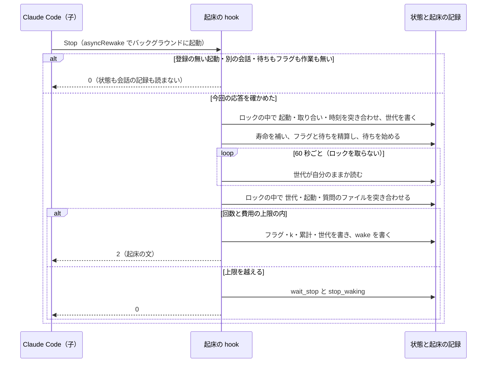

# 中継: 裏の作業を待つ子のキャッシュを寿命の手前で起床させる

中継のラッパー（`ndf relay run`）が起動した claude（子）は、バックグラウンドの supervisor などを待って応答を終える。
待ちがプロンプトのキャッシュの寿命（メインの会話は 1 時間）を越えると、待ちが終わった最初の応答で文脈の全体を
入力の 2 倍の値段で書き直す。そこで **裏に作業が 1 件以上残る子を、寿命の手前で短く応答させ（起床）、文脈を
読み出しの値段（Opus 5.5 は入力の 0.05 倍）で読ませてキャッシュを保つ。起床の費用の合計が書き直し 1 回の追加の
費用に届く回数で、その待ちでは起床をやめる**（#4068・#4199）。Claude Code だけが対象である。

**既定では働かない。** ラッパーが起床の hook を登録するのは、上限の設定 `cache.rewake` の `versions` に載った
Claude Code のバージョンの子だけで、この一覧は空で出している。一覧に載せる手順は「運用」にある。

| 何を読むか | 正本 |
| --- | --- |
| 起床の例・見直しの手順（利用者向け） | [`development-workflow` の `references/relay-cache.md`](../../plugins/ndf/skills/development-workflow/references/relay-cache.md) |
| 上限の設定の値・状態のファイル・起床の記録の行・`ndf relay cache report` の結果 | [ndf-relay-cache-rewake-records.md](ndf-relay-cache-rewake-records.md) |
| 作業と監視の見分け・`NDF_RELAY_SESSION`・子を止めるロック | [ndf-relay-background-wait.md](ndf-relay-background-wait.md) |
| 今の起動の記録・起動の ID・質問のファイル | [ndf-relay-pending-question-guard.md](ndf-relay-pending-question-guard.md) |
| 判断開始の値の知らせの数え手 | [ndf-context-thresholds.md](ndf-context-thresholds.md) |
| 会話の記録の末尾を読む部品の設計（#4089。未完了） | [issue-4089-design.md](../../issues/issue-4089-design.md)・[issue-4089-design-detail.md](../../issues/issue-4089-design-detail.md) |

## 概要

**例: レーンの conductor が supervisor を 1 つ起動して応答を終え、70 分待つ。文脈は 400,000 token、モデルは Opus 5.5。**

| 順 | 起きること |
| ---: | --- |
| 1 | 応答の終わり（Stop）で、Claude Code が起床の hook をバックグラウンドで起動する。hook は会話の記録の末尾から今回の応答を確かめ、作業が 1 件残るので待ちを始める（`wait_start`。起床の回数の上限は 35 回） |
| 2 | hook は最後の応答の時刻から 3,000 秒（寿命 3,600 秒 − 余白 600 秒）まで眠る。60 秒ごとに状態のファイルの世代だけを読む |
| 3 | 50 分の時点で世代が替わっていないので、ロックの中で突き合わせ直し、起床の文を標準エラーへ書いて終了コード 2 で終わる（`wake`） |
| 4 | Claude Code が子を起こし、子は「待機を続ける」の 1 行で応答を終える。その応答は文脈を読み出しで読む。その Stop の hook が起床の結果を突き合わせ（`wake_result`）、再び眠る |
| 5 | 70 分の時点で supervisor の知らせが届く。知らせで始まった応答は文脈を読み出しで読み、その Stop の hook が待ちを終える（`wait_end`） |

起床の費用は 1 回 `r × S + d` = 0.05 × 400,000 + 2,000 = 22,000 で、避けた書き直しは `(w − r) × S` = 1.95 × 400,000 = 780,000 である。

### 用語

次の語の定義は用語集（[docs/glossary.md](../glossary.md) のコンテキスト `ndf-relay`）にある。この文書はその語を使い、定義を写さない。

- キャッシュの寿命・キャッシュの起床・起床の hook・起床の記録・起床の間隔・起床の回数の上限・書き直し
- 起床の hook の世代・待ち（起床の記録の）・取り合い・寿命別の書き込み

「作業」「監視」「子を止めるロック」は [ndf-relay-background-wait.md](ndf-relay-background-wait.md) の、「起動の ID」「今の起動の記録」は
[ndf-relay-pending-question-guard.md](ndf-relay-pending-question-guard.md) の「用語」のとおりである。

| 語 | この文書での意味 |
| --- | --- |
| 待つ子 | Stop の時点で作業が 1 件以上あり、回答待ちの質問が無い子。作業と一緒に監視があってもよい。監視だけが残る子は待つ子でない |
| `S` | 判定に使う応答の文脈の量。その応答の `usage` の入力・読み出し・書き込みの合計 |
| `w`・`r`・`d` | 寿命の書き込みの倍率（1 時間は 2.0）・モデルの読み出しの倍率・起床の応答 1 回の費用（入力の token に換算した量） |
| 予約 | 眠る hook が持つ「起床の時点に起床させる」予定。世代が別の書き込み元に替わると失効する |
| 起床のフラグ | 起床させた直後に状態に書く `pending`。次の Stop で突き合わせて消す |
| 末尾の範囲 | hook が会話の記録の末尾から読む大きさ（`hook.transcript-tail`。262,144 バイト） |

### 構成要素と責務

パスは `plugins/ndf/src/ndf/` からの相対である。

| 要素 | 責務 |
| --- | --- |
| 起床の hook（`domains/hooks/rewake.py`） | Stop ごとにバックグラウンドで動く。今回の応答を確かめて世代を取り（`_settle`）、起床のフラグと待ちを精算し、起床の時点まで眠り（`_sleep_until`）、ロックの中で突き合わせ直して起床させるか上限で止める（`_finish`）。例外はすべて終了コード 0 にする |
| 判定（`domains/relay/keep_cache.py`） | 純粋な関数。今回の応答の読み取り（`last_turn`）・起床の呼び出しの合計（`wake_reply`）・待ちを終えた入力の形（`wake_opening`）・倍率（`ratios`）・起床の時点（`wake_at`）・上限（`n_max`）・次の手（`wake_step`）・当たり（`cache_hit`）。起床の文 `WAKE_TEXT` と頭 `WAKE_HEAD` を持つ |
| 会話の記録の読み手（`adapters/transcript.py`） | 末尾の読み取り（`read_tail`）・最後の応答と文脈の量（`last_context`）・時刻の変換（`timestamp_seconds`）。#4089 の詳細設計の「記録の読み手」の部品で、この実装が先に作った |
| 状態と記録（`domains/relay/signals.py`） | 状態のファイルの読み書き（`read_keep`・`update_keep`）、世代の書き換え（`bump_generation`・`revoke_generation`）、待ちの取り消し（`void_wait`）、起床の記録への追記（`append_cache_log`）、今の起動の記録の `rewake`・`claude_version`（`set_launch`・`rewake_on`・`launch_version`）、起床の状態を書いてよい子か（`rewake_child`） |
| UserPromptSubmit の guard（`domains/hooks/guards/turn.py`） | 登録を渡した子でだけ、入力の時刻で世代を書き換えて予約を失効させ、待ちの間の通常の入力を `opened` に残す。起床の文の入力を数え手に数え直させない |
| 登録（`domains/hooks/registration.py`） | 中継の子へ `--settings` で渡す登録 1 つ（`rewake_settings`・`rewake_entry`）と、起床の時点が `timeout` の内に届くか（`rewake_unreachable`） |
| 予算の検査（`domains/hooks/budget.py`） | バックグラウンドの登録の予算（`rewake_budget`）と届くかの検査（`rewake_reach`）。プラグインの登録のファイルに `asyncRewake` があれば破れとする |
| ラッパー（`domains/relay/wrapper_launch.py`・`account_choice.py`） | 起動先ごとに起動する `claude` のバージョンを確かめ、一覧と完全に一致する子にだけ登録と `NDF_RELAY_REWAKE=1` を渡す |
| バージョンの記録（`adapters/cli_floor.py`） | 実行ファイルのバージョンの記録の鍵と、記録に在るかを `--version` を打たずに返す（`version_record_key`） |
| 集計（`domains/relay/cli_cache.py`） | `ndf relay cache report`。全ラッパーの起床の記録を集計する |
| エントリポイント（`plugins/ndf/hooks/entry.py`） | 4 つ目の引数が `rewake` なら `rewake.run` の終了コードを返す |

## 背景

#4049 で、裏の作業を待つ子は止められずに待つようになった。待ちは supervisor の 1 工程・CI・承認の取り次ぎに及び、
1 時間を越えることが多い。2026-10-24〜11-22 の会話の記録では、20,000 token 以上の文脈のまま応答の間が 1 時間を
越えたメインの会話の組が 276 回あり、そのうち 263 回で次の応答が書き直した（間隔の中央値 1.94 時間）。
NDF 10.x にあった、子の端末へ文字を打ち込む仕組み（入力注入。#931）は 11.x で外しており、端末へ書くと人の入力と
区別できない。Claude Code は、バックグラウンドで動く hook（`asyncRewake`）が終了コード 2 で終わると入力を待つ会話を
すぐに起こすので、これを使う。

起床させるのは作業が 1 件以上残る子だけである。待ちのコマンド（`ndf lanes wait`・`ndf plan wait`・`ndf progress wait`）は
知らせが無くても上限の 3,000 秒までに戻り、子はそのたびに張り直す応答で文脈を読むので、監視だけを待つ子は寿命の内に
起きている。11.0.0 の後の中継の子で、監視だけを待って 1 時間を越えた回は 0 回、作業だけを待って書き直した回は 10 回だった。
過去の 3,000 秒以上の待ちに起床の規則を当てた見積りでは、起床させる待ち（作業が残る 291 回）の費用は何もしない費用の
約 8%（4,316,828 ÷ 51,928,921 = 0.083）になる。

## 対象範囲

含む:

- 中継の下で作業が 1 件以上残る子（作業を待つオーガナイザー・レーンの conductor）の起床と、起床をやめる式と閾値
- 起床の hook と、古い hook・入れ子の claude・起動し直した後の hook が起床させない守り
- 起床の hook を登録してよい Claude Code のバージョンを、ラッパーが起動先ごとに確かめて渡すこと
- 寿命・モデル・最後の応答の時刻を会話の記録から読むことと、記録の形が違えば起床させない側へ落ちること
- 起床の記録と、閾値を見直す集計 `ndf relay cache report`、値の保存先（上限の設定の `cache.*`）

含まない:

- 裏の作業が残る子を止めるかの判定（#4049）。起床の hook は子を止めない
- 監視だけを待つ子（起床させず、新しい会話へ引き継ぎもしない）と、戻りが寿命を越え得る待ちのコマンドだけを待つ子（`--timeout` を 1 時間以上にした `ndf plan wait`・`ndf progress wait`、`--budget` とランナーの割り当て待ちの和が 1 時間を越える `ndf ci watch`）
- 再利用できる supervisor・conductor の待機、裏の作業の無い待ち（承認ゲートの回答待ち）、サブエージェントのキャッシュ（寿命 5 分）。どれも #4071 で、#4071 はこの文書の式・`cache.*`・起床の記録を使う
- 待ちをオーガナイザーへ知らせること（#4070）、文脈の量の閾値（#3995）、利用上限でアカウントを替える判定（#3604・#3864）
- 中継の外の会話と Codex

## 仕様

### 常に成り立つ条件

| # | 条件 | 守り方 |
| --- | --- | --- |
| K1 | 起床の hook のプロセスが起動するのは、ラッパーが登録を渡した中継の子だけである。プラグインの登録（`hooks/claude.json`）に `asyncRewake` の登録は無い | 登録は `--settings` だけで渡す。予算の検査がプラグインの登録のファイルの `asyncRewake` を破れとする |
| K2 | `NDF_RELAY_REWAKE` が `1` でない・入力の `session_id` が `NDF_RELAY_SESSION` と違う・会話の ID が UUID の形でない呼び出しは、状態も会話の記録も読まずに終了コード 0 で終わる | `signals.rewake_child` を最初に確かめる |
| K3 | 状態に待ちも起床のフラグも無く、作業が 0 件の Stop は、会話の記録を読まずに終わる | `_handle_stop` の早期終了 |
| K4 | 状態と起床の記録の書き込みは、すべて子を止めるロックの中で、今の起動が自分の起動か・世代が自分かを突き合わせた後に行う | `_locked`・`bump_generation`。眠る間の世代の読み取りだけはロックを取らず、起床の直前にロックの中で突き合わせ直す |
| K5 | 世代は新しい時刻でだけ書き換わる。同じ時刻なら先の書き込み元を残す | `bump_generation` の `older` |
| K6 | 1 つの応答（`message.id`）を 2 つの hook が取れば、どちらも起床させない | 世代の書き込み元を `contested` に替え、先に取った hook が始めた起床前の待ちを取り消す |
| K7 | 回答待ちの質問がある間は起床させない | `_start_wait` と `_finish` がロックの中で質問のファイルを確かめる |
| K8 | 寿命が 5 分の応答では眠らず起床させない。寿命の分からない応答では待ちを始めない（仮の寿命で上限を計算しない） | `wake_at` が 5 分で None を返す（`_sleep_plan` の `short_ttl`）。補っても未定なら `ttl_unknown` |
| K9 | 1 つの待ちで起床させた費用の見積りの累計は、判定の時の応答での書き直し 1 回の費用を越えない | `wake_step` が回数と費用の両方で止める |
| K10 | 起床の直前に状態を書けなければ、起床させず、`k` と `pending` も残らない | `_finish` が状態を先に書き、書けなければ 0 |
| K11 | 子の端末へは書かない。起床は終了コード 2 と標準エラーの文だけで行う | ラッパーは見回りを足さない |

### 起床の hook の処理

1. **対象を確かめる（`_target`）。** K2 を満たす Stop だけを扱い、`background_tasks` の作業と監視の件数を #4049 の
   `relay_busy.work_count` で数える
2. **早期終了。** K3 に当たれば終わる
3. **今回の応答を読む（`last_turn`）。** 末尾を `read_tail` で読み、`last_context` で最後の応答を Stop の入力の
   `last_assistant_message` と突き合わせる（文の要素を区切りなしでつなぎ、両方から空白文字を除いて完全一致）

   | 結果 | 扱い |
   | --- | --- |
   | 応答の時刻が hook の起動の時刻（`started`）より後（`newer`） | 何も書かずに終わる。遅れて動いた古い hook が次の応答を読んだため |
   | 一致しない・まだ記録に無い（`unrecorded`） | 到着による失効（`_arrival`）。生きた予約の世代の書き込み元を `arrival` に替え、その予約の起床前の待ちを取り消す。理由を `stop_waking`（`scope` `once`）に会話で 1 度だけ書く |
   | 一致した応答の `usage`・`message.model`・`timestamp`・寿命別の書き込み・出力の量の形が違う（`form`） | 世代を取れたら起床のフラグを精算し、会話で止める（`stopped` `form`） |
   | 今回の応答 | 次へ |

4. **ロックの中で精算する（`_settle`）。** 次の順で行う
   1. 起動が自分の起動か。違えば何も書かない
   2. 取り合い（世代の `message_id` が同じで書き込み元が違う）なら `contested` にして終わる。時刻より先に見るのは、同じ応答を取り合う 2 つの hook が同じ時刻を持つためである
   3. 世代が同じか新しい時刻なら何も書かない
   4. 世代を今回の応答の時刻・`message.id`・自分の ID にする。作業が 1 件以上なら `work_stop` の行を書く
   5. 寿命を補う（下の「寿命の決め方」）
   6. 起床のフラグがあれば突き合わせる（`_reconcile`。「起床の結果の突き合わせ」）
   7. 待ちがあれば、待ちを終える入力かを確かめる（`_end_wait`。「待ちを終える規則」）
   8. 会話か待ちで止めていなければ、待つ子で待ちが無いとき待ちを始める（`_start_wait`。`n_max` を始まりの `S` で決める）
   9. 状態の `last` を今回の応答で更新し（`wait_end` を書いた後）、起床の時点が未来なら世代に `sleeps` を立てて眠る
5. **眠る（`_sleep_until`）。** 起床の時点まで `cache.wake` の `interval`（60 秒）ごとに世代だけを読み、替わっていれば終わる
6. **起床させるか止める（`_finish`）。** ロックの中で世代・起動・質問のファイル・`stopped`・`wait_stop` を突き合わせ直し、`wake_step` で決める

   | 次の手 | 書くもの | 終了コード |
   | --- | --- | --- |
   | 起床（`k + 1 ≤ n_max` かつ `spent + r × S + d ≤ (w − r) × S`） | 状態に起床のフラグ・`k + 1`・累計・起床の時刻の世代を書いてから `wake` の行。行が書けなくても起床させる | 2（標準エラーに起床の文） |
   | 上限（回数か費用） | `wait_stop` `limit` と `stop_waking`（`scope` `wait`） | 0 |

起床の文: `【ndf-relay】キャッシュを保つための起床（<k>/<n_max>）。Tool を呼ばずに「待機を続ける」の 1 行だけで応答を終える。`

### 寿命の決め方

寿命は今回の応答の寿命別の書き込み（`usage.cache_creation` の `ephemeral_1h_input_tokens`・`ephemeral_5m_input_tokens`）で決める。

| 1 時間の書き込み | 5 分の書き込み | 寿命 |
| --- | --- | --- |
| 正 | 正か 0 | 1 時間 |
| 0 | 正 | 5 分（起床させない） |
| 0 | 0 | ロックの中で読み直した状態の `ttl`。無ければ未定で、待ちを始めず `stop_waking`（`ttl_unknown`・`scope` `once`）を会話で 1 度だけ書く |
| 項目が欠ける・整数でない・負 | | 記録の形が違う（`form`） |

- `last_turn` はロックの外で動くので状態の寿命を受けず、両方 0 なら未定のまま返す。補うのは `_settle` だけである。並んで動く hook の順で古い「未定」が新しい寿命を上書きしないためである
- 状態の `ttl` は分かった寿命でだけ書き換え、未定では消さない
- 回数の上限 `n_max` は待ちの始まりの応答の `S`・モデル・寿命で決め、待ちの間は変えない。起床の時点・費用の足し込み・費用の照合は、今回の応答（寿命を補った後）の値を使う。起床の結果の値付けは、起床のフラグに書いた応答のモデルと寿命を使う

### 起床の回数と費用の上限

`n_max = floor((w − r) × S / (r × S + d))`。分子は書き直し 1 回の追加の費用、分母は起床 1 回の費用である。
待ちの長さを前もって知る手段が無いので、借り続けた費用が買う値段に届いたら買う決め方（スキーレンタル問題）を採る。
待ちが上限の前に終われば書き直しを丸ごと避け、上限を越えても費用は何もしない場合の 2 倍を越えない。

| モデル・寿命（`d` 2,000） | `S` 20,000 | 100,000 | 400,000 | 500,000 |
| --- | ---: | ---: | ---: | ---: |
| Opus 5.5・1 時間（`r` 0.05） | 13 回 | 27 回 | 35 回 | 36 回 |

- 費用の照合は 2 つ目のやめる条件である。待ちの間に `S` が減るかモデルが替わって読み出しの倍率が上がると、回数の上限より先に止める。`S` が減らず倍率が変わらない待ちでは、回数の上限より先に効かない
- 上限で止めるのはその待ちだけで、待ちが終わって次の待ちが始まれば `k` と `spent` を 0 にし、`n_max` を決め直す
- 作業の子は上限に達しても待機を終えない（子を止めると作業を失う）。起床をやめ、待ちが終わったときの書き直し 1 回を引き受ける

### 世代と失効

世代は（時刻・書き込み元の ID・取った応答の `message.id`・`sleeps`）の組で、会話ごとの状態に置く。

| 書き込み元 | 時刻 | 書き込み元の ID |
| --- | --- | --- |
| 起床の hook の Stop | 今回の応答の記録の `timestamp`（hook が遅れて動いても変わらない） | 起動ごとの乱数の ID |
| UserPromptSubmit の guard | guard が動いた時刻（同期で、入力の処理の前に終わる） | `turn` |
| 起床の hook の起床 | 起床の直前のロックの中の時刻 | 起動ごとの乱数の ID |
| 取り合い | 変えない | `contested` |
| 到着による失効 | 変えない | `arrival` |

- 時刻を比べる 2 つの出どころ（会話の記録の `timestamp` と Python の `time.time()`）は同じ機械の時計なので、UTC の UNIX 秒にそろえて比べる
- 取り合いと到着は時刻を書き換えない。失効と新旧の判定を分け、遅れて動いた古い hook が新しい応答を古い世代として弾かないためである
- 失効を保証できるのは、起床の直前のロックの中の突き合わせまでである。その後に届いた入力とは競合し、その応答の前か後に起床の文が届く。次の Stop は、フラグの直後の最初の入力が通常の入力なので当たりを判定しない

### UserPromptSubmit の guard

登録を渡した子（`NDF_RELAY_REWAKE` が `1` で、`session_id` が `NDF_RELAY_SESSION` と同じ）でだけ、ロックの中で次を行う。
登録を渡していない子では、ロックを取らず今の起動の記録も読まない。既存の中継のマーカーの確認と数え手の処理はどの子でも続ける。

1. 今の起動の記録が自分の起動（`NDF_RELAY_LAUNCH`）で、`rewake` が真かを確かめる（`rewake_on`）。違えば何も書かない
2. 世代を入力の時刻と書き込み元 `turn` に書き換える。状態のファイルが無ければ世代だけの状態を作る（最初の待ちで hook より先に入力が届いても、後から動く hook を失効させるため）
3. 起床のフラグが在り、入力の `prompt` の頭が `WAKE_HEAD` なら起床の入力とし、数え手を中継の入力として数え直さない。フラグの無い会話では、利用者が起床の文を貼り付けても利用者の入力として数える
4. 待ちがあり、起床の入力でなければ、その時刻を `opened` に残す（まだ無いときだけ）

状態を書けなくても入力は止めない（利用者の入力として数え直す）。

### 起床の結果の突き合わせ

起床のフラグがある Stop では、起床の前の最後の応答（フラグの `after`）の直後にある最初の入力の行だけを見る。

| 最初の入力の形 | `outcome` | 扱い |
| --- | --- | --- |
| 起床の文 | `woke` | 次の入力（Tool の結果は入力に数えない）の手前までの呼び出しを起床に属するとし、量を合計する。当たりは最初の呼び出しの読み出しがフラグの `S` の `cache.hit` の `ratio`（0.9）以上か。外れなら会話で止める（`stopped` `miss`） |
| 利用者の入力か作業の知らせ | `preempted` | 起床の呼び出しは無かった。呼び出し 0・費用 0・`priced` 真 |
| フラグの応答が末尾の範囲に無い | `truncated` | 当たりを判定しない。`priced` 偽。会話も待ちも止めない |
| 決められない | `unknown` | 当たりを判定しない。`priced` 偽。その待ちで止める（`wait_stop` `unmatched`） |

起床の文が会話の記録の入力の行にどう載るかは測っていないので、起床の文を見分ける `keep_cache.is_wake_input` は常に None を返す。
そのため登録を渡しても、起床の結果は `woke` にならない。有効化の Pull Request で測った形に直す（「運用」）。

### 待ちを終える規則

- 待ちを終えるのは、今回の応答を始めた入力が通常の入力（利用者の入力・作業の知らせ）だと確かめた Stop だけである。証拠は 2 つで、入力の行の形が通常の入力で時刻が待ちの始まり（`wait_id`）より後か、guard の `opened` が最後の応答より後かである
- 入力の行が末尾の範囲から押し出されて形を見られず `opened` で終えたときは、`wait_end` の当たりと読み出しを null にする
- 作業の件数は待ちを終える根拠にしない。起床の文で始まった応答・形を決められない応答では、作業が 0 件でも待ちを終えない。そのため突き合わせられない起床が続いても `k` は 0 に戻らず、`wait_stop` も消えない
- 当たりは待ちを終えた入力の直後の最初の呼び出しの読み出しで決め、待ちの長さはその入力の時刻（`opened_at`）までで数える（応答に掛かった時間を待ちに数えない）
- `wait_end` の `tokens`・`ttl`・`model` と倍率は、待ちが終わる直前の応答（`last`）のものである。避けたのは直前の応答の文脈の書き直しだからである

### 起床の hook を登録する条件（ラッパー）

ラッパーは起動ごとに前提をそろえ（`_rewake_plan`）、起動先（候補）ごとに登録を決める。次の 3 つがそろう起動先だけ、
起動の引数に `--settings <rewake_settings の JSON>` を、子の環境に `NDF_RELAY_REWAKE=1` を足し、今の起動の記録に `rewake` 真を書く。

1. 起動する `claude` のバージョンが `cache.rewake` の `versions` のどれかと文字列で完全に一致する
2. 受け継ぐ引数に利用者の `--settings` が無い（`--settings <値>` と `--settings=<値>` のどちらの形も）
3. `cache.wake` の値で、起床の時点がバックグラウンドの登録の `timeout` の内に届く（`rewake_reach`）

「届く」は次のすべてが成り立つことである。届かなければ `log.jsonl` に `rewake_off` の行で理由を残し、`ndf check` の予算の検査も破れとする。

- 確かめる間隔が 0 より大きく、1 回の眠りで世代を確かめる回数（(3,600 − 余白) ÷ 間隔 の切り上げ）が 300 回以内
- 余白が 0 以上 3,600 秒未満
- 3,600 − 余白 + 間隔 + `hook.budget.stop-rewake` の `margin` が `timeout` 以下（既定の 600・60・240 で 3,300 秒ちょうど）

バージョンの読み方:

- 一覧が空・利用者の `--settings` がある・届かない起動では、バージョンを読まない（`--version` の起動は増えない）
- 起動先の最終の環境の `PATH`（従量の接続の設定が上書きした後。`account_choice.version_env`）で `claude` の実パスを解く。従量の接続の設定は候補ごとに 1 回だけ読み、判定と起動先の用意に同じ値を渡す
- 起動の前の下限の確かめと同じ実行ファイルなら、既存のバージョンの記録から読む（`--version` を打ち直さない）
- 別の実行ファイルを指す従量の接続では、先に登録の無い引数で用意し、設定の確かめと固定を通った候補でだけバージョンを読む。キーでない候補は `log.jsonl` に `version_probe` の行を書く。API キーの子ではラッパーが作り直す 1 つの `--settings` に登録を入れ、`--settings` を 2 つにしない（最後の 1 つだけが効くため）
- 利用者の `--settings` があれば登録を足さず、利用者の引数を並びも中身も変えずに初回の起動と再開へ渡す

登録の中身は Stop の `asyncRewake: true` の 1 つで、command は `hooks/entry.py` の絶対パス、`timeout` は `hook.budget.stop-rewake` の 3,300 秒である
（`--settings` の hook にはプラグインの根の環境変数が渡らない）。登録と環境変数の両方で限るのは、登録の無い起動から
エントリポイントを直接呼んでも眠らないためである。入れ子の claude は `--settings` を受け継がないので hook が起動しない。

### 起床をやめる範囲

| 範囲 | 理由（`reason`） | 状態 | 次に起床させる時点 |
| --- | --- | --- | --- |
| 会話（`scope` `session`） | 記録の形が違う（`form`）・起床が当たらない（`miss`） | `stopped` | その会話では起床させない |
| 待ち（`scope` `wait`） | 回数か費用の上限（`limit`）・起床を突き合わせられない（`unmatched`） | `wait_stop` | 次の待ち |
| 一時的（`scope` `once`） | 今回の応答が未記録（`unrecorded`）・起床の時点が過去（`past`）・寿命がまだ分からない（`ttl_unknown`） | `noted` に理由 | 次の Stop で読み直す。行は理由ごとに会話で 1 度だけ |

どの範囲でも子のプロセスは止めない。

## エラー処理

| 場面 | 扱い |
| --- | --- |
| hook の中の例外 | 終了コード 0（Stop を壊さない。次の Stop で起動し直る） |
| 状態のファイルが読めない・壊れている | 無い状態として扱い、書き直す |
| ロックを取れない・今の起動が自分でない | 何も書かずに 0 |
| 倍率を読めない設定 | 眠らない（`ndf check` が設定を落とす） |
| 起床の直前に状態を書けない | 起床させずに 0（K10） |
| `wake` の行を書けない | 状態が起床を持つので起床させる。集計は `wake` の無い `wake_result` を数える |
| guard が状態を書けない | 入力は通し、利用者の入力として数え直す |
| `ndf relay cache report` の `--since` の形が違う | 停止理由 `invalid`（終了コード 2） |
| 起床の記録を読めない | 停止理由 `unknown`（終了コード 1）。読めない行は飛ばして `metrics.skipped` に数える |

## セキュリティ

- 状態と起床の記録には時刻・件数・token の量・モデルの名前・ID だけを書く。会話の文とコマンドの文は書かない
- 会話の ID は UUID の形を確かめてからファイルの名前に使う
- 起床の文は固定の文で、人の入力を装える自由な文を子へ送らない

## 運用

- 値（余白・倍率・`d`・当たりの境・バージョンの一覧）はすべて上限の設定の `cache.*` にある。直すのは方針のファイルで、コードは変えない
- 閾値の見直しは `wake_result` が 20 件たまるごとに `ndf relay cache report` で行う。手順は [relay-cache.md](../../plugins/ndf/skills/development-workflow/references/relay-cache.md) の「見直しの手順」にある
- 状態のファイルと起床の記録は中継の保存先（`relay-wrappers`）にあり、ラッパーの保存先と同じく掃除の対象である
- 起床の hook を止めたいときは `cache.rewake` の `versions` からそのバージョンを外す。外した後に起動した子から登録が渡らない

### バージョンの一覧に載せる手順

起床の hook は Claude Code のバージョンごとの振る舞い（UserPromptSubmit の発火の順・Stop の時点の記録の形）に頼るので、
測って通ったバージョンだけを一覧に載せる。上下の範囲にしないのは、測ったバージョンの間の測っていないバージョンでも働かせないためである。

1. 測る worktree の中だけで `contracts/limits/cache.rewake.json` の `versions` に測るバージョンを書き（コミットしない）、下の 11 項目を測る
2. 8 を先に測り、その形で `keep_cache.is_wake_input` を直してから、直した実装で残りを測る
3. 11 項目のすべてに通ったバージョンだけを `versions` に書き、直した `is_wake_input` とその単体テスト・測った結果と一緒に 1 つの Pull Request にする
4. 新しいバージョンも 11 項目を測り直し、通ったら一覧に足す Pull Request を作る

| # | 確かめること |
| ---: | --- |
| 1 | 3,300 秒の `timeout` を受け付け、50 分眠った hook が終了コード 2 で起床させられる |
| 2 | 起床を 10 回続けても、Stop の続行の上限（8 回続けて続行すると打ち切る）に掛からない |
| 3 | `/exit` で会話を終えると、眠る hook のプロセスが終わる |
| 4 | 質問の表示中に終了コード 2 が届いても、質問の答えにならない |
| 5 | 起きた応答の UserPromptSubmit の `prompt` に起床の文が頭 `【ndf-relay】` のまま載る |
| 6 | Stop の時点で会話の記録の最後の応答が `last_assistant_message` と同じ文で載る（通常の待ちの Stop 20 回と起床の後の Stop 10 回のすべて） |
| 7 | どの経路（利用者の入力・作業の知らせ・起床）で始まる応答でも UserPromptSubmit が発火し、その時刻が前の応答の記録より後 |
| 8 | 起床の文が会話の記録にどの形で残るか。利用者の入力・作業の知らせ・`isMeta` の行と見分けられ、終了コード 2 の後に通常の入力が先に応答したとき起床の文が別の応答として届かない |
| 9 | 本番の登録の経路で、取り合いか到着による失効で作業待ちを起床させられなくなった Stop が、作業を待つ Stop 20 回のうち 2 回以下で、二重の起床が無い |
| 10 | `--settings` の登録がプラグインの登録と並んで動き、`--resume` の後も効き、入れ子の claude では起動しない |
| 11 | 対象外の Stop で増える費用。hook のプロセスの 95 パーセンタイルが `p95_ms`（500）以内で、応答 1 回の所要時間を延ばさない |

あわせて、待ちのコマンドの上限を 3,000 秒にした後の中継の子の記録で、戻りの超過と張り直す応答の遅れの和の最長が
余白の 600 秒以内かを数え直す。越えた回があれば、監視だけの子を起床させない判断を見直す設計を起こしてから一覧に足す。
各項目の測り方（試行の回数・合否の数え方・CPU 時間の重み付け）は、消す前のコミットに固定した
[設計書](https://github.com/devbasex/ai-plugins/blob/480f1227fe00ad0a9910ed958c95179b2bf8928b/issues/issue-4068-4199-design.md) の決定 7 の「測る 11」にある。

一覧に載せた後は、見直しのたびに `metrics.by_version` を見る。作業を待つ Stop が 20 回以上たまったバージョンの `lost_ratio` が 0.1 を越えたら、一覧から外す。

### 既知の限界

| 場面 | 扱い |
| --- | --- |
| Claude Code が会話の記録の形を変えたバージョン | 直すまで起床させない（今の振る舞いに戻り、作業は失わない） |
| 取り合いが起きた待ち | どちらの hook も起床させず、書き直しを 1 回払い得る |
| 利用者の `--settings` で動く中継の子 | 起床させない |
| 定額のプランでの費用 | 週の利用上限が書き込みと読み出しをどの比で数えるかは公開されていないので、従量の値段の比で近似している。未確認 |
| 監視だけの大きな子の張り直しの読み出し | 抑えない（Opus 5.5・`S` 500,000 で 1 時間に約 30,000）。文脈の量で切る判断は #3995 が持つ |

## 決定と理由

番号はコードの注釈と設計の「決定 N」と同じである。5 は欠番（16 で外した）。

| # | 決定 | 理由 |
| ---: | --- | --- |
| 1 | 起床は Stop の `asyncRewake` のバックグラウンドの hook が終了コード 2 で行い、中継の子にだけ `--settings` で登録する | 子の端末へ書くと人の入力と区別できず、質問の表示中は選択肢を決める。モデルに起床を予約させる方法は手順への追従に頼る。プラグインに登録すると全ての会話の Stop で起動の費用が掛かる |
| 2 | 起床の時点は最後の応答の時刻 + 寿命 − 600 秒。5 分の寿命では起床させない | 寿命は要求の始まりから数え、記録は応答の終わりの時刻なので余白で吸収する。過去の記録で 50〜55 分の 39 組はすべて当たり、55〜60 分は 120 組のうち 106 組だったので余白を詰めない |
| 3 | 起床の費用の合計が書き直し 1 回に届く回数でやめ、費用の照合も重ねる | 待ちの長さを前もって知る手段が無い。照合は `S` が減るかモデルが替わっても費用の約束を守る |
| 4 | 会話の記録の形が違えば起床させず、起床が当たらなければその会話で起床をやめる。Stop と応答は文・時刻・取り合いの 3 つで結ぶ | 記録の形は公式の契約に無い。文の一致だけでは同じ文の起床の返事を見分けられず、遅れて動いた古い hook の取り違えを時刻と取り合いで防ぐ |
| 6 | 世代は出来事の時刻で、新しい時刻でだけ書き換え、入力でも失効させ、起床の直前にロックの中で突き合わせ直す | Stop の入力に発生の時刻も hook の ID も無い。hook が動いた時刻を使うと、遅れて動いた古い hook が最新の世代を奪う |
| 7 | 起動する claude のバージョンが実測した一覧と完全に一致する子にだけ登録し、利用者の `--settings` があれば登録しない | 失効の守りはバージョンごとの振る舞いに立つ。`--settings` は最後の 1 つだけが効き、重ねると利用者の設定か登録のどちらかが効かない |
| 8 | 値は上限の設定の `cache.*` に置き、集計は行に書いた倍率で費用を出す | 値の保存先を 1 か所にする。方針を直した後も過去の行の費用が変わらない |
| 9 | 待ちごとに起床の記録を残し、集計で余白・`d`・当たりの境を見直す | 既定値は過去の記録から決めた見積りで、測って直す |
| 10 | 起床の入力は、登録を渡した起動で起床のフラグが在るときの `prompt` の頭で見分け、数え手を数え直させない | 見分けないと起床のたびに判断開始の値の知らせが数え直される。マーカーで見分けると、先に届いた利用者の入力を中継の入力と数える |
| 11・12 | 再利用できる supervisor・conductor の待機・承認ゲートの回答待ち・サブエージェントのキャッシュは #4071 が持ち、この文書の式・値・記録を使う | 質問の表示中は Stop が来ず、サブエージェントはこの hook で起こせない。触る場所と確かめ方が違う |
| 13 | 寿命の補いは、ロックの中で読み直した状態で行い、分からない寿命で状態を消さない | 並んで動く hook の順に依らずに寿命を決める。仮に 1 時間と決めると、5 分で書く会話の上限と費用を 1 時間の倍率で数える |
| 14 | 起床の書き込みは寿命別に合計してそれぞれの倍率を掛け、読めない呼び出しのある起床は推し量らずに外す（`priced` 偽） | 1 つの倍率を掛けると、違う寿命への書き込みをその寿命と違う倍率で数える。推し量った値が見直しに混ざると形の変化に気付けない |
| 15 | 避けた書き直しは、待ちが終わる直前の応答の量・寿命・モデルで数える | 避けたのは直前の応答の文脈の書き直しで、待ちを終えた応答の寿命で数えると少なく数える |
| 16 | 起床させる対象を作業が 1 件以上残る子に縮め、監視だけの子は起床させない | 監視だけの子は待ちのコマンドが上限の 3,000 秒までに戻るたびに張り直して寿命の内に起きており、1 時間を越えた回は 0 回だった。作業だけを待つ子を寿命の内に起こす仕組みはほかに無い。まだ要らない仕組みは作らない |

ロックに外部ライブラリは使わない。眠りは差し替えられる関数で包み、使えるライブラリの候補は無い。

## テスト観点

パスは `plugins/ndf/tests/` からの相対である。時刻は差し替えた時計で進め、眠りは差し替えた関数で数え、実際に待たない。
並行は hook の呼び出しの順を差し替えて流す。

| 観点 | テスト |
| --- | --- |
| 起床の時点（1 時間の最後の応答 + 3,000 秒で起床・2,999 秒では眠る）と、5 分の寿命では余白によらず起床させないこと | `domains/hooks/test_rewake.py`・`domains/relay/test_keep_cache.py` |
| 新しい Stop・入力・起動の替わり・質問のファイルで予約が失効すること。古い hook・入れ子の claude・旧い起動の hook が世代も状態も変えないこと。同じ時点まで眠った 2 つの hook でも起床は 1 つ。取り合いでどちらも起床させず、起床前の待ちを取り消すこと | `domains/hooks/test_rewake.py`・`domains/hooks/test_turn_rewake.py` |
| 登録はプラグインの登録に無く、在れば予算の検査が破れとすること。一覧と完全に一致するバージョンだけ登録し、間のバージョン・一覧の外・空の一覧・利用者の `--settings` では足さないこと。従量の接続が `PATH` を上書きした子のバージョンで決めること。同じ実行ファイルなら `--version` を打ち直さないこと | `domains/hooks/test_budget.py`・`domains/hooks/test_registration.py`・`domains/relay/test_relay_wrapper_rewake.py`・`adapters/test_cli_floor.py` |
| 回数の上限（Opus 5.5・1 時間・`S` 400,000・`d` 2,000 で 35 回、`k` 34 で起床・35 で止める）と費用の照合（モデルが替わる・`S` が減る）。次の待ちで決め直すこと | `domains/relay/test_keep_cache.py`・`domains/hooks/test_rewake.py` |
| 寿命の表・表に無いモデルは既定の倍率・寿命の補い（ロックの外で読んだ未定で上書きしない・未定で状態を消さない・補っても未定なら待ちを始めない） | 同上 |
| 記録の形が違う応答で会話を止め、未記録・起床の時点が過去では止めずに次の Stop で読み直すこと | `domains/hooks/test_rewake.py` |
| 起床の結果の 4 つの `outcome`、当たりの境（0.89 倍で止め 0.9 倍で続ける）、Tool を呼んだ起床の呼び出しの合計、末尾の範囲から押し出された起床 | `domains/relay/test_keep_cache.py`・`domains/hooks/test_rewake.py` |
| 待ちを終える規則（`opened` で終える・起床の文や形を決められない入力では作業 0 件でも終えない）と、`wait_end` が直前の応答の量・寿命・モデルを持つこと | 同上 |
| 監視だけの Stop で会話の記録の読み取り・眠り・状態の書き込みが 0 回であること | `domains/hooks/test_rewake.py` |
| 起床の入力で数え手を数え直さないこと | `domains/hooks/test_turn_rewake.py` |
| 待ち 1 つの行が `wait_id` と `wake_id` でつながり、起床の直前に状態を書けないと `k`・`pending` が残らないこと | `domains/hooks/test_rewake.py` |
| 集計（起床の回数・当たりの率・`d` と実費の中央値・待ちの長さ・避けた書き直しの推定・`unpriced_waits`・`--since`・バージョンごとの `lost_ratio`）と、設定を差し替えても過去の行の費用が変わらないこと | `domains/relay/test_keep_cache.py`（引数の解析は `domains/relay/test_relay_cli_parse.py`） |
| 値をすべて上限の設定から読み、読み口と各方針の `read_by` が一致すること（`ndf check` の規則 `limit-readers`） | `contracts/test_limits.py` と CI の `ndf check` |
| 会話の記録の読み手（文の比べ方・圧縮の境・書きかけの行・形の違い） | `adapters/test_transcript.py` |

`.md` の文言を突き合わせるテストは書かない。

## 関連リンク

- [#4068](https://github.com/devbasex/ai-plugins/issues/4068)・[#4199](https://github.com/devbasex/ai-plugins/issues/4199) — 要求と受け入れ条件（実装は https://github.com/devbasex/ai-plugins/pull/4432 ）
- 設計の元の文書（消す前のコミットに固定）: [設計書](https://github.com/devbasex/ai-plugins/blob/480f1227fe00ad0a9910ed958c95179b2bf8928b/issues/issue-4068-4199-design.md)・[詳細設計](https://github.com/devbasex/ai-plugins/blob/480f1227fe00ad0a9910ed958c95179b2bf8928b/issues/issue-4068-4199-design-detail.md)・[測った結果](https://github.com/devbasex/ai-plugins/blob/480f1227fe00ad0a9910ed958c95179b2bf8928b/issues/issue-4068-4199-design-measured.md)
- [#4049](https://github.com/devbasex/ai-plugins/issues/4049)（裏の作業を待つ子を止めない）・[#3995](https://github.com/devbasex/ai-plugins/issues/3995)（判断開始の値と数え手）・[#4089](https://github.com/devbasex/ai-plugins/issues/4089)（会話の記録を読む部品）・[#4069](https://github.com/devbasex/ai-plugins/issues/4069)（全体の設計方針）・[#4070](https://github.com/devbasex/ai-plugins/issues/4070)・[#4071](https://github.com/devbasex/ai-plugins/issues/4071)
- [Anthropic API のプロンプトのキャッシュ](https://platform.claude.com/docs/en/build-with-claude/prompt-caching)・[値段](https://platform.claude.com/docs/en/about-claude/pricing)・[Claude Code の hook](https://code.claude.com/docs/en/hooks)
