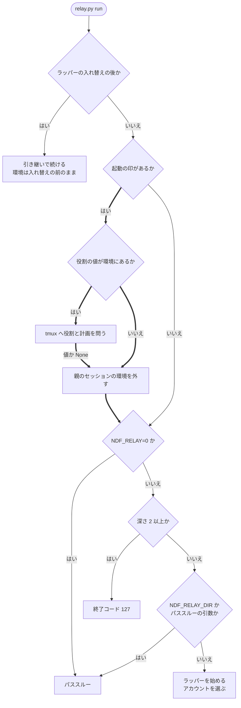

# 中継: 親のセッションの環境を持つ専用サーバーの上でも、レーンがアカウントを選んで起動する

tmux の専用サーバー（`tmux -L ndf-relay`）は、最初にサーバーを起こしたプロセスの環境をグローバルな環境として
持ち続ける。claude のセッションの中からサーバーが起きると、そのグローバルな環境には親のセッションの環境
（セッションの識別子・動いているラッパーの作業ディレクトリ・起動の深さ・アカウント・役割・費用の記録先）が残る。
起動の印（`NDF_RELAY_SPAWNED`）を持つ `relay.py run` は、入れ子とパススルーの判定より先にこれらを外し、
ラッパーとして新しい区間 1 を始め、アカウントの選定を通る。この文書は、外す変数の区分・判定の順序・
常に成り立つ条件と、それぞれをそう決めた理由を残す。

| 何を読むか | 正本 |
| --- | --- |
| リレーハブ・名前つきのラッパー・受付箱・`spawn` / `restart` の入出力 | [ndf-relay-multi-session-supervisor.md](ndf-relay-multi-session-supervisor.md) |
| 1 本のラッパーの入出力・区間の切り替え・パススルーの条件の表 | [ndf-relay-segment-restart.md](ndf-relay-segment-restart.md) の「パススルーの条件」 |
| 起動の印の宣言 | `plugins/ndf/contracts/env/NDF_RELAY_SPAWNED.json` |

## 概要

**例: 2026-11-06、アカウント `main` が週の上限に達した後に、レーン 2 本を起こし直した。**

| 順 | 起きること（変更の前） | 変更の後 |
| ---: | --- | --- |
| 1 | 専用サーバーのグローバルな環境に `NDF_RELAY_DIR`・`NDF_RELAY_DEPTH=1`・`NDF_CLAUDE_ACCOUNT=main`・`CLAUDE_CONFIG_DIR=<main の設定ディレクトリ>`・`CLAUDECODE=1` などが残っている | 同じ |
| 2 | リレーハブの `spawn` が `new-session -e NDF_RELAY_NAME=<名前> -e NDF_RELAY_SPAWNED=1` で `relay.py run` を起動する | 同じ |
| 3 | `run` は `NDF_RELAY_DIR` を見て親のラッパーの中にいると判断し、パススルーする | `run` は先に親のセッションの環境を外す。深さは 0、`NDF_RELAY_DIR` は無くなる |
| 4 | アカウントの選定を通らず、`main` の設定ディレクトリのまま claude が起動し、直後に上限で止まる | ラッパーが新しい作業ディレクトリで区間 1 を始め、指定・残量・上限から使えるアカウント（例: `gmail`）を選んで起動する |

リレーハブの起動（`relay.py spawn`・`restart`・起動のブロック）も、claude のセッションの中で手で打つ
`tmux -L ndf-relay new-session ... -e NDF_RELAY_SPAWNED=1 -- <python> relay.py run` も、最後は window の中の
`relay.py run` を通る。外す処理はこの受け取る側の 1 か所にあるため、どの経路でも同じ結果になる。

**コンテキストはラッパー（`ndf-relay`）の 1 つで閉じる。**

## 用語

tmux の専用サーバー・親のセッションの環境・アカウントの選定の定義は、設定の用語集
（`.ndf/glossary.json` の `document` が指す [docs/glossary.md](../glossary.md)）にある。ラッパー・区間・レーン・
リレーハブは [ndf-relay-segment-restart.md](ndf-relay-segment-restart.md) と
[ndf-relay-multi-session-supervisor.md](ndf-relay-multi-session-supervisor.md) の用語のまま使う。

「グローバルな環境」「tmux のセッションの環境」は tmux(1) の GLOBAL AND SESSION ENVIRONMENT の語である。
window の環境は両者をマージしたもので、両方にある変数は tmux のセッションの値を採る。起動の `-e` の値は
tmux のセッションの環境だけに入る。

## 背景

- 専用サーバーの子は、サーバーを起こした側の環境を受け取る。後から `new-session` を打つクライアントの環境は届かない（tmux 3.6 で確認）
- パススルーの判定の引き金は `NDF_RELAY_DIR` である。深さ 1 だけではパススルーにならず、深さ 2 以上は終了コード 127 で止まる
- `NDF_RELAY_SPAWNED` はラッパーの子の claude へ渡らない（`relay_lib/claude.py` の `child_env`）。この印を持つプロセスはラッパーの子の claude ではなく、新しいレーンである

## 仕様

### 構成要素と責務

| 要素 | 責務 |
| --- | --- |
| 起動処理（`relay_lib/run.py` の `cmd_run`・`_lane_env`） | 起動の印があれば、入れ子とパススルーの判定より先に親のセッションの環境を外す。役割と計画の値が環境にあるときだけ、tmux のセッションの環境へ問う |
| 環境の一覧と外す処理（`relay_lib/session_env.py`） | `DROP_ENV`・`PARENT_ENV`・`LANE_ENV` の一覧を 1 か所に持ち、`drop_parent_env` で外す |
| アカウントの環境の戻し（`lib/claude_accounts.py` の `leave_account`） | 親のアカウントの環境を外して元の値へ戻す。従量の接続の環境を作る処理（`_metered_env`）も同じ戻しを使う |
| tmux の呼び出し（`relay_lib/tmux.py` の `session_value`） | `show-environment -t =<名前> <キー>` で tmux のセッションの環境の値を 1 つ読む。無い・tmux に聞けないときは `None` |

リレーハブの起動（`relay_lib/hub.py` の `launch`）は、今と同じく `-e` で名前・起動の印・役割と計画を渡す。
ランチャー（`scripts/relay.py`）の中身が見つからないときの退避は、アカウントの選定を通せないため、
親のセッションの環境を持つサーバーの上でも終了コード 127 と導入し直す案内で止まる。

### 変数ごとの扱い

親のセッションの環境は 3 つに分かれる。無条件に外す一覧（`PARENT_ENV`）、起動で付いた値だけを残す役割と
計画（`LANE_ENV`）、`leave_account` が戻すアカウントの環境である。

| 変数 | 区分 | 起動の印を持つ `relay.py run` での扱い |
| --- | --- | --- |
| `CLAUDECODE`・`CLAUDE_CODE_SESSION_ID`・`CLAUDE_CODE_ENTRYPOINT`・`CLAUDE_CODE_BRIDGE_SESSION_ID`・`CLAUDE_CODE_CHILD_SESSION`・`CLAUDE_CODE_EXECPATH`・`CLAUDE_CODE_MESSAGING_SOCKET`・`CLAUDE_CODE_MESSAGING_TOKEN`・`CLAUDE_CODE_SESSION_ATTENDED`・`CLAUDE_EFFORT`・`CLAUDE_PID` | Claude Code のセッションの値（`DROP_ENV` の 11 個） | 外す |
| `NDF_RELAY_DIR`・`NDF_RELAY_DEPTH` | ラッパーの値 | 外す |
| `NDF_USAGE_SOURCE`・`NDF_USAGE_KIND`・`NDF_USAGE_PLAN`・`NDF_USAGE_STEP` | 費用の記録先 | 外す |
| `NDF_RELAY_ROLE`・`NDF_RELAY_PLAN` | 役割と計画（`LANE_ENV`） | tmux のセッションの環境に値があれば、その値にする。無ければ外す |
| `NDF_CLAUDE_ACCOUNT`・`NDF_SHARED_CONFIG_DIR` | アカウントの環境 | `leave_account` が外す |
| `CLAUDE_CONFIG_DIR` | アカウントの環境 | `NDF_SHARED_CONFIG_DIR` があるときだけ、その値（元の設定ディレクトリ）へ戻す。値が空なら外す。`NDF_SHARED_CONFIG_DIR` が無ければ利用者の値として残す |
| `CLAUDE_CODE_PLUGIN_CACHE_DIR` | アカウントの環境 | NDF が足した値（共有の設定ディレクトリの `plugins`）と同じときだけ外す |
| 従量の接続の宣言のキー | アカウントの環境 | 親が `NDF_CLAUDE_ACCOUNT=metered` のときだけ、そのとき読める宣言のキーを外す。名前（`NDF_CLAUDE_ACCOUNT`）より先に外す |
| `NDF_RELAY_NAME`・`NDF_RELAY_SPAWNED` | 起動で付ける値 | そのまま読む。`-e` の値がグローバルな環境の値に勝つ |
| 上のどれにも当たらない変数（`CLAUDE_CODE_OAUTH_TOKEN`・`CLAUDE_CODE_USE_BEDROCK`・`NDF_ACCOUNT_SWITCH_AT`・`AWS_*` など） | 利用者の設定と認証の宣言 | 変えない |

`DROP_ENV` は区間の子の環境（`child_env`）・`claude plugin` の環境（`plugin_cli`）・ラッパーの入れ替えの
環境（`handover.py` の `startup_env`）・ログインの子の環境（`login.py`）も読む。どれも子の claude が自分で
設定する値なので、同じ一覧で外す。

### 常に成り立つ条件

| # | 条件 | 破れたときの扱い |
| --- | --- | --- |
| 1 | 起動の印を持つ `relay.py run` は、起動時の環境に親のセッションの環境があっても、パススルーにも終了コード 127 にもならず、最初の区間を新しい作業ディレクトリで始める | テストが落ちる。実行時の検出はしない |
| 2 | 3 つの区分のどれにも当たらない変数は、外す処理の前後で値が変わらない | テストが落ちる |
| 3 | 役割と計画は、この tmux のセッションの起動で付けたものだけが残る。グローバルな環境から来た値は残らない | tmux に聞けないときは役割を持たないレーンとして起動する |
| 4 | 起動の印を持たない `relay.py run` の判定は変わらない（ラッパーの子の中で打つ `claude` はパススルー、深さ 2 以上は終了コード 127） | テストが落ちる |
| 5 | 親のアカウントの環境を外した後の `CLAUDE_CONFIG_DIR` は元の値である。元に無ければ変数を持たない。親が従量の接続なら、そのとき読める宣言のキーも残らない | テストが落ちる。読めない宣言は無いものとして扱い、例外を出さない |
| 6 | 外した変数の値は、画面にも記録（`log.jsonl`・`hub-log.jsonl`）にも出ない | 外す処理は値を読み出さず、出力も記録も持たない |

### `relay.py run` の判定の順序

太い枝が起動の印による判定である。起動の印を持たないときは
[パススルーの条件](ndf-relay-segment-restart.md) の表の順序を今のまま通る。

- 外した後は深さが 0 で `NDF_RELAY_DIR` も無いため、起動の印を持つレーンは深さと作業ディレクトリの判定に当たらない
- 端末が無い・擬似端末を作れない・`ndf` のプラグインを読めないときのパススルーは残る。このとき claude は親のセッションの環境を外した状態で起動する
- ラッパーの入れ替えの後の経路では外さない。起動の印を持つラッパーは、すでに外した環境で `os.execve` している

### 決定と理由

| 決定 | 理由 |
| --- | --- |
| 親のセッションの環境は、受け取る側の `relay.py run` の先頭で外す | リレーハブの起動と手で打つ `new-session` のどちらにも 1 か所で効く。動いている専用サーバーのグローバルな環境を変えない。リレーハブの `new_session` で外す形は、NDF を通らない手の起動に効かない |
| 入れ子かどうかは起動の印で分け、親のプロセスの生死を調べない | 起動の印は子の claude へ渡らないため、印があるだけで新しいレーンと決まる。生死で判定すると、親が動いているときに誤る |
| 外す変数は名前で列挙する。`CLAUDE_CODE_` の前方一致では外さない | `CLAUDE_CODE_*` には利用者の設定と認証の宣言が多数ある。残すものだけを列挙する形（`env -i` 相当）は、`PATH`・`AWS_*` など利用者の環境を列挙し続けることになる |
| 役割と計画の出所は、tmux のセッションの環境に値があるかで確かめる | window の中では `-e` の値もグローバルな環境の値も同じに見える。`-e` の形を変えないため、古い版のリレーハブが起動した一時レーンの役割も読める。役割の値が環境にあるときだけ問うので、通常の起動で tmux の呼び出しは増えない |
| アカウントの環境の戻しは `leave_account` の 1 か所に集め、従量の接続の環境を作る処理と共有する | 元の設定ディレクトリへ戻す規則が 2 か所に分かれない。名前を先に外すと宣言のキーを外す条件に当たらなくなるため、宣言のキーを先に外す |

親が従量の接続で、登録のアカウントが 1 つ以下で `account use` の指定も無いレーンは、宣言のキーを外した後、
親のセッションの環境を持たないサーバーの上と同じく既定のログインで区間 1 を起動する。上限の後の選び直しで
使えるアカウントが無く宣言があれば、今の規則どおり従量の接続へ移る。

## 運用

効くのは、ラッパーを新しい版で起動した後である。動いているレーンは止めず、専用サーバーを起こし直す必要もない。
外す処理はサーバーのグローバルな環境を変えないため、`tmux -L ndf-relay show-environment -g` には親の値が
残ったままになる。

`NDF_RELAY_SPAWNED` を付けずに `relay.py run` を tmux で起動する形は対象外で、パススルーのままである。

## セキュリティ

- 外した変数の値を画面にも記録にも出さない
- tmux へは役割と計画の 2 つの変数名だけを問い、認証の変数を読まない。新しい受け渡しのファイルを作らない
- アカウントを選ぶ区間では、今の規則どおり `CLAUDE_CODE_OAUTH_TOKEN` と `CLAUDE_CODE_USE_BEDROCK` を子から外す。外す処理の前後で値を保つのは、アカウントを登録していない構成である
- 親が従量の接続のときの宣言のキーは子へ届かない。利用者のシェルが同じキーを持っていても区別できず、一緒に外す

## テスト観点

テストは `plugins/ndf/scripts/tests/test_relay.py`（環境の分け方の単体テスト）と `test_relay_hub.py`（使い捨ての
`TMUX_TMPDIR` と偽の claude で起動の経路を通す）にある。「親の環境を持つサーバー」は、グローバルな環境に
Claude Code のセッションの値・`NDF_RELAY_DIR`・`NDF_RELAY_DEPTH`・`NDF_CLAUDE_ACCOUNT=main`・
`CLAUDE_CONFIG_DIR=<main の設定ディレクトリ>`・`NDF_SHARED_CONFIG_DIR` を持つ専用サーバーを指す。

- 親の環境を持つサーバーの上の `spawn`・`restart`・手で打つ `new-session` が、新しい作業ディレクトリと区間 1 で始まり、子の `NDF_CLAUDE_ACCOUNT` が `account use` の指定と一致すること
- `NDF_RELAY_DIR` が動いているラッパーを指しても、グローバルな深さが 2 でも、結果が変わらないこと
- 指定の `main` が上限で `gmail` が使えるとき、子のアカウントが `gmail` になること
- すべてのアカウントが上限のとき、親のセッションの環境の有無で選ばれる結果（アカウントと理由）が同じであること
- グローバルな環境の役割・計画・費用の記録先がレーンの子へ残らず、役割を付けていないレーンが役割のファイルを持たないこと。`-e` で付けた役割は書かれること
- `NDF_SHARED_CONFIG_DIR` の値で共有の設定ディレクトリが決まり、空なら `~/.claude` になること
- アカウントを登録していない構成で、`NDF_ACCOUNT_SWITCH_AT`・`CLAUDE_CODE_OAUTH_TOKEN`・`CLAUDE_CODE_USE_BEDROCK` が子まで届くこと
- `leave_account` が元の値・空・変数なしの 3 通りで元の環境へ戻し、親が従量の接続なら宣言のキーも外すこと。保存した宣言が消えた・壊れたときも例外を出さないこと
- `session_value` が起動の `-e` で付いた値だけを読み、グローバルな環境の値は読まないこと
- 起動の印が無い `run` は環境を変えず、ラッパーの子の中ではパススルー、深さ 2 では終了コード 127 のままであること
- 親のセッションの環境の値に目印の文字列を入れて起動し、画面と記録にその文字列が現れないこと
- `cmd_run` の外す処理を取り除くと、`spawn`・手の起動・上限での切り替えのテストが落ちること

## 未確認・残リスク

| 項目 | 内容 |
| --- | --- |
| Claude Code が将来足すセッションごとの値 | 一覧に載るまでレーンへ継がれる。見つけたときに `DROP_ENV` へ足す |
| `CLAUDE_CODE_ENTRYPOINT`・`CLAUDE_CODE_EXECPATH`・`CLAUDE_CODE_SESSION_ATTENDED` の意味 | Claude Code の環境変数の公開文書に定義が無い（2026-11-07 に変数名で検索して 0 件）。子のプロセスの `env` に現れる値としてセッションの値に分類した。子の claude が自分で設定する限り、誤っていても影響は無い |
| 読めない従量の接続の宣言 | 親が従量の接続のまま保存した宣言が消えた・壊れたときは、外すキーの名前が分からず、親の宣言のキーが環境に残る。既定のログインの区間では `CLAUDE_CODE_USE_BEDROCK` も残り、Bedrock への課金が続く |
| 実サーバーでの確認 | 開発版を入れた後に、親のセッションの環境が残る専用サーバーでレーンを起動し、`relay.py ls` の区間が 1 で指定どおりのアカウントで動くことを確かめる機会が要る |
| spawn が `ok` を返すのに立ち上がらない不具合 | 同じサーバーの上で手で起動すると動いた事例で、環境の継承だけでは成否の差を説明できない。原因は未確認 |

## 関連リンク

- [ndf-relay-multi-session-supervisor.md](ndf-relay-multi-session-supervisor.md)
- [ndf-relay-segment-restart.md](ndf-relay-segment-restart.md)
- 課題: https://github.com/devbasex/ai-plugins/issues/2656 （spawn が立ち上がらない不具合は https://github.com/devbasex/ai-plugins/issues/2563 ）
- tmux(1) の GLOBAL AND SESSION ENVIRONMENT: https://man.openbsd.org/tmux.1
- Claude Code の環境変数: https://code.claude.com/docs/en/env-vars
