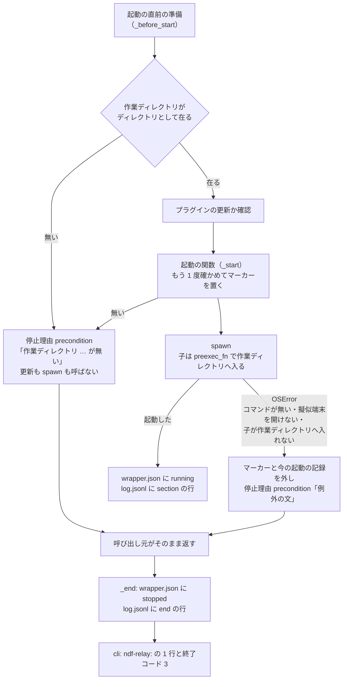

# 中継: 子の claude を起動できないときは、理由の 1 行と終了コード 3 で終わる

11 系のラッパー（`ndf relay run`。claude を擬似端末の下で子として動かし、カットポイントで次の claude を新しい会話（セグメント）として起動する）は、
子の claude を起動できないとき、起動を打ち直さずに停止理由 `precondition`（終了コード 3）で終わる。端末には `ndf-relay: 子の claude を起動できない（<理由>）` の 1 行を出し、
状態のファイル（`wrapper.json`）を `stopped` にし、記録（`log.jsonl`）の最後に `end` の行を書く。止まり方は、メジャーバージョンの変化で止まるときと同じ形である。
この文書は、起動の失敗の拾い方・止まり方・常に成り立つ条件と、それぞれをそう決めた理由を残す。

| 何を読むか | 正本 |
| --- | --- |
| 利用者が端末の 1 行を見てどう続けるか | `plugins/ndf/skills/development-workflow/references/relay.md` の「落ちたときの続け方」 |
| ラッパーの本体の契約（セグメント・シグナルファイル・`log.jsonl`・`run` の終了コード） | [ndf-relay-segment-restart.md](ndf-relay-segment-restart.md) |
| 起動の直前の準備（プラグインの更新とメジャーバージョンの違いで止まる） | [ndf-relay-plugin-update.md](ndf-relay-plugin-update.md) |
| 停止理由の種類と終了コード | `plugins/ndf/contracts/causes.json` の `precondition` |

## 概要

**例: レーンの作業ディレクトリ（ワークツリー）を片付けた後に、子が `ndf-next` のブロックを出した。**

| 順 | 起きること |
| ---: | --- |
| 1 | ラッパーがカットポイントの切り替え（`switch`）を選び、今の子を止める |
| 2 | 起動の直前の準備（`_before_start`）が、プラグインを更新する前に作業ディレクトリを確かめ、無いので停止理由 `precondition` を返す |
| 3 | ラッパーは更新のコマンドも子の起動（`spawn`）も呼ばず、`wrapper.json` を `stopped`、`log.jsonl` の最後を `{"kind": "end", "cause": "precondition", "reason": "子の claude を起動できない（作業ディレクトリ <パス> が無い）"}` にする |
| 4 | 端末に `ndf-relay: 子の claude を起動できない（作業ディレクトリ <パス> が無い）` を出し、終了コード 3 で終わる |
| 5 | 利用者は作業ディレクトリを戻してから、conductor のブロックの中身で `claude` を打ち直す |

`claude` が PATH に無いときも同じ形で終わり、理由の文が `子の claude を起動できない（The command was not found or was not executable: claude.）` のように例外の文になる。

**コンテキストはラッパー（`ndf-relay`）の 1 つで閉じる。** 起動の失敗の検出・停止理由・記録は、どれもラッパーの中にある。

### 構成要素と責務

| 要素 | 責務 |
| --- | --- |
| 設定の生成（`plugins/ndf/src/ndf/domains/relay/cli.py` の `wrapper_settings`・`_cwd`） | 作業ディレクトリを例外なしで読む。`Path.cwd()` が失敗したら、表示用の文字列を設定（`Settings.cwd_lost`）に残す |
| 作業ディレクトリの確かめ（`plugins/ndf/src/ndf/domains/relay/wrapper.py` の `Wrapper._cwd_missing`） | `cwd_lost` が無く、作業ディレクトリが絶対パスのディレクトリとして在れば None、そうでなければ停止理由を返す |
| 起動の直前の準備（`Wrapper._before_start`） | プラグインの更新と確認の前に作業ディレクトリを確かめ、無ければ停止理由を返す |
| 子を起動する関数（`Wrapper._start`） | マーカーを置く前に作業ディレクトリを確かめ直し、`spawn` の `OSError` を受けて停止理由を返す。返り値は停止理由か None（`Optional[Ended]`） |
| 擬似端末の起動（`spawn_pty`・`_enter`） | 作業ディレクトリを ptyprocess へ渡さず、fork した子の `preexec_fn`（`_enter`）で入る。入れなければ同じ型の `OSError` を理由の文で上げ直し、親の `spawn` へ届ける |
| 起動の呼び出し元（`_loop`・`_on_switch`・`_on_resume`・`_on_handover`） | 起動の関数が返した停止理由をそのまま返す。`_loop` が `_end` で記録して終える |
| 終わりの表示（`cli._ended`） | `ndf-relay: <理由>` を標準エラーへ出し、停止理由の種類の終了コードを返す |

## 用語

「子の起動の失敗」の定義は、設定の用語集（`.ndf/glossary.json` の `document` が指す [docs/glossary.md](../glossary.md)）にある。
ラッパー・セグメント・カットポイント・停止理由は用語集のコンテキスト `ndf-relay` と `ndf-durable` の語のまま使う。

「手」はラッパーが子に対して打つ操作の種類である。`switch` はカットポイントで次のセグメントを新しい会話として始め、`account` は上限に当たったアカウントを替えて同じ会話を `--resume` で再開し、
`restart` は子が終わった・止まったときに同じ会話を `--resume` で起動し直し、`handover` は引継ぎを頼む文で同じ会話を起動し直す。

## 背景

起動の失敗には 2 つの形がある。起動に使うライブラリ ptyprocess 0.7.0 の `PtyProcess.spawn` を打って確かめた（2026-11-19）。

| 打ったもの | 親で起きること |
| --- | --- |
| PATH に無いコマンド・実行できないファイル | `FileNotFoundError: The command was not found or was not executable: <名前>.` |
| 無い作業ディレクトリを `cwd` で渡す | 親では例外が出ない。fork した子の Python が `os.chdir` で失敗し、トレースバックを擬似端末へ出して終了コード 1 で終わる |

1 つ目の形は、起動の関数・呼び出し元・コマンドのエントリポイントのどれも捕まえないとトレースバックで終わり、`wrapper.json` が `running` のまま残る。一覧（`ndf relay ls`）と耐久ワークフローはそれを動いているラッパーと読む。
2 つ目の形は、親から見ると起動できた子がすぐ終了コード 1 で終わったのと区別がつかず、ラッパーは `restart` で起動し直しを今日の上限まで繰り返し、利用者には本当の理由が見えない。
どちらも、起動を止めるほかの場合（メジャーバージョンの変化・停止シグナルファイル）と同じ止まり方で終える。

## 対象範囲

含む:

- ラッパーが子を起動するすべての経路（最初のセグメント・`switch`・`account`・`restart`・`handover`）で、起動できないときに停止理由 `precondition` で終えること
- 子を起動する前に、作業ディレクトリがディレクトリとして在るかを確かめること（設定の生成・起動の直前の準備・起動の関数）
- 手順書の「落ちたときの続け方」の 1 行と続け方

含まない:

- 作業ディレクトリが消えたときに、メインディレクトリや親のディレクトリへ逃がして起動すること。起動先を変えると、別の作業場所で会話が続く
- 起動できなかったときの打ち直し。PATH・作業ディレクトリ・擬似端末の欠けは、時間を置いても直らない
- ラッパーを挟まない起動（`_passthrough`）。`exec` できなければ理由の 1 行と終了コード 127 で終わる
- リレーハブ（`ndf relay spawn`）が tmux でラッパーを起動できないとき。ラッパーより前にあり、`hub.py` が持つ

## 仕様

### 集約

起動の失敗を受け持つ集約はラッパー（`Wrapper`）の 1 つである。停止理由の記録（`wrapper.json` の `stopped` と `log.jsonl` の `end` の行）を書くのは `_loop` の `_end` だけで、
起動の関数と呼び出し元は停止理由を返すだけにする。書く場所を 1 つにして、端末の 1 行・`log.jsonl`・`wrapper.json` の理由の文を同じにする。

### 処理の流れ

### 作業ディレクトリの確かめ

- **起動できるかは、設定の生成で `Path.cwd()` が失敗したことと、作業ディレクトリが絶対パスのディレクトリとして在ることで決める。** `Path.cwd()` が失敗したら、同じ名前のディレクトリが作り直されていても起動しない
- 表示の文字列は `/proc/self/cwd` の指し先から末尾の ` (deleted)` を外したもの、読めなければ環境変数 `PWD`、どちらも無ければ `（不明）` である。読むパスと 2 つの文字列は `cli.py` の定数 `PROC_CWD`・`DELETED_SUFFIX`・`UNKNOWN_CWD` にある。表示の文字列は停止理由の文にだけ使い、起動先には使わない
- 消えた作業ディレクトリでも `Path(".").is_dir()` は真を返す（開いたままのディレクトリを指す）ので、`.` へは倒さない
- 確かめは `_before_start` の先頭と、`_start` のマーカーを置く前の 2 か所で同じ関数（`_cwd_missing`）を呼ぶ。プラグインの更新は作業ディレクトリでコマンドを打つので、更新より前に確かめる。`_start` の確かめは、準備の後に消えたときのためにある

### 子の側で作業ディレクトリへ入る

`spawn_pty` は ptyprocess へ作業ディレクトリを渡さず、`preexec_fn` に `functools.partial(_enter, cwd)` を渡す。`_enter` は fork した子で `os.chdir(cwd)` し、`OSError` を
`type(exc)(NO_ENTER.format(cwd=cwd, why=exc.strerror))` で上げ直す。ptyprocess は `preexec_fn` の例外を型と文のまま親の `spawn` で上げ直すので、
確かめの後に消えたディレクトリ（`FileNotFoundError`）と入る権限の無いディレクトリ（`PermissionError`。`is_dir()` は真）も、親の `except OSError` で受けられる。
子は claude を実行せずに終わり、親が回収する。`chdir` の後に `execvpe` する順と、親で `which` が解くコマンドの場所は ptyprocess の `cwd` を使うときと同じで、起動できるときの引数・環境・作業ディレクトリは変わらない。

### 理由の文

文の形は `wrapper.py` の定数にある。

| 定数 | 文の形 | 使う場面 |
| --- | --- | --- |
| `LAUNCH_FAILED` | `子の claude を起動できない（{why}）` | すべての起動の失敗。`{why}` は下の 2 つの文か、`spawn` の例外の文 |
| `NO_CWD` | `作業ディレクトリ {cwd} が無い` | 作業ディレクトリの確かめで止めたとき。`{cwd}` は `cwd_lost` の文字列か設定の作業ディレクトリ |
| `NO_ENTER` | `作業ディレクトリ {cwd} に入れない: {why}` | 子が `chdir` に失敗したとき。`{why}` は `strerror` |

### 常に成り立つ条件

| # | 条件 |
| --- | --- |
| I1 | 起動の失敗の停止理由の種類は、理由に依らず `precondition`（終了コード 3）の 1 つである |
| I2 | 起動に失敗したとき、`spawn` を呼ぶのは失敗した 1 回だけで、ラッパーは同じ起動を打ち直さない |
| I3 | 作業ディレクトリの確かめで止めたときは、プラグインの更新・確認と `spawn` のどれも呼ばない |
| I4 | 端末の 1 行・`log.jsonl` の `end` の行の `reason`・`wrapper.json` の `reason` は同じ文である |
| I5 | 停止理由の記録を書くのは `_loop` の `_end` の 1 か所だけである |
| I6 | 呼び出し元は前の子を止めてから起動の関数を呼ぶ。次のセグメントの起動に失敗しても、前の子は残らない |
| I7 | 起動に失敗したとき、`self.section` は前のままで、`_start` が置いた最初の入力のマーカーと今の起動の記録は外してある |
| I8 | 起動できるときは、`spawn` に渡す引数・環境・作業ディレクトリと `log.jsonl` の `section` の行が、起動の失敗を扱わないときと同じである |

### 決定と理由

| 決定 | 理由 |
| --- | --- |
| 起動の失敗を理由に依らず `precondition` の 1 種類で終える。`claude` が無いときだけ `deps_missing`（終了コード 69）にはせず、停止理由の種類も足さない | 起動を止めるほかの場合（メジャーバージョンの変化・バージョンの混ざり）も `precondition` で、手順書の続け方は終了コードではなく 1 行の文で分ける。`FileNotFoundError` は実行できないファイルでも出る。今の `precondition` の意味「前提が無い」に収まる。代償として、終了コードだけでは起動の失敗とバージョンの変化を区別できない |
| 作業ディレクトリは起動の前に確かめ、さらに子の `preexec_fn` で入る | 事前の確かめだけでは、確かめの後に消えたディレクトリと入る権限の無いディレクトリで、起動し直しの繰り返しが残る。子の終了コード 1 と画面のトレースバックで見分ける形は、claude 自身の終了コード 1 と区別できない。代償として ptyprocess の `preexec_fn` の振る舞い（例外を親へ返す）に依り、この依りどころは本物の擬似端末のテストで確かめる |
| 直すのは失敗の起きる起動の関数で、コマンドのエントリポイント（`cli.main`）で例外を広く捕まえる形にはしない | エントリポイントでは、状態のファイルと記録の行をラッパーの止まり方と同じ形で書けない |

## データ・設定

| 項目 | 形 |
| --- | --- |
| `Settings.cwd_lost` | `Optional[str]`。既定は None。設定の生成で `Path.cwd()` が失敗したときの表示の文字列で、None でなければ起動しない。このとき `Settings.cwd` は同じ文字列の `Path` |
| `log.jsonl` の `end` の行 | `{"section": <番号か null>, "kind": "end", "cause": "precondition", "reason": "子の claude を起動できない（…）"}`。行の種類は増えない |
| `wrapper.json` | `state` が `stopped`、`reason` が `end` の行と同じ文。形は変わらない |

`section` は最初のセグメントの起動に失敗したとき null、次のセグメントの起動に失敗したときは前のセグメントの番号である。

## 外部連携

| 相手 | 依る振る舞い |
| --- | --- |
| ptyprocess 0.7.0（ISC） | コマンドの欠けを `FileNotFoundError`、擬似端末の欠けを `OSError` で親へ上げる。`preexec_fn` の例外を型と文のまま親の `spawn` で上げ直す。`cwd` を渡すと `preexec_fn` より前に子で移り、その失敗は親へ返さない（2026-11-19、`inspect.getsource(PtyProcess.spawn)` と打って確かめた） |

## エラー処理

| 失敗 | 検出する場所 | 端末の 1 行と終了コード | 後始末と続け方 |
| --- | --- | --- | --- |
| 作業ディレクトリが無い（起動の前にシェルの作業ディレクトリが消えていたときを含む） | `_before_start` か `_start` の `_cwd_missing` | `ndf-relay: 子の claude を起動できない（作業ディレクトリ <cwd> が無い）`、3 | 何も残らない。ディレクトリを戻して `claude` を打ち直す |
| `spawn` が `OSError`（`claude` が PATH に無い・実行できない・擬似端末を開けない） | `_start` の `spawn` の呼び出し | `ndf-relay: 子の claude を起動できない（<例外の文>）`、3 | マーカーと今の起動の記録を外す。原因を直して打ち直す |
| 子が作業ディレクトリへ入れない（確かめの後に消えた・入る権限が無い） | 子の `_enter` の `OSError`。親の `spawn` が同じ型で上げる | `ndf-relay: 子の claude を起動できない（作業ディレクトリ <cwd> に入れない: <strerror>）`、3 | 子は claude を実行せずに終わっている。上の行と同じ |

## 運用

- `ndf relay run` が起動できないときの終わり方は、`ndf-relay:` の 1 行と終了コード 3 である。起動できるときの振る舞いと `run` のほかの終了コードは [ndf-relay-segment-restart.md](ndf-relay-segment-restart.md) にある
- 利用者向けの続け方は `relay.md` の「落ちたときの続け方」の `子の claude を起動できない（<理由>）` の行にある
- 起動の失敗を `log.jsonl` から探すときは、`end` の行の `reason` が `子の claude を起動できない` で始まる行を見る

### 未確認のまま残ること

- PATH から `claude` を外した環境で、本物のラッパーを通して打ったときの端末の出力と終了コードは、単体テスト（偽の起動が `FileNotFoundError` を出す）でだけ確かめている
- 擬似端末を開けない場合（`OSError`）は、実機で起こして確かめていない。`except OSError` の同じ経路を通る

## テスト観点

テストは `plugins/ndf/tests/domains/relay/test_relay_wrapper.py` と `test_relay_cli.py` にある。偽の起動（`Spawner`）と偽の子（`FakeChild`）で起動の失敗を起こし、本物の擬似端末は `spawn_pty` を直に呼ぶテストで確かめる。

| 観点 | 満たすこと |
| --- | --- |
| `claude` が無い（I1・I4） | 偽の起動が `FileNotFoundError` を出すと、`Wrapper.run` が `precondition` を返し、`cli._ended` が `ndf-relay:` の 1 行と 3 を返し、トレースバックを出さないこと。`log.jsonl` の最後が `end`、`wrapper.json` が `stopped` で、理由の文が 3 か所で同じこと |
| 最初のセグメントの作業ディレクトリが無い（I3） | 無い作業ディレクトリで、最初のセグメントを起動しないこと |
| 次の起動の手の作業ディレクトリが無い（I2・I3） | 最初の子の起動の後に作業ディレクトリが消えると、`switch`・`account`・`restart` のどれでも次の起動で更新も `spawn` も呼ばず、`precondition` で終わること |
| 設定の生成から（I3） | 作業ディレクトリへ入ってから消し、`cli.main(["run", …])` を呼ぶと、終了コード 3 と `作業ディレクトリ <消したパス> が無い` の 1 行で終わり、`spawn` も更新も呼ばないこと。`/proc/self/cwd` と `PWD` を読めなければ `（不明）` の文になること |
| 作り直したディレクトリ・`PWD` が指す別のディレクトリ | 消した後に同じ名前のディレクトリを作り直しても、`/proc/self/cwd` を読めず `PWD` が別の在るディレクトリを指しても、起動しないこと |
| 本物の擬似端末で入れない | 入る権限の無いディレクトリ（root では飛ばす）と、確かめの後・`spawn_pty` の前に消したディレクトリで、`precondition` に終わり `spawn` が 1 回であること |
| 前の子が残らない（I6） | 次のセグメントの起動に失敗したとき、前の子が止まっていること |
| 記録を外す（I7） | 起動に失敗したとき、今の起動の記録とマーカーが外れていること |
| 退行しない（I8） | 本物の `spawn_pty` の子が `pwd` で作業ディレクトリを出すこと。既存の中継のテストが通ること |
| 手順書 | 「落ちたときの続け方」の行はレビューと `python3 scripts/check-markdown-links.py` で見る。文言のテストは書かない |

## 関連リンク

- [ndf-relay-segment-restart.md](ndf-relay-segment-restart.md)（ラッパーの本体の契約と `run` の終了コード）
- [ndf-relay-plugin-update.md](ndf-relay-plugin-update.md)（起動の直前の準備）
- 手順書: [relay.md の「落ちたときの続け方」](../../plugins/ndf/skills/development-workflow/references/relay.md#落ちたときの続け方)
- 課題 [#3842](https://github.com/devbasex/ai-plugins/issues/3842)
