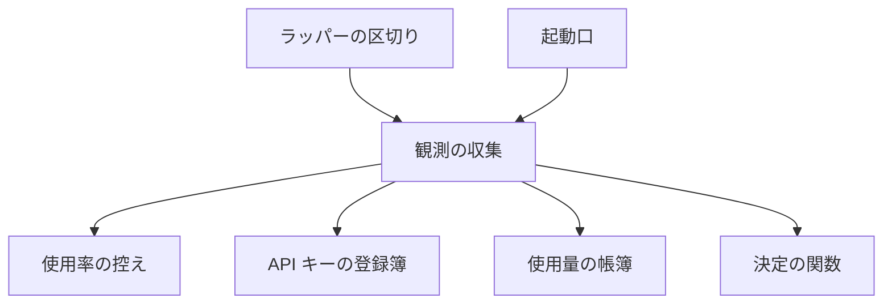

# claude -p とラッパーの起動先: 5 時間の枠を先に使い、全アカウントの週の上限が近いときだけ API キーへ逃がす

`supervise.py` の起動口が打つ `claude -p` と、ラッパー（`relay.py`）が区切りで行う起動先の選び直しは、どちらも
1 つの起動先の決定（`lib/launch_rules.py`）で決まる。決定はその時点の観測（アカウントの使用率・上限の観測・API キーの宣言・
使用量の帳簿の直近 7 日の使用額）だけを入力にし、判定のための状態を持たない。プロセスやマシンを起動し直しても、
同じ観測から同じ起動先が出る。

例: 登録済みアカウントが `team`（5 時間の枠あり）と `gmail`（5 時間の枠なし）の 2 つで、閾値 T が既定の 85% のとき。

| 順 | 観測 | 起動先 | 当たった規則・組 |
| ---: | --- | --- | --- |
| 1 | `team` 5 時間 50%・週 30%、`gmail` 週 2% | `team` | `account`・`five_hour_first` |
| 2 | `team` が 5 時間の上限に当たった | `gmail` | `account`・`weekly_only`（復帰先は記録しない） |
| 3 | `team` の 5 時間の枠がリセットされた。次の区切り | `team` へ戻る | `account`・`five_hour_first`（組が変わったので替える） |
| 4 | `team` 週 88%、`gmail` 週 40% | `gmail` | `account`・`weekly_only`（`team` は組 3） |
| 5 | `team` 週 90%、`gmail` 週 86%、near-limit の宣言で月の額を宣言した API キーがある | API キー | `near_limit_key` |
| 6 | `gmail` の週の枠がリセットされ 0% に戻った | `gmail` | `account`（API キーを使わない） |

この文書は、その形に**なぜしたか**（常に成り立つ条件・選ぶ順の組と並べ方・切り替えの余裕・閾値 T の根拠・決定と理由・
テスト観点）を残す。**利用者向けの使い方と画面の文の正は Skill とスクリプトにある。**

| 何を読むか | 正本 |
| --- | --- |
| 選ぶ順の組の表・`account list` の列・閾値 T の宣言の打ち方 | [`development-workflow` の `references/relay-accounts.md`](../../plugins/ndf/skills/development-workflow/references/relay-accounts.md) |
| API キーの登録簿・月の額・near-limit の規則の表・起動し直し・副命令の契約 | [ndf-relay-api-keys.md](ndf-relay-api-keys.md) |
| 起動先の決定（規則の表・選ぶ順の組・組の中の並べ方） | [`lib/launch_rules.py`](../../plugins/ndf/scripts/lib/launch_rules.py) |
| 観測の収集と決定のエントリポイント（`decide_now`） | [`lib/launch_observe.py`](../../plugins/ndf/scripts/lib/launch_observe.py) |
| 使用率の控え・`choose` の互換の口 | [`lib/claude_accounts.py`](../../plugins/ndf/scripts/lib/claude_accounts.py) |
| ラッパーの区切りでの選び直し | [`relay_lib/switch.py`](../../plugins/ndf/scripts/relay_lib/switch.py) |
| 登録済みアカウントと従量の接続の切り替え・認証の失敗 | [ndf-relay-auth-failure.md](ndf-relay-auth-failure.md) |

## 用語

「起動先の決定」「5 時間の枠の無いアカウント」「週の使用率」「閾値 T」「月の額」「週の利用枠」「使用の割合」「区切り」
「選ぶ順の組」「観測のスナップショット」「切り替えの余裕」の定義は用語集（[docs/glossary.md](../glossary.md)）が正である。

## 背景

5 時間の枠は使わなければ消える。週だけの枠のアカウントを先に使うと、5 時間の枠のあるアカウントの枠が使われないまま
リセットされ、全体として早く週の上限に当たる。API キーの月のクレジットは `claude -p` にだけ使え、対話の Claude Code には
使えない（同じキーで `claude -p` は終了コード 0、対話の claude は `Credit balance too low`。2026-11-10 に実機で確認）。
そのため API キーは、すべてのアカウントの週の枠が尽きかけたときに `claude -p` を逃がし、対話のセッションのために週の枠を
残す調整弁として使う。5 時間の上限は数時間で戻るため、API キーを使わずに解除を待つ。

判断に使う材料は内部に持たず、判定のたびに提供元の API（`GET /api/oauth/usage`）から取った最新の値で決める。状態を持つと、
親プロセスの終了やマシンの再起動のたびにその扱いが要るためである。例外は API キーの使用額で、Admin API を使わない
（組織の運用で発行できない）ため、使用量の帳簿から数える。帳簿は起きたことを追記するだけの記録で、判定のたびに読み直す。

## 対象範囲

| 含む | 含まない |
| --- | --- |
| `supervise.py` の起動口（`ClaudeRunner`）が打つ `claude -p` の起動先 | 対話の claude を API キーで起動すること |
| ラッパーの区切り（区間の起動）での起動先の選び直しと切り替え | `api-key-use` の `always` と `off` の振る舞い（今のまま） |
| アカウントの選ぶ順（組の順と組の中の並べ方） | Admin API の利用・クレジットの残高と付与日の取得 |
| near-limit で API キーへ逃がす条件と、API キーの選び方 | 従量の接続（`metered`）へ移る条件 |
| 使用率の控えの寿命とリセット時刻での取り直し | 戻るためだけの確かめの間隔と、戻るためだけに区切りを早めること |

## 仕様

### 構成要素

| 要素 | 責務 |
| --- | --- |
| 決定の関数（`lib/launch_rules.py` の `decide_launch`） | 観測のスナップショットから起動先の決定を返す。I/O を持たない。規則の表（`RULES`）・選ぶ順の組の表（`GROUPS`）・組の中の並べ方を持つ |
| 観測の収集（`lib/launch_observe.py`） | アカウントの使用率（控えを通す）・上限の観測・起動できるか・API キーの宣言・帳簿の直近 7 日の使用額・時刻を集めてスナップショットを組み、決定を呼ぶ（`decide_now`） |
| アカウントの置き場（`lib/claude_accounts.py`） | 使用率の控えを持つ。`choose` は `use="off"` で決定を呼び、アカウントの部分を `Choice` に写す互換の口 |
| 起動口（`supervise_lib/claude.py` の `ClaudeRunner`） | 呼び出しのたびに決定を求める。今のアカウントを `current` に渡す |
| ラッパーの区切り（`relay_lib/switch.py`・`run.py`・`handover.py`） | 区間の起動ごとに `choose(current=今のアカウント)` で選び直す。上限・認証の失敗の後は今のアカウントを除外して呼ぶ |

### 観測のスナップショットと決定

| 型 | 値 |
| --- | --- |
| `Snapshot` | `now`・`use`（`off` / `always` / `near-limit`）・`weekly_at`（閾値 T）・`current`（今のアカウント）・`accounts`・`keys`・`ledger_ok`（帳簿を読めたか）・`exclude_keys`。不変 |
| `AccountObs` | `five_hour`（`(使用率, リセット時刻)`。応答に 5 時間の枠が無ければ None）・`weekly`（週の使用率。読めなければ None）・`weekly_resets`・`limited_until`（上限の観測の解除時刻）・`launchable`・`relogin` |
| `KeyObs` | `monthly_usd`（未宣言なら None）・`spent_7d`（直近 7 日の使用額） |
| `Decision` | `route`（`account` / `api_key` / `wait`）・`target`・`rule`（規則の名前）・`account_rule`（組の名前か `keep_current`）・`evidence`（根拠の値）・`wait_until` |

`five_hour` が None であることが「5 時間の枠の無いアカウント」を表す。週の使用率は、週の枠とモデル別の週の枠の使用率の
最大である。5 時間の上限に当たった応答は `account.json` の `limit` に残り、`limited_until` の時刻としてだけ決定に入る。

規則の表（`always_key` → `near_limit_key` → `near_limit_ledger_unreadable` → `near_limit_no_declared_key` →
`near_limit_budget_used_up` → `account`）は上から当て、最初に決定を返した規則を採る。候補のアカウントが無ければ
`account` の規則が `wait_reset`（待つ）を返す。規則ごとの条件は [ndf-relay-api-keys.md](ndf-relay-api-keys.md) の
「使う条件と選定」にある。

### 選ぶ順の組

アカウントは、上限になく・起動でき・再登録が要らず・この呼び出しで外していないものだけが候補になり、最初に当たった組に入る。

| 組 | 名前 | 入るアカウント | 組の中の並べ方 |
| ---: | --- | --- | --- |
| 1 | `five_hour_first` | 使用率を読め、5 時間の枠があり、週の使用率が T 未満 | 5 時間の枠で、リセットまで持つものを先にリセットの早い順。持たないものは使い切るまでの時間の長い順 |
| 2 | `weekly_only` | 使用率を読め、5 時間の枠が無く、週の使用率が T 未満 | 組 1 と同じ並べ方を週の枠で |
| 3 | `over_threshold` | 使用率を読める（週の使用率が T 以上） | 週の使用率の小さい順 |
| 4 | `usage_unknown` | 使用率を読めない | 名前の順 |

どの組でも、同じ値なら名前の順に並べる。使い切るまでの時間は次の式で見積もる（`lasts_until_reset`）。

- 枠の開始 = リセット時刻 − 枠の長さ（5 時間か 7 日）
- 経過 = max(今 − 枠の開始, 60 秒)
- 速さ = 使用率 ÷ 経過。使用率が 0 ならリセットまで持つ
- 使い切るまでの時間 = (100 − 使用率) ÷ 速さ。リセットまで持つ ⇔ 使い切るまでの時間 ≥ リセット時刻 − 今

| 例 | アカウント | 使用率（残り） | リセット | 使い切るまで | 持つか | 選ばれる |
| --- | --- | --- | --- | --- | --- | --- |
| 1 | A | 70%（30%） | 1 時間後 | 1.71 時間 | 持つ | A |
| 1 | B | 70%（30%） | 4 時間後 | 0.43 時間 | 持たない | |
| 2 | A | 95%（5%） | 1 時間後 | 0.21 時間 | 持たない | |
| 2 | B | 70%（30%） | 1 時間後 | 1.71 時間 | 持つ | B |

**切り替えの余裕**: 最良の候補は組の番号の小さい順・組の中の並べ方で並べた先頭である。今のアカウント（`current`）が
最良の候補と同じ組にあれば今のアカウントを採り、`account_rule` を `keep_current` にする。替えるのは組が変わったとき
（5 時間の枠がリセットされたアカウントが組 1 に戻った・今のアカウントの週の使用率が T を超えた・今のアカウントが上限に
当たった）だけである。

### 常に成り立つ条件

| # | 条件 | 破れたときの扱い |
| --- | --- | --- |
| I1 | 同じ観測のスナップショットからは、同じ決定（起動先・規則の名前・根拠の値）が出る。決定の関数は時刻・ファイル・API を読まない | 表のテストが落とす |
| I2 | near-limit で API キーを選ぶのは、再登録が要るものを除いた登録済みアカウントの週の使用率がすべて読めて T 以上のときだけである。読めないアカウントは発動を止める側に数える | 同上 |
| I3 | 選ばれるアカウントは、上限になく、起動でき、再登録が要らないものだけである | 同上 |
| I4 | 今のアカウントが最良の候補と同じ組にあれば今のアカウントを保つ | 同上 |
| I5 | 使用率の控えは、寿命（`NDF_ACCOUNT_CHECK_INTERVAL`、既定 300 秒）を過ぎたものと、控えの中のどれかの枠のリセット時刻を過ぎたものを使わずに取り直す | 単体テストが落とす |
| I6 | 判定のための状態のファイルを読まず、書かない。この呼び出しで外したアカウント・API キーは呼び出しの中だけの集合で、次の呼び出しは空から決める | 状態のファイルを置いたテストで決定が変わる |
| I7 | 1 回の決定で使用率の API を呼ぶのは、登録済みアカウントごとに多くて 1 回である | 呼び出しの回数を数える単体テストが落とす |

### 起動口とラッパーの区切り

- 起動口は呼び出しのたびに決定を求め、今のアカウントを `current` に渡す。組が同じなら呼び出しの間でアカウントを替えない
- 5 時間の上限に当たったアカウントは、その呼び出しの除外へ足して決定を出し直す。復帰先・リセット時刻・戻り待ちの印は記録しない
- 決定が待つで `wait_until` が None（候補が無く、上限にあるアカウントも無い）なら、従量の接続の宣言が無ければ起動口は待たずに
  止める（`AuthUnavailable`）。同じ認証の失敗を繰り返さないためである
- ラッパーは対話のセッションを起動するため、API キーを使わない（`use="off"`）。区間の起動のたびに選び直し、決定のアカウントが
  今と違えば替える。指定（`account use`）が使えるときは指定を優先する
- 区切りの間に使用率を取りに行く処理は持たない。戻るためだけに区切りを早めない
- 従量の接続で動く区間は、決定の起動先がアカウントなら（組 1〜4 のどれでも）アカウントへ戻す（`Choice.recoverable`）
- 起動先が変わったとき（API キーへ移った・アカウントへ戻った・規則 3〜5 に当たった・アカウントを替えた）だけ、進捗ログの
  `account` の行へ規則の名前と根拠の値を残す

## データ・設定

| 置き場 | キー | 意味 |
| --- | --- | --- |
| `api-keys.json` の最上位 | `weekly_at` | 閾値 T（%）。1 以上 100 以下。無い・範囲の外のときは 85。`relay.py account api-key-use --weekly-at <百分率>` で宣言する |
| `<アカウント>/usage.json` | 使用率の控え | 取得した値と時刻。失われても取り直すだけで、同じ決定が出る |
| `<アカウント>/account.json` | `limit` | 上限の観測。リセット時刻を過ぎるか、後に読んだ使用率が上限でないと分かった時点で効かなくなる |
| 環境変数 `NDF_ACCOUNT_CHECK_INTERVAL` | 秒（既定 300） | 使用率の控えの寿命 |

`NDF_ACCOUNT_SWITCH_AT` は読まない。閾値 T へ読み替えず、閾値は `--weekly-at` の宣言（無ければ 85%）で決まる。

## 決定と理由

- **起動先を「観測のスナップショット → 決定」の純粋な関数と、規則・組の関数の並びで決める。** 規則は 6 つ、組は 4 つ、組の
  中の並べ方は 3 通りある。条件の連鎖で書くと規則の順序が入れ子に埋もれ、表のテストの行と対応しなくなる。並びにすると、
  並びがそのまま設計の表になり、決定に当たった規則の名前を載せられる。規則が少なく Python の関数の並びで足りるため、
  決定表のライブラリは使わない。複数のアカウントを使用率で切り替える既存の CLI（ccpool・claude-swap）は、API キーの利用枠と
  区切りでの選び直しを持たず、端末全体のログインを替える方式のため使わない
- **5 時間の枠のあるアカウントを先に使う。** 5 時間の枠は使わなければ消えるためである。ただし週の使用率が T 以上なら
  組 1 に入れない。5 時間の枠を優先して週の枠まで使い切らないためである
- **組の中は、リセットまで持つものをリセットの早い順、持たないものを使い切るまでの長い順に並べる。** 費用を生むのは切り替え
  （再起動による読み直し）である。リセットまで持つアカウントなら切り替えずにリセットで消える残りを使え、持たないなら最も
  長く持つものが切り替えの回数を減らす。速さは、過去の観測を持たないため、今の枠の使用率 ÷ 枠の開始からの経過で見積もる
- **切り替えの余裕を「今のアカウントが最良の候補と同じ組にあるなら替えない」に置く。** 組が同じなら組の方針は守られる。
  使用率の差（例: 10 ポイント）を余裕にすると、組 1 の中で 2 つのアカウントの間を行き来しうるうえ、差の値に根拠が無い。
  同じ余裕を起動口にも当て、規則を 1 つにする
- **組 3 の中は週の使用率の小さい順に並べる。** 組 3 はどれも週の枠が尽きかけており、数日戻らない。残りの割合の大きいものから
  使い、使い切る時期を遅らせる
- **復帰先と戻り待ちの印を持たず、区切りごとに同じ規則で選び直す。** 5 時間の枠がリセットされたアカウントは規則で再び先頭に
  来るため、戻りはこれで済む。区切りの間に使用率を定期に読む処理（旧 `UsageWatch`）は、区切りの決定が同じ結論を出すため外した
- **従量の接続から戻す条件を「決定の起動先がアカウント」にし、組を問わない。** 従量の接続は候補のアカウントが無いときの逃げ先
  である。組 3・組 4 を戻す先から外すと、週の枠がリセットされるまで数日課金され続ける。戻す条件を決定と同じにすると、従量の
  接続に入る前と後で起動先が食い違わない
- **5 時間の上限の観測を `limited_until` として残す。** 使用率の控えは最長 300 秒古く、上限の直後に読むと上限でない値を返す
  ことがある。観測を捨てると同じアカウントを選び直して 1 回の起動を無駄にする
- **「リセットで即座にやめる」を、控えをリセット時刻で取り直すことで満たす。** どれか 1 つのアカウントの週の枠がリセット
  されると、そのアカウントの週の使用率が T を下回り、near-limit の条件が偽になる。前回 API キーを使ったことは入力に無いため、
  リセットの後の最初の起動では API キーを使わない。控えの寿命 300 秒は ccpool の提供元の側の控えと同じ長さである
- **近い上限の判定で、再登録が要るアカウントを除き、使用率を読めないアカウントを止める側に数える。** 再登録が要るアカウントは
  利用者が直すまで使えず、数えると API キーへ逃がせない。読めないだけのアカウントは週の枠が残っている可能性があり、誤って
  API キーを使うより 1 回の取得の失敗で発動が遅れるほうが週の利用枠を守れる
- **閾値 T を、選ぶ順の組と API キーへ逃がす条件の両方に使う。** 閾値を 2 つ持つと、大小の組み合わせで振る舞いが変わる

### 閾値 T の既定値を 85% にした根拠

| 項目 | 値 | 出所 |
| --- | --- | --- |
| 直近 7 日（2026-11-03〜11-09）の `claude -p` の費用 | $2,443（1 日あたり $349） | 使用量の帳簿の `cost_usd` の合計 |
| API キーの週の利用枠の合計 | 約 $150 | 2 本の月の額の見込み（宣言の前の値） |
| 利用枠が補える `claude -p` | 費用の 6%、約 10 時間分 | $150 ÷ $349/日 |
| 登録済みアカウントの週の枠の大きさの合計 | $2,840 | `claude_accounts.CAPACITY` と各アカウントの `rateLimitTier` |

| T | 発動の時点のアカウントの残り | `claude -p` だけで残りが持つ時間 | API キーの利用枠を足した時間 |
| --- | --- | --- | --- |
| 80% | $568 | 39 時間 | 49 時間 |
| 85% | $426 | 29 時間 | 39 時間 |
| 90% | $284 | 20 時間 | 30 時間 |

80% では、アカウントの残りが `claude -p` の 1.6 日分ある時点で利用枠を使い始め、本当に尽きかけたときに利用枠が残らない。
90% では、API キーの利用枠を使い切った後に対話のセッションへ残る量が少ない。持つ時間は、発動の後も `claude -p` が
1 日 $349 で使い続け、対話のセッションの消費を 0 とした上限の値である。

## 運用

- 組・5 時間の枠の有無・次に選ばれるアカウントは `relay.py account list` で見る
- 閾値 T は `relay.py account api-key-use near-limit --weekly-at <百分率>` で変える

**未確認のまま残ること**:

| 項目 | 内容 |
| --- | --- |
| 過去の週ごとの使用率の推移 | 使用率の控えは最新の 1 件だけで、閾値 T の根拠には「80%・85%・90% に達した時刻からリセットまでの消費量」を使えなかった。決定の根拠の値（週の使用率）が進捗ログに残るため、次の T の見直しはその記録から測る |
| 対話のセッションの消費の速さ | 対話のセッションは帳簿に載らず、アカウントの消費から `claude -p` の分を引けない |
| 帳簿のディレクトリが利用者の中で 1 つか | 直近 7 日の使用額は `ledger_dir()` の 1 か所だけを数える。`CLAUDE_PLUGIN_DATA` や `NDF_USAGE_DIR` を起動ごとに変えると、別のディレクトリの使用額は数えられない |
| 起動口が呼び出しごとに選び直すことのプロンプトキャッシュへの影響 | 組が同じなら替えないため替わる回数は少ない見込みだが、計測していない |
| 週の枠のリセットの仕組み | 固定の時刻か転がる 7 日かを公式の原文で確かめていない。決定は応答のリセット時刻だけを使う |

## テスト観点

テストは [`tests/test_launch_rules.py`](../../plugins/ndf/scripts/tests/test_launch_rules.py)（観測と期待する決定の表）と
[`tests/test_launch_observe.py`](../../plugins/ndf/scripts/tests/test_launch_observe.py)（観測の収集・控え・帳簿）にある。

| 観点 | 満たすこと |
| --- | --- |
| 組の順 | 組 1・組 2 の両方に候補があると組 1 が選ばれる。組 1 の候補の週の使用率が T 以上だと組 2 が先に選ばれる |
| 組の中の並べ方 | 「選ぶ順の組」の例の 2 組で、それぞれ A・B が選ばれる |
| 5 時間の上限 | 今のアカウントが上限の観測にあると別のアカウントが選ばれ、復帰先がファイルに書かれない |
| 残量不明 | 使用率を読めるアカウントに候補があれば組 4 は選ばれない。読めるアカウントがすべて上限なら組 4 が選ばれる |
| 切り替えの余裕（I4） | 今が組 2 で組 1 の候補があれば替える。今が組 1 で同じ組の別の候補が先頭でも `keep_current` |
| near-limit の発動（I2） | 5 時間の上限だけでは API キーにならない。全アカウントが週 T 以上のときだけ API キーになり、1 つでも T 未満か不明なら API キーにならない。`weekly_at` を変えると決定が変わる |
| リセットの後 | 1 つのアカウントの週の使用率が 0 の観測で API キーにならない。リセット時刻を過ぎた控えは寿命の中でも取り直される（I5） |
| 純粋さ（I1・I6） | 同じスナップショットで 2 回呼ぶと等しい決定。状態のファイルを置いても決定が変わらない。`NDF_ACCOUNT_SWITCH_AT` を設定しても決定が変わらない |
| 区切り | 区切りの無い間に使用率の取得が呼ばれない。従量の接続の間、組 3 だけ・組 4 だけが候補でもそのアカウントへ戻す |
| 待ち | 上限にある・再登録が要るアカウントだけなら `wait_reset`。全アカウントが再登録待ちで従量の接続の宣言が無ければ、起動口は決定を呼び直さずに止める |
| 既定値 | `weekly_at` の既定値が 85 である |

## 関連リンク

- [ndf-relay-api-keys.md](ndf-relay-api-keys.md)（API キーの登録・near-limit の規則の表・起動し直し）
- [ndf-relay-auth-failure.md](ndf-relay-auth-failure.md)（登録済みアカウントと従量の接続の切り替え）
- [ndf-relay-segment-restart.md](ndf-relay-segment-restart.md)（ラッパーの本体の契約）
- #2930（要求と受け入れ条件。#2931 のアカウントの選び方を取り込んだ）
